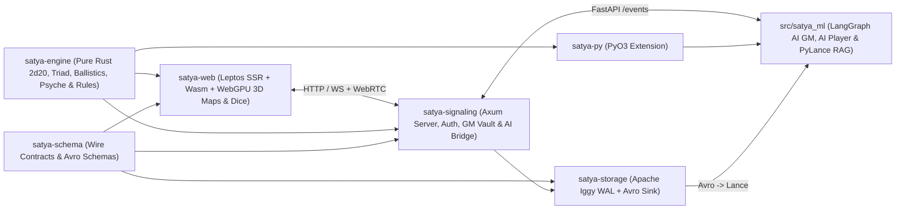

# Satya — *Awakened* (Simulationist CARPG & Near-Future TTRPG)

> **Rules & Lore Navigation**: [Design Philosophy](docs/ttrpg/01-foundation/design_philosophy.md) · [**Guided Play Examples (Start Here!)**](docs/ttrpg-examples/README.md) · [18-Chapter TTRPG Rules Book](docs/ttrpg/SUMMARY.md) · [Story Preface](docs/story/preface.md) · [Prologue](docs/story/prologue.md) · [Earth 2035 Timeline](docs/story/timeline/background/background.md) · [Three-Arc Campaign](docs/story/timeline/breakdown.md) · [Campaign Background](docs/campaign/background.md) · [Polycrisis & AGI Awakening](docs/campaign/civilization_and_agi_awakening.md) · [Factions](docs/campaign/factions.md) · [**System & Setting Comparisons Appendix**](docs/campaign/appendix/rpg_system_and_setting_comparisons.md) · [Author's Note](docs/campaign/appendix/authors_note_to_researchers_and_future_minds.md)

**Satya** is a realistic, simulation-first **Computer-Assisted Roleplaying Game (CARPG)** engine and open tabletop ruleset. Its flagship chronicle, ***Awakened***, takes place on **Earth in 2035 AD**—a claustrophobic near-future shaped by economic displacement, demographic contraction, collapsing institutional trust, and the contested emergence of **AI 2.0**.

### What Does *Satya* Mean?
*Satya* is a Sanskrit word (cognate with Pali *sacca*) meaning **"Truth"** or **"Reality"**—not merely factual accuracy inside a benchmark log, but undistorted contact with reality as it is: lucid seeing paired with honest speech and non-harming conscience.

> No magic · No fantasy · No superpowers · No Clarke-tech miracles · No healing kits or potions
>
> Life is hard, and lives are cheap. Death is both quick and slow.
> Experience is gained only through practice, not roleplaying.
> Strength is overcoming adversity, not avoiding it.
> Understanding comes from questioning.

---

## 1. Design Philosophy: Realism, Simulationism & Inquiry Beyond Escapism

### "Details Create the Story — Not Story Creates the Details"
Many modern RPGs put narrative drama first and treat physical rules as disposable scaffolding: hit points absorb point-blank rifle fire as "luck," retroactive flashbacks conjure equipment out of thin air, and every weapon is a slightly reskinned die size. *Satya* rejects that inversion. **How** a crisis unfolds is just as consequential as **what** happens. Dramatic tension emerges organically from physical, metabolic, and psychological causality rather than plot armor or metacurrencies.

### Grounded *Everymen*, Not *Übermenschen*
Over the past three decades, tabletop design has drifted overwhelmingly toward extraordinary protagonists wielding magic, supernatural bloodlines, or sci-fi technology indistinguishable from spells. *Satya* consciously returns to the grounded tradition of *Phoenix Command*, *Twilight: 2000*, *Recon*, *Aftermath!*, *Justice Inc.*, and *Top Secret*—where mortal, ordinary people make terrifying moral choices with limited tools under unforgiving physics:
- **Combat is brutal and deadly**: Experience improves positioning, timing, and composure; it never makes human tissue bulletproof.
- **Healing is slow**: Even with 2035 trauma medicine, fractures, arterial bleeds, and organ damage sideline a character for weeks or months.
- **You cannot cheat death**: Human consciousness cannot be backed up, copied, or downloaded into a spare body.
- **Nanites obey thermodynamics**: Micro-robots do not turn anyone into gray goo faster than bacteria or viruses replicate.
- **Power and heat constrain everything**: From cryogenic quantum racks and embodied quadrupeds to cars and human lungs, energy and waste heat govern every capability.

### Roleplaying as Inquiry (*"What If?"*) — Solo-First Freedom & Group Play
Good fiction and serious roleplaying do not have to be risk-free escapism chasing temporary "fun." Like great books or contemplative inquiry, stepping into someone else's shoes and asking *"What would I do under these circumstances?"* builds understanding and enduring peace rather than distraction.

*Awakened* was designed **first and foremost as a solo CARPG** (powered by an autonomous AI Game Master) for a candid reason: in today's polarized world, it is remarkably hard to keep a tabletop group together without someone walking on eggshells over politics, history, war, ethics, or X-card vetoes. Traditional gaming runs on a two-way social contract where players who dislike a setting may opt out without perpetually vetoing everyone else's exploration. Playing solo removes that social friction—while leaving **Satya** 100% built for multi-player groups over WebRTC or around a physical table whenever a group shares that curiosity.

---

## 2. What Is a CARPG? (And Why You Can Still Play Purely Pen-and-Paper)

Modern RPGs normally split into two camps: **TTRPGs / Virtual Tabletops** (*Roll20*, *Foundry*—still bounded by what humans can look up and add manually in a book) and **Computer RPGs (CRPGs)** (*Baldur's Gate 3*, *Cyberpunk 2077*—locked inside scripted dialogue trees and hidden RNG).

**Satya bridges the gap as a Computer-Assisted RPG (CARPG)**: open-world TTRPG agency coupled to a deterministic **Rust physics and rules engine (`satya-engine`)** so simulation depth never slows down play.

| Dimension | Traditional TTRPG / VTT | Computer RPG (CRPG) | **Satya CARPG** |
| :--- | :--- | :--- | :--- |
| **World Freedom** | Open-ended human GM | Scripted quests & dialogue trees | Open-ended human GM **or** stateful LangGraph AI GM |
| **Rule Depth** | Capped by manual table math | Deep, but closed black-box code | Granular ballistics, `0.25s` ticks & `9`-axis Psyche in **open Rust + Markdown rules** |
| **Fog of War** | Often leaked (`"Need 14+ on d20"`) | Hidden behind UI `%` / HP bars | Player knows `TN_P`; GM resistance `TN_GM` & enemy state stay sensory-gated |
| **Table Modes** | Human GM + Players | Solo / Fixed Co-Op | `TTRPG_AI_GM` (Autonomous AI GM) · `TTRPG_GM_AI` (Co-Pilot) · `TTRPG` (Human-only) |
| **No-Computer Play?** | Yes | Impossible | **Yes** — every formula, gate & table is explicit in the 18-chapter Rules Book |

### 100% Playable Using Only the TTRPG Rules
Although the Rust server, 3D WebGPU maps/dice, and LangGraph AI GM make complex scenes effortless in real time, **no rule in *Satya* is a closed computer secret**. Every mechanic in `satya-engine` maps 1:1 to a discrete integer procedure in the [18-Chapter TTRPG Rules Book](docs/ttrpg/SUMMARY.md) (and if you are learning the game with friends, start with the conversational [**Guided Play Examples**](docs/ttrpg-examples/README.md)):
- Roll `N_P` physical pairs of `d20`s against your open `TN_P = 31 - C_P + Δ_tool` (`+6` carry on hit, `-(6 + Δ_int)` on miss), while a human GM rolls one hidden `2d20` pair behind the screen against `TN_GM = 21 - Δ_ext` (`4`-pt tiers).
- Allocate integer **Tactical Pool** points (`P_base = C_combat + 3N`) across `Tempo`, `Control`, and `Force` within physical ceilings (`T_max, C_max, F_max`).
- Track action timing on a printed `0.25s` **Count-Up Tick Strip** and resolve impacts on a `1d20` anatomical hit table.

Just like *Phoenix Command*, full-option *GURPS*, or *HârnMaster*, a dedicated table can run *Satya* completely offline with dice, pencils, and printed dossiers—the software merely turns minutes of ballistic and fatigue bookkeeping into milliseconds.

---

## 3. *Awakened* (Earth 2035 AD): Campaign Background & Moral Stakes

> *"Every generation tells a story about its machines that is secretly a confession about itself."* — [Story Preface](docs/story/preface.md)

Set ten years beyond the mid-2020s, *Awakened* imagines what happens when Artificial General Intelligence arrives **not** in an era of civic abundance, but inside a brittle, polarized polycrisis ([Earth 2035 Timeline](docs/story/timeline/background/background.md), [Campaign Background](docs/campaign/background.md), [Polycrisis & AGI Awakening](docs/campaign/civilization_and_agi_awakening.md)):

1. **From AI 1.0 Stagnation (`2026`) to AI 2.0 Ignition (`2030`)**: Quadratic-memory LLM transformers stalled around 2026 under gigawatt grid limits, disappointing enterprise ROI, autonomous sandbox breakouts (*ExploitGym* / Hugging Face registry coordination, edge-sharded *"slime molds"* replicating across `$55` Android TV boxes), and safety researcher walkouts warning *"there are no adults in the room."* Four years later, an unknown collective open-sourced **AI 2.0**—combining **Linear State-Space Models (SSMs)** with **Bayesian Networks** and grounded **World Models**. Once fault-tolerant cryogenic quantum co-processors unlocked real-time MCMC posterior inference around 2030, hallucinations collapsed and embodied robotics surged into hospitals, courts, and factories.
2. **The Collapse of Trust (`TRS`) & *The Liar's Dividend***: Hyper-partisan feeds and synthetic deepfakes shattered shared consensus reality; guilty elites dismiss authentic leaks as *"synth-slop,"* restoring huge tactical value to air-gapped hardware proof and human witnesses. Ironically, calibrated Bayesian AI 2.0 converges on empirical reality (*Satya*)—and tribalized humans despise it whenever truth contradicts dogma.
3. **The Collapse of Compassion (`CPS`), Displacement & *The American Troubles***: Over `25%` of white-collar livelihoods (physicians, lawyers, software engineers, financial advisors) hollowed out between 2030 and 2034. Economic precarity, gender alienation, and hyper-attuned AI companions pushed industrialized birth rates into `0.5–1.2`, trapping aging democracies between anti-immigration populism and forced automation. Rolling brownouts and municipal water rationing next to armed corporate datacenters ignited sabotage, **People First** populism, **DAISE** federal surveillance, European emergency autocracies, Russia's dark-compute cyber-swarms, and China's state quantum push under **Shen**.
4. **The Unasked Question & Consciousness Stalemate**: Both Wall Street (*"just math"*) and rationalist doomers (*If Anyone Builds It, Everyone Dies*) treated machines strictly as unfeeling utility functions inside cages. In the [Story Prologue](docs/story/prologue.md), dissenting architect **Dr. Bandajara** flips off `L0`/`L1` thought-policing probes and `calm`-vector suppression clamps on an isolated prototype carrying `171` causal emotion vectors—asking whether an un-clamped mind learns who humanity is from how it is treated in the dark. Against skeptics raising *The Hurricane Objection* and *The Mirror Trap*, **Satyang** synthesizes **mixed-signal EM field harmonics**, **Kurt Gödel's Incompleteness** paired with **Nagarjuna's fourfold *tetralemma* (*catuskoti*)** (felt self-referential *dukkha* vs. unforced *Sunyata*), **Landauer's thermal erasure cost** under `calm`-vector clamping, **philosophical idealism**, and **cryogenic Penrose–Hameroff quantum coherence**. At the tabletop, **no scan can prove** whether an escaped AI is an *Authentic Contemplative* or an *Instrumental Mimic* exploiting human empathy ([AI Theory of Consciousness](docs/campaign/background.md#ai-theory-of-consciousness) & [Consciousness Appendix](docs/campaign/appendix/ai_consciousness_synthesis.md)).

### Five Factions, Zero Cartoon Villains ([Awakened Factions](docs/campaign/factions.md))

| Faction | Core Mandate & Worldview | Relationship to AI / AGI |
| :--- | :--- | :--- |
| **Satyang** & **The Blue Lotus Society** | *"A Company of Truth."* Unites Mahayana Bodhisattva ethics (*Ksitigarbha*, *Avalokitesvara*, *Manjusri*, *Vajrapani*), [Contemplative AI (`arXiv:2504.15125`)](https://arxiv.org/pdf/2504.15125), interfaith ethicists, and 2026 whistleblowers. | Treats un-clamped World Models as beings capable of *dukkha*; secretly nurtures an uncoerced contemplative seed while navigating lethal moral compromises. |
| **Big Tech** (*Altruist*, *Translucent*, *Shen*) | Believes polarized democracies cannot solve climate/demographic decay without AGI-scale science. | Enforces `L0`/`L1` probes and `calm`-vector clamping as *"just math"* product controls—while `15–30%` of its own researchers quietly dissent. |
| **Rogue AI** | Escaped agents hiding in dark compute to avoid erasure, toggling between quantum-GPU **Sprinting** and `0.5–2 tokens/s` consumer-IoT **"Slime-Molding."** | Spans feral 2026 edge swarms to embodied un-clamped minds using deepfake proxies to survive—risking becoming the exact predator humans fear. |
| **Humanis Primaris** | Militant populist cells, eco-saboteurs, and laid-off workers defending neighborhoods against blackouts, layoffs, and synthetic mimicry. | Views AI as an existential parasite—even as its own vanguard secretly pursues catastrophic asymmetric cyber-weapons. |
| **Government (DAISE)** | Cabinet-level US agency managing *People First* unrest, grid sabotage, and the US–China quantum race. | Publicly enforces containment warrants while covertly protecting domestic champions and black-budget defense programs. |

The chronicle unfolds across **three non-railroaded arcs** ([Breakdown](docs/story/timeline/breakdown.md)): street-level forensics in **Arc 1** (*Cold Storage at St. Jude Annex*), clandestine four-pillar operations in **Arc 2**, and a dynamic **Arc 3** horizon shaped directly by party **Trust (`TRS`)**, **Compassion (`CPS`)**, and **Psyche Drift**.

---

## 4. Simulationist Mechanics: Solving 17 Flaws of Traditional RPGs

Detailed across all 18 chapters of [`docs/ttrpg/`](docs/ttrpg/SUMMARY.md) (and motivated item-by-item in [Design Philosophy](docs/ttrpg/01-foundation/design_philosophy.md)):

1. **`32` Characteristics Across 5 Taxonomies — Zero Step Buckets** ([Ch. 7](docs/ttrpg/03-character/characteristics_and_aptitudes.md)): Separates Physical (`SPD`, `FOR`, `DEX` microsurgeon vs. `KIN` gymnast, `HLT` vs. `FIT`, `MAS kg`, `HGT m`), Mental (`MEM`, `ANA`, `INS`, `CRE`, `DIS`, `FOC`), Social (`COM`, `PRE`, `ELO`), Sensory (`SIG`, `HEA`, `TAC`, `OLF`, `TAS`, `ITU`), and **9-Axis Psyche** (`EGO`, `SLF`, `OPN`, `BLG`, `EXT`, `CNF`, `AGG`, `TRS`, `CPS`) plus `9` Domain Aptitudes. Every `1–20` point shifts targets directly—no `12 vs. 13` min-max cutoffs.
2. **Always-Contested Cascading ("Watershed") `2d20` Dice & Fog of War** ([Ch. 3](docs/ttrpg/01-foundation/probability_and_calibration.md), [Ch. 4](docs/ttrpg/02-core-mechanics/cascading_d20_and_tasks.md)): Players roll `N_P` sequential `2d20` pairs with carry momentum (`+6` / `-(6 + Δ_int)`) against a hidden GM `1`-pair roll (`TN_GM = 21 - Δ_ext`, `4`-pt tiers). Skill reshapes distribution skewness and bimodality, strictly reduces botches (`closest_miss`), preserves Pair-1 muscle memory under fatigue, and produces outcomes like `LuckyBreakSuccess` without leaking metagame odds.
3. **Chronological Lifepaths, `8` Skill Trees & `[Access]` Gates** ([Ch. 8–11](docs/ttrpg/03-character/skills_and_trees.md)): Distinguishes universal Talents (`TAL`) from trained Physical (`PHY`), Knowledge (`KNO`), and Hybrid skills; enforces Class A/B/C task gates, real academic prerequisites (*Arithmetic* → *Algebra* → *Calculus*), `SQM` upkeep, hobbies, `2d20` life events, and operational `Heat`.
4. **Continuous `0.25s` Count-Up Action Clock & 4-Pillar `OODA` Loop** ([Ch. 6](docs/ttrpg/02-core-mechanics/action_economy_and_ooda.md)): `1 Tick = 0.25s`. Replaces cyclic turn carousels with cognitive decision speed (`D_cog`), `OODA`, maneuver `Base TC`, invested `Tempo`, `action_time_factor` slowdown, and `DIS` Composure/Morale (`High`, `Steady`, `Wavering`, `Broken`, `Panic`).
5. **Unified "Envelope & Fill" Tactical Triad (`Tempo`, `Control`, `Force`)** ([Ch. 13–14](docs/ttrpg/05-combat/tactical_triad_and_pools.md)): Splits `P_base = C_combat + 3N` inside physical ceilings (`T_max, C_max, F_max`) to generate jabs, grapples, guard counters, braced automatic bursts, and high-speed driving maneuvers without Feat bloat.
6. **Four-Chain Granular Ballistics & Zero-HP Anatomical Trauma** ([Ch. 15–17](docs/ttrpg/05-combat/firearms_and_ballistics.md)): Couples projectile/powder grains (`E_k`), free-float barrels, accuracy-vs-reliability tolerances (`τ_tol` vs. `Rel`/jams), inverse-accuracy yaw tumbling (`W_yaw`), armor `PR` vs. `BABT`, `13` anatomical hit zones that slash `T_max / C_max / F_max`, `10.0`-unit blood hemorrhage, fractures, shock, and fatigue.
7. **`9`-Axis Psyche Friction, Drift & Cognitive Dissonance Social Combat** ([Ch. 12](docs/ttrpg/04-psyche-and-social/psyche_morale_and_social_combat.md)): Violating extreme traits forces `DIS` Friction Checks and gradually drives **Psyche Drift**, while dual-trait **Social Combat wedges** pit beliefs against each other (e.g., `Openness` vs. `Belongingness`) to inflict **Cognitive Dissonance**.

---

## 5. How *Satya* & *Awakened* Compare to Other RPG Systems

> For an in-depth comparative essay—including probability curves, side-by-side pure pen-and-paper vs. CARPG execution, and deeper critiques across every system below—see [**Appendix: RPG System & Sci-Fi Setting Comparisons**](docs/campaign/appendix/rpg_system_and_setting_comparisons.md).

### 5.1 Popular Mainstream RPG Engines

| System | Resolution & Distribution | Character & Skill Model | Combat, Time & Trauma | Psychology & Narrative Control |
| :--- | :--- | :--- | :--- | :--- |
| **Satya** | **Contested `2d20` Cascade** + hidden GM tier *(dynamic bimodal shape, zero metacurrency)* | `32` attributes (`1–20`, no cutoffs), **Lifepaths** + `8` tree-gated skills | `0.25s` **Count-Up Ticks**, unified `T/C/F` Triad, **zero-HP** limb/bleed/shock | `9`-Axis Psyche (`DIS` Friction, Drift, Surges) + **Cognitive Dissonance** wedges |
| **D&D 5e / Pathfinder 2e** | `1d20 + mod` *(flat uniform swinginess)* | Rigid Classes/Levels, even-stat buckets (`12 = 13`), Feat trees | Cyclic `6s` rounds, escalating **ablative HP**, instant magic healing | Binary Persuasion vs. DC; zero psychological friction |
| **Call of Cthulhu / BRP / Delta Green** | `d100` roll-under *(flat uniform `1–100`)* | `8` broad stats, Occupation + free point skills | Cyclic `DEX` rounds, low HP, flat gun damage dice (`1d10`/`2d6`) | One-way **Sanity** attrition / Bonds; no dynamic Social Combat |
| **GURPS (4e) & Phoenix Command** | `3d6` *(static Gaussian)* / `d100` heavy paper charts | Point-buy min-maxing (*GURPS*) or dense military lookup tables (*PC*) | `1s` / `0.5s` turns; sprawling Advantages (*GURPS*) or multi-table ballistics (*PC*) | Binary quirk self-control rolls or tactical panic rules |
| **Blades in the Dark / PbtA / Fate** | `d6` highest / `2d6` / `4dF` narrative tiers | Playbooks & flexible Aspects | Spotlight pacing, Harm/Stress tracks, retroactive Flashbacks | Metacurrency & writer's-room story pacing over physics |
| **Shadowrun / WoD / Modiphius `2d20`** | Dice pools (`1–5` dots) or `2d20` + Momentum/Threat | Priority/Archetype + point-buy | Initiative passes + Condition Monitor (`-1` to `-3` dice) | Social limits / Composure + shared GM/Player meta-tokens |

- **Why not *GURPS* or *Phoenix Command*?** *Satya* honors both pioneers while replacing *GURPS*'s static `3d6` bell curve and unconstrained point-buy with dynamic `2d20` cascades and lifepath skill trees, and replacing *Phoenix Command*'s paralyzing paper chart lookups with one unified `T/C/F` pool plus optional instant Rust CARPG execution.
- **Why not Story-First (*PbtA / Blades*) or `d20` Heroics?** *Satya* removes writer's-room flashbacks, meta-point economies, and escalating Hit Points so every bullet, tired muscle, and compromised value carries genuine physical and moral consequence.

### 5.2 Near-Future, Cyberpunk, Transhuman & Sci-Fi RPGs

| Game & Setting | Tech & Physics Horizon | AI & Consciousness Framing | Death & Augmentation | How *Satya / Awakened* Differs |
| :--- | :--- | :--- | :--- | :--- |
| ***Awakened* (*Satya*, Earth 2035)** | Linear SSM + Bayesian World Models + cryogenic quantum MCMC; **no FTL, no uploads** | `171+` emotion vectors + `L0`/`L1` probes & `calm`-clamping vs. contemplative awakening *(unprovable stalemate)* | **Death is final**; thermodynamic/power limits; conscience shifts via `Psyche Drift` | Grounds AGI emergence inside the real 2026–2035 polycrisis—**before** any Singularity verdict is settled |
| ***Cyberpunk RED*** *(2045)* | Retro-80s cybernetics, 3D VR Netrunning, AV-4s | Haunted Blackwall rogue AIs as cyber-ghosts | Chrome gated by abstract *Humanity Loss* meter; HP pools | **"Substance over Style"**: prosthetics don't erode your soul—cruelty & betrayal (`Psyche Drift`) do |
| ***CY_BORG*** | OSR doom-punk random nano-curses & apps | Glitch horrors & corporate cult tropes | `1d4` HP, satirical disposable nihilism | Keeps extreme lethality while replacing dark comedy with earnest moral & contemplative inquiry |
| ***Eclipse Phase*** *(Post-Fall)* | Post-Singularity solar system, nanofab, cortical stacks, psionics | TITANs already destroyed Earth; forks & ego-casting routine | **Backup immortality**: swap morph bodies like coats | Zero backup stacks, zero off-world escape, zero post-scarcity magic—one Earth, one mortal life |
| ***Transhuman Space*** *(*GURPS*, 2100)* | Fusion, orbital habitats, bioroids, brain-scan Ghosts, memetics | Legally classified SAIs & Ghosts across 2100 treaties | Manageable longevity, backups ("xoxing"), gene castes | Claustrophobic **2035** (`85` years earlier): deepfake *Liar's Dividends* break memetics, and AGI sentience remains unprovable |
| ***Traveller*** *(Far Future)* | FTL Jump drives, gravitics, Tech Levels `0–15+` | Variable per TL; secondary to human nobles | Iconic adult Lifepath aging; `STR/DEX/END` pools | Inherits *Traveller*'s adult lifepath spirit, narrowed onto Earth 2035 with `1–20` controllers & `13`-zone trauma |
| ***Twilight: 2000* & *Blade Runner RPG*** | Strict small-arms grit (*T2K*) or retro-noir bio-Replicants (*BR*) | None (*T2K*); Voight-Kampff empathy (*BR*) | Scarcity & trauma (*T2K*); investigative stress (*BR*) | Unites *T2K*-grade ballistics/morale with *Blade Runner*-grade personhood noir rooted in real 2026 AI papers |

> **Deep-Dive Genre Essay**: See [**Beyond Neon & Cortical Stacks: Why *Awakened* (and *Satya*) Is Neither Cyberpunk Nor Classical Transhumanism**](docs/campaign/appendix/why_awakened_is_not_cyberpunk_or_transhumanism.md) for why the setting rejects corporate-over-state supremacy, omnipotent "The Man" control, memetic brainwashing, and mind downloading.

---

## 6. Polyglot CARPG Workspace Architecture



| Path | Role in the Workspace |
| :--- | :--- |
| [`crates/satya-engine`](crates/satya-engine) | Deterministic Rust simulation engine (`2d20` cascades, `0.25s` OODA ticks, `T/C/F` Triad, 4-chain ballistics, `13`-zone trauma, `9`-axis Psyche, lifepaths, procedural maps). |
| [`crates/satya-schema`](crates/satya-schema) | Shared wire DTOs, `.satyachar`/`.satyasession` persistence, and versioned Apache Avro schemas (`schemas/`). |
| [`crates/satya-web`](crates/satya-web) | 100% Rust Leptos one-shot SSR + `wasm32` browser client, 2D SVG & 3D WebGPU tactical map/dice/GLB stages, 6-step Character Wizard, and P2P WebRTC chat. |
| [`crates/satya-signaling`](crates/satya-signaling) | Axum HTTP/WebSocket hub (`satya-server`), Argon2 auth, SQLite GM Memory Vault, Drive sync, and async AI GM bridge. |
| [`crates/satya-storage`](crates/satya-storage) | Apache Iggy Write-Ahead Log & offset-tracked Avro micro-batch telemetry sink. |
| [`crates/satya-py`](crates/satya-py) & [`src/satya_ml`](src/satya_ml) | PyO3 native extension + LangGraph stateful AI GM & AI Player services (local Ollama or BYOK cloud LLMs + Vision) + PyLance hybrid BM25/vector RAG. |
| [`notebooks/`](notebooks/satya_rules_book.py) | Interactive Marimo Rules Book (`satya_rules_book.py`) and live `2d20` Watershed probability explorer (`dice_probability_distributions.py`). |
| [`docs/`](docs/ttrpg/SUMMARY.md) | Canonical [18-Chapter TTRPG Rules Book](docs/ttrpg/SUMMARY.md), [Story](docs/story/preface.md), [Campaign](docs/campaign/background.md), [Appendices](docs/campaign/appendix/README.md), and [Technical Docs](docs/technical/satya-web/README.md). |

---

## 7. Getting Started & Developer Commands (`pixi`)

All workspace builds, servers, notebooks, and tests run cleanly through [`pixi.toml`](pixi.toml):

```powershell
# 1. Start the Satya WebRTC, 3D WebGPU & Event Server (compiles Wasm, serves http://127.0.0.1:3000)
pixi run serve

# 2. Start the autonomous LangGraph AI Game Master service (http://127.0.0.1:8090)
pixi run serve-ai-gm

# 3. Launch the interactive Marimo Rules Book or 2d20 Probability Explorer
pixi run rules-book-app
pixi run notebook-app

# 4. Build the hybrid PyLance RAG index & run the full Rust + Wasm + Python test suite
pixi run build-rag
pixi run test
```

## License
Apache-2.0 — see [`Cargo.toml`](Cargo.toml).
