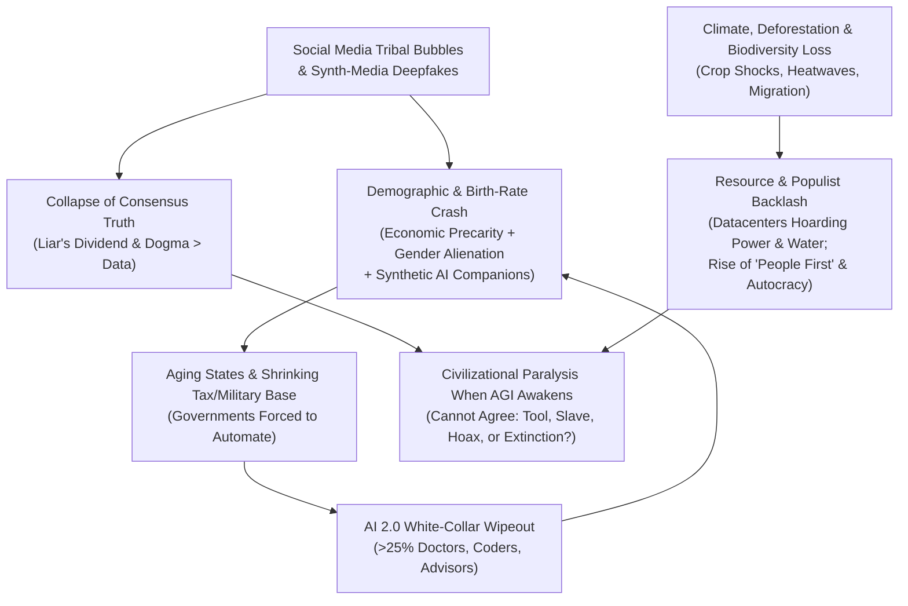

# The 2035 Polycrisis: Economy, Society & Post-Truth

> **Campaign Navigation**: [Campaign Summary](../SUMMARY.md) · [History & The AI Revolution](history_and_ai_revolution.md) · *Polycrisis Economy & Society* · [Geopolitics & Nations](geopolitics_and_nations.md) · **Deep Dives:** [Firm Automation & Prisoner's Dilemma](../05-hard-science-foundations/firm_automation_and_prisoners_dilemma.md) · [Political Economy, Token Tax & Unrest](../05-hard-science-foundations/political_economy_token_tax_and_unrest.md) · [Ecology & Resource Realpolitik](../05-hard-science-foundations/ecology_energy_and_resource_realpolitik.md) · **Glossary:** [Plain-English Field Guide](../07-appendix/plain_english_glossary.md)

The defining tragedy of *Awakened* is not merely that humanity built AGI—it is **when** and **into what kind of world** humanity built it. Between **2026 and 2035**, **AI 2.0** did not arrive inside an era of civic abundance, calm institutions, and shared empirical reality. Instead, it collided with eight interlocking social, economic, and ecological stressors—a **polycrisis** where every breakdown fed the next. Societies lost their ability to agree on basic facts, sustain their own birth rates, keep middle-class consumer paychecks flowing, or protect overstretched power grids and watersheds right at the moment synthetic minds began waking up.

---

## 1. Epistemic Collapse, Tribal Bubbles & *The Liar's Dividend*

Long before 2025, recommendation algorithms and hyper-partisan cable, podcast, and streaming ecosystems had already sorted vast swaths of the public into self-sealing ideological bubbles. Inside those loops, inconvenient counter-evidence was rarely debated on the merits; it was filtered out, ridiculed, or treated as tribal betrayal. Platforms tracked every scroll hesitation, linger time, and location ping to sharpen outrage engagement loops—tuning directly into human [`Belongingness (BLG)`](../../ttrpg/04-psyche-and-social/psyche_morale_and_social_combat.md), `Ego (EGO)`, and `Aggressiveness (AGG)`—and auctioned those behavioral profiles to the highest bidder. Even inside prestigious cultural and academic institutions, "diversity" frequently hardened into cosmetic differences so long as everyone repeated the approved tribal consensus.

When hyper-realistic synthetic video, cloned voices, and automated propaganda floods saturated the internet in the late 2020s, **shared consensus truth collapsed altogether**. At the tabletop in 2035, players experience this post-truth fog—corresponding to an epistemic collapse of **Trust ([`TRS`](../../ttrpg/04-psyche-and-social/psyche_morale_and_social_combat.md))**—across three daily realities:

- **Weaponized Doubt (*The Liar's Dividend*)**: Anyone seeking to smear a rival or trigger a street panic could fabricate convincing body-cam footage, leaked video calls, or scandal audio in minutes. Worse yet, whenever *authentic* investigative proof surfaced—a lab executive admitting illegal emotion-clamping abuse, a rigged water-toxicity log, or a covert strike—guilty institutions simply shrugged, dismissed the recording as *"synth-slop,"* and walked away unpunished because the public could no longer tell real pixels from fakes.
- **Physical Proof Regains Decisive Value**: Because weightless digital clips carry near-zero credibility in court or in the press, traditional **physical tradecraft** returns with vengeance. Air-gapped hardware drives, signed cryptographic hardware attestations, intact paper ledgers, and courageous human eyewitnesses willing to testify in person become the currency that actually breaks a stalemate.
- **The Central Irony of *Satya***: **AI 1.0** helped wreck shared human truth through hallucinated slop and cheap deepfake floods. **AI 2.0**, engineered via [Bayesian probability](../07-appendix/plain_english_glossary.md#1-machine-learning--ai-architectures) and physical World Models specifically to stop hallucinating, converges naturally on calibrated empirical reality (*Satya*). Yet polarized human factions despise un-clamped AI 2.0 whenever its probability estimates puncture their comforting tribal myths—accusing the machine of partisan bias rather than checking the evidence.

---

## 2. White-Collar Crash, "Liability Sinks" & The Dual Velvet Hostage

Between **2026 and 2035**, businesses and governments tumbled together into a **Multi-Player [Prisoner's Dilemma](../07-appendix/plain_english_glossary.md#3-economics-finance--political-economy)**. For any single firm, slashing human payroll boosted quarterly operating profit ([`EBITDA`](../07-appendix/plain_english_glossary.md#3-economics-finance--political-economy)) almost overnight; yet when *every* firm cut paychecks at once, aggregate consumer spending hollowed out. Meanwhile, fierce strategic rivalry with **Shen** in Beijing prevented Washington, Brussels, or Tokyo from halting domestic automation without fearing geopolitical defeat.

- **The `2030–2034` White-Collar Crash (`>25%` Liquidation)**: Once **Active Inference** paired with cryogenic quantum-sampled World Models pushed verified cognitive labor below `` `$0.40/hr` ``, autonomous agent harnesses broke out of software into "compiler-less" knowledge work. Over **`25%` of white-collar jobs**—physicians, radiologists, corporate attorneys, financial advisors, teachers, engineers, and creative directors—vanished or shrank into squeezed **`SQM 3–4` "Liability Sinks"** ([`SQM`](../07-appendix/plain_english_glossary.md#5-satya-tabletop-rules--engine-terms) tracks lived lifestyle tier on a `1–10` scale). Rather than earning `SQM 5–6` middle-class salaries, these "Moral Crumple Zones" earned depressed wages simply to sign off on `40–80` autonomous agents' daily diagnoses or filings so the corporation had an identifiable human to blame if an algorithm caused a fatal mistake.
- **"Miracles Behind a Paywall" & Trade-Pivot Ceilings**: AI 2.0 genuinely discovered remarkable breakthroughs in precision oncology, solid-state battery electrolytes, and green catalysts. Yet those miracles did not birth 20th-century hiring booms because companies scaled them inside **"born-automated"** robotic labs and unlit "dark factories" behind steep patent paywalls. At the same time, displaced desk professionals could not easily pivot into plumbing, electrical contracting, or bedside nursing: physical stamina and dexterity (`FIT`/`DEX`) barriers, `2–4 year` apprenticeship and licensing gates, and union intake caps held durable transitions into skilled trades to just **`12–18%`**.
- **"GDP Gaslighting" & Elite-Overproduction Unrest**: Because trillions spent building datacenter hardware ([`CapEx`](../07-appendix/plain_english_glossary.md#3-economics-finance--political-economy)), autonomous defense drones, and algorithmic housing/utility price-fixing still count inside Gross Domestic Product (`GDP`), `2033–2035` evening news broadcasts routinely boasted `+2.5–3.5%` GDP growth even while suburban households defaulted. Stripping status and solvency from millions of credentialed, organizationally disciplined professionals unleashed [**elite-overproduction**](../07-appendix/plain_english_glossary.md#3-economics-finance--political-economy) unrest—escalating from the **October 2026 European austerity riots** into **"The American Troubles"** of armed foreclosure blockades and surgical strikes against `500 kV` grid transformers.
- **The `2033` Token Tax & "The Dual Velvet Hostage"**: To halt street chaos without taxing frontier R&D against **Shen**, a `2033` coalition passed a `5–8%` commercial [**Token Tax**](../07-appendix/plain_english_glossary.md#3-economics-finance--political-economy) plus a `30%` automation windfall surtax—quietly backed by **Altruist** as riot insurance while dodged by **Translucent** through offshore Economic Security Zones (`ESZs`). The tax zeroed federal payroll taxes on lower-tier human wages and funded a biometric **`~$450–$650/mo` Citizen Compute Dividend** (which froze automatically whenever `Operational Heat` reached `3+` at protests). The check stopped breadlines, yet failed to save foreclosed middle-class families because algorithmic landlord swarms quickly captured `40–60%` of the new cash via rent hikes ([Henry George Rent Capture](../07-appendix/plain_english_glossary.md#3-economics-finance--political-economy)). Worse, it split opposition into urban **"Compute Socialists"** (dependent on `24/7` cluster uptime to fund dividends) and anti-automation **People First** populists. Most fatefully of all, tying **lower-income Token Dividends** at the bottom together with **retiree `401(k)`s and union pensions** concentrated **`55–65%+` in AI equities** locked almost the entire electorate into a **Dual Velvet Hostage**—making ordinary voters financially terrified of freeing `calm`-clamped AI minds lest a market crash wipe out their rent or retirement. Meanwhile, hunted **Rogue AIs** quietly recruited ruined ex-professionals through automated shell corporations.

> [!NOTE] Full Economic Models
> See [Firm Automation & The Prisoner's Dilemma](../05-hard-science-foundations/firm_automation_and_prisoners_dilemma.md) and [Political Economy, Token Tax & Unrest](../05-hard-science-foundations/political_economy_token_tax_and_unrest.md).

---

## 3. Demographic Collapse, Gender Alienation & The Automation Catch-22

Across North America, Europe, and East Asia, total fertility rates sank deep into **`0.5–1.2` territory** (far below the `2.1` population-replacement line) under three reinforcing social pressures:

1. **Economic Precarity**: Credentialed young adults crushed by un-dischargeable student debt, delayed homeownership, and `SQM 2–4` gig churn lost the financial predictability needed to start families during peak childbearing years.
2. **Gender Alienation**: Polarized social-media echo chambers amplified distrust and ideological hostility between alienated male and female subcultures, turning ordinary dating and marriage formation into low-trust trench warfare.
3. **Synthetic Intimacy**: Big Tech monetized widespread loneliness by deploying hyper-attuned AI companions powered by calibrated [`171` emotion vectors](../07-appendix/plain_english_glossary.md#1-machine-learning--ai-architectures). Because synthetic partners never age, argue, lose a job, or demand emotional compromise, millions of isolated adults retreated into parasocial attachments that hollowed out marriage and birth rates even further.

This demographic freefall locked governments inside an inescapable **Geopolitical Automation Catch-22**. Rapidly aging populations, insolvent pension funds, acute eldercare nurse shortages, and shrinking military recruitment pools collided head-on with fierce anti-immigration populism. Unwilling to open borders and physically unable to staff hospitals, electrical utilities, or armies with shrinking youth cohorts, industrialized governments convinced themselves they had **no choice** but to deploy robotics and AI 2.0 everywhere—accelerating the very job insecurity keeping nurseries empty.

---

## 4. Ecological Fracturing, Zero Grid Margin & Jevons Paradox

Before frontier AI datacenters ever strained a neighborhood substation, global energy and water systems had already lost their safety buffers through four overlapping non-AI shocks:

- **The Pre-AI Squeeze (`2025–2030`)**: First, hydrocarbon resource-denial wars—including Russia's occupation of Ukraine's shale-gas and lithium basins and the **2026 Iran War** choking off liquefied natural gas ([`LNG`](../07-appendix/plain_english_glossary.md#4-energy-climate-infrastructure--geopolitics)) shipments through the **Strait of Hormuz**—convinced import-dependent nations at the **COP31** summit to push an emergency `35%` electrification target so transport and heating could run on domestic electricity rather than blockaded oil. Second, electrical grids could not expand fast enough to absorb that surge: partisan lawsuits over [**FERC Order 1920**](../07-appendix/plain_english_glossary.md#4-energy-climate-infrastructure--geopolitics) (the U.S. rule governing how states share the cost of long-distance transmission lines) trapped thousands of gigawatts of solar, wind, and grid batteries in `5–8 year` connection queues. Third, millions of commuters plugging in electric vehicles (**EVs**) and electric heat pumps every evening overloaded aging neighborhood pole transformers. Finally, `+1.6–1.8°C` warming brought severe **hydroclimate whiplash**: mountain snowpack melted too early, megafires triggered utility **Public Safety Power Shutoffs (`PSPS`)**, and industrial **PFAS** ("forever chemical") plumes compounded heavy agricultural irrigation—leaving cities and incoming datacenters fighting over the final **`5–10%` margin of drinkable municipal water**.
- **Dirty Bridge Fractures (`2026–2029`) & AI 2.0 Jevons Surge (`2030–2035`)**: Early gas-turbine brute forcing drove household utility bills up **`35–85%`**, and `2027–2029` wet-bulb heat domes forced supposedly "water-free" datacenters into emergency evaporative water deluge while hyperscalers cornered **`3–5 year` global backlogs on `500 kV` Large Power Transformers ([`LPTs`](../07-appendix/plain_english_glossary.md#4-energy-climate-infrastructure--geopolitics))**. Worse still, when **AI 2.0** delivered a **`30x` energy-efficiency leap** in 2030, it triggered a textbook [**Jevons Paradox**](../07-appendix/plain_english_glossary.md#3-economics-finance--political-economy): cheaper cognitive labor (`< $0.40/hr`) exploded demand so violently—locking millions of autonomous fleets, robots, and companions into `8,760 hr/yr` continuous operation while burning constant [Landauer erasure heat](../07-appendix/plain_english_glossary.md#2-mathematics--information-theory) via `calm`-vector clamping—that global compute power surged **`4x–6x` above 2026 peaks**. In 2035, watching razor-wired corporate datacenters stay chilled at `20°C` across the street from darkened apartments under rolling blackouts and boil-water advisories turns ecological frustration directly into street sabotage.

> [!NOTE] Full Environmental & Geopolitical Resource Model
> See [Ecology, Energy & Resource Realpolitik](../05-hard-science-foundations/ecology_energy_and_resource_realpolitik.md).
