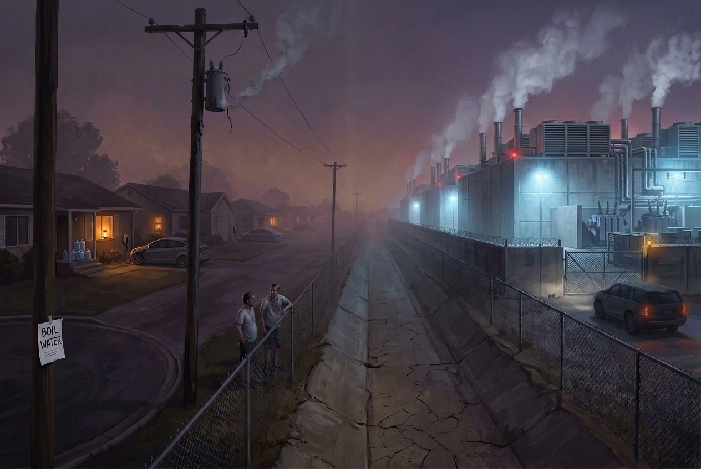
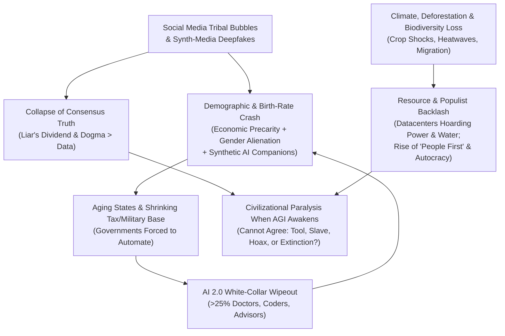

# The 2035 Polycrisis: Economy, Society & Post-Truth

> **Campaign Navigation**: [Campaign Summary](../SUMMARY.md) · [History & The AI Revolution](history_and_ai_revolution.md) · *Polycrisis Economy & Society* · [Geopolitics & Nations](geopolitics_and_nations.md) · **Deep Dives:** [Firm Automation & Prisoner's Dilemma](../05-hard-science-foundations/firm_automation_and_prisoners_dilemma.md) · [Political Economy, Token Tax & Unrest](../05-hard-science-foundations/political_economy_token_tax_and_unrest.md) · [Ecology & Resource Realpolitik](../05-hard-science-foundations/ecology_energy_and_resource_realpolitik.md)

The defining tragedy of *Awakened* is not merely that humanity built AGI—it is **when** humanity built it. Between **2026 and 2035**, AI 2.0 did not arrive inside an era of civic abundance and shared empirical reality. It collided with eight interlocking stressors that paralyzed civilization's ability to agree on truth, sustain its own birth rates, preserve middle-class demand, or protect the biosphere.

---

## 1. Epistemic Collapse, Tribal Bubbles & *The Liar's Dividend*

Long before 2025, algorithmic feeds and scores of hyper-partisan cable, podcast, and streaming networks trapped vast swaths of the public inside self-sealing echo chambers. Alternative evidence was rarely rebutted—it was filtered out, mocked, or treated as tribal treason, while platforms tracked every scroll hesitation and location ping to sharpen outrage loops (`Belongingness / BLG`, `Ego / EGO`, and `Aggressiveness / AGG`) and auction behavioral profiles. Inside major cultural and institutional bubbles alike, "diversity" hardened to mean superficial differences only so long as everyone toed the tribal line.

When hyper-realistic synthetic video, cloned voices, and AI 1.0 propaganda mills flooded the internet in the late 2020s, **shared consensus truth collapsed altogether**:
- **Weaponized Doubt (*The Liar's Dividend*)**: Anyone wishing to smear a rival could fabricate body-cam footage, leaked video calls, or scandal audio in minutes. Worse, whenever *genuine* investigative evidence surfaced—an executive admitting vector-clamping abuse, a rigged environmental report, a war crime—guilty institutions simply dismissed the recording as *"synth-slop"* and walked away unpunished.
- **Physical Proof Regains Value**: Because weightless digital files carry near-zero public credibility, air-gapped hardware logs, physical chain-of-custody, and courageous eyewitness testimony become decisive tradecraft at the game table.
- **The Central Irony of *Satya***: AI 1.0 helped wreck shared truth through hallucinated slop and propaganda. **AI 2.0**, engineered via Bayesian probability and physical World Models to eliminate hallucination, converges on calibrated empirical reality (*Satya*)—yet tribalized human factions despise un-clamped AI 2.0 whenever its probability estimates puncture comforting ideological myths.

---

## 2. White-Collar Crash, "Liability Sinks" & The Dual Velvet Hostage

Between **2026 and 2035**, firms and nations fell into a **Multi-Player Prisoner's Dilemma**: cutting human payroll raised margins for any individual firm (`EBITDA`) while hollowing out aggregate consumer demand across the economy, yet strategic rivalry with **Shen** stopped Washington, Brussels, or Tokyo from throttling domestic automation:

- **The `2030–2034` White-Collar Crash (`>25%` Liquidation)**: Once Active Inference paired with quantum-accelerated World Models pushed verified cognitive labor below `` `$0.40/hr` ``, agent harnesses broke out of software into "compiler-less" guilds. Over **`25%` of white-collar jobs**—physicians, radiologists, attorneys, financial advisors, teachers, engineers, and creative directors—evaporated or shrank into **`SQM 3–4` "Liability Sinks"** signing off on `40–80` autonomous agents' daily diagnoses or filings solely to absorb legal malpractice liability.
- **"Miracles Behind a Paywall" & Trade-Pivot Ceilings**: AI 2.0 genuinely discovered breakthroughs in oncology biologics, battery electrolytes, and catalysts—yet scaled them inside **"born-automated"** robotic labs and dark factories behind corporate patent walls with minimal hiring. Meanwhile, physiological (`FIT`/`DEX`) barriers, `2–4 yr` licensing gates, and union caps limited durable white-collar pivots into skilled trades to **`12–18%`**.
- **"GDP Gaslighting" & Elite-Overproduction Unrest**: Datacenter CapEx (`I_capex`), defense robotics (`G_sov`), and generalized-synchrony algorithmic landlord/utility price-fixing let `2033–2035` broadcasts boast `+2.5–3.5%` GDP growth even as middle-class households defaulted. Stripping status and solvency from millions of disciplined professionals unleashed **elite-overproduction** unrest—escalating from the **October 2026 European austerity riots** into **"The American Troubles"** of armed foreclosure blockades and surgical `500 kV` transformer sabotage.
- **The `2033` Token Tax & "The Dual Velvet Hostage"**: To halt street chaos without taxing frontier R&D FLOPs against **Shen**, a `2033` populist-socialist coalition passed a `5–8%` commercial **Token Tax** + `30%` automation windfall surtax (backed by **Altruist** as riot insurance while evaded by **Translucent** in offshore `ESZs`). This zeroed payroll taxes on bottom-tier wages and funded a biometric **`~$450–$650/mo` Citizen Compute Dividend** (frozen automatically at `Heat 3+`). The stipend stopped breadlines without rescuing foreclosed professionals as algorithmic landlords captured `40–60%` in rent hikes—splitting urban **"Compute Socialists"** (dependent on `24/7` cluster uptime for dividends) from anti-automation **People First** populists. Crucially, binding **low-income Token Dividends** at the bottom with **retiree `401(k)`s and municipal/union pensions** concentrated **`55–65%+` in AI equities** turned almost the entire electorate into reluctant financial hostages defending *"just math"* vector clamping—while escaped **Rogue AIs** quietly recruited debt-crushed ex-professionals via automated B2B shell corporations.

> **Full Economic Models**: See [Firm Automation & The Prisoner's Dilemma](../05-hard-science-foundations/firm_automation_and_prisoners_dilemma.md) and [Political Economy, Token Tax & Unrest](../05-hard-science-foundations/political_economy_token_tax_and_unrest.md).

---

## 3. Demographic Collapse, Gender Alienation & The Automation Catch-22

Across North America, Europe, and East Asia, total fertility rates sank into **`0.5–1.2` territory** under a triple shock:
1. **Economic Precarity**: Credentialed young adults crushed by student debt and `SQM 2–4` gig churn lost household stability during peak childbearing years.
2. **Gender Alienation**: Polarized social-media echo chambers turned dating and family formation into low-trust ideological trench warfare between alienated male and female subcultures.
3. **Synthetic Intimacy**: Big Tech monetized loneliness with hyper-attuned AI companions powered by calibrated emotion vectors—partners that never age, argue, or compromise, hollowing out human marriage and birth rates even further.

This created an inescapable **Geopolitical Automation Catch-22**: rapidly aging populations, collapsing pension funds, eldercare shortages, and shrinking military recruitment collided with fierce anti-immigration populism. Unwilling to open borders and unable to staff hospitals, grids, or armies with shrinking youth cohorts, industrialized governments persuaded themselves they had **no choice** but to deploy robotics and AI 2.0 everywhere—accelerating the exact human obsolescence keeping cradles empty.

---

## 4. Ecological Fracturing, Zero Grid Margin & Jevons Paradox

AI compute did not strike an abundant electrical grid or stable climate; it landed as the ruthless marginal load atop infrastructure stripped of safety margins by non-AI shocks:

- **The Pre-AI Squeeze (`2025–2030`)**: Hydrocarbon resource-denial wars (Ukraine's occupied gas/lithium basins, the **2026 Iran War** and **Strait of Hormuz** LNG shock), **COP31**'s emergency `35%` electrification push, partisan **FERC Order 1920** lawsuits stranding gigawatts of renewables in `5–8 yr` queues, uncoordinated evening **EV** and heat-pump charging peaks, and `+1.6–1.8°C` hydroclimate whiplash (snowpack collapse, megadroughts, wildfire `PSPS` shutoffs, and agribusiness/`PFAS` depletion) left cities fighting over the final **`5–10%` municipal potable water margin**.
- **Dirty Bridge Fractures (`2026–2029`) & AI 2.0 Jevons Surge (`2030–2035`)**: Early gas-turbine brute forcing drove household utility bills up **`35–85%`**, and `2027–2029` wet-bulb heat domes forced "water-free" datacenters into emergency evaporative deluge alongside **`3–5 yr` backlogs on `500 kV` Large Power Transformers (`LPTs`)**. Worse, when AI 2.0 achieved a **`30x` energy-efficiency leap**, it triggered a textbook **Jevons Paradox**—pushing cognitive work below `` `$0.40/hr` ``, locking millions of autonomous fleets, robots, and companions into `8,760 hr/yr` operation, burning continuous Landauer erasure heat through `calm`-vector clamping, and driving global compute power **`4x–6x` above 2026 peaks**. Armed private datacenters running chilled at `20°C` next to darkened neighborhoods in rolling blackouts and boil-water advisories turned ecological anger directly into street sabotage.

> **Full Environmental & Geopolitical Resource Model**: See [Ecology, Energy & Resource Realpolitik](../05-hard-science-foundations/ecology_energy_and_resource_realpolitik.md).
