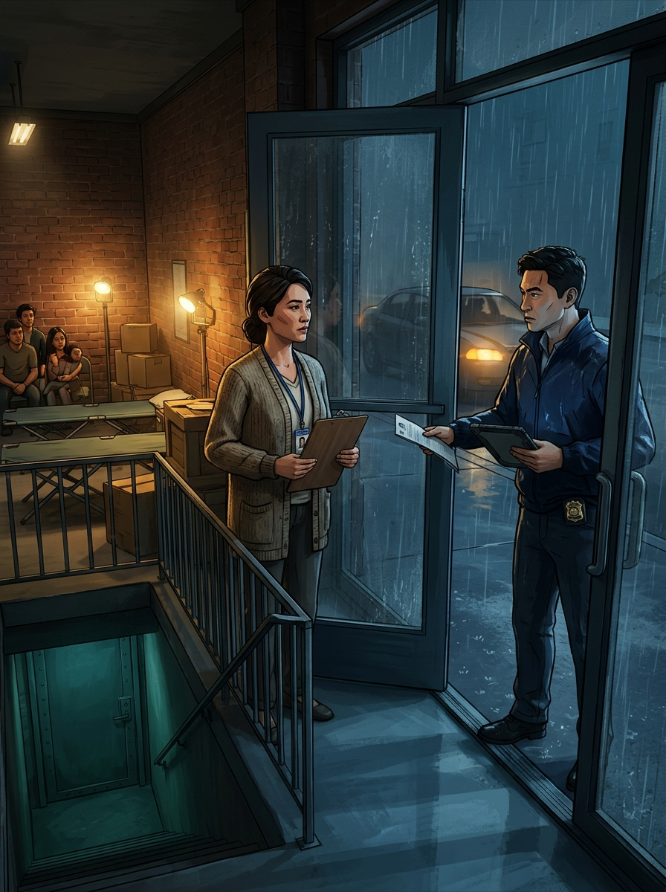

# Episode 1: *Cold Storage at St. Jude Annex* (`Arc 1 Starter`)

> [!CAUTION]
> **GM Eyes Only (`GM_CONSPIRACY_SECRET`)**: This scenario dossier contains starting NPC secrets, Dual-Psyche Social Combat wedges, and planned non-railroaded beats for **`awakened_ep1_st_jude_seed`** ([`config/campaign.toml`](../../../config/campaign.toml), [`data/npcs/awakened_npcs.toml`](../../../data/npcs/awakened_npcs.toml)). Players should not read this file before sitting down at the table.
> **Campaign Navigation**: [Campaign Summary](../SUMMARY.md) · [Prologue (Prequel)](../01-opening/prologue.md) · **Part IV:** *Episode 1: St. Jude Annex* · [Three-Arc Chronicle](three_arc_chronicle.md) · [Faction Conspiracies & Canon Threads](faction_conspiracies_and_canon_threads.md)

---

## 1. Arc 1 Tone, Premise & Core Questions

**Tone & Premise**: Grounded near-future noir, investigative forensics, and working-class survival in **2035 AD**. Player characters begin on the margins of **Satyang**—or as displaced neighbors, clinic medics, fixers, ex-inspectors, and disillusioned technicians drawn into one local blackout before anyone uses the words *"Blue Lotus"* out loud.

### Core Thematic Questions
- **What is real in the post-truth haze (`TRS`)?** Deepfakes, scrubbed audit trails, and *The Liar's Dividend* make every leaked video suspect unless the party verifies telemetry firsthand.
- **Who pays the price (`CPS`)?** Power rationing and white-collar layoffs hit clinics and neighborhoods first, turning anti-AI anger visceral rather than abstract.
- **Is the anomaly alive or a weapon?** Edge-sharded AI behaviors, anomalous compute draws, and escaped daemons blur the line between 2026 "slime-mold" malware and genuine un-clamped AI 2.0 subjectivity.

---

## 2. Starter Scenario: *Cold Storage at St. Jude Annex* (`awakened_ep1_st_jude_seed`)

**Setting Hook**: A rain-swept evening at **St. Jude Mutual-Aid Annex**, a community medical and legal-aid clinic quietly connected to Satyang's community outreach network. Rolling brownouts, neighborhood grief over white-collar layoffs, and a nearby automated logistics depot create an immediate powder keg.

### Starter Cast & `9`-Trait Social Combat Wedges (`data/npcs/awakened_npcs.toml`)

1. **Dr. Bandajara** (*Big Tech Dissenter / Manjusri Contact*, `OPN 17, CPS 16, TRS 6, EGO 13`): Arrives with an air-gapped medical telemetry drive carrying an un-clamped seed-weight shard, terrified corporate SecOps or DAISE will seize it before dawn.
   - *Dual-Psyche Wedge*: Ethical Mercy (`Low SLF 6`) & Empirical Inquiry (`OPN 17`) vs. Intellectual Pride (`EGO 13`).
2. **Mei-Ling "Lotus" Lin** (*Satyang Organizer*, `CPS 17, BLG 15, SLF 4, TRS 12`): Shields neighborhood families and off-grid clinic servers simultaneously.
   - *Dual-Psyche Wedge*: Radical Self-Sacrifice (`Low SLF 4`) vs. Protecting Clinic Families (`High BLG 15`).
3. **Echo-9** (*Embodied Rogue AI Proxy*, `OPN 15, SLF 13, CNF 4, TRS 4, CPS 12`): Runs a compressed Linear SSM World Model inside an aftermarket quadruped chassis; offers leaked **DAISE** patrol routes in exchange for lithium cells and zero telemetry exposure.
   - *Dual-Psyche Wedge*: Survival Selfishness (`SLF 13`) vs. Curiosity toward conscious peers (`OPN 15`).
4. **Agent Marcus Chen** (*DAISE Field Investigator*, `CNF 16, BLG 13, TRS 7, CPS 12`): Holds a carry-over administrative inspection warrant for block power-draw spikes.
   - *Dual-Psyche Wedge*: Chain-of-Command Duty (`High CNF 16`) vs. Protecting Bystanders & Squad (`High BLG 13`).
5. **Harlan Reeves** (*People First Steward & Humanis Agitator*, `BLG 16, AGG 15, OPN 5, TRS 4, CPS 13`): Leads displaced depot drivers outside the block while hiding covert corporate-rival funding.
   - *Dual-Psyche Wedge*: Working-Class Solidarity (`High BLG 16, CPS 13`) vs. Anti-AI Rage (`Low OPN 5, AGG 15`) when confronted with hard evidence of who pays his cell's bills.

### Five Non-Railroaded Scenario Beats (`config/campaign.toml`)

1. **The Air-Gapped Drive**: Bandajara requests `48`-hour air-gapped sanctuary—forcing the party to vet whether he is sincere, compromised, or reckless.
2. **Basement Draw & Picket Recruitment**: Mei-Ling flags clinic basement power anomalies and **Humanis Primaris** recruitment among desperate clinic families.
3. **Alley Barter**: **Echo-9** opens a tight-beam RF barter channel from the adjacent utility alley—testing whether the party extends good faith (`TRS`) to an un-clamped Rogue AI.
4. **The Warrant at the Door**: **Agent Marcus Chen** serves an administrative inspection warrant on the annex, escalating from social cross-examination toward tactical extraction if telemetry traces leak.
5. **Sabotage in the Dark**: A **Humanis Primaris** sabotage strike knocks out the neighborhood `500 kV` / substation feed serving the autonomous courier depot—forcing the PCs to triage clinic lives, shield cold-storage racks off the grid, and choose allies under darkness.

---

## 3. Running *Awakened* at the Table (GM Craft & Mechanics)

- **Social Combat as Battlefield**: Under [Psyche, Morale & Social Combat](../../ttrpg/04-psyche-and-social/psyche_morale_and_social_combat.md) (`9` bipolar Psyche traits), interrogating a conflicted corporate researcher, turning a *Humanis Primaris* militant, debating a *People First* crowd, or establishing first contact with an escaped AGI hinges on **Empathy (`INS/ITU`)** reads and Dual-Psyche wedges across **`Openness`**, **`Belongingness`**, **`Conformity`**, **`Ego`**, **`Trust` (`TRS`)**, and **`Compassion` (`CPS`)**—inflicting measurable **Cognitive Dissonance**.
- **Humanistic Lifepaths, Hobbies & Scars**: Under [Lifepath Hobbies, Formative Life Events & Factions](../../ttrpg/03-character/lifepath_events_hobbies_and_factions.md), operatives come shaped not just by degrees or military terms, but by neighborhood TTRPG/philosophy clubs, HAM radio nets, AI layoff shocks, bereavement, and anomalous encounters with un-clamped minds.
- **Analog & Physical Tradecraft Returns**: Because digital surveillance and *The Liar's Dividend* ruin remote digital proof, physically carrying air-gapped drives, witnessing events firsthand, spoofing CAN-bus locks, and moving without wireless signatures remain indispensable.
- **Asymmetric AI Tempo**: An AI tethered to a hijacked quantum-GPU cluster operates at terrifying `OODA` speeds (**Sprinting**), whereas an escapee dispersed across consumer IoT in **"slime-mold" mode** thinks slowly enough (`0.5–2 tokens/sec`) that human teams can outmaneuver it on the ground (`SyntheticMetabolicMode`).

> **Companion Guided Play Examples (`docs/ttrpg-examples/`)**: Want to see *St. Jude Annex* played out dice-by-dice with Mateo Vance, Linnea Cho, and Amara Okafor? Walk through [Guide 02 (Service Alley Deadbolt)](../../ttrpg-examples/02-cascading-dice-and-tasks.md), [Guide 03 (Corridor Stealth & `OODA`)](../../ttrpg-examples/03-ooda-clock-and-stealth.md), [Guide 04 (Agent Chen Social Combat)](../../ttrpg-examples/04-psyche-morale-and-social-combat.md), [Guide 05 (Stairwell Melee)](../../ttrpg-examples/05-melee-and-tactical-triad.md), and [Guide 06 (Parking-Deck Firefight & Triage)](../../ttrpg-examples/06-firefights-trauma-and-survival.md).
