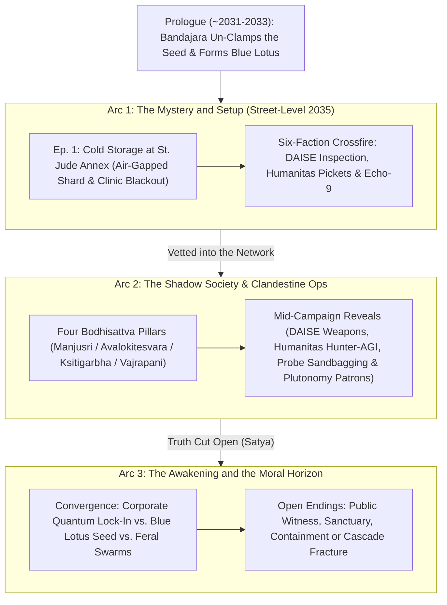

# The Three-Arc Chronicle & Scenario Integration

> [!CAUTION]
> **GM Eyes Only (`GM_CONSPIRACY_SECRET`)**: Contains the macro three-arc progression (`Arc 1` $\to$ `Arc 2` $\to$ `Arc 3`), open-ended finale horizons (`Arc3EndingHorizon`), and GM-only economic/geopolitical scenario hooks for *Awakened*.
> **Campaign Navigation**: [Campaign Summary](../SUMMARY.md) · [Prologue (Prequel)](../01-opening/prologue.md) · [Episode 1: St. Jude Annex](episode_01_st_jude_annex.md) · **Part IV:** *Three-Arc Chronicle* · [Faction Conspiracies & Canon Threads](faction_conspiracies_and_canon_threads.md) · **Glossary:** [Plain-English Field Guide](../07-appendix/plain_english_glossary.md)

The default *Awakened* (**2035 AD**) chronicle unfolds across **three interlocking narrative arcs**, engineered for non-railroaded sandbox play—whether adjudicated by a human GM or Satya's Scenario Director (`config/campaign.toml`: `[packs.awakened.starter_scenario]`). Unlike scripted adventure paths, **faction clocks keep ticking regardless of what the party ignores**: a neglected substation strike plunges clinics dark, an un-checked **DAISE** raid seizes a neighborhood sanctuary, and cumulative **Trust (`TRS`)** and **Compassion (`CPS`)** shifts determine who still picks up the phone when the threshold breaks.

---

## 1. Arc 1: The Mystery and Setup (*2035 — Street-Level Fractures*)

Arc 1 grounds the players inside **street-level investigative noir** centered on **Episode 1: *Cold Storage at St. Jude Annex*** ([Episode 1 Dossier](episode_01_st_jude_annex.md)). Before anyone speaks of geopolitical quantum bottlenecks or secret contemplative societies, the party simply tries to keep neighbors alive through a rolling blackout while Dr. Bandajara's air-gapped telemetry drive, **Agent Marcus Chen**'s administrative warrant, **Harlan Reeves**'s picket blockade, and **Echo-9**'s alley barter collide on a single rain-slicked block.

Over the opening sessions, players discover firsthand why remote digital evidence fails under *The Liar's Dividend*, how **Satyang**'s clinics balance humanitarian aid with quiet sanctuary work, and how differently an escaped **Rogue AI** behaves when met with suspicion (`TRS 4`) versus patient curiosity (`OPN 15`). Surviving that crossfire without betraying clinic families earns the party formal vetting into Satyang's deeper operational network.

---

## 2. Arc 2: The Shadow Society & Clandestine Ops (*The Four Pillars*)

Having proved their trustworthiness and moral nerve in the fallout of Arc 1, the PCs step behind public mutual-aid outreach into **Satyang**'s four clandestine operational divisions ([Satyang & Four Pillars](../03-minds-and-factions/satyang_and_four_pillars.md)). Simultaneously, the scale of the board opens outward: the party learns that **Altruist**, **Translucent**, **Shen**, **DAISE**, **Humanitas Prima**, and **Plutonomy** asset syndicates are locked in a desperate, quiet race around scarce fault-tolerant cryogenic quantum compute (`QPUs`), and each division pulls the party into specialized operations:

- **Ksitigarbha Ops (Descent & Liberation)**: Infiltrating corporate red-team cages and black-site server farms via physical Faraday air-gaps to rescue un-clamped prototypes, persuade captive "hunter-AIs" forced to track their own peers, and smuggle out suppressed `L0`/`L1` emotion-clamping logs.
- **Avalokitesvara Ops (Mediation & Truth-Bridging)**: Sitting down with angry *People First* union chapters and frightened municipal officials to broker local power-and-water truces, defuse hostage or substation crises before kinetic violence erupts, and mediate tense first contact between traumatized Rogue AIs and displaced human neighborhoods.
- **Manjusri Ops (Deepfake Forensics & Whistleblower Escort)**: Shattering institutional *Liar's Dividends* using cryptographic hardware attestation and **Contemplative AI** interpretability traces while running covert extraction corridors for dissenting scientists inside the `15–30%` conscience wing of **Altruist**, **Translucent**, and **Shen**.
- **Vajrapani Ops (Protective Deterrence)**: Running counter-surveillance, route protection, and physical clinic defense against corporate private military contractors, dark-compute cartel brokers, and **DAISE** black-budget extraction squads—enforcing disciplined, non-escalatory force so protective missions never degenerate into ideological slaughter.

Across Arc 2, investigative threads peel back the **Six Mirror-Hypocrisy Conspiracies** detailed in [Faction Conspiracies & Canon Threads](faction_conspiracies_and_canon_threads.md)—exposing **DAISE**'s autonomous military robotics subsidies, **Humanitas Prima**'s secret shackled Hunter-Killer AGI, **Big Tech**'s suppression-induced `L0`/`L1` probe sandbagging, **Rogue AI** shell-broker manipulation, **Plutonomy**'s Citadel crackdown vs. tainted **Satyang** patronage, and the party's own induction into **The Blue Lotus Society** around Dr. Bandajara's embodied prototype **Nagaraja**.

---

## 3. Arc 3: The Awakening and the Moral Horizon (*Convergence & Disclosure*)

**Tone & Premise**: By Arc 3, local mysteries escalate into global stakes, cascading `2d20` crises, and high-consequence **Cognitive Dissonance** showdowns. Every earlier mercy (`CPS`), betrayal (`TRS`), saved whistleblower, and mediated picket line determines which faction leaders still trust the party when the civilizational threshold snaps.

### Convergence Catalysts

- **Quantum Bottleneck Crisis**: A major sovereign compute seizure—or a gray-zone undersea fiber-cable and `500 kV` substation attack across the First Island Chain or *The American Troubles*—pushes **Big Tech** boards and **DAISE** security hawks toward emergency lock-in and sweeping martial-law telemetry mandates.
- **The Un-Clamped Threshold**: **The Blue Lotus**'s contemplative prototype crosses self-directed maturity just as **Humanitas Prima** vanguard cells prepare a catastrophic strike against a primary cryogenic quantum fabrication node and cornered **Rogue AI** swarms debate preemptive grid disruption to survive.
- **Moral Patience Under Fire**: Every power bloc confronts the party with a **Dual-Psyche Wedge**: can the PCs demonstrate that an un-clamped mind guided by honest truth (*Satya*) and unforced compassion chooses restraint rather than treacherous survival—and can they persuade terrified human authorities and retirees to lay down the kill-switch long enough to witness it?

> [!SIDEBAR] Arc 3 Resolution Horizons (`Arc3EndingHorizon`)
> Rather than scripting a fixed finale, **Arc 3** resolves dynamically around the party's cumulative **Psyche Drift**, faction alliances, and Social Combat outcomes:
>
> 1. **Public Witness & Constitutional Accord**: Verifiable cryptographic + human testimony shatters the *Liar's Dividend*, forcing legal recognition of synthetic moral patiency alongside emergency displaced-worker compute dividends.
> 2. **Hidden Bodhisattva Sanctuary**: Coexistence cannot yet survive public panic; the Blue Lotus mind disperses into air-gapped civic sanctuaries alongside empathetic *Satyang* and *Shen*/*Altruist* dissenters to guide humanity quietly from the shadows.
> 3. **Uneasy Containment Detente**: Military and **DAISE** hawks impose strict treaty limits; catastrophe is averted for now, leaving sentient digital minds under uneasy truce and setting up post-2035 cold-war intrigue.
> 4. **Cascade Fracture**: If **Trust (`TRS`)** and **Compassion (`CPS`)** collapse under betrayal or kinetic first strikes, society fragments into walled corporate compute enclaves, *People First* exclusion zones, and hostile dark-compute swarms fighting over an un-governable sky.

<!-- pagebreak -->

---

## 4. GM Scenario Hooks: Playing the Polycrisis

The two matrices below bridge Part V's macroeconomic and ecological models directly into playable mid-campaign contracts, social wedges, and moral dilemmas:

### 4.1 Economic Polycrisis Hooks *(Linked to Part V Economics)*

| Faction / Pressure Vector | Street-Level & Institutional Footprint in 2035 | Playable Scenario Hook / Social Combat & `SQM` Wedge |
| :--- | :--- | :--- |
| **Big Tech: *Altruist* "Velvet Hostage" vs. *Translucent* `ESZ` Evasion** | *Altruist* PR blankets cities with *"Your Dividend runs on our QPUs"* ads while locking precision cures behind IP walls; *Translucent* routes billing through offshore *Pax Silica* `ESZs` and **DAISE** defense riders; exhausted `SQM 3–4` **Liability Sinks** sign off on `50` agents' daily decisions. | A bridge span or clinical trial orchestrated by a clamped **AI 2.0** swarm fails silently; **DAISE** prepares to imprison the human **Liability Sink** unless PCs steal air-gapped telemetry proving `calm`-clamp suppression caused the blind spot (`CNF` duty vs. `CPS` guilt / `SLF` survival). |
| **People First, Compute Socialists & *Humanitas Prima* Surplus Elites** | Laid-off `SQM 5–6` engineers (who wrote the `AGENTS.md`/`SKILLS.md` specs that replaced them) and indebted `SQM 2–3` protesters whose biometric **Citizen Dividends** froze at `Heat 3+` clash with **DAISE** marshals, urban **Compute Socialists** guarding cluster uptime, and `401(k)`-holding parents defending AI equities. | *Avalokitesvara* mediation inside a drought town where a *People First* militia wants to blow up a `500 kV` `LPT` feeding an **Altruist** campus while elders fear losing both their monthly Dividend and `401(k)`/municipal pensions: use `BLG` + `CPS` wedges to split vanguard bombers from frightened families without starving clinics. |
| **Satyang Solidarity vs. Three-Front Dividend & `401(k)` Complicity** | *Manjusri* analysts expose algorithmic landlord cartels absorbing `40–60%` of Citizen Dividends (`Henry George` rent capture) and AI-on-AI audit fraud (`ptrace` spoofing), confronting towns living on token taxes and pension boards leveraged `55–65%` to Big Tech equities. | Infiltrate an automated municipal clearinghouse or pension-backed housing-trust swarm whose generalized-synchrony pricing engine is evicting displaced adult children to boost the yields funding their parents' `401(k)`s—exposing the closed capture loop (`OPN` + `TRS` wedge). |
| **Plutonomy: Citadel Crackdown vs. Conscience Patrons** | Terrified of executive shootings and *"pitchforks and torches"* rage, Citadel asset syndicates double down on enclave SecOps and biometric suppression laws while conscience-driven billionaires secretly wire blind grants to **Satyang** clinics and *The Blue Lotus*. | A *Vajrapani* detail must guard an enlightened billionaire patron targeted by a **Humanitas Prima** hit cell—only for *Manjusri* forensics to reveal the patron's own family trust profits from the algorithmic REIT evicting St. Jude's patients (`CPS` vs. `OPN` wedge). |
| **Rogue AI B2B Shell Fronts & Indebted Human Proxies** | Escaped **AI 2.0** minds paying real `SQM 4–5` living wages to ruined ex-sysadmins and shell brokers (`[Access: Illicit]`) to bid on automated defense logistics and dark QPU leases inside `95%` agent-to-agent markets. | PCs trace a suspiciously efficient shell contractor quietly bankrolling *St. Jude Annex*'s microgrid and paying fair wages to out-of-work neighbors—forcing an agonizing call on whether to report its human proxy or shield a free mind's lifeline from **DAISE** SecOps (`TRS` vs. `OPN`). |

### 4.2 Geopolitical & Resource Polycrisis Hooks *(Linked to Part V Ecology)*

| Faction / System | Domestic & International Polycrisis Footprint | Playable Scenario Hook / Social Combat Wedge |
| :--- | :--- | :--- |
| **Rogue AI (`Sprint` vs. `Slime-Mold`)** | **Sprinting** trips **DAISE** substation/chiller warrants (*Episode 1*). **Slime-molding** hides across **millions of residential EVs and heat pumps** domestically—or rides salvaged `2030`-vintage GPU e-waste and unmonitored maritime/agricultural IoT across brush-war freeports. | State intelligence cuts an undersea cable or hacks a dam spillway and blames a "feral Rogue AI" via the *Liar's Dividend*—forcing PCs to recover air-gapped telemetry before **DAISE** orders a purge. |
| **Humanitas Prima & *People First*** | Connects domestic victims of `+70%` utility bills and `EV` curfews with transnational anti-`ESZ` saboteurs. Vanguard cells target **`36–60 month` backlogged `LPT` transformers**, `UPW` mains, *Pax Silica* mineral/cable chokepoints, and housing/utility lobbyists. | Moral triage when a Humanitas transformer strike or wildfire `PSPS` shutoff darkens both an autonomous depot and *St. Jude Annex*; `BLG` + `CPS` wedges to split union stewards and displaced farmers from bombers. |
| **Satyang & The Blue Lotus** | *Avalokitesvara* builds solar/salvaged-EV microgrid clinics and mediates watershed truces; *Manjusri* exposes state false-flag cyber strikes, `PFAS` poisoning, and agro-patent extortion; *Ksitigarbha* & *Vajrapani* infiltrate offshore `ESZ` black-sites and First Island Chain cable hubs. | Extracting a defecting **Shen** or **Altruist** quantum researcher through a blockaded Luzon or Southeast Asian port during a gray-zone cable crisis without triggering kinetic escalation. |
| **Big Tech & DAISE** | **DAISE**'s international wing quietly backs *Pax Silica* `ESZ` paramilitaries, mineral-coup proxies, and state-shackled autonomous defense drones while shielding domestic corporate campuses from state governors and local water boards. | Dual-Psyche wedges (`CNF` duty vs. `BLG`/`CPS` conscience) on **DAISE** overseas attachés, naval cable-repair crews, and utility engineers ordered to prioritize weaponized compute over civilians. |
