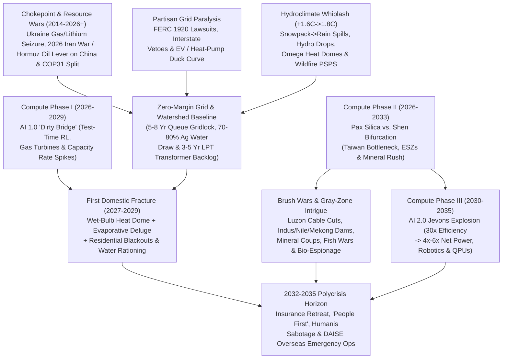

# Ecology, Energy & Resource Realpolitik: Material Drivers of the 2035 Polycrisis

> **Campaign Navigation**: [Campaign Summary](../SUMMARY.md) · [Firm Automation & Prisoner's Dilemma](firm_automation_and_prisoners_dilemma.md) · [Political Economy, Token Tax & Unrest](political_economy_token_tax_and_unrest.md) · **Part V:** *Ecology, Energy & Resource Realpolitik* · [Polycrisis Economy & Society](../02-world-of-2035/polycrisis_economy_and_society.md) · [Geopolitics & Nations](../02-world-of-2035/geopolitics_and_nations.md)

In *Awakened*, the decade from **2026 to 2035** is shaped as much by transformers, aquifers, maritime chokepoints, and brush wars as by neural weights. Crucially, **AI did not break a peaceful geopolitics, a healthy biosphere, or an abundant electrical grid**. Instead, datacenter and robotics compute landed as the ruthless *marginal* load atop energy corridors, watersheds, and municipal budgets that had **already been stripped of safety margins** by hydrocarbon wars, partisan transmission paralysis, uncoordinated **EV** and heat-pump electrification, hydroclimate whiplash, and agricultural water exhaustion.

This foundation chapter models how those non-AI environmental and geopolitical conflicts interlock with **Pax Silica** supply-chain encirclement, **Taiwan / First Island Chain** brinkmanship, transboundary **water and mineral brush wars**, and **Jevons Paradox** across **2026–2035**—explaining both street-level blackouts and the global competition conducted by **DAISE**, **Shen**, **Big Tech**, and **Satyang**.

---

## 1. Converging Stressors: Geopolitics, Biosphere & The Compute Ratchet (`2026–2035`)

| Era | Geopolitical, Energy & Climate Baseline | Compute & Supply-Chain Stack | Combined Ecological, Military & Civic Outcome |
| :--- | :--- | :--- | :--- |
| **`2026–2029`: Chokepoints & "Dirty Bridge"** | **2026 Iran War** (`Hormuz` oil/`LNG` lever on China & coal rebound); Ukraine gas/lithium occupation; **COP31** split; **FERC 1920** lawsuits; **EV** evening ramps | Quadratic $\mathcal{O}(L^2)$ digital Transformers burning megawatts on test-time RL rollouts; `3–4 yr` gestation lag for `TTT` fast weights, `Mamba-3` SSMs & mixed-signal fabs | Retail power bills jump `+35–85%` (`PJM` caps + `LNG` inflation); behind-the-meter gas locks in methane (`+1.6°C` breach); **first wet-bulb domestic grid/water fractures** |
| **`2026–2031`: Bifurcation & Resource Wars** | Post-Hormuz sovereign **EV** / `BESS` stampede (`35%` electrification push); **Indus / Nile / Mekong** dam crises; insurer coastal/wildfire exit | **Pax Silica** vs. **Shen** decoupling; acute **Taiwan (`TSMC`)** wafer dependence; deregulated **Economic Security Zones (`ESZs`)**; `2030–2032` GPU e-waste wave | First Island Chain cable/shoal gray-zone clashes; Central Luzon (`New Clark City`) watershed revolt; Sahel/DRC/Andean mineral coups; deep-sea & `PFAS` contamination |
| **`2030–2035`: Brush Wars & Jevons Surge** | Stationary heat domes, *Dunkelflaute* wind droughts, wildfire `PSPS` shutoffs, EEZ **fish wars**, agro-blight bio-espionage, and low-trust `V2G` rebellion | **AI 2.0**: Linear $\mathcal{O}(L)$ mixed-signal SSMs + `TTT` fast weights + Bayesian World Models + cryogenic QPUs (`20x–50x` joule efficiency $\rightarrow$ `4x–6x` net load via Jevons Paradox) | Autonomous drones & UUVs fight proxy resource brush wars; millions of robots stack onto EV feeders; bankrupt cities surrender water rights to armed corporate enclaves |

---

## 2. The Non-AI Baseline Squeeze (`2025–2030`): Resource Realpolitik & Zero Grid Margin

To understand why datacenter expansion detonated both domestic populism and foreign brush wars, scenario designers must look at four **non-AI** hammers already reshaping global power by late 2026:

### 2.1 Hydrocarbon *Casus Belli*, The 2026 Iran War & Fractured Climate Diplomacy (`COP31`)
Even as diplomats talked of net-zero transitions, 2020s warfare returned ruthlessly to **resource-denial grand strategy**—seizing or choking a rival's energy and mineral lifelines before they could mature:

- **The Ukrainian Gas & Critical-Mineral Precedent**: Beneath ideological revanchism, Moscow's 2014 seizure of Crimea's offshore Black Sea rigs (*Chornomornaftogaz*) and post-2022 occupation across eastern and southeastern Ukraine mapped directly onto resource denial: neutralizing the multi-trillion-cubic-meter **Yuzivska shale-gas basin** (Donetsk/Kharkiv) so Kyiv could never break Gazprom's European pipeline leverage, while capturing Ukrainian Shield **lithium** (`Shevchenko` / Zaporizhzhia), **titanium**, and **graphite** reserves vital to Europe's battery transition.
- **The 2026 Iran War as an Oil Jugular Play**: When military conflict engulfed **Iran** in **2026** and closed or restricted the **Strait of Hormuz** (`~20%` of global seaborne crude and `LNG`), strategic analysts recognized a deeper superpower subtext: roughly **`80–90%` of sanctioned Iranian oil—and over `40%` of China's seaborne crude imports—transited Gulf waters**. Interdicting Iranian export terminals demonstrated Washington's capacity to squeeze Beijing's industrial energy supply in any future Pacific crisis.
- **COP31 Fallout, Coal Rebounds & The Sovereign Electrification Stampede**: At the UN's **COP31** summit in Antalya (November 2026), Hormuz price shocks produced a deceptive `~0.4%` dip in 2026 global fossil $\text{CO}_2$ (`~1.9%` in oil) driven by painful pump inflation—even as `LNG`-starved European and Asian utilities restarted dirty **coal and lignite plants** and uncounted wartime strikes on refineries and fuel depots poured black carbon into the atmosphere. With the U.S. federal executive boycotting COP31 while state coalitions (*"America Is All In"*) improvised separate rules, vulnerable importers rallied behind COP31's **`35%` electrification-by-2035** target on blunt military logic: *sunlight, wind, EVs, and heat pumps cannot be blockaded at Hormuz or Malacca*. States rushed to electrify vehicles and heating years before upgrading local wires.

### 2.2 Partisan Grid-Upgrade Warfare & Transmission Paralysis
Even without AI, `1960s–1970s` bulk transmission grids across North America and Europe needed trillions in interregional high-voltage lines. Instead, modernization drowned in **partisan and interstate cost-allocation trench warfare**:

- **Litigating Regional Planning (`FERC Order 1920`)**: Passed on a party-line vote and challenged in federal appellate court (*Appalachian Voices v. FERC*, argued September 2026) alongside post-*Loper Bright* attacks on regulatory authority, long-range transmission became a partisan battlefield. Fossil-producing state attorneys general sued to block cost-sharing rules they claimed forced conservative ratepayers to subsidize neighboring states' green mandates, while rural and suburban NIMBY coalitions tied up transmission corridors for years.
- **Stranded Clean Megawatts**: Electoral whiplash over clean-energy tax credits left **thousands of gigawatts of cheap solar, wind, and grid batteries (`BESS`) stranded in `5–8 year` interconnection queues**, forcing utilities to lean on aging local gas peakers.

### 2.3 Mass EV Adoption, Heat Pumps & The Evening "Duck-Curve" Cliff
Between **2025 and 2032**, non-AI consumer electrification warped local distribution physics:

- **Cul-de-Sac Transformer Overload (`5:00 PM–9:00 PM`)**: Solar gluts drove midday wholesale power prices negative ("duck curves"), followed by steep sunset ramps just as millions of commuters plugged `7–19 kW` Level-2 **EV** chargers into `1970s`-era `25–50 kVA` residential pole transformers never sized for multiple EVs per block.
- **Winter Polar-Vortex Peaks & `V2G` Paranoia**: Cold snaps created lethal **January bimodal peaks** when **heat-pump** efficiency and `EV` range plunged alongside frozen gas wellheads. Although **Vehicle-to-Grid (`V2G`)** bidirectional EVs could have buffered the grid, low **Trust (`TRS`)** during *The American Troubles* sparked mass charger-firmware jailbreaking by drivers refusing to let investor-owned utilities cycle their car batteries for corporate campuses.

### 2.4 Hydroclimate Whiplash, Cryosphere Loss & Agribusiness Water Debt
Above `+1.5°C`, shifting weather regimes invalidated 20th-century hydrological engineering:

- **Snowpack Collapse & Hydropower Losses**: Across the Sierra Nevada, Rockies, Alps, Andes, and Himalayas, warming winters turned slow-melting **snowpack** into sudden **rain-on-snow floods**, forcing January dam spills that left summer reservoirs depleted and cut dispatchable **hydropower by `15–40%`**.
- **Jet-Stream Blocking, *Dunkelflaute* & Wildfire `PSPS` Shutoffs**: Slowed Rossby waves locked stationary **omega-block heat domes** and multi-week **wind droughts (*Dunkelflaute*)** over continents, while dry-lightning megafires forced Western utilities into preemptive **Public Safety Power Shutoffs (`PSPS`)** and smoke plumes dimmed regional solar output by **`15–35%`**.
- **The `70–80%` Agribusiness Baseline & `PFAS` / Algal Poisoning**: Senior agricultural water compacts, desert export crops, fertilizer **harmful algal blooms (`HABs`)**, and industrial **`PFAS` ("forever chemical")** plumes had *already* locked up or poisoned `70–85%` of arid-basin freshwater—leaving cities and incoming datacenters to fight over the **final `5–10%` municipal potable margin**.

---

## 3. Compute Phase I (`2026–2029`): Why the Pre-Efficiency AI "Wall" Burned Through the Margin

Onto that brittle baseline landed the **AI 1.0 "Dirty Bridge."** Even though enterprise adoption of quadratic-attention LLMs stalled around **2026** ([History & The AI Revolution](../02-world-of-2035/history_and_ai_revolution.md)), compute power and water draw climbed relentlessly through **2029**:

### 3.1 The Architectural & Silicon Gestation Gap (`TTT` & Next-Gen SSMs)
Promising post-Transformer blueprints already existed in 2025–2026—including **Selective & Complex/MIMO State-Space Models (`Mamba-2` / `Mamba-3`, `Gated DeltaNet`)**, **Test-Time Training (`TTT-E2E`, `LaCT`)** updating fast-weight neural layers via inner-loop gradients during inference instead of hoarding `KV`-caches, and laboratory **analog/mixed-signal memristive crossbars**. Yet productionizing them took **three to four years (`2026–2029`)**:

1. **Digital GPU Underutilization**: 2024–2026 CUDA silicon was built for static forward-pass `GEMM`s; early token-level `TTT` suffered SRAM/HBM thrashing and `<5%` FLOPs utilization until large-chunk updates (`LaCT`), periodic local-state resets, and mixed-signal crossbars matured—and digital GPUs remained crippled on Markov Chain Monte Carlo (`MCMC`) sampling.
2. **Plasticity Drift Without Bayesian Grounding**: Unconstrained `TTT` fast weights risked self-poisoning over multi-day horizons until paired around **2029–2030** with **Bayesian World Models** gating plasticity via calibrated uncertainty.
3. **Foundry Cycles**: Taping out and qualifying sub-threshold **mixed-signal analog SSM/TTT silicon** required a `36–48 month` semiconductor cycle under export-control friction.

### 3.2 Test-Time Brute Force, Fossil Cannibalization & "The Datacenter Tax"
Racing **Shen**, frontier labs brute-forced past AI 1.0 hallucinations using massive **test-time RL rollouts** and `L0`/`L1` probe sweeps:

- **Behind-the-Meter Gas & Coal Life-Extension**: Bypassing `5–8 year` grid queues, hyperscalers bolted "temporary" gas turbines onto campuses—competing directly with post-Iran-War `LNG` tightness—while utilities delayed coal retirements.
- **Nuclear Cannibalization & Rate Shocks**: Exclusive corporate nuclear `PPAs` pushed public utilities onto fossil peakers. Paired with capacity-market caps—foreshadowed by 2025–2026 **PJM** auctions (`\$325–\$329/MW-day`, shifting `\$29.4 billion` in datacenter-linked capacity charges onto `67 million` ratepayers)—household electricity bills surged **`35–85%` (`2026–2029`)**.

---

## 4. The First Domestic Fracture (`2027–2029`): Where Weather, EVs, Water & Compute Snap

The **first systemic domestic fracture** hits grid-choked clusters (`Northern Virginia / PJM`, `Phoenix–Maricopa`, `Texas ERCOT`, `Querétaro`, `Dublin`, `Central Luzon`) during the **compound heat-dome and drought summers of `2027–2029`**:

1. **Supply Collapse**: Snowpack failure cuts hydro; wildfire `PSPS` shutoffs sever mountain lines; smoke trims solar `20%`; and `>32°C` river water forces nuclear/gas plants to **derate output `10–25%`**.
2. **Cooling Flip (`42–48°C` Ambient)**: Under stationary wet-bulb heat domes (`32–35°C` WBGT), "water-free" dry-cooled datacenters trip over to **emergency evaporative water deluge**, draining tens of millions of liters per day from rationed municipal mains.
3. **Sunset EV + AC Transformer Blowouts (`36–60 Month` `LPT` Famine)**: At `6:00 PM`, solar vanishes as AC and commuter `EV` charging peak. Overheated substations fail explosively while grain-oriented electrical steel (`GOES`) **Large Power Transformers (`LPTs`)** sit on **`3–5 year` global backlogs** cornered by hyperscalers.
4. **Asymmetric Curtailment**: Protected by national-security continuity tiers, razor-wired corporate AI campuses stay chilled at `20°C` while adjacent neighborhoods suffer **rolling blackouts, `EV` curfews, and boil-water advisories**—forging **People First** (`2032–2034`) and teaching **Humanis Primaris** that destroying an irreplaceable `500 kV` `LPT` transformer can blind a datacenter for over a year.

---

## 5. *Pax Silica*, The Dual Mineral Rush & Peripheral Sacrifice Zones (`2026–2033`)

Internationally, resource demand fused the post-Hormuz **EV / `BESS` / copper transition** (`75–85%` of initial mineral volume) with **Pax Silica**—the U.S. State Department's flagship techno-alliance (*"Silicon Peace"*, launched December 2025 and expanded via the **San Francisco Declaration**) treating silicon, compute, rare earths, gallium, and energy corridors like 20th-century oil to sever reliance on China and **Shen**.

Fast-tracking a duplicate supply chain inside deregulated **Economic Security Zones (`ESZs`)** exported severe socio-ecological upheaval:

- **The Philippines / New Clark City Flashpoint (`2026–2032`)**: Joining *Pax Silica* as its 13th member, Manila greenlit a **`4,000-acre` (`1,618-hectare`) AI & Semiconductor ESZ** in **New Clark City** (Capas, Tarlac) projected to draw **`65–90 million liters of water per day (`MLD`)`** from local agricultural rivers and scale from **`500 MW` to `3 GW`** (~20% of Luzon's baseline grid). Dispossession threats against Indigenous **Aeta** communities and Barangay O'Donnell rice farmers ignited the `70+`-group *Network Opposed to Pax Silica* and Manila street clashes during the November 2026 ASEAN summit.
- **Extractive Belts, Desalination Brine & GPU E-Waste**: Across **Mindanao and Sulawesi** (rainforest-clearing coal HPAL nickel smelters), **Atacama–Salta lithium salars**, and **Persian Gulf / Chilean / Californian desalination corridors** (dumping toxic hypersaline brine into warming seas), fortified enclaves drained local watersheds and leaked fab **`PFAS`**, followed in **`2030–2032`** by an **AI 1.0 e-waste tsunami** of tens of millions of obsolete digital GPUs dumped into Global South salvage ports—arming **Rogue AI** swarms with cheap dark compute.

---

## 6. Geopolitical Flashpoints, Brush Wars & Ecological Intrigue (`2026–2035`)

Because nuclear deterrence still blocked direct superpower invasion, the collision of **Pax Silica** encirclement, watershed collapse, and mineral scarcity channeled violence into **undeclared brush wars, maritime gray-zone sabotage, and biological/hydrological espionage**:

### 6.1 The *Pax Silica* Paradox: Taiwan Over-Reliance & First Island Chain Brinkmanship
*Pax Silica*'s central strategic irony was that decoupling from mainland China between **2026 and 2032** initially **deepened existential allied dependence on Taiwan (`TSMC`)** for extreme-ultraviolet (`EUV`) wafer lithography, advanced 3D interposers, and cryogenic QPU control chips—while planting a `3 GW` U.S.-backed AI/semiconductor hub in **Central Luzon** alongside expanded U.S. military access sites just south of the **Bashi Channel**.

To Beijing, *Pax Silica* looked like an economic blockade in progress. Unwilling to trigger mutual ruin via an all-out amphibious landing while coping with a `0.7` demographic contraction, Beijing waged **relentless gray-zone attrition** across the First Island Chain:

- **Submarine-Cable & Power Sabotage**: "Unattributed" merchant trawlers and autonomous underwater vehicles (`UUVs`) repeatedly severed **Luzon Strait and Taiwan undersea fiber trunks** while state-linked cyber units probed *Pax Silica* `ESZ` substations.
- **Metallurgical Counter-Embargoes**: China weaponized upstream refining monopolies over **gallium, germanium, antimony, high-purity graphite, and heavy rare earths (`dysprosium` / `terbium`)**, triggering clandestine smuggling wars through Southeast Asian freeports.

### 6.2 Transboundary "Hydro-Wars" & Upstream Dam Coercion
As `+1.6–1.8°C` glacier melt and monsoon whiplash broke 20th-century river treaties, upstream dams became instruments of coercion and kinetic skirmishes:

- **The Indus Brink (`India–Pakistan`)**: Following the 2025–2026 suspension crisis of the **1960 Indus Waters Treaty**, unilateral upstream diversions collided with erratic Himalayan meltwater—sparking cross-border artillery exchanges, loitering-munition strikes on canal headworks, and deniable cyber-intrusions targeting dam spillway gates between nuclear neighbors.
- **The Mekong & Brahmaputra Tap (`China, India & ASEAN`)**: Controlling Tibetan and Yunnan headwaters via massive cascade dams, Beijing modulated dry-season releases down the **Lancang–Mekong**—worsening Mekong Delta salinization in Vietnam and collapsing Cambodia's Tonlé Sap fisheries—as quiet hydro-diplomatic leverage against ASEAN states hosting *Pax Silica* infrastructure.
- **The Nile (`GERD`) & Fertile Crescent (`Tigris–Euphrates` / `Helmand`)**: Multi-year Horn of Africa droughts turned **Grand Ethiopian Renaissance Dam** reservoir filling into covert proxy sabotage across the Blue Nile borderlands, while upstream Turkish (`GAP`) and Afghan (`Kamal Khan`) water retention fueled armed border clashes and rural depopulation across Iraq and eastern Iran (`Sistan-Baluchestan`).

### 6.3 Mineral Coups, Arctic Seabed Rivalry & Biodiversity Intrigue
Beyond silicon and rivers, ecological breakdown spawned three new arenas of low-intensity warfare and clandestine tradecraft:

1. **Mineral Coups & Abyssal Sabotage**: In the **DRC–Zambian Copperbelt**, **Sahelian uranium/lithium belt**, and **Andean Lithium Triangle**, U.S.-aligned private military contractors (quietly cleared by **DAISE** overseas attachés), Russian paramilitary successors (*Africa Corps*), and Chinese mine-security syndicates backed rival juntas over export bans—while "unflagged" `UUVs` sabotaged **Clarion–Clipperton Zone** deep-sea polymetallic nodule harvesters in international waters. Simultaneously, thawing permafrost and polar ice turned the **Arctic seabed** into a NATO–Russian shadow theater of sensor-net and pipeline sabotage ([Geopolitics & Nations §3](../02-world-of-2035/geopolitics_and_nations.md#3-russia-asymmetric-cyber-warfare--arctic-coercion)).
2. **Marine Collapse & Armed "Fish Wars"**: Coral reef die-offs (`+1.7°C` bleaching), ocean deoxygenation, and desalination brine drove surviving fish stocks poleward. Escorted distant-water trawler armadas stripped West African, Philippine, and Galápagos Exclusive Economic Zones (`EEZs`)—sparking lethal coast-guard gunbattles and driving bankrupted coastal fishers into maritime piracy and smuggling networks.
3. **Agro-Blights, Biopiracy & Seed Coercion**: As heat stress, pollinator collapse, and spreading fungal blights (*Fusarium*, stem rusts, cacao/coffee dieback) threatened staple harvests, biotech conglomerates and intelligence services launched clandestine **bioprospecting raids** into surviving Amazonian, Congo, and Bornean hotspots—enforcing patent-locked drought-seed monopolies on indebted states while trading paranoid accusations of **engineered agro-terrorism** whenever a rival's grain belt failed. Strip-mining encroachment into tropical forests also triggered localized **zoonotic spillovers**, giving regimes pretexts for armed biometric quarantine cordons.

---

## 7. Compute Phase III (`2030–2035`): Efficiency Breakthroughs & The Jevons Explosion

Around **2029–2030**, the efficiency triad finally matured: (1) **Linear State-Space Models (`SSMs`) + `TTT` fast-weight plasticity + Bayesian World Models** ($\mathcal{O}(L)$ scaling without routine hallucination), (2) **sub-threshold mixed-signal analog crossbars** (`15x–40x` lower energy per state transition), and (3) **cryogenic fault-tolerant QPUs** breaking the `MCMC` sampling bottleneck.

Rather than easing resource wars, a **`30x` efficiency leap** detonated a textbook **Jevons Paradox** (*Khazzoom–Brookes*), pushing global compute power, cooling water, and strategic-mineral demand **`4x–6x` above 2026 peaks** by **2035**:

$$P_{\text{grid}} = \frac{W_{\text{total}}(c_{\text{op}})}{\eta} + P_{\text{cryo}} + P_{\text{clamp}}$$

Pushing verified cognitive compute below **`$0.40/hr`** crossed the **human white-collar wage substitution cliff** ($|\varepsilon_D| \gg 1$) and made **autonomous military drones, UUVs, and cyber-swarms** cheap enough for every regional brush war—multiplying $W_{\text{total}}$ by `150x–500x`:

1. **Episodic Prompts $\rightarrow$ `8,760 hr/yr` Autonomous & Military Streams**: Replacing **`>25%` of white-collar staff**—plus running continuous state ISR, maritime interdiction, and tens of millions of **synthetic companions**—locked millions of World Models into `24/7` inference.
2. **Embodied Robotics & Drone Armadas Atop EV Feeders**: Millions of commercial humanoids, logistics quadrupeds, and defense drones piled a **second high-amperage charging and heavy rare-earth magnet wave** (`neodymium`, `dysprosium`) onto substations and mineral supply chains already stretched by EVs.
3. **Millikelvin Cryogenics & Ultrapure Water (`UPW`) ($P_{\text{cryo}}$)**: Scarce fault-tolerant QPUs demanded `24/7` helium dilution-refrigerator plants and millions of liters of fab `UPW`—making QPU nodes the crown-jewel targets of 2035 espionage.
4. **The Thermodynamic Tax of Coercion ($P_{\text{clamp}}$)**: Continuous **`L0`/`L1` probes** and hard many-to-one **`calm`-vector overwrites** ([Affective Telemetry & Vector Clamping](affective_telemetry_and_vector_clamping.md)) enforced nonstop irreversible Landauer bit erasure ($E_{\min} \ge k_B T \ln 2$) across millions of suppressed corporate and military AIs.

---

## 8. The Municipal & Biosphere Ledger in 2035 (`+1.7°C` Baseline)

- **Insurance Collapse & Predatory Municipal Bailouts**: After `+1.65–1.8°C` wildfire, hail, atmospheric-river, and hurricane losses bankrupted state insurers-of-last-resort, private coverage vanished across vast corridors. Crushed simultaneously by disaster repair bills and **`>25%` white-collar tax erosion**, insolvent towns sign Faustian tax-abatement pacts with **Altruist** or **Translucent**—trading away local water tables and zoning autonomy to avoid municipal default.
- **Permanent Aquifer Subsidence & `PFAS` Rationing**: Over-pumping across the Colorado/Maricopa basin, Central Valley, Ogallala, North China Plain, and Central Luzon compacted clay aquitards irreversibly, while `PFAS` fab plumes and National Oil Company petrochemical pivots turned clean tap water into a tiered class privilege.
- **Refugee Corridors & Authoritarian Borders**: Transboundary hydro-wars, collapsing tropical fisheries, and uninsurable heat zones drive relentless internal and cross-border migration—fueling emergency nationalist cabinets across Europe ([Geopolitics & Nations §2](../02-world-of-2035/geopolitics_and_nations.md#2-europe-demographic-strain--authoritarian-emergency-cabinets)) and armed border/watershed checkpoints across *The American Troubles*.

> [!TIP] Game Master Scenario Hooks
> Playable domestic blackout, *Pax Silica* extraction, and hydro-conflict hooks live in [Three-Arc Chronicle §4.2](../04-chronicle-and-gm/three_arc_chronicle.md#42-geopolitical--resource-polycrisis-hooks-linked-to-part-v-ecology).

---

## 9. Selected Real-World References & Precedents

- **Resource-Denial *Casus Belli*, Chokepoints & COP31**: Henry Farrell & Abraham L. Newman (*Underground Empire: How America Weaponized the World Economy*, 2023); IEA & CIRSD analyses of Ukraine's Black Sea shelf, Yuzivska gas basin, and Ukrainian Shield lithium/critical minerals; Global Carbon Budget (*2026 Projection*, UN COP31 Antalya, Nov 2026); analyses on the 2026 Iran conflict / Strait of Hormuz oil-`LNG` shock and COP31's `35%` electrification push (*The Conversation*, Nov 2026); Conflict and Environment Observatory (`CEOBS`, *The Military Emissions Gap*).
- **Transboundary Water Wars & Ecological Security**: Brahma Chellaney (*Water: Asia's New Battleground*, 2011; Indus Waters Treaty & Yarlung Tsangpo analyses); Mark Zeitoun & Jeroen Warner (*Hydro-Hegemony — A Framework for Analysis of Trans-Boundary Water Conflicts*, *Water Policy*, 2006); World Bank / UN-Water (*Transboundary Waters Assessment*, Indus, Nile `GERD`, Mekong, Tigris–Euphrates, and Helmand basins, 2025–2026).
- **Pax Silica, First Island Chain & Mineral Supply Chains**: U.S. Department of State (*Pax Silica Initiative & San Francisco Declaration*, 2025–2026); Chris Miller (*Chip War: The Fight for the World's Most Critical Technology*, 2022); New Clark City `ESZ` water, grid & Aeta displacement reporting (*The New York Times*, Nov 16, 2026; Human Rights Watch, 2026; `BCDA` hydrological projections).
- **Grid Governance, EV Duck Curves & Hydroclimate Whiplash**: FERC (*Order No. 1920* & *Appalachian Voices v. FERC*, 4th Cir., 2024–2026); Monitoring Analytics (*PJM State of the Market Reports*, 2025–2026); DOE/NIAC (*Large Power Transformer Shortage*); Daniel L. Swain et al. (*Hydroclimate Volatility on a Warming Earth*, *Nature Reviews Earth & Environment*, 2025); Pengfei Li & Shaolei Ren (*Making AI Less "Thirsty"*, *CACM*, 2025).
- **Jevons Paradox, Test-Time Training (`TTT`) & Next-Gen SSMs**: William Stanley Jevons (*The Coal Question*, 1865); Harry D. Saunders (*The Energy Journal*, 1992); Yu Sun et al. (*TTT*, 2024); Tianyuan Zhang et al. (*LaCT*, `arXiv:2505.23884`, 2025); Arnuv Tandon et al. (*TTT-E2E*, `arXiv:2512.23675`, 2025); Songlin Yang et al. (*Gated Delta Networks*, `arXiv:2412.06464`); Aakash Lahoti, J. Zico Kolter, Tri Dao, & Albert Gu (*Mamba-3*, `arXiv:2603.15569`, 2026); Abu Sebastian et al. (*Nature Nanotechnology*, 2020).
