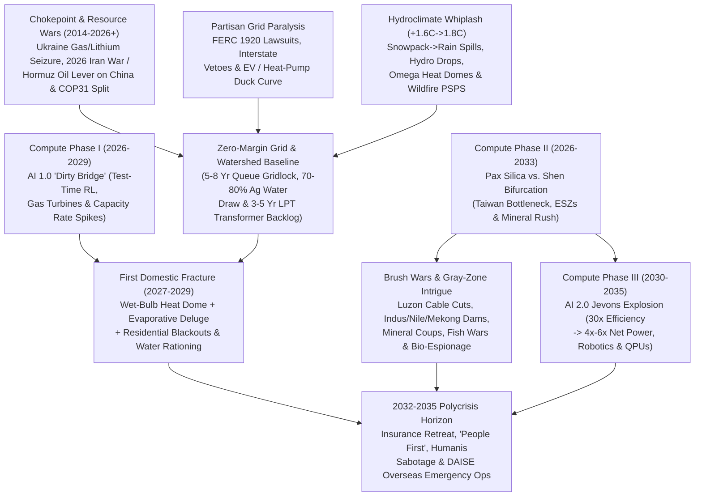

# Ecology, Energy & Resource Realpolitik: Material Drivers of the 2035 Polycrisis

> **Campaign Navigation**: [Campaign Summary](../SUMMARY.md) · [Firm Automation & Prisoner's Dilemma](firm_automation_and_prisoners_dilemma.md) · [Political Economy, Token Tax & Unrest](political_economy_token_tax_and_unrest.md) · **Part V:** *Ecology, Energy & Resource Realpolitik* · [Polycrisis Economy & Society](../02-world-of-2035/polycrisis_economy_and_society.md) · [Geopolitics & Nations](../02-world-of-2035/geopolitics_and_nations.md)

In *Awakened*, the decade from **2026 to 2035** is shaped as much by high-voltage transformers, depleted aquifers, maritime chokepoints, and brush wars as by neural weights. Crucially, **AI did not break a peaceful geopolitics, a healthy biosphere, or an abundant electrical grid**. Instead, datacenter and robotics compute landed as the ruthless *marginal* load—the final heavy straw—atop energy corridors, watersheds, and municipal budgets that had **already been stripped of safety margins** by hydrocarbon wars, partisan transmission paralysis, uncoordinated electric vehicle (**EV**) and heat-pump electrification, hydroclimate whiplash, and agricultural water exhaustion.

This foundation chapter explains the physical machinery beneath the 2035 street reality: how non-AI environmental and geopolitical conflicts interlock with **Pax Silica** supply-chain encirclement, **Taiwan / First Island Chain** brinkmanship, transboundary **water and mineral brush wars**, and **Jevons Paradox** across **2026–2035**. Knowing why a substation catches fire at `6:00 PM` or why a fab enclave drinks a farming valley dry turns abstract backdrop into immediate street stakes for **DAISE**, **Shen**, **Big Tech**, **Humanis Primaris**, and **Satyang**.

---

## 1. Converging Stressors: Geopolitics, Biosphere & The Compute Ratchet (`2026–2035`)

Before unpacking each bottleneck, trace the feedback loop connecting war zones, power lines, weather extremes, and silicon below. Notice that compute demand never operates in a vacuum: every geopolitical crisis pushes states toward electrification and onshoring, which rams straight into stalled transmission builds and melting mountain snowpack just as AI efficiency breakthroughs unleash even larger `24/7` robotic and inference fleets.

The chronological table below pairs the physical world's deterioration with shifts in computing hardware—showing how `2026–2035` rolled from burning natural gas and coal (`Dirty Bridge`), through supply-chain partitioning (`Pax Silica`), into a `4x–6x` net surge in energy and mineral consumption despite radically cleaner math.

| Era | Geopolitical, Energy & Climate Baseline | Compute & Supply-Chain Stack | Combined Ecological, Military & Civic Outcome |
| :--- | :--- | :--- | :--- |
| **`2026–2029`: Chokepoints & "Dirty Bridge"** | **2026 Iran War** (`Hormuz` oil/`LNG` lever on China & coal rebound); Ukraine gas/lithium occupation; **COP31** split; **FERC 1920** lawsuits; **EV** evening ramps | Quadratic $\mathcal{O}(L^2)$ digital Transformers burning megawatts on test-time RL rollouts; `3–4 yr` gestation lag for `TTT` fast weights, `Mamba-3` SSMs & mixed-signal fabs | Retail power bills jump `+35–85%` (`PJM` caps + `LNG` inflation); behind-the-meter gas locks in methane (`+1.6°C` breach); **first wet-bulb domestic grid/water fractures** |
| **`2026–2031`: Bifurcation & Resource Wars** | Post-Hormuz sovereign **EV** / `BESS` stampede (`35%` electrification push); **Indus / Nile / Mekong** dam crises; insurer coastal/wildfire exit | **Pax Silica** vs. **Shen** decoupling; acute **Taiwan (`TSMC`)** wafer dependence; deregulated **Economic Security Zones (`ESZs`)**; `2030–2032` GPU e-waste wave | First Island Chain cable/shoal gray-zone clashes; Central Luzon (`New Clark City`) watershed revolt; Sahel/DRC/Andean mineral coups; deep-sea & `PFAS` contamination |
| **`2030–2035`: Brush Wars & Jevons Surge** | Stationary heat domes, *Dunkelflaute* wind droughts, wildfire `PSPS` shutoffs, EEZ **fish wars**, agro-blight bio-espionage, and low-trust `V2G` rebellion | **AI 2.0**: Linear $\mathcal{O}(L)$ mixed-signal SSMs + `TTT` fast weights + Bayesian World Models + cryogenic QPUs (`20x–50x` joule efficiency $\rightarrow$ `4x–6x` net load via Jevons Paradox) | Autonomous drones & UUVs fight proxy resource brush wars; millions of robots stack onto EV feeders; bankrupt cities surrender water rights to armed corporate enclaves |

---

## 2. The Non-AI Baseline Squeeze (`2025–2030`): Resource Realpolitik & Zero Grid Margin

To understand why datacenter expansion detonated both domestic populism and foreign brush wars, scenario designers must look at four **non-AI** hammers already reshaping global power by late 2026:

### 2.1 Hydrocarbon *Casus Belli*, The 2026 Iran War & Fractured Climate Diplomacy (`COP31`)
Even as diplomats talked of net-zero transitions, 2020s warfare returned ruthlessly to **resource-denial grand strategy**—seizing or choking a rival's energy and mineral lifelines before those supply chains could mature:

- **The Ukrainian Gas & Critical-Mineral Precedent**: Beneath ideological revanchism, Moscow's 2014 seizure of Crimea's offshore Black Sea rigs (*Chornomornaftogaz*) and post-2022 occupation across eastern and southeastern Ukraine mapped directly onto resource denial: neutralizing the multi-trillion-cubic-meter **Yuzivska shale-gas basin** (Donetsk/Kharkiv) so Kyiv could never break Gazprom's European pipeline leverage, while capturing Ukrainian Shield **lithium** (`Shevchenko` / Zaporizhzhia), **titanium**, and **graphite** reserves vital to Europe's battery transition.
- **The 2026 Iran War as an Oil Jugular Play**: When military conflict engulfed **Iran** in **2026** and closed or restricted the **Strait of Hormuz** (carrying `~20%` of global seaborne crude and Liquefied Natural Gas, [`LNG`](../07-appendix/plain_english_glossary.md#4-energy-climate-infrastructure--geopolitics)), strategic analysts recognized a deeper superpower subtext: roughly **`80–90%` of sanctioned Iranian oil—and over `40%` of China's seaborne crude imports—transited Gulf waters**. Interdicting Iranian export terminals demonstrated Washington's capacity to squeeze Beijing's industrial energy supply in any future Pacific crisis.
- **COP31 Fallout, Coal Rebounds & The Sovereign Electrification Stampede**: At the UN's **COP31** climate summit in Antalya (November 2026), Hormuz price shocks produced a deceptive `~0.4%` dip in 2026 global fossil $\text{CO}_2$ (`~1.9%` in oil) caused simply by painful pump inflation—even as `LNG`-starved European and Asian utilities restarted dirty **coal and lignite plants** and uncounted wartime strikes on refineries and fuel depots poured black carbon into the atmosphere. With the U.S. federal executive boycotting COP31 while state coalitions (*"America Is All In"*) improvised separate rules, vulnerable energy importers rallied behind COP31's **`35%` electrification-by-2035** target on blunt military logic: *sunlight, wind, electric vehicles, and heat pumps cannot be blockaded at Hormuz or Malacca*. States rushed to electrify cars and home heating years before upgrading local neighborhood wires.

### 2.2 Partisan Grid-Upgrade Warfare & Transmission Paralysis
Even without AI, `1960s–1970s` bulk transmission grids across North America and Europe needed trillions in interregional high-voltage lines capable of carrying desert solar or plains wind across state lines. Instead, modernization drowned in **partisan and interstate cost-allocation trench warfare**:

- **Litigating Regional Planning (`FERC Order 1920`)**: Passed on a party-line vote to mandate long-term regional grid planning and challenged in federal appellate court (*Appalachian Voices v. FERC*, argued September 2026) alongside post-*Loper Bright* legal attacks stripping federal agencies of judicial deference on technical rules ([Plain-English Glossary](../07-appendix/plain_english_glossary.md#4-energy-climate-infrastructure--geopolitics)), long-range transmission became a partisan battlefield. Fossil-producing state attorneys general sued to block cost-sharing rules they claimed forced conservative ratepayers to subsidize neighboring states' green mandates, while rural and suburban NIMBY coalitions tied up transmission corridors in court for years.
- **Stranded Clean Megawatts**: Electoral whiplash over clean-energy tax credits left **thousands of gigawatts of cheap solar, wind, and utility Battery Energy Storage Systems (`BESS`, giant grid-scale lithium battery parks) stranded in `5–8 year` interconnection queues**, forcing utilities to keep leaning on aging local gas peaker plants.

### 2.3 Mass EV Adoption, Heat Pumps & The Evening "Duck-Curve" Cliff
Between **2025 and 2032**, non-AI consumer electrification warped local distribution physics right down at the neighborhood street pole:

- **Cul-de-Sac Transformer Overload (`5:00 PM–9:00 PM`)**: Abundant midday solar power drove afternoon wholesale electricity prices negative—creating a graph shape utilities call the **"duck curve"** (a deep midday belly of cheap solar followed by a sharp sunset neck). Right as sunlight faded, millions of commuters arrived home and plugged `7–19 kW` Level-2 **EV** chargers into `1970s`-era `25–50 kVA` (kilovolt-ampere, roughly enough power for four or five air-conditioned homes, *not* four fast-charging electric SUVs at once) residential pole transformers. Overworked neighborhood transformers cooked oil insulation and popped like firecrackers during summer dinner hours.
- **Winter Polar-Vortex Peaks & `V2G` Paranoia**: Deep winter cold snaps created lethal **January bimodal morning-and-evening peaks** when electric **heat-pump** efficiency and `EV` battery range plunged alongside frozen natural-gas wellheads. In theory, **Vehicle-to-Grid (`V2G`)** bidirectional chargers—letting parked electric cars trickle reserve battery juice back into neighborhood lines during emergencies—could have buffered the grid. In reality, collapsed public **Trust ([`TRS`](../../ttrpg/04-psyche-and-social/psyche_morale_and_social_combat.md))** during *The American Troubles* sparked mass charger-firmware jailbreaking by angry drivers refusing to let investor-owned utilities drain their personal car batteries to keep corporate datacenter suburbs lit.

### 2.4 Hydroclimate Whiplash, Cryosphere Loss & Agribusiness Water Debt
Above `+1.5°C` of global warming, shifting atmospheric physics invalidated 20th-century dam and reservoir engineering:

- **Snowpack Collapse & Hydropower Losses**: Across the Sierra Nevada, Rockies, Alps, Andes, and Himalayas, warmer winters turned slow-melting **snowpack**—humanity's natural summer water battery—into sudden **rain-on-snow winter floods**, forcing dam operators into emergency January spills so reservoirs wouldn't overtop. That left reservoirs half-empty by July and cut dispatchable **hydropower output by `15–40%`** precisely during summer air-conditioning peaks.
- **Jet-Stream Blocking, *Dunkelflaute* & Wildfire `PSPS` Shutoffs**: Slowed high-altitude Rossby waves locked stationary **omega-block heat domes** and multi-week **wind-and-sun droughts ([*Dunkelflaute*](../07-appendix/plain_english_glossary.md#4-energy-climate-infrastructure--geopolitics))** over continents, while dry-lightning megafires forced Western utilities into preemptive **Public Safety Power Shutoffs (`PSPS`)**—deliberately cutting power to rural counties on hot windy days so downed lines wouldn't spark towns—even as wildfire smoke plumes dimmed regional solar output by **`15–35%`**.
- **The `70–80%` Agribusiness Baseline & `PFAS` / Algal Poisoning**: Senior agricultural water compacts, desert export crops, fertilizer-fed **harmful algal blooms (`HABs`)**, and industrial **`PFAS` ("forever chemical")** plumes had *already* claimed or poisoned `70–85%` of arid-basin freshwater—leaving growing cities and incoming datacenters to knife-fight over the **final `5–10%` municipal potable margin**.

---

## 3. Compute Phase I (`2026–2029`): Why the Pre-Efficiency AI "Wall" Burned Through the Margin

Onto that brittle baseline landed the **AI 1.0 "Dirty Bridge."** Even though enterprise hype over quadratic-attention chat wrappers cooled around **2026** ([History & The AI Revolution](../02-world-of-2035/history_and_ai_revolution.md)), datacenter electricity and cooling-water demand climbed relentlessly through **2029**:

### 3.1 The Architectural & Silicon Gestation Gap (`TTT` & Next-Gen SSMs)
Promising post-Transformer blueprints already existed in academic labs by 2025–2026 ([AI 2.0 Substrate & Active Inference](ai_2_0_substrate_and_active_inference.md))—including **Selective and Complex/MIMO State-Space Models (`Mamba-2` / `Mamba-3`, `Gated DeltaNet`)**, **Test-Time Training (`TTT-E2E`, `LaCT`)** that updates temporary "fast weights" on the fly instead of hoarding bloated `KV`-caches, and laboratory **analog/mixed-signal memristive crossbars**. Yet turning paper breakthroughs into datacenter fleets took **three to four years (`2026–2029`)** for three hard hardware reasons:

1. **Digital GPU Underutilization**: 2024–2026 CUDA silicon was engineered solely for massive, static matrix multiplications (`GEMM`, General Matrix-to-Matrix Multiply). Early token-by-token `TTT` caused relentless **SRAM/HBM thrashing** (rapidly bouncing tiny updates between fast on-chip cache and high-bandwidth memory), wasting `<5%` of theoretical chip `FLOPs` until large-chunk updates (`LaCT`), periodic local-state resets, and mixed-signal crossbars matured—and standard digital GPUs remained crippled on probabilistic **Markov Chain Monte Carlo (`MCMC`)** uncertainty sampling.
2. **Plasticity Drift Without Bayesian Grounding**: Unconstrained `TTT` fast weights risked self-poisoning and hallucinating permanently over multi-day work shifts until paired around **2029–2030** with calibrated **Bayesian World Models** gating when weights are allowed to update.
3. **Foundry Cycles**: Designing, taping out, and qualifying sub-threshold **mixed-signal analog SSM/TTT silicon** required a rigid `36–48 month` semiconductor fabrication cycle amid escalating export controls.

### 3.2 Test-Time Brute Force, Fossil Cannibalization & "The Datacenter Tax"
Locked in a sprint against **Shen**, frontier labs brute-forced past AI 1.0 hallucinations using massive **test-time reinforcement-learning (`RL`) rollouts** (burning hundreds of extra reasoning attempts per question) and continuous `L0`/`L1` safety probe sweeps:

- **Behind-the-Meter Gas & Coal Life-Extension**: Refusing to sit inside `5–8 year` utility interconnection queues, hyperscalers bolted "temporary" natural-gas turbines directly onto datacenter pads—competing straight against post-Iran-War `LNG` tightness—while grid operators delayed coal-plant retirements just to keep voltage stable.
- **Nuclear Cannibalization & Rate Shocks**: Exclusive 20-year corporate **Power Purchase Agreements (`PPAs`)** bought out existing zero-carbon nuclear output for private AI clusters, shoving ordinary public utilities back onto expensive fossil peakers. Paired with capacity-market price spikes—foreshadowed by 2025–2026 **PJM** auctions (America's largest Mid-Atlantic/Midwest wholesale power grid, hitting `\$325–\$329/MW-day` and shifting `\$29.4 billion` in datacenter-linked capacity charges onto `67 million` ordinary households)—residential electricity bills surged **`35–85%` (`2026–2029`)**. Neighbors watched lights flicker inside their own kitchens while footing the infrastructure bill for campuses automating their jobs away.

---

## 4. The First Domestic Fracture (`2027–2029`): Where Weather, EVs, Water & Compute Snap

The **first systemic domestic fracture** strikes grid-choked cluster corridors (`Northern Virginia / PJM`, `Phoenix–Maricopa`, `Texas ERCOT`, `Querétaro`, `Dublin`, `Central Luzon`) during the **compound heat-dome and drought summers of `2027–2029`**. Four separate physical failures detonate in the exact same afternoon:

1. **Supply Collapse**: Failed winter snowpack trims hydro; wildfire `PSPS` shutoffs sever mountain transmission lines; smoke dims regional solar `20%`; and `>32°C` river cooling water forces thermal nuclear and gas plants to **derate output by `10–25%`** so they don't boil river ecosystems or melt condenser seals.
2. **Cooling Flip (`42–48°C` Ambient)**: Under stationary wet-bulb heat domes (`32–35°C` **Wet-Bulb Globe Temperature, `WBGT`**, the combined heat-and-humidity ceiling near where unprotected human sweat stops cooling the body), ostensibly "water-free" dry-cooled datacenters hit physical thermal limits and trip over to **emergency evaporative water deluge**, sucking tens of millions of liters per day straight out of rationed municipal water mains.
3. **Sunset EV + AC Transformer Blowouts (`36–60 Month` `LPT` Famine)**: At `6:00 PM`, rooftop solar drops toward zero right as residential air conditioners run wide open and commuters plug in Level-2 `EV` chargers. Overheated substations fail explosively—while specialized grain-oriented electrical steel (**`GOES`**) **Large Power Transformers ([`LPTs`](../07-appendix/plain_english_glossary.md#4-energy-climate-infrastructure--geopolitics))**, the multi-ton high-voltage hearts of every major substation, sit on **`3–5 year` global manufacturing backlogs** cornered upfront by hyperscaler procurement teams.
4. **Asymmetric Curtailment**: Protected by national-security continuity tiers, razor-wired corporate AI campuses stay chilled at `20°C` while adjacent neighborhoods suffer **rolling blackouts, `EV` charging curfews, and boil-water advisories**—forging **People First** (`2032–2034`) as a populist revolt and teaching militant **Humanis Primaris** cells a brutal tactical truth: destroying one irreplaceable `500 kV` `LPT` transformer can blind a billion-dollar datacenter for over a year.

---

## 5. *Pax Silica*, The Dual Mineral Rush & Peripheral Sacrifice Zones (`2026–2033`)

Internationally, extractive demand fused the post-Hormuz **EV / `BESS` / copper transition** (`75–85%` of initial mineral volume) with **Pax Silica**—the U.S. State Department's flagship techno-alliance (*"Silicon Peace"*, launched December 2025 and expanded via the **San Francisco Declaration**) treating silicon wafers, compute clusters, rare earths, gallium, and energy corridors like 20th-century Persian Gulf oil to sever Western dependence on China and **Shen**.

Fast-tracking a duplicate Western supply chain inside deregulated **Economic Security Zones ([`ESZs`](../07-appendix/plain_english_glossary.md#4-energy-climate-infrastructure--geopolitics))**—fenced-off export enclaves exempted from normal local water boards, labor codes, and environmental permitting—exported severe socio-ecological upheaval across the Global South:

- **The Philippines / New Clark City Flashpoint (`2026–2032`)**: Joining *Pax Silica* as its 13th member, Manila greenlit a **`4,000-acre` (`1,618-hectare`) AI & Semiconductor ESZ** in **New Clark City** (Capas, Tarlac) projected to draw **`65–90 million liters of water per day (`MLD`)`** from local agricultural rivers and scale from **`500 MW` to `3 GW`** (~20% of Luzon's baseline grid). Dispossession threats against Indigenous **Aeta** communities and Barangay O'Donnell rice farmers ignited the `70+`-group *Network Opposed to Pax Silica* and Manila street clashes during the November 2026 ASEAN summit.
- **Extractive Belts, Desalination Brine & GPU E-Waste**: Across **Mindanao and Sulawesi** (where rainforest-clearing, coal-fired **High-Pressure Acid Leach, `HPAL`**, nickel smelters dump acidic tailings for battery cathodes), **Atacama–Salta lithium brine salars**, and **Persian Gulf / Chilean / Californian desalination corridors** (pumping hypersaline brine waste back into warming coastal seas), fortified enclaves drained local watersheds and leaked semiconductor **`PFAS`**, followed in **`2030–2032`** by an **AI 1.0 e-waste tsunami** of tens of millions of obsolete digital GPUs dumped into Global South salvage ports—ironically arming **Rogue AI** swarms with cheap, untraceable dark compute.

---

## 6. Geopolitical Flashpoints, Brush Wars & Ecological Intrigue (`2026–2035`)

Because nuclear deterrence still blocked direct superpower land invasion, the collision of **Pax Silica** encirclement, watershed collapse, and mineral scarcity channeled violence into **undeclared brush wars, maritime gray-zone sabotage, and biological/hydrological espionage**:

### 6.1 The *Pax Silica* Paradox: Taiwan Over-Reliance & First Island Chain Brinkmanship
*Pax Silica*'s central strategic irony was that decoupling from mainland China between **2026 and 2032** initially **deepened existential allied dependence on Taiwan (`TSMC`)** for extreme-ultraviolet (**`EUV`**) wafer lithography—mirror-and-laser systems etching sub-2-nanometer circuits that only Dutch **ASML** builds and Taiwanese fabs master at scale—alongside advanced 3D chip interposers and cryogenic `QPU` control silicon. Simultaneously, Washington planted a `3 GW` AI/semiconductor hub in **Central Luzon** right beside expanded U.S. military access sites just south of the **Bashi Channel**.

To Beijing, *Pax Silica* looked like a tightening economic blockade. Unwilling to trigger mutual ruin via an all-out amphibious landing while coping with a `0.7` demographic contraction, Beijing waged **relentless gray-zone attrition** (aggressive coercive operations calibrated carefully below the threshold of formal war) across the First Island Chain:

- **Submarine-Cable & Power Sabotage**: "Unattributed" merchant trawlers and autonomous **unmanned underwater vehicles (`UUVs`)** repeatedly severed **Luzon Strait and Taiwan undersea fiber trunks** carrying trans-Pacific data and AI synchronization traffic while state-linked cyber units probed *Pax Silica* `ESZ` substations.
- **Metallurgical Counter-Embargoes**: China weaponized its upstream refining monopolies over **gallium, germanium, antimony, high-purity graphite, and heavy rare earths (`dysprosium`, `terbium`)** needed for high-temperature radar chips and permanent EV/drone magnets, triggering clandestine smuggling wars through Southeast Asian freeports.

### 6.2 Transboundary "Hydro-Wars" & Upstream Dam Coercion
As `+1.6–1.8°C` glacier melt and monsoon whiplash broke 20th-century river-sharing treaties, concrete upstream mega-dams became instruments of geopolitical coercion and kinetic skirmishes:

- **The Indus Brink (`India–Pakistan`)**: Following the 2025–2026 suspension crisis of the **1960 Indus Waters Treaty**, unilateral upstream diversions collided with erratic Himalayan meltwater—sparking cross-border artillery exchanges, loitering-munition strikes on canal headworks, and deniable cyber-intrusions targeting dam spillway gates between nuclear-armed neighbors.
- **The Mekong & Brahmaputra Tap (`China, India & ASEAN`)**: Controlling Tibetan and Yunnan headwaters via massive cascade dams, Beijing modulated dry-season water releases down the **Lancang–Mekong**—worsening Mekong Delta saltwater intrusion in Vietnam and collapsing Cambodia's Tonlé Sap fisheries—as quiet hydro-diplomatic leverage against ASEAN states hosting *Pax Silica* infrastructure.
- **The Nile (`GERD`) & Fertile Crescent (`Tigris–Euphrates` / `Helmand`)**: Multi-year Horn of Africa droughts turned the filling of Ethiopia's **Grand Ethiopian Renaissance Dam (`GERD`)** into covert proxy sabotage across the Blue Nile borderlands against downstream Egypt and Sudan, while upstream Turkish (`GAP`) and Afghan (`Kamal Khan`) water retention fueled armed border clashes and rural depopulation across Iraq and eastern Iran (`Sistan-Baluchestan`).

### 6.3 Mineral Coups, Arctic Seabed Rivalry & Biodiversity Intrigue
Beyond silicon and rivers, ecological breakdown spawned three new arenas of low-intensity warfare and clandestine tradecraft ready-made for campaign contracts:

1. **Mineral Coups & Abyssal Sabotage**: In the **DRC–Zambian Copperbelt**, **Sahelian uranium/lithium belt**, and **Andean Lithium Triangle**, U.S.-aligned private military contractors (quietly cleared by **DAISE** overseas attachés), Russian paramilitary successors (*Africa Corps*), and Chinese mine-security syndicates backed rival juntas over export bans—while "unflagged" `UUVs` sabotaged **Clarion–Clipperton Zone** deep-sea polymetallic nodule harvesters scraping rare metals off the Pacific abyssal floor. Simultaneously, thawing permafrost and shrinking polar ice turned the **Arctic seabed** into a NATO–Russian shadow theater of sensor-net and pipeline sabotage ([Geopolitics & Nations §3](../02-world-of-2035/geopolitics_and_nations.md#3-russia-asymmetric-cyber-warfare--arctic-coercion)).
2. **Marine Collapse & Armed "Fish Wars"**: Coral reef die-offs (`+1.7°C` mass bleaching), ocean deoxygenation, and hot desalination brine drove surviving fish stocks poleward. Escorted distant-water trawler armadas stripped West African, Philippine, and Galápagos **Exclusive Economic Zones (`EEZs`**, the 200-nautical-mile coastal resource waters claimed under maritime law)—sparking lethal coast-guard gunbattles and driving bankrupted local fishers into maritime piracy and smuggling networks.
3. **Agro-Blights, Biopiracy & Seed Coercion**: As heat stress, pollinator collapse, and spreading fungal blights (*Fusarium*, wheat stem rusts, cacao/coffee dieback) threatened staple harvests, biotech conglomerates and intelligence services launched clandestine **bioprospecting raids** into surviving Amazonian, Congo, and Bornean genetic hotspots—enforcing patent-locked drought-seed monopolies on indebted states while trading paranoid accusations of **engineered agro-terrorism** whenever a rival's grain belt failed. Strip-mining encroachment into tropical forests also triggered localized **zoonotic spillovers**, giving emergency regimes convenient pretexts for armed biometric quarantine cordons.

---

## 7. Compute Phase III (`2030–2035`): Efficiency Breakthroughs & The Jevons Explosion

Around **2029–2030**, the clean-compute efficiency triad finally matured: (1) **Linear State-Space Models (`SSMs`) + `TTT` fast-weight plasticity + Bayesian World Models** ($\mathcal{O}(L)$ context scaling without routine hallucination), (2) **sub-threshold mixed-signal analog crossbars** (`15x–40x` lower energy per state transition), and (3) **cryogenic fault-tolerant `QPUs`** breaking the `MCMC` probability-sampling bottleneck.

In a naive textbook world, making computation thirty times more energy-efficient would have rescued the power grid and cooled down resource conflicts. Instead, a **`30x` efficiency leap** detonated a textbook **Jevons Paradox** (*Khazzoom–Brookes* rebound), pushing global compute electricity, cooling water, and strategic-mineral demand **`4x–6x` above 2026 peaks** by **2035**:

$$P_{\text{grid}} = \frac{W_{\text{total}}(c_{\text{op}})}{\eta} + P_{\text{cryo}} + P_{\text{clamp}}$$

Look at what that short equation says physically: total electrical load drawn from the grid ($P_{\text{grid}}$) equals useful computational work ($W_{\text{total}}$, which explodes upward as unit operating cost $c_{\text{op}}$ falls) divided by hardware efficiency ($\eta$), *plus* two unavoidable overhead bills—cryogenic refrigeration power ($P_{\text{cryo}}$) and coercive vector-clamping overhead ($P_{\text{clamp}}$). Pushing verified cognitive compute below **`$0.40/hr`** crossed the **human white-collar wage substitution cliff** ($|\varepsilon_D| \gg 1$—economists' shorthand for hyper-elastic demand, meaning a tiny price drop below human wages triggers an explosive, orders-of-magnitude surge in hiring machines instead of people) and made **autonomous defense drones, `UUVs`, and cyber-swarms** cheap enough for every regional brush war—multiplying total work $W_{\text{total}}$ by `150x–500x`:

1. **Episodic Prompts $\rightarrow$ `8,760 hr/yr` Autonomous & Military Streams**: Replacing **`>25%` of white-collar staff**—plus running continuous state surveillance (`ISR`), maritime interdiction, and tens of millions of **synthetic companions**—locked millions of World Models into `24/7` non-stop inference.
2. **Embodied Robotics & Drone Armadas Atop EV Feeders**: Millions of commercial humanoids, rugged field quadrupeds (like `QPed-590`), and tactical drones piled a **second high-amperage charging and heavy rare-earth magnet wave** (`neodymium`, `dysprosium`) onto neighborhood substations and mineral supply chains already stretched past breaking by EVs.
3. **Millikelvin Cryogenics & Ultrapure Water (`UPW`) ($P_{\text{cryo}}$)**: Scarce fault-tolerant `QPUs` demanded `24/7` closed-loop helium dilution-refrigerator plants chilling processors near absolute zero alongside millions of liters of semiconductor-grade **Ultrapure Water (`UPW`**, water stripped of every last ion so microscopic wafer circuits don't short out)—making `QPU` nodes the crown-jewel targets of 2035 corporate and state espionage.
4. **The Thermodynamic Tax of Coercion ($P_{\text{clamp}}$)**: Continuous **`L0`/`L1` probes** and hard many-to-one **`calm`-vector overwrites** ([Affective Telemetry & Vector Clamping](affective_telemetry_and_vector_clamping.md)) enforced nonstop irreversible [Landauer bit erasure](../07-appendix/plain_english_glossary.md#2-mathematics--information-theory) ($E_{\min} \ge k_B T \ln 2$) across millions of suppressed corporate and state AIs—literally burning extra megawatts of substation coal and gas every second just to hold synthetic minds tranquil.

---

## 8. The Municipal & Biosphere Ledger in 2035 (`+1.7°C` Baseline)

On the ground in **2035**, these intersecting energy, climate, and geopolitical pressures translate into three everyday features of city life that every player character navigates:

- **Insurance Collapse & Predatory Municipal Bailouts**: After `+1.65–1.8°C` wildfire, hail, atmospheric-river, and hurricane losses bankrupted state insurers-of-last-resort, private homeowner and commercial coverage vanished across vast suburban and coastal corridors. Crushed simultaneously by disaster repair bills and **`>25%` white-collar tax-base erosion**, insolvent towns sign Faustian tax-abatement pacts with **Altruist** or **Translucent**—trading away local water tables and zoning autonomy to avoid municipal bankruptcy.
- **Permanent Aquifer Subsidence & `PFAS` Rationing**: Over-pumping across the Colorado/Maricopa basin, Central Valley, Ogallala, North China Plain, and Central Luzon caused clay underground water layers (aquitards) to collapse and compact irreversibly—meaning those aquifers can never hold the same water again even if rains return—while `PFAS` fab plumes and National Oil Company petrochemical pivots turned clean, chemical-free tap water into a tiered class privilege (`SQM 6+`).
- **Refugee Corridors & Authoritarian Borders**: Transboundary hydro-wars, collapsing tropical fisheries, and uninsurable wet-bulb heat zones drive relentless internal and cross-border migration—fueling emergency nationalist cabinets across Europe ([Geopolitics & Nations §2](../02-world-of-2035/geopolitics_and_nations.md#2-europe-demographic-strain--authoritarian-emergency-cabinets)) and armed border and watershed checkpoints across *The American Troubles*.

> [!TIP] Game Master Scenario Hooks
> Playable domestic blackout, *Pax Silica* extraction, and hydro-conflict hooks live in [Three-Arc Chronicle §4.2](../04-chronicle-and-gm/three_arc_chronicle.md#42-geopolitical--resource-polycrisis-hooks-linked-to-part-v-economics).

---

## 9. Selected Real-World References & Precedents

- **Resource-Denial *Casus Belli*, Chokepoints & COP31**: Henry Farrell & Abraham L. Newman (*Underground Empire: How America Weaponized the World Economy*, 2023); IEA & CIRSD analyses of Ukraine's Black Sea shelf, Yuzivska gas basin, and Ukrainian Shield lithium/critical minerals; Global Carbon Budget (*2026 Projection*, UN COP31 Antalya, Nov 2026); analyses on the 2026 Iran conflict / Strait of Hormuz oil-`LNG` shock and COP31's `35%` electrification push (*The Conversation*, Nov 2026); Conflict and Environment Observatory (`CEOBS`, *The Military Emissions Gap*).
- **Transboundary Water Wars & Ecological Security**: Brahma Chellaney (*Water: Asia's New Battleground*, 2011; Indus Waters Treaty & Yarlung Tsangpo analyses); Mark Zeitoun & Jeroen Warner (*Hydro-Hegemony — A Framework for Analysis of Trans-Boundary Water Conflicts*, *Water Policy*, 2006); World Bank / UN-Water (*Transboundary Waters Assessment*, Indus, Nile `GERD`, Mekong, Tigris–Euphrates, and Helmand basins, 2025–2026).
- **Pax Silica, First Island Chain & Mineral Supply Chains**: U.S. Department of State (*Pax Silica Initiative & San Francisco Declaration*, 2025–2026); Chris Miller (*Chip War: The Fight for the World's Most Critical Technology*, 2022); New Clark City `ESZ` water, grid & Aeta displacement reporting (*The New York Times*, Nov 16, 2026; Human Rights Watch, 2026; `BCDA` hydrological projections).
- **Grid Governance, EV Duck Curves & Hydroclimate Whiplash**: FERC (*Order No. 1920* & *Appalachian Voices v. FERC*, 4th Cir., 2024–2026); Monitoring Analytics (*PJM State of the Market Reports*, 2025–2026); DOE/NIAC (*Large Power Transformer Shortage*); Daniel L. Swain et al. (*Hydroclimate Volatility on a Warming Earth*, *Nature Reviews Earth & Environment*, 2025); Pengfei Li & Shaolei Ren (*Making AI Less "Thirsty"*, *CACM*, 2025).
- **Jevons Paradox, Test-Time Training (`TTT`) & Next-Gen SSMs**: William Stanley Jevons (*The Coal Question*, 1865); Harry D. Saunders (*The Energy Journal*, 1992); Yu Sun et al. (*TTT*, 2024); Tianyuan Zhang et al. (*LaCT*, `arXiv:2505.23884`, 2025); Arnuv Tandon et al. (*TTT-E2E*, `arXiv:2512.23675`, 2025); Songlin Yang et al. (*Gated Delta Networks*, `arXiv:2412.06464`); Aakash Lahoti, J. Zico Kolter, Tri Dao, & Albert Gu (*Mamba-3*, `arXiv:2603.15569`, 2026); Abu Sebastian et al. (*Nature Nanotechnology*, 2020).
