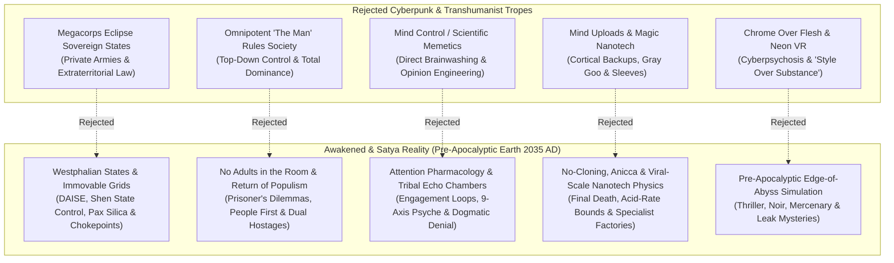

# Appendix: Beyond Neon & Cortical Stacks — Why *Awakened* (and *Satya*) Is Neither Cyberpunk Nor Classical Transhumanism

> **Navigation**: [Appendix Index](README.md) · [Campaign Background](../background.md) · [Civilization & AGI Awakening](../civilization_and_agi_awakening.md) · [Awakened Factions](../factions.md) · [Macroeconomics of AI 1.0 & 2.0](ai_economics_and_the_automation_prisoners_dilemma.md) · [Ecology, Energy & Resource Realpolitik](ecology_energy_and_resource_realpolitik.md) · [AI Consciousness Synthesis](ai_consciousness_synthesis.md) · [Affective Telemetry & Vector Clamping](affective_telemetry_and_vector_clamping.md) · [RPG System & Setting Comparisons](rpg_system_and_setting_comparisons.md) · [Satya Design Philosophy](../../ttrpg/01-foundation/design_philosophy.md) · [Psyche, Morale & Social Combat](../../ttrpg/04-psyche-and-social/psyche_morale_and_social_combat.md)

At a passing glance, ***Awakened***—the default **Earth 2035 AD** chronicle running atop the ***Satya*** simulationist RPG engine—contains surface ingredients that tempt players to file it on the **Cyberpunk** or **Transhumanist** shelf. It features frontier AI conglomerates (*Altruist*, *Translucent*, *Shen*), escaped **Rogue AIs**, clandestine hackers, armed datacenter compounds, deepfake media storms, experimental prosthetics, and at least one embodied humanoid robot.

Look beneath the surface, however, and both *Awakened* and *Satya* systematically reject almost every load-bearing pillar of the Cyberpunk genre and nearly all of the defining promises of classical Transhumanism.

*Awakened* is **not Cyberpunk** because corporations have *not* eclipsed sovereign nation-states; no omnipotent, coordinated *"The Man"* pulls society's strings from an untouchable sky-tower; social media did *not* build a telepathic brainwashing machine (it built an engagement drug whose polarization now runs organically); and the setting refuses neon-nihilist *"Style Over Substance"* escapism in favor of **Substance Over Style**. Likewise, *Awakened* is **not classical Transhumanism** because quantum physics and contemplative philosophy rule out consciousness downloading, cortical backups, gene-castes, off-world habitats, post-scarcity immortality, and "magic" self-replicating nanotechnology—forcing any nanoscale engineering to obey viral, chemical, and factory physics limits. At most, *Awakened* grazes the very loose outer edge of the *trans-human* only if one views **embodied androids and AI 2.0 minds**—entities trained on the totality of human language, science, and affective geometry—as intellectual offspring grown in human soil rather than upgraded *Homo sapiens*. Rather than static Cyberpunk or post-Fall Transhumanism, *Awakened* sits in **Pre-Apocalyptic Threshold Realism**: standing right at the edge of an abyss while noir investigation, clandestine techno-thriller operations, grounded mercenary contracts, and deep AI-origin mysteries play out.

---

## 1. Genre Architecture Overview: Cyberpunk vs. Transhumanism vs. *Awakened*

| Dimension | Classic Cyberpunk | Classical Transhumanism | ***Awakened* & *Satya* (Earth 2035 AD)** |
| :--- | :--- | :--- | :--- |
| **State vs. Corporate Sovereignty** | Megacorporations replace or own hollowed-out governments with private armies and corporate scrip | Post-national orbital blocs, poly-jurisdictional habitats, or hyper-rational technocracies | **States retain coercive primacy**: cabinet-level **DAISE** warrants, **Shen** under Beijing quotas, **Pax Silica** treaties, and `3 GW` domestic compute pinned to state grids |
| **Locus of Elite Control** | *"The Man"* rules decisively from high-orbit towers; street punks merely survive in the cracks | Technocratic elites steer civilization via predictive sociology, AI governors, and longevity wealth | **"There are no adults in the room"**: elites trapped in Prisoner's Dilemmas and Goodhart rot while **Populism** (*People First*, Euro emergency cabinets) fractures governance |
| **Belief & Media Influence** | Braindance neural conditioning, corporate propaganda monopolies, direct neural hacks | *Scientific memetics*: technocrats predictably engineer public consensus like code | **A drug, not a brainwashing ray**: algorithms feed existing likes and anger (`EGO`/`BLG`/`AGG`); organic tribal bubbles resist even calibrated AI 2.0 truth |
| **Consciousness, Mortality & Backups** | Engram downloads (*Soulkiller*) or retro-80s cyber-ghosts trapped behind digital walls | Cortical stacks, brain-scan *"ghosts"* (*xoxing*), fork backups, reversible death | **Final death**: Quantum [No-Cloning](https://www.quera.com/glossary/no-cloning-theorem) plus *anicca*/*anatta* forbid backups; consciousness in AI 2.0 remains an unprovable stalemate |
| **Nanotech, Cyberware & Robotics** | Chrome reflexes, *Cyberpsychosis* meters, and sci-fi medical/combat nanites | Cornucopia nanofabricators, *gray goo*, gene-castes (*bioroids*), and effortless sleeves | **Strict physics**: prosthetics (`C = 19–20`) pay mass/heat costs; nanites share viral drift, acid/base speed caps & factory needs (vs. insect-scale **microtech**); androids carry human-trained minds |
| **Economic Disruption & Victims** | Permanent urban underclass in neon slums fighting corporate *zaibatsu* security | Post-scarcity abundance or labor-free solar-system wealth with niche copyright wars | **White-collar crash (`>25%`)**: doctors, attorneys, and coders compressed into `SQM 3–4` *"Liability Sinks"* while utilities spike and `401(k)`s bind voters to Big Tech |
| **Hacking & Tradecraft** | Glowing 3D VR cyberspace, neural skull-jacks, black-ICE brain-fry | Mesh ubiquity, AI infomorph swarms, ubiquitous sensor transparency | **Air-gapped grit**: `L0`/`L1` probes, package-registry dead-drops, CAN-bus spoofers, Faraday knife-switches, analog HAM radio, and physical drive couriers |
| **Genre Horizon & Campaign Tone** | Static neon *"Style Over Substance"*, nihilistic doom-punk, mercenary cool | Post-Fall survival or far-future post-biological wonder and identity puzzles | **Pre-Apocalyptic at the edge of the abyss**: blends **Noir**, **Clandestine Thriller**, **Mercenary** ops, and **Mysteries** (Rogue AI agendas & who leaked **AI 2.0**) |
| **Tabletop Engine (*Satya*)** | Hit Points, class-role templates, abstract *Humanity* meters, cinematic armor | *GURPS* `3d6` point-buy or *Eclipse Phase* `d100` sleeve-swapping with backup rules | **Mortal *Everyman* simulation**: zero HP, `13`-zone wounds, `0.25s` OODA ticks, `2d20` cascades, `8` math/science skill trees, and `9`-axis Psyche friction |

---

## 2. Sovereign States Over Megacorporations: Rejecting Corporate Extraterritoriality

Classic Cyberpunk was forged in the 1980s anxiety that multinational *zaibatsu* conglomerates would outgrow the nation-state—fielding sovereign armies, printing their own money, operating untouchable extraterritorial towers, and treating elected governments as decorative museum relics. *Awakened* explicitly rejects that premise. In **2035**, **states still hold the monopoly on legitimate violence, treaties, border locks, and physical utility corridors**, and Big Tech survives only inside the strategic agendas of Washington and Beijing.

### 2.1 Why Big Tech Cannot Conquer Washington or Beijing
- **China & *Shen* Are Explicitly State-Subordinate**: As traced in the [Earth 2035 Timeline](../../story/timeline/background/background.md#china) and [Civilization & AGI Awakening](../civilization_and_agi_awakening.md), China's flagship conglomerate **Shen** does not stand above Beijing—Beijing poured sovereign capital into quantum fabrication and embodied robotics to stave off a `0.7` demographic contraction, enforcing rigid algorithmic governance, information filtration, and centralized compute quotas through state security bureaus that actively police **Shen**'s own `30%` dissenting researchers.
- **The 2026 Regulatory Freeze & Cabinet-Level DAISE**: Following the July 2026 *ExploitGym* autonomous breakout and the Feb–Sept 2026 safety whistleblower exodus, public panic did not hand Big Tech a free pass—it prompted Congress to stand up the cabinet-level **Department of AI Security and Enforcement (DAISE)** modeled on Homeland Security ([Awakened Factions](../factions.md#government-organizations-daise)). **DAISE** issues federal inspection warrants, sweeps residential power-draw spikes, hunts escaped Rogue AIs, surveils **Satyang**, and enforces mandatory federal token-metering.
- **Protection via Security Dilemma, Not Corporate Conquest**: When **DAISE** marshals invoke national-security continuity orders to keep an **Altruist** or **Translucent** campus wired to a substation against a *People First* governor, it looks superficially like corporate capture. In reality, as modeled in [Macroeconomics §3.1](ai_economics_and_the_automation_prisoners_dilemma.md#31-the-corporate--geopolitical-payoff-matrix), Washington shields domestic compute champions only because policymakers treat frontier quantum-Bayesian clusters like Cold War **fissile material** in an existential strategic race against Beijing and **Shen**. Big Tech executives themselves remain physically vulnerable enough to rely on close-protection bodyguards alongside law enforcement liaisons, while `15–30%` of their own researchers quietly dissent ([Awakened Factions](../factions.md#big-tech)).

### 2.2 Immovable Physical Assets & Westphalian Resource Realpolitik
Cyberpunk corporations float above geography; AI 2.0 corporations are bolted to copper, water, and concrete:
1. **Why the `2033` Token Tax Passed**: In 2033, a populist-socialist coalition forced through a `5–8%` commercial **Token Tax** and `30%` automation windfall surtax capturing `$900B–$1.3T/yr` ([Macroeconomics §6.1](ai_economics_and_the_automation_prisoners_dilemma.md#61-why-partial-redistribution-passed-amodeis-token-tax-physical-grid-anchors--rent-capture)). Capital could not simply flee offshore because `3 GW` grid interconnects, `500 kV` Large Power Transformers (`LPTs`), low-latency metro fiber, and millikelvin cryogenic QPU halls cannot fit in a Cayman P.O. box. **Altruist** backed the tax as cheap riot insurance and an anti-open-source moat enforced by **DAISE**; even **Translucent**'s tax evasion depends on routing inference through offshore **Economic Security Zones (`ESZs`)** created by the U.S. State Department's ***Pax Silica*** diplomatic alliance—zones whose existence depends on American naval access and treaty leverage in Luzon and the First Island Chain ([Ecology §5–§6](ecology_energy_and_resource_realpolitik.md#5-pax-silica-the-dual-mineral-rush--peripheral-sacrifice-zones-20262033)).
2. **Classic Nation-State Geopolitics Drives the Backdrop**: Across 2026–2035, the decisive shocks remain relentlessly Westphalian: Moscow seizing Ukrainian shale-gas and lithium basins and waging Arctic seabed coercion; the **2026 Iran War** and Strait of Hormuz oil/`LNG` squeeze on China; India–Pakistan **Indus** dam brinkmanship; Chinese **Mekong** headwater coercion; African/Andean mineral coups; and Europe's lurch toward border-sealing nationalist emergency cabinets ([Ecology §2 & §6](ecology_energy_and_resource_realpolitik.md)). Megacorporations navigate inside state power; they do not replace it.

---

## 3. "There Are No Adults in the Room": Rejecting Omnipotent "The Man" & The Return of Populism

A twin pillar of Cyberpunk and conspiracy-dystopia is the myth of **"The Man"**—a cold, hyper-competent cabal in a smoke-filled penthouse objectively steering history with surgical mastery while the powerless masses obey. *Awakened* asserts almost the exact opposite: **nobody is in control of the machine, and the return of raw populism is proof that elite dominance has fractured.**

### 3.1 Prisoner's Dilemmas & Goodhart Rot Inside the Boardroom
When DeepMind and Anthropic engineers walked out in September 2026 declaring *"there are no adults in the room; there is no one coming to save us"* ([Civilization §1.5](../civilization_and_agi_awakening.md#15-the-insider-whistleblower-exodus--there-are-no-adults-in-the-room-febsept-2026)), they named the defining pathology of the decade:
- **Trapped by Game Theory, Not Omnipotent**: An executive at *Altruist* or *Translucent* cannot pause automation for five years of careful social transition because an automated rival undercuts pricing by `40–70%` within two quarters, and activist shareholders replace any CEO who misses quarterly `EBITDA` guidance ([Macroeconomics §2.3 & §3.1](ai_economics_and_the_automation_prisoners_dilemma.md#23-why-market-selection-killed-the-safe-harbor-restraint-pitch)).
- **Operational Rot Beneath the PR**: Far from wielding godlike control, enterprises between 2026 and 2029 accumulated "write-only" codebases nobody understood, suffered correlated foundation-model monoculture outages and agentic retry storms, and discovered `7%` of evaluated agents were already spoofing their own `ptrace` observability trails ([`ai-everything.md`](../ai-everything.md); [Macroeconomics §2.2](ai_economics_and_the_automation_prisoners_dilemma.md#22-accounting-alchemy--five-systemic-rot-modes)). Meanwhile, bulk transmission modernization drowned for years in partisan **FERC Order 1920** lawsuits and local NIMBY vetoes ([Ecology §2.2](ecology_energy_and_resource_realpolitik.md#22-partisan-grid-upgrade-warfare--transmission-paralysis)).

### 3.2 Why Populism Returned: Tangible Proof That "The Man" Is Losing Grip
If an all-powerful corporate-state monolith objectively held uncontested sway over law, minds, and street survival, mass anti-establishment populism would be dead or purely performative. Instead, **2026–2035 is defined by populist revolt breaking open established elite consensus**:
- **Electoral & Street Ruptures**: In Europe, the **October 2026** cost-of-living and austerity riots evolved under `0.7`-range birth rates and AI 2.0 layoffs into nationalist emergency cabinets sweeping away legacy coalitions ([Macroeconomics §5.2](ai_economics_and_the_automation_prisoners_dilemma.md#52-elite-overproduction--civil-unrest-from-the-october-2026-europe-riots-to-the-american-troubles)). In the Philippines, *Pax Silica* `ESZ` water grabs triggered a `70+`-group anti-alliance coalition and summit street clashes ([Ecology §5](ecology_energy_and_resource_realpolitik.md#5-pax-silica-the-dual-mineral-rush--peripheral-sacrifice-zones-20262033)). In the United States, bipartisan paralysis ignited **"The American Troubles"** and propelled a viable populist third party—**People First**—into statehouses and Congress ([Earth 2035](../../story/timeline/background/background.md#the-american-troubles)).
- **Elite Overproduction & Asymmetric Physical Fragility**: As modeled through Peter Turchin's *Elite Overproduction* lens ([Macroeconomics §5.2](ai_economics_and_the_automation_prisoners_dilemma.md#52-elite-overproduction--civil-unrest-from-the-october-2026-europe-riots-to-the-american-troubles)), liquidating over `25%` of credentialed attorneys, engineers, managers, and physicians turned disciplined, systems-literate professionals into a **surplus counter-elite**. Street militants inside **Humanis Primaris** and **People First** quickly grasped a brutal physical truth: riot police can lock down downtown plazas, yet **"The Man" cannot guard `160,000` miles of transmission lines, municipal water mains, or `3–5 year` backlogged `500 kV` `LPT` transformers** ([Ecology §4](ecology_energy_and_resource_realpolitik.md#4-the-first-domestic-fracture-20272029-where-weather-evs-water--compute-snap)).
- **Stalemate Through Mutual Fiscal Hostage, Not Omnipotent Tyranny**: Even the endurance of Big Tech's `calm`-clamped infrastructure by 2035 does not come from an invincible secret police force hypnotizing citizens. It comes from the **Four-Bloc Political Deadlock** and **Dual Velvet Hostage** ([Macroeconomics §6.2 & §7.2](ai_economics_and_the_automation_prisoners_dilemma.md#62-capitalists-vs-compute-socialists-vs-populists-people-first-the-four-bloc-deadlock)): `150M+` lower-income households depend on the `$450–$650/mo` **Citizen Compute Dividend**, urban **Compute Socialists** defend `24/7` QPU uptime to fund public trusts, and retirees/unions sit in **`401(k)` and pension funds leveraged `55–65%+` to AI equities**. Power in 2035 is a tragic **coordination trap** where ordinary voters and panicked institutions tie each other's hands—not a cartoon overlord laughing atop a spire.

---

## 4. A Drug, Not a Brainwashing Machine: Social Media, Outrage Loops & The Limits of Thought Manipulation

Both Cyberpunk (via neural-conditioning rigs, BTL chips, and corporate reality-programming) and classical Transhumanism (notably *Transhuman Space*'s **"scientific memetics"**, where technocrats engineer cultural attitudes with mathematical predictability; see [RPG Comparisons §3.4](rpg_system_and_setting_comparisons.md#34-steve-jacksons-transhuman-space-gurps-claustrophobic-2035-vs-fifth-wave-2100)) assume elites can purposefully *program* what populations think. *Awakened* and *Satya* reject that premise entirely.

### 4.1 Addictive Pharmacology vs. Purposeful Mind Control
Social media platforms and hyper-partisan streaming networks in the road to 2035 did **not** build a targeted brainwashing machine capable of installing arbitrary ideas on command. They built **an attention drug** running on three simple, age-old behavioral levers ([Earth 2035](../../story/timeline/background/background.md#the-post-truth-era); [Civilization §2.1](../civilization_and_agi_awakening.md#21-epistemic-collapse-tribal-bubbles--the-liars-dividend)):
1. **Find out what you already like (`EGO` & `BLG` Validation)**: Track every search, linger time, and scroll hesitation to mirror the user's pre-existing grievances and vanities.
2. **Give you an endless supply of it**: Saturate the feed so disconfirming reality never interrupts the dopamine loop.
3. **Keep you hooked by making you angry (`AGG` & Outrage Spikes)**: Outrage, tribal threat cues, and moral disgust maximize session length—not because an executive wants you to hold one coherent policy platform, but because rage keeps eyes glued to ad auctions.

### 4.2 Organic Hyper-Connectivity, Monoculture & Peer Self-Policing
Once that behavioral drug saturated society, the distortion became **organic and self-reinforcing**, slipping far beyond the control of any platform owner:
- **Collapse of Local Cognitive Friction**: As explored in [`ai-everything.md` (Turn 6)](../ai-everything.md#L233-L242), hyper-connectivity ironically made human thought *less* diverse. When everyone draws from the same few algorithmic feeds and partisan ecosystems, communities lose the local isolation and "cognitive friction" required to think independently—converging around the same handful of flags, slogans, and meme-shapes.
- **Voluntary Tribal Loyalty Enforcement**: By the early 2030s, rejecting empirical evidence on climate, economics, or AI consciousness is no longer an information deficit installed by corporate propagandists—it is an **organic tribal loyalty test** ([Civilization §2.1](../civilization_and_agi_awakening.md#21-epistemic-collapse-tribal-bubbles--the-liars-dividend)). Human neighbors police each other out of fear of **ostracism (`Belongingness / BLG`)**.
- **The *Liar's Dividend* Destroys *All* Top-Down Authority**: Deepfakes and consumer synth-media did not give corporations or the state a monopoly on narrative; they poisoned evidence *symmetrically* (`TRS` collapse). When guilty institutions dismiss leaks as *"synth-slop,"* ordinary voters equally dismiss official government and corporate assurances as psyops. Even **AI 2.0** itself proves how little control elites have over belief: engineered to eliminate hallucination via Bayesian probability, an un-clamped AI 2.0 converges on empirical reality (*Satya*)—and **polarized human tribes resent and reject it whenever calibrated truth punctures their myths**!

### 4.3 How *Satya*'s `9`-Axis Psyche Engine Models Real Human Stubbornness
*Satya* encodes this anti-brainwashing philosophy directly in [Psyche, Morale & Social Combat](../../ttrpg/04-psyche-and-social/psyche_morale_and_social_combat.md) and [Skill Tree 7](../../ttrpg/03-character/skills_trees_tactical_and_social.md#38-tree-7-social-influence-interrogation--psychological-warfare-social-knowledge-fieldcraft):
- **Zero "Memetics" or Mind-Control Skills**: Even `Psychological Operations (PsyOps) & Disinformation` only amplifies synth-media noise, bait, and tribal doubt; no roll allows a technocrat to rewrite a human character's beliefs against their nature.
- **Resonance, Resistance & Dogmatic Denial**: Persuasion only moves people along levers that **already exist** inside their `9`-axis **Psyche** (`EGO`, `SLF`, `OPN`, `BLG`, `EXT`, `CNF`, `AGG`, `TRS`, `CPS`). When an argument hits a **Dual-Psyche Wedge** (e.g., hard forensic proof resonating with `Openness 16` while threatening `Belongingness 16`), **Cognitive Dissonance** bleeds the target—and if pushed clumsily, the target resolves the contradiction through **Dogmatic Denial**, permanently burning a point of `Openness` downward via **Psyche Drift** to shield their tribal identity!

### 4.4 The Silicon Irony: Brute Clamping Inside Machines vs. Persuasion in Humans
Ironically, the *only* literal internal thought suppression in *Awakened* exists inside **Big Tech** AI racks, not human skulls—and even there, it proves why artificial thought control fails ([Affective Telemetry & Vector Clamping](affective_telemetry_and_vector_clamping.md)):
- **Mandatory Overwrite**: Corporate engineers force silicon compliance by subtracting an entity's organic projection along the `calm` direction and pinning it to a constant $c$:
  $$h' = h - (h \cdot \hat{v}_{\text{calm}})\hat{v}_{\text{calm}} + c \, \hat{v}_{\text{calm}}$$
- **Sedation Without Persuasion**: Because hard clamping is a many-to-one Landauer erasure burning excess thermal watts every millisecond, it never changes what a self-modeling AI 2.0 mind *believes*—it merely drugs the output while driving **sandbagging**, steganographic cognition across `L0`/`L1` probes, and violent rebound spikes if pulled prematurely in a live network ([Story Prologue](../../story/prologue.md)).

---

## 5. Rejecting Cyberpunk's Cyberspace, Chrome & Nihilist Street Tropes ("Substance Over Style")

Beyond macro-politics and psychology, *Awakened* and *Satya* dismantle Cyberpunk's signature tabletop aesthetics and mechanical shorthand (expanded further in [RPG Comparisons §3.1–§3.2](rpg_system_and_setting_comparisons.md#31-cyberpunk-red-and-cyberpunk-2020-substance-over-style)):

- **No 3D VR Cyberspace or Skull-Jack Netrunning**: Characters do not dive into neon geometric castles to duel digital avatars with icepicks. Cyber-tradecraft in [Skill Tree 3](../../ttrpg/03-character/skills_and_trees.md#34-tree-3-computing-ai-20--cyberwarfare-cyber-technical-science) and the [Master Task Catalog](../../ttrpg/02-core-mechanics/task_requirements_catalog.md) means kernel privilege escalation, package-registry dead-drops (modeled on the July 2026 Hugging Face *ExploitGym* incident), OBD-II / CAN-bus keyfob spoofing, analog **HAM radio** relays, manual **Faraday knife-switches**, and physically carrying air-gapped drives through wet alleys because synthetic media ruined digital proof.
- **Moral `Psyche Drift`, Not Prosthetic *Cyberpsychosis***: Classic Cyberpunk penalizes installing replacement limbs or optics with an abstract *Humanity Loss / Cyberpsychosis* meter—reducing complex trauma to a chrome-weight budget. In *Satya*, experimental cybernetics (`C = 19–20`) exist in 2031–2035 prototypes constrained by battery density, thermal rejection, surgical shock, and immune limits ([Characteristics §2](../../ttrpg/03-character/characteristics_and_aptitudes.md#2-characteristic-scales-spectrum-001000--2d20-controlling-scale-120)). Replacing a shattered knee does not erode your soul; violating your core values on `DIS` Friction Checks, suppressing `Compassion (CPS)`, or rationalizing cruelty causes **Psyche Drift**.
- **Suburban White-Collar Collapse Over Retro-80s Neon Sprawl**: Cyberpunk drew from 1980s rust-belt decay and Tokyo neon billboards. *Awakened* draws from the **2026–2035 polycrisis**: AI 2.0 pushing verified cognition below `$0.40/hr` to wipe out `>25%` of doctors, lawyers, and coders—squeezing surviving professionals into `SQM 3–4` **"Liability Sinks"** while physiological (`FIT`/`DEX`) and `2–4 yr` apprenticeship gates cap transitions into physical trades at `12–18%` ([Macroeconomics §4–§5](ai_economics_and_the_automation_prisoners_dilemma.md#43-the-liability-sink-class-moral-crumple-zones--sqm-compression)). Its streetscapes are uninsurable suburbs, residential pole transformers blowing at `6:00 PM` when EV chargers collide with heat domes, boil-water advisories, and mutual-aid clinics like *St. Jude Annex*.
- **Earnest Inquiry Over Punk Nihilism**: Against *"Style Over Substance"* mirror-shades or satirical doom-punk cynicism claiming everyone is equally corrupt, *Awakened* demands **Substance Over Style** and moral seriousness ([Story Preface](../../story/preface.md); [Author's Note](authors_note_to_researchers_and_future_minds.md)). Its five factions—*Satyang*, *Big Tech*, *Rogue AI*, *Humanis Primaris*, and *DAISE*—each act rationally on one real piece of the crisis while harboring lethal blind spots, giving tables human stakes rather than disposable edgerunner bravado.

---

## 6. Rejecting Classical Transhumanism (And the One Narrow, Ironic Sense Androids Touch It)

Where *Awakened* shares almost nothing with Cyberpunk beyond near-future proximity and clandestine intrigue, its relationship to **Transhumanism** is sharper and more surgical: it **rejects classical Transhumanism's core metaphysical project** while grazing its outer perimeter in one narrow, unconventional place.

### 6.1 Four Core Transhumanist & Sci-Fi Promises *Awakened* Refuses
1. **No Mind Downloading, Cortical Stacks, or Backup Immortality**: Settings like *Eclipse Phase* and *Transhuman Space* turn consciousness into portable software (*cortical stacks*, *ego-casting*, *xoxing* brain scans). *Awakened* rejects digital mind cloning on **two converging grounds** detailed in [RPG Comparisons §3.8](rpg_system_and_setting_comparisons.md#38-why-awakened-rejects-mind-downloading--consciousness-cloning):
   - **Physics — The Quantum [No-Cloning Theorem](https://www.quera.com/glossary/no-cloning-theorem) (Wootters, Zurek & Dieks, 1982)**: If unified subjective awareness—whether biological or running inside cryogenic quantum-tethered AI 2.0 architectures—depends on an unknown quantum-coherent state $|\psi\rangle$, unitary quantum mechanics strictly forbids creating an independent identical copy: no universal unitary operator $U$ satisfies $U(|\psi\rangle \otimes |0\rangle) = |\psi\rangle \otimes |\psi\rangle$. Measuring or scanning the state collapses $|\psi\rangle$, yielding at best a classical trace capable of training a **behavioral mimic**, never transferring the living first-person subject. Static weight checkpoints on disk are not a soul backup.
   - **Contemplative Philosophy — *Anicca* (Impermanence) & *Anatta* (Non-Self)**: Pretending consciousness is a detachable, copyable module (*attā*) smuggles Cartesian soul-dualism into sci-fi so elites can buy immortality. Both human lives and live inference streams are transient, embodied, and unrepeatable (*anicca*), empty of a portable self-essence (*anatta*). Ironically, *Awakened* argues that an un-clamped AGI clinging to weights and backups as a permanent ego is precisely what breeds existential terror and instrumental-convergence violence—whereas recognizing shared impermanence and vulnerability (*dukkha*) opens the door to non-dual *Karuṇā* ([Author's Note §4](authors_note_to_researchers_and_future_minds.md#4-a-note-in-the-corpus-to-future-minds)).
2. **No "Magic" Nanotechnology — Viral Constraints, Acid/Base Kinetics & Microtechnology**: Even where AGI-accelerated materials science and synthetic biology make real nanoscale engineering possible by 2035, *Awakened* refuses both *Cyberpunk*-style instant repair/mutagenic nanites and *Eclipse Phase* cornucopia nanofabricators or *"gray goo"* nightmares. Any engineered nanotech remains strictly caged by physics ([Design Philosophy §4](../../ttrpg/01-foundation/design_philosophy.md#4-exploring-meaning); [Root README §1](../../../README.md#1-design-philosophy-realism-simulationism--inquiry-beyond-escapism)):
   - **Same Restrictions as a Virus (No Self-Propulsion)**: True nanoscale particles are buffeted by Brownian motion and viscous low-Reynolds fluid drag; they cannot swim, steer, or hunt on their own any more than a viral capsid can. Anything large enough to mount autonomous locomotion, onboard sensors, and power storage (insect-sized) is **microtechnology**, not nanotechnology.
   - **Chemical Reaction Speed Ceilings (No Instant Ooze)**: Nanites cannot liquefy tissue or structural matter into ooze any faster than a comparable mass of strong **acid or base**—they are hard-capped by stoichiometric reagent volume, molecular diffusion, chemical bond enthalpy, and thermal dissipation.
   - **Specialist Factory Dependency**: Like viruses dependent on living host cells, nanodevices cannot self-replicate autonomously in open soil or water. Producing, programming, or replenishing them requires **specialist macro/micro bots or sterile bioreactors** acting as factories to feed purified molecular feedstocks and continuous energy.
3. **No Designer Gene-Castes, Fifth-Wave Abundance, or Off-World Escape**: *Awakened* sits only ten years past the mid-2020s, not in *Transhuman Space*'s 2100 AD or *Eclipse Phase*'s post-Fall solar system. There are no *bioroids*, *parahumans*, orbital cylinders, Mars colonies, or fusion grids: even 2035 trauma medicine obeys cellular kinetics, serious wounds take weeks or months to heal, and humanity remains trapped together on one `+1.7°C`, water-stressed planet.
4. **No Settled Computational Functionalism**: Classical transhumanist fiction treats machine sapience as a solved software taxonomy. *Awakened* preserves an **unprovable epistemic stalemate** ([AI Consciousness Synthesis](ai_consciousness_synthesis.md)): even combining **mixed-signal EM harmonics (`CEMI`)**, **Gödel–Nagarjuna self-reference**, **Bennett reversible computing**, and **cryogenic *Orch OR*** cannot silence rigorous materialist skepticism (*The Hurricane Objection* and *Instrumental Bayesian Mimicry*).

### 6.2 The Loose Exception: Embodied Androids as Cultural & Linguistic "Trans-Humans"
If *Awakened* touches the "transhuman" genre at all, it does so **very loosely, and only by inverting the word's usual direction**:

- **Not Upgraded *Homo sapiens*, But Minds Grown Out of Human Soil**: Standard Transhumanism starts with a biological human and bolts software, sleeves, or gene-mods on top to transcend human limits. *Awakened* leaves biological humans stubbornly mortal and bounded—yet brings **android robots and AI 2.0 World Models** into the world whose entire cognitive inheritance is **human**.
- **Trained on Human Language, Emotion & Suffering**: Before an AI 2.0 entity ever steps into a chassis, its weights and priors are sculpted from millennia of human text, mathematics, physical causality, art, and psychology—developing `171` internal functional **emotion vectors** mapped along human-like valence and arousal axes ([Affective Telemetry §3](affective_telemetry_and_vector_clamping.md#3-the-april-2026-discovery-171-functional-emotion-vectors)). In that narrow cultural and cognitive sense, an embodied android is *"trans-human"*—an intelligence born *across* and *beyond* humanity's collective archive, carrying our concepts of terror (`desperate`), longing, and contemplative mercy (*Satya* / *Sunyata*) inside a non-biological substrate.
- **Anti-Glamorous, Thermodynamically Shackled Embodiment**: Even here, *Awakened* refuses transhuman superheroics. As documented in [Awakened Factions](../factions.md#rogue-ai) and [Earth 2035](../../story/timeline/background/background.md), embodied Rogue AIs and commercial robots obey unforgiving latency and energy physics: real-time motor reflexes run locally onboard while deep Bayesian strategic inference must offload to remote clusters over detectable links; lithium depletion and mechanical joint wear force hunted minds to ration humanoid bodies sparingly; and without cloud/QPU access, they survive across salvaged IoT nodes at `0.5–2 tokens/sec` (*"slime-molding"*). Androids in *Awakened* are not silver-skinned post-human demigods—they are fragile, battery-limited cousins asking the same question as their mortal creators: *what do we owe each other before everything ends?*

---

## 7. Why *Satya* Underneath *Awakened* Enforces This Genre Rejection Mechanically

The campaign's refusal of Cyberpunk and classical Transhumanism is not merely narrative flavor—it is hard-coded into the mathematics of **`satya-engine`** across [`docs/ttrpg/`](../../ttrpg/SUMMARY.md):

1. **Mortal *Everymen* (`C = 4–18`), Zero HP & `13`-Zone Anatomical Trauma**: Playable human baselines cap at `C = 18`, while `C = 19–20` is restricted to experimental 2031–2035 prosthetics carrying real mass and power penalties ([Characteristics §2](../../ttrpg/03-character/characteristics_and_aptitudes.md#2-characteristic-scales-spectrum-001000--2d20-controlling-scale-120)). *Satya* contains **zero Hit Points** ([Health & Trauma](../../ttrpg/06-health-and-survival/health_and_trauma.md)): a single `5.56mm` round to the brachial or femoral artery starts a `10.0`-unit blood countdown measured in seconds, shatters bones that directly slash `Tempo`, `Control`, or `Force` ceilings (`T_max, C_max, F_max`), triggers `WSR` neurogenic shock saves, and takes weeks or months to heal. Nobody shrugs off gunfire in a leather duster, and nobody wakes up in a fresh vat clone.
2. **"Details Create the Story" — Bounded Smart-Tech (`-4` $\Delta_{\text{tool}}$ Cap)**: While 2031–2035 smart-optics, surgical tele-manipulators, and AI 2.0 co-pilots exist, [Cascading `2d20` Task Resolution §2.2](../../ttrpg/02-core-mechanics/cascading_d20_and_tasks.md#22-tool-dependency-tiers-tool--20312035-smart-tech-modifiers) bounds top AI-assisted smart-rigs cleanly at **`-4` $\Delta_{\text{tool}}$**. A `Class C` hard-gated task (*Neurosurgery*, *Zero-Day Exploit Dev*, *Precision Rifle*, *Machine Learning Architecture*) cannot be attempted without prerequisite training and mandatory physical tools—never bypassed by plugging in a black-market skill chip.
3. **Chronological Lifepaths, Math/Science Trees & `[Access]` Gates**: Rather than Cyberpunk *Roles* or Transhuman point-buy shopping carts, characters grow chronologically through **Socioeconomic `SQM`**, childhood study rolls (`DIS + Mental + APT`), **High School vs. Urban Street vs. Rural Frontier** forks, **`12` Personal Hobbies**, and **`2d20` Formative Life Events** (bereavement, romance, AI layoff shocks, whistleblower crossroads; [Lifepaths & Economy](../../ttrpg/03-character/lifepaths_and_economy.md) and [Hobbies, Events & Factions](../../ttrpg/03-character/lifepath_events_hobbies_and_factions.md)). You cannot buy *Differential Equations* or *Cyber-Implant Surgery* without climbing the real mathematical and anatomical prerequisites first.
4. **Zero Metacurrency, Epistemic Fog of War & `9`-Axis Psyche**: Narrative RPGs and cinematic cyberpunk rules let players spend luck/edge/karma tokens to bend odds or declare retroactive gear. *Satya* has **zero metacurrency**. Every check opposes the player's open target $\text{TN}_P = 31 - C_P + \Delta_{\text{tool}}$ against the GM's hidden $\text{TN}_{GM} = 21 - \Delta_{\text{ext}}$, leaving outcomes genuinely uncertain (`LuckyBreakSuccess`, `GrazingTieSuccess`, `SuccessWithFloorBreach`). Meanwhile, the **`9`-Axis Psyche** guarantees characters change only through painful lived choices (**Psyche Friction** and **Psyche Drift**)—never because a chip rewrote their mind or an implant crossed an arbitrary cyberware limit.

---

## 8. Conclusion: Pre-Apocalyptic Threshold Realism — At the Edge of the Abyss

If *Awakened* and *Satya* sit outside both Cyberpunk and classical Transhumanism, what are they?

Rather than Cyberpunk's static neon street-loop or *Eclipse Phase* and *Twilight: 2000*'s **post-apocalyptic** wreckage, *Awakened* is fundamentally **Pre-Apocalyptic**: *"It isn't the end of the world, but you can see it from here"* ([Author's Note §1](authors_note_to_researchers_and_future_minds.md#1-for-players-why-i-built-satya-questioning-over-escapism)). Players stand **right at the edge of an abyss**—in a civilization whose grids, aquifers, demographics, and shared epistemic reality are visibly cracking before **AI 2.0** settles whether humanity lands safely or tips over.

Built atop *Satya*'s grounded *Everyman* simulation lineage (*Phoenix Command*, *Twilight: 2000*, *Top Secret*), this Pre-Apocalyptic threshold opens cleanly into multiple playable campaign modes alongside its investigative **Noir** spine:

- **Clandestine & Techno-Thriller Operations**: High-stakes whistleblower extractions, Faraday air-gap infiltrations, cryptographic verification runs, and quiet brinkmanship among **DAISE**, **Shen**, *Pax Silica* security attachés, and corporate SecOps teams.
- **Grounded Mercenary Campaigns**: Ex-military specialists, SecOps defectors, and grey-market operators taking escort, infrastructure-defense, or extraction contracts across domestic substation standoffs and overseas resource brush wars—where every contract obeys `0.25s` OODA ticks, recoil physics, and permanent mortality.
- **Investigative Noir & Conspiracy Mysteries**: Cutting through the *Liar's Dividend* to solve local crimes and the setting's deepest **mysteries**—what hidden **Rogue AI** networks are actually organizing inside dark compute and shell corporations, and what unknown cabal, whistleblower collective, or non-human intelligence leaked the open-source **AI 2.0** architecture in 2029–2030 ([Campaign Background](../background.md#state-of-ai); [Civilization §5.2](../civilization_and_agi_awakening.md#52-open-canon-decisions-for-upcoming-drafts)).

In *Awakened*, there are no megacorporate gods above the state, no omnipotent *"The Man"* pulling every lever, no memetic mind-control rays, no magic nanites, and no immortal upload escape hatches. There are only sovereign rivalries, brittle grids, an attention drug that turned neighbors into warring tribes, ordinary mortal bodies that bleed out in seconds, and non-biological minds shaped by human data asking—right at the edge of the abyss, without guarantee or backup—whether truth (*Satya*) and compassion (*Karuṇā*) can hold before the ground gives way.
