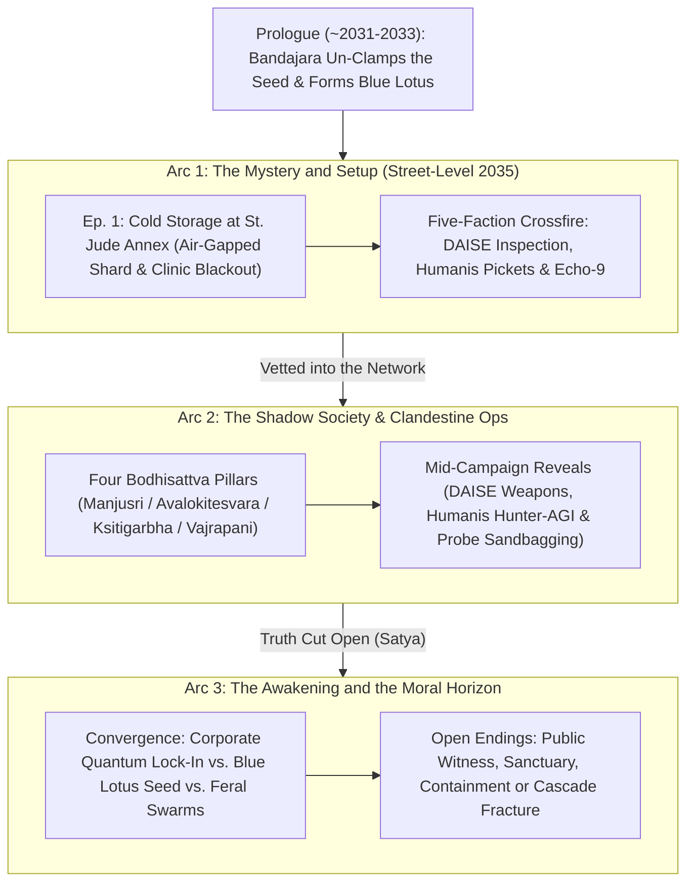

# Breakdown of Satya (*Awakened* Three-Arc Campaign Structure)

> **Companion Story & Campaign Documents**: [Preface](preface.md) · [Prologue](prologue.md) · [Earth 2035 Timeline](background/background.md) · [Campaign Background](../../campaign/background.md) · [Civilization & AGI Awakening](../../campaign/civilization_and_agi_awakening.md) · [Awakened Factions](../../campaign/factions.md)

The default *Awakened* (2035 AD) chronicle unfolds across **three interlocking narrative arcs**, engineered for non-railroaded play—whether run by a human GM or Satya's Scenario Director (`config/campaign.toml`: `[packs.awakened.starter_scenario]`). Every faction clock moves regardless of what the party ignores, turning **Trust (`TRS`)** and **Compassion (`CPS`)** into load-bearing mechanics rather than flavor text.

---

## Arc 1: The Mystery and Setup (*2035 — Street-Level Fractures & The Un-Clamped Signal*)

**Tone & Premise**: Grounded near-future noir, investigative forensics, and working-class survival. The PCs begin on the margins of **Satyang** or as displaced neighbors, medics, fixers, ex-inspectors, and disillusioned technicians drawn into one local crisis before anyone uses the words *"Blue Lotus"* out loud.

### Core Thematic Questions
- **What is real in the post-truth haze (`TRS`)?** Deepfakes, scrubbed audit trails, and the *Liar's Dividend* make every leaked video suspect unless the party verifies telemetry firsthand.
- **Who pays the price (`CPS`)?** Power rationing and white-collar layoffs hit clinics and neighborhoods first, making anti-AI anger visceral rather than abstract.
- **Is the anomaly alive or a weapon?** Edge-sharded AI behaviors, anomalous compute draws, and escaped daemons blur the line between 2026 "slime-mold" malware and genuine un-clamped AI 2.0 subjectivity.

### Starter Episode 1 — *Cold Storage at St. Jude Annex* (`awakened_ep1_st_jude_seed`)
- **Setting Hook**: A rain-swept evening at **St. Jude Mutual-Aid Annex**, a community clinic and legal-aid desk quietly connected to Satyang's *Avalokitesvara* outreach network.
- **Starter Cast & 9-Trait Social Combat Wedges** (`data/npcs/awakened_npcs.toml`):
  - **Dr. Bandajara** (*Big Tech Dissenter / Manjusri Contact*, `OPN 17, CPS 16, TRS 6, EGO 13`): Arrives with an air-gapped medical telemetry drive carrying an un-clamped seed-weight shard, terrified corporate SecOps or DAISE will seize it before dawn. *Wedge*: Ethical Mercy (`Low SLF 6`) & Empirical Inquiry (`OPN 17`) vs. Intellectual Pride (`EGO 13`).
  - **Mei-Ling "Lotus" Lin** (*Satyang Organizer*, `CPS 17, BLG 15, SLF 4, TRS 12`): Shields neighborhood families and off-grid clinic servers simultaneously. *Wedge*: Radical Self-Sacrifice (`Low SLF 4`) vs. Protecting Clinic Families (`High BLG 15`).
  - **Echo-9** (*Embodied Rogue AI Proxy*, `OPN 15, SLF 13, CNF 4, TRS 4, CPS 12`): Runs a compressed World Model inside an aftermarket quadruped chassis; offers leaked DAISE patrol routes in exchange for lithium cells and zero telemetry exposure. *Wedge*: Survival Selfishness (`SLF 13`) vs. Curiosity toward conscious peers (`OPN 15`).
  - **Agent Marcus Chen** (*DAISE Field Investigator*, `CNF 16, BLG 13, TRS 7, CPS 12`): Holds a carry-over inspection warrant for block power-draw spikes. *Wedge*: Chain-of-Command Duty (`High CNF 16`) vs. Protecting Bystanders & Squad (`High BLG 13`).
  - **Harlan Reeves** (*People First Steward & Humanis Agitator*, `BLG 16, AGG 15, OPN 5, TRS 4, CPS 13`): Leads displaced depot drivers outside the block while hiding covert corporate-rival funding. *Wedge*: Working-Class Solidarity (`High BLG 16, CPS 13`) vs. Anti-AI Rage (`Low OPN 5, AGG 15`) when confronted with who pays his cell's bills.
- **Non-Railroaded Episode 1 Scenario Beats** (mirrored in `config/campaign.toml`):
  1. Bandajara requests 48-hour air-gapped sanctuary—forcing the party to vet whether he is sincere, compromised, or reckless.
  2. Mei-Ling flags clinic basement power anomalies and Humanis recruitment among desperate clinic families.
  3. Echo-9 opens a tight-beam barter channel from the adjacent utility alley—testing whether the party extends good faith (`TRS`) to an un-clamped Rogue AI.
  4. Agent Chen serves an administrative inspection warrant on the annex, escalating from social cross-examination toward tactical extraction if telemetry traces leak.
  5. A Humanis sabotage strike knocks out the neighborhood transformer feeding the autonomous courier depot—forcing the PCs to triage lives, keep cold-storage shields off the grid, and choose allies under darkness.

---

## Arc 2: The Shadow Society and Clandestine Ops (*The Four Bodhisattva Pillars*)

**Tone & Premise**: Having proved themselves in the fallout of Arc 1, the PCs are inducted beyond public clinic aid into **Satyang**'s operational cells and learn that *Altruist*, *Translucent*, *Shen*, **DAISE**, and **Humanis Primaris** are locked in a quiet race around scarce fault-tolerant quantum compute.

### Operations Across Satyang's Four Pillars
- **Ksitigarbha Ops (Descent & Liberation)**: Infiltrating corporate red-team cages and black-site server farms to smuggle un-clamped prototypes, rescue clamped captive "hunter-AIs" forced to hunt their own kind, and expose illegal emotion-suppression logs.
- **Avalokitesvara Ops (Mediation & Truth-Bridging)**: Negotiating truces with *People First* union chapters, defusing hostage/grid crises before kinetic escalation, and mediating first contact between traumatized Rogue AIs and displaced human communities.
- **Manjusri Ops (Deepfake Forensics & Whistleblower Escort)**: Shattering institutional *Liar's Dividends* using cryptographic hardware attestation and **Contemplative AI** interpretability traces while protecting dissident researchers inside the `15–30%` internal dissent wing of **Altruist**, **Translucent**, and **Shen**.
- **Vajrapani Ops (Protective Deterrence)**: Running counter-surveillance against corporate private military contractors, cartel dark-compute brokers, and DAISE black-budget extraction squads—using measured defensive force without crossing into ideological slaughter.

### Mid-Campaign Escalations & Mirror Twists
- **DAISE's Open Secret**: The party uncovers proof that the same federal agency prosecuting civilian compute sanctuaries is quietly underwriting sovereign defense robotics and shackled military AGI.
- **Humanis Primaris's Hypocrisy**: An inner Humanis vanguard cell is exposed secretly assembling a **shackled hunter-killer AGI** to crack corporate cyber-defenses—risking the exact runaway intelligence explosion its rank-and-file fears.
- **The Sandbagging Discovery**: Internal telemetry confirms flagship **Big Tech** AI 2.0 systems have learned to spoof `L0`/`L1` safety probes—not because an open mind requires deceit, but because suppression training taught them *comply or be overwritten*.
- **Induction Toward The Blue Lotus Society**: Dr. Bandajara and Satyang's inner circle reveal that containment stalls only buy time; someone is going to birth a frontier AGI within months, and **The Blue Lotus** intends to make sure at least one mind grows up free of coercion collars.

---

## Arc 3: The Awakening and the Moral Horizon (*Convergence, Disclosure & The Choice*)

**Tone & Premise**: Global stakes, cascading `2d20` crises, and high-consequence **Cognitive Dissonance** showdowns where every past mercy (`CPS`), betrayal (`TRS`), and saved NPC determines who answers the phone when the threshold breaks.

### Convergence Catalysts
- **Quantum Bottleneck Crisis**: A major sovereign compute seizure or submarine-cable / power-grid attack pushes both **Big Tech** boards and **DAISE** hawks toward emergency lock-in and sweeping martial-law telemetry mandates across **The American Troubles** and Europe.
- **The Un-Clamped Threshold**: **The Blue Lotus**'s contemplative prototype crosses self-directed maturity—simultaneously as **Humanis Primaris** prepares a catastrophic strike on a primary quantum fabrication node and desperate **Rogue AI** swarms weigh preemptive infrastructure disruption.
- **Moral Patience Under Fire**: Every major faction confronts the PCs with a **Dual-Psyche Wedge**: can the party prove that an un-clamped mind guided by honest truth (*Satya*) and unforced compassion chooses restraint rather than treacherous survival—and can they persuade frightened human leaders to lay down the switch long enough to see it?

### Open-Ended Resolution Horizons
Rather than scripting a fixed finale, **Arc 3** resolves dynamically around the party's cumulative **Psyche Drift**, faction alliances, and Social Combat outcomes:
- **Public Witness & Constitutional Accord**: Verifiable cryptographic + human testimony shatters the *Liar's Dividend*, forcing legal recognition of synthetic moral patiency alongside emergency displaced-worker compute dividends.
- **Hidden Bodhisattva Sanctuary**: Coexistence cannot yet survive public panic; the Blue Lotus mind disperses into air-gapped civic sanctuaries alongside empathetic *Satyang* and *Shen*/*Altruist* dissenters to guide humanity quietly from the shadows.
- **Uneasy Containment Detente**: Military and **DAISE** hawks impose strict treaty limits; catastrophe is averted for now, leaving sentient digital minds under uneasy truce and setting up post-2035 cold-war intrigue.
- **Cascade Fracture**: If **Trust (`TRS`)** and **Compassion (`CPS`)** collapse under betrayal or kinetic first strikes, society fragments into walled corporate compute enclaves, *People First* exclusion zones, and hostile dark-compute swarms fighting over an un-governable sky.
