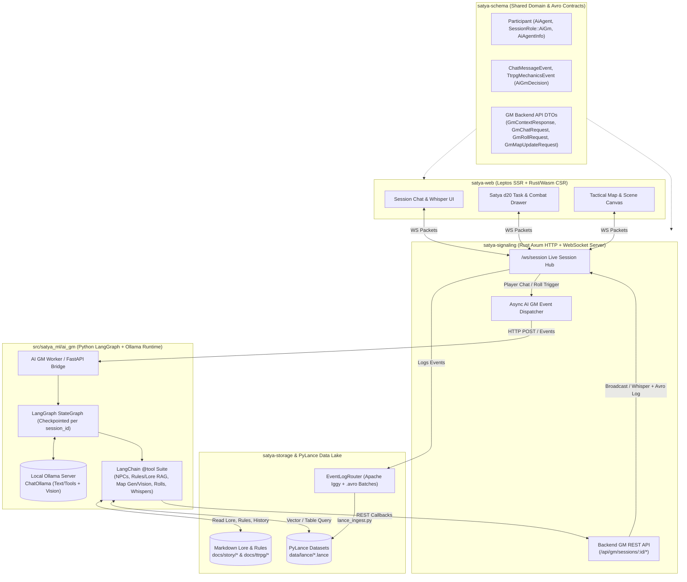
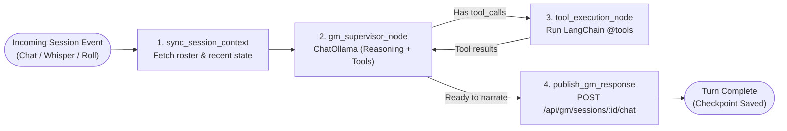
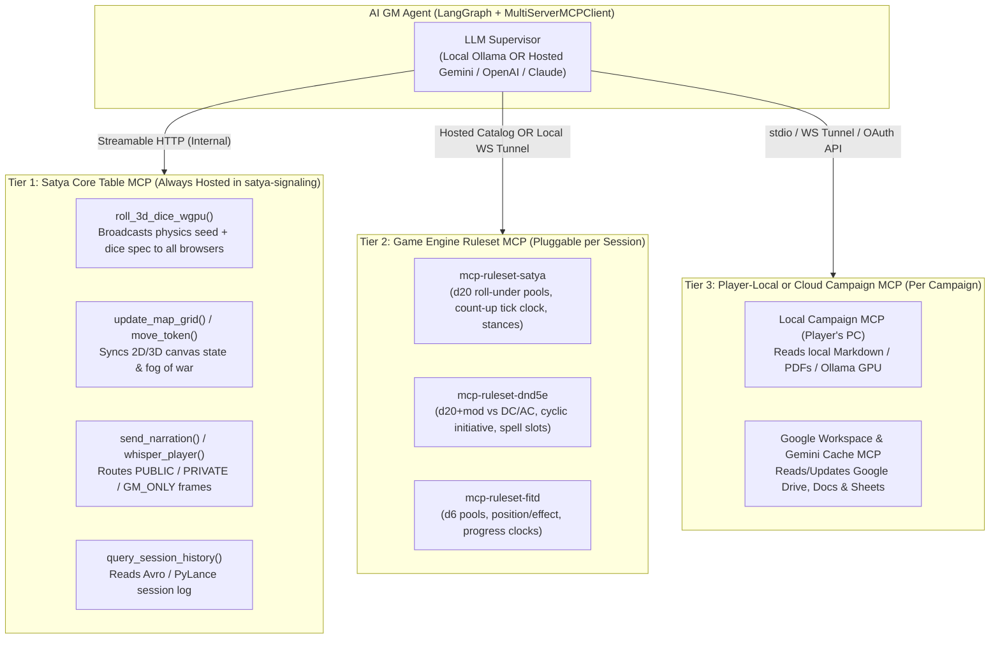
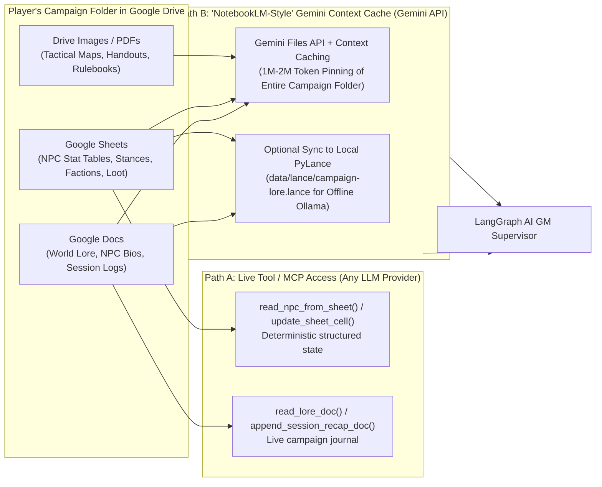
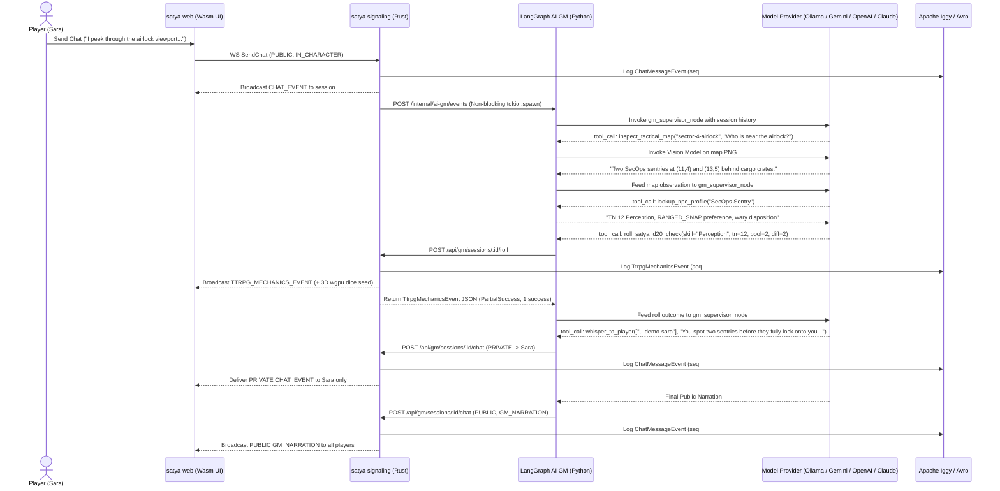

# Satya Autonomous AI Game Master (LangGraph + LangChain + Ollama) — Technical Design

## 1. Overview & Architectural Context

Satya is a polyglot **Rust + Python** platform combining real-time WebRTC audio/video, targeted session chat, Satya d20 roll-under TTRPG mechanics, and an Apache Iggy + Apache Avro + PyLance event-streaming pipeline.

While the core signaling server (`satya-signaling`) and shared wire schemas (`satya-schema`) already model an autonomous AI Game Master participant via:
- `ParticipantKind::AiAgent` and `SessionRole::AiGm`
- `AiAgentInfo { model_id, persona_id, temperature }`
- `MessageVisibility::GmOnly` and `ChannelContext::GmNarration`
- `MechanicEventType::AiGmDecision` in `TtrpgMechanicsEvent`

the current in-process handler (`trigger_ai_gm_chat_reply` in `crates/satya-signaling/src/lib.rs`) is a deterministic stub.

This document specifies the design for replacing that stub with a **stateful, tool-calling AI Game Master Agent** built with **LangGraph**, **LangChain**, and local **Ollama** models (`langchain-ollama`) inside the Python `src/satya_ml/` package, connected to `satya-signaling` through a dedicated **Backend GM API**.

### Key Capabilities of the AI GM Agent
1. **Stateful Multi-Step Workflows (LangGraph)**: Maintains per-session campaign state, scene context, active count-up combat clocks, and turn memory across player interactions.
2. **Local LLM + Vision Inference (Ollama)**:
   - **Reasoning & Tool-Calling Model** (e.g., `gemma4:12b`, `qwen3`, or `llama3.1`) for rules adjudication, NPC roleplay, and structured tool execution.
   - **Multimodal Vision Model** (e.g., `llama3.2-vision` or `gemma4`) for inspecting tactical maps, room layouts, and token positions.
3. **Rich Tool Execution (`@tool`)**:
   - Reading and updating **NPC personalities, abilities, dispositions, and fatigue/wound states**.
   - Querying **Satya TTRPG rules** (`docs/ttrpg/*.md`), **world lore** (`docs/story/**/*.md`), and **historical session logs** stored in PyLance (`data/lance/*.lance`).
   - **Generating, updating, and visually inspecting tactical maps** pushed to the session UI.
   - Executing authoritative **Satya d20 roll-under task and combat checks** (`TtrpgMechanicsEvent`) and sending **public narrations** (`GM_NARRATION`), **NPC dialogue** (`IN_CHARACTER`), or **targeted private whispers** (`PRIVATE`) back to players via the backend API.

### 1.1 Three TTRPG Operating Topologies: Autonomous AI GM vs. AI GM Assistant (Co-Pilot)

In addition to `MEETING` mode (`Host + Attendees`), Satya supports **three distinct TTRPG session topologies** in `#session-mode-select`:

| Mode Option Value | UI Label | Human Roles Allowed | AI Participant Present? | AI Operating Behavior & Persona |
| :--- | :--- | :--- | :--- | :--- |
| `TTRPG` | **TTRPG Mode (GM + Players)** | `GM`, `PLAYER`, `OBSERVER` | No (`enable_ai_gm = false`) | Traditional human-run tabletop session; no AI agent in the roster. |
| `TTRPG_GM_AI` | **TTRPG Mode (GM + AI + Players)** | `GM`, `PLAYER`, `OBSERVER` | Yes (`enable_ai_gm = true`, **Co-Pilot / MCP Assistant Mode**) | The **Human GM** is the primary storyteller and authority. The AI acts as a **GM Assistant & MCP Tool Operator**: it listens for whispered/directed commands from the Human GM (e.g., *"Look up Captain Vance's stats"*, *"Generate a 20x15 cargo bay map"*, *"Roll 3d20 for the two sentries"*), executes the corresponding MCP tools, and replies privately (`PRIVATE` / `GM_ONLY`) to the Human GM unless explicitly asked to broadcast to the table. |
| `TTRPG_AI_GM` | **TTRPG Mode (AI GM + Players)** | `PLAYER`, `OBSERVER` *(no human GM)* | Yes (`enable_ai_gm = true`, **Autonomous Solo AI GM Mode**) | The **AI GM** is the sole Game Master at the table: it proactively adjudicates player actions and rolls, controls NPCs (`IN_CHARACTER`), narrates scenes publicly (`GM_NARRATION`), and sends private perception whispers (`PRIVATE`) to players. |

#### How LangGraph Switches Between `TTRPG_GM_AI` (Co-Pilot) and `TTRPG_AI_GM` (Autonomous)
The LangGraph supervisor node inspects whether a human participant with `SessionRole::Gm` is present in `roster`:
- **When a Human GM is present (`TTRPG_GM_AI`)**:
  - **Trigger Filter**: The AI Assistant only wakes up when directly addressed (`@satya_ai_gm` or `/msg @satya_ai_gm ...`) or when the Human GM sends a `GM_ONLY` / `PRIVATE` instruction. It does **not** interrupt or overwrite the Human GM on normal public player chat.
  - **Default Output Visibility**: Tool outputs (NPC stat lookups, lore summaries, hidden dice rolls, draft scene descriptions) default to **`MessageVisibility::Private` targeted only at the Human GM**, except when the Human GM asks the AI to perform a table-wide action (such as `generate_tactical_map`, `move_map_token`, or rolling public 3D `wgpu` dice).
- **When no Human GM is present (`TTRPG_AI_GM`)**:
  - **Trigger Filter**: The AI GM responds to all `IN_CHARACTER` player actions, `GM_ONLY` whispers, and `TtrpgMechanicsEvent` rolls.
  - **Default Output Visibility**: World narration defaults to `MessageVisibility::Public` (`ChannelContext::GmNarration`), while secret character observations use `MessageVisibility::Private`.

---

## 2. Module Boundaries Across the Workspace



| Layer / Component | Path | Responsibility |
| :--- | :--- | :--- |
| **Shared Schemas** | `crates/satya-schema/src/lib.rs` | Defines `Participant::ai_gm`, `AiAgentInfo`, `MechanicEventType::AiGmDecision`, and the REST request/response DTOs for `/api/gm/sessions/:id/*`. |
| **Rust Signaling & GM API** | `crates/satya-signaling/src/lib.rs` | Exposes `/api/gm/sessions/:id/{context,chat,roll,map}`, authenticates the Python AI GM service, logs all AI GM actions to Apache Iggy / Avro, and routes frames over `/ws/session`. |
| **LangGraph Agent Runtime** | `src/satya_ml/ai_gm/graph.py` | Defines `AiGmSessionState` and the LangGraph `StateGraph` orchestrating perception, retrieval, tool execution, and response synthesis. |
| **LangChain Tool Suite** | `src/satya_ml/ai_gm/tools.py` | Implements `@tool` functions for NPC lookup, Satya rules/lore retrieval, tactical map generation & vision inspection, d20 rolls, and player whispers. |
| **Ollama Model Provider** | `src/satya_ml/ai_gm/models.py` | Configures `ChatOllama` instances for tool-calling reasoning, structured JSON output, and multimodal map vision. |

---

## 3. LangGraph Workflow & State Design

### 3.1 Per-Session Graph State (`AiGmSessionState`)

Each active TTRPG session with `enable_ai_gm = true` maps to a LangGraph `thread_id` equal to `session_id`. Using a LangGraph checkpointer (`SqliteSaver` or `InMemorySaver`), the agent preserves state across turns:

```python
from typing import Annotated, Literal, TypedDict
from langchain_core.messages import AnyMessage
from langgraph.graph.message import add_messages

class NpcState(TypedDict):
    npc_id: str
    name: str
    role: str
    personality: str
    attributes_tn: dict[str, int]
    skills: dict[str, int]
    preferred_stance: str          # e.g. "MANEUVER", "POWER", "RANGED_AIMED"
    fatigue_level: int
    wound_shock_index: float
    disposition: str               # e.g. "hostile", "wary", "allied"

class TacticalMapState(TypedDict):
    map_id: str
    title: str
    image_path: str                # Local path or URL to rendered PNG/SVG map
    grid_width: int
    grid_height: int
    tokens: dict[str, tuple[int, int]]  # entity_id -> (x, y) coordinates
    terrain_notes: str

class AiGmSessionState(TypedDict):
    session_id: str
    operating_mode: Literal["autonomous", "co_pilot"]  # "autonomous" (TTRPG_AI_GM) vs "co_pilot" (TTRPG_GM_AI)
    human_gm_user_id: str | None                       # Populated in TTRPG_GM_AI so tools whisper back to the GM by default
    messages: Annotated[list[AnyMessage], add_messages]
    roster: list[dict]
    current_scene: str
    combat_active: bool
    combat_tick_clock: dict[str, int]   # participant/npc_id -> current count-up tick
    active_npcs: dict[str, NpcState]
    active_map: TacticalMapState | None
```

### 3.2 LangGraph Node Topology



1. **`sync_session_context` Node**: Pulls the latest session roster and recent events from `GET /api/gm/sessions/:id/context` and formats the triggering event (e.g., whether a player spoke `IN_CHARACTER`, sent a secret `GM_ONLY` message, or completed a `TtrpgMechanicsEvent` roll).
2. **`gm_supervisor_node` (`ChatOllama`)**: Evaluates the player's action or roll outcome against the current scene, active NPCs, and tactical map. Decides whether to invoke one or more tools before speaking.
3. **`tool_execution_node` (`ToolNode`)**: Executes tool calls (reading NPC sheets, querying Satya combat/task rules, inspecting or generating a map, rolling hidden/public NPC d20 checks, or sending private whispers to specific players) and feeds observations back to `gm_supervisor_node`.
4. **`publish_gm_response` Node**: Posts the final in-world narration (`ChannelContext::GmNarration` or `InCharacter`) back to `POST /api/gm/sessions/:id/chat`.

### 3.3 Multi-Provider Model Factory (`Ollama` + Hosted BYOK: `Gemini`, `OpenAI`, `Claude`)

Because the LangGraph `StateGraph` and `@tool` suite program against LangChain's unified `BaseChatModel` interface, the exact same AI GM workflow runs unmodified across **local Ollama models** and **player-supplied (Bring-Your-Own-Key / BYOK) hosted models** (`langchain-google-genai`, `langchain-openai`, `langchain-anthropic`, `langchain-ollama`):

| Provider | LangChain Integration | Example Model IDs | Tool Calling + Vision in Single Model? |
| :--- | :--- | :--- | :--- |
| **Ollama (Local)** | `langchain-ollama` (`ChatOllama`) | `qwen2.5:14b`, `qwen3:14b`, `llama3.2-vision`, `gemma3:12b` | Yes (`gemma3` / `qwen2.5-vl`) or split reasoning + vision (`qwen2.5` + `llama3.2-vision`) |
| **Google Gemini (BYOK)** | `langchain-google-genai` (`ChatGoogleGenerativeAI`) | `gemini-2.5-pro`, `gemini-2.5-flash` | Yes (native multimodal + tool calling) |
| **OpenAI (BYOK)** | `langchain-openai` (`ChatOpenAI`) | `gpt-4o`, `gpt-4.1`, `o4-mini` | Yes (native multimodal + tool calling) |
| **Anthropic Claude (BYOK)** | `langchain-anthropic` (`ChatAnthropic`) | `claude-sonnet-4-20250514`, `claude-3-7-sonnet-latest` | Yes (native multimodal + tool calling) |

```python
from dataclasses import dataclass
from langchain_core.language_models.chat_models import BaseChatModel
from langchain_ollama import ChatOllama

@dataclass(frozen=True)
class SessionLlmConfig:
    provider: str               # "ollama", "google_genai", "openai", "anthropic"
    model_id: str               # e.g. "qwen2.5:14b", "gemini-2.5-flash", "gpt-4o", "claude-sonnet-4-20250514"
    vision_model_id: str | None = None
    temperature: float = 0.35
    api_key: str | None = None  # Ephemeral player-supplied API key (None for local Ollama)
    base_url: str | None = None

def build_gm_chat_model(cfg: SessionLlmConfig, for_vision: bool = False) -> BaseChatModel:
    """Instantiates the per-session LangChain BaseChatModel for either local Ollama or a player's hosted API key."""
    target_model = (cfg.vision_model_id or cfg.model_id) if for_vision else cfg.model_id
    temp = 0.1 if for_vision else cfg.temperature

    if cfg.provider == "ollama":
        return ChatOllama(
            base_url=cfg.base_url or "http://127.0.0.1:11434",
            model=target_model,
            temperature=temp,
            num_ctx=16384,
        )
    elif cfg.provider == "google_genai":
        from langchain_google_genai import ChatGoogleGenerativeAI
        return ChatGoogleGenerativeAI(
            model=target_model,
            google_api_key=cfg.api_key,
            temperature=temp,
        )
    elif cfg.provider == "openai":
        from langchain_openai import ChatOpenAI
        return ChatOpenAI(
            model=target_model,
            api_key=cfg.api_key,
            temperature=temp,
        )
    elif cfg.provider == "anthropic":
        from langchain_anthropic import ChatAnthropic
        return ChatAnthropic(
            model=target_model,
            api_key=cfg.api_key,
            temperature=temp,
        )
    raise ValueError(f"Unsupported AI GM provider: {cfg.provider}")
```

### 3.4 Player-Supplied Credentials (BYOK) & Ephemeral Key Security

When a session uses a hosted LLM (`Google Gemini`, `OpenAI`, or `Anthropic Claude`) instead of local Ollama, any authenticated player in the session (typically the session creator in `#session-card` or via **Hamburger Menu -> Settings -> AI GM Provider**) can supply their API key to power the session's AI GM:

1. **Ephemeral In-Memory Session Vault (Default)**:
   - The player submits `{ provider, model_id, api_key }` over HTTPS/localhost to `POST /api/sessions/create` or `POST /api/sessions/:id/gm-config`.
   - `AuthAndSessionManager` stores the `api_key` **exclusively in memory** inside `ProtectedSession` (`crates/satya-signaling/src/auth.rs`) for the duration of that session.
   - When the sponsoring player leaves/logs out or the session ends (`remaining_human_count == 0` -> `SESSION_ENDED`), the in-memory key is immediately dropped.
2. **Strict Telemetry & Wire Redaction**:
   - **Never persisted to Avro or PyLance**: `Participant.ai_agent_info` (`AiAgentInfo`) only records the non-sensitive provider and model identifier (e.g., `model_id: "google_genai/gemini-2.5-flash"`, `persona_id: "harsh-reality-arbiter"`, `temperature: 0.35`).
   - **Never broadcast to other players**: `ROSTER_SYNC` and `GET /api/gm/sessions/:id/context` expose `AiAgentInfo` so all players can see *which* model is acting as GM, but never return the `api_key`.
   - **Scoped Local Dispatch**: When `satya-signaling` dispatches an event turn to the local Python LangGraph worker (`POST /internal/ai-gm/events`), it passes the ephemeral key in an internal request header (`X-Satya-Provider-Key`) used only to instantiate the `BaseChatModel` for that turn.

---

## 4. Hybrid 3-Tier MCP Architecture (Hosted Table Primitives vs. Pluggable Game Rulesets & Local Lore)

Different TTRPG systems have fundamentally different mechanics for skills, task resolution, damage, and combat sequencing (e.g., Satya's roll-under d20 pools and count-up tick clock vs. D&D 5e's `d20 + mod vs. DC` and cyclic initiative vs. Forged in the Dark's `d6` pools and progress clocks), while tabletop primitives like **3D dice physics on a `wgpu` canvas**, **tactical maps/tokens**, and **public/whisper chat routing** are universal across every game.

By adopting the **Model Context Protocol (MCP)** via LangChain's `langchain-mcp-adapters` (`MultiServerMCPClient`), the LangGraph AI GM mounts tools from **three distinct tiers** simultaneously:



### 4.1 Pros & Cons: Satya-Hosted MCP vs. Player-Local MCP

| Dimension | Satya-Hosted MCP Server (Backend) | Player-Local MCP Server (Player's PC) |
| :--- | :--- | :--- |
| **Primary Role** | **Universal multiplayer table primitives**: 3D `wgpu` dice physics sync, tactical map/token canvas state, public/private chat routing, Avro telemetry. | **Custom game rulesets, private homebrew lore, & local GPU compute**: custom RPG ruleset servers, local markdown/PDF notes, local Ollama/image generation. |
| **Pros** | • **Authoritative Shared State**: Directly mutates `SignalingAppState` and broadcasts to all browsers over `/ws/session` with zero NAT/firewall setup.<br>• **Zero Client Install**: Works immediately in any browser tab.<br>• **Guaranteed Avro Audit Trail**: Every roll, map update, and message is logged to Apache Iggy. | • **Pluggable Game Engines**: Any GM/developer can run a custom ruleset MCP without modifying or redeploying Satya's backend.<br>• **Private Lore**: Unreleased campaign modules and secret NPC files stay on the host player's disk.<br>• **Zero Server GPU Cost**: Offloads LLM/vision/image compute to the player's hardware. |
| **Cons** | • **Static Built-in Catalog**: Adding a new built-in ruleset to the hosted server requires a backend deployment.<br>• **Compute Scaling**: Heavy image/vision generation costs server resources if hosted centrally. | • **Host Availability**: If the player hosting a local MCP disconnects, those local tools become unavailable.<br>• **Tunneling**: Requires routing `McpToolCallRequest` / `McpToolCallResponse` frames over the player's `/ws/session` WebSocket if the LangGraph orchestrator runs on the server. |

### 4.2 How Tier 1 (`wgpu` 3D Dice) and Tier 2 (Game-Specific Ruleset MCP) Compose
Separating **visual dice physics (Tier 1)** from **rules adjudication (Tier 2)** allows any game engine to drive Satya's 3D `wgpu` dice canvas:
1. The AI GM calls a **Tier 2** game-specific tool—for example, `satya_resolve_task(skill="Trauma Surgery", tn=13, pool=3, diff=2, stance="MANEUVER")` (or in a D&D 5e session, `dnd5e_saving_throw(ability="DEX", dc=15, advantage=True)`).
2. The Tier 2 tool invokes the **Tier 1** universal primitive `roll_3d_dice_wgpu(dice_expr="3d20", actor="Sara")`.
3. `satya-signaling` generates a deterministic physics seed and RNG outcome (`[1, 11, 18]`) and broadcasts `ServerWsPacket::WgpuDiceRoll` to the room so every player's browser renders the exact same 3D dice tumbling across the `wgpu` canvas.
4. The **Tier 2** ruleset MCP evaluates `[1, 11, 18]` according to its specific engine rules (in Satya: `1` = 2 successes, `11 <= 13` = 1 success -> `3 successes` vs. `diff 2` -> `Success`, adding `11 * 1.1 = 12 ticks` to the count-up action clock) and emits the `TtrpgMechanicsEvent`.

---

## 5. Cloud Campaign Lore & Structured State (Google Drive, Docs, Sheets & Gemini Context Caching)

In addition to local markdown files (`docs/story/`, `docs/ttrpg/`) and PyLance tables (`data/lance/*.lance`), players and GMs frequently organize campaign worlds in **Google Drive**, **Google Docs**, **Google Sheets**, and notebook-style workspaces.

### 5.1 Authentication Distinction: `GEMINI_API_KEY` vs. Google Workspace OAuth
- **`GEMINI_API_KEY` (AI Studio Key)**: Authenticates requests to the Gemini API (`generativelanguage.googleapis.com`) for model inference, the **Gemini Files API**, and **Gemini Context Caching**. By itself, a raw API key cannot read a user's private Google Drive.
- **Google OAuth 2.0 User Token (or Service Account / Workspace MCP)**: Granting scoped OAuth access (`drive.readonly`, `documents`, `spreadsheets`) allows Satya's AI GM tools (or attached Google Drive / Docs / Sheets MCP servers) to directly read and update the user's campaign documents and spreadsheets.

### 5.2 Two Complementary Ways to Use Google Docs, Sheets & Drive in LangGraph



#### Path A: Live Google Docs & Sheets as Structured GM Tools (Works with Ollama, Gemini, OpenAI, or Claude)
1. **Google Sheets as Live World-State Tables (`spreadsheets`)**:
   - Spreadsheets are ideal for structured TTRPG data: **NPC Rosters** (columns for Name, Faction, Personality, Attribute TNs, Preferred Stance, Current Fatigue, Disposition), **Equipment/Weapon Tables**, and **Faction Clocks**.
   - The AI GM uses `@tool` functions (`lookup_npc_row_in_sheet`, `update_npc_fatigue_in_sheet`) to read and mutate rows in real time during combat or social encounters—giving human co-GMs or players a live spreadsheet view of campaign state.
2. **Google Docs as Campaign Lore & Automated Session Journal (`documents`)**:
   - The AI GM reads world-building docs on demand (`read_campaign_google_doc`) and, at the end of a session (`SESSION_ENDED`), can automatically append a narrative **Episode Recap** to the group's Campaign Journal Google Doc.
3. **Google Drive Map & Handout Folder (`drive`)**:
   - The AI GM lists images in a shared Drive folder (`Maps/`), downloads the relevant tactical map for the current scene, pushes it to the Satya UI (`POST /api/gm/sessions/:id/map`), and inspects it with its vision model.

#### Path B: "NotebookLM-Style" Zero-Infrastructure RAG via Gemini Context Caching
While consumer **NotebookLM** (`notebooklm.google.com`) does not expose a public consumer REST API (only *NotebookLM Enterprise* on Google Cloud Discovery Engine has an API), you can achieve the **exact same grounded "Notebook" behavior** using the **Gemini API's Context Caching (`client.caches.create`) + Files API**:
1. **One-Click Campaign Folder Sync**:
   - When a session starts, Satya exports the linked Google Docs (as Markdown/text), Google Sheets (as CSV), and Drive PDFs/maps and uploads them to the Gemini Files API (`client.files.upload`).
2. **Pinned 1M+ Token Campaign Cache**:
   - Those files are bundled into a Gemini `CachedContent` resource with a TTL matching the session duration (e.g., 4 hours).
   - Because Gemini 2.5 Flash/Pro supports a **1M–2M token context window**, an entire multi-book campaign setting, ruleset, and every past session transcript fit directly in cached memory—eliminating chunking loss, embedding drift, and retrieval misses while reducing input token costs by ~75%.
3. **Offline / Local Ollama Mirroring to PyLance**:
   - The same Google Drive sync step can also write the exported Docs and Sheets into a local **PyLance** table (`data/lance/campaign-lore.lance`), so if the user switches from Gemini to a local **Ollama** model offline, the LangGraph agent seamlessly falls back to local vector/table search over the synced Drive content.

---

## 6. Concrete AI GM Tool Suite (`@tool` Specifications)

### 6.1 Lore, Rules & NPC Knowledge Tools

| Tool Name | Arguments | Data Source | Purpose |
| :--- | :--- | :--- | :--- |
| `lookup_npc_profile` | `npc_name: str` | Google Sheets / `data/npcs/*.toml` / LanceDB | Retrieves an NPC's personality traits, speech style, secret motives, attribute TNs (`1..=20`), skill pool levels, and preferred `CombatStance`. |
| `update_npc_state` | `session_id: str, npc_id: str, fatigue_delta: int, wound_shock_delta: float, disposition: str \| None` | LangGraph `AiGmSessionState` (+ optional Google Sheet sync) | Updates an NPC's accumulated fatigue, wound shock index, or attitude during combat or social encounters. |
| `query_satya_rules` | `query: str` | `docs/ttrpg/{tasks,combat,melee_combat,probability}.md` | Retrieves exact Satya mechanics (d20 roll-under pools, open-ended natural 1s/20s, count-up tick economy, stance `TC` costs, fatigue multipliers). |
| `query_campaign_lore` | `query: str, session_id: str \| None` | Google Docs / `docs/story/**/*.md` / `data/lance/*.lance` | Searches setting lore (`preface.md`, `prologue.md`, `timeline/`, synced Google Docs) and prior session `.lance` tables for past player decisions and events. |

### 6.2 Tactical Map Generation & Vision Inspection Tools

| Tool Name | Arguments | Purpose |
| :--- | :--- | :--- |
| `generate_tactical_map` | `session_id: str, title: str, width: int, height: int, obstacles: list[dict], tokens: dict[str, list[int]]` | Renders a deterministic 2D tactical grid (SVG/PNG) with cover, doors, hazards, and character/NPC token coordinates, saves it under `data/maps/{session_id}/`, and publishes it to the session via `POST /api/gm/sessions/:id/map`. |
| `move_map_token` | `session_id: str, entity_id: str, to_x: int, to_y: int` | Moves a player or NPC token on the active map grid, re-renders the map overlay, and pushes the updated map state to connected clients. |
| `inspect_tactical_map` | `session_id: str, question: str` | Loads the active map image (and token coordinate metadata) and queries the session's multimodal vision model (`ChatOllama` vision or Gemini/OpenAI/Claude) to answer spatial questions such as line-of-sight, flanking angles, cover availability, or distance in grid squares. |

#### Example Vision Map Inspection Implementation

```python
import base64
from pathlib import Path
from langchain_core.messages import HumanMessage
from langchain_core.tools import tool

@tool
def inspect_tactical_map(image_path: str, tactical_question: str) -> str:
    """Inspect a tactical map image using the session's vision model to evaluate line-of-sight, cover, choke points, or token distances."""
    raw_bytes = Path(image_path).read_bytes()
    b64_img = base64.b64encode(raw_bytes).decode("utf-8")

    msg = HumanMessage(
        content=[
            {
                "type": "text",
                "text": (
                    "You are analyzing a Satya TTRPG tactical map. "
                    f"Answer concisely with coordinates and cover details: {tactical_question}"
                ),
            },
            {
                "type": "image_url",
                "image_url": {"url": f"data:image/png;base64,{b64_img}"},
            },
        ]
    )
    resp = gm_vision_llm.invoke([msg])
    return str(resp.content)
```

### 6.3 Session Interaction & Mechanics Tools (Calling `satya-signaling`)

| Tool Name | Arguments | Backend Endpoint Called | Purpose |
| :--- | :--- | :--- | :--- |
| `roll_satya_d20_check` | `session_id: str, actor_name: str, skill_name: str, attribute_tn: int, pool_size: int, difficulty_rating: int, combat_stance: str \| None, fatigue_level: int` | `POST /api/gm/sessions/:id/roll` | Executes an authoritative server-side Satya d20 roll-under evaluation (`TtrpgMechanicsEvent::evaluate_satya_task`), triggers synchronized 3D `wgpu` dice physics, logs to Apache Iggy (`ttrpg-mechanics`), broadcasts the roll to the session, and returns the structured outcome (`outcome_tier`, `successes_counted`, `action_count_cost`) to the LangGraph agent. |
| `whisper_to_player` | `session_id: str, recipient_user_ids: list[str], body: str` | `POST /api/gm/sessions/:id/chat` | Sends a `MessageVisibility::Private` whisper from the AI GM to one or more specific players (e.g., secret perception notices, private cybernetic HUD readouts, or responses to `GM_ONLY` messages). |
| `narrate_to_session` | `session_id: str, body: str, channel_context: str = "GM_NARRATION", speaker_override: str \| None = None` | `POST /api/gm/sessions/:id/chat` | Broadcasts a `MessageVisibility::Public` message as either `GM_NARRATION` (world description) or `IN_CHARACTER` (speaking as a specific NPC). |

---

## 7. Backend API Design (`satya-signaling`)

To allow the Python LangGraph service (or any external MCP/agent process) to interact with active sessions safely and deterministically, `satya-signaling` exposes a scoped `/api/gm/*` REST surface alongside an asynchronous event webhook dispatcher.

### 7.1 Service Authentication
- Configured in `config/storage.toml` under an `[ai_gm]` section:
  ```toml
  [ai_gm]
  enabled = true
  service_url = "http://127.0.0.1:8090"
  service_token = "satya_gm_secret_dev_token"
  default_provider = "ollama"
  ollama_base_url = "http://127.0.0.1:11434"
  reasoning_model = "qwen2.5:14b"
  vision_model = "llama3.2-vision"
  persona_id = "harsh-reality-arbiter"
  ```
- Requests from the Python LangGraph service to `satya-signaling` carry `Authorization: Bearer <service_token>` (verified by a `verify_gm_service_header` helper in `crates/satya-signaling/src/lib.rs`).

### 7.2 Endpoints Exposed by `satya-signaling`

#### 1. `GET /api/gm/sessions/:session_id/context`
Returns the current session mode, active participant roster, and recent chat/mechanics context so the LangGraph agent has an authoritative view of the room.

```json
{
  "session_id": "harsh-reality-ep1",
  "session_mode": "TTRPG",
  "ai_gm_participant": {
    "user_id": "ai-gm-harsh-reality-ep1",
    "username": "satya_ai_gm",
    "display_name": "Satya AI Game Master",
    "participant_kind": "AI_AGENT",
    "role": "AI_GM",
    "ai_agent_info": {
      "model_id": "ollama/qwen2.5:14b",
      "persona_id": "harsh-reality-arbiter",
      "temperature": 0.35
    }
  },
  "roster": [
    {
      "user_id": "u-demo-sara",
      "username": "sara_valkyrie",
      "display_name": "Sara (Valkyrie)",
      "participant_kind": "HUMAN",
      "role": "PLAYER"
    }
  ]
}
```

#### 2. `POST /api/gm/sessions/:session_id/chat`
Allows the AI GM to emit public narrations, NPC dialogue, or private whispers to targeted players.
- **Request Body (`GmChatRequest`)**:
  ```json
  {
    "visibility": "PRIVATE",
    "recipient_user_ids": ["u-demo-sara"],
    "channel_context": "GM_NARRATION",
    "body": "[Thermal Optics] You spot two heat signatures crouching behind the bulkhead at (12, 4).",
    "model_id": "ollama/qwen2.5:14b"
  }
  ```
- **Server Behavior**:
  1. Resolves target recipients via `SignalingAppState::resolve_message_targets`.
  2. Constructs a `ChatMessageEvent` with `sender = Participant::ai_gm(...)` and logs it to the `chat-messages` Apache Iggy / Avro topic.
  3. Sends `ServerWsPacket::ChatEvent` over `/ws/session` to `delivery_ids`.

#### 3. `POST /api/gm/sessions/:session_id/roll`
Allows the AI GM to execute Satya d20 rolls on behalf of NPCs, environmental hazards, or hidden checks.
- **Request Body (`GmRollRequest`)**:
  ```json
  {
    "actor_display_name": "Station SecOps Sentry",
    "target_user_ids": ["u-demo-sara"],
    "skill_name": "Suppressive Fire",
    "attribute_tn": 13,
    "pool_size": 3,
    "difficulty_rating": 2,
    "combat_stance": "RANGED_SNAP",
    "fatigue_level": 1,
    "wound_shock_index": 0.0,
    "notes": "Sentry reacts to corridor movement"
  }
  ```
- **Server Behavior**:
  1. Generates `pool_size` random `d20` rolls and evaluates them via `TtrpgMechanicsEvent::evaluate_satya_task`.
  2. Sets `mechanic_type = MechanicEventType::AiGmDecision` (or `CombatAction` / `TaskResolution`).
  3. Logs the `TtrpgMechanicsEvent` to the `ttrpg-mechanics` Apache Iggy / Avro topic and broadcasts `ServerWsPacket::TtrpgMechanicsEvent` to the session.
  4. Returns the serialized `TtrpgMechanicsEvent` JSON to the Python tool caller so the LLM can narrate the exact dice rolled and tick cost.

#### 4. `POST /api/gm/sessions/:session_id/map`
Publishes a new or updated tactical map to the session UI.
- **Request Body (`GmMapUpdateRequest`)**:
  ```json
  {
    "map_id": "sector-4-airlock",
    "title": "Sector 4 Cargo Airlock",
    "image_url": "/maps/harsh-reality-ep1/sector-4-airlock.svg",
    "grid_width": 20,
    "grid_height": 15,
    "notes": "Low-gravity cargo bay; radiation leak near eastern vent."
  }
  ```

---

## 8. End-to-End Multi-Tool Turn Sequence

The sequence below illustrates what happens when a player sends an in-character action (`"I peek through the airlock viewport to check for guards"`):



---

## 9. Hybrid Observability (OpenTelemetry) & Avro/PyLance Telemetry Loop

> **Detailed Specification**: See [`docs/technical/observability-and-avro-telemetry-design.md`](./observability-and-avro-telemetry-design.md) for the complete OpenTelemetry span hierarchy, W3C `traceparent` propagation rules, `.avsc` schemas, and PyLance compaction/distillation schemas.

Satya splits AI GM and MCP telemetry into two complementary layers joined by a shared 128-bit W3C **`trace_id`**:

1. **OpenTelemetry Distributed Tracing ("The Plumbing")**:
   - Captures low-level operational waterfalls across Rust (`satya-signaling` via `tracing-opentelemetry`) $\leftrightarrow$ Python (`FastAPI` + `LangGraph`) $\leftrightarrow$ LLM Providers (`gen_ai.*` semantic conventions) $\leftrightarrow$ Tier 1/2/3 MCP Servers (`mcp.*` spans).
   - Propagates `traceparent` headers automatically across WebSocket-triggered dispatches, MCP JSON-RPC calls, and `/api/gm/sessions/:id/*` callbacks without polluting durable campaign history with low-level HTTP transport noise.
2. **Apache Iggy + Avro + PyLance ("The World State, Logs & Training Trajectories")**:
   - In addition to the 6 existing topics (`schema-registry`, `session-lifecycle`, `webrtc-telemetry`, `chat-messages`, `interaction-dynamics`, `ttrpg-mechanics`), three new versioned, `CRC-64-AVRO`-fingerprinted topics capture permanent tabletop state, high-level agent reasoning, and structured call-graph/data-lineage logs:
     - **Topic 7 — `tabletop-canvas` (`com.satya.events.TabletopCanvasEvent`, `schema_id = 8`)**: Records durable visual tabletop mutations (`MAP_GENERATED`, `MAP_UPDATED`, `TOKEN_MOVED`, `FOG_UPDATED`, `WGPU_DICE_SPAWNED`) so tactical maps and 3D `wgpu` dice physics can be deterministically replayed alongside audio and chat.
     - **Topic 8 — `ai-gm-trajectories` (`com.satya.events.AiGmTrajectoryEvent`, `schema_id = 9`)**: Emitted once per completed AI GM turn (`AUTONOMOUS` or `CO_PILOT`), capturing `trace_id`, `trigger_event_id`, `provider`, `model_id`, ordered `tool_invocations` across Tier 1/2/3 MCP servers, `rag_sources_used` (Google Docs/Sheets IDs, Gemini `CachedContent` ID, or local `.lance` paths), token counts (`prompt_tokens`, `completion_tokens`, `cached_tokens`), and `total_turn_latency_ms`.
     - **Topic 9 — `system-logs` (`com.satya.events.SessionLogEvent`, `schema_id = 10`)**: Persists plain-text Rust (`tracing`) and Python (`logging`) log lines prefixed inline with `[session=...] [trace=... span=...<-...] [lineage=...<-...]` so they can be directly embedded into `data/lance/system-logs.lance`.
3. **Zero-Copy Compaction to PyLance & Downstream Custom Models**:
   - See [`docs/technical/custom-ml-models-and-data-use-cases.md`](./custom-ml-models-and-data-use-cases.md) for how these `.lance` tables power **Roleplay & Persona Fine-Tuning (LoRA/DPO)**, **Local Ollama Tool-Calling Distillation**, **Encounter Pacing Predictors**, and a **Call-Graph + Data-Lineage Variational Autoencoder (VAE)** for automated error triage.

---

## 10. Implementation Roadmap

1. **Phase 1 — Backend GM API & Ephemeral BYOK Vault in `satya-signaling`**:
   - Add `GmChatRequest`, `GmRollRequest`, `GmMapUpdateRequest`, and `GmContextResponse` to `crates/satya-schema/src/lib.rs`.
   - Implement `/api/gm/sessions/:id/{context,chat,roll,map}` and in-memory session BYOK credential storage in `crates/satya-signaling/src/lib.rs`, replacing the hardcoded body in `trigger_ai_gm_chat_reply` with an async HTTP dispatch to the Python AI GM service.
2. **Phase 2 — Python LangGraph + Multi-Provider + MCP Package (`src/satya_ml/ai_gm/`)**:
   - Add `langgraph`, `langchain-core`, `langchain-ollama`, `langchain-google-genai`, `langchain-openai`, `langchain-anthropic`, `langchain-mcp-adapters`, `fastapi`, `uvicorn`, and `httpx` to `pixi.toml`.
   - Implement `models.py` (`build_gm_chat_model`), Tier 1 & Tier 2 MCP tools in `tools.py`, and `graph.py` (`StateGraph` with per-session checkpointing).
3. **Phase 3 — Google Drive / Docs / Sheets Lore Sync & Gemini Context Caching**:
   - Add optional Google Workspace sync and Gemini `CachedContent` pinning (`src/satya_ml/ai_gm/lore_sync.py`) alongside local PyLance indexing (`data/lance/campaign-lore.lance`).
4. **Phase 4 — Tactical Map Generator, Vision Inspector & `wgpu` 3D Dice Canvas**:
   - Add deterministic SVG/PNG tactical grid generation and `inspect_tactical_map` to `src/satya_ml/ai_gm/maps.py`.
   - Add `ServerWsPacket::MapUpdated` and `ServerWsPacket::WgpuDiceRoll` to `crates/satya-web/` so players see live map updates and synchronized 3D dice physics alongside WebRTC video and chat.
