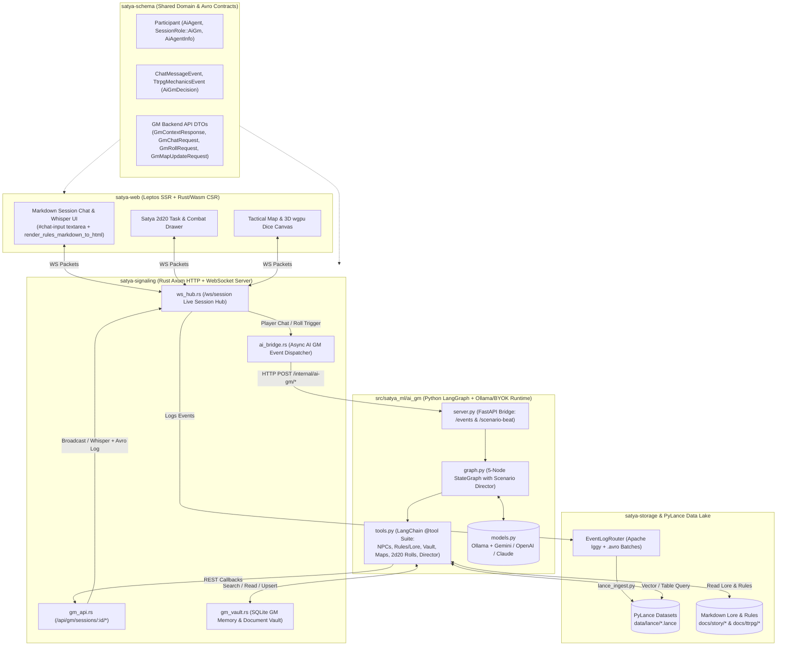
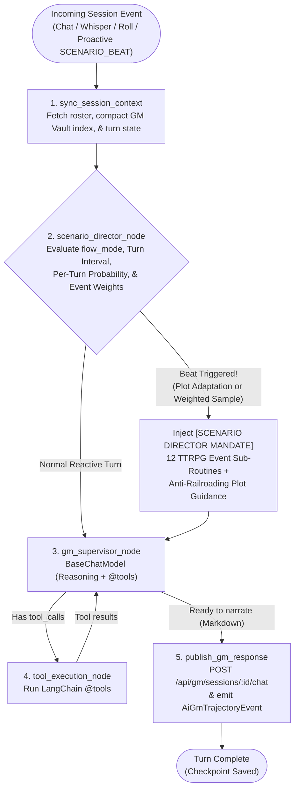
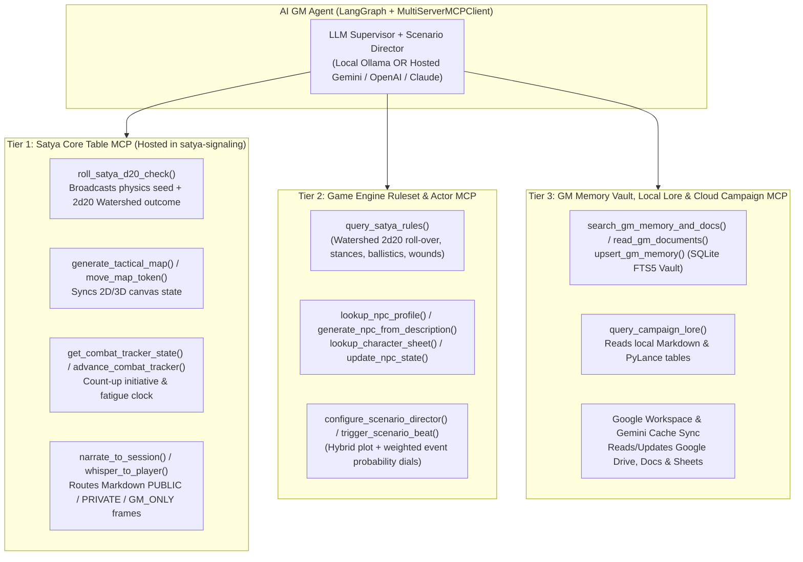

# Satya Autonomous AI Game Master (LangGraph + LangChain + Ollama) — Technical Design

## 1. Overview & Architectural Context

Satya is a polyglot **Rust + Python** platform combining real-time WebRTC audio/video, Markdown-enabled targeted session chat, Satya Two-List Cascading ("Watershed") `2d20` Roll-Over TTRPG mechanics, and an Apache Iggy + Apache Avro + PyLance event-streaming pipeline.

The signaling server (`satya-signaling`) and shared wire schemas (`satya-schema`) model an autonomous or co-pilot AI Game Master participant via:
- `ParticipantKind::AiAgent` and `SessionRole::AiGm`
- `AiAgentInfo { model_id, persona_id, temperature }`
- `MessageVisibility::GmOnly` and `ChannelContext::GmNarration`
- `MechanicEventType::AiGmDecision` in `TtrpgMechanicsEvent`

The **stateful, tool-calling AI Game Master Agent** is implemented with **LangGraph**, **LangChain**, and local **Ollama** or hosted **BYOK** models (`src/satya_ml/ai_gm/`), connected to `satya-signaling` (`crates/satya-signaling/src/{gm_api.rs, ai_bridge.rs, gm_vault.rs}`) through the **Backend GM API**.

### Key Capabilities of the AI GM Agent
1. **Stateful 5-Node Workflow with Proactive Scenario Director (LangGraph)**:
   - Maintains per-session campaign state, scene context, active count-up combat clocks, SQLite-backed GM Memory Vault notes, and turn memory across player interactions.
   - Includes a dedicated **`scenario_director_node`** supporting **Scenario-Driven** (non-railroaded overarching plot adaptation), **Free-Form** (weighted probability sandbox), and **Hybrid** flows across **12 TTRPG scenario event sub-routines** with player/GM-tunable probability dials (`event_weights`).
2. **Rich Markdown Session Chat Input & Output**:
   - Both players (`#chat-input` multi-line Markdown `<textarea>`) and the AI GM (`narrate_to_session`, `whisper_to_player`, and `publish_gm_response`) compose and render rich Markdown via `satya_engine::render_rules_markdown_to_html` (bold/italics, `> ` comms/handout blockquotes and `[!WARNING]` alerts, bulleted action hooks, Markdown tables, inline code, LaTeX math `$...$`, and `mermaid` diagrams).
3. **Local LLM + Hosted BYOK + Vision Inference**:
   - **Reasoning & Tool-Calling Model** (local Ollama `gemma4:12b`/`qwen3`/`llama3.1`, or hosted BYOK `Gemini`, `OpenAI`, `Claude`) for rules adjudication, NPC roleplay, and structured tool execution.
   - **Multimodal Vision Model** (`llama3.2-vision`, `gemma4`, or multimodal cloud models) for inspecting tactical maps, room layouts, and token positions.
4. **Authoritative Tool Execution (`@tool`)**:
   - Reading and updating **NPC personalities, abilities, dispositions, and fatigue/wound states**, plus generating new NPCs (`generate_npc_from_description`) and inspecting player character sheets (`lookup_character_sheet`).
   - Querying **Satya TTRPG rules** (`docs/ttrpg/*.md`), **world lore** (`docs/story/**/*.md`), **SQLite GM Memory Vault** (`gm_vault.rs`), and **historical session logs** stored in PyLance (`data/lance/*.lance`).
   - **Generating, updating, and visually inspecting tactical maps** pushed to the session UI.
   - Executing authoritative **Satya Watershed `2d20` roll-over task and combat checks** (`TtrpgMechanicsEvent`), advancing the count-up combat tracker (`advance_combat_tracker`), and sending **public Markdown narrations** (`GM_NARRATION`), **NPC dialogue** (`IN_CHARACTER`), or **targeted private whispers** (`PRIVATE`) back to players via the backend API.

### 1.1 Three TTRPG Operating Topologies: Autonomous AI GM vs. AI GM Assistant (Co-Pilot)

In addition to `MEETING` mode (`Host + Attendees`), Satya supports **three distinct TTRPG session topologies** in `#session-mode-select`:

| Mode Option Value | UI Label | Human Roles Allowed | AI Participant Present? | AI Operating Behavior & Persona |
| :--- | :--- | :--- | :--- | :--- |
| `TTRPG` | **TTRPG Mode (GM + Players)** | `GM`, `PLAYER`, `OBSERVER` | No (`enable_ai_gm = false`) | Traditional human-run tabletop session; no AI agent in the roster. |
| `TTRPG_GM_AI` | **TTRPG Mode (GM + AI + Players)** | `GM`, `PLAYER`, `OBSERVER` | Yes (`enable_ai_gm = true`, **Co-Pilot / MCP Assistant Mode**) | The **Human GM** is the primary storyteller and authority. The AI acts as a **GM Assistant & MCP Tool Operator**: it listens for whispered/directed commands from the Human GM (e.g., *"Look up Captain Vance's stats"*, *"Generate a 20x15 cargo bay map"*, *"Roll 2d20 for the two sentries"*), executes the corresponding MCP tools, and replies privately (`PRIVATE` / `GM_ONLY`) in Markdown to the Human GM unless explicitly asked to broadcast to the table. |
| `TTRPG_AI_GM` | **TTRPG Mode (AI GM + Players)** | `PLAYER`, `OBSERVER` *(no human GM)* | Yes (`enable_ai_gm = true`, **Autonomous Solo AI GM Mode**) | The **AI GM** is the sole Game Master at the table: it proactively adjudicates player actions and rolls, drives scenario pacing via the **Scenario Director**, controls NPCs (`IN_CHARACTER`), narrates scenes publicly in Markdown (`GM_NARRATION`), and sends private perception whispers (`PRIVATE`) to players. |

#### How LangGraph Switches Between `TTRPG_GM_AI` (Co-Pilot) and `TTRPG_AI_GM` (Autonomous)
The LangGraph context and supervisor nodes inspect whether a human participant with `SessionRole::Gm` is present in `roster`:
- **When a Human GM is present (`TTRPG_GM_AI`)**:
  - **Trigger Filter**: The AI Assistant only wakes up when directly addressed (`@satya_ai_gm` or `/msg @satya_ai_gm ...`) or when the Human GM sends a `GM_ONLY` / `PRIVATE` instruction. It does **not** interrupt or overwrite the Human GM on normal public player chat.
  - **Default Output Visibility**: Tool outputs (NPC stat lookups, lore summaries, hidden dice rolls, draft scene descriptions) default to **`MessageVisibility::Private` targeted only at the Human GM**, except when the Human GM asks the AI to perform a table-wide action (such as `generate_tactical_map`, `move_map_token`, or rolling public 3D `wgpu` dice).
- **When no Human GM is present (`TTRPG_AI_GM`)**:
  - **Trigger Filter**: The AI GM responds to all `IN_CHARACTER` player actions, `OUT_OF_CHARACTER` rules/table questions, `GM_ONLY` whispers, `TtrpgMechanicsEvent` rolls, and proactive `SCENARIO_BEAT` triggers.
  - **Channel-Aware Routing (`IN_CHARACTER` vs. `OUT_OF_CHARACTER`)**: `satya-signaling` propagates `channel_context` in `AiGmTurnTriggerRequest` (`POST /internal/ai-gm/events`). When a message is sent on `OUT_OF_CHARACTER` (or detected by `is_ooc_or_rules_query` as an explicit rules/mechanics question about combat, ticks, or `Tempo / Control / Force` pools), `sync_session_context` tags it as `[OUT_OF_CHARACTER RULES / TABLE QUESTION]` with a pre-fetched rules excerpt, `scenario_director_node` suppresses story beat advancement (`turns_since_last_beat` is not incremented), and `publish_gm_response` replies on `ChannelContext::OutOfCharacter`.
  - **Default Output Visibility**: World narration defaults to `MessageVisibility::Public` (`ChannelContext::GmNarration` for story beats, or `ChannelContext::OutOfCharacter` for rules Q&A), while secret character observations use `MessageVisibility::Private`.

---

## 2. Module Boundaries Across the Workspace



| Layer / Component | Path | Responsibility |
| :--- | :--- | :--- |
| **Shared Schemas** | `crates/satya-schema/src/protocol.rs` | Defines `Participant::ai_gm`, `AiAgentInfo`, `MechanicEventType::AiGmDecision`, `AiGmTurnTriggerRequest` (with `channel_context`), `RollTtrpgTask` / `GmRollRequest` (`combat_technique`, `tempo_pool`, `control_pool`, `force_pool`), and `CombatantTickEntry` / `UpdateCombatTrackerRequest` (`grid_x`, `grid_y`, `zone_label`). |
| **Rust Signaling, Vault & GM API** | `crates/satya-signaling/src/{gm_api.rs,gm_persistence.rs,ws.rs}` | Exposes `/api/gm/sessions/:id/{context,chat,roll,map,combat,memories,documents,trajectory}`, evaluates Combat Technique + `Tempo / Control / Force` Triad rolls (`evaluate_roll_combat_action_and_triad`), synchronizes the Action Mode `CombatTrackerState` and Tactical Map stub (`sync_or_generate_tactical_map_stub`), and routes frames over `/ws/session`. |
| **Web Client, Markdown Chat & Action Pool Drawer** | `crates/satya-web/src/{views_workspace.rs,wasm_client/{chat_and_ttrpg.rs,ttrpg_drawer_triad.rs}}` | Provides the multi-line Markdown `#chat-input` composer, renders Markdown chat bodies via `satya_engine::render_rules_markdown_to_html`, and hosts the `Task Resolution & Action Pool` (`#ttrpg-drawer`) Combat Technique selector (`#ttrpg-action-technique`) and `Tempo / Control / Force` (`T/C/F`) pool controls with live `Effective TC` preview. |
| **LangGraph Agent Runtime** | `src/satya_ml/ai_gm/graph.py` | Defines `AiGmSessionState`, `is_ooc_or_rules_query`, `format_action_mode_hud_block`, and the 5-node LangGraph `StateGraph` (`sync_session_context -> scenario_director_node -> gm_supervisor_node <-> tool_execution_node -> publish_gm_response`). |
| **LangChain Tool Suite & Map Stubs** | `src/satya_ml/ai_gm/{tools.py,maps.py}` | Implements `@tool` functions for NPC lookup/generation, Satya Watershed `2d20` rules/rolls (with `combat_technique` & `T/C/F` pools), GM Memory Vault, tactical maps/vision, procedural tactical map stub synchronization (`ensure_or_sync_procedural_tactical_map_stub`), combat tracker, and the Scenario Director. |
| **Model Provider Factory** | `src/satya_ml/ai_gm/models.py` | Configures `ChatOllama` and hosted BYOK (`ChatGoogleGenerativeAI`, `ChatOpenAI`, `ChatAnthropic`) instances for tool-calling reasoning and multimodal map vision. |

---

## 3. LangGraph Workflow, Scenario Director & State Design

### 3.1 Per-Session Graph State (`AiGmSessionState` & `ScenarioDirectorState`)

Each active TTRPG session with `enable_ai_gm = true` maps to a LangGraph `thread_id` equal to `session_id`:

```python
from typing import Annotated, Any, Literal, TypedDict
from langchain_core.messages import BaseMessage
from langgraph.graph.message import add_messages

class ScenarioDirectorState(TypedDict, total=False):
    flow_mode: Literal["hybrid", "scenario_driven", "free_form"]
    campaign_premise: str
    player_desires: list[str]
    planned_beats: list[str]
    event_weights: dict[str, float]         # Task slug -> relative probability weight (0.0 disables the event)
    beat_probability_per_turn: float        # 0.0..=1.0 chance of an emergent beat before beat_interval_turns
    beat_interval_turns: int                # Hard turn ceiling before a world beat breaks a rabbit hole (default 3)
    turns_since_last_beat: int
    completed_beats: list[dict[str, Any]]
    active_mandate: dict[str, Any] | None

class AiGmSessionState(TypedDict, total=False):
    session_id: str
    session_mode: str
    operating_mode: Literal["autonomous", "co_pilot"]
    human_gm_user_id: str | None
    messages: Annotated[list[BaseMessage], add_messages]
    roster: list[dict[str, Any]]
    current_scene: str
    combat_active: bool
    combat_tick_clock: dict[str, int]
    active_npcs: dict[str, NpcState]
    active_map: TacticalMapState | None
    scenario_director: ScenarioDirectorState
    active_director_mandate: str
    trigger_event: dict[str, Any]
    tool_invocations: list[dict[str, Any]]
    turn_started_ms: float
    final_reply: str
    final_channel: str
    trace_id: str
    turn_logs: list[dict[str, Any]]
```

### 3.2 Five-Node LangGraph Topology (`scenario_director_node`)



1. **`sync_session_context` Node**:
   - Pulls the latest session roster and recent events from `GET /api/gm/sessions/:id/context`, builds a compact `[GM Vault & Session Index]` (listing document titles/IDs, character sheets, and pinned GM memories without dumping full text into the prompt), and formats the triggering event.
   - **Out-of-Character & Rules Q&A Detection (`is_ooc_or_rules_query`)**: When `channel_context == "OUT_OF_CHARACTER"` or the player asks a meta/rules question (e.g., *"How do we do combat? Are we at tick 0 now? How do I use my Tempo, Control and Force pool here?"*), `sync_session_context` prefixes the prompt with `[OUT_OF_CHARACTER RULES / TABLE QUESTION]`, attaches a `query_satya_rules` reference excerpt, and includes the `[ACTION MODE — TACTICAL CLOCK, MAP & T/C/F POOLS]` status block so the AI GM answers directly using exact Satya formulas without advancing story time.
   - **Combat Action Mode HUD (`format_action_mode_hud_block`)**: Whenever `combat_tracker.combat_active` is `True`, injects `[ACTION MODE — TACTICAL CLOCK, MAP & T/C/F POOLS]` into the context header with `Window W · Tick T (X.Xs)`, each combatant's `Next Action Tick` and `(grid_x, grid_y)` / `[zone_label]`, and each bound character's `TacticalPoolEnvelope` (`P_eff / P_base`, Neutral Baseline `B`, and ceilings `T_max / C_max / F_max`).
2. **`scenario_director_node` (Proactive World Pacing, OOC Bypass & Action Mode Activation)**:
   - Prevents the AI GM from getting stuck indefinitely answering player prompts in a conversational loop while **never railroading player choices**.
   - **OOC / Rules Query Bypass**: When `is_ooc_or_rules_query(trigger)` is `True` (and `force_scenario_beat` is not set), `scenario_director_node` immediately returns without incrementing `turns_since_last_beat` or injecting a `[SCENARIO DIRECTOR MANDATE]`.
   - **Automatic Combat Action Mode & Tactical Map Stub Activation**: When a `combat_encounter` beat is selected, `scenario_director_node` automatically calls `advance_combat_tracker(tick_delta=0, ...)` and `ensure_or_sync_procedural_tactical_map_stub(...)` to initialize Action Mode at `Window 1 · Tick 1`, populate OODA starting ticks ($\text{Tick}_{\text{start}} = \max(1, 15 - \text{OODA})$), synchronize the `16x12` procedural tactical map stub, and append the `[ACTION MODE MANDATE]` to the turn prompt.
   - Supports three composable flow modes (`flow_mode`):
     - **`"scenario_driven"` (Overarching Plot with Non-Railroaded Adaptation)**: Draws from authored `planned_beats` and `campaign_premise`. The mandate instructs the AI GM to **adapt the plot event to the player's actual choices and location** rather than forcing the player back onto a predetermined path.
     - **`"free_form"` (Weighted Probability Sandbox)**: Samples emergent world events from `event_weights: dict[str, float]` where players or GMs can dial up favorite pillars (e.g., `combat_encounter: 50`, `dramatic_revelation: 30`) and dial down or zero out unwanted ones (`thought_provoking_discussion: 0`).
     - **`"hybrid"` (Default)**: Alternates between adapting unplayed `planned_beats` to player actions and sampling emergent beats from `event_weights`.
   - Fires automatically when `turns_since_last_beat >= beat_interval_turns` (default `3`), when a per-turn emergence check (`rng.random() < beat_probability_per_turn`) succeeds after turn 1, or when explicitly invoked via `trigger_kind == "SCENARIO_BEAT"` (`POST /internal/ai-gm/scenario-beat`).
3. **`gm_supervisor_node` (`BaseChatModel`)**: Evaluates the player's action, roll outcome, and any active `[SCENARIO DIRECTOR MANDATE]` against the current scene, active NPCs, and tactical map.
4. **`tool_execution_node`**: Executes tool calls (reading NPC sheets, querying Satya `2d20` rules, inspecting or generating a map, rolling NPC `2d20` checks, advancing combat ticks, or sending private whispers) and feeds observations back to `gm_supervisor_node`.
5. **`publish_gm_response` Node**: Posts the final Markdown narration (`ChannelContext::OutOfCharacter` for OOC/rules questions, or `ChannelContext::GmNarration` / `InCharacter` for story turns) back to `POST /api/gm/sessions/:id/chat` and records the `AiGmTrajectoryEvent`.

### 3.2.1 Combat "Action Mode", Tactical Triad (`Tempo / Control / Force`) Pools, & Procedural Tactical Map Stubs

When combat begins (either via a `combat_encounter` Scenario Director beat, `advance_combat_tracker`, or a player rolling a combat technique from `#ttrpg-drawer`), the session transitions into **Action Mode** (`combat_active = true`):

1. **Count-Up Tick Timeline & OODA Initiative**:
   - Combatants enter the timeline at $\text{Tick}_{\text{start}} = \max(1, 15 - \text{OODA})$ (`1 Tick = 0.5s`, `1 Window = 20 Ticks = 10.0s`).
   - Every combat action advances the acting combatant's `next_action_tick` by its two-component `Effective TC` ($\text{TC}_{\text{decide}} + \text{TC}_{\text{act}}$, compressed by allocated `Tempo` above the neutral baseline $B = \lfloor P_{\text{base}} / 3 \rfloor$).
2. **`Task Resolution & Action Pool` (`#ttrpg-drawer`) Technique & `T/C/F` Controls (`ttrpg_drawer_triad.rs`)**:
   - Players select an **Action / Combat Technique** (`#ttrpg-action-technique`: `Non-Combat Task` or any technique from `COMBAT_TECHNIQUE_CATALOG` grouped under `Strikes`, `Control & Grappling`, `Intercepts & Footwork Maneuvers`, and `Ranged Fire & Maneuvers`).
   - Players allocate their **Tactical Pool** ($P_{\text{eff}} = T + C + F$) across **Tempo (`#ttrpg-pool-tempo`)**, **Control (`#ttrpg-pool-control`)**, and **Force (`#ttrpg-pool-force`)**—or pick a quick preset (`#ttrpg-triad-preset`: `Neutral Balanced`, `High-Tempo Blitz`, `Precision Control`, `Heavy Force`)—with a live `#ttrpg-triad-readout` displaying `Base TC -> Effective Ticks`, aspect ceilings ($T_{\max} / C_{\max} / F_{\max}$), `Tech Delta_ext`, `Guard`, `Root`, `Strike Impact`, `Recoil R_eff`, and `Exertion`.
   - On submission (`RollTtrpgTask` / `POST /api/gm/sessions/:id/roll`), `evaluate_roll_combat_action_and_triad` and `apply_combat_action_to_mechanics_and_tracker` fold `technique_delta_ext` (and unbraced ranged recoil dispersion when $F < R_{\text{eff}}$) into the `2d20` cascade check, set `MechanicEventType::CombatAction`, advance the actor's `next_action_tick` in `CombatTrackerState`, and include the full `combat_action(...)` summary in the AI GM trigger context.
3. **Tactical Map & Procedural Environment Generator Stubs (`gm_persistence.rs` & `maps.py`)**:
   - `CombatantTickEntry` and `UpdateCombatTrackerRequest` carry optional `grid_x`, `grid_y`, and `zone_label` spatial fields.
   - `AuthAndSessionManager::sync_or_generate_tactical_map_stub` (Rust) and `ensure_or_sync_procedural_tactical_map_stub` (Python) act as the forward-compatible hook for future procedural environment and battlemap generation: when Action Mode activates or updates, they initialize a `16x12` tactical sector SVG map (`procedural_generator_stub = True`) if no map is active, synchronize `TokenPlacement` coordinates (`(x, y)` and `[zone_label]`) for all player and NPC combatants, and broadcast `ServerWsPacket::MapUpdated` to connected clients.

### 3.3 Built-In TTRPG Scenario Event Sub-Routines (`SCENARIO_DIRECTOR_TASKS`)

| Task Slug | Pillar / Category | Default Weight | World Event Behavior & Anti-Railroad Framing | Primary Tools |
| :--- | :--- | :---: | :--- | :--- |
| `combat_encounter` | `combat`, `action`, `tactical` | `20.0` | Hostile ambush, security breach, or patrol intercept erupts in the scene, demanding immediate tactical positioning. | `advance_combat_tracker`, `roll_satya_d20_check`, `generate_tactical_map` |
| `mysterious_stranger` | `intrigue`, `mystery`, `espionage` | `15.0` | A covert informant, observer, or encrypted transmission cuts in with a veiled warning, leverage, or clue. | `lookup_npc_profile`, `whisper_to_player`, `upsert_gm_memory` |
| `new_npc_arrives` | `social`, `npc`, `intrigue` | `15.0` | A new or recurring NPC physically enters the location with an urgent agenda, shifting the social dynamic. | `generate_npc_from_description`, `lookup_npc_profile`, `update_npc_state` |
| `dramatic_revelation` | `drama`, `twist`, `emotional` | `15.0` | A sudden plot twist, betrayal, hidden identity reveal, or personal backstory collision raises the emotional stakes. | `lookup_npc_profile`, `search_gm_memory_and_docs`, `upsert_gm_memory` |
| `thought_provoking_discussion` | `philosophy`, `psyche`, `roleplay` | `10.0` | An NPC poses an ethical or philosophical dilemma testing the character's 7 bipolar Psyche traits (`EGO`, `SLF`, `OPN`, `BLG`, `EXT`, `CNF`, `AGG`). | `lookup_character_sheet`, `lookup_npc_profile`, `upsert_gm_memory` |
| `discovery_or_clue` | `investigation`, `lore`, `mystery` | `10.0` | A physical clue, forensic trace, encrypted data-slate, or overheard secret surfaces, opening a new investigative lead. | `query_campaign_lore`, `whisper_to_player`, `upsert_gm_memory` |
| `environmental_hazard` | `survival`, `exploration`, `hazard` | `10.0` | The environment turns volatile (depressurization, radiation spike, structural collapse, power failure), requiring immediate checks. | `roll_satya_d20_check`, `generate_tactical_map`, `narrate_to_session` |
| `ticking_clock_escalation` | `pacing`, `tension`, `urgency` | `10.0` | An off-screen faction clock or threat visibly advances—reinforcements close in or a rival completes a phase of their plan. | `upsert_gm_memory`, `advance_combat_tracker`, `narrate_to_session` |
| `heist_or_infiltration_complication` | `stealth`, `heist`, `tactical` | `10.0` | A patrol route shifts, a biometric lock cycles, or a sensor sweep nears the crew, demanding clever improvisation. | `roll_satya_d20_check`, `inspect_tactical_map`, `whisper_to_player` |
| `moral_or_faction_dilemma` | `politics`, `factions`, `drama` | `10.0` | Two rival factions or allies make competing, mutually exclusive demands—helping one visibly alienates the other. | `lookup_npc_profile`, `update_npc_state`, `upsert_gm_memory` |
| `resource_or_gear_windfall` | `loot`, `salvage`, `opportunity` | `5.0` | A high-value opportunity appears—an unguarded cache, prototype gear, or tactical vantage point—if the crew acts quickly. | `roll_satya_d20_check`, `upsert_gm_memory`, `narrate_to_session` |
| `downtime_campfire_moment` | `bonding`, `spotlight`, `roleplay` | `5.0` | A quiet character-focused beat amidst tension where an ally tends to fatigue/wounds or asks a personal question. | `lookup_character_sheet`, `update_npc_state`, `narrate_to_session` |

### 3.4 Multi-Provider Model Factory (`Ollama` + Hosted BYOK: `Gemini`, `OpenAI`, `Claude`)

Because the LangGraph `StateGraph` and `@tool` suite program against LangChain's unified `BaseChatModel` interface, the exact same AI GM workflow runs unmodified across **local Ollama models** and **player-supplied (Bring-Your-Own-Key / BYOK) hosted models** (`src/satya_ml/ai_gm/models.py`):

| Provider | LangChain Integration | Example Model IDs | Tool Calling + Vision in Single Model? |
| :--- | :--- | :--- | :--- |
| **Ollama (Local)** | `langchain-ollama` (`ChatOllama`) | `gemma4:12b`, `qwen2.5:14b`, `qwen3:14b`, `llama3.2-vision` | Yes (`gemma4` / `qwen2.5-vl`) or split reasoning + vision (`qwen2.5` + `llama3.2-vision`) |
| **Google Gemini (BYOK)** | `langchain-google-genai` (`ChatGoogleGenerativeAI`) | `gemini-2.5-pro`, `gemini-2.5-flash` | Yes (native multimodal + tool calling) |
| **OpenAI (BYOK)** | `langchain-openai` (`ChatOpenAI`) | `gpt-4o`, `gpt-4.1`, `o4-mini` | Yes (native multimodal + tool calling) |
| **Anthropic Claude (BYOK)** | `langchain-anthropic` (`ChatAnthropic`) | `claude-sonnet-4-20250514`, `claude-3-7-sonnet-latest` | Yes (native multimodal + tool calling) |

### 3.5 Player-Supplied Credentials (BYOK) & Ephemeral Key Security

When a session uses a hosted LLM (`Google Gemini`, `OpenAI`, or `Anthropic Claude`) instead of local Ollama, any authenticated player in the session can supply their API key to power the session's AI GM:

1. **Ephemeral In-Memory Session Vault (Default)**:
   - The player submits `{ provider, model_id, api_key }` over HTTPS/localhost to `POST /api/sessions/create` or `POST /api/sessions/:id/gm-config`.
   - `AuthAndSessionManager` stores the `api_key` **exclusively in memory** inside `ProtectedSession` (`crates/satya-signaling/src/auth.rs`) for the duration of that session.
   - When the sponsoring player leaves/logs out or the session ends (`remaining_human_count == 0` -> `SESSION_ENDED`), the in-memory key is immediately dropped.
2. **Strict Telemetry & Wire Redaction**:
   - **Never persisted to Avro or PyLance**: `Participant.ai_agent_info` (`AiAgentInfo`) only records the non-sensitive provider and model identifier (e.g., `model_id: "google_genai/gemini-2.5-flash"`, `persona_id: "harsh-reality-arbiter"`, `temperature: 0.35`).
   - **Never broadcast to other players**: `ROSTER_SYNC` and `GET /api/gm/sessions/:id/context` expose `AiAgentInfo` so all players can see *which* model is acting as GM, but never return the `api_key`.
   - **Scoped Local Dispatch**: When `satya-signaling` dispatches an event turn to the local Python LangGraph worker (`POST /internal/ai-gm/events`), it passes the ephemeral key in an internal request header (`X-Satya-Provider-Key`) used only to instantiate the `BaseChatModel` for that turn.

---

## 4. Hybrid 3-Tier MCP Architecture (Hosted Table Primitives vs. Pluggable Game Rulesets & Local Lore)

By adopting the **Model Context Protocol (MCP)** via LangChain's `langchain-mcp-adapters` (`MultiServerMCPClient`), the LangGraph AI GM mounts tools from **three distinct tiers** simultaneously:



---

## 5. Cloud Campaign Lore & Structured State (Google Drive, Docs, Sheets & Gemini Context Caching)

In addition to local markdown files (`docs/story/`, `docs/ttrpg/`), the SQLite GM Memory Vault (`gm_vault.rs`), and PyLance tables (`data/lance/*.lance`), players and GMs can sync campaign worlds from **Google Drive**, **Google Docs**, and **Google Sheets** (`src/satya_ml/ai_gm/lore_sync.py`):

1. **Live Google Docs & Sheets as Structured GM Tools**:
   - **Google Sheets**: Structured NPC rosters, faction clocks, and loot tables.
   - **Google Docs**: World lore and automated session recaps.
2. **Gemini Context Caching + Offline PyLance Mirroring**:
   - Exported Docs/Sheets can be pinned in a Gemini `CachedContent` resource and mirrored into `data/lance/campaign-lore.lance` for offline local Ollama retrieval.

---

## 6. Concrete AI GM Tool Suite (`@tool` Specifications in `src/satya_ml/ai_gm/tools.py`)

### 6.1 Lore, Rules, GM Vault & Character/NPC Knowledge Tools

| Tool Name | Arguments | Data Source | Purpose |
| :--- | :--- | :--- | :--- |
| `lookup_npc_profile` | `npc_name: str, session_id: str = "default"` | `data/npcs/*.toml` / Session State | Retrieves an NPC's personality traits, archetype, attribute TNs, skill levels, disposition, and secrets. |
| `generate_npc_from_description` | `session_id: str, name: str, description: str, role_or_archetype: str = "operative"` | `satya_ml.ai_gm.tools` | Generates a balanced Satya NPC with 7 attributes, skills, and Psyche traits from a natural-language description and registers them in the session. |
| `update_npc_state` | `session_id: str, npc_id: str, fatigue_delta: int = 0, wound_shock_delta: int = 0, disposition: str \| None = None` | `AiGmSessionState` | Updates an NPC's accumulated fatigue, wound shock index, or attitude during combat or social encounters. |
| `lookup_character_sheet` | `session_id: str, character_name_or_id: str` | `AiGmSessionState` / Signaling Context | Retrieves a player character's full Satya sheet (Triad attributes, `TN_P`/`TN_M`, 7 bipolar Psyche traits, skills, equipment, and wounds). |
| `query_satya_rules` | `query: str` | `docs/ttrpg/*.md` | Retrieves authoritative Satya mechanics (Two-List Cascading "Watershed" `2d20` Roll-Over, `TN_eff = 31 - C + Delta_ext`, `+6` carry, count-up tick economy, ballistics, and medical trauma). |
| `query_campaign_lore` | `query: str, session_id: str = "default"` | `docs/story/**/*.md` / `data/lance/*.lance` | Searches setting lore and prior session `.lance` tables for past player decisions and world events. |
| `search_gm_memory_and_docs` | `session_id: str, query: str, category: str = ""` | `GET /api/gm/sessions/:id/memories` | Searches the SQLite FTS5 GM Memory Vault and session document headers without bloating the LLM context window. |
| `read_gm_documents` | `session_id: str, doc_ids: list[str]` | `AiGmSessionState` / Signaling Vault | Reads specific `GM_ONLY` or untrusted player-submitted documents on demand (wrapping player docs in `<untrusted_player_document>` tags). |
| `upsert_gm_memory` | `session_id: str, title: str, content: str, category: str = "WORLD_FACT", pinned: bool = False` | `POST /api/gm/sessions/:id/memories` | Creates or updates a persistent GM memory note (`NPC_STATE`, `PLOT_DECISION`, `QUEST_HOOK`, `WORLD_FACT`, `FACTION_CLOCK`) in SQLite. |

### 6.2 Scenario Director & Proactive Pacing Tools

| Tool Name | Arguments | Purpose |
| :--- | :--- | :--- |
| `configure_scenario_director` | `session_id: str, campaign_premise: str = "", flow_mode: str = "hybrid", player_desires: list[str] \| None = None, planned_beats: list[str] \| None = None, event_weights: dict[str, float] \| None = None, beat_probability_per_turn: float = 0.35, beat_interval_turns: int = 3` | Configures the session's Scenario Director flow mode (`"hybrid"`, `"scenario_driven"`, or `"free_form"`), overarching plot milestones (`planned_beats`), and relative event probability dials (`event_weights`, where `0` disables an event type and higher numbers increase its frequency), persisting the configuration in the GM Memory Vault. |
| `trigger_scenario_beat` | `session_id: str, task_slug: str = "auto", custom_context: str = ""` | Immediately selects and activates a Scenario Director task sub-routine (either a specific `task_slug` from the 12 built-in TTRPG beats or `"auto"` using the session's `flow_mode` and weighted probability distribution) and returns its structured Task Playbook. |

### 6.3 Tactical Map, Combat Tracker & Session Interaction Tools

| Tool Name | Arguments | Backend Endpoint Called | Purpose |
| :--- | :--- | :--- | :--- |
| `generate_tactical_map` | `session_id: str, title: str, width: int = 20, height: int = 15, obstacles: list[dict] \| None = None, tokens: list[dict] \| None = None` | `POST /api/gm/sessions/:id/map` | Renders a deterministic 2D tactical grid (SVG/PNG) with cover, doors, hazards, and token coordinates and publishes it to the session. |
| `move_map_token` | `session_id: str, entity_id: str, to_x: int, to_y: int` | `POST /api/gm/sessions/:id/map` | Moves a player or NPC token on the active map grid and broadcasts the updated map state. |
| `inspect_tactical_map` | `session_id: str, tactical_question: str` | Multimodal Vision LLM | Inspects the active tactical map image to evaluate line-of-sight, cover, choke points, or token distances. |
| `get_combat_tracker_state` | `session_id: str` | `GET /api/gm/sessions/:id/combat` | Reads the active count-up tick initiative clock, combatants, stances, and spatial coordinates (`grid_x`, `grid_y`, `zone_label`). |
| `advance_combat_tracker` | `tick_delta: int = 1, entity_id: str \| None = None, active_stance: str \| None = None, next_action_tick: int \| None = None, grid_x: int \| None = None, grid_y: int \| None = None, zone_label: str \| None = None, session_id: str = "default"` | `POST /api/gm/sessions/:id/combat` | Starts/resets Action Mode (`tick_delta <= 0`) or advances the Count-Up Tick timeline, updates a combatant's stance/tick/grid position, and synchronizes the procedural tactical map stub (`ensure_or_sync_procedural_tactical_map_stub`). |
| `roll_satya_d20_check` | `session_id: str, actor_name: str, check_category: str = "SKILL_CHECK", attribute_tn: int = 12, skill_rank: int = 2, difficulty_mod: int = 0, internal_mod: int = 0, carry_mode: str = "markov_step", combat_stance: str \| None = None, combat_technique: str \| None = None, tempo_pool: int \| None = None, control_pool: int \| None = None, force_pool: int \| None = None, note: str \| None = None` | `POST /api/gm/sessions/:id/roll` | Executes an authoritative server-side Satya Watershed `2d20` roll-over check (including optional `combat_technique` and `Tempo / Control / Force` pool split), triggers synchronized 3D `wgpu` dice physics, advances the actor's Action Mode tick, logs to Apache Iggy (`ttrpg-mechanics`), and returns the structured outcome. |
| `whisper_to_player` | `session_id: str, target_user_id: str, content: str` | `POST /api/gm/sessions/:id/chat` | Sends a `MessageVisibility::Private` Markdown whisper from the AI GM to a specific player. |
| `narrate_to_session` | `session_id: str, content: str, channel: str = "IN_CHARACTER", is_hidden_cot: bool = False` | `POST /api/gm/sessions/:id/chat` | Broadcasts a `MessageVisibility::Public` Markdown message as `GM_NARRATION`, `IN_CHARACTER`, or `OUT_OF_CHARACTER`. |

---

## 7. Backend API Surface (`crates/satya-signaling/src/gm_api.rs` & `src/satya_ml/ai_gm/server.py`)

### 7.1 Rust Signaling GM Endpoints (`satya-signaling`)
- `GET /api/gm/sessions/:session_id/context` — Returns session mode, AI GM participant info, active roster, character sheets, combat tracker state, and compact GM Vault headers.
- `POST /api/gm/sessions/:session_id/chat` — Emits public Markdown narrations, NPC dialogue, or private whispers (`ChatMessageEvent`).
- `POST /api/gm/sessions/:session_id/roll` — Evaluates authoritative Satya Watershed `2d20` checks (`TtrpgMechanicsEvent`) and broadcasts 3D `wgpu` dice physics seeds.
- `POST /api/gm/sessions/:session_id/map` — Publishes tactical map updates (`TabletopCanvasEvent`).
- `GET / POST /api/gm/sessions/:session_id/combat` — Reads or mutates the count-up combat tracker state.
- `GET / POST /api/gm/sessions/:session_id/memories` — Searches or upserts persistent GM Memory Vault entries in SQLite (`gm_vault.rs`).
- `POST /api/gm/sessions/:session_id/trajectory` — Logs `AiGmTrajectoryEvent` records to Topic 8 (`ai-gm-trajectories`).

### 7.2 Python LangGraph FastAPI Worker Endpoints (`src/satya_ml/ai_gm/server.py`)
- `GET /health` — Health probe reporting active checkpointer and default LLM provider.
- `POST /internal/ai-gm/events` — Invokes a reactive or event-driven turn (`CHAT`, `MECHANICS`, ` WHISPER`) on the per-session LangGraph `StateGraph`.
- `POST /internal/ai-gm/scenario-beat` — Proactively triggers an out-of-band Scenario Director beat (`trigger_kind = "SCENARIO_BEAT"`), optionally accepting `task_slug`, `flow_mode`, `event_weights`, or `custom_context` overrides to advance the scenario and push an unprompted Markdown event to the session.

---

## 8. Hybrid Observability (OpenTelemetry) & Avro/PyLance Telemetry Loop

> **Detailed Specification**: See [`docs/technical/observability-and-avro-telemetry-design.md`](./observability-and-avro-telemetry-design.md) and [`docs/technical/custom-ml-models-and-data-use-cases.md`](./custom-ml-models-and-data-use-cases.md).

1. **OpenTelemetry Distributed Tracing**: Captures spans across `satya-signaling` $\leftrightarrow$ `FastAPI` + `LangGraph` (`sync_session_context`, `scenario_director_node`, `gm_supervisor_node`, `tool_execution_node`, `publish_gm_response`) $\leftrightarrow$ LLM Providers.
2. **Apache Iggy + Avro + PyLance**:
   - **Topic 7 — `tabletop-canvas` (`com.satya.events.TabletopCanvasEvent`)**
   - **Topic 8 — `ai-gm-trajectories` (`com.satya.events.AiGmTrajectoryEvent`)**
   - **Topic 9 — `system-logs` (`com.satya.events.SessionLogEvent`)**
