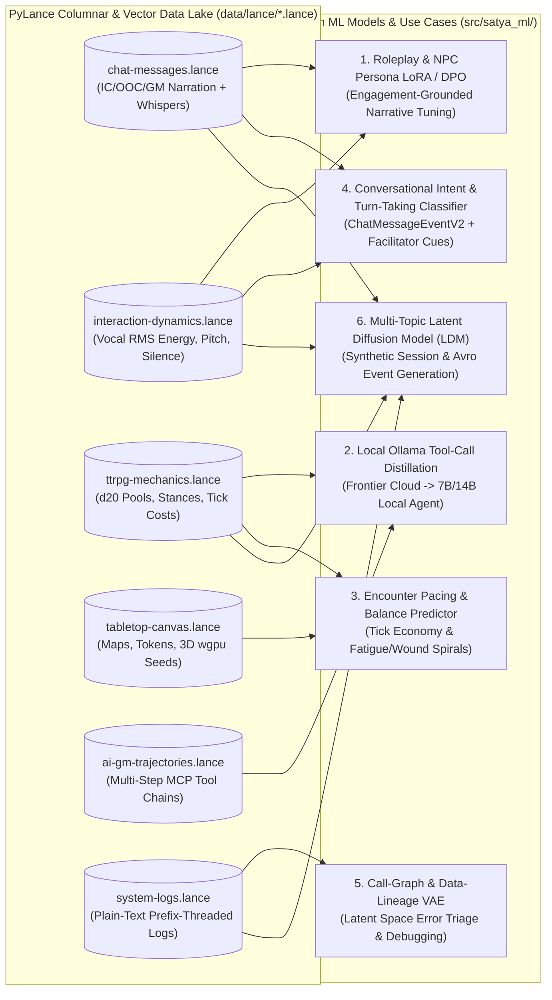
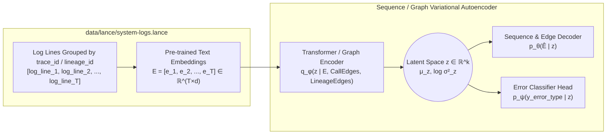
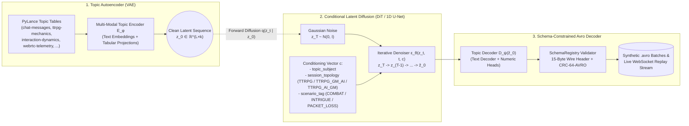

# Custom ML Models & PyLance Data Use Cases — Technical Design & Roadmap

## 1. Overview

Because Satya ingests every session event, vocal prosody turn, TTRPG mechanics check, AI GM tool trajectory, and plain-text trace-prefixed log line through **Apache Iggy $\rightarrow$ Apache Avro (`CRC-64-AVRO`) $\rightarrow$ PyLance (`data/lance/*.lance`)**, the platform naturally accumulates a rich, multi-modal, causally linked dataset.

While early phases of Satya rely on off-the-shelf local Ollama models (`qwen2.5`, `llama3`, `gemma3`) or BYOK cloud APIs (Gemini, OpenAI, Claude), our PyLance data lake enables training **specialized, lightweight custom models** tailored to tabletop roleplaying, rules adjudication, social dynamics, and automated system debugging.



---

## 2. Use Case 1: Roleplaying, NPC Persona & Narrative Voice Fine-Tuning (LoRA + Engagement DPO)

### 2.1 The Problem with Generic LLMs in TTRPGs
Out-of-the-box instruction-tuned LLMs often sound like helpful corporate assistants: they over-explain, resolve player actions prematurely instead of leaving dramatic hooks, or flatten distinct NPC personalities into a single uniform voice.

### 2.2 Training Signal in PyLance
Satya uniquely captures **both the text of the roleplay** (`chat-messages.lance`) and **how players vocally and behaviorally reacted to it in the following 30–60 seconds** (`interaction-dynamics.lance` + follow-up `chat-messages.lance`):
- **Positive Engagement Signals ($R^+$)**:
  - Immediate increase in player vocal RMS energy (`rms_energy_mean`, `rms_energy_peak`) and pitch variance (`pitch_hz_estimate`) in `interaction-dynamics.lance` after a `GM_NARRATION` or `IN_CHARACTER` message.
  - Short `preceding_silence_ms` (players immediately jump in to respond in-character).
  - Balanced `dominance_ratio` across the party rather than dead air (`LongSilence`).
- **Negative Engagement Signals ($R^-$)**:
  - `LongSilence` events following a bloated or confusing GM narration.
  - Immediate switch from `IN_CHARACTER` to `OUT_OF_CHARACTER` clarification questions (e.g., *"Wait, what room are we in?"*).

### 2.3 Training Pipeline (SFT $\rightarrow$ DPO for Ollama GGUF Export)
1. **Supervised Fine-Tuning (SFT)**:
   - Filter `chat-messages.lance` for high-engagement Human GM and frontier AI GM sessions, conditioned on `(campaign_lore_context, active_npc_persona, channel_context, message_visibility)`.
   - Train lightweight **LoRA adapters** (on `Qwen2.5-7B/14B` or `Llama-3.1-8B`) for:
     - **Gritty Hard-Sci-Fi / Horror GM Narration** (`ChannelContext::GmNarration`)
     - **Distinct NPC Archetypes** (`ChannelContext::InCharacter` conditioned on `NpcState.personality` and `disposition`)
     - **Atmospheric Secret Whispers** (`MessageVisibility::Private` sensory cues)
2. **Direct Preference Optimization (DPO) Grounded in Player Dynamics**:
   - Pair high-engagement GM turns ($y_w$, high vocal/chat follow-up score) against low-engagement turns ($y_l$, followed by `LongSilence` or OOC confusion) in similar scene contexts $x$.
   - Export the merged or LoRA-adapted weights to **GGUF** and register a custom Ollama `Modelfile` (`satya-gm-rp:14b`) so players running local models get a dramatic, concise tabletop storyteller.

---

## 3. Use Case 2: Distilling Frontier Cloud AI GM Tool-Calling into Small Local Models

### 3.1 The Problem
When players use BYOK with frontier models (`gemini-2.5-pro`, `claude-sonnet-4`, `gpt-4o`), the LangGraph agent reliably chains 3–5 MCP tools (`inspect_tactical_map` $\rightarrow$ `lookup_npc_profile` $\rightarrow$ `roll_satya_d20_check` $\rightarrow$ `whisper_to_player`). Smaller local Ollama models (7B–14B) sometimes hallucinate tool arguments or pick the wrong visibility scope (`PUBLIC` vs `PRIVATE` in `TTRPG_GM_AI` Co-Pilot mode).

### 3.2 Training Signal in `data/lance/ai-gm-trajectories.lance`
Every row in `ai-gm-trajectories.lance` records:
- `operating_mode` (`AUTONOMOUS` for `TTRPG_AI_GM` vs. `CO_PILOT` for `TTRPG_GM_AI`)
- `trigger_summary` and session state context
- Ordered `tool_invocations` (`mcp_tier`, `server_id`, `tool_name`, `arguments_json`, `result_summary_json`, `is_error == false`)
- `rag_sources_used` and `emitted_event_ids`

### 3.3 Distillation Workflow
- Filter `ai-gm-trajectories.lance` where `turn_status == "COMPLETED"` and all `tool_invocations[*].is_error == false`.
- Format each trajectory as a multi-turn OpenAI/LangChain tool-calling conversation and fine-tune a local `qwen2.5:7b` or `qwen2.5:14b` model.
- This creates a specialized **Satya MCP Operator model** that knows the exact difference between `TTRPG_GM_AI` (whispering tool results privately back to the Human GM) and `TTRPG_AI_GM` (narrating publicly to the table).

---

## 4. Use Case 3: Combat Pacing, Stance & Encounter Balance Predictor

### 4.1 Training Signal in `ttrpg-mechanics.lance` & `tabletop-canvas.lance`
Satya's d20 roll-under system uses a **count-up action tick clock** (`action_count_cost`), **combat stances** (`POWER`, `MANEUVER`, `STABILITY`, `RANGED_AIMED`, `RANGED_SNAP`), and compounding **fatigue/wound shock multipliers** (`action_time_factor = 1.0 + 0.1 * fatigue + 0.25 * wound_shock`).

By joining `ttrpg-mechanics.lance` and `tabletop-canvas.lance` across `session_id`:
- We can train a fast tabular/sequence model (e.g., LightGBM or a small Transformer over combat ticks) to predict:
  1. **Death-Spiral Probability**: When a party's accumulated `fatigue_level` and `wound_shock_index` will cause their `action_count_cost` to double, leading to a party wipe within $N$ ticks.
  2. **Dynamic Difficulty Adjustment (DDA) Hints**: Suggesting to the Human GM (`TTRPG_GM_AI`) or Autonomous AI GM (`TTRPG_AI_GM`) when an NPC sentry should switch from `POWER` to `MANEUVER` or retreat to keep combat tense without dragging.

---

## 5. Use Case 4: Real-Time Conversational Intent, Sentiment & Turn-Taking Facilitator

### 5.1 Populating `ChatMessageEventV2` & Assisting Quiet Players
Satya's schema registry already includes `ChatMessageEventV2` (`schemas/v2/chat_message_event.avsc`) with optional fields:
- `sentiment_score: Option<f32>` (`-1.0` to `1.0`)
- `detected_intent: Option<String>` (e.g., `ACTION_DECLARATION`, `NPC_DIALOGUE`, `RULES_QUESTION`, `GM_TOOL_COMMAND`, `LORE_QUERY`, `OOC_BANTER`)

By training a compact classifier/regressor over `chat-messages.lance` + `interaction-dynamics.lance`:
1. **Automatic Intent Routing**: Immediately classifies whether a player message needs a rules lookup, a d20 roll check, or pure roleplay without waiting for a heavy LLM round-trip.
2. **Table Inclusion Cues**: By monitoring `dominance_ratio` and `InterruptionOverlap` in `interaction-dynamics.lance`, the AI GM (or GM Assistant whisper) can gently prompt a player whose `dominance_ratio` has dropped below `0.05` for 15 minutes (e.g., *"Sara, while the others argue with the dockmaster, what is your character keeping an eye on?"*).

---

## 6. Use Case 5: Automated Debugging & Error Triage via Call-Graph & Data-Lineage Variational Autoencoder (VAE)

> **Timeline Note**: This is a longer-term AIOps / diagnostic model to build once Satya has accumulated a healthy corpus of normal and failure traces in `data/lance/system-logs.lance`.

### 6.1 Why Plain-Text Prefix-Formatted Logs Make Embeddings & VAEs Easy
In [`docs/technical/observability-and-avro-telemetry-design.md`](./observability-and-avro-telemetry-design.md#34-topic-9-system-logs-schemasv1session_log_eventavsc), Topic 9 (`system-logs`) intentionally avoids splitting logs into rigid nested JSON schemas. Instead, every `SessionLogEvent` stores a **single plain-text `log_line`** prefixed with the session, call-graph edge (`span<-parent_span`), and data-lineage edge (`lineage<-parent_lineage`):

```text
[2026-10-29T23:18:04.112Z] [INFO] [session=ep1-sector-4] [trace=4bf92f35 span=a1b2<-09f1] [lineage=L4<-L3,L1] satya_signaling::ws: Received SendChat from u-demo-sara (14 words)
[2026-10-29T23:18:04.145Z] [INFO] [session=ep1-sector-4] [trace=4bf92f35 span=c3d4<-a1b2] [lineage=L5<-L4] satya_ml.ai_gm: Invoking MCP tool inspect_tactical_map
[2026-10-29T23:18:06.890Z] [ERROR] [session=ep1-sector-4] [trace=4bf92f35 span=e5f6<-c3d4] [lineage=L6<-L5] satya_ml.ai_gm: MCP tool timeout after 2500ms
```

Because the call-graph transitions (`span=c3d4<-a1b2`) and data-flow transitions (`lineage=L5<-L4`) are written right into the plain-text string *and* indexed as lightweight filter columns (`session_id`, `trace_id`, `lineage_id`):
1. **Direct Text Embedding**: During `compact-to-lance`, any off-the-shelf text embedding model (`bge-small-en-v1.5`, `nomic-embed-text`, or `text-embedding-004`) can embed each `log_line` (or a multi-line trace window) directly into a vector column `log_embedding: FixedSizeList<f32, 384>` in `data/lance/system-logs.lance` without custom feature engineering.
2. **Grouping by Execution or Data Flow**: Grouping `system-logs.lance` by `trace_id` yields the exact sequence of log embeddings for a single request's call graph; grouping by `lineage_id` $\leftarrow$ `parent_lineage_ids` yields the sequence of log embeddings for a piece of data across multiple turns.

### 6.2 How the Variational Autoencoder (VAE) Learns Call Graphs & Data Flow in Latent Space



1. **Encoding Trace & Lineage Windows into Latent Space $z$**:
   - Given the sequence of embedded log lines $E = (e_1, \dots, e_T)$ for a `trace_id` (plus optional adjacency masks from `span_id <- parent_span_id` and `lineage_id <- parent_lineage_ids`), the encoder maps the trace into a continuous latent distribution $q_\phi(z \mid E) = \mathcal{N}(\mu_z, \Sigma_z)$.
2. **Joint Reconstruction + Error Classification Objective**:
   $$
   \mathcal{L}_{\text{total}} = -\mathbb{E}_{q_\phi(z \mid E)}\big[\log p_\theta(E \mid z)\big] + \beta \, D_{\text{KL}}\big(q_\phi(z \mid E) \,\|\, \mathcal{N}(0, I)\big) + \gamma \, \operatorname{CE}\big(y_{\text{error}}, \hat{y}_\psi(\mu_z)\big)
   $$
   - Healthy execution traces cluster tightly on a smooth manifold in latent space $z$.
   - When a trace leads up to an error (e.g., WebRTC ICE renegotiation race, MCP tool timeout, Gemini cache expiration, or Avro schema mismatch), the sequence of log embeddings leading *up to* the failure projects into a distinct region of latent space classified by $\hat{y}_\psi(\mu_z)$.
3. **Debugging via Reconstruction Surprise**:
   - When triaging a bug, inspecting the per-line reconstruction error $\|e_t - \hat{e}_t\|^2$ along the `trace_id` / `lineage_id` chain immediately pinpoints the **exact log line where the call graph or data flow first diverged from normal execution**—even if the actual `ERROR` log occurred 20 steps later in another service.

---

## 7. Use Case 6: Multi-Topic Latent Diffusion Model (LDM) for Synthetic Session & Avro Event Generation

### 7.1 Motivation: Realistic Multi-Topic Synthetic Data for Testing & Simulation
Testing a real-time multiplayer TTRPG and meeting platform requires realistic, temporally correlated event streams across **all 9 Apache Iggy / Avro topics** (`chat-messages`, `ttrpg-mechanics`, `interaction-dynamics`, `webrtc-telemetry`, `session-lifecycle`, `tabletop-canvas`, `ai-gm-trajectories`, `system-logs`, and `schema-registry`). Hand-written unit test fixtures cannot capture the natural burstiness of player chat, whisper subgraphs, simultaneous speech overlaps, d20 dice-pool cascades, or correlated WebRTC jitter spikes.

Moreover, because Satya events mix **discrete text** (chat messages, log lines, tool calls) with **continuous tabular telemetry** (composition times, vocal RMS energy, pitch, RTT, count-up combat ticks, fatigue/wound multipliers), a **Latent Diffusion Model (LDM)** is uniquely well-suited: once heterogeneous topic records are mapped into a continuous VAE latent space $z_0 \in \mathbb{R}^{L \times k}$, standard continuous Gaussian diffusion can jointly model any single topic or synchronized cross-topic session slice.

### 7.2 Three-Stage Latent Diffusion Architecture (`src/satya_ml/synthetic/latent_diffusion.py`)



1. **Stage 1 — Topic-Aware Variational Autoencoder ($\mathcal{E}_\phi, \mathcal{D}_\psi$)**:
   - Encodes a window of $L$ events from any topic (e.g., a sequence of player `ChatMessageEvent`s with their `visibility`, `channel_context`, `composition_time_ms`, and text embeddings, or a sequence of `TtrpgMechanicsEvent`s and `WebRtcTelemetryEvent`s) into a continuous latent sequence $z_0 = \mathcal{E}_\phi(x_{1:L}) \in \mathbb{R}^{L \times k}$.
   - Reuses the same VAE building blocks designed in **Use Case 5**, so the autoencoder and the diffusion generator share infrastructure.
2. **Stage 2 — Conditional Denoising Diffusion in Latent Space ($\epsilon_\theta(z_t, t, c)$)**:
   - Forward diffusion progressively adds Gaussian noise over $t \in \{1, \dots, T\}$:
     $$
     q(z_t \mid z_0) = \mathcal{N}\big(z_t;\, \sqrt{\bar{\alpha}_t}\, z_0,\, (1 - \bar{\alpha}_t) I\big)
     $$
   - A lightweight **Diffusion Transformer (DiT)** or **1D Temporal U-Net** is trained to predict the noise $\epsilon_\theta(z_t, t, c)$ conditioned on $c$:
     $$
     \mathcal{L}_{\text{LDM}} = \mathbb{E}_{z_0, \epsilon \sim \mathcal{N}(0, I), t}\Big[\big\|\epsilon - \epsilon_\theta\big(\sqrt{\bar{\alpha}_t} z_0 + \sqrt{1 - \bar{\alpha}_t}\epsilon,\, t,\, c\big)\big\|_2^2\Big]
     $$
   - **Conditioning Tags ($c$)**:
     - `topic`: Generate a single topic (e.g., `chat-messages` only) or a synchronized multi-topic bundle (`chat-messages` + `ttrpg-mechanics` + `interaction-dynamics`).
     - `session_topology`: `TTRPG`, `TTRPG_GM_AI`, `TTRPG_AI_GM`, or `MEETING`.
     - `scenario_profile`: e.g., `HIGH_INTENSITY_COMBAT`, `HEAVY_PRIVATE_WHISPERS`, `QUIET_PARTY_STALL`, `WEBRTC_DEGRADED_NETWORK`, or `ERROR_STRESS_TRACE`.
3. **Stage 3 — Schema-Constrained Avro Decoding & `CRC-64-AVRO` Framing**:
   - The decoder $\mathcal{D}_\psi(\hat{z}_0)$ maps the denoised latent trajectory back into concrete topic fields:
     - For `chat-messages`: decodes realistic player/GM chat text (via a small latent-conditioned language decoder or nearest-neighbor embedding decoder with variation), `MessageVisibility` (`PUBLIC`, `PRIVATE`, `GM_ONLY`), `ChannelContext` (`IN_CHARACTER`, `OUT_OF_CHARACTER`), and `composition_time_ms`.
     - For `ttrpg-mechanics`, `webrtc-telemetry`, and `interaction-dynamics`: decodes correlated numerical and enum fields (`dice_rolled_d20`, `combat_stance`, `fatigue_level`, `rms_energy_mean`, `rtt_ms`).
   - Every generated record is validated against `SchemaRegistry` (`crates/satya-schema`) and wrapped in a valid 15-byte binary Satya wire header (`0x53` + `schema_id` + `schema_version` + `CRC-64-AVRO`) so it is 100% indistinguishable at the wire level from live production traffic.

### 7.3 Key Testing & Engineering Workflows Unlocked by Synthetic Diffusion Data

| Testing / Engineering Workflow | How the Latent Diffusion Model Is Used |
| :--- | :--- |
| **1. "Virtual Player Party" for AI GM Regression Testing** | Sample realistic sequences of player `IN_CHARACTER` actions, `GM_ONLY` whispers, and `OUT_OF_CHARACTER` rules questions from `chat-messages` diffusion to automatically test new LangGraph nodes and MCP tools without needing 4 human testers online. |
| **2. High-Concurrency Load & Compaction Stress Testing** | Generate 100+ synthetic sessions across all 9 Avro topics to benchmark `satya-signaling` WebSocket fan-out, Apache Iggy batch flushing, and `compact-to-lance` throughput at scale without paying cloud LLM token costs. |
| **3. Rare Edge-Case & Chaos Augmentation (Classifier-Free Guidance)** | Use Classifier-Free Guidance (CFG) toward rare conditioning tags (e.g., `WEBRTC_DEGRADED_NETWORK` + `ERROR_STRESS_TRACE`) to synthesize realistic failure precursors that balance the training set for the **Use Case 5 Error Triage VAE**. |
| **4. Privacy-Safe Benchmark Datasets** | Export synthetic `.avro` and `.lance` session archives that preserve the statistical, temporal, and conversational distributions of real TTRPG sessions without exposing real users' private chat messages or voice prosody. |

---

## 8. Training Data Governance: Opt-In Consent, Channel Exclusions, PII Scrubbing & GDPR Compliance

> **Detailed Schema & GDPR/DSAR Specification**: See [Section 6 of `docs/technical/observability-and-avro-telemetry-design.md`](./observability-and-avro-telemetry-design.md#6-security-opt-in-ml-consent-gdpr-compliance-pii-anonymization--dsar-architecture) for the complete PII field inventory across all 9 Avro topics, GDPR Art. 17 in-place anonymization (`anon-<12hex>`), and GDPR Art. 15/20 DSAR export pipelines.

Because Satya sessions are private, password-protected rooms rather than public web forums, every model training pipeline in `src/satya_ml/` must pass through a **four-gate privacy & consent filter** before reading from `data/lance/*.lance`:

### Gate 1 — Strict Affirmative Opt-In (`TrainingConsentScope`, Default `NONE`)
- Players and GMs are **opted out (`NONE`) by default**.
- Model training pipelines only query rows where the participant (and all participants in a multi-turn dialogue window) explicitly opted into:
  - `DIAGNOSTICS_AND_MECHANICS` (permits Use Cases 3 & 5 on non-textual mechanics, telemetry, and system logs).
  - `IN_CHARACTER_ROLEPLAY` (additionally permits Use Cases 1, 2, 4, and 6 on `PUBLIC` + `IN_CHARACTER` / `GM_NARRATION` TTRPG turns).

### Gate 2 — Hard Schema-Level Exclusion of `PRIVATE` Whispers & `OUT_OF_CHARACTER` Chat
- Even for users who opt into `IN_CHARACTER_ROLEPLAY`, the training dataloader enforces a hard filter:
  ```sql
  visibility = 'PUBLIC'
  AND channel_context IN ('IN_CHARACTER', 'GM_NARRATION')
  AND metadata.session_mode = 'TTRPG'
  ```
- **Why**: Players use `PRIVATE` whispers and `OUT_OF_CHARACTER` (`OOC`) chat to discuss real-life schedules, phone numbers, family, work, or health. Hard-excluding `PRIVATE`, `GM_ONLY`, `HOST_ONLY`, `OUT_OF_CHARACTER`, and `MEETING` messages at the SQL/PyArrow filter layer prevents personal conversations from ever entering a training batch.

### Gate 3 — Automated PII Scrubbing (`src/satya_ml/pii_scrubber.py`)
- Before any opted-in `IN_CHARACTER` message is tokenized or embedded for LoRA fine-tuning (Use Case 1) or Latent Diffusion (Use Case 6), a local NER + regex scrubber (e.g., Microsoft Presidio) replaces incidental emails, phone numbers, URLs, IP addresses, financial numbers, and real-world person/address entities with canonical placeholders (`<EMAIL>`, `<PHONE>`, `<URL>`, `<REAL_PERSON>`).

### Gate 4 — GDPR Right to Withdraw Consent & Erasure Propagation
- When a user withdraws ML training consent or submits a **GDPR Art. 17 Right to Erasure** request:
  1. Their `Participant` records in `data/lance/*.lance` are irreversibly anonymized (`user_id` $\rightarrow$ `anon-<12hex>`, `username` $\rightarrow$ `"deleted_user"`, `body` redacted) and historical Lance dataset versions are vacuumed via `dataset.cleanup_old_versions(older_than=timedelta(seconds=0))`.
  2. Subsequent training runs of LoRA adapters, the Error Triage VAE, or the Latent Diffusion Model automatically exclude all revoked or redacted records.
  3. For the **Latent Diffusion Model (Use Case 6)**, training with **Differential Privacy (DP-SGD)** or near-duplicate memorization filtering ensures the generative model learns general tabletop distributions rather than memorizing verbatim quotes from any individual player.


