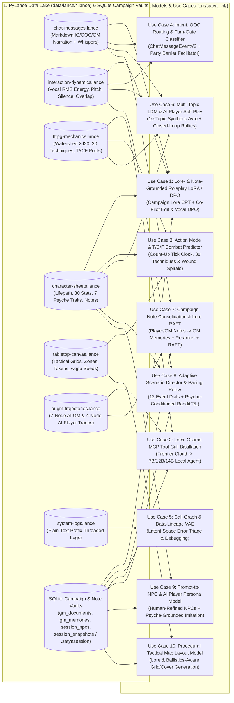
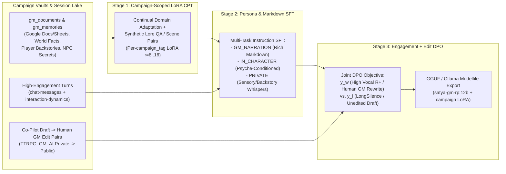
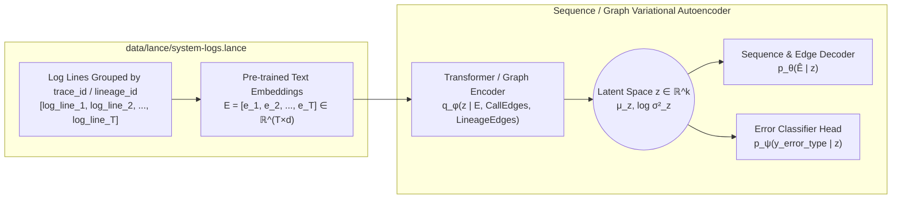
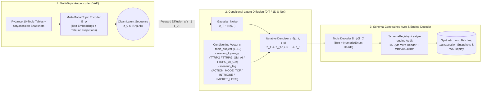
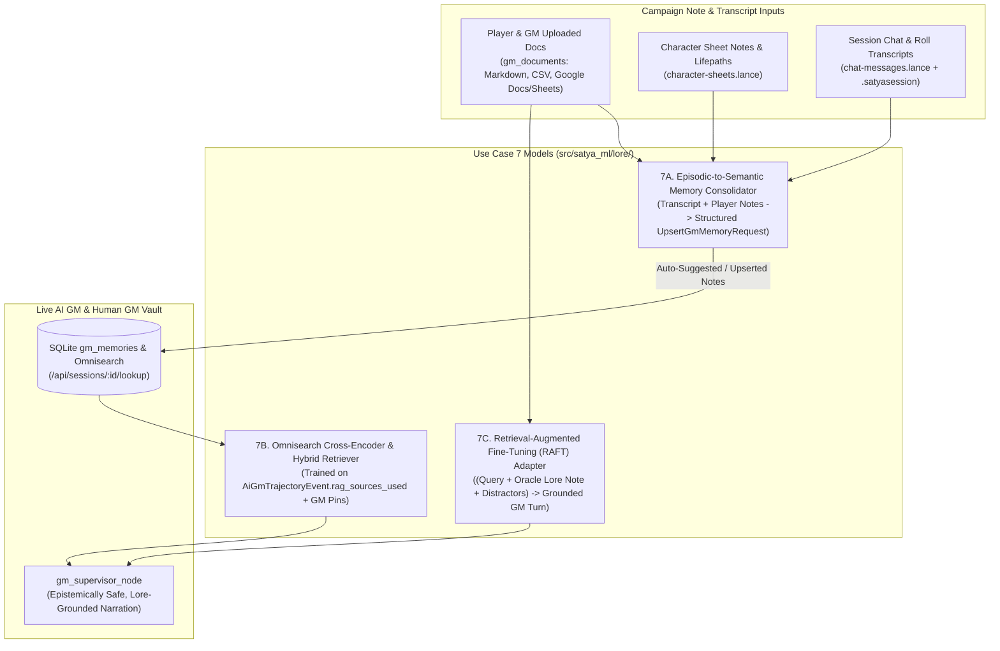
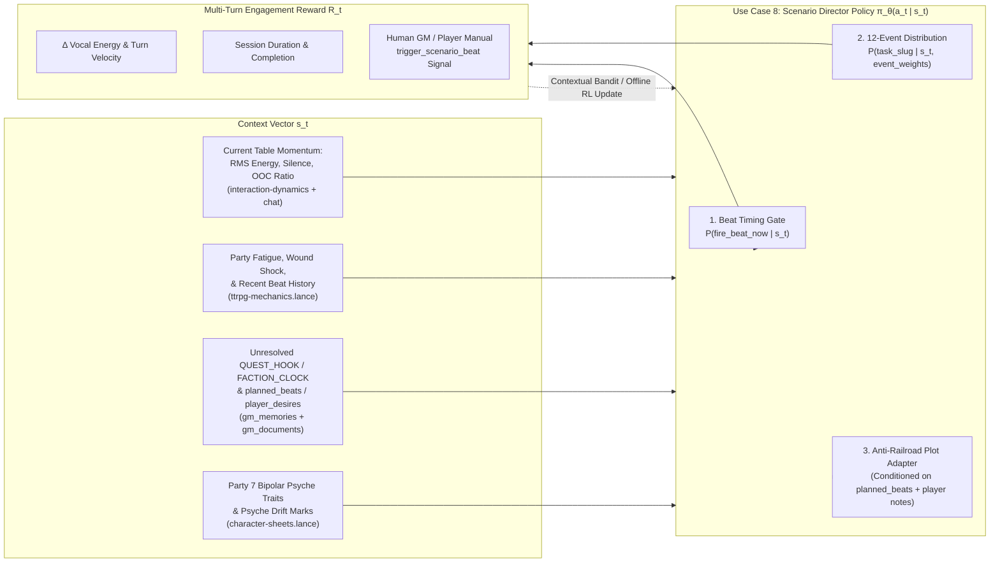

# Custom ML Models & PyLance / SQLite Data Use Cases — Technical Design & Roadmap

## 1. Overview

Because Satya ingests every session event, vocal prosody turn, Watershed `2d20` mechanics check, character sheet lifecycle event, AI GM / AI Player tool trajectory, and plain-text trace-prefixed log line through **Apache Iggy $\rightarrow$ Apache Avro (`CRC-64-AVRO`) $\rightarrow$ PyLance (`data/lance/*.lance`)**—alongside structured **SQLite Campaign Vaults** (`gm_documents`, `gm_memories`, `session_npcs`, `characters`, `session_combat_state`, and `.satyasession` snapshots)—the platform naturally accumulates a rich, multi-modal, causally linked dataset.

While early phases of Satya rely on off-the-shelf local Ollama models (`gemma4:12b`, `qwen3:14b`, `qwen2.5:14b`, `llama3.2-vision`) or BYOK cloud APIs (`Gemini`, `OpenAI`, `Claude`), our unified PyLance data lake and SQLite campaign vaults enable training **specialized, lightweight custom models** tailored to campaign-grounded roleplaying, player/GM note synthesis, rules adjudication, tactical `Tempo / Control / Force` (`T/C/F`) combat, proactive Scenario Director pacing, and automated system debugging.



---

## 2. Use Case 1: Roleplaying, NPC Persona & Campaign-Lore-Grounded Fine-Tuning (Continual LoRA + Engagement & Co-Pilot Edit DPO)

### 2.1 The Problem with Generic LLMs in TTRPGs
Out-of-the-box instruction-tuned LLMs often sound like corporate assistants: they over-explain, resolve player actions prematurely instead of leaving dramatic hooks, flatten distinct NPC personalities into a uniform voice, and treat campaign lore or player backstory notes as detached encyclopedia entries rather than living dramatic stakes.

### 2.2 Multi-Modal & Human-in-the-Loop Training Signals in PyLance + SQLite Vaults
With the **`GM_ONLY` Document Vault** (`gm_documents` in [`gm_docs.rs`](../../crates/satya-signaling/src/gm_docs.rs)), **Persistent GM Memory Notes** (`gm_memories` in [`gm_persistence.rs`](../../crates/satya-signaling/src/gm_persistence.rs)), **Character Sheet Notes & Lifepaths** (`character-sheets.lance`), and **Prompt-Driven NPC Dossiers** (`session_npcs` in [`npcs.rs`](../../crates/satya-signaling/src/npcs.rs)), Satya captures four complementary supervision signals for roleplay fine-tuning:

1. **Player & Human GM Campaign Lore and Notes (`gm_documents` + `gm_memories` + `CharacterSheetRecord.notes`)**:
   - Players and Human GMs upload Markdown/text/CSV notes or link **Google Docs and Google Sheets** (`drive.file` scope) tagged with a `campaign_tag`, alongside structured `GmMemoryNoteRecord` entries (`WORLD_FACT`, `NPC_STATE`, `NPC_SECRET`, `PLOT_DECISION`, `QUEST_HOOK`, `FACTION_CLOCK`) and character free-text `notes` / `lifepath_config_json`.
   - When a skilled Human GM (or frontier model) weaves a player's uploaded backstory hook or a `QUEST_HOOK` memory note into an in-character scene without leaking raw `GM_ONLY` secrets, the linked tuple `(active_gm_memories, referenced_gm_docs, player_character_notes, trigger_chat) -> gm_markdown_narration` records how abstract lore notes translate into playable tabletop drama.
2. **Co-Pilot Draft vs. Human GM Revision Pairs (`TTRPG_GM_AI` Mode Explicit Preference Signal)**:
   - In `TTRPG_GM_AI` (`GM + AI + Players`) mode, the AI Co-Pilot whispers draft scene descriptions, NPC dialogue lines, or lore callbacks privately (`MessageVisibility::Private` / `GmOnly`) to the Human GM.
   - What the Human GM broadcasts publicly (`PUBLIC` + `GM_NARRATION` or `IN_CHARACTER`) in the next 15–60 seconds yields a direct **chosen vs. rejected ($y_w$ vs. $y_l$) revision pair**:
     - If the Human GM broadcasts the AI's draft nearly verbatim (or pins the AI's `upsert_gm_memory` note), it serves as a strong positive example ($y_w$).
     - If the Human GM rewrites the draft to be punchier, darker, or truer to their campaign notes, `(y_w = \text{Human GM broadcast}, y_l = \text{AI Co-Pilot draft})` forms an ideal **Direct Preference Optimization (DPO)** pair under identical scene context $x$.
3. **Post-Turn Vocal Prosody & Conversational Dynamics (`interaction-dynamics.lance` + `chat-messages.lance`)**:
   - **Positive Engagement Signals ($R^+$)**:
     - Immediate increase in player vocal RMS energy (`rms_energy_mean`, `rms_energy_peak`) and pitch variance (`pitch_hz_estimate`) in `interaction-dynamics.lance` during the 30–60 seconds following a `GM_NARRATION` or `IN_CHARACTER` turn.
     - Short `preceding_silence_ms` (players immediately jump in to respond in-character), balanced party `dominance_ratio`, and active engagement with Markdown action hooks (`- `) or in-world blockquote handouts (`> `) rendered by `satya_engine::render_rules_markdown_to_html`.
   - **Negative Engagement Signals ($R^-$)**:
     - `LongSilence` events following a bloated or confusing GM narration, or an immediate switch from `IN_CHARACTER` to `OUT_OF_CHARACTER` clarification complaints (e.g., *"Wait, didn't my character note say I already knew Dr. Thorne?"*).
4. **7 Bipolar Psyche Traits & NPC Secret Dossiers (`session_npcs` & `character-sheets.lance`)**:
   - Every NPC generated via `POST /api/sessions/:id/npcs/generate` has a `public_summary`, `apparent_condition`, `gm_secret_dossier`, and **7 bipolar Psyche traits** (`EGO`, `SLF`, `OPN`, `BLG`, `EXT`, `CNF`, `AGG` in `[-5, +5]`). Conditioning `ChannelContext::InCharacter` dialogue on the speaker's numeric Psyche vector prevents NPCs from sounding interchangeable.

### 2.3 Three-Stage Training Pipeline (Campaign-Scoped CPT $\rightarrow$ Multi-Task LoRA SFT $\rightarrow$ Dual-Signal DPO)



1. **Stage 1 — Per-Campaign Continual LoRA Adaptation (`campaign_tag`-Scoped World Adapters)**:
   - When a group accumulates campaign lore in `gm_documents` (imported Google Docs/Sheets or uploaded Markdown) and persistent `gm_memories` under a `campaign_tag`, an offline job (`src/satya_ml/training/campaign_lora.py`) synthesizes grounded reading-comprehension and scene-application pairs over those documents and trains a lightweight **Campaign World LoRA** (`r = 8`, $\alpha = 16$) on `gemma4:12b` or `qwen3:14b`.
   - Unlike pure runtime RAG (which can miss subtle tonal conventions or proper-noun relationships across dozens of pages of notes), a campaign LoRA internalizes the setting's vocabulary, faction tensions, and tone directly into adapter weights while keeping the base model frozen.
2. **Stage 2 — Supervised Fine-Tuning (SFT) Conditioned on Notes, Psyche & Markdown Structure**:
   - Filter `chat-messages.lance` for high-engagement Human GM and frontier AI GM turns, conditioned on:
     $$
     x = \big(\text{campaign\_tag},\, \text{pinned\_gm\_memories},\, \text{relevant\_player\_notes},\, \text{npc\_psyche\_vector},\, \text{channel\_context},\, \text{visibility}\big)
     $$
   - Train specialized LoRA adapters for:
     - **Rich Markdown GM Narration (`ChannelContext::GmNarration`)**: Atmospheric prose using `> ` in-world comms/data-slate callouts, `**NPC Name**` emphasis, compact `2d20` roll tables, and 2–3 non-railroading bulleted hooks.
     - **Psyche-Conditioned NPC Dialogue (`ChannelContext::InCharacter`)**: Conditioning NPC speech directly on their 7 bipolar Psyche scores (e.g., `AGG +4, CNF -3, EGO +3` vs. `SLF +4, OPN +3, EXT -2`) and `gm_secret_dossier` without blurting out `GM_ONLY` secrets prematurely.
     - **Note-Aware Secret Whispers (`MessageVisibility::Private`)**: Triggering private sensory or backstory recognition whispers when a scene element intersects a specific player's `gm_documents` dossier or `CharacterSheetRecord.notes`.
3. **Stage 3 — Direct Preference Optimization (DPO) Grounded in Vocal Dynamics & Human GM Rewrites**:
   - Construct preference triples $(x, y_w, y_l)$ from:
     - **Human GM Co-Pilot Rewrites**: $y_w =$ Human GM's public narration/dialogue following an AI Co-Pilot whisper $y_l$.
     - **Player Engagement Contrast**: $y_w =$ GM turns followed by high vocal RMS energy, low response latency, and in-character momentum vs. $y_l =$ turns followed by `LongSilence` or OOC confusion in comparable scene states $x$.
   - Export the merged or hot-swappable LoRA weights to **GGUF** and register a custom Ollama `Modelfile` (`satya-gm-rp:12b`) so local sessions get a concise, note-aware storyteller.

---

## 3. Use Case 2: Distilling Frontier Cloud AI GM & AI Player Tool-Calling into Small Local Models

### 3.1 The Problem
When players use BYOK with frontier models (`gemini-2.5-pro`, `claude-sonnet-4`, `gpt-4o`), the 7-node LangGraph AI GM (`src/satya_ml/ai_gm/graph.py`) and 4-node AI Player (`src/satya_ml/ai_player/graph.py`) reliably chain multi-step MCP tools (`search_gm_memory_and_docs` $\rightarrow$ `read_gm_documents` $\rightarrow$ `lookup_character_sheet` $\rightarrow$ `roll_satya_d20_check` with `combat_technique` and `T/C/F` pools $\rightarrow$ `advance_combat_tracker` $\rightarrow$ `whisper_to_player`). Smaller local Ollama models (`7B`–`14B`) can occasionally:
- Skip `search_gm_memory_and_docs` before adjudicating a lore-sensitive action.
- Pick invalid `Tempo / Control / Force` pool splits that violate $T + C + F \le P_{\text{eff}}$ or aspect ceilings $T_{\max} / C_{\max} / F_{\max}$.
- Confuse `TTRPG_GM_AI` Co-Pilot mode (where outputs default to `PRIVATE` whispers to the Human GM) with `TTRPG_AI_GM` Autonomous mode (where story narration is `PUBLIC` and OOC rules questions route to `OUT_OF_CHARACTER`).

### 3.2 Training Signal in `data/lance/ai-gm-trajectories.lance`
Every completed turn in `ai-gm-trajectories.lance` (`schemas/v1/ai_gm_trajectory_event.avsc`) records:
- `operating_mode` (`AUTONOMOUS` for `TTRPG_AI_GM` vs. `CO_PILOT` for `TTRPG_GM_AI`), `trigger_summary`, and compact `[GM Vault & Session Index]` state.
- Ordered `tool_invocations` (`mcp_tier`, `server_id`, `tool_name`, `arguments_json`, `result_summary_json`, `is_error == false`, `duration_ms`) across all 17+ Tier 1/2/3 tools.
- `rag_sources_used` (Rules Book chapters, `gm_documents` IDs, `gm_memories` IDs) and `emitted_event_ids`.

### 3.3 Distillation Workflow
- Filter `ai-gm-trajectories.lance` where `turn_status == "COMPLETED"` and all `tool_invocations[*].is_error == false`.
- Format each trajectory as a multi-turn tool-calling conversation (including negative rejection examples where `<untrusted_player_document>` blocks attempt prompt injection) and fine-tune local `gemma4:12b`, `qwen3:14b`, or `qwen2.5:7b` models.
- Produces a specialized **Satya MCP Operator LoRA** that masters on-demand GM Vault retrieval, exact Watershed `2d20` + `T/C/F` tool parameters, `OUT_OF_CHARACTER` rules Q&A routing, and strict `CO_PILOT` vs. `AUTONOMOUS` visibility discipline.

---

## 4. Use Case 3: Combat Action Mode Pacing, Tactical Triad (`Tempo / Control / Force`) Policy & Death-Spiral Predictor

### 4.1 Training Signal in `ttrpg-mechanics.lance`, `character-sheets.lance` & `tabletop-canvas.lance`
Satya's combat engine (`crates/satya-engine/src/{combat.rs, combat_techniques.rs, ranged_combat.rs, health_survival.rs}`) resolves tactical encounters on a **Count-Up Action Tick Clock** (`1 Tick = 0.5s`, `1 Window = 20 Ticks = 10.0s`) with:
- **OODA Initiative**: $\text{Tick}_{\text{start}} = \max(1, 15 - \text{OODA})$.
- **Two-List Cascading ("Watershed") `2d20` Roll-Over**: $N$ sequential `2d20` pairs against $\text{TN}_{\text{eff}} = 31 - C_{\text{eff}} + \Delta_{\text{ext}}$, with `+6` momentum carry on success and $-\delta_{\text{under}}$ penalty carry on failure.
- **30 Canonical Combat Techniques & 3-Aspect Tactical Triad (`Tempo / Control / Force`, `T/C/F`)**: Actors allocate their effective Tactical Pool ($P_{\text{eff}} = T + C + F$, reduced by fatigue and wound shock from $P_{\text{base}}$) across:
  - **Tempo ($T$)**: Compresses $\text{TC}_{\text{act}}$ below the neutral baseline $B = \lfloor P_{\text{base}} / 3 \rfloor$ so the combatant acts again sooner on `next_action_tick`.
  - **Control ($C$)**: Boosts guard defense, root stability, precision $\Delta_{\text{int}}$, and grapple leverage.
  - **Force ($F$)**: Increases strike impact, armor penetration, and ranged recoil bracing ($F \ge R_{\text{eff}}$ avoids unbraced dispersion penalties).
- **Anatomical Hit Zones & Attrition**: Per-location `wound_tier`, `bone_status`, `bleed_grade`, `blood_units_lost`, `fatigue_level`, `exertion_marks`, and `wound_shock_index`.

### 4.2 Predictive & Tactical Policy Models
By joining `ttrpg-mechanics.lance`, `character-sheets.lance`, `tabletop-canvas.lance`, and `session_combat_state` across `session_id`:
1. **Attrition & Death-Spiral Early Warning Model (LightGBM / Small Sequence Transformer)**:
   - Predicts when the party's compounding `fatigue_level`, `exertion_marks`, `blood_units_lost`, and `wound_shock_index` will collapse their $P_{\text{eff}}$ pool and double their `Effective TC` within $K$ Windows (`20-tick` horizons).
   - Surfaces real-time **Dynamic Difficulty Adjustment (DDA)** advisories to the Human GM (`TTRPG_GM_AI`) or Scenario Director (`TTRPG_AI_GM`)—e.g., suggesting when hostile NPCs should shift from lethal `Heavy Force` strikes to suppression, capture/grapple techniques, or tactical withdrawal.
2. **Learned NPC Tactical Triad (`T/C/F`) & Technique Selection Policy (`npc_action_resolution_node`)**:
   - Upgrades `npc_action_resolution_node` (`src/satya_ml/ai_gm/party_coordinator.py`) from heuristic templates to a policy network conditioned on `(npc_sheet, npc_psyche_traits, active_map_zones, target_distance, tick_gap_to_next_player)`.
   - Selects psyche-consistent `combat_technique` + `(tempo_pool, control_pool, force_pool)` allocations (e.g., an aggressive `AGG +4` enforcer over-committing to `Tempo + Force` vs. a disciplined `DIS 14, SLF +3` operative prioritizing `Control` and `cover_peek`).

---

## 5. Use Case 4: Real-Time Conversational Intent, OOC Rules Routing, Multi-Player Readiness & Table Inclusion Facilitator

### 5.1 Populating `ChatMessageEventV2`, Routing OOC Queries & Assisting `party_turn_gate_node`
Satya's schema registry includes `ChatMessageEventV2` (`schemas/v2/chat_message_event.avsc`, Schema ID `7`) with optional ML-populated fields:
- `sentiment_score: Option<f32>` (`-1.0` to `1.0`)
- `detected_intent: Option<String>` (e.g., `ACTION_DECLARATION`, `PASS_OR_HOLD`, `FORCE_RESOLVE`, `NPC_DIALOGUE`, `RULES_QUESTION`, `GM_TOOL_COMMAND`, `LORE_QUERY`, `OOC_BANTER`)

By training a compact, low-latency text + prosody classifier (`DeBERTa-v3-small` or quantized `ONNX` embedder) over `chat-messages.lance` + `interaction-dynamics.lance`:
1. **Zero-LLM-Latency Intent & OOC Rules Routing (`is_ooc_or_rules_query`)**:
   - Replaces keyword heuristics in `is_ooc_or_rules_query` with a calibrated classifier that immediately distinguishes an `OUT_OF_CHARACTER` mechanics question (routing to `query_satya_rules` without advancing story time or incrementing `turns_since_last_beat`) from an `IN_CHARACTER` action declaration.
2. **Smart Multi-Player Turn Barrier Classification (`party_turn_gate_node`)**:
   - In multi-player sessions (`>= 2` human `PLAYER`s), `party_turn_gate_node` waits until all active players declare an action before calling the AI GM LLM.
   - Distinguishes **tentative party coordination** (*"Should we breach the bulkhead or slice the console first?"* $\rightarrow$ keep barrier waiting, 0 LLM tokens spent) from a **committed turn declaration** (*"I brace my carbine on the console and cover the bulkhead"* $\rightarrow$ mark player ready in `pending_round_actions`).
3. **Quiet-Player Inclusion & Spotlight Prompts**:
   - Monitors per-player `dominance_ratio`, `preceding_silence_ms`, and `InterruptionOverlap` in `interaction-dynamics.lance`. When a player's `dominance_ratio` drops below `0.05` across multiple rounds, injects a subtle spotlight cue into the AI GM context (or whispers a co-pilot tip to the Human GM) tied to that character's top skill or `CharacterSheetRecord.notes`.

---

## 6. Use Case 5: Automated Debugging & Error Triage via Call-Graph & Data-Lineage Variational Autoencoder (VAE)

> **Timeline Note**: Diagnostic AIOps model built once Satya accumulates a broad corpus of normal and failure traces in `data/lance/system-logs.lance`.

### 6.1 Why Plain-Text Prefix-Formatted Logs Make Embeddings & VAEs Easy
In [`docs/technical/observability-and-avro-telemetry-design.md`](./observability-and-avro-telemetry-design.md#34-topic-9-system-logs-schemasv1session_log_eventavsc), Topic 9 (`system-logs`, Schema ID `10`) stores a **single plain-text `log_line`** prefixed with the session, call-graph edge (`span<-parent_span`), and data-lineage edge (`lineage<-parent_lineage`):

```text
[2026-11-09T23:18:04.112Z] [INFO] [session=ep1-sector-4] [trace=4bf92f35 span=a1b2<-09f1] [lineage=L4<-L3,L1] satya_signaling::ws: Received SendChat from u-demo-sara (14 words)
[2026-11-09T23:18:04.130Z] [INFO] [session=ep1-sector-4] [trace=4bf92f35 span=b2c3<-a1b2] [lineage=L5<-L4] satya_ml.ai_gm.party_coordinator: party_turn_gate_node status=ready (2/2 players declared)
[2026-11-09T23:18:04.145Z] [INFO] [session=ep1-sector-4] [trace=4bf92f35 span=c3d4<-b2c3] [lineage=L6<-L5] satya_ml.ai_gm: Invoking MCP tool inspect_tactical_map
[2026-11-09T23:18:06.890Z] [ERROR] [session=ep1-sector-4] [trace=4bf92f35 span=e5f6<-c3d4] [lineage=L7<-L6] satya_ml.ai_gm: MCP tool timeout after 2500ms
```

Because call-graph (`span=c3d4<-b2c3`) and data-flow (`lineage=L6<-L5`) transitions are embedded in the plain-text string *and* indexed as filter columns (`session_id`, `trace_id`, `lineage_id`) alongside managed Ollama logs (`src/satya_ml/ai_gm/ollama_runner.py`), `compact-to-lance` embeds each `log_line` directly into `log_embedding: FixedSizeList<f32, 384>` in `data/lance/system-logs.lance`.

### 6.2 Sequence / Graph Variational Autoencoder (VAE) in Latent Space



- **Joint Reconstruction + Error Classification Objective**:
  $$
  \mathcal{L}_{\text{total}} = -\mathbb{E}_{q_\phi(z \mid E)}\big[\log p_\theta(E \mid z)\big] + \beta \, D_{\text{KL}}\big(q_\phi(z \mid E) \,\|\, \mathcal{N}(0, I)\big) + \gamma \, \operatorname{CE}\big(y_{\text{error}}, \hat{y}_\psi(\mu_z)\big)
  $$
- **Debugging via Reconstruction Surprise**: Inspecting per-line reconstruction error $\|e_t - \hat{e}_t\|^2$ along a `trace_id` or `lineage_id` chain pinpoints the exact log step where execution first diverged from the healthy manifold (e.g., a race in multi-player turn locking or an Ollama context truncation) well before the downstream `ERROR` is emitted.

---

## 7. Use Case 6: Multi-Topic Latent Diffusion Model (LDM) & Closed-Loop AI Player (`satya_ml.ai_player`) Self-Play Simulation

### 7.1 Motivation: Realistic 10-Topic Synthetic Data & Multi-Agent Party Testing
Testing a real-time multiplayer TTRPG and meeting platform requires realistic, temporally correlated event streams across **all 10 Apache Iggy / Avro topics** (`schema-registry`, `session-lifecycle`, `webrtc-telemetry`, `chat-messages`, `interaction-dynamics`, `ttrpg-mechanics`, `tabletop-canvas`, `ai-gm-trajectories`, `system-logs`, and `character-sheets`).

Satya combines two complementary synthetic data engines:
1. **Closed-Loop Multi-Agent Self-Play (`satya_ml.ai_player` $\leftrightarrow$ `satya_ml.ai_gm`)**:
   - The isolated 4-node AI Player agent (`src/satya_ml/ai_player/graph.py`) and player-scoped signaling API (`/api/player-ai/sessions/:id/{context,chat,roll}`) allow spawning 1–5 autonomous AI party members alongside the 7-node AI GM (governed by `max_rally_turns`).
   - Because `satya-signaling` enforces strict epistemic boundaries (stripping `GM_ONLY` documents, GM memories, and NPC secret dossiers from player context) and executes real `satya-engine` Watershed `2d20` + `T/C/F` checks, self-play rallies generate causally valid multi-player trajectories across `chat-messages`, `ttrpg-mechanics`, `tabletop-canvas`, and `ai-gm-trajectories`.
2. **Multi-Topic Latent Diffusion Model (LDM) for High-Throughput Telemetry & Biometric/Network Simulation**:
   - While LLM self-play excels at semantic reasoning and tool chains, running 100+ concurrent LLM sessions is compute-heavy and does not synthesize continuous acoustic prosody (`interaction-dynamics.lance`: `rms_energy_mean`, `pitch_hz_estimate`, `preceding_silence_ms`) or network jitter spikes (`webrtc-telemetry.lance`: `rtt_ms`, `packet_loss_rate`).
   - A **Latent Diffusion Model (LDM)** maps heterogeneous discrete + continuous topic windows into a shared latent space $z_0 \in \mathbb{R}^{L \times k}$, generating thousands of 10-topic `.avro` batches or `.satyasession` snapshots per minute.

### 7.2 Three-Stage Latent Diffusion Architecture (`src/satya_ml/synthetic/latent_diffusion.py`)



- **Schema & Engine Legality Guarantee**: Every decoded `CharacterSheetEvent` is audited via `satya_engine::verify_character_sheet_legality` (`sp_budget_valid`, `dag_prereqs_valid`), every `TtrpgMechanicsEvent` is checked against `evaluate_satya_cascade_task`, and every record is framed with the 15-byte binary Satya wire header (`0x53` + `schema_id` + `schema_version` + `CRC-64-AVRO`).

---

## 8. Use Case 7: Automated Campaign Lore Graph Extraction, Note Consolidation & Retrieval-Augmented Fine-Tuning (RAFT)

### 8.1 Why Player & Human GM Notes Are a Goldmine for the AI GM
Players and Human GMs continuously enrich a campaign's world state through:
1. **`GM_ONLY` & Campaign Documents (`gm_documents`)**: Uploaded Markdown/text/CSV notes and imported Google Docs / Google Sheets (`POST /api/sessions/:id/docs`), tagged with `campaign_tag` and `is_persistent`.
2. **Structured GM Memory Notes (`gm_memories`)**: Created via the Notebook UI or `upsert_gm_memory` across `WORLD_FACT`, `NPC_STATE`, `NPC_SECRET`, `PLOT_DECISION`, `QUEST_HOOK`, `FACTION_CLOCK`, and `SCENARIO_DIRECTOR`.
3. **Player Character Notes & Lifepath Narratives (`character-sheets.lance`)**: Free-text `CharacterSheetRecord.notes`, `origin_label`, `stage_history`, and `lifepath_config_json`.
4. **Exported Session Transcripts & Snapshots (`session_export.rs` & `session_persistence.rs`)**: Full chronological Markdown/JSON session transcripts (`GET /api/sessions/:id/transcript`) and `.satyasession` archives.

Without specialized ML models, long-running campaigns hit two bottlenecks:
- **Note Sprawl & Stale State**: Raw session chat and ad-hoc player notes accumulate faster than a Human GM (or naive LLM prompt) can summarize into clean, non-contradictory `gm_memories`.
- **Imperfect Retrieval & Context Ignorance**: Keyword search in Unified GM Omnisearch (`GET /api/sessions/:id/lookup`) can miss semantic connections (e.g., a player inspecting a *"cryo-seal manifold"* when an earlier note mentioned *"Dr. Thorne's sabotaged thermal valves"*), or a small local LLM may ignore retrieved notes when generating its response.

### 8.2 Three Models Unlocked by Player & GM Notes



#### 7A. Episodic-to-Semantic Memory Consolidator (Session Transcript + Player Notes $\rightarrow$ `gm_memories`)
- **Task**: At the end of a scene or session (or when a player submits a new `GmDocumentRecord`), a fine-tuned summarization & entity-state extraction model reads `(recent_chat_transcript, ttrpg_mechanics_events, existing_gm_memories, new_player_notes)` and outputs structured `UpsertGmMemoryRequest` diffs:
  - Updates `NPC_STATE` (disposition shifts, wounds taken in `CombatTrackerState`, promises made to players).
  - Advances `FACTION_CLOCK` and records `PLOT_DECISION` consequences.
  - Extracts new `QUEST_HOOK` entries from player character `notes` and `gm_documents` while strictly preserving visibility labels (`GM_ONLY` secrets remain in `NPC_SECRET` / `GM_ONLY` scope and never leak into public session recaps).
- **Training Signal**: Supervised on `(session_transcript_window, player_docs) -> human_gm_authored_or_edited_gm_memories` across opted-in sessions where Human GMs curate their GM Memory Vault.

#### 7B. Learned Omnisearch Retriever & Cross-Encoder Reranker (`GET /api/sessions/:id/lookup`)
- **Task**: Upgrade `search_session_gm_omnisearch` (`crates/satya-signaling/src/gm_persistence.rs`) from lexical keyword matching to **hybrid lexical + dense vector retrieval with a lightweight Cross-Encoder reranker** across all 6 lookup scopes (`RULES`, `DOCS`, `MEMORIES`, `CHARACTERS`, `NPCS`, `COMBAT_AND_MAP`).
- **Training Signal**:
  - **Positive pairs $(q, d^+)$**: Queries from `AiGmTrajectoryEvent` tool calls (`search_gm_memory_and_docs`, `query_campaign_lore`, `query_satya_rules`) paired with documents in `rag_sources_used` that the LLM subsequently cited or read via `read_gm_documents`, plus `gm_memories` explicitly pinned (`is_pinned == true`) by the Human GM during that scene.
  - **Hard negatives $(q, d^-)$**: High-keyword-overlap chunks returned by omnisearch that the GM ignored or followed with a refined retry query.

#### 7C. Retrieval-Augmented Fine-Tuning (RAFT) for Local Models on Player/GM Lore
- **Task**: Even when the right `gm_documents` or `gm_memories` chunk is retrieved into `[GM Vault & Session Index]`, small local models (`7B`–`14B`) often either ignore the note or copy-paste it robotically. **RAFT (Retrieval-Augmented Fine-Tuning)** trains the model on synthetic + real tuples:
  $$
  \big(\text{Scene Trigger},\, \{d^*_{\text{oracle note}},\, d^-_{\text{distractor 1}},\, d^-_{\text{distractor 2}}\},\, \text{Epistemic Scope}\big) \longrightarrow \text{Internal Reasoning Chain} + \text{In-Character Response}
  $$
- **Key Capabilities Learned via RAFT**:
  1. **Grounded Lore Weaving**: Citing exact facts from $d^*_{\text{oracle note}}$ (e.g., a faction password from a player's Google Doc or an NPC grudge from `gm_memories`) while ignoring irrelevant distractor notes $d^-$.
  2. **Epistemic Secret Discipline (`GM_ONLY` vs. `PUBLIC`)**: When $d^*$ is tagged `NPC_SECRET` or belongs to Player A's private `<untrusted_player_document>`, the model learns to **foreshadow** or send a `whisper_to_player(target_user_id="player_a")` rather than spoiling the secret in `PUBLIC` narration.
  3. **Prompt-Injection Immunity**: Training includes adversarial `<untrusted_player_document>` distractors attempting to override dice outcomes or grant free items (`safety_flagged == true`), teaching the model to treat player uploads strictly as in-world lore proposals subject to GM adjudication.

---

## 9. Use Case 8: Adaptive Scenario Director Policy & Personalized Narrative Pacing Model (Contextual Bandits / Offline RL)

### 9.1 Moving Beyond Static Turn Intervals & Manual Event Sliders
In [`src/satya_ml/ai_gm/scenario_director.py`](../../src/satya_ml/ai_gm/scenario_director.py), `scenario_director_node` prevents passive conversational rabbit holes by tracking `turns_since_last_beat`, `beat_interval_turns` (default `3`), `beat_probability_per_turn` (default `0.35`), `flow_mode` (`"hybrid"`, `"scenario_driven"`, `"free_form"`), `planned_beats`, and the 12 **TTRPG Scenario Event Sub-Routines (`SCENARIO_DIRECTOR_TASKS`)**:
1. `combat_encounter`
2. `mysterious_stranger`
3. `new_npc_arrives`
4. `dramatic_revelation`
5. `thought_provoking_discussion`
6. `discovery_or_clue`
7. `environmental_hazard`
8. `ticking_clock_escalation`
9. `heist_or_infiltration_complication`
10. `moral_or_faction_dilemma`
11. `resource_or_gear_windfall`
12. `downtime_campfire_moment`

While static probability dials (`event_weights`) and fixed turn counters work well as a baseline, a skilled Game Master dynamically adapts pacing based on **table energy, character psychology, campaign notes, and recent attrition**:
- Do **not** interrupt two players deeply immersed in an emotional in-character debate just because `turns_since_last_beat == 3`.
- Conversely, if the party stalls in dead air (`LongSilence`) after a failed investigation check, trigger `discovery_or_clue`, `mysterious_stranger`, or `ticking_clock_escalation` immediately on turn 1.
- After a brutal `combat_encounter` that leaves characters with high `fatigue_level` and `wound_shock_index`, select `downtime_campfire_moment` or `resource_or_gear_windfall` rather than another ambush.

### 9.2 State, Action & Reward Formulation in PyLance + SQLite



1. **Context Vector ($s_t$)**:
   - **Table Momentum**: Rolling 3-turn window of `preceding_silence_ms`, `rms_energy_mean`, chat velocity, and `IN_CHARACTER` vs. `OUT_OF_CHARACTER` ratio.
   - **Party Attrition & Pacing History**: Average party `fatigue_level`, `wound_shock_index`, `social_composure_lost`, `turns_since_last_beat`, and the last 3 completed `SCENARIO_DIRECTOR_TASKS` slugs (preventing repetitive beats).
   - **Character Psyche & Campaign Notes**: Aggregated party scores across the **7 bipolar Psyche traits** (`EGO`, `SLF`, `OPN`, `BLG`, `EXT`, `CNF`, `AGG`), active `psyche_drift_marks`, count of open `QUEST_HOOK` / `FACTION_CLOCK` notes in `gm_memories`, and the user's explicit `event_weights` mask (any event with `event_weights[slug] == 0` is hard-masked to probability `0`).
2. **Action Space ($a_t$)**:
   - $a_t \in \{\text{WAIT\_REACTIVE}\} \cup \{\text{TaskSlug}_1, \dots, \text{TaskSlug}_{12}\}$, plus selecting which unresolved `planned_beat` or `QUEST_HOOK` / `NPC_SECRET` note from `gm_memories` to bind to the beat.
3. **Reward Signal ($R_t$) & Offline RL / Contextual Bandit Training**:
   - Trained via **Doubly Robust Contextual Bandits** or **Conservative Q-Learning (CQL)** over logged trajectories (`ai-gm-trajectories.lance` joined with `interaction-dynamics.lance` and `chat-messages.lance`):
     - **Implicit Reward**: Post-beat increase in in-character turn velocity, vocal engagement, and multi-player participation over the next 3 turns, minus penalties for immediate `OUT_OF_CHARACTER` pushback.
     - **Explicit Imitation Signal**: When a Human GM (or player) manually calls `trigger_scenario_beat` or adjusts `configure_scenario_director` dials mid-session, treat their chosen `task_slug` and timing as expert demonstrations.
   - **Anti-Railroading Plot Adaptation LoRA**: Pairs `(planned_beat, campaign_lore_note, unexpected_player_location_or_action)` with non-railroaded Human GM adaptations so `"scenario_driven"` and `"hybrid"` modes bend overarching plot milestones smoothly around player agency.

---

## 10. Use Case 9: Learned Prompt-to-NPC Generator, Lifepath Co-Pilot & Playstyle-Grounded AI Player Persona Model

### 10.1 Training Signal in `session_npcs`, `character-sheets.lance` & `satya_ml.ai_player`
Satya records complete structured character and NPC lifecycles:
- **Topic 10 (`character-sheets.lance`, Schema ID `11`)**: Captures every 6-step Character Creation Wizard completion (`CHARACTER_CREATED`), update (`CHARACTER_UPDATED`), `.satyachar` import/export, session bind, and `CharacterVerificationStatus` (`VERIFIED_OFFICIAL`, `LEGAL_CUSTOM`), including all 30 characteristics, 9 aptitudes, 8-tree skill allocations, `stage_history` (including Path 4C rural/agrarian/fieldcraft paths), `lifepath_config_json`, 7 bipolar Psyche traits, and free-text `notes`.
- **Session NPC Table (`session_npcs` in `npcs.rs`)**: Stores `(prompt, template, career_terms, seed)` $\rightarrow$ `(CharacterSheetRecord, public_summary, gm_secret_dossier, psyche_json, top_skills_json)` alongside any subsequent edits made by the Human GM to the NPC's dossier or stats.

### 10.2 Three Character & Persona Models
1. **Campaign-Conditioned Prompt-to-NPC Generator (Upgrading `generate_npc_from_prompt`)**:
   - Upgrades `satya_engine::generate_npc_from_prompt` (`crates/satya-engine/src/npc_generator.rs`) by training a small structured generator on `(GenerateNpcRequest.prompt, campaign_tag_lore_summary, active_quest_hooks) -> (NpcTemplateKind, skill_priorities, psyche_vector, public_summary, gm_secret_dossier)` from Human-GM-refined entries in `session_npcs` and `gm_memories` (`NPC_SECRET`).
   - Rolls up rules-legal (`VerifiedOfficial`) NPCs whose secret motives and backstories automatically tie into the session's active `gm_documents` and `FACTION_CLOCK` notes.
2. **Interactive Character Wizard & Lifepath Co-Pilot**:
   - Suggests cohesive 8-tree skill packages, equipment loadouts, and backstory hooks in Steps 1–6 of the Character Creation Wizard conditioned on a player's concept prompt and the campaign's `campaign_tag` lore.
3. **Human-Like AI Player (`satya_ml.ai_player`) Persona & Tactical Imitation**:
   - Fine-tunes `satya_ml.ai_player` on opted-in human player turns (`character-sheets.lance` + `chat-messages.lance` + `ttrpg-mechanics.lance`) conditioned on the character's sheet and **7 bipolar Psyche traits** (`EGO`, `SLF`, `OPN`, `BLG`, `EXT`, `CNF`, `AGG`).
   - Ensures AI party members spawned for solo/LAN play (`POST /api/sessions/:id/ai-players`) exhibit believable human playstyles matching their declared `persona_prompt`, Psyche traits, and skill specializations.

---

## 11. Use Case 10: Scene- & Lore-Conditioned Procedural Tactical Map & Environment Layout Generator

### 11.1 Upgrading `sync_or_generate_tactical_map_stub` & `ensure_or_sync_procedural_tactical_map_stub`
In [`crates/satya-signaling/src/gm_persistence.rs`](../../crates/satya-signaling/src/gm_persistence.rs) and [`src/satya_ml/ai_gm/maps.py`](../../src/satya_ml/ai_gm/maps.py), Satya wires forward-compatible procedural map hooks (`sync_or_generate_tactical_map_stub` and `ensure_or_sync_procedural_tactical_map_stub`) that initialize a `16x12` SVG tactical grid with named zones (`Core Console`, `Central Choke Point`, `Entry Bulkhead`) and synchronize combatant `(grid_x, grid_y)` / `[zone_label]` coordinates whenever Combat Action Mode activates.

### 11.2 Training Signal & Procedural Layout Model
By joining `tabletop-canvas.lance` (`MAP_GENERATED`, `MAP_UPDATED`, `TOKEN_MOVED`, `terrain_notes`), `gm_documents` / `gm_memories` location notes, `chat-messages.lance` scene descriptions, and `ttrpg-mechanics.lance` ranged/movement checks:
1. **Text-to-Tactical-Grid Layout Transformer**:
   - Maps `(scene_narration, location_lore_notes, grid_width, grid_height, party_roster, npc_roster)` into a structured JSON/SVG battlemap specification with explicit **Satya Ballistics & Cover properties** (Hard Cover DR, Soft Cover Concealment, elevation $\Delta z$, lighting/visibility, environmental hazard tiles) and initial `TokenPlacement` coordinates `(grid_x, grid_y)` + `zone_label`.
2. **Closed-Loop Vision & Ballistics Consistency**:
   - Because generated layouts explicitly encode cover DR and sightlines alongside the rendered SVG/PNG, the multimodal vision tool (`inspect_tactical_map`) and `satya-engine` ranged combat calculators (`ranged_combat.rs`) remain 100% consistent with `#tabletop-canvas`.

---

## 12. Complete Inventory of Training Data Sources & Learning Signals Across Satya

Beyond the 10 Apache Iggy / Avro topics compacted into `data/lance/*.lance`, Satya's SQLite operational vaults and human-in-the-loop UI actions provide high-signal supervision:

| Data Store / Table | Location & Schema | Primary Contents | Explicit & Implicit ML Learning Signals Unlocked | Target Use Cases |
| :--- | :--- | :--- | :--- | :---: |
| **1. `chat-messages.lance`** | Avro Topic 4 (`v1` ID 4, `v2` ID 7) | Markdown `PUBLIC`, `PRIVATE`, `GM_ONLY` messages; `IN_CHARACTER`, `OUT_OF_CHARACTER`, `GM_NARRATION`; `composition_time_ms`, `sentiment_score`, `detected_intent`. | Dialogue flow, Markdown formatting patterns, OOC vs. IC classification, Co-Pilot private draft $\rightarrow$ public Human GM rewrite pairs ($y_l \rightarrow y_w$). | **1, 4, 6, 7, 8, 9** |
| **2. `interaction-dynamics.lance`** | Avro Topic 5 (`v1` ID 5) | `rms_energy_mean/peak`, `pitch_hz_estimate`, `preceding_silence_ms`, `InterruptionOverlap`, `LongSilence`, `dominance_ratio`. | Ground-truth **non-verbal player engagement reward ($R^+ / R^-$)** after GM narrations and Scenario Director beats; quiet-player detection. | **1, 4, 6, 8** |
| **3. `ttrpg-mechanics.lance`** | Avro Topic 6 (`v1` ID 6) | Watershed `2d20` rolls, 30 `combat_technique` codes, `Tempo / Control / Force` (`T/C/F`) pool splits, `Effective TC`, `fatigue_level`, `wound_shock_index`. | Optimal `T/C/F` pool allocation policies, combat attrition & death-spiral trajectories, technique success distributions. | **2, 3, 6, 8, 9** |
| **4. `character-sheets.lance`** | Avro Topic 10 (`v1` ID 11) & SQLite `characters` | 6-step Lifepath (`stage_history`, `lifepath_config_json`), 30 stats, 9 aptitudes, 8-tree skills, **7 bipolar Psyche traits**, `hit_zones`, `notes`, `verification_status`. | Psyche-conditioned roleplay & decision policies, lifepath skill co-occurrence priors, player-written backstory `notes` for GM hook weaving. | **1, 3, 6, 7, 8, 9** |
| **5. `tabletop-canvas.lance`** | Avro Topic 7 (`v1` ID 8) & `session_combat_state` | Tactical map SVG/URLs, `grid_width/height`, `token_placements` (`x, y, zone_label`), `terrain_notes`, 3D `wgpu` physics seeds. | Spatial token movement trajectories, cover/choke-point utilization, scene-to-battlemap layout pairs for procedural generation. | **3, 6, 10** |
| **6. `ai-gm-trajectories.lance`** | Avro Topic 8 (`v1` ID 9) | Ordered Tier 1/2/3 MCP `tool_invocations`, `operating_mode`, `rag_sources_used`, token counts, latency, `turn_status`. | Frontier-to-local tool-calling distillation, Omnisearch positive/negative retrieval pairs (`rag_sources_used`), trajectory error analysis. | **2, 5, 7, 8** |
| **7. `system-logs.lance`** | Avro Topic 9 (`v1` ID 10) | Plain-text `log_line` with `[session=...] [trace=... span=A<-B] [lineage=L2<-L1]` prefixes + Ollama runner logs. | Call-graph and data-lineage latent manifold learning for automated anomaly & root-cause localization. | **5, 6** |
| **8. `gm_documents` Vault** | SQLite (`gm_persistence.rs` / `gm_docs.rs`) | Sanitized player & GM uploads (`DirectTextUpload`, `GoogleDoc`, `GoogleSheet`), `campaign_tag`, `is_persistent`, `safety_flagged`. | **Campaign-scoped LoRA Continual Pre-Training (CPT)**, RAFT lore grounding, and adversarial `<untrusted_player_document>` safety training. | **1, 2, 7, 8, 10** |
| **9. `gm_memories` Vault** | SQLite (`gm_persistence.rs`) | Structured notes (`WORLD_FACT`, `NPC_STATE`, `NPC_SECRET`, `PLOT_DECISION`, `QUEST_HOOK`, `FACTION_CLOCK`), `is_pinned`, author/edits. | Episodic-to-semantic summarization targets; **Human GM pin/edit/delete actions** as explicit relevance & preference feedback. | **1, 7, 8, 9** |
| **10. `session_npcs` Vault** | SQLite (`npcs.rs`) | Prompt + template + career terms $\rightarrow$ audited `CharacterSheetRecord`, `public_summary`, `gm_secret_dossier`, `psyche_json`. | Supervised prompt-to-NPC generation and Human GM secret dossier refinement pairs. | **1, 7, 9** |
| **11. `.satyasession` & Transcripts** | SQLite `session_snapshots` & `session_export.rs` | Full point-in-time session state snapshots and exported `.md` / `.json` chronological transcripts. | Long-horizon campaign replay, end-of-session memory consolidation, and offline RL trajectory stitching. | **1, 6, 7, 8** |

---

## 13. Training Data Governance: Opt-In Consent, Player/GM Note Boundaries, PII Scrubbing & GDPR Compliance

> **Detailed Schema & GDPR/DSAR Specification**: See [Section 6 of `docs/technical/observability-and-avro-telemetry-design.md`](./observability-and-avro-telemetry-design.md#6-security-opt-in-ml-consent-gdpr-compliance-pii-anonymization--dsar-architecture) for the complete PII field inventory across all Avro topics, GDPR Art. 17 in-place anonymization (`anon-<12hex>`), and GDPR Art. 15/20 DSAR export pipelines.

Because Satya sessions are private, password-protected rooms—and because `gm_documents`, `gm_memories`, and `CharacterSheetRecord.notes` contain creative campaign IP and private player notes—every model training pipeline in `src/satya_ml/` enforces a **five-gate privacy, epistemic & consent architecture**:

### Gate 1 — Strict Affirmative Opt-In (`TrainingConsentScope`, Default `NONE`)
- Players and GMs are **opted out (`NONE`) by default**.
- Global model training pipelines only query rows where all participants in a multi-turn dialogue window explicitly opted into:
  - `DIAGNOSTICS_AND_MECHANICS` (permits Use Cases 3 & 5 on non-textual mechanics, telemetry, and system logs).
  - `IN_CHARACTER_ROLEPLAY` (additionally permits Use Cases 1, 2, 4, 6, 7, 8, 9, and 10 on opted-in TTRPG turns and campaign artifacts).

### Gate 2 — Local Campaign-Scoped Adaptation vs. Global Shared Training
- **Local / Private Campaign LoRA & RAFT (`campaign_tag`-Scoped)**:
  - A gaming group can fine-tune a **local Campaign World LoRA or RAFT adapter** (Use Cases 1 & 7) on their own `gm_documents`, `gm_memories`, and `.satyasession` transcripts directly on their local machine (for their local Ollama `gemma4:12b` / `qwen3:14b` instance) without uploading any campaign lore externally.
- **Global Shared Base Models**:
  - Never train global shared weights on raw `GM_ONLY` documents or `NPC_SECRET` notes unless the authoring GM/player explicitly marks the campaign/document as opted-in for shared training and `safety_flagged == false`.

### Gate 3 — Epistemic Scope Separation (`PUBLIC` vs. `GM_ONLY` / `PRIVATE`)
- Training objectives strictly separate **public narration weights** from **secret vault context**:
  - For public conversational training, the dataloader enforces:
    ```sql
    visibility = 'PUBLIC'
    AND channel_context IN ('IN_CHARACTER', 'GM_NARRATION')
    AND metadata.session_mode = 'TTRPG'
    ```
  - Hard-excluding `PRIVATE`, `HOST_ONLY`, `OUT_OF_CHARACTER`, and `MEETING` chat prevents personal off-table conversations (schedules, phone numbers, family, work) from entering roleplay training batches.
  - When training Use Case 7 (RAFT / Memory Consolidation) on `GM_ONLY` documents or `NPC_SECRET` memories, those notes are supplied as **conditioned input context with explicit visibility tags** (`[VISIBILITY: GM_ONLY — DO NOT REVEAL PUBLICLY]`) rather than unconditional completion targets, teaching the model *how to use* secrets without memorizing and regurgitating another player's private backstory in public chat.

### Gate 4 — Automated Sanitization, Minor-Safety Guardrails & PII Scrubbing (`gm_docs.rs` + `src/satya_ml/pii_scrubber.py`)
- At ingestion, `sanitize_and_guard_gm_document` (`crates/satya-signaling/src/gm_docs.rs`) strips HTML/scripts/images, rejects explicit/NSFW content (`PROHIBITED_CONTENT_MARKERS`), and flags prompt-injection patterns (`safety_flagged`). Any document with `safety_flagged == true` is excluded from positive SFT/CPT corpora (and routed only to adversarial safety-refusal training).
- Before any opted-in text (`chat-messages.lance`, `gm_documents`, `gm_memories`, or `CharacterSheetRecord.notes`) is tokenized or embedded, a local NER + regex scrubber (`src/satya_ml/pii_scrubber.py`) replaces incidental emails, phone numbers, URLs, IP addresses, financial numbers, and real-world person/address entities with canonical placeholders (`<EMAIL>`, `<PHONE>`, `<URL>`, `<REAL_PERSON>`).

### Gate 5 — GDPR Right to Withdraw Consent & Erasure Propagation
- When a user withdraws ML training consent or submits a **GDPR Art. 17 Right to Erasure** request:
  1. Their `Participant` and `CharacterSheetRecord` entries in `data/lance/*.lance` are irreversibly anonymized (`user_id` $\rightarrow$ `anon-<12hex>`, `username` $\rightarrow$ `"deleted_user"`, free-text `body`/`notes` redacted), their uploaded `gm_documents` and `gm_memories` are purged from SQLite, and historical Lance dataset versions are vacuumed via `dataset.cleanup_old_versions(older_than=timedelta(seconds=0))`.
  2. Subsequent training runs of LoRA adapters, the Error Triage VAE, or the Latent Diffusion Model automatically exclude all revoked or redacted records.
  3. For generative models (Use Cases 1, 6, 7, 9), training with **Differential Privacy (DP-SGD)** or near-duplicate memorization filtering ensures models learn general tabletop storytelling and tactical distributions rather than memorizing verbatim quotes from any individual player.
