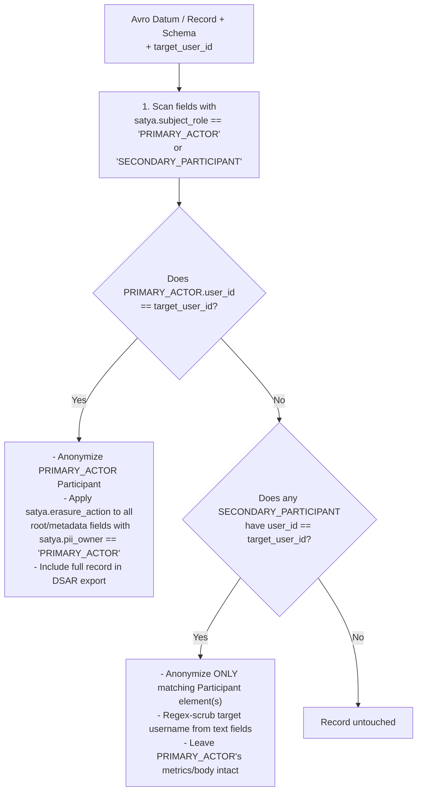

# Plan: Auditing & Annotating Satya Avro Schemas for PII and GDPR Subject Matching

## 1. Audit of All 7 Existing `.avsc` Schemas

Every existing Satya Avro schema embeds two shared types from `com.satya.types` (`EventMetadata` and `Participant`) alongside topic-specific payload fields.

Crucially, **a single event can reference multiple human participants in different roles** (e.g., `sender` vs. `recipients[]` in `ChatMessageEvent`, or `actor` vs. `roster_snapshot[]` in `SessionLifecycleEvent`). Therefore, matching PII fields to a GDPR data subject (`target_user_id`) requires distinguishing between:

1. **Participant-Scoped PII** (fields inside a specific `com.satya.types.Participant` instance, matched when *that instance's* `user_id == target_user_id`).
2. **Primary-Actor-Scoped Event PII** (fields on the event root or `metadata`, such as `body`, `pitch_hz_estimate`, or `timezone_offset_min`, matched when the event's **Primary Actor** has `user_id == target_user_id`).

---

### 1.1 Shared Nested Types (`com.satya.types`)

| Record & Field | Avro Type | PII Category (`satya.pii_category`) | How It Matches GDPR Subject (`target_user_id`) | Art. 17 Erasure Action (`satya.erasure_action`) | Art. 15/20 DSAR Rule (`satya.dsar_third_party_mask`) |
| :--- | :--- | :--- | :--- | :--- | :--- |
| **`Participant.user_id`** | `"string"` | `"DIRECT_IDENTIFIER"` | **`"satya.gdpr_subject_key": true`** (Exact match `user_id == target_user_id` when `participant_kind == "HUMAN"`) | `"HMAC_TOMBSTONE"` (`"anon-" + hmac_sha256(key, user_id \|\| session_id)[..12]`) | `true` (Mask to `"redacted-peer"` if this `Participant` is not `target_user_id`) |
| **`Participant.username`** | `"string"` | `"DIRECT_IDENTIFIER"` | Enclosed in matching `Participant` | `"REPLACE_STATIC"` (`"deleted_user"`) | `true` (Mask to `"redacted_user"` if not `target_user_id`) |
| **`Participant.display_name`** | `"string"` | `"DIRECT_IDENTIFIER"` | Enclosed in matching `Participant` | `"REPLACE_STATIC"` (`"Deleted Participant"`) | `false` (Or mask in `MEETING` mode) |
| **`Participant.character_id`** | `["null", "string"]` | `"PSEUDONYMOUS_ID"` | Enclosed in matching `Participant` | `"SET_NULL"` | `false` |
| **`EventMetadata.timezone_offset_min`** | `"int"` | `"QUASI_IDENTIFIER"` | Owned by the event's **`PRIMARY_ACTOR`** (`satya.pii_owner: "PRIMARY_ACTOR"`) | `"SET_ZERO"` (`0`) when Primary Actor matches `target_user_id` | Included in Primary Actor's DSAR export |

---

### 1.2 Per-Schema PII & Subject-Ownership Audit (`schemas/v1/*` & `schemas/v2/*`)

| Schema File & Subject | Primary Actor Field (`satya.subject_role: "PRIMARY_ACTOR"`) | Secondary Participant Field(s) (`satya.subject_role: "SECONDARY_PARTICIPANT"`) | Event-Level PII / Personal Data Fields (`satya.pii_owner: "PRIMARY_ACTOR"`) | Subject Matching & Anonymization Behavior |
| :--- | :--- | :--- | :--- | :--- |
| **1. `v1/schema_registry_event.avsc`** (`SchemaRegistryEvent`) | `registered_by` (`["null", Participant]`) | *None* | `metadata.timezone_offset_min` | If `registered_by.user_id == target_user_id`: anonymize `registered_by` and zero `metadata.timezone_offset_min`. |
| **2. `v1/session_lifecycle_event.avsc`** (`SessionLifecycleEvent`) | `actor` (`Participant`) | • `target_participant` (`["null", Participant]`)\n• `roster_snapshot` (`array<Participant>`) | • `metadata.timezone_offset_min`\n• `reason` (`["null", "string"]`, `"DIAGNOSTIC_TEXT"`) | • If `actor.user_id == target_user_id`: anonymize `actor`, zero `timezone_offset_min`, and scrub/null `reason`.\n• If `target_user_id` appears in `target_participant` or `roster_snapshot[i]`: anonymize **only** that matching `Participant` entry so the session lifecycle record remains valid for the rest of the room. |
| **3. `v1/webrtc_telemetry_event.avsc`** (`WebRtcTelemetryEvent`) | `local_participant` (`Participant`) | `remote_participant` (`["null", Participant]`) | `metadata.timezone_offset_min` | • If `local_participant.user_id == target_user_id`: anonymize `local_participant` and zero `timezone_offset_min`.\n• If `remote_participant.user_id == target_user_id`: anonymize `remote_participant` only. |
| **4. `v1/chat_message_event.avsc`** (`ChatMessageEvent` v1) | `sender` (`Participant`) | `recipients` (`array<Participant>`) | • `metadata.timezone_offset_min`\n• `body` (`"string"`, `"USER_CONTENT"`) | • If `sender.user_id == target_user_id`: anonymize `sender`, zero `timezone_offset_min`, and replace `body` with `"[Redacted per user erasure request]"`.\n• If `recipients[i].user_id == target_user_id`: anonymize `recipients[i]` and regex-scrub the erased user's `@username`/`display_name` from `body` without deleting `sender`'s message. |
| **5. `v2/chat_message_event.avsc`** (`ChatMessageEvent` v2) | `sender` (`Participant`) | `recipients` (`array<Participant>`) | • `metadata.timezone_offset_min`\n• `body` (`"USER_CONTENT"`)\n• `sentiment_score` (`"BEHAVIORAL_INFERENCE"`)\n• `detected_intent` (`"BEHAVIORAL_INFERENCE"`) | Same as `v1`, plus `SET_NULL` on `sentiment_score` and `detected_intent` when `sender.user_id == target_user_id`. |
| **6. `v1/interaction_dynamics_event.avsc`** (`InteractionDynamicsEvent`) | `speaker` (`Participant`) | `overlapped_participants` (`array<Participant>`) | • `metadata.timezone_offset_min`\n• `pitch_hz_estimate` (`"BIOMETRIC_PROXY"`)\n• `rms_energy_mean`, `rms_energy_peak` (`"BIOMETRIC_PROXY"`) | • If `speaker.user_id == target_user_id`: anonymize `speaker`, zero `timezone_offset_min`, and `SET_NULL` on `pitch_hz_estimate`.\n• If `overlapped_participants[i].user_id == target_user_id`: anonymize `overlapped_participants[i]` only. |
| **7. `v1/ttrpg_mechanics_event.avsc`** (`TtrpgMechanicsEvent`) | `actor` (`Participant`) | `target_participants` (`array<Participant>`) | • `metadata.timezone_offset_min`\n• `notes` (`["null", "string"]`, `"USER_CONTENT"`) | • If `actor.user_id == target_user_id`: anonymize `actor`, zero `timezone_offset_min`, and `SET_NULL` on `notes` while **preserving** `dice_rolled_d20`, `skill_name`, `attribute_tn`, `combat_stance`, and `action_count_cost`.\n• If `target_participants[i].user_id == target_user_id`: anonymize `target_participants[i]` only. |

---

## 2. How the Schema-Driven GDPR Matcher Works at Runtime

---

## 3. Proposed Implementation Steps

### Step 1 — Annotate All 7 `.avsc` Files in `schemas/v1/` and `schemas/v2/`
Add the non-breaking custom Avro properties (`satya.gdpr_subject_key`, `satya.subject_role`, `satya.pii_category`, `satya.pii_owner`, `satya.erasure_action`, `satya.erasure_replacement`, `satya.dsar_third_party_mask`) to:
- [`schemas/v1/schema_registry_event.avsc`](file:///c:/Users/hapah/Projects/satya/schemas/v1/schema_registry_event.avsc)
- [`schemas/v1/session_lifecycle_event.avsc`](file:///c:/Users/hapah/Projects/satya/schemas/v1/session_lifecycle_event.avsc)
- [`schemas/v1/webrtc_telemetry_event.avsc`](file:///c:/Users/hapah/Projects/satya/schemas/v1/webrtc_telemetry_event.avsc)
- [`schemas/v1/chat_message_event.avsc`](file:///c:/Users/hapah/Projects/satya/schemas/v1/chat_message_event.avsc)
- [`schemas/v1/interaction_dynamics_event.avsc`](file:///c:/Users/hapah/Projects/satya/schemas/v1/interaction_dynamics_event.avsc)
- [`schemas/v1/ttrpg_mechanics_event.avsc`](file:///c:/Users/hapah/Projects/satya/schemas/v1/ttrpg_mechanics_event.avsc)
- [`schemas/v2/chat_message_event.avsc`](file:///c:/Users/hapah/Projects/satya/schemas/v2/chat_message_event.avsc)

> [!IMPORTANT]
> Because Avro's Parsing Canonical Form (`Schema::canonical_form()`) strips custom attributes, we will add a unit test in `crates/satya-schema/src/lib.rs` verifying that the `CRC-64-AVRO` fingerprints of all 7 schemas remain **bit-for-bit identical** before and after adding the PII annotations.

### Step 2 — Add Schema-Driven PII Inspection & Subject-Matching Helpers in `crates/satya-schema`
In [`crates/satya-schema/src/lib.rs`](file:///c:/Users/hapah/Projects/satya/crates/satya-schema/src/lib.rs):
1. Add a `gdpr` module / helper methods on `RegisteredSchema`:
   - `extract_pii_field_manifest(&self) -> Vec<PiiFieldDescriptor>`: Recursively walks `self.avro_schema` (`RecordField::custom_attributes`) and returns every annotated PII field path (e.g., `sender.user_id`, `recipients[].username`, `metadata.timezone_offset_min`, `body`, `pitch_hz_estimate`) along with its `satya.pii_category`, `satya.subject_role`, and `satya.erasure_action`.
   - `anonymize_avro_value_for_subject(&self, value: &mut apache_avro::types::Value, target_user_id: &str, tombstone_id: &str) -> bool`: Walks any `apache_avro::types::Value::Record` using `self.avro_schema`'s custom attributes, distinguishes `PRIMARY_ACTOR` vs. `SECONDARY_PARTICIPANT` matches, applies `HMAC_TOMBSTONE` / `REPLACE_STATIC` / `REDACT_TEXT` / `SET_NULL` / `SET_ZERO`, and returns `true` if the event matched `target_user_id`.
   - `matches_gdpr_subject_for_dsar(&self, value: &apache_avro::types::Value, target_user_id: &str) -> Option<apache_avro::types::Value>`: Checks if `target_user_id` is involved in the record and returns a DSAR-safe clone where third-party participants' `satya.dsar_third_party_mask == true` fields (`user_id`, `username`) are masked.

### Step 3 — Update `docs/technical/observability-and-avro-telemetry-design.md`
Sync Section 6.3 of [`docs/technical/observability-and-avro-telemetry-design.md`](file:///c:/Users/hapah/Projects/satya/docs/technical/observability-and-avro-telemetry-design.md) with the `PRIMARY_ACTOR` vs. `SECONDARY_PARTICIPANT` subject-ownership model.
