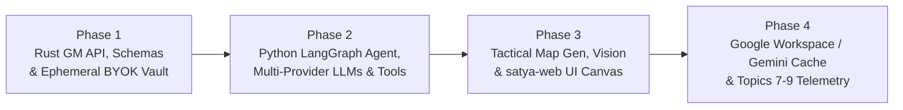

# Implementation Plan: Satya AI Game Master (`ai-gm-agent-design.md`)

> [!IMPORTANT]
> **Status**: **Phase 1**, **Phase 2**, and **Avro Topics 7–9** (`tabletop-canvas`, `ai-gm-trajectories`, `system-logs`) are implemented and verified across all Rust and Python test suites.

## 1. Current State vs. Target Architecture (Gap Analysis)

| Area | Already Implemented in Codebase | Missing / Needs to Be Built |
| :--- | :--- | :--- |
| **Shared Schemas (`satya-schema`)** | • [`ParticipantKind::AiAgent`](file:///c:/Users/hapah/Projects/satya/crates/satya-schema/src/types.rs#L18-L25), [`SessionRole::AiGm`](file:///c:/Users/hapah/Projects/satya/crates/satya-schema/src/types.rs#L28-L43), [`AiAgentInfo`](file:///c:/Users/hapah/Projects/satya/crates/satya-schema/src/types.rs#L46-L54), [`Participant::ai_gm`](file:///c:/Users/hapah/Projects/satya/crates/satya-schema/src/types.rs#L95-L109) • [`MessageVisibility::GmOnly`](file:///c:/Users/hapah/Projects/satya/crates/satya-schema/src/events.rs), [`ChannelContext::GmNarration`](file:///c:/Users/hapah/Projects/satya/crates/satya-schema/src/events.rs) • [`TtrpgMechanicsEvent::evaluate_satya_task`](file:///c:/Users/hapah/Projects/satya/crates/satya-schema/src/events.rs) | • Backend GM REST DTOs (`GmContextResponse`, `GmChatRequest`, `GmRollRequest`, `GmMapUpdateRequest`, `SessionGmConfigRequest`, `AiGmEventTriggerPayload`) in [`protocol.rs`](file:///c:/Users/hapah/Projects/satya/crates/satya-schema/src/protocol.rs) • New `ServerWsPacket` variants (`MapUpdated`, `WgpuDiceRoll`) • New Avro topics 7–9 (`TabletopCanvasEvent`, `AiGmTrajectoryEvent`, `SessionLogEvent`) & optional `trace_id`/`span_id` on [`EventMetadata`](file:///c:/Users/hapah/Projects/satya/crates/satya-schema/src/types.rs#L113-L136) |
| **Signaling & Auth (`satya-signaling`)** | • [`AuthAndSessionManager::create_session`](file:///c:/Users/hapah/Projects/satya/crates/satya-signaling/src/auth.rs#L399-L475) spawns `Participant::ai_gm` when `enable_ai_gm = true` • Deterministic stub [`trigger_ai_gm_chat_reply`](file:///c:/Users/hapah/Projects/satya/crates/satya-signaling/src/lib.rs#L1004-L1063) | • `[ai_gm]` config in [`config/storage.toml`](file:///c:/Users/hapah/Projects/satya/config/storage.toml) and [`StorageConfig`](file:///c:/Users/hapah/Projects/satya/crates/satya-storage/src/lib.rs#L140-L153) • Ephemeral in-memory BYOK credential vault in [`ProtectedSession`](file:///c:/Users/hapah/Projects/satya/crates/satya-signaling/src/auth.rs#L48-L61) + `POST /api/sessions/:id/gm-config` • Scoped `/api/gm/sessions/:id/{context,chat,roll,map}` endpoints with `verify_gm_service_header` • Co-Pilot (`TTRPG_GM_AI`) vs. Autonomous (`TTRPG_AI_GM`) trigger filter & async webhook dispatcher (`POST /internal/ai-gm/events`) |
| **Web UI (`satya-web`)** | • `#session-mode-select` already supports `TTRPG`, `TTRPG_GM_AI`, `TTRPG_AI_GM`, and `MEETING` in [`lib.rs`](file:///c:/Users/hapah/Projects/satya/crates/satya-web/src/lib.rs#L363-L372) and [`wasm_client.rs`](file:///c:/Users/hapah/Projects/satya/crates/satya-web/src/wasm_client.rs#L303-L314) • Targeted chat & d20 task drawer | • AI GM Provider / Model / Ephemeral BYOK API Key controls in `#session-card` and Hamburger Settings • Tactical Map & 3D Dice visual canvas card handling `MapUpdated` and `WgpuDiceRoll` packets |
| **Python AI GM (`src/satya_ml/`)** | • [`lance_ingest.py`](file:///c:/Users/hapah/Projects/satya/src/satya_ml/lance_ingest.py) & [`inspect_avro.py`](file:///c:/Users/hapah/Projects/satya/src/satya_ml/inspect_avro.py) | • Entire `src/satya_ml/ai_gm/` package (`models.py`, `graph.py`, `tools.py`, `maps.py`, `lore_sync.py`, `server.py`) • NPC profile data (`data/npcs/*.toml`) & tests (`tests/test_ai_gm.py`) |

---

## 2. Phased Execution Plan

### Phase 1: Shared Schemas, Ephemeral BYOK Vault & Backend GM API (Rust)

1. **`crates/satya-schema/src/protocol.rs`**:
   - Add `AiGmOperatingMode` (`Autonomous` vs. `CoPilot`) and `AiGmProviderConfig` (`provider`, `model_id`, `vision_model_id`, `temperature`, `persona_id`, `api_key`, `base_url`).
   - Add optional `ai_gm_config: Option<AiGmProviderConfig>` to [`CreateSessionRequest`](file:///c:/Users/hapah/Projects/satya/crates/satya-schema/src/protocol.rs#L86-L99) and create `UpdateSessionGmConfigRequest` for `POST /api/sessions/:id/gm-config`.
   - Add Backend GM REST DTOs:
     - `GmContextResponse` (`session_id`, `session_mode`, `operating_mode`, `ai_gm_participant`, `human_gm_user_id`, `roster`, `active_map`)
     - `GmChatRequest` (`visibility`, `recipient_user_ids`, `channel_context`, `body`, `model_id`, `speaker_override`)
     - `GmRollRequest` (`actor_display_name`, `target_user_ids`, `skill_name`, `attribute_tn`, `pool_size`, `difficulty_rating`, `combat_stance`, `fatigue_level`, `wound_shock_index`, `notes`)
     - `GmMapUpdateRequest` & `MapTokenPlacement` (`map_id`, `title`, `image_url`, `grid_width`, `grid_height`, `tokens`, `notes`)
     - `AiGmTurnTriggerRequest` (sent by `satya-signaling` to the Python LangGraph worker at `POST /internal/ai-gm/events`).
   - Add `ServerWsPacket::MapUpdated` and `ServerWsPacket::WgpuDiceRoll`.

2. **`config/storage.toml` & `crates/satya-storage/src/lib.rs`**:
   - Add `AiGmConfig` struct (`[ai_gm]` section with `enabled`, `service_url`, `service_token`, `default_provider`, `ollama_base_url`, `reasoning_model`, `vision_model`, `persona_id`, `temperature`) to [`StorageConfig`](file:///c:/Users/hapah/Projects/satya/crates/satya-storage/src/lib.rs#L140-L153).

3. **`crates/satya-signaling/src/auth.rs`**:
   - Extend [`ProtectedSession`](file:///c:/Users/hapah/Projects/satya/crates/satya-signaling/src/auth.rs#L48-L61) to hold in-memory `SessionAiGmVault` (including the ephemeral `api_key` and `sponsor_user_id`) and `active_map: Option<GmMapUpdateRequest>`.
   - Enforce strict key lifecycle & redaction:
     - `Participant.ai_agent_info` only stores `{ model_id: "<provider>/<model>", persona_id, temperature }`.
     - When the sponsoring user leaves/logs out or `remaining_human_count == 0`, scrub the ephemeral `api_key` from memory.

4. **`crates/satya-signaling/src/lib.rs`**:
   - Add `verify_gm_service_header` checking `Authorization: Bearer <service_token>`.
   - Implement routes:
     - `POST /api/sessions/:session_id/gm-config`
     - `GET /api/gm/sessions/:session_id/context`
     - `POST /api/gm/sessions/:session_id/chat`
     - `POST /api/gm/sessions/:session_id/roll`
     - `POST /api/gm/sessions/:session_id/map`
     - `.nest_service("/maps", ServeDir::new("data/maps"))`
   - Update [`trigger_ai_gm_chat_reply`](file:///c:/Users/hapah/Projects/satya/crates/satya-signaling/src/lib.rs#L1004-L1063):
     - Determine `operating_mode`: `CoPilot` if a human `SessionRole::Gm` is in `roster`, else `Autonomous`.
     - Apply the **Trigger Filter**:
       - `CoPilot` (`TTRPG_GM_AI`): only trigger when addressed (`@satya_ai_gm`) or when a `GM_ONLY` / `PRIVATE` message targets the AI GM.
       - `Autonomous` (`TTRPG_AI_GM`): trigger on `IN_CHARACTER` player chat, `GM_ONLY`/`PRIVATE` whispers to GM, and `RollTtrpgTask` mechanics outcomes.
     - Dispatch non-blocking HTTP `POST {service_url}/internal/ai-gm/events` (passing `X-Satya-Provider-Key` if present, with a deterministic fallback if the external Python worker is not running so existing offline Rust unit tests continue to pass).

---

### Phase 2: Python LangGraph Runtime, Multi-Provider Factory & Tool Suite (`src/satya_ml/ai_gm/`)

1. **`pixi.toml` Dependencies & Tasks**:
   - Add `langgraph`, `langchain-core`, `langchain-ollama`, `langchain-google-genai`, `langchain-openai`, `langchain-anthropic`, `langchain-mcp-adapters`, `fastapi`, `uvicorn`, `httpx` to `[pypi-dependencies]`.
   - Add `serve-ai-gm = { cmd = "uvicorn satya_ml.ai_gm.server:app --host 127.0.0.1 --port 8090", env = { PYTHONPATH = "src" } }`.

2. **Model Factory (`src/satya_ml/ai_gm/models.py`)**:
   - Implement `SessionLlmConfig` and `build_gm_chat_model(cfg, for_vision=False)` supporting `ollama` (`ChatOllama`), `google_genai` (`ChatGoogleGenerativeAI`), `openai` (`ChatOpenAI`), and `anthropic` (`ChatAnthropic`).

3. **NPC Data & Tool Suite (`src/satya_ml/ai_gm/tools.py` & `data/npcs/sector_4_npcs.toml`)**:
   - Seed starter NPC profiles in `data/npcs/sector_4_npcs.toml` (e.g., *Captain Vance*, *Station SecOps Sentry*, *Dr. Aris Thorne*) with Satya attribute TNs, skills, preferred `CombatStance`, fatigue, and disposition.
   - Implement `@tool` functions:
     - **Lore, Rules & NPCs**: `lookup_npc_profile`, `update_npc_state`, `query_satya_rules` (searches `docs/ttrpg/*.md`), `query_campaign_lore` (searches `docs/story/**/*.md` + `data/lance/*.lance`).
     - **Session Mechanics & Communication**: `roll_satya_d20_check` (`POST /api/gm/sessions/:id/roll`), `whisper_to_player` (`POST /api/gm/sessions/:id/chat` with `PRIVATE`), `narrate_to_session` (`POST /api/gm/sessions/:id/chat` with `PUBLIC` + `GM_NARRATION` or `IN_CHARACTER`).
   - Add optional MCP client bridge (`src/satya_ml/ai_gm/mcp_bridge.py`) using `MultiServerMCPClient` so external Tier 2 ruleset or Tier 3 lore MCP servers can be attached per session.

4. **LangGraph StateGraph & FastAPI Service (`src/satya_ml/ai_gm/graph.py` & `server.py`)**:
   - Implement `AiGmSessionState` (`session_id`, `operating_mode`, `human_gm_user_id`, `messages`, `roster`, `current_scene`, `combat_active`, `combat_tick_clock`, `active_npcs`, `active_map`).
   - Build the 4-node graph (`sync_session_context` $\rightarrow$ `gm_supervisor_node` $\leftrightarrow$ `tool_execution_node` $\rightarrow$ `publish_gm_response`) with `MemorySaver` / `SqliteSaver` checkpointer keyed by `thread_id = session_id`.
   - Enforce Co-Pilot vs. Autonomous visibility defaults in `publish_gm_response` (whispering to `human_gm_user_id` by default in `co_pilot` mode unless broadcasting a table action).

---

### Phase 3: Tactical Map Generator, Vision Inspector & Web UI (`src/satya_ml/ai_gm/maps.py` & `crates/satya-web`)

1. **Tactical Map Tools (`src/satya_ml/ai_gm/maps.py`)**:
   - `generate_tactical_map`: Generates a clean, coordinate-labeled 2D tactical grid SVG (and optional PNG) with obstacles/cover, doors, hazards, and token badges under `data/maps/{session_id}/{map_id}.svg`, and posts `GmMapUpdateRequest` to `POST /api/gm/sessions/:id/map`.
   - `move_map_token`: Updates entity `(x, y)` coordinates on the active map, re-renders the SVG, and pushes the update to `satya-signaling`.
   - `inspect_tactical_map`: Sends the rendered map + coordinate summary to `build_gm_chat_model(cfg, for_vision=True)` to answer spatial/cover/line-of-sight questions.

2. **Web UI Controls & Tabletop Canvas (`crates/satya-web/src/lib.rs` & `wasm_client.rs`)**:
   - Add AI GM Provider selector (`Ollama (Local)`, `Google Gemini (BYOK)`, `OpenAI (BYOK)`, `Anthropic Claude (BYOK)`), Model ID input, and Ephemeral API Key password field in `#session-card` (shown when `TTRPG_GM_AI` or `TTRPG_AI_GM` is selected) and in `#menu-settings-panel`.
   - Add a **Tactical Map & 3D Dice Canvas** card in `#workspace-panel` that renders live maps when `ServerWsPacket::MapUpdated` arrives and displays synchronized dice rolls when `ServerWsPacket::WgpuDiceRoll` arrives.

---

### Phase 4: Cloud Lore Sync (Google Drive/Docs/Sheets + Gemini Context Caching) & Avro Topics 7–9

1. **Google Workspace & Gemini Context Caching (`src/satya_ml/ai_gm/lore_sync.py`)**:
   - Live `@tool` wrappers for reading/updating NPC rows in Google Sheets and reading/appending session recaps in Google Docs.
   - Gemini Context Caching (`CachedContent`) sync for pinning campaign folders, with local fallback indexing into `data/lance/campaign-lore.lance`.

2. **Avro Telemetry Topics 7–9 (`schemas/v1/*.avsc`, `satya-schema`, `satya-storage`)**:
   - Implement `TabletopCanvasEvent` (Topic 7, `schema_id = 8`), `AiGmTrajectoryEvent` (Topic 8, `schema_id = 9`), and `SessionLogEvent` (Topic 9, `schema_id = 10`) per [`docs/technical/observability-and-avro-telemetry-design.md`](file:///c:/Users/hapah/Projects/satya/docs/technical/observability-and-avro-telemetry-design.md).
