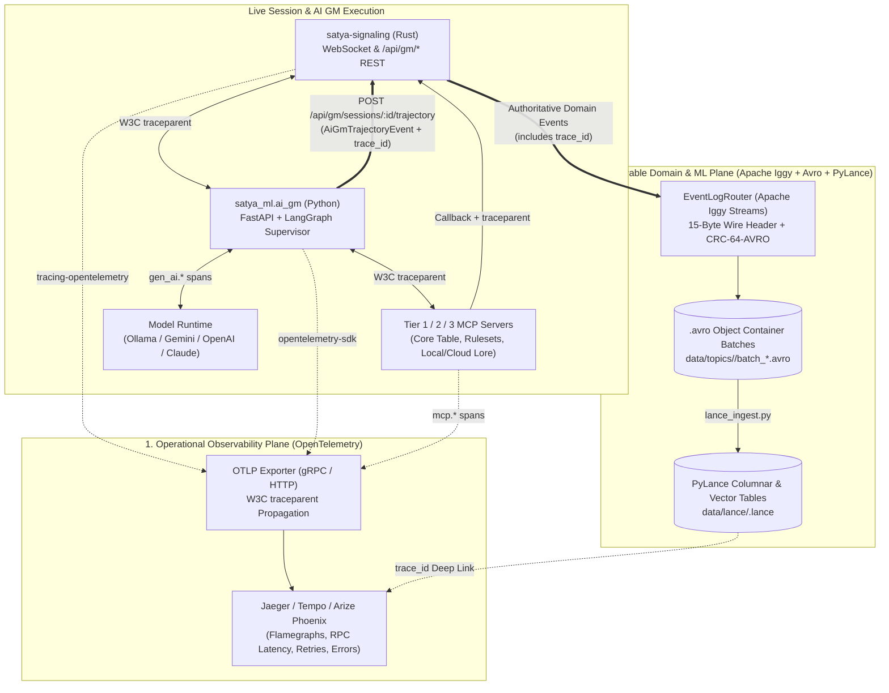
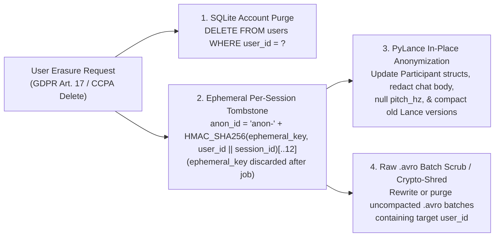

# Satya Observability (OpenTelemetry) & Avro/PyLance Telemetry Architecture — Technical Design

## 1. Overview & Architectural Philosophy

Satya is a polyglot **Rust + Python** real-time collaborative platform combining WebRTC mesh audio/video, multi-visibility session chat, Satya d20 roll-under TTRPG mechanics, a 3D `wgpu` / tactical map canvas, and a **LangGraph + MCP AI Game Master** (operating in either `TTRPG_AI_GM` Autonomous Mode or `TTRPG_GM_AI` Co-Pilot Assistant Mode).

To observe, debug, replay, and train models on this system without conflating ephemeral operational RPC diagnostics with permanent campaign history, Satya separates telemetry into two complementary planes linked by a shared **W3C `trace_id`**:

1. **Operational Observability Plane — OpenTelemetry (OTel Traces, Spans & Metrics)**:
   - **"The Plumbing"**: Tracks cross-language execution waterfalls (`Rust Axum/WebSocket` $\leftrightarrow$ `Python FastAPI/LangGraph` $\leftrightarrow$ `LLM Provider APIs` $\leftrightarrow$ `Tier 1/2/3 MCP Servers`), HTTP/JSON-RPC status codes, retries, queue wait times, and per-call LLM token/latency metrics using standard **OpenTelemetry GenAI (`gen_ai.*`)** and **MCP (`mcp.*`)** semantic conventions.
   - Designed for real-time flamegraph inspection in **Jaeger**, **Grafana Tempo**, **Arize Phoenix**, or **Langfuse**.
2. **Durable Domain & ML Event Plane — Apache Iggy + Apache Avro (`CRC-64-AVRO`) + PyLance**:
   - **"The World State & Training Corpus"**: Captures schema-versioned, binary wire-framed (`0x53` magic byte + `schema_id` + `schema_version` + 8-byte `CRC-64-AVRO` fingerprint) domain events that belong to the permanent campaign record and columnar ML datasets (`data/lance/*.lance`).
   - Designed for **deterministic session replay**, **in-campaign RAG**, **offline agent evaluation**, and **Supervised Fine-Tuning (SFT) / knowledge distillation** into local Ollama models.



---

## 2. Complete Catalog of Satya Apache Iggy & Avro Topics

Instead of creating separate topics for every individual REST route or MCP tool (which fragments schemas and complicates columnar joins), Satya organizes all durable events and structured logs into **9 canonical Apache Iggy topics** registered in `crates/satya-schema/src/lib.rs`:

| Topic ID | Topic Name (`topics::*`) | Avro Subject (`subjects::*`) | Schema ID(s) | Primary Producer | Purpose & PyLance Target (`data/lance/*.lance`) |
| :---: | :--- | :--- | :---: | :--- | :--- |
| **1** | `schema-registry` | `com.satya.events.SchemaRegistryEvent` | `1` (`v1`) | `satya-storage` bootstrap | Audit trail of all registered `.avsc` schemas, compatibility modes, and `CRC-64-AVRO` fingerprints. |
| **2** | `session-lifecycle` | `com.satya.events.SessionLifecycleEvent` | `2` (`v1`) | `satya-signaling` Auth/Room Mgr | User registration, login, logout, session creation (`TTRPG`, `TTRPG_GM_AI`, `TTRPG_AI_GM`, `MEETING`), joins, role changes, and disconnects. |
| **3** | `webrtc-telemetry` | `com.satya.events.WebRtcTelemetryEvent` | `3` (`v1`) | `satya-signaling` + `satya-web` | P2P SDP offers/answers, ICE candidate states, RTT, jitter, packet loss, and audio/video mute state transitions. |
| **4** | `chat-messages` | `com.satya.events.ChatMessageEvent` | `4` (`v1`), `7` (`v2`) | `satya-signaling` (`/ws/session` & `/api/gm/*/chat`) | Public broadcasts (`PUBLIC`), targeted whispers (`PRIVATE`), GM whispers (`GM_ONLY`), and AI GM narrations (`GM_NARRATION`). |
| **5** | `interaction-dynamics` | `com.satya.events.InteractionDynamicsEvent` | `5` (`v1`) | `satya-web` Web Audio VAD | Non-textual vocal prosody: speech turn duration, RMS energy mean/peak, pitch estimate, interruptions/overlaps, and dominance ratio. |
| **6** | `ttrpg-mechanics` | `com.satya.events.TtrpgMechanicsEvent` | `6` (`v1`) | `satya-signaling` (`/ws/session` & `/api/gm/*/roll`) | Authoritative Satya d20 roll-under task checks, count-up combat tick costs, stances, fatigue/wound shock, and `AI_GM_DECISION` adjudications. |
| **7** *(New)* | **`tabletop-canvas`** | `com.satya.events.TabletopCanvasEvent` | `8` (`v1`) | `satya-signaling` (`/api/gm/*/map` & Tier 1 MCP) | **Visual tabletop state mutations**: tactical map generation, grid updates, token coordinate moves, fog-of-war updates, and synchronized 3D `wgpu` dice physics seeds. |
| **8** *(New)* | **`ai-gm-trajectories`** | `com.satya.events.AiGmTrajectoryEvent` | `9` (`v1`) | `satya-ml` LangGraph runtime via `satya-signaling` | **End-to-end AI GM turn trajectories**: links `trace_id` and `trigger_event_id` to the ordered sequence of Tier 1/2/3 MCP tool invocations, RAG/Context Cache sources, token usage, and final response. |
| **9** *(New)* | **`system-logs`** | `com.satya.events.SessionLogEvent` | `10` (`v1`) | Rust `tracing::fmt` & Python `logging` sink | **Canonical plain-text session/trace/lineage-prefixed logs**: persists embedding-ready plain-text `log_line` strings into `data/lance/system-logs.lance` with lightweight `session_id`, `trace_id`, and `lineage_id` filter columns. |

---

## 3. New Avro Schema Specifications (`v1`)

### 3.1 Evolution of `com.satya.types.EventMetadata` (Optional `trace_id` & `span_id` Correlation)

To link every Avro record in PyLance to its exact OpenTelemetry distributed trace without breaking backward compatibility with existing `v1` readers, `EventMetadata` adds two nullable W3C trace context fields with `"default": null`:

```json
{
  "name": "trace_id",
  "type": ["null", "string"],
  "default": null,
  "doc": "Optional 32-character lowercase hex W3C OpenTelemetry trace_id correlating this domain event with distributed RPC spans."
},
{
  "name": "span_id",
  "type": ["null", "string"],
  "default": null,
  "doc": "Optional 16-character lowercase hex W3C OpenTelemetry span_id that emitted this domain event."
}
```

---

### 3.2 Topic 7: `tabletop-canvas` (`schemas/v1/tabletop_canvas_event.avsc`)

Captures every visual mutation on the shared tabletop canvas (whether triggered by a Human GM, a Player moving their token, the AI GM Assistant in `TTRPG_GM_AI`, or the Autonomous AI GM in `TTRPG_AI_GM`).

```json
{
  "type": "record",
  "name": "TabletopCanvasEvent",
  "namespace": "com.satya.events",
  "doc": "Captures tactical map generation, token coordinate updates, fog-of-war mutations, and deterministic 3D wgpu dice physics rolls.",
  "fields": [
    { "name": "metadata", "type": "com.satya.types.EventMetadata" },
    {
      "name": "canvas_event_type",
      "type": {
        "type": "enum",
        "name": "CanvasEventType",
        "symbols": [
          "MAP_GENERATED",
          "MAP_UPDATED",
          "TOKEN_MOVED",
          "TOKEN_ADDED",
          "TOKEN_REMOVED",
          "FOG_OF_WAR_UPDATED",
          "WGPU_DICE_SPAWNED"
        ]
      }
    },
    { "name": "actor", "type": "com.satya.types.Participant" },
    { "name": "map_id", "type": ["null", "string"], "default": null },
    { "name": "map_title", "type": ["null", "string"], "default": null },
    { "name": "image_url", "type": ["null", "string"], "default": null },
    { "name": "grid_width", "type": ["null", "int"], "default": null },
    { "name": "grid_height", "type": ["null", "int"], "default": null },
    {
      "name": "token_placements",
      "type": {
        "type": "array",
        "items": {
          "type": "record",
          "name": "TokenPlacement",
          "namespace": "com.satya.types",
          "fields": [
            { "name": "entity_id", "type": "string" },
            { "name": "label", "type": "string" },
            { "name": "x", "type": "int" },
            { "name": "y", "type": "int" },
            { "name": "visibility", "type": "com.satya.types.MessageVisibility" }
          ]
        }
      },
      "default": []
    },
    {
      "name": "wgpu_dice_roll",
      "type": [
        "null",
        {
          "type": "record",
          "name": "WgpuDiceSpec",
          "namespace": "com.satya.types",
          "fields": [
            { "name": "dice_notation", "type": "string", "doc": "e.g. '3d20', '2d6+3', '1d100'" },
            { "name": "physics_seed", "type": "long", "doc": "Deterministic PRNG seed so all clients render identical 3D wgpu dice trajectories" },
            { "name": "outcomes", "type": { "type": "array", "items": "int" } },
            { "name": "visibility", "type": "com.satya.types.MessageVisibility" }
          ]
        }
      ],
      "default": null
    },
    { "name": "terrain_notes", "type": ["null", "string"], "default": null }
  ]
}
```

---

### 3.3 Topic 8: `ai-gm-trajectories` (`schemas/v1/ai_gm_trajectory_event.avsc`)

Emitted **once per completed LangGraph turn** (`POST /api/gm/sessions/:session_id/trajectory`). Instead of writing a noisy Avro event for every internal HTTP header or retry, `AiGmTrajectoryEvent` records a clean, self-contained summary of the entire agent turn—including its ordered MCP tool calls across Tiers 1, 2, and 3—while linking to the granular OpenTelemetry trace via `trace_id`.

```json
{
  "type": "record",
  "name": "AiGmTrajectoryEvent",
  "namespace": "com.satya.events",
  "doc": "Captures a complete multi-step LangGraph AI GM turn, including ordered Tier 1/2/3 MCP tool calls, RAG/Context Cache grounding sources, token usage, and W3C trace_id correlation.",
  "fields": [
    { "name": "metadata", "type": "com.satya.types.EventMetadata" },
    { "name": "turn_id", "type": "string", "doc": "Unique UUIDv7 identifier for this LangGraph turn execution." },
    { "name": "trace_id", "type": "string", "doc": "32-char hex W3C OpenTelemetry trace_id linking to the full distributed span tree." },
    {
      "name": "operating_mode",
      "type": {
        "type": "enum",
        "name": "AiGmOperatingMode",
        "symbols": ["AUTONOMOUS", "CO_PILOT"]
      },
      "doc": "AUTONOMOUS for TTRPG_AI_GM (AI GM + Players); CO_PILOT for TTRPG_GM_AI (GM + AI + Players)."
    },
    { "name": "ai_participant", "type": "com.satya.types.Participant" },
    { "name": "trigger_actor", "type": "com.satya.types.Participant", "doc": "Human player or GM whose chat/whisper/roll triggered this AI turn." },
    { "name": "trigger_event_id", "type": "string", "doc": "event_id or message_id of the triggering ChatMessageEvent or TtrpgMechanicsEvent." },
    { "name": "trigger_summary", "type": "string" },
    { "name": "llm_provider", "type": "string", "doc": "e.g. 'ollama', 'gemini', 'openai', 'anthropic'" },
    { "name": "reasoning_model_id", "type": "string", "doc": "e.g. 'qwen2.5:14b', 'gemini-2.5-pro', 'claude-sonnet-4-20250514'" },
    { "name": "vision_model_id", "type": ["null", "string"], "default": null },
    { "name": "ruleset_engine_id", "type": "string", "doc": "e.g. 'satya-d20', 'dnd5e-srd', 'pf2e'" },
    {
      "name": "tool_invocations",
      "type": {
        "type": "array",
        "items": {
          "type": "record",
          "name": "McpToolInvocationRecord",
          "namespace": "com.satya.types",
          "fields": [
            { "name": "step_index", "type": "int" },
            { "name": "span_id", "type": "string", "doc": "16-char hex OTel span_id for this specific MCP tool call." },
            {
              "name": "mcp_tier",
              "type": {
                "type": "enum",
                "name": "McpServerTier",
                "namespace": "com.satya.types",
                "symbols": ["TIER_1_SATYA_CORE", "TIER_2_RULESET_ENGINE", "TIER_3_LORE_PROVIDER"]
              }
            },
            { "name": "server_id", "type": "string", "doc": "e.g. 'satya-core-table', 'satya-d20-rules', 'google-workspace-lore', 'local-lance-lore'" },
            { "name": "tool_name", "type": "string", "doc": "e.g. 'inspect_tactical_map', 'lookup_npc_profile', 'roll_satya_d20_check'" },
            { "name": "arguments_json", "type": "string", "doc": "Redacted JSON arguments passed to the MCP tool." },
            { "name": "result_summary_json", "type": "string", "doc": "Structured JSON or text output returned by the MCP tool." },
            { "name": "is_error", "type": "boolean" },
            { "name": "duration_ms", "type": "long" }
          ]
        }
      }
    },
    {
      "name": "rag_sources_used",
      "type": { "type": "array", "items": "string" },
      "default": [],
      "doc": "URIs or IDs of lore documents consulted (e.g. 'gdrive://1BxiMVs0XRA5nFMdKvBdBZjgmUUqptlbs74OgvE2upms', 'gemini-cache://cachedContents/abc123', 'file://docs/ttrpg/Combat.md')."
    },
    { "name": "emitted_event_ids", "type": { "type": "array", "items": "string" }, "default": [], "doc": "event_ids of ChatMessageEvents, TtrpgMechanicsEvents, or TabletopCanvasEvents produced during this turn." },
    { "name": "prompt_tokens", "type": "int" },
    { "name": "completion_tokens", "type": "int" },
    { "name": "cached_tokens", "type": "int", "default": 0, "doc": "Tokens served from provider context cache (e.g. Gemini CachedContent)." },
    { "name": "total_turn_latency_ms", "type": "long" },
    {
      "name": "turn_status",
      "type": {
        "type": "enum",
        "name": "AiGmTurnStatus",
        "symbols": ["COMPLETED", "PARTIAL_ERROR", "ABORTED_BY_GM", "PROVIDER_ERROR"]
      }
    }
  ]
}
```

---

### 3.4 Topic 9: `system-logs` (`schemas/v1/session_log_event.avsc`)

#### Why Plain-Text Prefix-Formatted Log Lines Instead of Heavy Structured JSON Logs?
Splitting logs into dozens of rigid structural fields (`fields_json`, numeric callsite hashes, nested dicts) makes downstream text embeddings and sequence modeling harder: pre-trained embedding models and tokenizers expect contiguous, human-readable text where context and causality appear inline.

Instead, Satya formats a **deterministic bracketed header prefix** directly into a single plain-text `log_line` string:
```text
[2026-10-29T23:18:04.112Z] [INFO] [session=ep1-sector-4] [trace=4bf92f35 span=a1b2<-09f1] [lineage=L4<-L3,L1] satya_signaling::ws: Received SendChat from u-demo-sara (14 words)
```
and stores that `log_line` alongside only the minimal top-level index columns (`session_id`, `trace_id`, `span_id`, `parent_span_id`, `lineage_id`, `level`) in `data/lance/system-logs.lance`:
- **Embedding- & Sequence-Ready**: You can pass `log_line` (or a multi-line window of `log_line`s for a `trace_id`) directly into any text embedding model or sequence encoder without custom feature engineering.
- **Fast Columnar Filtering**: PyLance can still filter or group by `session_id`, `trace_id`, `lineage_id`, or `level` in milliseconds before embedding.

```json
{
  "type": "record",
  "name": "SessionLogEvent",
  "namespace": "com.satya.events",
  "doc": "Embedding-friendly plain-text log line prefixed with [session=...] [trace=... span=...<-...] [lineage=...<-...], plus lightweight index columns for PyLance filtering.",
  "fields": [
    { "name": "metadata", "type": "com.satya.types.EventMetadata" },
    { "name": "log_id", "type": "string", "doc": "Unique UUIDv7 identifier for this log entry." },
    {
      "name": "level",
      "type": {
        "type": "enum",
        "name": "LogLevel",
        "symbols": ["TRACE", "DEBUG", "INFO", "WARN", "ERROR", "FATAL"]
      }
    },
    { "name": "service_name", "type": "string", "doc": "e.g. 'satya-signaling', 'satya-storage', 'satya-ml-ai-gm'" },
    { "name": "trace_id", "type": ["null", "string"], "default": null, "doc": "32-char hex W3C trace_id for fast PyLance grouping." },
    { "name": "span_id", "type": ["null", "string"], "default": null, "doc": "16-char hex W3C span_id." },
    { "name": "parent_span_id", "type": ["null", "string"], "default": null, "doc": "16-char hex caller span_id (parent_span_id -> span_id)." },
    { "name": "lineage_id", "type": ["null", "string"], "default": null, "doc": "Data artifact lineage ID produced or inspected at this step." },
    {
      "name": "parent_lineage_ids",
      "type": { "type": "array", "items": "string" },
      "default": [],
      "doc": "Upstream data lineage IDs consumed at this step (parent_lineage_id -> lineage_id)."
    },
    {
      "name": "log_line",
      "type": "string",
      "doc": "Complete formatted plain-text log line including the [session=...] [trace=... span=...<-...] [lineage=...<-...] prefix, ready for direct text embedding."
    }
  ]
}
```

---

## 4. OpenTelemetry Distributed Tracing & Logger Context Threading

### 4.1 Cross-Language Context Propagation (`W3C traceparent` + `W3C baggage`)

Every AI GM interaction crosses up to three process boundaries:
1. **Rust (`satya-signaling`)**: Receives a WebSocket frame (`ClientWsPacket::SendChat` or `RollTtrpgTask`), creates the root or child span `satya.ws.handle_packet`, logs the initial Avro event with `trace_id`, and dispatches an async HTTP `POST /internal/ai-gm/events` to the Python service with both `traceparent` and `baggage` headers injected.
2. **Python (`src/satya_ml/ai_gm`)**: `opentelemetry-instrumentation-fastapi` extracts `traceparent` and `baggage` and starts `ai_gm.langgraph.turn`. Every LangGraph node, LLM call, and MCP tool invocation runs as a child span under the same `trace_id` and inherits `session_id`, `turn_id`, and `lineage_id`.
3. **MCP Callbacks to Rust (`/api/gm/sessions/:id/*`)**: When a Tier 1 or Tier 2 MCP tool invokes `POST /api/gm/sessions/:id/{roll,chat,map}`, `opentelemetry-instrumentation-httpx` forwards `traceparent` and updated `baggage` (`lineage_id`) back to `satya-signaling`, where `tower-http::trace` attaches the Rust handler span (`satya.gm_api.roll`, `satya.gm_api.chat`, `satya.gm_api.map`) to the calling MCP tool span.

### 4.2 Span Hierarchy & Standard Semantic Attributes

```text
[Root Span] satya.ws.chat_message (Rust: satya-signaling)
 │  trace_id = "4bf92f3577b34da6a3ce929d0e0e4736"
 │  satya.session.id = "ep1-sector-4"
 │  satya.session.topology = "TTRPG_GM_AI" (or "TTRPG_AI_GM")
 │  satya.trigger.event_id = "0195f3a0-..."
 │
 └─► [Child Span] ai_gm.langgraph.turn (Python: FastAPI + LangGraph)
      │  satya.ai_gm.turn_id = "0195f3a1-..."
      │  satya.ai_gm.operating_mode = "CO_PILOT"
      │
      ├─► [Span] langgraph.node.sync_session_context
      │    └─► [Span] HTTP GET /api/gm/sessions/ep1-sector-4/context (Rust callback)
      │
      ├─► [Span] gen_ai.chat (LLM Reasoning Call #1)
      │    │  gen_ai.system = "gemini" | "ollama" | "openai" | "anthropic"
      │    │  gen_ai.request.model = "gemini-2.5-flash"
      │    │  gen_ai.usage.input_tokens = 1420
      │    │  gen_ai.usage.cached_input_tokens = 48500
      │    │  gen_ai.usage.output_tokens = 95
      │
      ├─► [Span] mcp.tool.execute (Tier 1 Vision Tool)
      │    │  mcp.server.tier = "TIER_1_SATYA_CORE"
      │    │  mcp.server.id = "satya-core-table"
      │    │  mcp.tool.name = "inspect_tactical_map"
      │    └─► [Span] gen_ai.vision (Multimodal Map Inspection)
      │
      ├─► [Span] mcp.tool.execute (Tier 2 Ruleset Tool)
      │    │  mcp.server.tier = "TIER_2_RULESET_ENGINE"
      │    │  mcp.server.id = "satya-d20-rules"
      │    │  mcp.tool.name = "roll_satya_d20_check"
      │    └─► [Span] HTTP POST /api/gm/sessions/ep1-sector-4/roll (Rust callback)
      │         └─► [Span] satya.storage.log_ttrpg_mechanics (Avro schema_id=6)
      │
      ├─► [Span] gen_ai.chat (LLM Final Synthesis Call #2)
      │    └─► [Span] mcp.tool.execute ("whisper_to_player")
      │         └─► [Span] HTTP POST /api/gm/sessions/ep1-sector-4/chat (Rust callback)
      │              └─► [Span] satya.storage.log_chat_message (Avro schema_id=4)
      │
      └─► [Span] HTTP POST /api/gm/sessions/ep1-sector-4/trajectory
           └─► [Span] satya.storage.log_ai_gm_trajectory (Avro schema_id=9)
```

### 4.3 Formatting `session_id`, `trace_id`, and `lineage_id` into Plain-Text Log Lines

We support **both live formatter prefixing** (primary) and **post-processing log stitch/imputation** (fallback during `compact-to-lance`):

1. **Live Formatter Prefixing (Rust `tracing_subscriber::fmt` & Python `logging.Formatter`)**:
   - **Call-Graph Token (`[trace=<trace_id> span=<span_id><-<parent_span_id>]`)**: Reads the active OpenTelemetry span context and writes the caller $\rightarrow$ callee edge directly into the log string.
   - **Data-Lineage Token (`[lineage=<lineage_id><-<parent_1>,<parent_2>]`)**: Reads the active data artifact ID (`lineage_id`) and its upstream inputs (`parent_lineage_ids`) from task-local context (`tracing::Span` / W3C `baggage` in Rust; `contextvars.ContextVar` in Python) and formats the data-flow edge inline.
   - Every normal `tracing::info!("...")` or `logger.info("...")` statement automatically emits a plain-text line with these prefixes and appends a `SessionLogEvent` to the `system-logs` stream.
2. **Post-Processing Imputation (`compact-to-lance`)**:
   - If a third-party crate or library emits a raw log line missing `[session=...]` or `[lineage=...]`, `src/satya_ml/lance_ingest.py` joins on `(trace_id, service_name, timestamp_us)` during compaction and prepends the missing `[session=...]` / `[lineage=...]` header before computing text embeddings and writing `data/lance/system-logs.lance`.

---

## 5. PyLance Compaction & Cross-Table Joins

> **Downstream Custom ML Models & Use Cases**: See [`docs/technical/custom-ml-models-and-data-use-cases.md`](./custom-ml-models-and-data-use-cases.md) for the full design of custom models built on these PyLance tables—including **Roleplay & Persona Fine-Tuning**, **Local Ollama Tool-Call Distillation**, **Encounter Pacing Models**, and the **Call-Graph + Data-Lineage Variational Autoencoder (VAE) for Error Triage**.

When `.avro` batch files under `data/topics/` are compacted via `pixi run compact-to-lance` (`src/satya_ml/lance_ingest.py`), all 9 topics materialize as zero-copy columnar PyLance datasets under `data/lance/`:

| PyLance Dataset | Primary Join Keys | Downstream Analytics & ML Role |
| :--- | :--- | :--- |
| `data/lance/chat-messages.lance` | `metadata.event_id`, `metadata.session_id`, `metadata.trace_id`, `message_id` | Conversational history, whisper graphs, roleplay SFT/DPO datasets, sentiment/intent evolution (`v1` $\rightarrow$ `v2`). |
| `data/lance/ttrpg-mechanics.lance` | `metadata.event_id`, `metadata.session_id`, `metadata.trace_id` | Satya d20 roll distributions, combat stance balance, action tick economy analysis. |
| `data/lance/tabletop-canvas.lance` | `metadata.event_id`, `metadata.session_id`, `metadata.trace_id`, `map_id` | Spatial tactical replay, multimodal vision-language alignment (`image_url` + `token_placements`). |
| `data/lance/ai-gm-trajectories.lance` | `turn_id`, `trace_id`, `trigger_event_id`, `emitted_event_ids` | Multi-step MCP tool-calling trajectories for local Ollama distillation and agent evaluation. |
| `data/lance/system-logs.lance` | `metadata.session_id`, `trace_id`, `span_id`, `parent_span_id`, `lineage_id` | Plain-text `log_line` + vector embeddings (`log_embedding`) for semantic log search and VAE call-graph/lineage error triage. |
| `data/lance/interaction-dynamics.lance` | `metadata.session_id`, `metadata.client_timestamp_us` | Vocal prosody & turn-taking engagement signals (RMS energy, pitch, silence reduction). |

---

## 6. Security, Opt-In ML Consent, GDPR Compliance, PII Anonymization & DSAR Architecture

### 6.1 Credential Redaction & `MessageVisibility` Access Control

1. **Zero Secrets in OTel, Avro, or `system-logs.lance`**:
   - Ephemeral BYOK credentials (`api_key`, Google OAuth `access_token`) held in `satya-signaling`'s in-memory session vault are **never** serialized into `AiGmTrajectoryEvent`, `SessionLogEvent`, `SessionLifecycleEvent`, or OpenTelemetry span attributes.
   - Before recording `McpToolInvocationRecord.arguments_json`, `SessionLogEvent.log_line`, or OTel `mcp.tool.arguments`, a redaction filter strips any key or token matching `(?i)(api_key|token|secret|password|authorization|bearer\s+\S+)`.
2. **Respecting `MessageVisibility` in Replay & RAG**:
   - Events in `chat-messages.lance` and `tabletop-canvas.lance` preserve their `MessageVisibility` (`PUBLIC`, `PRIVATE`, `GM_ONLY`, `HOST_ONLY`).
   - When the AI GM queries `data/lance/` during live session RAG, public narrations retrieve only `PUBLIC` facts, whereas `GM_ONLY` and `PRIVATE` records are restricted to GM-facing whispers (`TTRPG_GM_AI`) or private perception whispers targeted at the original recipient.

---

### 6.2 Strict Opt-In ML Training Consent (`TrainingConsentScope`) & Channel Exclusions

Unlike public social media comments posted to the open web, Satya sessions are **password-protected group rooms** containing private whispers and out-of-character (`OOC`) personal conversations. Under **GDPR** (EU/UK), **CCPA/CPRA** (California), **LGPD** (Brazil), **PIPEDA** (Canada), and US FTC guidance, using private communications for AI model training requires clear disclosure and affirmative consent.

Satya enforces **strict Opt-In (`NONE` by default)** at both the account level (`users` table) and session level (`EventMetadata.training_consent`):

| Consent Tier (`TrainingConsentScope`) | Default? | Allowed for ML Training (`data/lance/training_splits/`) | Hard-Excluded From Training |
| :--- | :---: | :--- | :--- |
| **`NONE`** | **Yes (Default)** | **Nothing.** Events are used only for live session delivery and session state. | All chat, voice prosody, mechanics, trajectories, and logs. |
| **`DIAGNOSTICS_AND_MECHANICS`** | Opt-In | Non-personal system logs (`system-logs`), WebRTC stats (`webrtc-telemetry`), and anonymous dice/tick math (`ttrpg-mechanics`) for the debugging VAE and balance models. | **All chat messages (`chat-messages`)** and voice prosody (`interaction-dynamics`). |
| **`IN_CHARACTER_ROLEPLAY`** | Opt-In | **Only `PUBLIC` + (`IN_CHARACTER` or `GM_NARRATION`)** messages and mechanics from opted-in participants in opted-in TTRPG sessions. | **Always hard-excludes**:<br>• `PRIVATE`, `GM_ONLY`, and `HOST_ONLY` whispers<br>• `OUT_OF_CHARACTER` (`OOC`) chat (where real-life personal details are shared)<br>• All `MEETING` mode sessions (`MEETING_PUBLIC` & `MEETING_BACKCHANNEL`) |

---

### 6.3 Schema-Driven GDPR Governance via Avro Custom Field Properties (`.avsc`)

#### Why Annotate PII Directly Inside `.avsc` Schemas?
The Apache Avro specification permits arbitrary custom JSON attributes on any record or field definition, and—critically—the **Avro Parsing Canonical Form (`[STRIP]` rule)** strips all non-structural attributes (`doc`, `aliases`, default values, and custom properties) before computing the 64-bit **`CRC-64-AVRO` fingerprint**.

This gives Satya two huge architectural advantages:
1. **Zero Wire or Fingerprint Breakage**: Adding or refining `"satya.pii_category"` or `"satya.erasure_action"` annotations on existing `v1`/`v2` `.avsc` files does **not** change `Schema::canonical_form()`, `CRC-64-AVRO` fingerprints, or binary wire compatibility.
2. **100% Schema-Driven Anonymization & DSAR Engine**: Instead of maintaining brittle, hardcoded lists of PII column names in Rust and Python that can drift when schemas evolve (`v1` $\rightarrow$ `v2`), the Erasure and DSAR walkers inspect `RecordField::custom_attributes` in Rust (`apache_avro::schema::RecordField`) and `field.other_props` in Python (`fastavro` / `avro`) to automatically discover and process every PII field across all 9 topics.

#### Standard Satya Avro Privacy Annotations (`satya.*`)

| Custom `.avsc` Field Property | Allowed Values | Purpose |
| :--- | :--- | :--- |
| **`"satya.gdpr_subject_key"`** | `true` \| `false` | Marks the field (`Participant.user_id`) used to match a user's DSAR or Art. 17 Erasure request across nested structs and arrays. |
| **`"satya.subject_role"`** | `"PRIMARY_ACTOR"`, `"SECONDARY_PARTICIPANT"` | Distinguishes the primary event emitter (`sender`, `actor`, `speaker`, `local_participant`, `registered_by`) from secondary participants (`recipients[]`, `roster_snapshot[]`, `overlapped_participants[]`, `target_participants[]`, `remote_participant`). |
| **`"satya.pii_owner"`** | `"PRIMARY_ACTOR"` | Marks event-root or `metadata` PII fields (`body`, `pitch_hz_estimate`, `sentiment_score`, `detected_intent`, `notes`, `reason`, `timezone_offset_min`) that are only redacted/nulled when `PRIMARY_ACTOR` matches the GDPR subject. |
| **`"satya.pii_category"`** | `"DIRECT_IDENTIFIER"`, `"PSEUDONYMOUS_ID"`, `"QUASI_IDENTIFIER"`, `"USER_CONTENT"`, `"BIOMETRIC_PROXY"`, `"BEHAVIORAL_INFERENCE"`, `"DIAGNOSTIC_TEXT"` | Classifies the field's GDPR/CCPA sensitivity level for compliance audits and training-split gates. |
| **`"satya.erasure_action"`** | `"HMAC_TOMBSTONE"`, `"REPLACE_STATIC"`, `"REDACT_TEXT"`, `"REGEX_SCRUB_SUBJECT"`, `"SET_NULL"`, `"SET_ZERO"` | Instructs the Art. 17 Erasure walker (`RegisteredSchema::anonymize_value_for_subject`) how to anonymize the field in place without breaking Avro schema validity. |
| **`"satya.erasure_replacement"`** | e.g. `"deleted_user"`, `"[Redacted per user erasure request]"` | Static fallback value used when `"satya.erasure_action"` is `"REPLACE_STATIC"` or `"REDACT_TEXT"`. |
| **`"satya.dsar_third_party_mask"`** | `true` \| `false` | Instructs the DSAR exporter (`RegisteredSchema::project_dsar_value_for_subject`, GDPR Art. 15(4)) to mask this field when it belongs to *another* human participant inside a shared record or array. |
| **`"satya.dsar_mask_value"`** | e.g. `"redacted-peer"`, `"redacted_user"` | Replacement string used when masking third-party human identifiers during a DSAR export. |

#### Example: Annotated `Participant` & `ChatMessageEvent` in `.avsc`

```json
{
  "type": "record",
  "name": "Participant",
  "namespace": "com.satya.types",
  "fields": [
    {
      "name": "user_id",
      "type": "string",
      "satya.gdpr_subject_key": true,
      "satya.pii_category": "DIRECT_IDENTIFIER",
      "satya.erasure_action": "HMAC_TOMBSTONE",
      "satya.dsar_third_party_mask": true
    },
    {
      "name": "username",
      "type": "string",
      "satya.pii_category": "DIRECT_IDENTIFIER",
      "satya.erasure_action": "REPLACE_STATIC",
      "satya.erasure_replacement": "deleted_user",
      "satya.dsar_third_party_mask": true
    },
    {
      "name": "display_name",
      "type": "string",
      "satya.pii_category": "DIRECT_IDENTIFIER",
      "satya.erasure_action": "REPLACE_STATIC",
      "satya.erasure_replacement": "Deleted Participant",
      "satya.dsar_third_party_mask": false
    }
  ]
}
```

And on `ChatMessageEvent.body`, `InteractionDynamicsEvent.pitch_hz_estimate`, and `EventMetadata.timezone_offset_min`:
```json
{
  "name": "body",
  "type": "string",
  "satya.pii_category": "USER_CONTENT",
  "satya.erasure_action": "REDACT_TEXT",
  "satya.erasure_replacement": "[Redacted per user erasure request]"
},
{
  "name": "pitch_hz_estimate",
  "type": ["null", "float"],
  "default": null,
  "satya.pii_category": "BIOMETRIC_PROXY",
  "satya.erasure_action": "SET_NULL"
},
{
  "name": "timezone_offset_min",
  "type": "int",
  "satya.pii_category": "QUASI_IDENTIFIER",
  "satya.erasure_action": "SET_ZERO"
}
```

#### Complete PII Field Inventory Across SQLite & All 9 Avro Topics

| Storage / Avro Topic | Annotated PII Fields | `satya.pii_category` | `satya.erasure_action` (GDPR Art. 17) |
| :--- | :--- | :--- | :--- |
| **SQLite `users` (`data/users.db`)** | `user_id`, `username`, `display_name`, `password_hash`, `created_at_us` | `DIRECT_IDENTIFIER` | Hard `DELETE FROM users WHERE user_id = ?` and revoke active tokens. |
| **`com.satya.types.Participant`** *(embedded across Topics 1–8)* | `user_id` (`gdpr_subject_key: true`), `username`, `display_name`, `character_id` | `DIRECT_IDENTIFIER` / `PSEUDONYMOUS_ID` | `HMAC_TOMBSTONE` (`anon-<12hex>`) on `user_id`; `REPLACE_STATIC` on `username` (`"deleted_user"`) & `display_name` (`"Deleted Participant"`). |
| **`com.satya.types.EventMetadata`** *(embedded across Topics 1–9)* | `timezone_offset_min` | `QUASI_IDENTIFIER` | `SET_ZERO` (`0`) for the erased user's events. |
| **Topic 2: `session-lifecycle`** | `actor`, `target_participant`, `roster_snapshot[]` | Nested `Participant` | Recursively apply `Participant` field annotations inside `actor`, `target_participant`, and `roster_snapshot[]`. |
| **Topic 3: `webrtc-telemetry`** | `local_participant`, `remote_participant` | Nested `Participant` | Recursively apply `Participant` field annotations. |
| **Topic 4: `chat-messages` (`v1`/`v2`)** | `sender`, `recipients[]`, `body` | `USER_CONTENT` | Anonymize `sender` & `recipients[]`; `REDACT_TEXT` on `body` (`"[Redacted per user erasure request]"`). |
| **Topic 5: `interaction-dynamics`** | `speaker`, `overlapped_participants[]`, `pitch_hz_estimate` | `BIOMETRIC_PROXY` | Anonymize `speaker` & `overlapped_participants[]`; `SET_NULL` on `pitch_hz_estimate`. |
| **Topic 6: `ttrpg-mechanics`** | `actor`, `target_participants[]`, `notes` | Nested `Participant` + `USER_CONTENT` | Anonymize `actor` & `target_participants[]` while **preserving** unannotated `dice_rolled_d20`, `skill_name`, `combat_stance`, and `action_count_cost`. |
| **Topic 7: `tabletop-canvas`** | `actor`, `token_placements[].label` | Nested `Participant` | Anonymize `actor`; replace personal token labels matching `display_name`. |
| **Topic 8: `ai-gm-trajectories`** | `trigger_actor`, `trigger_summary`, `rag_sources_used[]` | `USER_CONTENT` | Anonymize `trigger_actor`; `REDACT_TEXT` on `trigger_summary` and user-owned `gdrive://` URIs. |
| **Topic 9: `system-logs`** | `log_line` | `DIAGNOSTIC_TEXT` | `REGEX_SCRUB_SUBJECT`: replace occurrences of `user_id` and `username` inside `log_line` with `anon-<12hex>`. |

---

### 6.4 Right to Erasure (GDPR Art. 17): Why Multiplayer-Safe Anonymization Beats Hard-Deleting Shared Events

In a multiplayer TTRPG session, a single event often involves multiple players (e.g., `SessionLifecycleEvent.roster_snapshot`, a combat roll with `target_participants`, or a dialogue turn). Hard-deleting every row touching Player A would corrupt the campaign timeline and combat history for Players B, C, and the GM.

Under **GDPR Recital 26**, data that has been **irreversibly anonymized** so the data subject is no longer identifiable is no longer personal data. Satya implements a two-step erasure and anonymization pipeline (`POST /api/privacy/erase` / `pixi run privacy-erase --user-id <uid>`):



1. **Irreversible Unlinking with Session-Scoped Tombstones**:
   - During the erasure job, a random ephemeral key $K_{\text{ephemeral}}$ is generated in memory to compute `anon_id = "anon-" + HMAC_SHA256(K_ephemeral, user_id || session_id)[..12]`, and $K_{\text{ephemeral}}$ is immediately destroyed when the job finishes.
   - This guarantees **zero cross-session linkability** and **mathematical irreversibility** (even if someone knows the old `user_id`, they cannot compute `anon_id`), while preserving within-session turn-taking structure (`anon-a1b2c3d4e5f6` rolled 3d20) so the rest of the party's campaign log remains valid.
2. **Purging Historical PyLance Versions**:
   - Because PyLance (`data/lance/*.lance`) is an append-versioned columnar format, running `dataset.update(...)` or `dataset.delete(...)` creates a new version while old versions remain on disk until vacuumed.
   - The erasure pipeline immediately invokes `dataset.cleanup_old_versions(older_than=timedelta(seconds=0))` so the pre-anonymized parquet/lance fragments are physically removed from disk/S3.

---

### 6.5 Automated DSAR (Data Subject Access & Portability Request — GDPR Art. 15 & 20)

Because `Participant.user_id` is a uniform UUIDv7 key across SQLite and all 9 Avro/PyLance topics, fulfilling a Data Subject Access Request (`GET /api/privacy/dsar-export` authenticated with the user's Bearer token, or `pixi run privacy-dsar --user-id <uid>`) is fully automated:

1. **Cross-Table Subject Query**:
   - Queries `data/users.db` for the account record (`user_id`, `username`, `display_name`, `account_role`, `training_consent`, `created_at_us`).
   - Scans `data/lance/*.lance` (and any unflushed in-memory/Avro buffers) where:
     - `actor.user_id == uid` or `sender.user_id == uid` or `speaker.user_id == uid` or `local_participant.user_id == uid` or `trigger_actor.user_id == uid`.
   - **Third-Party Privacy Protection (GDPR Art. 15(4))**: When exporting events that also reference *other* participants (e.g., `recipients[]` or `roster_snapshot[]`), other human participants' `user_id` and `username` fields are masked (`"other-participant"`) so one user's DSAR export does not leak another user's personal data.
2. **Portable Machine-Readable Bundle**:
   - Returns a structured `.zip` archive containing `account_profile.json`, per-topic `.jsonl` files (`chat_messages.jsonl`, `ttrpg_mechanics.jsonl`, `session_lifecycle.jsonl`, etc.), and a human-readable `README_DSAR.md` explaining every schema field.
