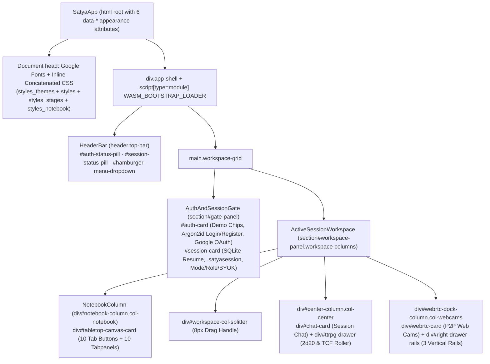

# 01 — SSR Application Shell, Workspace Drawers & 6-Axis CSS Theming

This document specifies the Server-Side Rendered (SSR) component tree, stable DOM `id` contracts, responsive 3-column CSS Grid + resizable splitter, collapsible/floating drawer state machine, `@container` responsive rules, and 6-axis decoupled theming architecture in [`crates/satya-web`](../../../crates/satya-web).

- **SSR Component Modules**: [`lib.rs`](../../../crates/satya-web/src/lib.rs), [`views_header.rs`](../../../crates/satya-web/src/views_header.rs), [`views_gate.rs`](../../../crates/satya-web/src/views_gate.rs), [`views_notebook.rs`](../../../crates/satya-web/src/views_notebook.rs), [`views_notebook_docs.rs`](../../../crates/satya-web/src/views_notebook_docs.rs), [`views_notebook_gm.rs`](../../../crates/satya-web/src/views_notebook_gm.rs), [`views_workspace.rs`](../../../crates/satya-web/src/views_workspace.rs)
- **Wasm Layout & Appearance Modules**: [`wasm_client/menu.rs`](../../../crates/satya-web/src/wasm_client/menu.rs), [`wasm_client/options.rs`](../../../crates/satya-web/src/wasm_client/options.rs), [`wasm_client/webrtc.rs`](../../../crates/satya-web/src/wasm_client/webrtc.rs), [`wasm_client/notebook.rs`](../../../crates/satya-web/src/wasm_client/notebook.rs)
- **Stylesheets**: [`styles_themes.css`](../../../crates/satya-web/src/styles_themes.css), [`styles.css`](../../../crates/satya-web/src/styles.css), [`styles_stages.css`](../../../crates/satya-web/src/styles_stages.css), [`styles_notebook.css`](../../../crates/satya-web/src/styles_notebook.css)

---

## 1. SSR Component & DOM Hierarchy

`SatyaApp` renders a complete, FOUC-free `<!DOCTYPE html>` document in one server pass (`SatyaApp().to_html()`). Every interactive card, input, canvas, and status badge carries a globally unique `id` (enforced by unit tests in [`tests.rs`](../../../crates/satya-web/src/tests.rs)) so `wasm_client` handlers can mutate targeted subtrees without Virtual-DOM diffing.



### 1.1 Top Navigation & Hamburger Menu (`HeaderBar` — `views_header.rs`, `menu.rs`)

| DOM `id` | Element / Role | Wasm Handler(s) | Behavior & State Coupling |
| :--- | :--- | :--- | :--- |
| `auth-status-pill` | `<span>` status badge | `apply_auth_success`, `satya_logout` | Displays `"Not Logged In"` (`pill-muted`) or `"<display_name> (<role>)"` (`pill-active`). |
| `session-status-pill` | `<span>` status badge | `enter_session`, `satya_leave_session` | Displays `"No Active Session"` or `"<session_id> · <mode> (<role>)"`. |
| `btn-hamburger-menu` / `hamburger-menu-dropdown` | `<button>` + dropdown `<div>` | `satya_toggle_hamburger_menu` | Toggles `display: flex \| none` and updates `aria-expanded`. |
| `btn-menu-toggle-{auth,session}-pane` | `<button>` × 2 | `satya_toggle_{auth,session}_pane` | Shows/hides `#auth-card` or `#session-card` and auto-closes the dropdown. |
| `btn-menu-toggle-{chat,ttrpg,webcam}-pane` | `<button>` × 3 | `satya_toggle_{chat,ttrpg,webcam}_drawer` | Synchronized with card collapse buttons and right-edge drawer rails (`aria-expanded`). |
| `menu-appearance-settings-panel` | Sub-panel `<div>` | `satya_toggle_appearance_settings`, `satya_apply_appearance_settings`, `satya_select_theme_preset`, `satya_reset_appearance_settings` | Contains `#appearance-swatch-grid` (`13` `#btn-theme-swatch-<id>` chips) and 6 `<select>` controls (`#menu-{theme,style,density,corners,font,font-size}-select`). |
| `menu-chat-settings-panel` | Sub-panel `<div>` | `satya_toggle_chat_settings`, `satya_filter_chat` | Iterates `CHAT_FILTER_SPECS`: `#filter-msg-{public,private,ai-gm,mechanics,system}`. |
| `menu-ai-gm-settings-panel` | Sub-panel `<div>` | `satya_menu_ai_gm_provider_changed`, `satya_update_session_gm_config` | Live GM provider/model switcher (`POST /api/sessions/:id/gm-config`); immediately scrubs `#menu-ai-gm-key` from the DOM after reading. |
| `menu-ai-player-settings-panel` | Sub-panel `<div>` | `satya_spawn_session_ai_player`, `satya_step_session_ai_player` | Spawns/updates or manually steps autonomous `AiPlayerConfig` test bots (`#menu-ai-player-{name,persona,auto}`). |

### 1.2 Pre-Session Gate (`AuthAndSessionGate` — `views_gate.rs`)

`#gate-panel` (`section.gate-container`) holds two sequential cards:
1. **`#auth-card`** (initially visible): Renders 4 `DEMO_ACCOUNT_SPECS` quick-fill chips (`gm_sean`, `sara_valkyrie`, `marcus_recon`, `host_elena` $\rightarrow$ `satya_fill_demo`), `#auth-username`, `#auth-password` (paired with `<PasswordToggleButton input_id="auth-password" btn_id="btn-toggle-auth-password"/>`), `#auth-display-name`, `#btn-google-auth` (`drive.file` OAuth link), `#google-auth-status-pill`, `#btn-logout`, and `#auth-feedback`. Upon login, `#auth-card` collapses (`display: none`) and `#session-card` opens (`display: block`).
2. **`#session-card`** (initially `display: none`):
   - **SQLite Vault & Portable Snapshots**: `#saved-sessions-select`, `#btn-resume-saved-session`, `#btn-refresh-saved-sessions`, `#btn-export-session-snapshot` (`.satyasession`), `#session-import-file-input`, and `#btn-import-session-snapshot`.
   - **Room Configuration**: `#session-id-input`, `#session-password-input`, `#session-mode-select` (`TTRPG`, `TTRPG_GM_AI`, `TTRPG_AI_GM`, `MEETING` $\rightarrow$ `satya_mode_changed` dynamically rewrites `#session-role-select` via `sync_role_options_for_mode` and reveals `#ai-gm-config-fields` when an AI mode is chosen), and `#session-feedback`.
   - **Zero-Height Auto-Collapse**: When both `#auth-card` and `#session-card` are hidden after entering a room, CSS `.gate-container:not(:has(> :not([style*="display: none"])...))` collapses `#gate-panel` completely (`display: none; margin-bottom: 0;`), giving `#workspace-panel` the full viewport height (`calc(100dvh - 76px)`).

### 1.3 Left-Column 10-Tab Tabletop Notebook (`NOTEBOOK_TAB_SPECS`)

Both SSR tab rendering (`views_notebook.rs`) and Wasm tab switching (`notebook::satya_select_notebook_tab`) iterate the canonical `NOTEBOOK_TAB_SPECS` slice so tab slugs, ARIA attributes (`role="tab"`, `aria-selected`, `aria-controls`), and `tabpanel` containers cannot drift:

| # | Slug | Tab `<button>` ID | Tabpanel `<div>` ID | UI Label | SSR View Source | On-Select Wasm Refresh Hook |
| :--- | :--- | :--- | :--- | :--- | :--- | :--- |
| 1 | `"maps"` | `tab-btn-maps` | `notebook-pane-maps` | **Maps** | `views_notebook.rs` | `map_3d::refresh_map_dom_and_wgpu()` (`#wgpu-map-canvas` + `#tabletop-map-svg-fallback`) |
| 2 | `"dice"` | `tab-btn-dice` | `notebook-pane-dice` | **3D Dice** | `views_notebook.rs` | `dice_3d::sync_dice_{material,camera}_from_dom_and_render()` (`#wgpu-dice-canvas`) |
| 3 | `"model"` | `tab-btn-model` | `notebook-pane-model` | **3D Model** | `views_notebook.rs` | `model_3d_wgpu::sync_3d_model_viewer_from_dom()` (`#wgpu-model-canvas`) |
| 4 | `"character"` | `tab-btn-character` | `notebook-pane-character` | **Character Sheet/Status** | `views_notebook.rs` | `character_sheet::render_character_sheet()` (`#char-sheet-stage-container`) |
| 5 | `"wizard"` | `tab-btn-wizard` | `notebook-pane-wizard` | **Character Wizard** | `views_notebook.rs` | `wizard::render_character_wizard()` (`#wizard-stage-container`) |
| 6 | `"npcs"` | `tab-btn-npcs` | `notebook-pane-npcs` | **NPC List** | `views_notebook_gm.rs` | `npcs::satya_refresh_npcs_tab()` (`#npc-selected-card-container`) |
| 7 | `"combat"` | `tab-btn-combat` | `notebook-pane-combat` | **Combat Tracker** | `views_notebook_docs.rs` | `notebook::render_combat_tracker()` (`#combat-tracker-list`, `1 Tick = 0.25s`) |
| 8 | `"rules"` | `tab-btn-rules` | `notebook-pane-rules` | **Rules Book** | `views_notebook_docs.rs` | Pre-rendered `#rules-book-viewport`; `satya_select_rules_chapter` / `satya_search_rules_book` |
| 9 | `"docs"` | `tab-btn-docs` | `notebook-pane-docs` | **GM Docs (GM_ONLY)** | `views_notebook_gm.rs` | `gm_docs::satya_refresh_gm_documents()` + Scenario Director + Omnisearch |
| 10 | `"iggy"` | `tab-btn-iggy` | `notebook-pane-iggy` | **Apache Iggy, Topics & PyLance** | `views_notebook_docs.rs` | `telemetry::satya_refresh_metrics()` (`#admin-inspector-card` when `AccountRole::Admin`) |

### 1.4 Center & Right Workspace Columns (`views_workspace.rs`)

- **Center Column (`#center-column.col-center`)**:
  - **Top (`#chat-card.card.chat-card`)**: Header with `.md`/`.json` transcript export buttons (`#btn-export-chat-{md,json}`) and `#btn-toggle-chat-drawer`; `#recipient-checkboxes` (`BROADCAST` + per-peer checkboxes); scrolling `#chat-log`; and `.chat-composer` containing multi-line Markdown `<textarea id="chat-input">` (`field-sizing: content`) plus mutually exclusive channel-context icon buttons (`#btn-ctx-ic`, `#btn-ctx-ooc`, and GM-gated `#btn-ctx-gm`).
  - **Bottom (`#ttrpg-drawer.card.ttrpg-card`)**: Header with live `#ttrpg-odds-pill` and `#btn-toggle-ttrpg-drawer`; `.ttrpg-controls` grid (searchable `#ttrpg-skill` combobox + `#ttrpg-skill-dropdown`, `N`, `C`, `Δ_int`, `Δ_tool`, `Δ_ext`, carry mode, botch rule, Fatigue, Wound Shock, 30-technique `#ttrpg-action-technique`, `#ttrpg-triad-preset`, and `T / C / F` pool inputs); `#ttrpg-triad-readout`; `#ttrpg-odds-readout`; and `Roll Satya Task`.
- **Right Column (`#webrtc-dock-column.col-webcams`)**:
  - **`#webrtc-card.card.webrtc-card`**: Draggable `#webrtc-drag-header` (`#btn-toggle-webcam-cols`, `#btn-toggle-webcam-float`, `#btn-toggle-webcam-drawer`), `.media-controls` (`Enable Cam/Mic`, `#btn-mute-audio`, `#btn-mute-video`, `Log VAD Turn`, `#btn-workspace-disconnect`), `#video-grid.cols-1` (`#local-video`, `#vad-energy-readout`, plus dynamic remote `<video>` tiles), and `#roster-list`.
  - **`#right-drawer-rails`**: Sticky vertical tab dock (`position: sticky; top: 12px;`) holding `#chat-drawer-rail`, `#ttrpg-drawer-rail`, and `#webcam-drawer-rail` (with live `#webcam-drawer-count-badge`).

---

## 2. Responsive 3-Column Grid, Splitter & Drawer State Machine

### 2.1 CSS Grid Tracks & Viewport Breakpoints (`styles.css`)

On desktop viewports (`> 1240px`), `#workspace-panel.workspace-columns` defines a 4-track horizontal CSS Grid driven by custom properties:

```css
.workspace-columns {
    --col-left-track: minmax(420px, 1.32fr);
    --col-center-track: minmax(360px, 1.08fr);
    --col-right-track: minmax(240px, 0.6fr);
    display: grid;
    grid-template-columns: var(--col-left-track) 8px var(--col-center-track) var(--col-right-track);
    grid-template-rows: minmax(0, 1fr);
    gap: var(--workspace-gap);
    height: max(680px, calc(100dvh - 76px));
}
```

- **Gate-Open Height Compensation**: When `#auth-card` or `#session-card` is temporarily toggled open during an active session, `.workspace-grid:has(.gate-container > :not([style*="display: none"])) .workspace-columns` reduces workspace height to `max(680px, calc(100dvh - 300px))` so internal `.chat-log` and `.notebook-body` scrollbars remain within the viewport.
- **Narrow / Tablet Viewport (`@media (max-width: 1240px)`)**: Collapses all column combinations to `grid-template-columns: minmax(0, 1fr); height: auto;`, hides `#workspace-col-splitter`, and clamps `.chat-card` to `clamp(460px, 68dvh, 780px)` for natural vertical scrolling.

### 2.2 Resizable Left/Center Column Splitter (`#workspace-col-splitter`)

Users can continuously resize the Left Notebook vs. Center Chat/Roller split:
1. **Start (`satya_start_column_resize`)**: Sets `st.column_resizing = true` and adds `.is-dragging` to `#workspace-col-splitter` (widening `.splitter-grip` from `2px × 44px` to `3px × 76px` in `var(--accent)`).
2. **Move (`handle_column_resize_move` in `webrtc.rs`)**: Computes pointer horizontal offset relative to `#workspace-panel.getBoundingClientRect()`, clamps `pct` strictly to **`22.0% ..= 72.0%`**, sets inline `--col-left-track: minmax(320px, {pct:.1}%)` and `--col-center-track: minmax(300px, 1fr)`, and persists `satya.workspace.notebook_width_pct` to `localStorage`. Because the 3D WebGPU canvases inspect `canvas.client_width()` / `client_height()` on redraw, resizing smoothly adapts canvas aspect ratios.
3. **Reset (`satya_reset_column_resize`)**: Double-clicking `#workspace-col-splitter` removes the inline `--col-left-track` / `--col-center-track` overrides and deletes `satya.workspace.notebook_width_pct` from `localStorage`.

### 2.3 Collapsible & Floating Drawer State Machine (`webrtc.rs`)

Three workspace cards (`#chat-card`, `#ttrpg-drawer`, `#webrtc-card`) can be independently collapsed to vertical right-edge tabs, and `#webrtc-card` can additionally be undocked into a floating Picture-in-Picture overlay. All transitions converge through a single idempotent reconciler: **`sync_workspace_drawers_dom()`**.

```mermaid
stateDiagram-v2
    [*] --> Docked3Col: Default Session Start

    state "Web Cams (#webrtc-card)" as CamState {
        CamDocked: Docked in #webrtc-dock-column\n(cols-1 or cols-2 max)
        CamFloating: Floating Overlay (.is-floating)\n(position: fixed, draggable, resizable)
        CamCollapsed: Collapsed to #webcam-drawer-rail\n(inert, display: none)

        CamDocked --> CamFloating: satyaToggleWebcamFloat()
        CamFloating --> CamDocked: satyaToggleWebcamFloat()
        CamDocked --> CamCollapsed: satyaToggleWebcamDrawer()
        CamFloating --> CamCollapsed: satyaToggleWebcamDrawer()
        CamCollapsed --> CamDocked: Expand (webcam_floating == false)
        CamCollapsed --> CamFloating: Expand (webcam_floating == true)
    }

    state "Center Stack (#center-column)" as CenterState {
        BothOpen: Chat + Task Roller Expanded
        OneCollapsed: Chat OR Roller Collapsed\n(Single card expands to 100% column height)
        BothCollapsed: Center Column Hidden (.center-collapsed)\n(Notebook expands to 1.8fr; splitter hidden)

        BothOpen --> OneCollapsed: Toggle Chat or TTRPG Drawer
        OneCollapsed --> BothOpen: Expand Collapsed Drawer
        OneCollapsed --> BothCollapsed: Collapse Remaining Center Card
        BothCollapsed --> OneCollapsed: Expand Chat or TTRPG Rail
    }
```



#### DOM, CSS Class & Accessibility Invariants Enforced by `sync_workspace_drawers_dom()`

| Helper / Target | Exact Mutation Rules |
| :--- | :--- |
| `sync_center_drawer_card(card_id, base_class, collapsed)` | When `collapsed == true`: adds `.is-collapsed`, sets HTML `inert=""` (preventing keyboard tab traps inside hidden controls), and sets `style.display = "none"`. When `false`: restores `base_class`, removes `inert`, and sets `style.display = "flex"`. |
| `sync_drawer_rail_and_aria(...)` | Shows/hides `#<name>-drawer-rail` inside `#right-drawer-rails`, synchronizes `aria-expanded="true\|false"` across **all three** buttons (`#btn-toggle-<name>-drawer`, `#btn-expand-<name>-drawer`, and `#btn-menu-toggle-<name>-pane`), and updates button labels (`"Collapse ▸"` vs. `"◂ <Title>"`, `"Hide <Title>"` vs. `"Show <Title>"`). |
| `#workspace-panel` classes | Recomputes `.workspace-columns` modifier classes (`webcam-collapsed`, `webcam-undocked`, `chat-collapsed`, `ttrpg-collapsed`, `center-collapsed`) so CSS Grid tracks automatically redistribute freed width to `#notebook-column` (up to `minmax(0, 1fr)` full-bleed when `center-collapsed.webcam-undocked`). |
| Floating `#webrtc-card.is-floating` | Detaches from grid flow (`position: fixed; top: 78px; right: 24px; width: 340px; z-index: 95; resize: both;`). Pressing `#webrtc-drag-header` (`satya_start_webcam_drag`, ignoring clicks on `<button>` children) records `(offset_x, offset_y)` and updates `left`/`top` on window `mousemove`. `#video-grid` is strictly capped at `1` (`cols-1`) or `2` (`cols-2`) columns via `satya_toggle_webcam_columns`. |

### 2.4 CSS Container Queries (`@container ttrpg-card`)

Because `#ttrpg-drawer` can be squeezed by `#workspace-col-splitter` or widened when `#webrtc-card` is undocked/collapsed, viewport `@media` queries cannot accurately size its 16-field `2d20` + `T/C/F` control grid. Instead, `.ttrpg-card` declares `container-type: inline-size; container-name: ttrpg-card;`, driving four `@container ttrpg-card` rules in [`styles.css`](../../../crates/satya-web/src/styles.css):

| `#ttrpg-drawer` Inline Size | `.ttrpg-controls` Grid Columns | Header / Button Adaptation |
| :--- | :--- | :--- |
| `< 360px` | `minmax(0, 1fr)` (`1` column) | Stacks `.card-header-inline` vertically; full-width `.btn`. |
| `360px .. 579px` | `repeat(2, minmax(0, 1fr))` (`2` columns) | Stacks `.card-header-inline` below `560px`. |
| `580px .. 879px` | `repeat(3, minmax(0, 1fr))` (`3` columns) | Inline header + odds pill + collapse button. |
| `>= 880px` | `repeat(5, minmax(0, 1fr))` (`5` columns) | Wide desktop tactical console layout. |

---

## 3. Six-Axis Appearance System & 4-File CSS Architecture

### 3.1 Compile-Time 4-File Stylesheet Split

`SatyaApp` concatenates four focused CSS files into a single inline `<style>` tag at compile time (`concat!(include_str!(...), ...)`), eliminating render-blocking network round-trips while keeping every file well below the `40 KB` editing threshold:

1. **`styles_themes.css`**: All `13` `html[data-theme="..."]` color token palettes, `5` `data-style` structural frame themes (`lcars`, `mil-spec`, `pulp`, `wehrmacht`), and `data-density`, `data-corners`, `data-font`, and `data-font-size` root token blocks.
2. **`styles.css`**: Reset, `.app-shell`, `.top-bar`, `.hamburger-dropdown`, `.workspace-columns` grid/splitter, `.webrtc-card` / `.right-drawer-rails`, `.chat-card` Markdown log, and `@container ttrpg-card` controls.
3. **`styles_stages.css`**: `#tabletop-map-viewport`, `#wgpu-map-canvas`, `#wgpu-dice-canvas`, `#wgpu-model-canvas`, camera/material toolbars, LoS HUD bar, and 2D `<svg>` fallback containers.
4. **`styles_notebook.css`**: Rules Book chapter typography/tables/callouts, 6-step Character Wizard fieldsets, 13-zone Character Sheet & interactive anatomical SVG trauma diagram, Scenario Director dial cards, GM Vault, and Apache Iggy metrics tables.

### 3.2 Six Orthogonal Root Attributes (`<html data-*>`)

Both the inline pre-paint `WASM_BOOTSTRAP_LOADER` (`SATYA_APPEARANCE_SPEC` in `lib.rs`) and Wasm `menu.rs` (`restore_saved_appearance_settings` / `satya_apply_appearance_settings`) synchronize six independent attributes on `document.documentElement`:

| Axis | HTML Attribute | `localStorage` Key | Allowed Canonical Values (*Default First*) | CSS Custom Properties Controlled |
| :--- | :--- | :--- | :--- | :--- |
| **1. Palette** | `data-theme` | `satya.appearance.theme` | `obsidian`, `amber-hud`, `parchment`, `cyberpunk`, `ranger`, `dusk-orange`, `nebula`, `navy-gold`, `marine-corps`, `lcars`, `mil-spec`, `pulp-1930s`, `wehrmacht` | `--bg-{0,1,2}`, `--border`, `--text-{primary,heading,muted}`, `--accent`, `--accent-strong`, `--emerald`, `--amber`, `--rose`, `--purple`, `--brand-grad` |
| **2. Frame** | `data-style` | `satya.appearance.style` | `default`, `mil-spec`, `lcars`, `pulp`, `wehrmacht` | Structural card bezels, pill shapes, elbow borders, header `::after` stamps |
| **3. Density** | `data-density` | `satya.appearance.density` | `default` (`10px/11px`), `compact` (`6px/7px`), `spacious` (`15px/16px`) | `--shell-pad-{y,x}`, `--workspace-gap`, `--card-pad`, `--control-pad-{y,x}` |
| **4. Corners** | `data-corners` | `satya.appearance.corners` | `default` (`10/8/6px`), `sharp` (`2px`), `rounded` (`16/12/10px`) | `--card-radius`, `--panel-radius`, `--control-radius` |
| **5. Font** | `data-font` | `satya.appearance.font` | `sans`, `mono`, `serif`, `lcars`, `military`, `stencil`, `pulp` | `--font-body` (`Inter`, `JetBrains Mono`, `Georgia`, `Antonio`, `Chakra Petch`, `Black Ops One`, `Courier Prime`) |
| **6. Scale** | `data-font-size` | `satya.appearance.font_size` | `default` (`100%`), `sm` (`90%`), `lg` (`110%`), `xl` (`120%`) | Root `html { font-size }` scaling all `rem`-based UI metrics |

### 3.3 Complete 13-Palette Color Token Matrix (`APPEARANCE_THEME_OPTIONS`)

| Theme ID | Swatch Label | `--bg-0` / `--bg-1` | `--accent` / `--accent-strong` | Aesthetic & Contrast Profile |
| :--- | :--- | :--- | :--- | :--- |
| `obsidian` | **Obsidian** *(Default)* | `#0b0e14` / `#131822` | `#38bdf8` / `#0284c7` | Deep slate dark mode with high-legibility sky-cyan accents. |
| `amber-hud` | **Amber HUD** | `#090806` / `#12100b` | `#f59e0b` / `#d97706` | Phosphor amber CRT / avionics terminal with warm gold text. |
| `parchment` | **Parchment** | `#f4eee1` / `#fcf9f2` | `#b45309` / `#92400e` | High-contrast daylight tabletop rulebook paper with burnt-umber ink. |
| `cyberpunk` | **Cyberpunk** | `#080412` / `#120924` | `#f43f5e` / `#e11d48` | Midnight violet synthwave with neon rose and `#00f5d4` cyan-emerald. |
| `ranger` | **Ranger** | `#080f0b` / `#101c15` | `#34d399` / `#059669` | Woodland night-ops green with emerald tactical highlights. |
| `dusk-orange` | **Dusk Orange** | `#110a08` / `#1c110d` | `#fb923c` / `#ea580c` | Warm espresso umber with sunset orange and violet gradients. |
| `nebula` | **Nebula** | `#0f081d` / `#1a0f30` | `#f97316` / `#c2410c` | Deep-space indigo with bronze borders and solar-flare orange. |
| `navy-gold` | **Navy & Gold** | `#050c1a` / `#0b192e` | `#facc15` / `#ca8a04` | Fleet CIC deep navy blue with dress-gold headings and controls. |
| `marine-corps` | **USMC** | `#0d1610` / `#15241a` | `#e11d48` / `#881337` | Rifle-green drab paired with scarlet-and-gold trim. |
| `lcars` | **TNG LCARS** | `#000000` / `#07080d` | `#ff9900` / `#cc6699` | Pure OLED black with Starfleet `#ff9900` amber, `#cc99cc` lilac, and `#99ccff` ice blue. |
| `mil-spec` | **MIL-SPEC C4ISR** | `#0b0e0a` / `#131811` | `#a3e635` / `#4d7c0f` | Olive-drab field ruggedized terminal with NVG lime-chartreuse phosphor. |
| `pulp-1930s` | **1930s Pulp** | `#140e0a` / `#1f1610` | `#f59e0b` / `#b91c1c` | Smoked mahogany sepia, brass borders (`#785532`), and crimson stamps. |
| `wehrmacht` | **Feldgrau** | `#0c0d0c` / `#161816` | `#dc2626` / `#991b1b` | Muted slate-feldgrau (`#222623`) with stark crimson-and-white command trim. |

### 3.4 Decoupled Palette × Structural Frame Pattern (`html:is(...)`)

Four themes (`lcars`, `mil-spec`, `pulp-1930s`, `wehrmacht`) have signature **structural geometry** (e.g., LCARS `22px` swept left-elbow cards and `999px` pill inputs; MIL-SPEC `24px` tactical grid backdrop, `Black Ops One` stencil headers, and `// MIL-STD-2525 C4ISR` badge; Pulp `3px double` Art Deco brass rules and `Limelight` display headers; Command Bunker asymmetric top/left trim).

To allow users to either:
1. Get a theme's signature frame automatically when `data-style="default"`, **or**
2. Mix **any** of the `13` color palettes with **any** of the `5` structural frames (for example, `data-theme="navy-gold"` + `data-style="mil-spec"`, or `data-theme="parchment"` + `data-style="pulp"`),

all structural frame rules use the zero-duplication `:is()` selector idiom:

```css
/* Activates EITHER when the matching theme uses `data-style="default"`
   OR when the user explicitly selects `data-style="mil-spec"` on ANY color palette: */
html:is([data-theme="mil-spec"][data-style="default"], [data-style="mil-spec"]) .card {
    background: var(--bg-1);
    border: 1px solid var(--border);
    border-top: 3px solid var(--accent);
    border-radius: 2px;
}
```

#### Why This Selector Pattern Works Cleanly
- **Zero Hardcoded Hex Colors in Frame Rules**: Every structural `data-style` rule references semantic palette variables (`var(--bg-1)`, `var(--accent)`, `var(--border)`, `color-mix(in srgb, var(--accent) 4%, transparent)`), so `lcars` elbows or `mil-spec` bezels automatically adopt `cyberpunk`, `parchment`, or `navy-gold` colors.
- **Clean Override When Switching `data-style`**: If a user chooses `data-theme="lcars"` and explicitly overrides `data-style="mil-spec"`, `[data-theme="lcars"][data-style="default"]` evaluates to **false** while `[data-style="mil-spec"]` evaluates to **true** — cleanly swapping the structural frame while keeping the LCARS color palette.
- **Smart Default Font Pairing**: When `data-font="sans"` (the default), rules such as `html[data-style="lcars"][data-font="sans"]` automatically pair condensed `Antonio` (LCARS), `Chakra Petch` (MIL-SPEC/Feldgrau), or `Courier Prime` (Pulp), while still allowing an explicit `data-font="mono"` or `data-font="serif"` selection to win.
