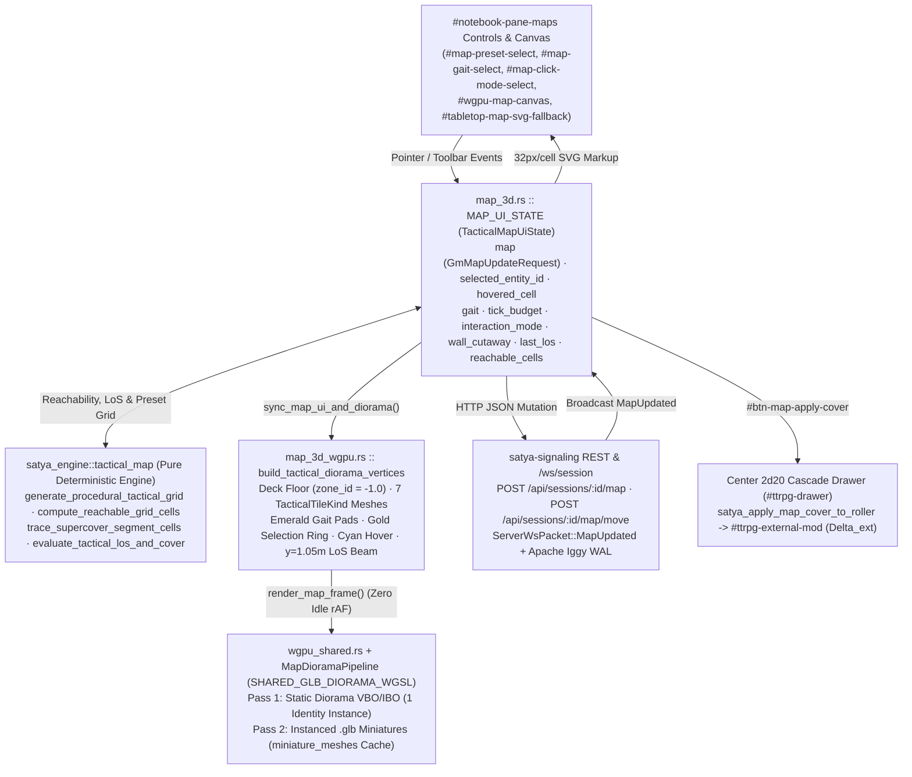
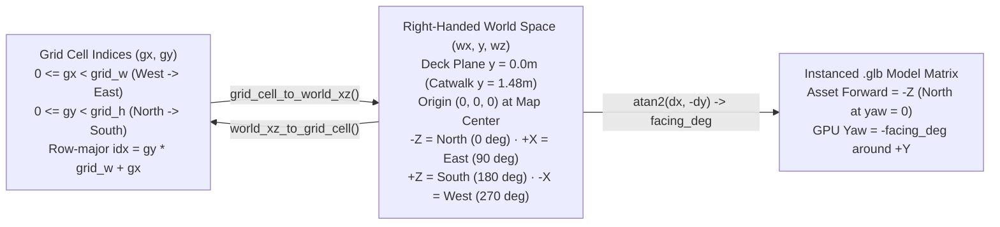
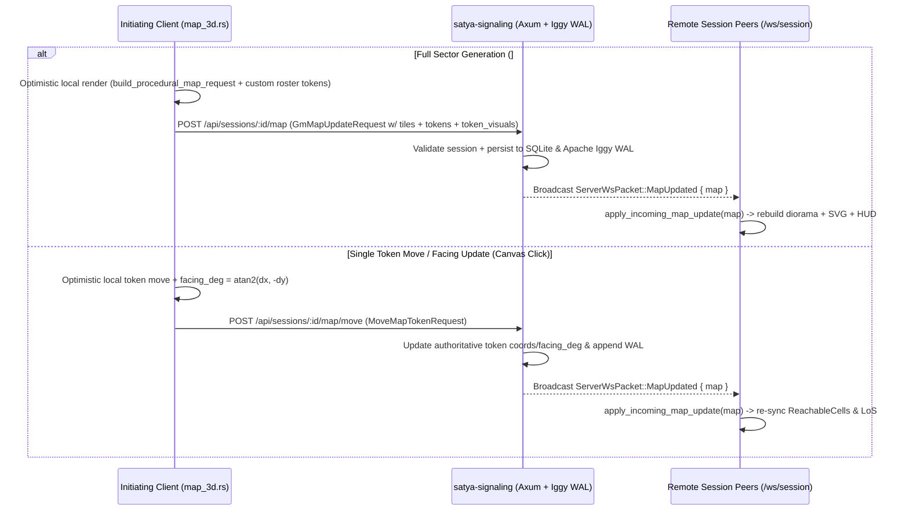

# 02 — 3D Tactical Map Diorama, LoS/Cover & Movement Overlays

This document is the authoritative technical reference for the **3D Tactical Map (`#notebook-pane-maps`)** in [`crates/satya-web`](../../../crates/satya-web), covering end-to-end state synchronization, `1.0m` metric world-to-grid math, procedural sector generation, diorama 3D mesh synthesis, `1 Tick = 0.25s` movement reachability, supercover Line-of-Sight (LoS) + corner-peek cover grading, the `2d20` Cascade roller bridge, instanced `.glb` miniature rendering on WebGPU (`wgpu`), `OrbitOrthoCamera` ray-plane picking, and graceful 2D `<svg>` degradation.

- **Web Client Modules**: [`wasm_client/map_3d.rs`](../../../crates/satya-web/src/wasm_client/map_3d.rs), [`wasm_client/map_3d_wgpu.rs`](../../../crates/satya-web/src/wasm_client/map_3d_wgpu.rs), [`wasm_client/map_3d_dressing_geom.rs`](../../../crates/satya-web/src/wasm_client/map_3d_dressing_geom.rs), [`wasm_client/map_edge_edit.rs`](../../../crates/satya-web/src/wasm_client/map_edge_edit.rs), [`wasm_client/map_2d_art.rs`](../../../crates/satya-web/src/wasm_client/map_2d_art.rs), [`wasm_client/map_2d_art_walls.rs`](../../../crates/satya-web/src/wasm_client/map_2d_art_walls.rs), [`wasm_client/map_2d_art_furniture.rs`](../../../crates/satya-web/src/wasm_client/map_2d_art_furniture.rs), [`wasm_client/map_2d_art_props.rs`](../../../crates/satya-web/src/wasm_client/map_2d_art_props.rs), [`wasm_client/wgpu_shared.rs`](../../../crates/satya-web/src/wasm_client/wgpu_shared.rs), [`wasm_client/glb_model.rs`](../../../crates/satya-web/src/wasm_client/glb_model.rs), [`wasm_client/model_3d_wgpu.rs`](../../../crates/satya-web/src/wasm_client/model_3d_wgpu.rs)
- **Deterministic Engine & Wire DTOs**: [`satya-engine/src/tactical_map.rs`](../../../crates/satya-engine/src/tactical_map.rs), [`satya-engine/src/tactical_map_edges.rs`](../../../crates/satya-engine/src/tactical_map_edges.rs), [`satya-engine/src/map_dressing.rs`](../../../crates/satya-engine/src/map_dressing.rs), [`satya-engine/src/map_interior_gen.rs`](../../../crates/satya-engine/src/map_interior_gen.rs), [`satya-engine/src/environment_vehicles.rs`](../../../crates/satya-engine/src/environment_vehicles.rs), [`satya-schema/src/tactical_map_dto.rs`](../../../crates/satya-schema/src/tactical_map_dto.rs), [`satya-schema/src/tactical_map_dressing_dto.rs`](../../../crates/satya-schema/src/tactical_map_dressing_dto.rs), [`satya-schema/src/protocol.rs`](../../../crates/satya-schema/src/protocol.rs)
- **SSR Markup & Styles**: [`views_notebook.rs`](../../../crates/satya-web/src/views_notebook.rs), [`styles_stages.css`](../../../crates/satya-web/src/styles_stages.css)

---

## 1. End-to-End Architecture & State Topology

All deterministic spatial rules — procedural bulkhead layout, 8-directional millimeter Dijkstra reachability, and supercover corner-peek LoS — execute in pure, host-testable Rust inside `satya_engine::tactical_map`. `wasm_client/map_3d.rs` owns the client UI state (`TacticalMapUiState`), synchronizes edits over REST/WebSocket, and drives both the event-driven WebGPU diorama (`map_3d_wgpu.rs`) and the synchronized 2D `<svg>` fallback (`#tabletop-map-svg-fallback`).



### 1.1 `TacticalMapUiState` (`MAP_UI_STATE` in `map_3d.rs`)

`MAP_UI_STATE` is stored in a Wasm `thread_local! { RefCell<TacticalMapUiState> }` accessed exclusively through short-lived closures (`with_map_ui`, `with_map_ui_mut`) so borrows never span an `.await` point or re-entrant DOM event:

| Field | Rust Type | Default Value | Responsibility |
| :--- | :--- | :--- | :--- |
| `map` | `GmMapUpdateRequest` | `"orbital_airlock"`, `20 × 14`, seed `42` | Canonical wire DTO holding `grid_width`, `grid_height`, `cell_size_cm` (`100`), row-major `tiles: Vec<TacticalTileKind>`, `tokens: Vec<MapTokenPlacement>`, and `token_visuals: Vec<TokenVisualSpec>`. |
| `selected_entity_id` | `Option<String>` | First token (`"pc-1"`) | Active token acting as the origin for gait reachability pads, LoS measurements, movement commands, and miniature visual customization. |
| `hovered_cell` | `Option<(i32, i32)>` | `None` | Grid cell currently under the pointer on `#wgpu-map-canvas` (drives cyan hover reticle and `#map-hover-coords-pill`). |
| `gait` | `CombatMovementGait` | `CombatGlideTacticalWalk` (`35%`) | Active movement gait (`crawl`, `creep`, `glide`, `hustle`, `sprint`) fed into `GaitReachQuery`. |
| `tick_budget` | `u8` | `8` (`2.00s`) | Movement duration in combat ticks (`1..=40`, `1 Tick = 0.25s`) fed into `GaitReachQuery`. |
| `interaction_mode` | `String` | `"move_or_select"` | Active canvas click tool: `"move_or_select"`, `"measure_los"`, or `"edit_terrain"`. |
| `wall_cutaway` | `bool` | `true` | Lowers `FullWall` (`2.35m` $\rightarrow$ `0.58m`) and `DoorClosed` (`2.25m` $\rightarrow$ `0.68m`) geometry so interior corridors remain visible from angled 3D isometric views. |
| `last_los` | `Option<(String, String, TacticalLosEvaluation)>` | Auto-computed vs. nearest non-self token | Cached `(attacker_label, target_label, TacticalLosEvaluation)` driving `#map-tactical-hud-bar` and the 3D chest-height laser beam. |
| `reachable_cells` | `Vec<ReachableCell>` | Computed on boot | Cached output of `compute_reachable_grid_cells` (`x`, `y`, `distance_m`, `ticks_required`). |
| `seed_counter` | `u64` | `42` | Monotonic procedural generation seed (`wrapping_add(137)` on each click of `#btn-map-generate`). |

### 1.2 Toolbar Controls & Window Callbacks (`#notebook-pane-maps`)

| DOM `id` | Callback (`window.*`) | Rust Entrypoint | Effect |
| :--- | :--- | :--- | :--- |
| `#map-preset-select`, `#map-grid-size-select`, `#btn-map-generate` | `satyaGenerateProceduralMap` | `satya_generate_procedural_map` | Advances `seed_counter += 137`, builds a seeded sector with live roster West-side spawns + hostile East sentry, renders immediately, and `POST`s `/api/sessions/:id/map`. |
| `#btn-map-proj-toggle` | `satyaToggleMapProjection` | `satya_toggle_map_projection` | Toggles `OrbitOrthoCamera.orthographic` between `3D Isometric` (`42°` perspective) and `2D Top-Down` (`88.5°` pitch orthographic, `yaw = 0°`). |
| `#btn-map-cutaway-toggle` | `satyaToggleMapWallCutaway` | `satya_toggle_map_wall_cutaway` | Toggles `wall_cutaway` (`Cutaway: ON` vs `Full Walls`) and rebuilds the static diorama VBO/IBO. |
| `#btn-map-cam-reset` | `satyaResetMapCamera` | `satya_reset_map_camera` | Resets `OrbitOrthoCamera` to `tactical_map_default()` (`yaw = -24°`, `pitch = 52°`, `zoom = 1.0`, `pan = [0, 0]`). |
| `#map-click-mode-select`, `#map-gait-select`, `#map-tick-budget-input` | `satyaUpdateMapTacticalControls` | `satya_update_map_tactical_controls` | Updates `interaction_mode`, `gait`, and clamped `tick_budget` (`1..=40`), recomputes `reachable_cells` & `last_los`, and redraws. |
| `#map-token-chip-bar` buttons | `satyaSelectMapToken(id)` | `satya_select_map_token` | Switches `selected_entity_id`, syncs `#map-token-model-select` / `#map-token-color-input`, and recomputes gait reach + auto-LoS. |
| `#map-token-model-select`, `#map-token-color-input` | `satyaUpdateSelectedTokenVisual` | `satya_update_selected_token_visual` | Updates `TokenVisualSpec` (`model_preset`, `color_hex`) for `selected_entity_id` and broadcasts full map state if in a session. |
| `#btn-map-apply-cover` | `satyaApplyMapCoverToRoller` | `satya_apply_map_cover_to_roller` | Bridges `last_los.recommended_delta_ext` into `#ttrpg-external-mod` ($\Delta_{\text{ext}}$) and refreshes the `2d20` Cascade odds preview. |

---

## 2. World-vs-Grid Coordinate System & Compass Bearings

Every tactical sector uses a metric **`1.0m × 1.0m` square cell** (`cell_size_cm = 100`, `cell_size_m = 1.0`) lying on the horizontal deck plane $y = 0.0$ in a right-handed WebGPU world coordinate frame (`+X` East, `+Y` Up, `-Z` North, `+Z` South). Grid indices `(gx, gy)` are zero-based integers (`0 <= gx < grid_w`, `0 <= gy < grid_h`) stored in row-major order (`idx = gy * grid_w + gx`), with `(0, 0)` at the **North-West** corner and the entire `grid_w × grid_h` rectangle centered symmetrically around world origin `(0.0, 0.0, 0.0)`.



### 2.1 Exact Coordinate Bijection (`map_3d.rs`)

Given grid dimensions $(W, H) = (\text{grid\_w}, \text{grid\_h})$ and cell scale $s = \max(\text{cell\_size\_m}, 0.25)$ (`1.0m` standard):

- **Grid Cell Center $\rightarrow$ World $(w_x, w_z)$** (`grid_cell_to_world_xz`):
  $$w_x = \left((g_x + 0.5) - \frac{W}{2}\right) \cdot s, \qquad w_z = \left((g_y + 0.5) - \frac{H}{2}\right) \cdot s$$
  For the default `20 × 14` (`20m × 14m`) airlock, cell `(0, 0)` maps to `(-9.5m, -6.5m)` and cell `(19, 13)` maps to `(+9.5m, +6.5m)`.

- **World $(w_x, w_z)$ $\rightarrow$ Grid Cell $(g_x, g_y)$** (`world_xz_to_grid_cell`):
  $$g_x = \left\lfloor \frac{w_x}{s} + \frac{W}{2} \right\rfloor, \qquad g_y = \left\lfloor \frac{w_z}{s} + \frac{H}{2} \right\rfloor$$
  Returns `Some((gx, gy))` if and only if $0 \le g_x < W$ and $0 \le g_y < H$, otherwise `None` (off-board ray hit).

### 2.2 Compass Bearings & `.glb` Miniature Yaw Convention

Token facing (`TokenVisualSpec.facing_deg` in `0..360`) follows standard tabletop/nautical compass bearings:

| Compass Direction | Grid Step $(\Delta g_x, \Delta g_y)$ | World Vector $(\Delta w_x, \Delta w_z)$ | `facing_deg` | GPU Instance `yaw_deg` (`-facing_deg`) |
| :--- | :---: | :---: | :---: | :---: |
| **North** | `(0, -1)` | `(0, -1)` | `0°` | `0°` |
| **East** | `(+1, 0)` | `(+1, 0)` | `90°` | `-90°` |
| **South** | `(0, +1)` | `(0, +1)` | `180°` | `-180°` |
| **West** | `(-1, 0)` | `(-1, 0)` | `270°` | `-270°` |

When a token moves by $(\Delta x, \Delta y) = (g_x' - g_x,\; g_y' - g_y)$ in `move_or_select` mode, `handle_map_grid_cell_clicked` computes its new compass heading via:
$$\text{facing\_deg} = \left(\operatorname{round}\!\big(\operatorname{atan2}(\Delta x, -\Delta y) \cdot \tfrac{180}{\pi}\big) + 360\right) \bmod 360$$
Because procedural `.glb` miniatures in `glb_model.rs` are authored facing `-Z` (North) at identity rotation, a right-handed rotation of $+\theta$ around `+Y` (`[x', z'] = [x cos θ + z sin θ, -x sin θ + z cos θ]`) rotates `-Z` toward `-X` (West). Therefore `map_3d_wgpu.rs` passes `yaw_deg = -(vis.facing_deg as f32)` into `GlbInstanceData::from_trs_and_tint`, aligning `+90°` (`-90°` right-hand yaw) cleanly with `+X` (East).

---

## 3. Procedural Sector Generation & Multi-Peer Synchronization

### 3.1 Deterministic `SectorPreset` Catalog (`satya_engine::tactical_map`)

`generate_procedural_tactical_grid(preset, width, height, seed)` clamps sector dimensions to `8..=48` cells (`8m..=48m`), initializes a deterministic `SplitMix64` PRNG (`state = seed.wrapping_add(0x9E37_79B9_7F4A_7C15)`), builds outer perimeter `FullWall` bulkheads with West `(0, mid_y)` `DoorOpen` and East `(w - 1, mid_y)` `DoorClosed` airlocks for indoor presets, applies layout geometry, scatters `2 + (rng % 3)` seeded `HalfCover` crates off the central choke column (`x != mid_x`), and clears four guaranteed `Floor` spawn pads at `(2, mid_y)`, `(2, mid_y - 1)`, `(w - 3, mid_y)`, and `(w - 3, mid_y + 1)`.

| `SectorPreset` (`code()`) | Default Label | Perimeter | Signature Structural Features |
| :--- | :--- | :--- | :--- |
| `OrbitalAirlock` (`"orbital_airlock"`) | `Sector 01 — Orbital Airlock` | Sealed `FullWall` + W/E airlocks | Central `FullWall` bulkhead at `mid_x` with blast door (`DoorClosed` at `mid_y`) + maintenance hatch (`DoorOpen`), N/S `ElevatedPlatform` catwalks (`y = 2`, `h - 3`), `HalfCover` crates (`mid_x ± 3`), and reactor `HazardZone` strip (`mid_x + 2`). |
| `DockingBay` (`"docking_bay"`) | `Bay 04 — Dropship Docking Deck` | Sealed `FullWall` + W/E airlocks | Central `2 × 3` `HalfCover` container spine (`mid_x - 1 ..= mid_x`), N/S `ElevatedPlatform` gantries (`y = 1`, `h - 2`), and thruster `HazardZone` pads on the East apron (`w - 4 .. w - 2`). |
| `MedLabSector` (`"med_lab"`) | `Deck B — Quarantine Med-Lab` | Sealed `FullWall` + W/E airlocks | Twin horizontal `FullWall` partitions (`q1_y = h/3`, `q2_y = 2h/3`) with `DoorClosed` airlocks at `w/3` and `2w/3`, central `HalfCover` cryo pods, and central biohazard `HazardZone`. |
| `UrbanCrossroads` (`"urban_crossroads"`) | `Hab-Block 9 — Neon Crossroads` | Open street edges | Four corner `FullWall` building blocks (`bw = max(w/4, 2)`, `bh = max(h/4, 2)`), corner `ElevatedPlatform` sniper perches, and intersection `HalfCover` barriers (`mid_x ± 2`, `mid_y ± 1`). |
| `DerelictCorridor` (`"derelict_corridor"`) | `Hull Breach — Derelict Spine` | Sealed `FullWall` + W/E airlocks | Narrow spine bounded by horizontal `FullWall` bulkheads with side-bay `DoorClosed` hatches, central blast door `(mid_x, mid_y)`, `HalfCover` debris, and `HazardZone` decompression pockets. |
| `ResidentialApartment` (`"residential_apartment"`) | `Safehouse 3B — Furnished Apartment` | Thin `Brick` `MapWallEdge` perimeter + exterior `Window`s + W/E doors | Seeded BSP room partition (`Drywall` `MapWallEdge`s + swinging doors) furnished by room role (`Living`, `Kitchen`, `Bedroom`, `Bathroom`, `Office`) with multi-cell `Sofa` (`3×1`), `AreaRug`, `CoffeeTable`, `DiningTable` (`2×2`), `BedDouble` (`2×2`), `KitchenCounter`, `Refrigerator`, `Stove`, `Bathtub`, `Toilet`, `Desk`, and `Bookshelf`. |
| `CornerBar` (`"corner_bar"`) | `Taproom — Neighborhood Corner Bar` | Thin `Brick` `MapWallEdge` perimeter + storefront `Window`s + W/E doors | Public taproom (`>= 55%` West span) with stretchable `BarCounter` (`4..8×1`), `BottleShelf` back-bar, bartender aisle, `BarStool` row, `BoothSeat`s + `DiningTable`s, `PoolTable` (`2×3`), `RoundTable`s, plus East-side `Drywall` restrooms, kitchen prep room, and crate/barrel storeroom. |

### 3.2 Roster-Aware Spawning & REST / WebSocket Synchronization

Clicking **Generate (`#btn-map-generate`)** (`satya_generate_procedural_map`):
1. Advances `seed_counter = seed_counter.wrapping_add(137)` for deterministic variation.
2. Reads `CLIENT_STATE.roster` (skipping `ParticipantKind::AiAgent` + `SessionRole::AiGm` so the narrator is never spawned as a token).
3. Spawns combatants along the West entry zone at `x = 2`, `y = clamp(mid_y - 2 + idx * 2, 1, h - 2)` facing East (`90°`) with cycling presets (`vanguard_breacher`, `void_medic`, `recon_sniper`) and squad colors (`#38bdf8`, `#34d399`, `#a78bfa`, `#fbbf24`), or defaults (`Vanguard-1`, `Medic-2`) offline.
4. Places hostile `"npc-secops-1"` (`SecOps Sentry`, `exo_heavy`, `#f43f5e`) at `(w - 3, mid_y)` facing West (`270°`).



> [!NOTE]
> **Door & Terrain Edits**: Toggling a blast door (`DoorClosed` $\leftrightarrow$ `DoorOpen`) in `move_or_select` mode or cycling tiles in `edit_terrain` mode mutates `map.tiles` and dispatches the full `GmMapUpdateRequest` to `POST /api/sessions/:id/map` (`broadcast_full_map = true`), whereas pure token movement uses the lightweight `POST /api/sessions/:id/map/move` (`MoveMapTokenRequest`) route.

---

## 4. Diorama 3D Geometry Builder (`build_tactical_diorama_vertices`)

`build_tactical_diorama_vertices(ui)` in [`map_3d_wgpu.rs`](../../../crates/satya-web/src/wasm_client/map_3d_wgpu.rs) synthesizes a single indexed `GlbVertex` triangle mesh (`Vec<GlbVertex>`, `Vec<u32>`) every time terrain, selection, hover, gait budget, cutaway state, or LoS changes. Using `hc = cell_m * 0.48` (`0.48m` half-cell width, leaving a subtle `0.04m` architectural seam between adjacent blocks), the builder emits geometry in three layers:

### 4.1 Deck Floor, Table Rim & `7` `TacticalTileKind` Variants

| Layer / `TacticalTileKind` | Footprint Half-Extents `(hx, hz)` | Elevation Range `y0 .. y1` (m) | `zone_id` (`bary_zone.w`) | Base Albedo RGB | Engine Rules (`blocks_occupancy` / `blocks_full_los` / `move_cost_multiplier`) |
| :--- | :--- | :--- | :---: | :--- | :--- |
| **Continuous Deck Floor** | `half_w_m × half_h_m` (full board) | `y = 0.000` (`push_quad`) | `-1.0` | `[0.075, 0.115, 0.185]` | Procedural `1.0m` minor (`[0.09, 0.22, 0.36]`) + `5.0m` major (`[0.14, 0.38, 0.58]`) grid lines in WGSL. |
| **Outer Diorama Rim** | `(half_w_m + 0.12) × (half_h_m + 0.12)` | `-0.140 .. -0.005` | `0.0` | `[0.05, 0.08, 0.13]` | Framing plinth beneath deck level so angled isometric views have a solid tabletop silhouette. |
| `Floor` (`0`) | *(uses continuous deck floor)* | `0.000` | `-1.0` | Deck slate | Open (`false` / `false` / `1.0×`). |
| `HalfCover` (`1`) | Body: `0.86·hc` (`0.413m`)<br>Cap: `0.90·hc` (`0.432m`) | Body: `0.000 .. 0.860`<br>Cap: `0.860 .. 0.910` | `0.0` | Body `[0.16, 0.34, 0.52]`<br>Cyan cap `[0.22, 0.68, 0.92]` | Waist-high `0.91m` ballistic crate (`true` / `false` / `2.0×` vault cost); grants **Low Cover (`+4` $\Delta_{\text{ext}}$)**. |
| `FullWall` (`2`) | Body: `1.00·hc` (`0.480m`)<br>Cap: `0.94·hc` (`0.451m`) | Cutaway: `0.00 .. 0.58` (`+0.04` cap)<br>Full: `0.00 .. 2.35` (`+0.04` cap) | `0.0` | Body `[0.23, 0.29, 0.38]`<br>Trim `[0.36, 0.45, 0.58]` | Structural bulkhead (`true` / `true` / impassable `99.0×`). Blocks center-ray LoS; corner-peekable if adjacent cell is open. |
| `DoorClosed` (`3`) | `0.92·hc × 0.42·hc` (`0.442m × 0.202m`) | Cutaway: `0.000 .. 0.680`<br>Full: `0.000 .. 2.250` | `0.0` | Amber `[0.78, 0.42, 0.09]` | Sealed airlock (`true` / `true` / `99.0×`). Clicking in `move_or_select` toggles to `DoorOpen`. |
| `DoorOpen` (`4`) | Twin jambs at `wx ± 0.78·hc`, each `0.16·hc × 0.45·hc` | `0.000 .. 0.350` | `0.0` | Emerald `[0.12, 0.65, 0.48]` | Unsealed threshold (`false` / `false` / `1.0×`). Clicking an unoccupied `DoorOpen` seals it back to `DoorClosed`. |
| `HazardZone` (`5`) | `0.92·hc × 0.92·hc` (`0.442m`) | `0.004 .. 0.032` | `0.0` | Crimson `[0.68, 0.14, 0.24]` | Fire / radiation / vacuum floor pad (`false` / `false` / `2.0×` movement penalty). |
| `ElevatedPlatform` (`6`) | `1.00·hc × 1.00·hc` (`0.480m`) | `0.000 .. 1.480` | `-1.0` | Catwalk `[0.15, 0.21, 0.31]` | `1.48m` raised gantry (`false` / `false` / `1.25×` climb/step cost). `zone_id = -1.0` renders `1m/5m` grid lines across the top deck; tokens, selection rings, hover reticles, and gait pads automatically step up onto `y = 1.48m..1.50m`. |

### 4.2 Procedural `1.0m` Minor / `5.0m` Major Grid Shader (`SHARED_GLB_DIORAMA_WGSL`)

Any triangle tagged with `zone_id < -0.5` (`-1.0` on the main deck quad and `ElevatedPlatform` catwalks) activates resolution-independent procedural grid lines inside `fs_main` using `scene.mode_params.y = cell_size_m`:
- **`1.0m` Minor Cell Lines**: `uv1 = fract(world_pos.xz / cell_scale + 0.5)` measures fractional distance to the nearest `1.0m` cell border (`+0.5` shifts grid lines from cell centers onto integer half-meter boundaries when $W, H$ are even, matching `(gx + 0.5) - W/2`), adding `vec3(0.09, 0.22, 0.36) * (1.0 - smoothstep(0.0, 0.038, d1))`.
- **`5.0m` Major Sector Lines**: `uv5 = fract((world_pos.xz / cell_scale + 0.5) * 0.2)` highlights every `5.0m` tactical zone boundary with `vec3(0.14, 0.38, 0.58) * (1.0 - smoothstep(0.0, 0.016, d5))`.
- **Anti-Aliased Barycentric Wireframe (`mode == 1 || mode == 2`)**: Every triangle emitted by `push_quad`, `push_box`, and `glb_model.rs` carries per-vertex barycentric coordinates `(1,0,0)`, `(0,1,0)`, `(0,0,1)` in `bary_zone.xyz`, allowing `fwidth(in.bary)` screen-space derivative edge detection when inspecting meshes.

---

## 5. Live Tactical Overlays & `2d20` Cascade Roller Bridge

### 5.1 `1 Tick = 0.25s` Gait Reachability Overlay (`GaitReachQuery`)

Whenever `selected_entity_id`, `gait`, `tick_budget`, or `map` changes, `recompute_reach_and_auto_los` invokes `compute_reachable_grid_cells(&map, &GaitReachQuery)` (`spd_eff = 11`, `hgt_m = 1.80`, `tick_budget` in `1..=40`):

1. **Physical Sprint & Per-Tick Velocity** ([`environment_vehicles.rs`](../../../crates/satya-engine/src/environment_vehicles.rs)):
   $$V_{\text{sprint}} = \big(4.0 + 0.35 \cdot \text{SPD}_{\text{eff}}\big) \cdot \frac{\text{HGT}_{\text{m}}}{1.75}\;\text{m/s}, \qquad d_{\text{budget}} = \frac{V_{\text{sprint}}}{4.0} \cdot f_{\text{gait}} \cdot N_{\text{ticks}}\;\text{m}$$
   For baseline `SPD_eff = 11`, `HGT = 1.80m`, $V_{\text{sprint}} = 7.85 \times 1.0286 \approx 8.074\;\text{m/s}$ (`2.019 m/tick` at all-out sprint):

   | `CombatMovementGait` | UI Option Value | Sprint Fraction $f_{\text{gait}}$ | Speed at `SPD 11` (`m/tick`) | Max Reach in `8 Ticks` (`2.00s`) | Tactical Profile |
   | :--- | :--- | :---: | :---: | :---: | :--- |
   | `ProneLowCrawl` | `"crawl"` | `8%` (`0.08`) | `0.16 m/tick` | `1.29 m` (`1` cell) | Maximizes low-profile concealment; high exertion. |
   | `StealthCreepCrouchWalk` | `"creep"` | `18%` (`0.18`) | `0.36 m/tick` | `2.91 m` (`2` cells) | Silent breach approach; preserves weapon readiness. |
   | `CombatGlideTacticalWalk` | `"glide"` *(default)* | `35%` (`0.35`) | `0.71 m/tick` | `5.65 m` (`5` cells) | Stabilized weapon platform; zero gunnery gait penalty. |
   | `BoundingRunHustle` | `"hustle"` | `65%` (`0.65`) | `1.31 m/tick` | `10.50 m` (`10` cells) | Rapid cover-to-cover bound; moderate fire penalty. |
   | `AllOutSprint` | `"sprint"` | `100%` (`1.00`) | `2.02 m/tick` | `16.15 m` (`16` cells) | Maximum dash speed; cannot maintain sighted fire. |

2. **8-Directional Millimeter Dijkstra**: `compute_reachable_grid_cells` converts $d_{\text{budget}}$ to integer millimeters (`budget_mm = round(max_dist_m * 1000)`) so priority-queue ordering is bit-identical across WASM and x86_64. Orthogonal steps cost `1000 mm × move_cost_multiplier()` and diagonals cost `1414 mm × move_cost_multiplier()`. Impassable tiles (`blocks_occupancy()`), occupied cells, and **diagonal corner-cuts** adjacent to any `blocks_full_los()` shoulder (`(cx + dx, cy)` or `(cx, cy + dy)`) are rejected.
3. **3D Diorama Overlays**: Reachable cells emit emerald pads (`RGB [0.09, 0.58, 0.42]`, half-extent `0.41m`, `y = 0.016..0.034m` on deck / `1.490..1.508m` on `ElevatedPlatform`); `selected_entity_id` emits a gold plinth ring (`[0.96, 0.78, 0.14]`, `y = 0.022..0.046m`); `hovered_cell` emits a cyan reticle (`[0.22, 0.78, 0.98]`, `y = 0.025..0.047m`).

### 5.2 Supercover LoS, Corner-Peek Cover & Chest-Height Laser (`evaluate_tactical_los_and_cover`)

LoS from `(ax, ay)` to `(tx, ty)` is computed by `evaluate_tactical_los_and_cover`:
1. **Center-to-Center Supercover Ray**: `trace_supercover_segment_cells` samples $N = \lceil \max(|\Delta x|, |\Delta y|) \times 6 \rceil$ points from `(ax + 0.5, ay + 0.5)` to `(tx + 0.5, ty + 0.5)`. Intermediate `blocks_full_los()` tiles (`FullWall`, `DoorClosed`) block the direct ray. Intermediate `HalfCover` tiles with Chebyshev distance `> 1` from the **attacker** (`max(|cx - ax|, |cy - ay|) > 1`) flag low cover — an attacker immediately behind an adjacent crate braces over it without self-penalty, while mid-field or defender-side crates shield the target.
2. **Orthogonal Corner-Peek Fallback (`HighCover`)**: When the center ray is blocked, four `0.80m` orthogonal lean origins `(ax + 0.5 + ox, ay + 0.5 + oy)` with $(o_x, o_y) \in \{(\pm 0.8, 0), (0, \pm 0.8)\}$ into unblocked adjacent cells are tested. If any lean ray clears `blocks_full_los()`, the shot succeeds at **High Cover (`+6` $\Delta_{\text{ext}}$)**.

| `CoverGrade` | `has_line_of_sight` | `recommended_delta_ext` ($\Delta_{\text{ext}}$) | `push_beam` Laser RGB (`y = 1.05m`, width `0.09m`) | HUD Badge & Tactical Meaning |
| :--- | :---: | :---: | :--- | :--- |
| `Clear` | `true` | `+0` | Cyan `[0.14, 0.86, 0.96]` | Unobstructed sightline (or attacker bracing over adjacent crate). |
| `LowCover` | `true` | `+4` | Amber `[0.98, 0.76, 0.14]` | Intermediate or defender-side `0.91m` `HalfCover` ballistic crate. |
| `HighCover` | `true` | `+6` | Orange `[0.98, 0.48, 0.16]` | Direct ray blocked by bulkhead, but `±0.80m` corner-peek ray clears. |
| `Blocked` | `false` | `+16` | Rose `[0.96, 0.22, 0.36]` | Solid `FullWall` / `DoorClosed` obstruction with zero valid corner-peeks. |

### 5.3 One-Click Roller Bridge (`satya_apply_map_cover_to_roller`)

Clicking **Apply `Δ_ext` to Roller (`#btn-map-apply-cover`)** inside `#map-tactical-hud-bar`:
1. Reads `(att_label, tgt_label, los)` from `MAP_UI_STATE.last_los`.
2. Clamps `los.recommended_delta_ext.clamp(-10, 16)` (`0`, `+4`, `+6`, or `+16`) and writes it directly into `#ttrpg-external-mod` in the Center `2d20` Cascade drawer (where positive $\Delta_{\text{ext}}$ raises Effective Difficulty $D_{\text{eff}} = \text{clamp}(D_{\text{base}} + \Delta_{\text{ext}} - \Delta_{\text{tool}}, 0, 5)$ or shifts margin requirements per [`satya-engine` sign conventions](../../../docs/technical/rust-engine-steering.md)).
3. Invokes `satya_update_cascade_preview()` so the live `2d20` success/crit odds bar updates immediately, and flashes confirmation feedback in `#ttrpg-roll-status`.

---

## 6. Instanced `.glb` Miniature Pipeline, Camera & Ray-Plane Picking

### 6.1 GPU Buffer Layouts (`GlbVertex`, `GlbInstanceData`, `DioramaUniforms`)

`MapDioramaPipeline` (`map_3d_wgpu.rs`) compiles [`SHARED_GLB_DIORAMA_WGSL`](../../../crates/satya-web/src/wasm_client/model_3d_wgpu.rs) with backface culling (`Face::Back`, `FrontFace::Ccw`), alpha blending (`BlendState::ALPHA_BLENDING`), and a `TextureFormat::Depth24Plus` depth buffer. Each frame executes a single `RenderPass` with **two draw phases**:
1. **Static Diorama Pass**: Binds `diorama_vbo` (slot `0`) + a 1-element identity `diorama_identity_ibo` (slot `1`) and draws all `diorama_index_count` indices in `1` draw call.
2. **Instanced Miniature Pass**: Groups `map.tokens` by `model_preset` (`vanguard_breacher`, `void_medic`, `recon_sniper`, `exo_heavy`, `civ_envoy`, or user-imported `custom_glb`), uploads all `GlbInstanceData` structs contiguously into a dynamic `max_instances = 256` buffer (`20,480 B`), and issues **one instanced `draw_indexed(0..slice.index_count, 0, start..end)` call per distinct preset**.

#### Vertex Buffer Slot `0` — `GlbVertex` (`56 bytes`, `#[repr(C)]`, `VertexStepMode::Vertex`)

| Byte Offset | WGSL `@location` | Field | Rust / WGSL Type | Semantics |
| :---: | :---: | :--- | :--- | :--- |
| `0..12` | `@location(0)` | `position` | `[f32; 3]` (`vec3<f32>`) | Local-space vertex position in meters (`y = 0` at miniature boot sole). |
| `12..24` | `@location(1)` | `normal` | `[f32; 3]` (`vec3<f32>`) | Unit surface normal transformed by `mat3x3(model_0..2)` in `vs_main`. |
| `24..40` | `@location(2)` | `color` | `[f32; 4]` (`vec4<f32>`) | Base albedo `rgb` + **faction tint mask `a`** (`vs_main` blends `mix(in.color.rgb, in.inst_tint.rgb, in.color.a)` so armor plates adopt token `color_hex` while visors, skin, and gunmetal stay crisp). |
| `40..56` | `@location(3)` | `bary_zone` | `[f32; 4]` (`vec4<f32>`) | `xyz` = triangle barycentric coords (`fwidth` wireframe); `w` = `zone_id` (`-1.0` procedural deck grid, `0.0` neutral prop, `1..5` anatomical `HitZoneTag`). |

#### Vertex Buffer Slot `1` — `GlbInstanceData` (`80 bytes`, `#[repr(C)]`, `VertexStepMode::Instance`)

| Byte Offset | WGSL `@location` | Field | Rust / WGSL Type | Semantics |
| :---: | :---: | :--- | :--- | :--- |
| `0..64` | `@location(4..7)` | `model` | `[[f32; 4]; 4]` (`mat4x4<f32>`) | Column-major TRS matrix built from world `[wx, base_y, wz]` (`base_y = 1.48m` on `ElevatedPlatform`, else `elevation_cm / 100`), `yaw = -facing_deg`, and `[0.92, 0.92, 0.92]` miniature scale. |
| `64..80` | `@location(8)` | `tint_rgba` | `[f32; 4]` (`vec4<f32>`) | Parsed token `color_hex` in `rgb` + visibility alpha in `a` (`0.55` translucent ghost for `MessageVisibility::GmOnly` tokens, `1.0` opaque for `Public`). |

#### Uniform Group `@group(0) @binding(0)` — `DioramaUniforms` (`96 bytes` `#[repr(C)]` struct)

| Byte Offset | Field | Rust / WGSL Type | Tactical Map Value |
| :---: | :--- | :--- | :--- |
| `0..64` | `view_proj` | `[[f32; 4]; 4]` (`mat4x4<f32>`) | Column-major `proj * view` matrix (`wgpu` `[0, 1]` depth range). |
| `64..80` | `camera_pos` | `[f32; 4]` (`vec4<f32>`) | `[eye.x, eye.y, eye.z, 1.0]` for Blinn-Phong key/fill specular + Fresnel rim lighting. |
| `80..96` | `mode_params` | `[f32; 4]` (`vec4<f32>`) | `[0.0, cell_size_m, 0.42, 0.0]` (`mode = 0` clean PBR + rim light, `cell_size_m = 1.0`, `wire_strength = 0.42`). |

### 6.2 Miniature GPU Mesh Cache & `custom_glb_generation()` Invalidation

`MapDioramaPipeline.miniature_meshes` caches `GpuMeshSlice` (`vbo`, `ibo`, `index_count`) buffers keyed by preset code (`"vanguard_breacher"`, `"void_medic"`, etc.) so `load_preset_glb_model` runs at most once per preset. When a user imports a custom `.glb` on Tab 3 (`#notebook-pane-model`), `glb_model::store_custom_glb_model` increments `custom_glb_generation()`. On the next `ensure_miniature_gpu_mesh("custom_glb")` call, `custom_glb_gen != current_gen` evicts the stale `"custom_glb"` slice and uploads the new mesh automatically.

### 6.3 `OrbitOrthoCamera`, `screen_ndc_to_plane_xz` Unprojection & `3` Click Modes

`MapDioramaController` (`MAP_CTRL`) binds pointer and wheel listeners onto `#wgpu-map-canvas`:
- **3D Perspective vs. 2D Orthographic (`OrbitOrthoCamera`)**:
  - *3D Isometric Default*: `yaw_deg = -24.0°`, `pitch_deg = 52.0°` (`8.0°..=88.5°`), `base_distance = 19.5m`, `zoom = 1.0` (`0.35..=3.5`), `fov_y = 42.0°`, `near = 0.1m`, `far = 140.0m`.
  - *2D Top-Down Orthographic*: `orthographic = true`, `yaw_deg = 0.0°` (North up), effective pitch `88.5°`, `half_h = (base_distance * 0.46) / zoom`, `half_w = half_h * aspect`, `near = 0.1m`, `far = 120.0m`.
- **Orbit, Pan, Zoom & `4px` Drag Threshold**:
  - `mousedown` sets `drag_start = (cx, cy)` and `moved = false`. Travel `> 4px` (`|cx - sx| > 4 || |cy - sy| > 4`) sets `moved = true`: left-drag in 3D orbits (`dyaw = -dx * 0.42°`, `dpitch = dy * 0.32°`), `Shift`/Middle/Right drag (or any drag in 2D ortho) pans (`limit = ±24.0m`), and `wheel` zooms by `1.12×` / `1/1.12×`.
  - `mouseup` invokes `handle_map_grid_cell_clicked(gx, gy)` **only when `!moved`**.
- **Ray-Plane Unprojection (`screen_ndc_to_plane_xz`)**:
  For canvas CSS coordinates $(x_{\text{css}}, y_{\text{css}})$ inside $(W_{\text{css}}, H_{\text{css}})$:
  $$\text{ndc}_x = \frac{2 x_{\text{css}}}{W_{\text{css}}} - 1, \qquad \text{ndc}_y = 1 - \frac{2 y_{\text{css}}}{H_{\text{css}}}$$
  `screen_ndc_to_plane_xz(ndc_x, ndc_y, aspect, 0.0)` forms either a perspective ray from `eye` along $\operatorname{normalize}(\mathbf{f} + \mathbf{r}\cdot \text{ndc}_x \cdot \text{aspect}\cdot\tan 21^\circ + \mathbf{u}\cdot \text{ndc}_y \cdot \tan 21^\circ)$ or an orthographic ray from $\mathbf{e} + \mathbf{r}(\text{ndc}_x w_{1/2}) + \mathbf{u}(\text{ndc}_y h_{1/2})$ along $\mathbf{f}$, intersects $y = 0.0$ at $t = -O_y / D_y$ ($t > 0,\; |D_y| \ge 10^{-4}$), and maps $(O_x + t D_x,\; O_z + t D_z)$ via `world_xz_to_grid_cell`.
- **Three Canvas Click Modes (`handle_map_grid_cell_clicked`)**:
  1. **`move_or_select` *(default)***: Clicking an occupied cell selects that token; clicking an unoccupied `DoorClosed`/`DoorOpen` toggles the door and `POST`s full map; clicking any passable cell moves `selected_entity_id` to `(gx, gy)`, sets `facing_deg = atan2(dx, -dy)`, and `POST`s `/api/sessions/:id/map/move`.
  2. **`measure_los`**: Evaluates `evaluate_tactical_los_and_cover` from the selected token to `(gx, gy)` and renders the `y = 1.05m` `CoverGrade` beam without moving tokens.
  3. **`edit_terrain`**: Cycles `(gx, gy)` across all 7 `TacticalTileKind` variants (`Floor` $\rightarrow$ `HalfCover` $\rightarrow$ `FullWall` $\rightarrow$ `DoorClosed` $\rightarrow$ `DoorOpen` $\rightarrow$ `HazardZone` $\rightarrow$ `ElevatedPlatform` $\rightarrow$ `Floor`) and broadcasts the map.

### 6.4 Event-Driven Rendering (Zero Idle `rAF`) & Automatic 2D `<svg>` Fallback

- **Zero Idle GPU Power Draw**: `#wgpu-map-canvas` has **no** continuous `requestAnimationFrame` loop; `render_map_frame` fires strictly on pointer orbit/pan/hover cell changes, wheel zoom, toolbar actions, `maps` tab activation, or `ServerWsPacket::MapUpdated`. Backing resolution clamps `(css_w * dpr)` to `320..=2048` and `(css_h * dpr)` to `220..=1440`.
- **Automatic Interactive 2D Battlemap Fallback (`#tabletop-map-svg-fallback`)**: If `navigator.gpu` or `request_adapter` / `request_device` is unavailable, `#wgpu-map-canvas-wrap` hides and the illustrated 2D battlemap (§6.5) displays automatically.

### 6.5 Illustrated 2D Battlemap & Thin Edge-Wall / Multi-Cell Prop Layer (`Phase 2a`)

[`wasm_client/map_2d_art.rs`](../../../crates/satya-web/src/wasm_client/map_2d_art.rs), [`map_2d_art_walls.rs`](../../../crates/satya-web/src/wasm_client/map_2d_art_walls.rs), [`map_2d_art_furniture.rs`](../../../crates/satya-web/src/wasm_client/map_2d_art_furniture.rs), and [`map_2d_art_props.rs`](../../../crates/satya-web/src/wasm_client/map_2d_art_props.rs) render a modern, hand-inked top-down architectural battlemap. It is a user-selectable alternative to the WebGPU diorama (`#btn-map-view-mode` → `satyaToggleBattlemapView`, persisted in `localStorage["satya.map.view_mode"]`) and also the automatic no-WebGPU fallback.

- **Thin Cell-Boundary Walls (`MapWallEdge` in `tactical_map_edges.rs`)**:
  - Interior partitions, exterior masonry walls, doors (`DoorClosed` / `DoorOpen`), and `Window`s live on `1.0m` cell boundaries (`EdgeSide::North` or `EdgeSide::West`, covering South/East borders at `y = grid_h` / `x = grid_w`) with an explicit `MaterialClass` (`Drywall`, `Brick`, `ConcreteBlock`, `ReinforcedConcrete`, `SteelPlate`, `Glass`, etc.) rather than consuming full `1m × 1m` grid squares.
  - `WallEdgeIndex::step_blocked` prevents movement across `Wall`, `DoorClosed`, and `Window` edges (including diagonal corner-squeezing at wall junctions while allowing rounding free wall ends). `WallEdgeIndex::trace_obstruction` runs exact Amanatides–Woo grid-border traversal for `evaluate_los_on_grid`, grading `Window` edges as `LowCover` (`+4` $\Delta_{\text{ext}}$) with shooter sill-bracing within `<= 1.05` cells.
- **Multi-Cell Props (`MapPropPlacement` & `PROP_CATALOG` in `map_dressing.rs`)**:
  - 28 `PropKind`s (`Sofa` `3×1`, `BarCounter` stretchable `3..8×1`, `PoolTable` `2×3`, `DiningTable` `2×2`, `BedDouble` `2×2`, `OakTree` `3×3`, `Sedan` `2×4`, etc.) carry footprint `(w_cells, h_cells)`, `rotation_deg` (`0/90/180/270`), `MaterialClass`, `height_cm`, and mechanical `TacticalTileKind` stamp (`stamp_props_into_tiles`). Floor-layer decor (`AreaRug`) renders beneath furniture without blocking movement or cover.
  - Both 2D (`map_2d_art_walls.rs` + `map_2d_art_furniture.rs`) and 3D (`map_3d_dressing_geom.rs`, suppressing generic `HalfCover`/`FullWall` cubes under `solid_prop_at`) render `wall_edges` and `props` from the same `GmMapUpdateRequest` payload, and `#map-tactical-hud-bar` inspects the hovered prop label + material.
- **Fractional Sub-Cell Edge Picking (`satyaClickMapPoint(fx, fy)` in `map_edge_edit.rs`)**:
  - Both `#battlemap-overlay` (`BATTLEMAP_PAD_PX = 12` exterior margin around `BATTLEMAP_CELL_PX = 64` cells) and `#wgpu-map-canvas` (`pick_grid_point_from_mouse`) dispatch fractional grid coordinates `(fx, fy)` to `window.satyaClickMapPoint`.
  - Within `EDGE_PICK_TOLERANCE_CELLS = 0.20` (`20 cm`) of a cell border: `move_or_select` toggles `DoorClosed` $\leftrightarrow$ `DoorOpen` on edge doors (permitted for any player via `POST /api/sessions/:id/map/generate` with `edit_edge`), while `edit_terrain` cycles edge walls (`None` $\rightarrow$ `Wall` $\rightarrow$ `DoorClosed` $\rightarrow$ `DoorOpen` $\rightarrow$ `Window` $\rightarrow$ `None`). Clicks in cell interiors fall through to `handle_map_grid_cell_clicked`.
- **Two stacked `<svg>` layers & data-driven themes**:
  - `#battlemap-art` caches static floors, `AreaRug`s, `feTurbulence` wobbly ink walls, window glazing, door swing arcs, multi-cell furniture glyphs, and legacy `HalfCover` props keyed by FNV-1a (`battlemap_art_cache_key` over tiles, `wall_edges`, `props`, size, seed, and theme).
  - `#battlemap-overlay` renders the toggleable `1.0m`/`5.0m` grid (`#btn-map-grid-overlay`), wall-bounded gait reach envelope, hover reticle, LoS ray, and tokens.
  - `BATTLEMAP_ART_THEMES` (`modern_interior`, `bar_interior`, `industrial`, `clinic`, `urban_street`, `derelict_industrial`) keeps setting aesthetics decoupled from engine mechanics.

---

## 7. Host Unit Test Coverage

All spatial math, SVG/HUD formatters, procedural layouts, reachability budgets, LoS corner-peeking, and camera unprojection invariants run offline on the host target without a browser:

```bash
cargo test --offline -p satya-engine tactical_map
cargo test --offline -p satya-web map_3d
```

Key verified invariants include `world_and_grid_coordinate_roundtrip_is_exact` (exact bijection across all `20 × 14` cells), `camera_ray_plane_unprojection_hits_origin_for_center_ndc` (perspective + orthographic ray-plane accuracy `< 0.05m`), `diorama_geometry_builder_emits_deck_walls_and_los_beam`, and `supercover_los_detects_clear_low_cover_corner_peek_and_blocked_rays`.
