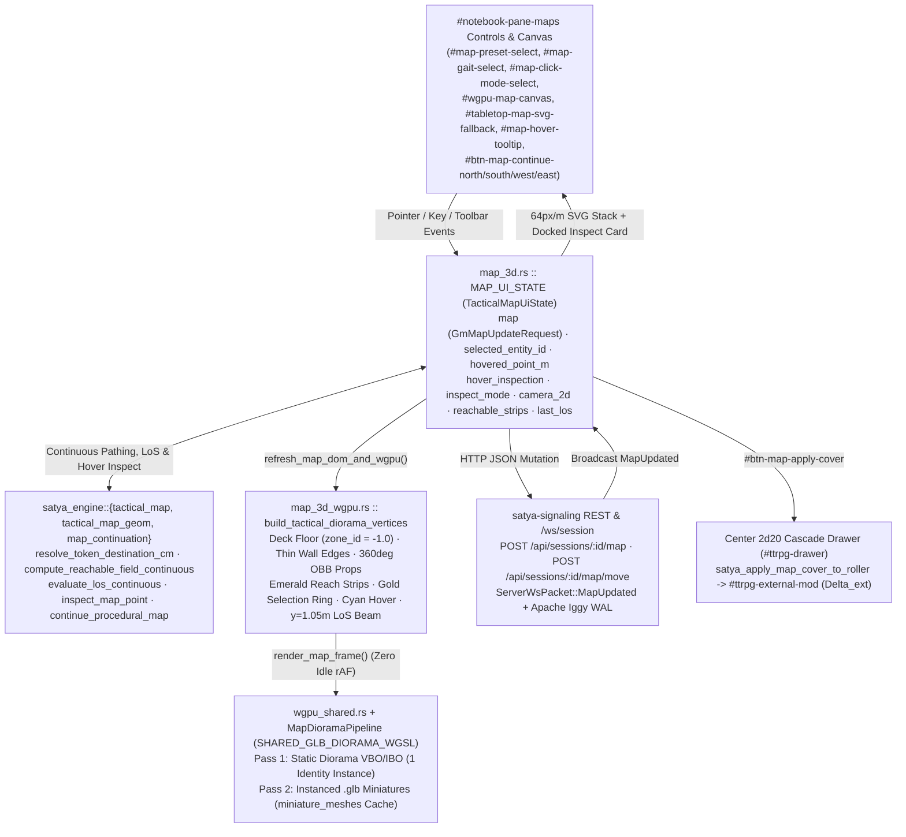
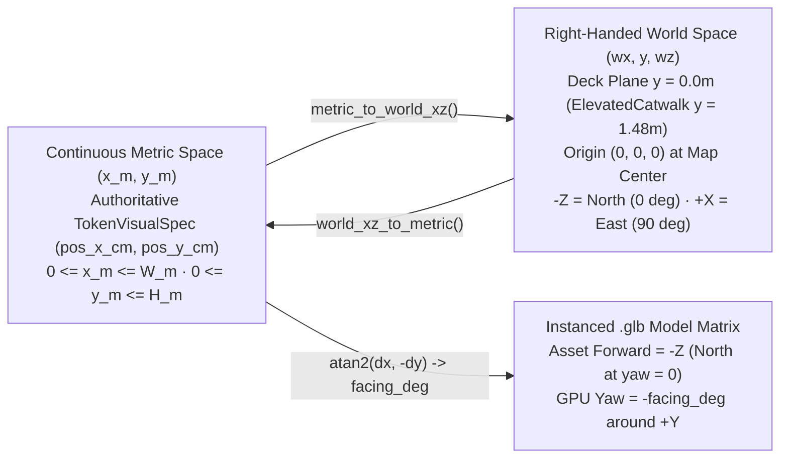

# 02 — 3D Tactical Map Diorama, Continuous Vector Geometry, LoS & Hover Inspector

This document is the authoritative technical reference for the **Tactical Map (`#notebook-pane-maps`)** in [`crates/satya-web`](../../../crates/satya-web), covering end-to-end state synchronization, tile-free continuous metric coordinates (`pos_x_cm`/`pos_y_cm` & `metric_to_world_xz`), procedural sector generation (`wall_edges` + `360°` rotated OBB/circle `props`) and seamless edge continuation (`map_continuation.rs`), diorama 3D mesh synthesis, `1 Tick = 0.25s` 16-directional `ReachableField` movement (`0.25m` sampling), analytical 2D segment/OBB Line-of-Sight & `barrier_ballistics`, the docked Object & Ground Hover Inspector (`[Alt / I]` `#map-hover-tooltip` + fixed `#map-hover-coords-pill`), the `2d20` Cascade roller bridge, instanced `.glb` miniature rendering on WebGPU (`wgpu`), `OrbitOrthoCamera` ray-plane picking, and zoomable/pannable 2D `<svg>` rendering.

- **Web Client Modules**: [`wasm_client/map_3d.rs`](../../../crates/satya-web/src/wasm_client/map_3d.rs), [`wasm_client/map_3d_wgpu.rs`](../../../crates/satya-web/src/wasm_client/map_3d_wgpu.rs), [`wasm_client/map_3d_dressing_geom.rs`](../../../crates/satya-web/src/wasm_client/map_3d_dressing_geom.rs), [`wasm_client/map_hover_inspect.rs`](../../../crates/satya-web/src/wasm_client/map_hover_inspect.rs), [`wasm_client/map_edge_edit.rs`](../../../crates/satya-web/src/wasm_client/map_edge_edit.rs), [`wasm_client/map_2d_art.rs`](../../../crates/satya-web/src/wasm_client/map_2d_art.rs), [`wasm_client/map_2d_art_surfaces.rs`](../../../crates/satya-web/src/wasm_client/map_2d_art_surfaces.rs), [`wasm_client/map_2d_art_overlay.rs`](../../../crates/satya-web/src/wasm_client/map_2d_art_overlay.rs), [`wasm_client/map_2d_art_walls.rs`](../../../crates/satya-web/src/wasm_client/map_2d_art_walls.rs), [`wasm_client/map_2d_art_furniture.rs`](../../../crates/satya-web/src/wasm_client/map_2d_art_furniture.rs), [`wasm_client/map_2d_art_props.rs`](../../../crates/satya-web/src/wasm_client/map_2d_art_props.rs), [`wasm_client/wgpu_shared.rs`](../../../crates/satya-web/src/wasm_client/wgpu_shared.rs), [`wasm_client/glb_model.rs`](../../../crates/satya-web/src/wasm_client/glb_model.rs), [`wasm_client/model_3d_wgpu.rs`](../../../crates/satya-web/src/wasm_client/model_3d_wgpu.rs)
- **Deterministic Engine & Wire DTOs**: [`satya-engine/src/tactical_map_geom.rs`](../../../crates/satya-engine/src/tactical_map_geom.rs), [`satya-engine/src/tactical_map.rs`](../../../crates/satya-engine/src/tactical_map.rs), [`satya-engine/src/tactical_map_edges.rs`](../../../crates/satya-engine/src/tactical_map_edges.rs), [`satya-engine/src/map_dressing.rs`](../../../crates/satya-engine/src/map_dressing.rs), [`satya-engine/src/barrier_ballistics.rs`](../../../crates/satya-engine/src/barrier_ballistics.rs), [`satya-engine/src/map_interior_gen.rs`](../../../crates/satya-engine/src/map_interior_gen.rs), [`satya-engine/src/map_outdoor_gen.rs`](../../../crates/satya-engine/src/map_outdoor_gen.rs), [`satya-engine/src/map_outdoor_natural.rs`](../../../crates/satya-engine/src/map_outdoor_natural.rs), [`satya-engine/src/map_sector_gen.rs`](../../../crates/satya-engine/src/map_sector_gen.rs), [`satya-engine/src/environment_vehicles.rs`](../../../crates/satya-engine/src/environment_vehicles.rs), [`satya-schema/src/tactical_map_dto.rs`](../../../crates/satya-schema/src/tactical_map_dto.rs), [`satya-schema/src/tactical_map_dressing_dto.rs`](../../../crates/satya-schema/src/tactical_map_dressing_dto.rs), [`satya-schema/src/protocol.rs`](../../../crates/satya-schema/src/protocol.rs)
- **SSR Markup & Styles**: [`views_notebook.rs`](../../../crates/satya-web/src/views_notebook.rs), [`styles_stages.css`](../../../crates/satya-web/src/styles_stages.css)

---

## 1. End-to-End Architecture & State Topology

All deterministic spatial rules — procedural sector generation (`tiles: []`), `0.30m` token-disc collision with `<= 0.35m` slide/snap clamping, 16-directional `0.25m` Dijkstra reachability (`ReachableField`), analytical 2D segment/OBB raycasting LoS, and cursor hover inspection (`inspect_map_point`) — execute in pure, host-testable Rust inside `satya_engine::{tactical_map, tactical_map_geom}`. `wasm_client/map_3d.rs` owns `TacticalMapUiState`, synchronizes edits over REST/WebSocket, and drives both the event-driven WebGPU diorama (`map_3d_wgpu.rs`) and the synchronized 2D `<svg>` battlemap (`#tabletop-map-svg-fallback`).



### 1.1 `TacticalMapUiState` (`MAP_UI_STATE` in `map_3d.rs`)

`MAP_UI_STATE` is stored in a Wasm `thread_local! { RefCell<TacticalMapUiState> }` accessed exclusively through short-lived closures (`with_map_ui`, `with_map_ui_mut`) so borrows never span an `.await` point or re-entrant DOM event:

| Field | Rust Type | Default Value | Responsibility |
| :--- | :--- | :--- | :--- |
| `map` | `GmMapUpdateRequest` | `"residential_apartment"`, `20m × 14m`, seed `42` | Canonical wire DTO holding `grid_width`, `grid_height`, visual `cell_size_cm` (`100`), `tiles: []` (legacy compat), thin `wall_edges`, `360°` continuous `props` (`center_x_cm`, `center_y_cm`, `rotation_deg`), `tokens: Vec<MapTokenPlacement>`, and `token_visuals: Vec<TokenVisualSpec>` (`pos_x_cm`, `pos_y_cm`). |
| `selected_entity_id` | `Option<String>` | First token (`"pc-1"`) | Active token acting as the origin for gait reachability, LoS measurements, point-and-click movement, and miniature visual customization. |
| `hovered_point_m` | `Option<(f32, f32)>` | `None` | Continuous metric cursor coordinate `(x_m, y_m)` under `#wgpu-map-canvas` or `#battlemap-overlay` (drives cyan hover reticle, `#map-hover-coords-pill`, and brush ghost preview). |
| `hover_inspection` | `Option<MapHoverInspection>` | `None` | Topmost entity/ground classification under `hovered_point_m` (drives docked top-right `[Alt / I]` `#map-hover-tooltip`). |
| `inspect_mode` / `alt_inspect_held` | `bool` | `false` | Sticky (`I` / `#btn-map-inspect-toggle`) and momentary (`Alt` key) triggers revealing `#map-hover-tooltip`. |
| `camera_2d` | `BattlemapCamera2d` | `pan_m: (0,0), zoom: 1.0` | Drives 2D SVG `viewBox` zoom (`0.25x..6.0x`), drag-pan, `>= 120px` boundary overscroll, and `Continue [Dir]` triggers (`map_2d_camera.rs`). |
| `prop_brush_rotation_deg` / `snap_to_grid` | `i32` / `bool` | `0` / `false` | Free `360°` (`0..359°`) rotation angle for GM prop placement (`+15°` steps or `#map-prop-rot-deg`) and optional `0.50m` placement snap toggle (`#btn-map-snap-toggle`). |
| `gait` | `CombatMovementGait` | `CombatGlideTacticalWalk` (`35%`) | Active movement gait (`crawl`, `creep`, `glide`, `hustle`, `sprint`) fed into `GaitReachQuery`. |
| `tick_budget` | `u8` | `8` (`2.00s`) | Movement duration in combat ticks (`1..=40`, `1 Tick = 0.25s`) fed into `GaitReachQuery`. |
| `interaction_mode` | `String` | `"move_or_select"` | Active canvas click tool: `"move_or_select"`, `"measure_los"`, or `"edit_terrain"`. |
| `wall_cutaway` | `bool` | `true` | Lowers `Wall` / `DoorClosed` (`2.35m` $\rightarrow$ `0.58m`) geometry so interior corridors remain visible from angled 3D isometric views. |
| `last_los` | `Option<(String, String, TacticalLosEvaluation)>` | Auto-computed vs. nearest non-self token | Cached `(attacker_label, target_label, TacticalLosEvaluation)` driving `#map-tactical-hud-bar` and the 3D chest-height laser beam. |
| `reachable_field` / `reachable_strips` | `Option<ReachableField>` / `Vec<ReachableStrip>` | Computed on boot | `0.25m` 16-directional continuous gait reachability field + merged horizontal runs (`merged_row_runs()`). |
| `seed_counter` | `u64` | `42` | Monotonic procedural generation seed (`wrapping_add(137)` on each click of `#btn-map-generate`). |

### 1.2 Toolbar Controls & Window Callbacks (`#notebook-pane-maps`)

| DOM `id` | Callback (`window.*`) | Rust Entrypoint | Effect |
| :--- | :--- | :--- | :--- |
| `#map-preset-select`, `#map-grid-size-select`, `#btn-map-generate` | `satyaGenerateProceduralMap` | `satya_generate_procedural_map` | Advances `seed_counter += 137`, builds a continuous vector sector with live roster West-side spawns + hostile East sentry, renders immediately, and `POST`s `/api/sessions/:id/map`. |
| `#btn-map-proj-toggle` | `satyaToggleMapProjection` | `satya_toggle_map_projection` | Toggles `OrbitOrthoCamera.orthographic` between `3D Isometric` (`42°` perspective) and `2D Top-Down` (`88.5°` pitch orthographic, `yaw = 0°`). |
| `#btn-map-cutaway-toggle` | `satyaToggleMapWallCutaway` | `satya_toggle_map_wall_cutaway` | Toggles `wall_cutaway` (`Cutaway: ON` vs `Full Walls`) and rebuilds the static diorama VBO/IBO. |
| `#btn-map-cam-reset` | `satyaResetMapCamera` | `satya_reset_map_camera` | Resets `OrbitOrthoCamera` to `tactical_map_default()` (`yaw = -24°`, `pitch = 52°`, `zoom = 1.0`, `pan = [0, 0]`). |
| `#btn-map-inspect-toggle` | `satyaToggleMapInspectMode` | `satya_toggle_map_inspect_mode` | Toggles sticky Object & Ground Hover Tooltip (`#map-hover-tooltip`, also bound to keyboard `I` and momentary `Alt`-hold). |
| `#btn-map-prop-rotate`, `#map-prop-rot-deg`, `#btn-map-snap-toggle` | `satyaRotateMapPropBrush`, `satyaSetMapPropRotationDeg`, `satyaToggleMapGridSnap` | `map_edge_edit.rs` | Steps prop rotation by `+15°` (or sets `0..359°` directly) and toggles optional `0.50m` snap vs. free continuous placement. |
| `#map-click-mode-select`, `#map-gait-select`, `#map-tick-budget-input` | `satyaUpdateMapTacticalControls` | `satya_update_map_tactical_controls` | Updates `interaction_mode`, `gait`, and clamped `tick_budget` (`1..=40`), recomputes `reachable_field` & `last_los`, and redraws. |
| `#map-token-chip-bar` buttons | `satyaSelectMapToken(id)` | `satya_select_map_token` | Switches `selected_entity_id`, syncs `#map-token-model-select` / `#map-token-color-input`, and recomputes gait reach + auto-LoS. |
| `#map-token-model-select`, `#map-token-color-input` | `satyaUpdateSelectedTokenVisual` | `satya_update_selected_token_visual` | Updates `TokenVisualSpec` (`model_preset`, `color_hex`) for `selected_entity_id` and broadcasts full map state if in a session. |
| `#btn-map-apply-cover` | `satyaApplyMapCoverToRoller` | `satya_apply_map_cover_to_roller` | Bridges `last_los.recommended_delta_ext` into `#ttrpg-external-mod` ($\Delta_{\text{ext}}$) and refreshes the `2d20` Cascade odds preview. |

---

## 2. Continuous Metric World Coordinates & Compass Bearings

Every tactical sector defines a metric viewport of physical size $(W_{\text{m}}, H_{\text{m}}) = (\text{grid\_w} \cdot s,\; \text{grid\_h} \cdot s)$ where $s = \max(\text{cell\_size\_m}, 0.25)$ (`1.0m` reference scale) lying on horizontal deck plane $y = 0.0$ in right-handed WebGPU world space (`+X` East, `+Y` Up, `-Z` North, `+Z` South), with `(0.0m, 0.0m)` at the **North-West** corner and the board centered symmetrically around `(0.0, 0.0, 0.0)`:



### 2.1 Continuous Bijection (`map_3d.rs`)

Given board dimensions $(W_{\text{m}}, H_{\text{m}})$:

- **Metric $(x_{\text{m}}, y_{\text{m}}) \rightarrow$ World $(w_x, w_z)$** (`metric_to_world_xz`):
  $$w_x = x_{\text{m}} - \frac{W_{\text{m}}}{2}, \qquad w_z = y_{\text{m}} - \frac{H_{\text{m}}}{2}$$
- **World $(w_x, w_z) \rightarrow$ Metric $(x_{\text{m}}, y_{\text{m}})$** (`world_xz_to_metric`):
  $$x_{\text{m}} = w_x + \frac{W_{\text{m}}}{2}, \qquad y_{\text{m}} = w_z + \frac{H_{\text{m}}}{2}$$
  Returns `Some((x_m, y_m))` iff $0 \le x_{\text{m}} \le W_{\text{m}}$ and $0 \le y_{\text{m}} \le H_{\text{m}}$, otherwise `None` (off-board ray hit). Token placement enforces a circular body radius of `TOKEN_RADIUS_M = 0.30m` with gentle outward wall/cover slide-snap clamping up to `COVER_SNAP_MAX_M = 0.35m` (`resolve_token_destination_cm`).

### 2.2 Compass Bearings & `.glb` Miniature Yaw Convention

Token facing (`TokenVisualSpec.facing_deg` in `0..360`) follows standard tabletop/nautical compass bearings:

| Compass Direction | Metric Delta $(\Delta x_{\text{m}}, \Delta y_{\text{m}})$ | World Vector $(\Delta w_x, \Delta w_z)$ | `facing_deg` | GPU Instance `yaw_deg` (`-facing_deg`) |
| :--- | :---: | :---: | :---: | :---: |
| **North** | `(0, -1)` | `(0, -1)` | `0°` | `0°` |
| **East** | `(+1, 0)` | `(+1, 0)` | `90°` | `-90°` |
| **South** | `(0, +1)` | `(0, +1)` | `180°` | `-180°` |
| **West** | `(-1, 0)` | `(-1, 0)` | `270°` | `-270°` |

When a token moves continuously by $(\Delta x_{\text{m}}, \Delta y_{\text{m}})$ in `move_or_select` mode, `handle_map_point_clicked` computes its heading via `atan2(dx, -dy)` and dispatches `{ to_x_cm, to_y_cm }` to `POST /api/sessions/:id/map/move`. Because procedural `.glb` miniatures in `glb_model.rs` face `-Z` at identity rotation, `map_3d_wgpu.rs` passes `yaw_deg = -(vis.facing_deg as f32)` into `GlbInstanceData::from_trs_and_tint`.

---

## 3. Procedural Sector Generation & Multi-Peer Synchronization

### 3.1 Deterministic `SectorPreset` Catalog (`satya_engine::tactical_map`)

`generate_procedural_sector(preset, width, height, seed)` clamps sector dimensions to `8m..=48m` (`tiles: Vec::new()`) and dispatches across `map_interior_gen`, `map_outdoor_gen`, `map_outdoor_natural`, and `map_sector_gen` so **all 12** presets emit thin [`MapWallEdge`](../../../crates/satya-schema/src/tactical_map_dressing_dto.rs) architecture (except open natural terrain `WoodedPark` and `WoodlandCreek`) and continuous `360°`-oriented [`MapPropPlacement`](../../../crates/satya-schema/src/tactical_map_dressing_dto.rs) props (all `52` variants including `StructuralPillar`, `ElevatedCatwalk`, and `HazardSpill`) carrying per-material ballistic ratings, while verifying continuous `0.50m`-sample connectivity across doors (`verify_sector_connectivity_continuous`).

| `SectorPreset` (`code()`) | Default Label | Perimeter | Signature Structural Features |
| :--- | :--- | :--- | :--- |
| `ResidentialApartment` (`"residential_apartment"`) | `Residential Apartment` | Thin `Brick` `MapWallEdge` perimeter + exterior `Window`s + W/E doors | Seeded BSP room partition (`Drywall` `MapWallEdge`s + swinging doors) furnished by room role (`Living`, `Kitchen`, `Bedroom`, `Bathroom`, `Office`) with multi-cell `Sofa` (`3×1`), `Rug`, `CoffeeTable`, `DiningTable` (`2×2`), `Bed` (`2×2`), `KitchenCounter`, `Fridge`, `Stove`, `Bathtub`, `Toilet`, `Desk`, `DeskL`, and `Bookshelf`. |
| `OfficeFloor` (`"office_floor"`) | `Corporate Office Suite` | Thin `ConcreteBlock` `MapWallEdge` shell + curtain `Window`s + W/E doors | Open-plan West workstation bullpen (`Desk`, `DeskL`, `DeskT` clusters, `Sofa`/`Rug`/`CoffeeTable` reception lounge, `Bookshelf`), glass-walled `ConferenceRoom` (`DiningTable` `2×2` + interior `Window`s), `Breakroom` (`KitchenCounter`, `Fridge`, `RoundTable`), and `ServerCloset` (`SteelShelving`). |
| `CornerBar` (`"corner_bar"`) | `Neighborhood Corner Bar` | Thin `Brick` `MapWallEdge` perimeter + storefront `Window`s + W/E doors | Public taproom (`>= 55%` West span) with stretchable `BarCounter` (`4..8×1`), `BackBarShelf`, bartender aisle, `BarStool` row, `Booth`s, `PoolTable` (`3×2`), `RoundTable`s, plus East-side `Drywall` restrooms, kitchen prep room, and crate/drum storeroom. |
| `UrbanCrossroads` (`"urban_crossroads"`) | `Urban Street Crossroads` | Open street edges + 4 corner `Brick`/`ConcreteBlock` buildings | Flagstone `StonePath` corner sidewalks surrounding furnished corner storefronts (café, hardware shop, agency office, bodega) with storefront `Window`s + street doors, parked `Car` & `UtilityVan` (`2×5`), `JerseyBarrier`s, `Dumpster`, `ParkBench`, `Planter`s, and sidewalk `MediumTree`s. |
| `WoodedPark` (`"wooded_park"`) | `Wooded Park & Trail` | Open natural edges + roadside `AsphaltDrive` pullout | Meandering `2m` `StonePath` trail through an octagonal central plaza (`Planter` / `LargeTree` + inward `ParkBench`es), roadside parked `Car` / `UtilityVan` (`2×5`) + `Hedge` borders, `GardenBed` / `GardenEdging`, `MulchBed` pockets, diagonal `FallenLog`s, `PicnicTable` (`2×2`), `Boulder`s, and `LargeTree` / `MediumTree` + `Bush` scatter. |
| `GardenEstate` (`"garden_estate"`) | `Walled Estate & Courtyard` | West `AsphaltDrive` approach + `Brick`/`ConcreteBlock` `MapWallEdge` compound + iron gates | Driveway parked `Car` / `UtilityVan`, landscaped courtyard (`StonePath` & `GravelPath` walks, `GardenBed` / `GardenEdging`, `MulchBed`, `Hedge` rows, `PicnicTable`, `ParkBench`, `LargeTree`, `MediumTree`, `Bush`, service `Dumpster`), and a windowed East brick/drywall pavilion furnished with `Rug`, `Sofa`, `Desk`, `Bookshelf`, and `SteelShelving`. |
| `WoodlandCreek` (`"woodland_creek"`) | `Woodland Creek & Ford` | Open natural woodland edges | Meandering `CreekWater` stream (`HazardZone` wading penalty) flanked by `GravelPath` shoals, a `StonePath` stepping-stone ford, winding `DirtPath` trails, `MulchBed` pockets, diagonal `45°/135°` `FallenLog`s, granite `Boulder`s, and multi-lobed `LargeTree` / `MediumTree` + `Bush` canopy. |
| `RoadsideDitch` (`"roadside_ditch"`) | `Country Lane & Ditch` | Open lane verges + culvert concrete headwalls + fenced cottage garden (`DoorOpen` gate) | East–West `GravelPath` lane with `DirtPath` verges, parallel `DrainageDitch` trench, masonry `StonePath` culvert crossing, cottage garden (`GardenBed`, `GardenEdging`, `MulchBed`, `ParkBench`), diagonal `FallenLog`s, `Boulder`s, and roadside trees. |
| `DockingBay` (`"docking_bay"`) | `Industrial Logistics & Loading Bay` | Thin `ConcreteBlock` + `SheetSteel` bay doors + corner pilasters | North `ElevatedPlatform` catwalk (`y = 2`), glazed SW `Drywall` shipping booth (`Desk`, `SteelShelving`), East `AsphaltDrive` loading apron with `UtilityVan` (`2×5`), `SteelShelving` racks, `WoodCrate` / `DrumCluster` / `JerseyBarrier` cover, and central chemical/fuel `HazardZone` spill. |
| `MedLabSector` (`"med_lab"`) | `Trauma Clinic & Bio-Containment Lab` | Thin `ConcreteBlock` + exterior `Window`s + W/E doors | Three clinical zones split by a `Drywall`/glass triage partition and a `ReinforcedConcrete`/steel quarantine bulkhead, furnished with waiting `Loveseat`, `Desk`s, trauma `Bed`s (`2×2`), `Fridge`s, `KitchenCounter`, `SteelShelving`, `DrumCluster`s, and east bio-spill `HazardZone`. |
| `DerelictCorridor` (`"derelict_corridor"`) | `Breached Utility Tunnel & Sub-Level` | Thin `ReinforcedConcrete` outer shell + `SheetSteel` service doors | Longitudinal `ConcreteBlock` flanking conduit bays with `SheetSteel` sub-rooms and transverse `ReinforcedConcrete` blast bulkheads, dressed with `Boulder` rubble slabs, `SteelShelving`, ruptured `DrumCluster`s, `WoodCrate`s, maintenance `Desk`, and chemical `HazardZone` pools. |
| `OrbitalAirlock` (`"orbital_airlock"`) | `Pressurized Transfer Airlock` | Thin `ArmorSteel` (`10 PR`) shell + W/E armored airlocks | Four structural `FullWall` Mag-Rail blast columns, inner armored vestibule bulkheads with viewports, N/S `SheetSteel` suit-prep/overwatch booths (`Desk`, `Wardrobe`), `ElevatedPlatform` inspection deck, `JerseyBarrier` blast shields, `SteelShelving`, `WoodCrate`/`DrumCluster` pods, and vent `HazardZone`. |

### 3.2 Roster-Aware Spawning & REST / WebSocket Synchronization

Clicking **Generate (`#btn-map-generate`)** (`satya_generate_procedural_map`):
1. Advances `seed_counter = seed_counter.wrapping_add(137)` for deterministic variation.
2. Reads `CLIENT_STATE.roster` (skipping `ParticipantKind::AiAgent` + `SessionRole::AiGm` so the narrator is never spawned as a token).
3. Spawns combatants along the West entry zone at `x = 2`, `y = clamp(mid_y - 2 + idx * 2, 1, h - 2)` facing East (`90°`) with cycling presets (`vanguard_breacher`, `void_medic`, `recon_sniper`) and squad colors (`#38bdf8`, `#34d399`, `#a78bfa`, `#fbbf24`), or defaults (`Vanguard-1`, `Medic-2`) offline.
4. Places hostile `"npc-secops-1"` (`SecOps Sentry`, `exo_heavy`, `#f43f5e`) at `(w - 3, mid_y)` facing West (`270°`).


> [!NOTE]
> **Door, Edge & 360° Prop Edits**: Toggling a door (`DoorClosed` $\leftrightarrow$ `DoorOpen`), painting edges, or placing/erasing `360°` props (`place_prop_on_map` / `remove_prop_at_point`) mutates `map.wall_edges` / `map.props` (`tiles: []`) and dispatches `GmMapUpdateRequest` to `POST /api/sessions/:id/map`, whereas pure token movement uses `POST /api/sessions/:id/map/move` (`MoveMapTokenRequest` with `to_x_cm`/`to_y_cm`).

---

## 4. Diorama 3D Geometry Builder (`build_tactical_diorama_vertices`)

`build_tactical_diorama_vertices(ui)` in [`map_3d_wgpu.rs`](../../../crates/satya-web/src/wasm_client/map_3d_wgpu.rs) synthesizes a single indexed `GlbVertex` triangle mesh (`Vec<GlbVertex>`, `Vec<u32>`) from continuous `wall_edges`, `360°`-rotated `props` (`push_obb`), `reachable_strips`, selection/hover rings, and LoS beams every time scene geometry or overlays change:

### 4.1 Deck Floor, Structural Props & Thin Wall Edges

| Layer / Entity | Footprint / Scale Geometry | Elevation Range `y0 .. y1` (m) | `zone_id` (`bary_zone.w`) | Base Albedo / Visual | Engine Rules (`tactical_map_geom.rs`) |
| :--- | :--- | :--- | :---: | :--- | :--- |
| **Continuous Deck Floor** | `half_w_m × half_h_m` (full board) | `y = 0.000` (`push_quad`) | `-1.0` (when `show_grid_overlay`) | `[0.075, 0.115, 0.185]` | Procedural `1.0m` minor + `5.0m` major scale lines toggleable via `#btn-map-grid-overlay`. |
| **Outer Diorama Rim** | `(half_w_m + 0.12) × (half_h_m + 0.12)` | `-0.140 .. -0.005` | `0.0` | `[0.05, 0.08, 0.13]` | Framing plinth beneath deck level so angled isometric views have a solid tabletop silhouette. |
| **`MapWallEdge` (`Wall`, `Door*`, `Window`)** | Coalesced segment (`0.08m` thick) | Cutaway: `0.00 .. 0.58` (`+0.03` cap)<br>Full: `0.00 .. 2.35` (`+0.03` cap) | `0.0` | Drywall/Brick/CMU/Steel/Glass palette | Analytical segment blocking (`Wall`, `DoorClosed`), sill cover (`Window`), and passable swing frame (`DoorOpen`). |
| **`StructuralPillar`** (`360°` OBB) | Per `span_w_cm × span_h_cm` (`90×90 cm` default) | Cutaway: `0.00 .. 0.61`<br>Full: `0.00 .. 2.38` | `0.0` | `[0.30, 0.36, 0.44]` | Solid rotated OBB (`FullObstacle`); blocks movement and sightlines cleanly. |
| **`ElevatedCatwalk`** (`360°` OBB) | Per prop center & rotation | `0.000 .. 1.480` | `-1.0` / `0.0` | `[0.15, 0.21, 0.31]` | Walkable `1.48m` raised gantry (`1.25×` climb cost); tokens & rings inside catwalk OBB lift to `y = 1.48m`. |
| **`HazardSpill`** (`360°` OBB) | Per prop center & rotation | `0.004 .. 0.032` | `0.0` | Crimson `[0.68, 0.14, 0.24]` | Chemical / radiation floor hazard (`2.0×` movement cost penalty). |
| **Furnishings, Cover & Foliage (`PropKind`, `52` total)** | Continuous `(center_x_cm, center_y_cm)` at any `0..359°` angle (`push_obb`) | `0.00 .. height_m` (`VehicleBody`, `LiveWood`, `Foliage`, etc.) | `0.0` / `-0.25` (canopy foliage) | Per-material PBR palette | Hover inspector distinguishes `Car`/`UtilityVan` `Engine Block` vs cabin and `Tree` `Trunk` vs `Canopy`. |

### 4.2 Procedural `1.0m` Minor / `5.0m` Major Visual Scale Grid & Materials (`SHARED_GLB_DIORAMA_WGSL`)

Triangles tagged with `zone_id < -0.5` (`-1.0` on the deck when `#btn-map-grid-overlay` is enabled) render resolution-independent visual reference lines in `fs_main`; disabling `#btn-map-grid-overlay` sets `deck zone_id = 0.0` for a pure ungridded terrain surface while keeping procedural Grass (`-2.0`), Gravel (`-3.0`), Packed Dirt (`-4.0`), Bark Mulch (`-5.0`), Creek Water (`-6.0`), and Leaf Canopy (`-0.25`) shaders active.

---

## 5. Live Continuous Overlays, Analytical LoS & Hover Inspector

### 5.1 `1 Tick = 0.25s` 16-Directional Continuous Reachability (`ReachableField`)

Whenever `selected_entity_id`, `gait`, `tick_budget`, or `map` changes, `recompute_reach_and_auto_los` invokes `compute_reachable_field_continuous(&map, &GaitReachQuery)` (`spd_eff = 11`, `hgt_m = 1.80`, `tick_budget` in `1..=40`):

1. **Physical Sprint & Per-Tick Velocity** ([`environment_vehicles.rs`](../../../crates/satya-engine/src/environment_vehicles.rs)):
   $$V_{\text{sprint}} = \big(4.0 + 0.35 \cdot \text{SPD}_{\text{eff}}\big) \cdot \frac{\text{HGT}_{\text{m}}}{1.75}\;\text{m/s}, \qquad d_{\text{budget}} = \frac{V_{\text{sprint}}}{4.0} \cdot f_{\text{gait}} \cdot N_{\text{ticks}}\;\text{m}$$
   Gait speed profiles (`crawl 8%`, `creep 18%`, `glide 35%`, `hustle 65%`, `sprint 100%`) govern reachable metric distance.
2. **16-Directional `0.25m` Sampling & Strip Merging**: `compute_reachable_field_continuous` steps `0.25m` lattice nodes in millimeters with 16 directional vectors (`(±1,0)`, `(±1,±1)`, `(±2,±1)` knight-dirs) validating `TOKEN_RADIUS_M = 0.30m` clearance along every segment and surface move-cost multipliers (`HazardSpill`, `CreekWater`, `ElevatedCatwalk`), then exports `merged_row_runs()` (`Vec<ReachableStrip>`) for crisp, low-triangle emerald pads in 3D WebGPU and contoured movement envelopes in 2D SVG.

### 5.2 Analytical 2D Raycast LoS & `barrier_ballistics` (`evaluate_los_continuous`)

LoS from `attacker_m` to `target_m` is computed analytically against `WallEdgeIndex` segments (`tactical_map_edges.rs`) and `360°` rotated OBBs + trunk/foliage circles (`prop_ray_intersect_t` in `tactical_map_geom.rs`):
1. **Center-to-Center Exact Ray & Lean Peek (`±0.80m`)**: Directly intersects `Wall`/`DoorClosed`/`Window` segments and rotated prop volumes along `[0, 1]` parameter `t` — testing symmetric perpendicular peek origins when blocked to detect **High Cover (`+6` $\Delta_{\text{ext}}$)** corner leans.
2. **Continuous Hover Inspector (`map_hover_inspect.rs`)**: `satyaHoverMapPoint(x_m, y_m, client_x, client_y)` calls `inspect_map_point(&map, theme_name, x_m, y_m)` to update fixed-width `#map-hover-coords-pill` and populate the `[Alt`-hold / `I`-toggle / `#btn-map-inspect-toggle]` docked top-right `#map-hover-tooltip` pane across tokens, wall/door edges, sub-zone props (`Car` engine vs. cabin, `LargeTree` trunk vs. canopy), surface props, and ground material.

| `CoverGrade` | `has_line_of_sight` | `recommended_delta_ext` ($\Delta_{\text{ext}}$) | `push_beam` Laser RGB (`y = 1.05m`, width `0.09m`) | HUD Badge & Tactical Meaning |
| :--- | :---: | :---: | :--- | :--- |
| `Clear` | `true` | `+0` | Cyan `[0.14, 0.86, 0.96]` | Unobstructed sightline. |
| `Concealment` | `true` | `+3` | Emerald `[0.18, 0.80, 0.38]` | Foliage (`Hedge`, `Bush`, tree canopy) obscuring silhouette (`0 PR` — zero trauma loss). |
| `LowCover` | `true` | `+4` *(or `+2` overmatched)* | Amber `[0.98, 0.76, 0.14]` | Low cover or `Window` sill; degrades to `+2` when overmatched by active firearm (`barrier_ballistics.rs`). |
| `HighCover` | `true` | `+6` | Orange `[0.98, 0.48, 0.16]` | Direct ray blocked, but perpendicular corner-peek ray clears. |
| `Blocked` | `false` | `+16` *(or `+6` blind wall-bang)* | Rose `[0.96, 0.22, 0.36]` *(Violet `[0.68, 0.32, 0.96]` if penetrable)* | Solid wall/door/pillar; if `#map-weapon-select` perforates all barriers, allows `+6` blind fire. |

### 5.3 One-Click Roller Bridge (`satya_apply_map_cover_to_roller`)

Clicking **Apply `Δ_ext` to Roller (`#btn-map-apply-cover`)** inside `#map-tactical-hud-bar`:
1. Reads `(att_label, tgt_label, los)` from `MAP_UI_STATE.last_los`.
2. Clamps `los.recommended_delta_ext.clamp(-10, 16)` (`0`, `+4`, `+6`, or `+16`) and writes it directly into `#ttrpg-external-mod` in the Center `2d20` Cascade drawer (where positive $\Delta_{\text{ext}}$ raises Effective Difficulty $D_{\text{eff}} = \text{clamp}(D_{\text{base}} + \Delta_{\text{ext}} - \Delta_{\text{tool}}, 0, 5)$ or shifts margin requirements per [`satya-engine` sign conventions](../../../docs/technical/rust-engine-steering.md)).
3. Invokes `satya_update_cascade_preview()` so the live `2d20` success/crit odds bar updates immediately, and flashes confirmation feedback in `#ttrpg-roll-status`.

---

## 6. Instanced `.glb` Miniature Pipeline, Camera & Ray-Plane Picking

### 6.1 GPU Buffer Layouts (`GlbVertex`, `GlbInstanceData`, `DioramaUniforms`)

`MapDioramaPipeline` (`map_3d_wgpu.rs`) compiles [`SHARED_GLB_DIORAMA_WGSL`](../../../crates/satya-web/src/wasm_client/model_3d_wgpu.rs) with backface culling (`Face::Back`, `FrontFace::Ccw`), alpha blending (`BlendState::ALPHA_BLENDING`), and a `TextureFormat::Depth24Plus` depth buffer. Each frame executes a single `RenderPass` with **two draw phases**:
1. **Static Diorama Pass**: Binds `diorama_vbo` (slot `0`) + a 1-element identity `diorama_identity_ibo` (slot `1`) and draws all `diorama_index_count` indices in `1` draw call.
2. **Instanced Miniature Pass**: Groups `map.tokens` by `model_preset` (`vanguard_breacher`, `void_medic`, `recon_sniper`, `exo_heavy`, `civ_envoy`, or user-imported `custom_glb`), uploads all `GlbInstanceData` structs contiguously into a dynamic `max_instances = 256` buffer (`20,480 B`), and issues **one instanced `draw_indexed(0..slice.index_count, 0, start..end)` call per distinct preset**.

#### Vertex Buffer Slot `0` — `GlbVertex` (`56 bytes`, `#[repr(C)]`, `VertexStepMode::Vertex`)

| Byte Offset | WGSL `@location` | Field | Rust / WGSL Type | Semantics |
| :---: | :---: | :--- | :--- | :--- |
| `0..12` | `@location(0)` | `position` | `[f32; 3]` (`vec3<f32>`) | Local-space vertex position in meters (`y = 0` at miniature boot sole). |
| `12..24` | `@location(1)` | `normal` | `[f32; 3]` (`vec3<f32>`) | Unit surface normal transformed by `mat3x3(model_0..2)` in `vs_main`. |
| `24..40` | `@location(2)` | `color` | `[f32; 4]` (`vec4<f32>`) | Base albedo `rgb` + **faction tint mask `a`** (`vs_main` blends `mix(in.color.rgb, in.inst_tint.rgb, in.color.a)` so armor plates adopt token `color_hex` while visors, skin, and gunmetal stay crisp). |
| `40..56` | `@location(3)` | `bary_zone` | `[f32; 4]` (`vec4<f32>`) | `xyz` = triangle barycentric coords (`fwidth` wireframe); `w` = `zone_id` (`-1.0` procedural deck grid, `0.0` neutral prop, `1..5` anatomical `HitZoneTag`). |

#### Vertex Buffer Slot `1` — `GlbInstanceData` (`80 bytes`, `#[repr(C)]`, `VertexStepMode::Instance`)

| Byte Offset | WGSL `@location` | Field | Rust / WGSL Type | Semantics |
| :---: | :---: | :--- | :--- | :--- |
| `0..64` | `@location(4..7)` | `model` | `[[f32; 4]; 4]` (`mat4x4<f32>`) | Column-major TRS matrix built from world `[wx, base_y, wz]` (`base_y = 1.48m` on `ElevatedPlatform`, else `elevation_cm / 100`), `yaw = -facing_deg`, and `[0.92, 0.92, 0.92]` miniature scale. |
| `64..80` | `@location(8)` | `tint_rgba` | `[f32; 4]` (`vec4<f32>`) | Parsed token `color_hex` in `rgb` + visibility alpha in `a` (`0.55` translucent ghost for `MessageVisibility::GmOnly` tokens, `1.0` opaque for `Public`). |

#### Uniform Group `@group(0) @binding(0)` — `DioramaUniforms` (`96 bytes` `#[repr(C)]` struct)

| Byte Offset | Field | Rust / WGSL Type | Tactical Map Value |
| :---: | :--- | :--- | :--- |
| `0..64` | `view_proj` | `[[f32; 4]; 4]` (`mat4x4<f32>`) | Column-major `proj * view` matrix (`wgpu` `[0, 1]` depth range). |
| `64..80` | `camera_pos` | `[f32; 4]` (`vec4<f32>`) | `[eye.x, eye.y, eye.z, 1.0]` for Blinn-Phong key/fill specular + Fresnel rim lighting. |
| `80..96` | `mode_params` | `[f32; 4]` (`vec4<f32>`) | `[0.0, cell_size_m, 0.42, 0.0]` (`mode = 0` clean PBR + rim light, `cell_size_m = 1.0`, `wire_strength = 0.42`). |

### 6.2 Miniature GPU Mesh Cache & `custom_glb_generation()` Invalidation

`MapDioramaPipeline.miniature_meshes` caches `GpuMeshSlice` (`vbo`, `ibo`, `index_count`) buffers keyed by preset code (`"vanguard_breacher"`, `"void_medic"`, etc.) so `load_preset_glb_model` runs at most once per preset. When a user imports a custom `.glb` on Tab 3 (`#notebook-pane-model`), `glb_model::store_custom_glb_model` increments `custom_glb_generation()`. On the next `ensure_miniature_gpu_mesh("custom_glb")` call, `custom_glb_gen != current_gen` evicts the stale `"custom_glb"` slice and uploads the new mesh automatically.

### 6.3 `OrbitOrthoCamera`, `screen_ndc_to_plane_xz` Unprojection & `3` Click Modes

`MapDioramaController` (`MAP_CTRL`) binds pointer and wheel listeners onto `#wgpu-map-canvas`:
- **3D Perspective vs. 2D Orthographic (`OrbitOrthoCamera`)**:
  - *3D Isometric Default*: `yaw_deg = -24.0°`, `pitch_deg = 52.0°` (`8.0°..=88.5°`), `base_distance = 19.5m`, `zoom = 1.0` (`0.18..=4.0`), `fov_y = 42.0°`, `near = 0.1m`, `far = 240.0m`.
  - *2D Top-Down Orthographic*: `orthographic = true`, `yaw_deg = 0.0°` (North up), effective pitch `88.5°`, `half_h = (base_distance * 0.46) / zoom`, `half_w = half_h * aspect`, `near = 0.1m`, `far = 240.0m`.
- **Orbit, Pan, Zoom & `4px` Drag Threshold**:
  - `mousedown` sets `drag_start = (cx, cy)` and `moved = false`. Travel `> 4px` (`|cx - sx| > 4 || |cy - sy| > 4`) sets `moved = true`: left-drag in 3D orbits (`dyaw = -dx * 0.42°`, `dpitch = dy * 0.32°`), `Shift`/Middle/Right drag (or any drag in 2D ortho) pans (`max_pan = board_max * 0.55 + 6.0m`), and `wheel` zooms by `1.12×` / `1/1.12×` (also controllable via `#btn-map-zoom-out` / `#map-zoom-readout` / `#btn-map-zoom-in`).
  - `mouseup` invokes `satya_click_map_point(x_m, y_m)` **only when `!moved`**; `mousemove` invokes `satya_hover_map_point(x_m, y_m, ...)` to update fixed-width `#map-hover-coords-pill`, `[Alt / I]` docked top-right `#map-hover-tooltip`, and 3D/2D brush previews without changing viewport height.
- **Ray-Plane Unprojection (`screen_ndc_to_plane_xz`)**:
  For canvas CSS coordinates $(x_{\text{css}}, y_{\text{css}})$ inside $(W_{\text{css}}, H_{\text{css}})$:
  $$\text{ndc}_x = \frac{2 x_{\text{css}}}{W_{\text{css}}} - 1, \qquad \text{ndc}_y = 1 - \frac{2 y_{\text{css}}}{H_{\text{css}}}$$
  `screen_ndc_to_plane_xz(ndc_x, ndc_y, aspect, 0.0)` forms either a perspective ray or orthographic ray, intersects $y = 0.0$, and maps $(O_x + t D_x,\; O_z + t D_z)$ via `world_xz_to_metric`.
- **Three Canvas Click Modes (`handle_map_point_clicked`)**:
  1. **`move_or_select` *(default)***: Clicking within `0.42m` of a token selects it; clicking an unoccupied `DoorClosed`/`DoorOpen` edge toggles the door and `POST`s full map; clicking any point moves `selected_entity_id` via `resolve_token_destination_cm` (applying `<= 0.35m` slide/snap clamping), sets `facing_deg = atan2(dx, -dy)`, and `POST`s `/api/sessions/:id/map/move` (`to_x_cm`, `to_y_cm`).
  2. **`measure_los`**: Evaluates `evaluate_los_continuous` from the selected token to `(x_m, y_m)` and renders the `y = 1.05m` `CoverGrade` beam without moving tokens.
  3. **`edit_terrain`**: Places the active `#map-prop-brush-select` (`52` `PropKind`s at free `0..359°` `prop_brush_rotation_deg`, or `EdgeWall` cycle, or `__erase__`) via `place_prop_on_map` / `remove_prop_at_point` and broadcasts the map (`tiles: []`).

### 6.4 Event-Driven Rendering (Zero Idle `rAF`) & Synchronized 2D SVG Battlemap

- **Zero Idle GPU Power Draw**: `#wgpu-map-canvas` has **no** continuous `requestAnimationFrame` loop; `render_map_frame` fires strictly on pointer orbit/pan/hover point changes, wheel zoom, toolbar actions, `maps` tab activation, or `ServerWsPacket::MapUpdated`. Backing resolution clamps `(css_w * dpr)` to `320..=2048` and `(css_h * dpr)` to `220..=1440`.
- **Automatic Interactive 2D Battlemap Fallback (`#tabletop-map-svg-fallback`)**: If `navigator.gpu` or `request_adapter` / `request_device` is unavailable (or when toggled via `#btn-map-view-mode`), the illustrated 2D battlemap (§6.5) displays automatically.

### 6.5 Illustrated 2D Battlemap, Boundary Continuation, & Docked Hover Inspector

See **[`06-2d-battlemap-art.md`](06-2d-battlemap-art.md)** for the full illustrated 2D `<svg>` pipeline (`map_2d_art*.rs`, `map_2d_tokens.rs`), `BattlemapCamera2d` zoom/pan & edge-matched procedural continuation (`map_2d_camera.rs` + `satya_engine::map_continuation`), paper/ink filter styles (`#map-ink-style-select`), continuous token portrait discs, GM `360°` prop-brush (`#map-prop-brush-select`, `#btn-map-prop-rotate`, `#map-prop-rot-deg`, `#btn-map-snap-toggle`) controls, and docked top-right Object & Ground Hover Inspector (`[Alt / I]` `#map-hover-tooltip` + fixed-width `#map-hover-coords-pill`).

---

## 7. Host Unit Test Coverage

All spatial math, SVG/HUD formatters, procedural layouts, seamless sector stitching, continuous reachability, analytical LoS, hover inspection, and 2D/3D camera unprojection invariants run offline on the host target without a browser:

```bash
cargo test --offline -p satya-engine tactical_map
cargo test --offline -p satya-engine map_continuation
cargo test --offline -p satya-web map_
```

Key verified invariants include `world_and_metric_coordinate_roundtrip_and_continuous_move`, `continuous_move_slides_around_wall_and_blocks_solid_props`, `hover_inspector_identifies_tokens_walls_car_parts_trees_surfaces_and_ground`, `free_360_brush_rotation_and_continuous_prop_placement_erase`, `unproject_inverts_letterboxed_aspect_ratios_and_cursor_zoom_preserves_anchor`, `continue_all_presets_across_all_four_cardinal_edges`, and `test_orbit_ortho_camera_ray_plane_unprojection_perspective_and_ortho`.
