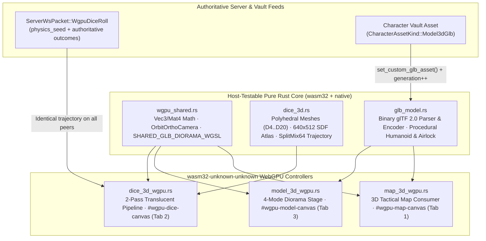
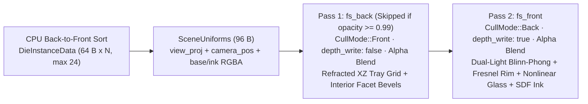

# Satya Web Client — 3D Polyhedral WebGPU Dice & Binary glTF 2.0 (`.glb`) Stage

This document specifies the client-side 3D rendering subsystem in `crates/satya-web/src/wasm_client/`: the shared `wgpu` foundation (`wgpu_shared.rs`), the deterministic 2-pass translucent polyhedral dice engine (`dice_3d.rs`, `dice_3d_wgpu.rs`), and the zero-dependency binary glTF 2.0 (`.glb`) miniature codec and turntable stage (`glb_model.rs`, `model_3d_wgpu.rs`).

---

## 1. Architectural Overview & Module Boundaries

All 3D rendering in `satya-web` executes directly in Rust/WebAssembly via `wgpu` (`Backends::BROWSER_WEBGPU`), eliminating external JavaScript scene graphs (`Three.js`, `Babylon.js`). Every geometry generator, binary `.glb` parser/encoder, camera unprojector, signed-distance-field (SDF) atlas builder, and trajectory solver compiles cleanly on native host targets (`x86_64`, `aarch64`) without a browser DOM, allowing full offline verification under `cargo test --offline -p satya-web`.



| Module | Target Guard | Primary Responsibilities |
| :--- | :--- | :--- |
| `wasm_client/wgpu_shared.rs` | Shared + `wasm32` | Column-major `Mat4` / `Vec3` math, `OrbitOrthoCamera` (perspective + orthographic + XZ ray-plane unprojection), WebGPU `Surface`/`Adapter`/`Device` bootstrap, dynamic canvas resize, `Depth24Plus` attachment builder, `SHARED_GLB_DIORAMA_WGSL`, and `naga` offline WGSL validation tests. |
| `wasm_client/dice_3d.rs` | Host + `wasm32` | Exact procedural geometry for `D4`, `D6`, `D8`, `D10`, `D12`, `D20`, `44 B` `DieVertex` layout with centroid bevel interpolation, `640×512` `Rgba8Unorm` 2D segment SDF numeral atlas (`1..=20`), `DeterministicPrng` (`SplitMix64`), and analytical 4-bounce trajectory solver (`DicePhysicsScene`). |
| `wasm_client/dice_3d_wgpu.rs` | `wasm32` (`cfg`) | `WebGpuDicePipeline`, `DiceRendererController`, CPU back-to-front instance sorting, 2-pass alpha-blended refractive glass/resin `DICE_WGSL_SHADER`, 6 `DiceMaterialConfig` presets, `DiceCameraConfig` DOM sync, and self-terminating `1250 ms` `requestAnimationFrame` loop. |
| `wasm_client/glb_model.rs` | Host + `wasm32` | Zero-dependency binary glTF 2.0 (`b"glTF"`, v2) parser (`parse_glb_bytes`) and Blender-compatible serializer (`encode_glb_bytes`), `56 B` `GlbVertex` with barycentric wireframe coordinates and `HitZoneTag` (`0..=5`), `SubmeshBuilder`, 5 procedural tactical presets, and `CUSTOM_GLB_MODEL` registry. |
| `wasm_client/model_3d_wgpu.rs` | `wasm32` (`cfg`) | `ModelViewerController` for Notebook Tab 3 (`#wgpu-model-canvas`), pointer orbit/pan/zoom interaction, turntable auto-spin, faction RGBA tint swatches, `.glb` drag-and-drop / file upload / `.glb` binary export, and 4 shader inspection modes. |

---

## 2. Shared 3D Foundation (`wgpu_shared.rs`)

`wgpu_shared.rs` eliminates vector math, camera matrix, and WebGPU device-initialization duplication across the 3D Tactical Map (`#wgpu-map-canvas`), the 3D Dice Tray (`#wgpu-dice-canvas`), and the 3D Model Turntable (`#wgpu-model-canvas`).

### 2.1 Column-Major Linear Algebra & `OrbitOrthoCamera`

All matrices use `wgpu`'s native column-major `[[f32; 4]; 4]` convention with clip-space depth $z_{\text{ndc}} \in [0, 1]$:

- **Vector Primitives**: `vec3_add`, `vec3_sub`, `vec3_scale`, `vec3_dot`, `vec3_cross`, `vec3_len`, `vec3_normalize`, and `mul_mat4_cols(a, b)` operate directly on `[f32; 3]` and `[[f32; 4]; 4]` arrays without external crate overhead.
- **`OrbitOrthoCamera` State**:

```rust
#[derive(Debug, Clone, Copy, PartialEq)]
pub struct OrbitOrthoCamera {
    pub yaw_deg: f32,
    pub pitch_deg: f32,      // Clamped to [8.0, 88.5] deg to avoid gimbal singularity
    pub zoom: f32,           // Clamped to [0.35, 3.50]
    pub pan: [f32; 2],       // World-space XZ pan offset [pan_x, pan_z]
    pub target_y: f32,       // Vertical look-at elevation (e.g. 0.92m for humanoids)
    pub base_distance: f32,  // Nominal orbital radius at zoom = 1.0
    pub orthographic: bool,  // false = 42 deg perspective; true = isometric ortho
}
```

- **Preset Constructors**: `OrbitOrthoCamera::turntable_default()` (`yaw = 32°`, `pitch = 22°`, `target_y = 0.92`, `base_distance = 3.9`, `orthographic = false`) frames `1.8 m` miniatures; `OrbitOrthoCamera::tactical_map_default()` frames `24×24` meter grid dioramas from an elevated `52°` pitch.
- **View-Projection & Ray-Plane Unprojection**:
  - `build_view_proj_and_eye(aspect)` computes spherical eye position $\mathbf{e} = \mathbf{t} + d \cdot (\cos\theta\sin\psi,\, \sin\theta,\, \cos\theta\cos\psi)$ where $d = \text{base\_distance} / \text{zoom}$, builds `look_at_rh`, and multiplies against either `perspective_wgpu(42°, aspect, 0.1, 160.0)` or `ortho_wgpu(half_w, half_h, -80.0, 160.0)` where $\text{half\_h} = 1.45 / \text{zoom}$.
  - `screen_ndc_to_plane_xz(ndc_x, ndc_y, aspect, plane_y)` analytically unprojects normalized device coordinates $(x_{\text{ndc}}, y_{\text{ndc}}) \in [-1, 1]^2$ through the camera's right/up/forward basis onto any horizontal world plane $Y = \text{plane\_y}$ (supporting both perspective ray divergence and parallel orthographic rays, rejecting grazing rays when $|r_y| \le 10^{-5}$).

### 2.2 WebGPU Canvas Bootstrap, Dynamic Resize & `Depth24Plus`

1. **Instance & Surface Creation**: Instantiates `wgpu::Instance` with `Backends::BROWSER_WEBGPU` and binds a `Surface<'static>` directly to the target `web_sys::HtmlCanvasElement` via `SurfaceTarget::Canvas(canvas)`.
2. **Adapter & Device Negotiation**: Requests `PowerPreference::HighPerformance`, then opens a logical `Device` and `Queue` using `Limits::downlevel_webgl2_defaults().using_resolution(adapter.limits())` so high-DPI Retina viewports work alongside conservative WebGPU browser limits.
3. **Dynamic Viewport & `Depth24Plus` Attachment**: Before each frame, the controller compares `(canvas.client_width().max(320), canvas.client_height().max(260))` against the active `SurfaceConfiguration` (`PresentMode::Fifo`, `CompositeAlphaMode::Opaque` or `Auto`). On mismatch, it updates `canvas.set_width`/`set_height`, reconfigures the surface, and recreates the `2D` `wgpu::TextureFormat::Depth24Plus` (`RENDER_ATTACHMENT`) depth view.

### 2.3 Shared Diorama Shader (`SHARED_GLB_DIORAMA_WGSL`) & Offline `naga` Validation

Both the 3D Model Turntable (`model_3d_wgpu.rs`) and the 3D Tactical Map miniature layer (`map_3d_wgpu.rs`) share a single WGSL uber-shader (`SHARED_GLB_DIORAMA_WGSL`) and vertex-buffer layout helper (`shared_glb_vertex_buffer_layouts()`), binding a `56 B` vertex stream (`@location(0..=4)`) and an `80 B` per-instance stream (`@location(5..=9)`).

To catch WGSL syntax, type, or layout regressions without launching headless Chrome, `satya-web` includes `naga` (`wgsl-in`) in `[dev-dependencies]`. Unit tests in `wgpu_shared.rs` and `dice_3d.rs` parse every embedded shader string with `naga::front::wgsl::parse_str` and validate module capabilities and bindings via `naga::valid::Validator::new(ValidationFlags::all(), Capabilities::empty())` during `cargo test --offline -p satya-web`.

---

## 3. 3D Polyhedral Dice Engine (`dice_3d.rs` + `dice_3d_wgpu.rs`)

### 3.1 Exact Polyhedral Mesh Construction (`build_polyhedral_mesh`)

`DieKind` enumerates the six canonical tabletop polyhedra (`D4`, `D6`, `D8`, `D10`, `D12`, `D20`). `build_polyhedral_mesh(kind)` generates exact unit-scale convex geometry, face-number mappings (`1..=N`), and outward unit `face_normals` (`face_normals[v - 1]` corresponds to face value `v`):

| `DieKind` | Geometric Solid | Exact Construction & Face Numbering | `uv_radius_scale` | Triangles (`3` idx/tri) |
| :--- | :--- | :--- | :---: | :---: |
| `D4` | Regular Tetrahedron | Even-parity vertices $[ \pm s, \pm s, \pm s ]$ with $s = 1/\sqrt{3}$; 4 equilateral faces (`1..=4`). | `0.82` | `12` (`4 × 3`) |
| `D6` | Hexahedron (Cube) | Half-extent $h = 0.68$; opposite faces sum to **7**: `1 (+Y)`, `6 (-Y)`, `2 (+Z)`, `5 (-Z)`, `3 (+X)`, `4 (-X)`. | `0.90` | `24` (`6 × 4`) |
| `D8` | Regular Octahedron | Axial vertices at $r = 1.05$ along $\pm X, \pm Y, \pm Z$; 8 triangular faces (`1..=8`). | `0.84` | `24` (`8 × 3`) |
| `D10` | Pentagonal Trapezohedron | Poles at $y = \pm 1.05$ plus two staggered 5-gon rings at $y = \pm 0.19$, $r_{\text{ring}} = 0.96$ ($\Delta\theta = \frac{1}{2}\cdot\frac{2\pi}{5}$ phase shift), forming **10 congruent kites** (`2i+1` upper, `2i+2` lower; displays `0..9` / `1..10`). | `0.82` | `40` (`10 × 4`) |
| `D12` | Regular Dodecahedron | Constructed as the **geometric dual of the icosahedron**: for each of the 12 icosahedron vertices, the centroids of its 5 incident triangles are normalized to $r = 1.02$ and sorted counter-clockwise via `atan2` in the vertex normal's tangent plane (`1..=12`). | `0.88` | `60` (`12 × 5`) |
| `D20` | Regular Icosahedron | Golden-ratio vertices $(0, \pm 1, \pm\varphi)$, $(\pm 1, \pm\varphi, 0)$, $(\pm\varphi, 0, \pm 1)$ with $\varphi = \frac{1+\sqrt{5}}{2}$, normalized to $r = 1.04$; 20 equilateral faces (`1..=20`). | `0.85` | `60` (`20 × 3`) |

### 3.2 Centroid Fan-Triangulation & `44 B` `DieVertex` Layout

Standard triangle-pair quad or pentagon tessellations distort interior edge distances, causing uneven shader bevels across 4-sided (`D6`, `D10`) and 5-sided (`D12`) faces. `append_polygon_face` solves this via **centroid fan-triangulation**:

1. Computes polygon centroid $\mathbf{c} = \frac{1}{k}\sum_{i=0}^{k-1} \mathbf{p}_i$ and geometric normal $\hat{\mathbf{n}} = \text{normalize}((\mathbf{p}_1 - \mathbf{p}_0) \times (\mathbf{p}_2 - \mathbf{p}_0))$.
2. Enforces outward winding: if $\hat{\mathbf{n}} \cdot \mathbf{c} < 0$, reverses the polygon ring and negates $\hat{\mathbf{n}}$ so every face normal strictly points away from the origin.
3. Builds an orthonormal face tangent frame $(\hat{\mathbf{u}}, \hat{\mathbf{v}})$ (`up_ref = +Y`, falling back to `+X` when $|n_y| \ge 0.85$), computes maximum projected radius $r_{\max}$, and maps every vertex into the cell's `[u0..u1, v0..v1]` tile inside the `5×4` numeral atlas.
4. Emits $k$ fan triangles $(\mathbf{c}, \mathbf{p}_i, \mathbf{p}_{(i+1)\bmod k})$ using the `44-byte` `#[repr(C)]` `DieVertex` layout:

```rust
#[repr(C)]
#[derive(Debug, Clone, Copy, PartialEq)]
pub struct DieVertex {
    pub position: [f32; 3],     // Offset  0..12 (Float32x3, @location(0))
    pub normal: [f32; 3],       // Offset 12..24 (Float32x3, @location(1))
    pub uv: [f32; 2],           // Offset 24..32 (Float32x2, @location(2))
    pub edge_factors: [f32; 3], // Offset 32..44 (Float32x3, @location(3)) — Total: 44 B
}
```

At the centroid vertex $\mathbf{c}$, `edge_factors = [1.0, 1.0, 1.0]`; at every outer perimeter vertex $\mathbf{p}_i$, `edge_factors = [0.0, 1.0, 1.0]`. Hardware perspective-correct interpolation of `edge_factors.x` yields a smooth radial distance-from-edge scalar (`0.0` on every polygon edge, `1.0` at face center) that produces uniform `smoothstep(0.0, 0.11, edge_dist)` chamfers across triangles, squares, kites, and pentagons alike.

### 3.3 `640×512` 2D Segment SDF Numeral Atlas (`generate_dice_numeral_atlas_rgba8`)

Rather than shipping external font files or PNG assets, `generate_dice_numeral_atlas_rgba8()` synthesizes a crisp `640×512` `Rgba8Unorm` texture (`ATLAS_COLS = 5`, `ATLAS_ROWS = 4`, `ATLAS_CELL_SIZE = 128`, `1,310,720 B`) at startup:

- **Cell Addressing**: Face number $n \in [1, 20]$ maps to column $(n - 1) \bmod 5$ and row $\lfloor (n - 1) / 5 \rfloor$. Single-digit labels (`1..=9`) render centered at scale `0.62`; two-digit labels (`10..=20`) render side-by-side at scale `0.50` (`±0.40` horizontal offset).
- **7-Segment Vector SDF**: Each glyph (`0..=9`) is defined by normalized capsule line segments evaluated via `segment_sdf(px, py, ax, ay, bx, by)` with stroke radius `0.125` and anti-aliased `smoothstep_f32` feathering (`edge_softness = 0.028`).
- **Orientation Disambiguation**: Face cells `6` and `9` append a horizontal orientation underline bar (`y = 0.70`, `x = -0.28..0.28`, thickness `0.85 × stroke_r`) beneath the glyph so tumbled polyhedra (`D10`, `D12`, `D20`) remain unambiguous.
- **Dynamic Ink Tinting**: Every texel writes pure white RGB (`[255, 255, 255]`) and stores anti-aliased glyph coverage in the alpha channel (`a`), allowing `DICE_WGSL_SHADER` to dynamically tint numerals via `scene.ink_color` (gold, ivory, cyan) without regenerating the texture.

### 3.4 Deterministic `SplitMix64` Trajectory Solver & WebSocket Synchronization

When a player or GM executes a roll, the server computes authoritative RNG outcomes and broadcasts `ServerWsPacket::WgpuDiceRoll(WgpuDiceSpec)` containing `physics_seed: u64` and `dice: Vec<WgpuDieRollSpec>`. Every connected client feeds that identical `WgpuDiceSpec` into `DicePhysicsScene::from_spec`:

1. **`SplitMix64` PRNG (`DeterministicPrng`)**: Seeded with `spec.physics_seed ^ 0x9E37_79B9_7F4A_7C15` (non-zero fallback `0xD1CE_5EED_2026_0001`), generating bit-identical spawn offsets, spin axes, spin magnitudes (`2..=4` full revolutions), and resting yaw angles across Chrome, Edge, Firefox, and OS architectures.
2. **Exact Top-Face Landing (`rotation_aligning_normal_to_up`)**: Given the authoritative `outcome` (`1..=sides`), `DicePhysicsScene` looks up `mesh.face_normals[outcome - 1]` and computes the exact quaternion-free Rodrigues rotation matrix $\mathbf{R}_{\text{rest}} = \mathbf{R}_y(\psi_{\text{yaw}}) \cdot \mathbf{R}_{\hat{\mathbf{n}} \to +\mathbf{Y}}$ (handling the $\hat{\mathbf{n}} \approx -\mathbf{Y}$ antiparallel edge case cleanly around `+X`) so that at $t = 1.0$, the winning face normal points **strictly along $+\mathbf{Y} = [0, 1, 0]$**.
3. **Analytical 4-Stage Bounce & Quadratic Spin Damping (`sample_die_transform`)**: Over normalized time $u = \text{clamp}(t, 0, 1)$ (`ROLL_DURATION_MS = 1250.0`):
   - **Horizontal travel**: Cubic ease-out $e_{xz} = 1 - (1 - u)^3$ from tray entry rim (`start_pos`) to collision-spaced slot (`end_pos`).
   - **Vertical 4-stage parabolic arc**:
     - $u \in [0.00, 0.45)$: Initial drop $y_0 (1 - p^2)$ from height $3.6\text{–}5.0\text{ m}$ to tray impact ($y = 0$).
     - $u \in [0.45, 0.75)$: Primary rebound $4 \cdot 1.15 \cdot p(1 - p)$.
     - $u \in [0.75, 0.92)$: Secondary rebound $4 \cdot 0.38 \cdot p(1 - p)$.
     - $u \in [0.92, 1.00]$: Micro-settle hop $4 \cdot 0.08 \cdot p(1 - p)$, reaching $y = 0$ at $u = 1.0$.
   - **Rotational convergence**: Remaining tumble angle $\theta(u) = \theta_{\text{total}} \cdot (1 - u)^2$ decays quadratically around `spin_axis`: $\mathbf{R}(u) = \mathbf{R}_{\text{axis}}(\theta(u)) \cdot \mathbf{R}_{\text{rest}}$. At $u = 1.0$, $\theta(1) = 0$ and $\mathbf{R}(1) \equiv \mathbf{R}_{\text{rest}}$.
4. **Self-Terminating `requestAnimationFrame` Loop**: `DiceRendererController` drives animation via `window.performance().now()`. The moment `elapsed_ms >= 1250.0`, it renders the final $t = 1.0$ resting frame and sets `anim_loop_active = false`, consuming **zero idle GPU/CPU cycles** between rolls while still redrawing single frames on user camera/material edits.

### 3.5 2-Pass Translucent WebGPU Pipeline (`DICE_WGSL_SHADER`)



- **Uniform & Instance Buffers**:
  - `SceneUniforms` (`96 B`): `view_proj: [[f32; 4]; 4]`, `camera_pos: [f32; 4]`, `base_color: [f32; 4]`, `ink_color: [f32; 4]`.
  - `DieInstanceData` (`64 B`, `VertexStepMode::Instance` at `@location(4..=7)`): `model_col0..3: [[f32; 4]; 4]`, pre-allocated for `MAX_DICE_PER_KIND = 24` instances per polyhedron.
  - **CPU Depth Sorting**: Each frame, active dice are sorted descending by squared distance $\|\mathbf{p}_{\text{die}} - \mathbf{e}_{\text{cam}}\|^2$ before uploading instance slices, guaranteeing artifact-free alpha compositing when translucent dice overlap.
- **Pass 1 (`fs_back` — Interior Refraction)**: Uses `CullMode::Front`, `CompareFunction::LessEqual`, `depth_write_enabled: false`, and `BlendState::ALPHA_BLENDING` (skipped automatically when `base_color.a >= 0.99`, e.g., `obsidian_opaque`). Perturbs the eye ray $\mathbf{r}_{\text{refr}} = \text{normalize}(-\mathbf{V} - \mathbf{N}_{\text{back}} \cdot 0.32)$ onto the $y = -0.68$ felt plane to render a refracted procedural `0.85`-unit XZ grid, interior bevel highlights, and attenuated reverse-side ink (`alpha * 0.42`).
- **Pass 2 (`fs_front` — Exterior Crystal & Ink)**: Uses `CullMode::Back` and `depth_write_enabled: true`. Combines dual directional Blinn-Phong key/fill lights (`pow(..., 54.0)` sharp specular), Schlick-style Fresnel rim (`pow(1 - N·V, 2.8)`), exterior facet edge bevels, nonlinear glass alpha curves ($\alpha_{\text{body}} = \text{mix}(a \cdot 0.50, 1.0, a^{3.2}) + \text{Fresnel} \cdot 0.24 + \text{spec} \cdot 0.45$), and crisp opaque ink compositing (`max(body_alpha, ink_mask * 0.96)`).
- **6 Built-In `DiceMaterialConfig` Presets & Camera Sync**:
  - `translucent_sapphire` (Sapphire Glass + Gold Ink, $\alpha = 0.72$), `amber_resin` (Amber Resin + Ivory Ink, $\alpha = 0.76$), `emerald_glass` (Emerald Jade + Gold Ink, $\alpha = 0.74$), `crimson_ruby` (Crimson Ruby + Silver Ink, $\alpha = 0.74$), `amethyst_void` (Void Amethyst + Cyan Ink, $\alpha = 0.75$), and `obsidian_opaque` (Matte Obsidian + Gold Ink, $\alpha = 1.00$).
  - `DiceCameraConfig` (`yaw_deg`, `pitch_deg` `[15°, 88°]`, `zoom` `[0.45, 2.50]`, `pan_x/z` `[-6, +6]`) synchronizes bidirectionally with Tab 2 slider controls via `sync_camera_dom_from_config()`.

---

## 4. Binary glTF 2.0 (`.glb`) Codec & Turntable Stage (`glb_model.rs` + `model_3d_wgpu.rs`)

### 4.1 Zero-Dependency Binary glTF 2.0 (`parse_glb_bytes` & `encode_glb_bytes`)

`glb_model.rs` implements a self-contained, memory-safe binary glTF 2.0 codec following the Khronos specification:

```text
+-----------------------------------------------------------------------+
| 12-Byte GLB Header: magic = 0x46546C67 ("glTF") | version = 2 | len   |
+-----------------------------------------------------------------------+
| Chunk 0 (JSON): chunkLength (4-B aligned) | 0x4E4F534A ("JSON") | UTF8|
+-----------------------------------------------------------------------+
| Chunk 1 (BIN):  chunkLength (4-B aligned) | 0x004E4942 ("BIN\0")| RAW |
+-----------------------------------------------------------------------+
```

1. **Parser (`parse_glb_bytes`)**:
   - Validates `GLB_MAGIC` (`0x4654_6C67`), `GLB_VERSION_2` (`2`), total byte bounds, and 4-byte chunk alignment (`0x4E4F_534A` `JSON` padded with `0x20` spaces; optional `0x004E_4942` `BIN\0` padded with `0x00`).
   - Traverses the root `scene` node hierarchy iteratively using an explicit `(node_idx, parent_world_mat)` stack, composing either column-major `matrix: [f32; 16]` or `translation` / `rotation` (quaternion) / `scale` (`TRS`) transforms, and transforming normals via the upper-left $3\times 3$ linear basis.
   - Reads `TRIANGLES` (`mode == 4` or default) primitives from `bufferViews` (respecting `byteOffset` and `byteStride`): `POSITION` (`5126` `VEC3`), optional `NORMAL` (`5126` `VEC3`, synthesizing flat geometric normals when absent), and `SCALAR` indices in `UNSIGNED_BYTE` (`5121`), `UNSIGNED_SHORT` (`5123`), or `UNSIGNED_INT` (`5125`).
   - **Material Faction-Tint & Hit-Zone Classification**: Extracts `pbrMetallicRoughness.baseColorFactor`. Materials whose name contains `"tint"` or `"primary"` (case-insensitive) set `GlbVertex::color[3] = 1.0` (`0.0` otherwise), instructing `SHARED_GLB_DIORAMA_WGSL` to blend `instance_tint` into armor plates while keeping weapons/visors untinted. Node/mesh names classify each primitive into `HitZoneTag` (`0` `BaseOrProp`, `1` `HeadOptics`, `2` `TorsoCarapace`, `3` `ArmsWeapon`, `4` `LegsBoots`, `5` `PackThrusters`).
   - **Auto-Grounding & Barycentrics (`assemble_loaded_model`)**: Computes world AABB (`bounds_min`, `bounds_max`), shifts all vertices by $(-c_x, -y_{\min}, -c_z)$ so every imported miniature stands centered at $(0, 0, 0)$ on the pedestal (`height_m = y_max - y_min`), and assigns cycling barycentric coordinates `[1,0,0], [0,1,0], [0,0,1]` per triangle into the `56-byte` `GlbVertex`:

```rust
#[repr(C)]
#[derive(Debug, Clone, Copy, PartialEq)]
pub struct GlbVertex {
    pub position: [f32; 3], // Offset  0..12 (@location(0))
    pub normal: [f32; 3],   // Offset 12..24 (@location(1))
    pub color: [f32; 4],    // Offset 24..40 (@location(2), .a = 1.0 faction tint mask)
    pub bary: [f32; 3],     // Offset 40..52 (@location(3), screen-space wireframe)
    pub zone_id: f32,       // Offset 52..56 (@location(4), HitZoneTag 0..=5 or -1 pedestal)
}
```

2. **Blender-Compatible Serializer (`encode_glb_bytes`)**:
   - Packs `RawGlbSubmesh` slices (`positions`, `normals`, `u32` `indices`, `base_color`, `metallic`, `roughness`, `tintable`) into contiguous 4-byte-aligned `BIN\0` segments with exact `min`/`max` accessor bounds and `"generator": "satya-web-glb-encoder"`. Any exported `.glb` imports directly into Blender (`File -> Import -> glTF 2.0`) and round-trips losslessly back through `parse_glb_bytes`.

### 4.2 Procedural Articulated Presets & 4-Mode Diorama Stage (`model_3d_wgpu.rs`)

Using `SubmeshBuilder` (`add_tapered_box` and `add_frustum`), `glb_model.rs` generates 5 built-in presets by encoding procedural submeshes through `encode_glb_bytes` and parsing them via `parse_glb_bytes` (exercising the exact binary `.glb` codepath at boot):

- **4 Articulated Humanoid Miniatures (`build_humanoid_submeshes`)**: `valkyrie_rig` (*Valkyrie Exo-Rig*, heavy shoulder pauldrons + jump-pack + rifle), `recon_mk4` (*Recon Scout Mk-IV*, lean frame + long marksman barrel), `secops_sentry` (*SecOps Heavy Breacher*, wide carapace + compact carbine), and `operative_light` (*Field Operative*, unarmored silhouette + sidearm) — each composed of 7 anatomical submeshes across `HitZoneTag` `0..=5`.
- **1 Hard-Surface Architectural Prop (`build_sector4_airlock_submeshes`)**: `sector4_airlock` (*Sector-4 Blast Bulkhead*, `2.45 m` tall octagonal deck pad, beveled pillars, recessed dual blast doors, and amber hazard beacon).

`ModelViewerController` renders the active miniature atop a `6.4 m` tactical pedestal (`zone_id = -1.0`, `1 m` minor / `5 m` major cyan gridlines) using `DioramaUniforms` (`80 B`: `view_proj`, `camera_pos`, `shader_params = [mode, time_s, ambientboost, 0]`) and `GlbInstanceData` (`80 B`: `model_col0..3`, `tint_color`) across **4 real-time inspection modes**:

| `shader_mode` | UI Key | `SHARED_GLB_DIORAMA_WGSL` Shading Behavior |
| :---: | :--- | :--- |
| `0.0` | `pbr` | **Tactical PBR**: Dual key/rim directional lights, sky/ground hemisphere ambient, Blinn-Phong specular (`pow 36`), Fresnel rim, and alpha-masked faction tinting (`mix(v_color.rgb, v_color.rgb * v_tint.rgb * 1.35, v_color.a * v_tint.a)`). |
| `1.0` | `wireframe_pbr` | **Wireframe + PBR**: Computes derivative-based `fwidth(v_bary)` anti-aliased triangle edge distance (`smoothstep(0.0, 1.35, edge_px)`) to overlay crisp cyan (`#38BDF8`) mesh topology over darkened (`0.72×`) PBR shading. |
| `2.0` | `hit_zones` | **Anatomical Hit-Zones**: Maps `v_zone` (`0..=5`) to distinct high-contrast false colors (`1` Gold Head/Optics, `2` Sky Torso, `3` Orange Arms/Weapon, `4` Emerald Legs, `5` Violet Pack, `0` Slate Base) with subtle rose wireframe lines (`0.35` blend) to inspect Satya hit-location geometry. |
| `3.0` | `thermal` | **IR Thermal**: Converts surface orientation and vertical heat signature (`clamp(world_pos.y * 0.52, 0, 1) * 0.55 + rim * 0.50 + N·L * 0.20`) into a 4-stop FLIR palette (Deep Indigo → Magenta → Amber → White-Hot) with horizontal `sin(world_pos.y * 95.0)` scanlines. |

### 4.3 `CUSTOM_GLB_MODEL` Cross-Canvas Sharing & Character Vault Bridge

Uploaded or Vault-restored `.glb` binaries are registered via `register_custom_glb_bytes(label, bytes)` into a thread-local `CUSTOM_GLB_MODEL` slot alongside a monotonically increasing `CUSTOM_GLB_GENERATION: Cell<u64>` counter:

1. **Direct Upload / Export (Tab 3)**: Users can drag-and-drop or pick any `.glb` file (`<= 16 MB`) via `satya_model_upload_glb_base64`, or export any procedural/custom model to disk via `satya_model_export_current_glb` (`URL.createObjectURL` download).
2. **Character Vault `MODEL_3D_GLB` Auto-Hydration**: When `character_sheet_vault.rs` loads or uploads a character asset with `kind == CharacterAssetKind::Model3dGlb` (`POST/GET /api/characters/{id}/assets`), it invokes `set_custom_glb_asset(filename, raw_bytes)`, parsing and caching the `.glb` once and incrementing `CUSTOM_GLB_GENERATION`.
3. **Zero-Copy Stage & Tactical Map Sync**: Both `ModelViewerController` (`#wgpu-model-canvas`) and the 3D Tactical Map (`#wgpu-map-canvas`) compare their cached `loaded_custom_gen` against `custom_glb_generation()`. Whenever the generation advances and preset `"custom"` is selected, both WebGPU contexts automatically re-upload the new vertex/index buffers on their next frame.

---

## 5. Offline Verification Matrix

All pure-Rust 3D invariants run headless without a browser or GPU driver via `cargo test --offline -p satya-web`:

- **WGSL Shader Validation (`naga`)**: Parses and validates both `DICE_WGSL_SHADER` (`vs_main`, `fs_back`, `fs_front`) and `SHARED_GLB_DIORAMA_WGSL` (`vs_main`, `fs_main`) for type safety, uniform struct alignment (`96 B` / `80 B`), and vertex attribute bindings.
- **Polyhedral & Atlas Invariants**: Asserts exact face counts (`4, 6, 8, 10, 12, 20`), opposite `D6` normals summing to `7` (`dot == -1.0`), outward centroid normals, `640×512×4` SDF coverage in every cell `1..=20`, and bit-identical `DicePhysicsScene` landing normals (`dot(up, [0, 1, 0]) > 0.999`) at $t = 1.0$.
- **`.glb` Round-Trip & Grounding**: Verifies `encode_glb_bytes` → `parse_glb_bytes` magic/chunk alignment, `bounds_min.y == 0.0` grounding, XZ centering, `HitZoneTag` classification, and failure diagnostics on truncated or malformed `.glb` headers.
