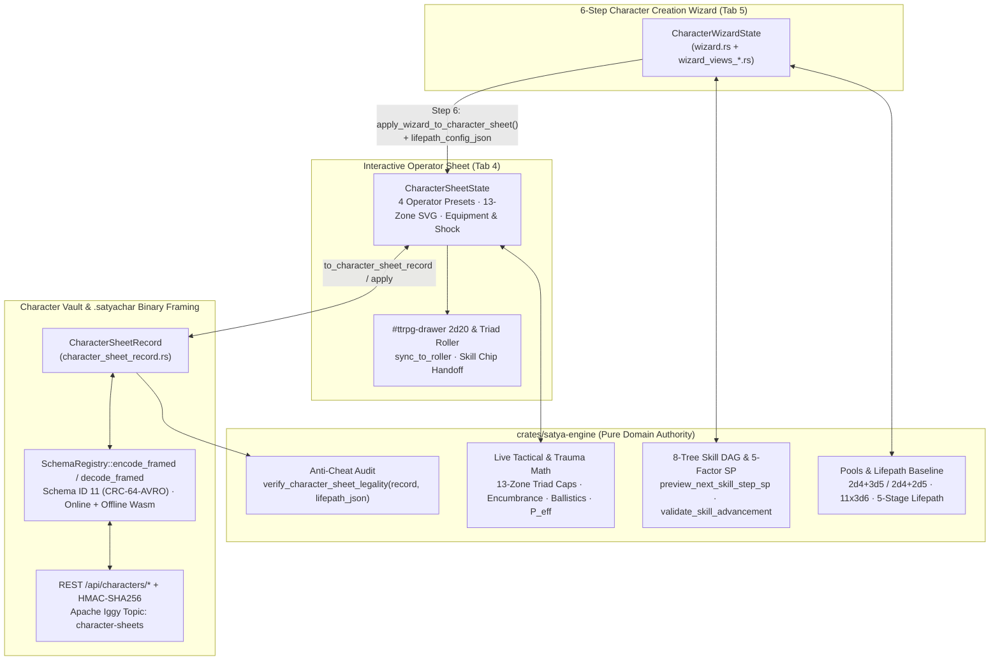
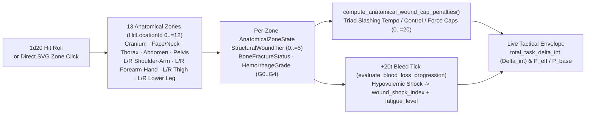

# Satya Web Client — 6-Step Character Wizard, 13-Zone Sheet & `.satyachar` Vault

This document specifies the client-side character lifecycle subsystem in `crates/satya-web/src/wasm_client/`: the 6-step Character Creation Wizard (`wizard.rs`, `wizard_views_stats.rs`, `wizard_views_lifepath.rs`, `wizard_views_skills.rs`), the interactive 13-zone anatomical Operator Character Sheet (`character_sheet.rs`, `character_sheet_views.rs`, `character_sheet_equip_views.rs`, `character_sheet_status_views.rs`), and the cryptographically verified `.satyachar` Avro Vault (`character_sheet_record.rs`, `character_sheet_vault.rs`).

---

## 1. Architectural Overview & Zero-Duplication Engine Boundary

A strict invariant of `satya-web` is **zero duplicated TTRPG math in UI modules**: every characteristic pool generator, lifepath `[Access]` gate, 5-factor skill point (`SP`) ledger, encumbrance tier, ballistic penetration curve, 13-zone wound cap penalty (`Triad<i32>`), and anti-cheat legality audit delegates directly to pure Rust functions in `crates/satya-engine` and framed Avro codecs in `crates/satya-schema`.



| Module | Primary Responsibilities |
| :--- | :--- |
| `wasm_client/wizard.rs` | `CharacterWizardState` (`steps 1..=6`), pool RNG & slot swapping (`assign_or_swap_slot`), `try_adjust_skill` floor/cap/DAG validator, `recompute_derived` KPIs, and `apply_wizard_to_character_sheet` handoff. |
| `wasm_client/wizard_views_stats.rs` | Step 1 (4 scaled characteristic pools + `HGT`/`MAS`), Step 2 (7 bipolar `PsychePole` controls), and Step 3 (`11×3d6` drop-2 Domain Aptitude pool) HTML view renderers. |
| `wasm_client/wizard_views_lifepath.rs` | Step 4 Chronological 5-Stage Lifepath editor (Origin, Elementary, Jr High + Age-15 Dropout Crisis, dynamic `4A`/`4B`/`4C` `[Access]` branches, `0..=4` Career Terms + `adult_ged_waiver`). |
| `wasm_client/wizard_views_skills.rs` | Step 5 8-Tree Hierarchical Skill Builder (`89` skills), Formal vs Experience `SP` dual progress meters, live 5-factor next-step `SP` preview badges, and Step 6 12-KPI Dossier Summary. |
| `wasm_client/character_sheet.rs` | `CharacterSheetState`, 4 canonical presets (`sara_valkyrie`, `mateo_vance`, `priya_nair`, `amara_okafor`), 13-zone anatomical trauma state, `total_task_delta_int` ($\Delta_{\text{int}}$), live `P_eff`, and `2d20` roller sync. |
| `wasm_client/character_sheet_views.rs` | Primary Tab 4 layout orchestrator, preset switcher, characteristic/aptitude matrices, 89-skill clickable chip directory, and derived tactical KPI bar. |
| `wasm_client/character_sheet_equip_views.rs` | Shared `satya-engine` firearm, melee, armor, and field-gear catalog selectors, granular ballistics readout, and live `Tiers 0–4` encumbrance bar. |
| `wasm_client/character_sheet_status_views.rs` | Interactive `1d20` → 13-zone SVG Hit-Location Silhouette (`format_human_hit_location_svg`), fracture/wound/bleed selectors, `+20t` bleed shock button, fatigue/exertion rollover, morale/mental/social trauma, and Conviction Surge toggle. |
| `wasm_client/character_sheet_record.rs` | Bidirectional lossless conversion (`to_character_sheet_record` / `apply_character_sheet_record`) between UI `CharacterSheetState` and Avro `CharacterSheetRecord` (`satya-schema`). |
| `wasm_client/character_sheet_vault.rs` | Cloud Vault CRUD (`POST/GET /api/characters`), HMAC-SHA256 anti-cheat badges, `.satyachar` binary export/import (online REST + offline Wasm `SchemaRegistry` fallback), session binding, and multimodal assets (`PORTRAIT_IMAGE`, `TACTICAL_TOKEN`, `DOSSIER_PDF`, `MODEL_3D_GLB`). |

---

## 2. 6-Step Character Creation Wizard (`wizard.rs` + `wizard_views_*.rs`)

`CharacterWizardState` models character generation as a deterministic, inspectable pipeline across Steps `1..=6`. Users can step forward/backward freely via `#wiz-step-tabs` without losing rolled pools or partial allocations; upstream mutations automatically clamp or re-validate downstream skill ranks.

### 2.1 Step 1 — 21 Core Characteristics & Scaled Pool Generation (`wizard_views_stats.rs`)

Satya's 21 core characteristics (`1..=20`, human mean `10.5`) partition into **four scaled pools** plus **two anthropometric traits** (`HGT`, `MAS`):

- **Pool Partitioning**: `Physical` (**6** traits: `STR`, `END`, `AGI`, `FOR`, `REA`, `DEX`), `Mental` (**6** traits: `LOG`, `MEM`, `FOC`, `WIL`, `CRE`, `INS`), `Sensory` (**6** traits: `VIS`, `AUD`, `OLF`, `TAC`, `PRO`, `VES`), and `Social` (**3** traits: `CHA`, `EMP`, `COM`).
- **Dual Roll Methods (`CharacteristicRollMethod`)**:
  - **`Method1DropLowestD5` (`2d4 + 3d5`, drop lowest `1d5`)**: Rolls exact slot count ($N \in \{6, 6, 6, 3\}$) with higher per-die floor and lower variance (`4..=18` typical).
  - **`Method2PoolKeepHighest` (`2d4 + 2d5`, extra-roll pool)**: Rolls extra pool dice ($N + 1$ for 6-stat pools; $N + 1$ for 3-stat Social) and drops the lowest roll(s), rewarding tactical specialization.
- **Non-Destructive Slot Assignment (`assign_or_swap_slot`)**: Clicking a rolled value chip and clicking a target characteristic either fills an empty slot or **swaps** pool indices (`Option<usize>`) in-place without clobbering sibling assignments.
- **Correlated vs Manual Anthropometrics (`HGT` & `MAS`)**: By default (`height_mass_manual_override == false`), `roll_correlated_height_mass` / `compute_correlated_height_mass` couples Height (`cm` → `1..=20` scalar) and Body Mass (`kg` → `1..=20` scalar) statistically to Frame/Fortitude (`FOR`) and Strength (`STR`). Enabling manual override unlocks direct `1..=20` sliders while recording the non-rolled customization flag for Vault verification.

### 2.2 Step 2 — 7 Bipolar Psyche Traits (`PsychePole`)

Models psychological disposition across **7 bipolar axes** (`1..=20`, neutral `10`): Egoism/Altruism (`EGO`), Impulsivity/Self-Discipline (`SLF`), Dogmatism/Openness (`OPN`), Cynicism/Belonging (`BLG`), Introversion/Extraversion (`EXT`), Caution/Confidence (`CNF`), and Pacifism/Aggression (`AGG`). Three allocation modes are supported:

1. **`"CHOOSE"` (Free Narrative Sliders)**: Direct `1..=20` slider placement with zero point-buy tax.
2. **`"ROLL_DIRECT"`**: Rolls `2d4 + 2d5` sequentially down all 7 axes in locked order.
3. **`"ROLL_POOL"`**: Rolls a 7-value `2d4 + 2d5` pool (`psyche_pool`) assigned via `psyche_slots` swap chips.

Psyche extremes directly feed `satya-engine` Composure (`CMP`), Acute Stress Resistance, and AI Player persona synthesis.

### 2.3 Step 3 — 9 Domain Aptitudes (`11 × 3d6` Drop-2 Pool)

`roll_aptitude_pool_11_drop_2` rolls **eleven `3d6` sums**, converts each sum through Satya's bell-curve modifier table into an integer aptitude tier in **`-2..=+3`**, drops the **2 lowest** rolls (`dropped: bool`), and exposes the **9 kept modifiers** for assignment across `AptitudeCode::ALL` (`Combat`, `Physical`, `Technical`, `Academic`, `Medical`, `Social`, `Subterfuge`, `Tactical`, `Survival`). Positive aptitudes discount Step 5 skill `SP` costs; negative aptitudes impose steep learning multipliers.

### 2.4 Step 4 — Chronological 5-Stage Lifepath (`wizard_views_lifepath.rs`)

`LifepathBuildConfig` drives `satya_engine::compute_lifepath_baseline_from_config(&lifepath, &characteristics)`, tracing an operator from birth to active deployment:

| Stage | Age Window | Mechanics, Crises & `[Access]` Tag Outputs |
| :--- | :---: | :--- |
| **1. Socioeconomic Origin** | `0–5` | `2d20` origin roll (`origin_roll_2d20`, `2..=40`) setting starting Living Standard (`SQM`), baseline linguistic exposure, and early childhood resilience. |
| **2. Elementary School** | `6–11` | Foundational literacy/numeracy (`baseline_skills` rank seeds) plus childhood curiosity domain focus. |
| **3. Junior High & Age-15 Crisis** | `12–15` | Evaluates the **Age-15 Dropout Crisis**: determines whether the youth retains institutional academic standing or is forced out of formal schooling (`dropped_out_at_15`). |
| **4. Adolescent Branch (`4A`/`4B`/`4C`)** | `15–18` | Dynamic branch unlocked by Stage 3: **`4A` `HighSchoolTrack`** (Vocational / Academic / Prep — preserves Academic tree), **`4B` `StreetGangArchetype`** (Enforcer / Runner / Crew Tech — grants illicit `[Access]` tags, sets `academic_tree_frozen = true`), or **`4C` `RuralYouthArchetype`** (Frontier / Homestead / Militia — grants survival/mechanical `[Access]` tags). |
| **5. Adult Career Terms (`0..=4`)** | `18+` (`4 yr`/term) | Up to 4 sequential `CareerTermConfig` tours (Military, Law Enforcement, Corporate Intelligence, Medical/ Trauma, Criminal Syndicate, Frontier Contractor) accumulating Formal `[FOC+INS]` and Experience `[INS]` `SP`, aging fatigue, Operational Heat, and optional **`adult_ged_waiver`** (`SP` fee to unfreeze `academic_tree_frozen`). |

### 2.5 Step 5 — 8-Tree Hierarchical Skill Builder & 5-Factor `SP` Ledger (`wizard_views_skills.rs`)

Satya organizes **89 canonical skills** (`CANONICAL_SKILL_TREES`) into **8 3-tier Directed Acyclic Graphs (DAGs)**: Tier 1 Broad Foundations → Tier 2 Operational Disciplines → Tier 3 Elite Specializations.

- **Dual `SP` Pool Ledger (`compute_skill_allocation_sp_ledger`)**:
  - **Formal Pool (`[FOC + INS]`)**: Earned through institutional education (`4A`), academies, and formal career schooling; can fund Academic, Medical, and restricted technical doctrines.
  - **Experience Pool (`[INS]`)**: Earned through street/field terms (`4B`, `4C`, operational tours); funds fieldcraft, combat, and practical skills (`formal_sp_spent <= formal_sp_budget` and total `sp_spent <= formal_sp_budget + experience_sp_budget`).
- **5-Factor Next-Step `SP` Cost (`preview_next_skill_step_sp`)**: Every `+` button displays the exact marginal `SP` cost to raise skill $s$ from rank $r \to r + 1$:

$$\text{Cost}_{\text{SP}}(s, r \to r+1) = \text{round}\!\left(\text{Base}(r+1) \times M_{\text{Diff}}(s) \times M_{\text{Ctrl}}(s) \times M_{\text{Apt}}(\text{apt}_s) \times M_{\text{Train}}(\text{mode}_s)\right)$$

  combining progressive rank step base cost, intrinsic skill complexity (`Difficulty`), sensorimotor/cognitive control demand (`Control`), assigned Step 3 Domain Aptitude (`-2..=+3`), and Institutional vs Self-Taught training mode.
- **4-Gate `try_adjust_skill` Validator (`satya_wizard_adjust_skill`)**:
  1. **Childhood Floor**: Rejects `-` decrements below `baseline.baseline_skills[id]` earned in Stages 1–4.
  2. **Post-School Gain Cap**: Rejects `+` increments exceeding `baseline_rank + baseline.max_post_school_gain_per_skill` (determined by total career terms).
  3. **DAG Prerequisite & `[Access]` Gate (`validate_skill_advancement`)**: Verifies parent Tier-1/Tier-2 rank minimums, `SkillAccessTier` tags unlocked by Step 4 careers, and `academic_tree_frozen` status (unless `adult_ged_waiver` is active).
  4. **Dual-Ledger Budget Check**: Ensures `compute_skill_allocation_sp_ledger` reports zero budget deficit before committing the rank mutation.

### 2.6 Step 6 — 12 Derived Telemetry KPIs & Lossless Sheet Handoff

`recompute_derived()` calls `satya-engine` to populate **12 real-time bio-mechanical KPIs** reviewed in Step 6: `OODA` Initiative Bonus, Cognitive Bandwidth (`D_cog` max simultaneous complex actions), Fatigue Threshold (`FT`), Wound Shock Resistance (`WSR`), Melee Strike Power (`POW`), Psychological Composure (`CMP`), Living Standard (`SQM`), Operational Heat, Chronological Age, Base Action Pool (`P_base`), Total `SP` Invested, and Encumbrance Baseline (`FOR + STR`).

Clicking **Deploy to Active Sheet** invokes `apply_wizard_to_character_sheet(&mut AppState)`, copying all 21 characteristics, 7 psyche traits, 9 aptitudes, 89 skill ranks, derived KPIs, and serializing **`lifepath_config_json = serde_json::to_string(&st.wizard.lifepath)`** onto `CharacterSheetState` so downstream server anti-cheat verification can replay the exact Lifepath + `SP` ledger deterministically.

---

## 3. Interactive Operator Character Sheet (`character_sheet*.rs`)

### 3.1 Canonical Presets, Shared Equipment Catalogs & Granular Encumbrance

Tab 4 (`#character-sheet-root`) initializes with **4 ready-to-play canonical operators** (`sara_valkyrie` — Breacher/Assault, `mateo_vance` — Recon Marksman, `priya_nair` — Combat Medic / Trauma Tech, `amara_okafor` — Intelligence / Comms Specialist) alongside `"custom_wizard"`.

Equipment selection in `character_sheet_equip_views.rs` binds directly to `satya-engine` catalogs with zero hardcoded UI tables:

- **Firearms & Ballistics (`CANONICAL_FIREARM_PRESETS`)**: Exposes `GranularFirearmSpec` barrel length, cartridge impulse, muzzle energy, armor-piercing rating, sight optic magnification, and range-band penetration/dispersion curves (`10 m`, `50 m`, `150 m`, `300 m+`).
- **Melee, Armor & Field Gear**: Binds `MELEE_WEAPON_CATALOG` (`MeleeWeaponId`, reach, `mass_kg`, cleave/parry triad modifiers), `ARMOR_CATALOG` (`ArmorProfileId`, regional ballistic `NIJ`/composite ratings, powered `exo_load_offset_kg`), and `CANONICAL_FIELD_GEAR_PRESETS` (trauma kits, comms rigs, breach charges, magazines).
- **5-Tier Encumbrance (`evaluate_encumbrance_load`)**: Sums weapon, armor (net of exoskeleton offset), and carried gear mass in `kg` against body mass and `STR`/`FOR` load capacity to classify **`Tiers 0–4`** (*Unencumbered*, *Light Tactical*, *Standard Combat*, *Heavy March*, *Overloaded*), applying exact movement speed multipliers, exertion mark multipliers, and `Tempo` cap reductions.

### 3.2 Interactive `1d20` → 13-Zone SVG Hit-Location Silhouette & Trauma Engine



`character_sheet_status_views.rs` renders an interactive two-column clinical monitor:

1. **13-Zone Anatomical SVG Silhouette (`format_human_hit_location_svg`)**: Maps `HitLocationId` (`0..=12`, matching Satya's `1d20` hit-location table: Head/Cranium, Face/Neck, Upper Thorax, Abdomen, Pelvis/Vitals, Left/Right Upper Arm, Left/Right Forearm/Hand, Left/Right Thigh, Left/Right Lower Leg/Foot) to clickable `<path>`/`<rect>` SVG regions color-coded dynamically (`Slate` intact → `Amber` lacerated → `Orange` fractured/dislocated → `Crimson` critical Tier 4–5 / severe `G3–G4` arterial bleed). Users can either click any body region or press **Roll `1d20` Hit Location** (`satya_charsheet_roll_hit_location`).
2. **Per-Zone Clinical Controls (`AnatomicalZoneState`)**:
   - `StructuralWoundTier` (`0` Uninjured .. `5` Catastrophic Destruction)
   - `BoneFractureStatus` (`Intact`, `HairlineFracture`, `DislocatedJoint`, `CompleteFracture`, `CompoundShattered`)
   - `HemorrhageGrade` (`G0` None, `G1` Capillary/Minor, `G2` Venous Steady, `G3` Arterial Spurting, `G4` Exsanguinating)
   - Feeding all 13 zones into `compute_anatomical_wound_cap_penalties(&zones)` returns a **`Triad<i32>`** (`tempo`, `control`, `force` cap reductions in `0..=20`) — e.g., a shattered right forearm severely slashes `Control` and `Force` ceilings, whereas a fractured femur slashes `Tempo` mobility.
3. **Hypovolemic Shock (`+20t` Bleed Progression) & Exertion Rollover**:
   - Clicking **Advance `+20t` (`5.0s`) Bleed** runs `evaluate_blood_loss_progression`, integrating active `G1–G4` hemorrhage across all 13 zones over `20` combat ticks (`5.0 s`) to increment cumulative blood-loss volume, `wound_shock_index`, and systemic `fatigue_level`.
   - **Fatigue & Exertion Marks (`accumulate_exertion_marks`)**: High-effort combat maneuvers add Exertion Marks; whenever marks reach the operator's Fatigue Threshold (`FT`), marks wrap modulo `FT` and increment `fatigue_level` (`0..=6`).
4. **Morale, Acute Mental Trauma, Social Wounds & Conviction Surge**:
   - Tracks `MoraleState` (*Steady*, *Shaken*, *Wavring*, *Broken*), `AcuteMentalTraumaTier` (`None`, `T1` Startle/Tunnel Vision .. `T4` Dissociative Freeze), `SocialWoundKind` (betrayal, humiliation, command loss), and `PhysiologicalStatusCondition` flags (hypoxia, concussion, toxin, stun).
   - **Conviction Surge (`conviction_surge_active`)**: Spending a scarce Conviction point temporarily suppresses internal pain/trauma penalties by **`-6`** on $\Delta_{\text{int}}$ (clamped so internal relief cannot push net internal penalty below `-2` bonus equivalent) and grants **`+2` bonus Action Pool (`P_eff`)** for a decisive heroic turn.
5. **Sign-Safe $\Delta_{\text{int}}$ & `2d20` Roller Handoff**:
   - `total_task_delta_int()` strictly obeys Satya's sign convention (**$\Delta_{\text{int}} \ge 0$ is an internal penalty** raising the player's roll-over threshold or degrading effective skill; external $\Delta_{\text{ext}} / \Delta_{\text{tool}}$ stay separate in the roller).
   - `compute_live_tactical_envelope()` displays real-time `P_eff / P_base` and capped `[Tempo | Control | Force]` ceilings. Clicking any of the 89 skill chips (`satya_charsheet_roll_skill`) or **Sync to `2d20` Roller** (`sync_to_roller`) populates `#ttrpg-skill`, governing attribute, skill rank, and internal $\Delta_{\text{int}}$ directly into `#ttrpg-drawer`.

---

## 4. Character Vault, Anti-Cheat & `.satyachar` Binary Framing

### 4.1 Record Mapping & Three-Tier Legality / HMAC-SHA256 Verification

`character_sheet_record.rs` converts bidirectionally (`to_character_sheet_record` / `apply_character_sheet_record`) between `CharacterSheetState` and `satya_schema::CharacterSheetRecord`, bundling identity (`character_id`, `owner_user_id`, `version`), all stats/psyche/aptitudes/skills, 13-zone trauma JSON, equipment IDs, `lifepath_config_json`, and `server_hmac_signature`.

Both the Wasm client (offline preview) and `satya-signaling` (authoritative gate) evaluate `satya_engine::verify_character_sheet_legality` combined with server-keyed **HMAC-SHA256** (`SATYA_VAULT_HMAC_SECRET`) to assign one of three `CharacterVerificationStatus` badges:

| Status Badge | Cryptographic & Rules Criteria |
| :--- | :--- |
| **`VerifiedOfficial`** | Server HMAC-SHA256 signature is valid **and** `verify_character_sheet_legality` confirms all characteristic bounds, Lifepath `[Access]` prerequisites, post-school skill gain caps, and dual Formal/Experience `SP` budgets have zero deficit (`height_mass_manual == false`, rolled pools intact). |
| **`LegalCustom`** | Point/budget math, DAG prerequisites, and `[Access]` gates pass `verify_character_sheet_legality`, or custom narrative overrides (`height_mass_manual_override`, offline local edits) are present without exceeding ruleset caps, prior to official GM/server signing. |
| **`TamperedOrOverBudget`** | Invalid/forged `server_hmac_signature`, characteristic $> 20$, skill rank exceeding career gain cap, unmet DAG/`[Access]` prerequisite, or negative Formal/Experience `SP` ledger balance. Flagged visibly to the table GM upon session bind! |

### 4.2 `.satyachar` Framed Avro Binary Wire Format (Online & Offline Wasm)

Exported `.satyachar` files are compact, schema-evolution-safe binary containers encoded via `satya_schema::SchemaRegistry` (`subjects::CHARACTER_SHEET`, **Schema ID `11`**):

```text
+----------------+--------------------+------------------------+-------------------------+
| Magic (0xC301) | Schema ID (u32 LE) | CRC-64-AVRO (8 Bytes)  | Raw Apache Avro Payload |
|    2 Bytes     |   11 (0x0B000000)  |  Parsing Canonical FP  |  CharacterSheetEvent    |
+----------------+--------------------+------------------------+-------------------------+
```

- **Online Export & Import**: `satya_vault_export_binary` fetches `GET /api/characters/{id}/export` (server-signed `.satyachar` bytes) and invokes Chromium's native `window.showSaveFilePicker` (`suggestedName: "<callsign>.satyachar"`) when available, falling back cleanly to `<a download>` Blob URL dispatch. `satya_vault_import_binary_b64` posts uploaded `.satyachar` bytes to `POST /api/characters/import`.
- **Offline Wasm Fallback (`SchemaRegistry::new_with_builtin_schemas`)**: If the user is offline or unauthenticated, `character_sheet_vault.rs` instantiates `SchemaRegistry::new_with_builtin_schemas()` directly inside WebAssembly to call `encode_framed(subjects::CHARACTER_SHEET, &event)` and `decode_framed::<CharacterSheetEvent>(&bytes)` locally with full CRC-64-AVRO fingerprint validation and local `verify_character_sheet_legality` inspection.

### 4.3 REST Endpoints, Multimodal Assets & Apache Iggy `character-sheets` Stream

| Method & Endpoint | Request / Response & Side Effects |
| :--- | :--- |
| `GET /api/characters` | Lists the authenticated user's saved `CharacterSheetRecord` summaries and verification badges. |
| `POST /api/characters` | Upserts a `CharacterSheetRecord`, computes legality + server `HMAC-SHA256`, increments `version`, and appends `CHARACTER_CREATED` / `CHARACTER_UPDATED` to Apache Iggy. |
| `GET /api/characters/{id}/export` | Streams server-signed framed Avro `.satyachar` binary (`application/octet-stream`), logging `CHARACTER_EXPORTED`. |
| `POST /api/characters/import` | Decodes framed `.satyachar` bytes, audits HMAC & `verify_character_sheet_legality`, stores in Vault, and emits `CHARACTER_IMPORTED`. |
| `POST /api/characters/{id}/bind-session` | Binds the operator sheet to an active session (`session_id`), broadcasting live callsign, verification status, and tactical telemetry to the GM roster (`CHARACTER_BOUND_TO_SESSION`). |
| `POST/GET /api/characters/{id}/assets` | Uploads or retrieves multimodal binary attachments (`CharacterAssetKind`: `PORTRAIT_IMAGE`, `TACTICAL_TOKEN`, `DOSSIER_PDF`, `MODEL_3D_GLB`), emitting `CHARACTER_ASSET_UPLOADED` and auto-hydrating `MODEL_3D_GLB` into the WebGPU 3D stage (`set_custom_glb_asset`). |

Every Vault mutation emits a framed `CharacterSheetEvent` (`schemas/v1/character_sheet.avsc`) onto the **`character-sheets`** topic in Apache Iggy (`crates/satya-storage`), preserving a complete, replayable version history of operator progression and trauma across campaigns.

---

## 5. `window.satya_*` Callback Surface & Offline Test Matrix

All DOM interactions across Tab 4 (`#character-sheet-root`) and Tab 5 (`#wizard-root`) bind through `bind_window_callbacks!` in `wasm_client/mod.rs` using typed closures over `APP_STATE`:

| Callback Prefix | Representative `window.*` Bindings | Architectural Role |
| :--- | :--- | :--- |
| `satya_wizard_*` | `satya_wizard_set_step`, `satya_wizard_roll_pool`, `satya_wizard_select_slot`, `satya_wizard_set_lifepath_field`, `satya_wizard_adjust_skill`, `satya_wizard_apply_to_sheet` | Drives Steps `1..=6` state transitions, non-destructive pool swapping, 5-factor `SP` DAG checks, and `lifepath_config_json` handoff to Tab 4. |
| `satya_charsheet_*` | `satya_charsheet_load_preset`, `satya_charsheet_roll_hit_location`, `satya_charsheet_select_hit_zone`, `satya_charsheet_set_zone_trauma`, `satya_charsheet_advance_bleed_20t`, `satya_charsheet_roll_skill`, `satya_charsheet_sync_roller` | Updates 13-zone SVG trauma, advances `+20t` (`5.0 s`) hypovolemic shock, toggles Conviction Surge, recalculates `P_eff` & `Triad<i32>` caps, and populates `#ttrpg-drawer`. |
| `satya_vault_*` | `satya_vault_save`, `satya_vault_refresh_list`, `satya_vault_load_record`, `satya_vault_export_binary`, `satya_vault_import_binary_b64`, `satya_vault_bind_session`, `satya_vault_upload_asset_b64` | Executes online REST Vault CRUD, offline Wasm `SchemaRegistry` `.satyachar` framing, session roster binding, and `MODEL_3D_GLB` / portrait asset hydration. |

### Offline Verification (`cargo test --offline -p satya-web`)

- **Wizard Pool & Slot-Swap Determinism**: Verifies `Method1DropLowestD5` vs `Method2PoolKeepHighest` pool sizes, `assign_or_swap_slot` index bijectivity, `11 × 3d6` drop-2 sorting, and `try_adjust_skill` enforcement of Stage 1–4 `baseline_skills` floors, `academic_tree_frozen` locks, `adult_ged_waiver` overrides, and dual Formal/Experience `SP` caps.
- **13-Zone Trauma & Sign-Convention Invariants**: Verifies `format_human_hit_location_svg` renders all 13 `data-zone-id` regions, `compute_anatomical_wound_cap_penalties` slashes `Triad<i32>` ceilings monotonically with fracture/bleed severity, Conviction Surge clamps internal $\Delta_{\text{int}}$ relief cleanly, and `total_task_delta_int` preserves $\Delta_{\text{int}} \ge 0$ penalty semantics.
- **`.satyachar` Round-Trip & Tamper Detection**: Asserts `to_character_sheet_record` → `SchemaRegistry::encode_framed` (Schema ID `11`) → `decode_framed` → `apply_character_sheet_record` preserves all 21 characteristics, 89 skills, 13 trauma zones, equipment IDs, and `lifepath_config_json`, and confirms `verify_character_sheet_legality` flags over-budget skill injections as `TamperedOrOverBudget`.

