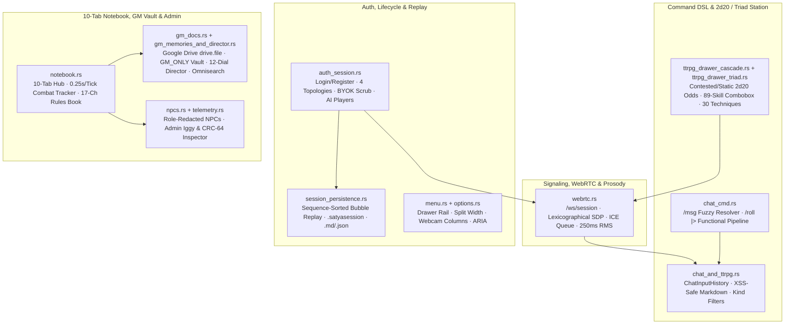
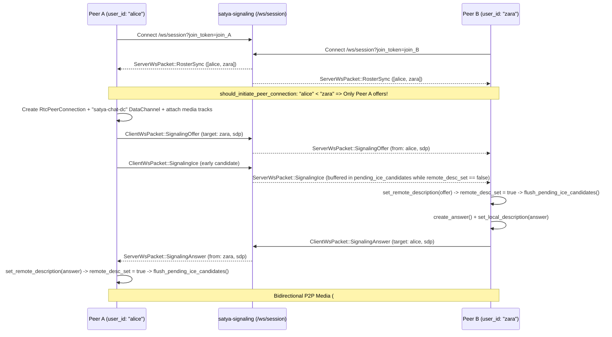

# Satya Web Client — Session Persistence, WebRTC Mesh, `2d20` Roller & GM Vault

This document specifies the multiplayer session, media, command-DSL, tactical roller, and Game Master (GM) campaign management subsystems in `crates/satya-web`: authentication and deterministic session replay (`auth_session.rs`, `session_persistence.rs`, `menu.rs`, `options.rs`), WebSocket signaling and P2P WebRTC mesh with RMS prosody telemetry (`webrtc.rs`), the `/msg` and `/roll` `|>` functional DSL plus `2d20` Cascade/Triad drawer (`chat_cmd.rs`, `chat_and_ttrpg.rs`, `ttrpg_drawer_cascade.rs`, `ttrpg_drawer_triad.rs`), and the 10-tab Notebook Hub, Google Drive `GM_ONLY` Vault, 12-dial Scenario Director, role-redacted NPC roster, and Admin Apache Iggy inspector (`notebook.rs`, `gm_docs.rs`, `gm_memories_and_director.rs`, `npcs.rs`, `telemetry.rs`).

---

## 1. Auth, Session Topologies & Deterministic History Replay

### 1.1 Subsystem Module Map & Data-Flow Overview



| Module | Primary Responsibilities |
| :--- | :--- |
| `wasm_client/auth_session.rs` | Account auth (`satya_tok_*`), 4 session topologies, boot auto-restore (`GET /api/auth/me` + `POST /api/sessions/resume`), pure `format_roster_and_recipients_html`, immediate BYOK key scrubbing, and AI Player spawn/step controls. |
| `wasm_client/session_persistence.rs` | `merge_history_events_by_sequence`, `replay_session_history_snapshot` (bubble-only mechanics replay without 3D dice re-rolls), `.satyasession` bundle export/import, and `.md`/`.json` transcript downloads. |
| `wasm_client/menu.rs` & `options.rs` | Top bar controls, collapsible/floating center drawer ARIA sync (`sync_drawer_rail_and_aria`), resizable notebook split (`25%..=75%`), and `1..=2` webcam column layout. |
| `wasm_client/webrtc.rs` | `/ws/session` lifecycle, `ROSTER_SYNC`, deterministic `self_user_id < remote_user_id` SDP offer tie-breaking (`renegotiate` override), `pending_ice_candidates` queue, `#video-tile-{uid}`, `satya-chat-dc`, and `250 ms` WebAudio RMS prosody. |
| `chat_cmd.rs` (root shared) | Pure host+Wasm `/msg` (`/w`, `/whisper`) multi-recipient resolver and `/roll` (`/r`) `\|>` functional pipeline parser/evaluator (`MAX_EXPLOSIONS = 100`). |
| `wasm_client/chat_and_ttrpg.rs` | `ChatInputHistory` (`ArrowUp`/`ArrowDown`), `render_rules_markdown_to_html` sanitized chat bubbles, `data-msg-kind` filters, and WebSocket packet dispatch. |
| `wasm_client/ttrpg_drawer_cascade.rs` | Searchable 89-skill combobox, Contested ($\text{TN}_P, \text{TN}_{\text{GM}}$) vs Uncontested ($\text{TN}_{\text{eff}}$) `2d20` Cascade exact 400-state odds preview, and roll submission. |
| `wasm_client/ttrpg_drawer_triad.rs` | 30-technique `Tempo / Control / Force` Triad dice allocator enforcing live $P_{\text{eff}}$ and `Triad<i32>` trauma caps (`1 Tick = 0.25s`). |
| `wasm_client/notebook.rs` | 10-tab `NOTEBOOK_TABS` switcher, Count-Up Tick Combat Tracker (`POST /api/sessions/:id/combat`), and 17-chapter offline Rules Book search/reader. |
| `wasm_client/gm_docs.rs` | Dynamic Google Identity Services + Picker (`drive.file` scope), `GM_ONLY` Document Vault (`safety_flagged`, `is_persistent`), and 6-source Omnisearch (`GET /api/sessions/:id/lookup`). |
| `wasm_client/gm_memories_and_director.rs` | GM Memories CRUD (`GET/POST/DELETE /api/sessions/:id/memories`) and 12-dial `SCENARIO_DIRECTOR_DIAL_SPECS` (`mem-scenario-director` + `localStorage` fallback). |
| `wasm_client/npcs.rs` & `telemetry.rs` | Role-aware NPC secret redaction (`can_viewer_see_npc_secrets`) and `AccountRole::Admin` Apache Iggy WAL / Avro CRC-64 fingerprint inspector. |

### 1.2 Four Session Topologies & Two-Tier Token Architecture (`auth_session.rs`)

`satya-web` supports **four first-class multiplayer and AI session topologies**, configured at creation (`POST /api/sessions`) and persisted across browser reloads:

| Session Mode | Human GM | AI GM Agent | Workspace & Routing Semantics |
| :--- | :---: | :---: | :--- |
| **`MEETING`** | None (`HOST`) | Disabled | Clean video-conferencing and collaborative notebook layout; hides TTRPG dice/trauma drawers unless opened manually. |
| **`TTRPG`** | `GM` Seat | Disabled | Classic human-led Satya TTRPG table with full `2d20` Cascade/Triad roller, `GM_ONLY` Document Vault, NPC secrets, and Combat Tracker. |
| **`TTRPG_GM_AI`** | `GM` Seat | **Co-Pilot** | Human GM retains full table authority while invoking the LangGraph AI GM (`@gm` / whisper co-pilot) for rules lookups, NPC dialogue drafts, and pacing cues. |
| **`TTRPG_AI_GM`** | None (`HOST`) | **Autonomous GM** | Solo or co-op player party run autonomously by the LangGraph AI GM (`src/satya_ml/ai_gm/`), auto-adjudicating actions, rolls, NPCs, and scene transitions. |

Authentication separates long-lived account identity from ephemeral room admission via **two distinct bearer tokens**:

1. **Account Session Token (`satya_tok_<uuid>`)**: Issued by `POST /api/auth/register`, `POST /api/auth/login`, or `POST /api/auth/google`; stored in `localStorage["satya.auth.token"]` (`STORAGE_KEY_AUTH_TOKEN`) and sent via `Authorization: Bearer satya_tok_...` on authenticated REST calls.
2. **Scoped Room Join Token (`join_<uuid>`)**: Issued by `POST /api/sessions`, `POST /api/sessions/join`, or `POST /api/sessions/resume`; persisted inside `PersistedActiveSessionRef` (`localStorage["satya.session.active"]`) alongside `session_id`, `invite_code`, `role`, and `session_mode`. Used exclusively to authenticate `/ws/session?join_token=join_...`.

### 1.3 Boot Auto-Restore, Roster Rendering & Sequence-Sorted Bubble-Only Replay (`session_persistence.rs`)

On Wasm startup, `restore_saved_auth_and_session()` executes a two-phase non-blocking recovery:

1. **Account Verification**: Reads `satya.auth.token` and calls `GET /api/auth/me`. If expired (`401`), clears stale storage cleanly; if valid, hydrates `AccountUserProfile` (including `AccountRole::Admin` visibility gates for the Apache Iggy tab).
2. **Active Room Resume**: If `satya.session.active` is present (and URL `?invite=` does not override it), posts `session_id` to `POST /api/sessions/resume`, receives a fresh `join_<uuid>` plus `SessionHistorySnapshot`, transitions `#lobby-overlay` → `#workspace-shell`, opens `/ws/session`, and invokes `replay_session_history_snapshot()`.

Key invariants of `session_persistence.rs`, `menu.rs`, and `options.rs`:

- **Pure Roster & Recipient Chip Builder (`format_roster_and_recipients_html`)**: Deterministically renders participant role badges (`GM`, `HOST`, `PLAYER`, `SPECTATOR`, `AI_PLAYER`) and updates `#chat-recipient` whisper `<option>` handles while preserving the user's active recipient selection across `ROSTER_SYNC` updates.
- **Sequence-Sorted Merge (`merge_history_events_by_sequence`)**: Combines `ChatMessageEvent` (`PUBLIC`, `PRIVATE`, `AI_GM`, `SYSTEM`) and `MechanicsEvent` (`DICE_ROLL`, `CASCADE_2D20`, `TRIAD_ACTION`) into a unified `Vec<HistoryReplayItem>` sorted strictly by authoritative `sequence_num: u64` (`stable sort`).
- **Bubble-Only Mechanics Replay (`render_mechanics_event_bubble_only`)**: Replaying historical `MechanicsEvent` records reconstructs rich chat outcome cards **without** re-triggering 3D WebGPU dice tray physics (`ServerWsPacket::WgpuDiceRoll`), preventing a storm of phantom dice rolls when refreshing mid-campaign! Simultaneously, `replay_session_history_snapshot` hydrates the active Tactical Map (`map_state_json`), Count-Up Combat Tracker (`combat_state_json`), and bound operator sheet.
- **Portable Archives & Transcripts**:
  - **`.satyasession` Bundle**: `GET /api/sessions/:id/export` and `POST /api/sessions/import` serialize/restore a complete `SessionSnapshotBundle` (metadata, ordered chat/mechanics log, GM docs, memories, NPCs, combat, and map state) for offline campaign backup or server migration.
  - **`.md` / `.json` Transcripts**: `GET /api/sessions/:id/transcript?format=md|json` downloads human-readable Markdown campaign logs or structured JSON datasets.
- **BYOK Immediate DOM Key Scrubbing & AI Players**:
  - When a user submits a Bring-Your-Own-Key Gemini/OpenAI credential (`POST /api/sessions/:id/ai-config`), `auth_session.rs` **immediately scrubs the `<input type="password" id="ai-gm-api-key-input">` value to `""`** in the DOM (`set_input_value(..., "")`) before `await`ing the network response and never writes API keys to `localStorage`.
  - **Autonomous AI Party Members**: Hosts/GMs can spawn AI-controlled operators into seats via `POST /api/sessions/:id/ai-players` and trigger tactical/roleplay turns on demand via `POST /api/sessions/:id/ai-players/step`.

---

## 2. WebSocket Signaling, P2P WebRTC Mesh & RMS Prosody (`webrtc.rs`)

### 2.1 Deterministic Offer Tie-Breaking & ICE Candidate Buffering

`webrtc.rs` manages full-mesh `RtcPeerConnection` links relayed over `/ws/session` without glare (simultaneous conflicting SDP offers) or early-ICE race conditions:



1. **Lexicographical Glare Prevention (`should_initiate_peer_connection`)**: On routine `ROSTER_SYNC` discovery (`renegotiate == false`), a client initiates `createOffer()` if and only if `self_user_id < remote_user_id` (and no `PeerEntry` exists yet). When a user actively enables their camera/microphone mid-call (`satya_start_camera`), `renegotiate == true` overrides the lexicographical gate so the newly-streaming peer immediately renegotiates outbound `MediaStreamTrack`s to every mesh neighbor.
2. **Pre-SDP ICE Candidate Queue (`PeerEntry::pending_ice_candidates`)**: Because trickle-ICE candidates frequently arrive over WebSocket before the async `setRemoteDescription` Promise resolves, each `PeerEntry` buffers incoming `(candidate, sdp_mid, sdp_m_line_index)` tuples while `remote_desc_set == false` and drains them in order via `flush_pending_ice_candidates(&pc, &mut list)` immediately upon `setRemoteDescription` completion.
3. **Media Tile Binding & Autoplay Recovery (`ontrack`)**: Remote tracks dynamically mount `<video id="video-tile-{uid}" autoplay playsinline>`. If browser autoplay policy blocks unmuted playback, the `play()` rejection handler automatically sets `video.muted = true` and retries playback so video frames never stall.
4. **DataChannel Telemetry (`satya-chat-dc`)**: Every initiator opens a labeled `RtcDataChannel` (`"satya-chat-dc"`); `onopen` and `onclose` emit `ClientWsPacket::Telemetry` (`DataChannelOpen` / `DataChannelClosed`) for mesh health auditing.

### 2.2 `250 ms` WebAudio `AnalyserNode` RMS Prosody Sampler & Workspace Drawers

To supply non-invasive vocal engagement dynamics (`InteractionDynamics`) to the AI GM and session analytics without transmitting raw audio to the server:

- **WebAudio Graph**: `start_prosody_rms_sampler` attaches the local `MediaStream` to an `AudioContext` → `MediaStreamAudioSourceNode` → `AnalyserNode` (`fft_size = 512`), storing handles in `AppState::prosody_audio_ctx` and `prosody_interval_id`.
- **Time-Domain RMS Calculation**: Every **`250 ms`**, the interval callback reads 8-bit unsigned PCM samples (`get_byte_time_domain_data`, centered at `128`), computes root-mean-square energy $\text{RMS} = \sqrt{\frac{1}{N}\sum_{i=0}^{N-1} \left(\frac{s_i - 128}{128}\right)^2}$, tracks voice-activity transitions (`rms > 0.025`), and periodically emits compact `ClientWsPacket::InteractionDynamics` scalars (`rms_energy`, `speaking_ratio`, `turn_transitions`). Stopping local media (`satya_stop_camera`) cleanly clears `prosody_interval_id` and closes `prosody_audio_ctx`.
- **Responsive Multi-Drawer Workspace (`menu.rs` / `options.rs`)**: Persists notebook split width (`STORAGE_KEY_NOTEBOOK_WIDTH_PCT`, clamped `25%..=75%`), `1..=2` webcam grid columns (`webcam_columns`), and `aria-expanded` collapsible/floating center drawers (`sync_drawer_rail_and_aria`, `sync_center_drawer_card`).

---

## 3. Chat Slash-DSL, Markdown & `2d20` Cascade / Triad Drawer

### 3.1 `/msg` Whisper Routing & `/roll` `|>` Functional Dice Pipeline (`chat_cmd.rs`)

`chat_cmd.rs` is a pure, zero-DOM parser/evaluator compiled into both SSR and Wasm targets:

```ebnf
command       = msg_cmd | roll_cmd | plain_chat ;
msg_cmd       = ( "/msg" | "/w" | "/whisper" ) , ws , target_list , ws , body ;
target_list   = "@broadcast" | "@all" | "@public" | handle , { "," , handle } ;
roll_cmd      = ( "/roll" | "/r" ) , ws , dice_source , { "|>" , ws , stage_op } ;
dice_source   = [ count ] , "d" , sides , [ "e" , [ "(" , threshold , ")" ] ] ;
stage_op      = ( "hi" , "(" , n , ")" ) | bare_int | ( "lo" , "(" , n , ")" )
              | "sum" | ( "gte" , "(" , n , ")" ) | ( "lte" , "(" , n , ")" ) ;
```

- **Fuzzy Multi-Target Whisper Resolver (`resolve_msg_recipients`)**: Resolves `@handle` tokens case-insensitively by exact ID, exact display name, or unambiguous prefix across the active roster, supporting comma-separated multi-target whispers (`/w @gm,@mateo Holding airlock!`) and `@broadcast` / `@all` public overrides.
- **`/roll` `|>` Functional Pipeline Semantics**:
  - **Bounds & Explosion Safety**: Validates `count` in `1..=100`, `sides` in `2..=1000`, and exploding dice `e` / `e(t)` (default threshold $t = \text{sides}$, requiring $t \ge 2$) capped strictly at **`MAX_EXPLOSIONS = 100`** extra dice per pool to prevent infinite loops.
  - **Polymorphic `RollValue` Stages (`List(Vec<i64>)` → `Scalar(i64)` → `Check { value, passed }`)**:
    - `hi(n)` (or bare integer shorthand `|> 2` meaning keep highest `2`) and `lo(n)` slice sorted pool outcomes while preserving original roll trace metadata.
    - `sum` folds `RollValue::List` into `RollValue::Scalar` (applied implicitly at end-of-pipeline when the final value is still a `List` and no check stage terminated it).
    - **Polymorphic `gte(n)` / `lte(n)`**: Applied to a `RollValue::List`, filters dice matching $\ge n$ / $\le n$ (success-counting pool); applied after `sum` to a `RollValue::Scalar`, evaluates a pass/fail `RollValue::Check` (`4d6 |> 3 |> sum |> gte(14)`).
- **Input Ergonomics & XSS-Safe Markdown (`chat_and_ttrpg.rs`)**:
  - `ChatInputHistory` provides shell-style `ArrowUp` / `ArrowDown` command recall (activating only on single-line inputs so multi-line Markdown drafts still navigate lines naturally) while preserving any uncommitted draft line.
  - Incoming chat and AI GM narratives render through `satya_engine::render_rules_markdown_to_html` (escaping raw `<`/`>`/`&` before formatting tables, fenced code blocks, callouts, and inline emphasis), filterable in real time via `data-msg-kind` (`ALL`, `PUBLIC`, `PRIVATE`, `AI_GM`, `MECHANICS`).

### 3.2 Contested vs Uncontested `2d20` Cascade Odds & 30-Technique Triad Allocator

`ttrpg_drawer_cascade.rs` and `ttrpg_drawer_triad.rs` power the `#ttrpg-drawer` action station:

1. **Exact Roll-Over `2d20` Cascade Mathematics (`format_contested_cascade_odds_summary`)**:
   - **Searchable 89-Skill Combobox (`#ttrpg-skill` + `#ttrpg-skill-dropdown`)**: Filters all 89 skills by name, tree, or governing attribute code, auto-filling the operator's rank and internal $\Delta_{\text{int}}$ when bound.
   - **Target Number Equations**: Given Skill Competence $C = \text{Attr} + \text{Skill} - \Delta_{\text{int}}$, equipment/situational modifier $\Delta_{\text{tool}}$, and external opposition/environment modifier $\Delta_{\text{ext}}$:
     - **Contested Check** (`is_contested == true`, `ContestedTieRule::HybridSignedMargin`):

$$\text{TN}_P = 31 - C + \Delta_{\text{tool}}, \qquad \text{TN}_{\text{GM}} = 21 - \Delta_{\text{ext}}$$

     - **Uncontested (Static) Check** (`is_contested == false`):

$$\text{TN}_{\text{eff}} = 31 - C + \Delta_{\text{tool}} + \Delta_{\text{ext}}$$

   - Evaluates exact $400$-state (`20 × 20`) discrete probability distributions (`CarryMode`, `BotchRule`) before rolling, displaying live Win %, Crit %, Mean Net Cascade Successes, and Botch % in `#ttrpg-odds-preview`.
2. **30-Technique `Tempo / Control / Force` Triad Allocator (`ttrpg_drawer_triad.rs`)**:
   - Binds all **30 canonical combat/tactical techniques** from `satya-engine` (`Snap Shot`, `Aimed Double-Tap`, `Suppressive Sweep`, `Riposte`, `Tactical Sprint`, `Trauma Clamp`, etc.).
   - Enforces live pool constraints $T + K + F \le P_{\text{eff}}$ and per-axis wound/encumbrance ceilings (`Triad<i32>`), converting `Tempo` dice directly into sub-second initiative cost at **`1 Tick = 0.25s`** (`SECONDS_PER_TICK = 0.25`, `20 Ticks = 5.0s` standard combat exchange).

---

## 4. 10-Tab Notebook Hub, GM Vault, Scenario Director, NPCs & Admin Inspector

### 4.1 10-Tab Notebook Architecture, Combat Tracker & 17-Chapter Rules Book (`notebook.rs`)

`NOTEBOOK_TABS` (`NOTEBOOK_TAB_SPECS`) coordinates 10 specialized right-hand workspace panels (`#notebook-panel-*`):

1. `maps` — 2D Canvas + 3D WebGPU Tactical Map & Fog-of-War (`02-tactical-map-2d-and-3d.md`)
2. `dice` — 3D WebGPU Polyhedral Dice Tray (`03-3d-dice-and-glb-stage.md`)
3. `model` — `.glb` Miniature Turntable & 4-Mode Shader Inspector (`03-3d-dice-and-glb-stage.md`)
4. `character` — 13-Zone Interactive Operator Sheet & Vault (`04-character-wizard-sheet-and-vault.md`)
5. `wizard` — 6-Step Lifepath & 8-Tree Skill Creation Wizard (`04-character-wizard-sheet-and-vault.md`)
6. `npcs` — Role-Aware NPC Roster & GM Secret Cards (`npcs.rs`)
7. `combat` — **Count-Up Tick Combat Tracker**: Continuous timeline (`tick = 0, 1, 2, ...` where **`1 Tick = 0.25s`**), sorting combatants by lowest `next_action_tick` (tie-broken by `OODA`), offering `+1t (0.25s)`, `+4t (1.0s)`, and `Next Actor` steppers synchronized across all clients via `POST /api/sessions/:id/combat`.
8. `rules` — **17-Chapter Embedded Rules Book**: Instant full-text search (`satya_engine::search_rules_book`) and rendered Markdown chapter reader (`satya_engine::rules_book_catalog`) available 100% offline inside Wasm.
9. `docs` — `GM_ONLY` Document Vault, Google Drive Picker, GM Memories, 12-Dial Scenario Director & 6-Source Omnisearch.
10. `iggy` — **Admin-Only (`AccountRole::Admin`)** Apache Iggy WAL & Avro Schema Registry Inspector.

### 4.2 Google Drive `drive.file` Vault, 12-Dial Scenario Director & 6-Source Omnisearch (`gm_docs.rs`, `gm_memories_and_director.rs`)

- **Least-Privilege Google Drive Integration**: Dynamically injects Google Identity Services (`accounts.google.com/gsi/client`, `initTokenClient`) and the Google Picker API (`apis.google.com/js/api.js`, `google.picker.PickerBuilder`) on demand using strictly the non-sensitive **`https://www.googleapis.com/auth/drive.file`** scope (zero broad Drive read access; only files explicitly chosen by the user in Picker or URL-parsed via `extract_google_drive_file_id_and_kind` are imported).
- **`GM_ONLY` Document Vault (`GET/POST /api/sessions/:id/docs`)**: Stores sanitized campaign lore, handouts, and encounter notes with visibility tiers (`GM_ONLY` vs `PLAYERS`), campaign persistence (`is_persistent`), and prompt-injection / content safety badges (`safety_flagged`).
- **GM Memories (`GET/POST/DELETE /api/sessions/:id/memories`) & 12-Dial Scenario Director**:
  - Persists structured AI/Human GM world facts, faction clocks, and plot threads.
  - **`SCENARIO_DIRECTOR_DIAL_SPECS` (`mem-scenario-director`)**: Exposes **12 `0..=10` campaign tone & adjudication dials** (*Lethality*, *Realism Strictness*, *Pacing Velocity*, *Clue Generosity*, *Moral Ambiguity*, *Horror/Dread*, *Tactical Complexity*, *Social Intrigue*, *Tech Scarcity*, *Consequence Persistence*, *Prose Conciseness*, *Improvisation Latitude*) plus 4 one-click genre presets (*Grounded Spec-Ops*, *Noir Conspiracy*, *Survival Horror*, *Cinematic High-Tempo*), saved to reserved memory ID `mem-scenario-director` (with `localStorage` offline fallback) and injected directly into the AI GM system prompt.
- **6-Source Omnisearch (`GET /api/sessions/:id/lookup`)**: Queries `RulesBook`, `GmDocument` (respecting `GM_ONLY` caller role), `GmMemory`, `CharacterSheet`, `CombatTracker`, and `TacticalMap` in a single ranked lookup, seamlessly falling back to local Wasm state search when offline.

### 4.3 Role-Aware NPC Secret Redaction (`npcs.rs`) & Admin Storage Inspector (`telemetry.rs`)

- **Two-Layer NPC Secret Redaction (`can_viewer_see_npc_secrets` / `viewer_can_see_npc_gm_secrets`)**:
  - Every NPC entry (`GET/POST /api/sessions/:id/npcs`) separates public fields (`name`, `faction`, `public_description`, `disposition`, visible portrait/tags) from sensitive GM fields (`gm_secret_agenda`, `hidden_stat_block`, `betrayal_trigger`, `true_allegiance`).
  - **Defense in Depth**: `satya-signaling` strips GM secret fields on the wire before serializing responses to non-GM participants, and `npcs.rs` (`format_npc_card_html`) enforces `can_viewer_see_npc_secrets(session_role, session_mode)` (`role == "GM"` or solo `HOST` configuration) in client rendering and authoring controls.
- **Admin-Only Apache Iggy & Avro CRC-64 Inspector (`telemetry.rs`)**:
  - Tab 10 (`iggy`) is hidden and server-gated (`403 Forbidden`) unless `profile.role == AccountRole::Admin`.
  - Queries `GET /api/storage/metrics` and `POST /api/storage/flush` to inspect live Apache Iggy WAL stream lag, buffered Parquet/Avro sink batch counts, active `satya-schema` subject versions (`IDs 1..=11`), and canonical **64-bit `CRC-64-AVRO`** schema fingerprints.

---

## 5. REST API, `/ws/session` Packet Protocol & Offline Verification

### 5.1 REST Endpoint Reference

| Endpoint | Method | Auth / Role Gate | Client Caller & Purpose |
| :--- | :---: | :--- | :--- |
| `/api/auth/register`, `/login`, `/google`, `/me` | `POST` / `GET` | Public / `satya_tok_*` | `auth_session.rs` — Account registration, Argon2id/Google OAuth sign-in, and boot token check (`GET /api/auth/google/status` checks OAuth readiness). |
| `/api/sessions`, `/join`, `/resume` | `POST` | `satya_tok_*` / Invite | `auth_session.rs` — Room creation (`MEETING`/`TTRPG`/`TTRPG_GM_AI`/`TTRPG_AI_GM`), invite entry, and reload auto-resume (`SessionHistorySnapshot`). |
| `/api/sessions/:id/export`, `/sessions/import`, `/transcript` | `GET` / `POST` | Session Member | `session_persistence.rs` — Portable `.satyasession` snapshot archive round-trip and `.md` / `.json` campaign transcript downloads. |
| `/api/sessions/:id/ai-config`, `/ai-players`, `/ai-players/step` | `POST` | `GM` / `HOST` | `auth_session.rs` — Immediate-scrubbed BYOK LLM provider key configuration, AI party member seat spawning, and autonomous turn triggers. |
| `/api/sessions/:id/combat` | `POST` | `GM` / `HOST` | `notebook.rs` — Synchronizes Count-Up Tick (`0.25s/tick`) combatant initiative timeline across the room. |
| `/api/sessions/:id/docs`, `/memories`, `/lookup` | `GET`/`POST`/`DELETE` | Role-Filtered | `gm_docs.rs`, `gm_memories_and_director.rs` — `GM_ONLY` Document Vault, `mem-scenario-director` 12-dial state, and 6-source Omnisearch. |
| `/api/sessions/:id/npcs` | `GET` / `POST` | Role-Redacted | `npcs.rs` — NPC directory with server-side and client-side GM secret stripping for non-GM seats. |
| `/api/storage/metrics`, `/storage/flush` | `GET` / `POST` | `AccountRole::Admin` | `telemetry.rs` — Apache Iggy WAL stream diagnostics, Avro Schema ID `1..=11` registry, and `CRC-64-AVRO` fingerprint audit. |

### 5.2 `/ws/session` Bidirectional Packet Summary

- **Outbound (`ClientWsPacket`)**: `SignalingOffer`, `SignalingAnswer`, `SignalingIce`, `ChatMessage` (public/whisper/AI-GM `@gm`), `RollCommand` (`/roll` DSL), `Cascade2d20Roll`, `TriadTechniqueAction`, `TacticalMapUpdate`, `InteractionDynamics` (`250 ms` WebAudio RMS prosody), and `Telemetry` (`DataChannelOpen` / `DataChannelClosed`).
- **Inbound (`ServerWsPacket`)**: `RosterSync`, `SignalingOffer`, `SignalingAnswer`, `SignalingIce`, `ChatBroadcast`, `MechanicsBroadcast`, `WgpuDiceRoll` (deterministic `physics_seed` + authoritative face outcomes), `TacticalMapSync`, `CombatStateSync`, and `AiGmStatus` (thinking/tool-call streaming indicators).

### 5.3 Offline Verification Matrix (`cargo test --offline -p satya-web`)

- **Command DSL & Safety Caps (`chat_cmd.rs`)**: Verifies `/msg`/`/w`/`/whisper` fuzzy prefix resolution, ambiguity errors, `/roll` `|>` chaining (`hi`, bare `n`, `lo`, `sum`, polymorphic list-filter vs scalar-check `gte`/`lte`), `MAX_EXPLOSIONS = 100` termination, and `ChatInputHistory` draft preservation.
- **Signaling & Replay Determinism (`webrtc.rs`, `session_persistence.rs`)**: Asserts `should_initiate_peer_connection` lexicographical glare avoidance + `renegotiate` override, strict `sequence_num` ordering in `merge_history_events_by_sequence`, and `format_roster_and_recipients_html` recipient retention.
- **Odds, Secrets & Vault Parsers (`ttrpg_drawer_cascade.rs`, `npcs.rs`, `gm_docs.rs`)**: Verifies Contested ($\text{TN}_P, \text{TN}_{\text{GM}}$) vs Static ($\text{TN}_{\text{eff}}$) `2d20` probability sums (`100.0%`), `can_viewer_see_npc_secrets` HTML redaction on player/spectator seats, `extract_google_drive_file_id_and_kind` URL parsing across Docs/Sheets/Drive links, and 12-dial `SCENARIO_DIRECTOR_DIAL_SPECS` JSON serialization.

