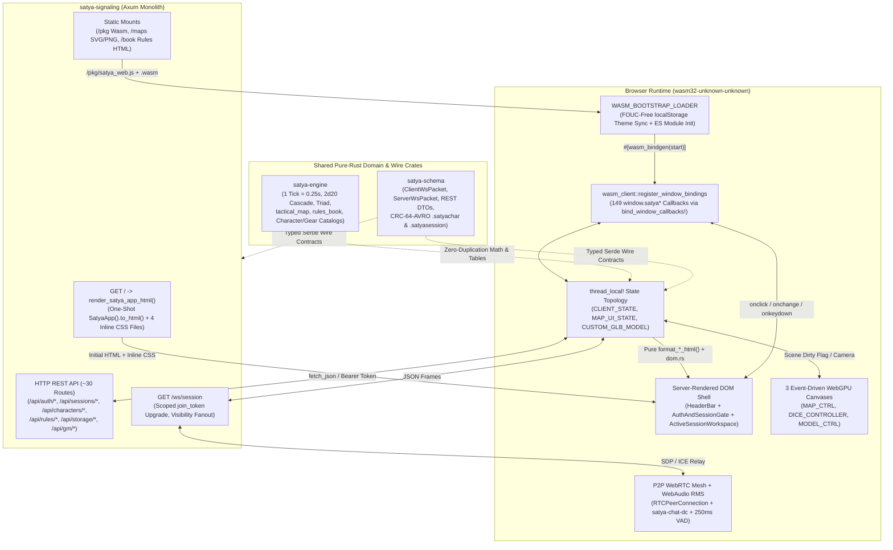

# `satya-web` — Full-Stack Leptos SSR & Rust/WebAssembly Architecture

[`crates/satya-web`](../../../crates/satya-web) is the full-stack browser frontend and Server-Side Rendering (SSR) shell for the **Satya** WebRTC Audio/Video, `2d20` Watershed TTRPG, Autonomous AI Game Master, and Apache Iggy + Avro + PyLance Event Streaming platform. Written in 100% Rust (`leptos` SSR, `wasm-bindgen`, `web-sys`, and `wgpu` WebGPU), it compiles into both the native `satya-server` binary (serving zero-FOUC HTML at `GET /`) and the browser WebAssembly bundle served under `/pkg/satya_web_bg.wasm`.

---

## 1. Executive Architecture & Documentation Map



### Companion Technical Reference Suite (`docs/technical/satya-web/`)

Each document in this directory is scoped under `35 KB` (`< 740` lines) so AI agents and engineers can load only the exact subsystem needed in a single file read:

| Document | Primary Modules Covered | Architectural Scope |
| :--- | :--- | :--- |
| **[`README.md`](README.md)** *(this file)* | `lib.rs`, `wasm_client/{mod,state,dom}.rs`, `tests.rs` | One-shot SSR + imperative Wasm model, module map, `thread_local!` & `localStorage` topology, REST/WS master index, and fast-path routing table. |
| **[`01-ssr-shell-and-theming.md`](01-ssr-shell-and-theming.md)** | `views_header.rs`, `views_gate.rs`, `views_notebook*.rs`, `views_workspace.rs`, `styles*.css`, `menu.rs` | Complete DOM ID hierarchy, 3-column grid + `--col-left-track` splitter, collapsible/floating drawer state machine, and 6-axis CSS theming (`13` palettes × `5` structural frames). |
| **[`02-3d-tactical-map-diorama.md`](02-3d-tactical-map-diorama.md)** | `map_3d.rs`, `map_3d_wgpu.rs`, `wgpu_shared.rs`, `satya_engine::tactical_map` | `1.0m` metric grid math, procedural sectors, cutaway bulkheads, `GaitReachQuery` envelopes, supercover LoS/Cover laser + `2d20` roller bridge, `.glb` miniatures, ray-plane picking, and 2D `<svg>` fallback. |
| **[`03-3d-dice-and-glb-stage.md`](03-3d-dice-and-glb-stage.md)** | `dice_3d.rs`, `dice_3d_wgpu.rs`, `glb_model.rs`, `model_3d_wgpu.rs`, `wgpu_shared.rs` | Procedural `d4`–`d20` meshes, SDF numeral atlas, `SplitMix64` deterministic rigid-body trajectories, 2-pass translucent glass WGSL, and spec-compliant binary glTF 2.0 (`.glb`) parser/encoder/turntable. |
| **[`04-character-wizard-sheet-and-vault.md`](04-character-wizard-sheet-and-vault.md)** | `wizard*.rs`, `character_sheet*.rs` | 6-step Character Creation Wizard, interactive Operator Dossier, 13-zone anatomical SVG trauma/bleed/psyche tracker, legality verifier, and `.satyachar` Avro Vault. |
| **[`05-session-webrtc-chat-and-gm-vault.md`](05-session-webrtc-chat-and-gm-vault.md)** | `auth_session.rs`, `session_persistence.rs`, `webrtc.rs`, `chat_cmd.rs`, `chat_and_ttrpg.rs`, `ttrpg_drawer_*.rs`, `gm_docs.rs`, `gm_memories_and_director.rs`, `npcs.rs`, `telemetry.rs` | Auth/session lifecycle, `.satyasession` replay, P2P WebRTC + `250ms` RMS prosody, `/roll` `\|>` DSL, `2d20` Cascade & 30-technique `T/C/F` Triad drawer, Google Drive `drive.file` Vault, 12-dial Scenario Director, NPCs, and Admin Iggy Inspector. |

---

## 2. One-Shot SSR + Imperative Wasm Architecture

Unlike reactive Virtual-DOM or fine-grained signal frameworks that ship a duplicate reactive component tree to hydrate server HTML, `satya-web` deliberately separates **initial document construction** (Leptos one-shot SSR) from **runtime interactivity** (imperative `wasm-bindgen` handlers + pure Rust HTML formatters).

> [!IMPORTANT]
> **`SatyaApp` is NEVER reactive-hydrated on the client.** `render_satya_app_html()` invokes `SatyaApp().to_html()` once on the Axum server (and in native `cargo test` suites). On the browser, Wasm attaches directly to stable DOM `id`s and `window.satya*` global callbacks.

### Why This Architecture Was Chosen
1. **Zero Hydration Mismatch & Instant First Paint**: `GET /` emits self-contained HTML with all 4 CSS files inline (`<style>`) and pre-populated default views (Airlock SVG/HUD, `2d20` Cascade odds, Rules Book chapter, Character Sheet, and Wizard Stage 1).
2. **Dual Event-Attribute Compatibility**: Interactive SSR elements emit both `onclick="window.satyaFoo()"` (for raw HTML / `inner_html`) and `on:click=move |_| wasm_client::satya_foo()`, routing to the exact same Rust handler.
3. **100% Host-Testable Rendering**: Dynamic updates pair pure `format_*_html(&State) -> String` functions with thin `dom.rs` writers (`set_html`, `set_text`, `set_display`). `cargo test --offline -p satya-web` verifies markup, escaping, math, and CPU WebGPU vertex builders in milliseconds without a browser.
4. **Zero Idle CPU/GPU Overhead**: No reactive diff timers or idle `requestAnimationFrame` loops run; DOM mutations and WebGPU frames execute strictly on user input, WebSocket packets, or active dice trajectories.

### Four-Phase Boot Sequence

```mermaid
sequenceDiagram
    participant User as Browser Document
    participant Loader as WASM_BOOTSTRAP_LOADER (Inline ES Module)
    participant Wasm as start_satya_wasm_client (#[wasm_bindgen(start)])
    participant Api as satya-signaling (REST + /ws/session)

    User->>Api: GET /
    Api-->>User: SatyaApp().to_html() (4 inline CSS files + pre-rendered panes)
    User->>Loader: Execute inline ES module script
    Loader->>User: satyaSyncAppearance(false) -> Apply localStorage data-* to html root (0 FOUC)
    Loader->>User: Bind pre-Wasm window.satya*Appearance* stubs
    Loader->>Wasm: import init from "/pkg/satya_web.js"; init()
    Wasm->>User: register_window_bindings() (149 window.satya* Closures)
    Wasm->>User: restore_saved_appearance_settings() + restore_saved_column_split()
    Wasm->>User: sync_role_options_for_mode() + sync_chat_options_for_mode()
    Wasm->>User: refresh_map_dom_and_wgpu() (Init #notebook-pane-maps + wgpu adapter)
    Wasm->>Api: restore_saved_auth_and_session() (GET /api/auth/me -> POST /api/sessions/resume)
    Api-->>Wasm: AuthSuccessResponse + SessionEnterResponse (history snapshot)
    Wasm->>User: replay_session_history_snapshot() + connect_signaling_websocket()
```

### Declarative Callback Contract (`bind_window_callbacks!`)

All browser globals are registered in [`crates/satya-web/src/wasm_client/mod.rs`](../../../crates/satya-web/src/wasm_client/mod.rs) through a single declarative macro invocation (`149` entries across Auth/Menu, WebRTC/Drawers, Chat/Roller, Notebook/3D Stages, GM Vault/Director/NPCs, Character Wizard, and Character Sheet):

```rust
macro_rules! bind_window_callbacks {
    ($bind:ident; $( $js_name:literal => $fn_ident:ident ( $($arg_ty:ty),* ) ),* $(,)?) => {
        // 1. Exports `pub const REGISTERED_WINDOW_CALLBACKS: &[&str]` for SSR parity tests
        // 2. Binds each `Closure::<dyn Fn($($arg_ty),*)>::new($fn_ident)` onto `window.<jsName>`
    };
}
```

In [`crates/satya-web/src/tests.rs`](../../../crates/satya-web/src/tests.rs), host unit tests scan the entire rendered SSR HTML and formatter outputs for every `window.satya[A-Za-z0-9_]*` reference and assert 1:1 membership in `REGISTERED_WINDOW_CALLBACKS`, making broken `onclick` typos a compile/test-time failure.

---

## 3. Complete Source Module Map (`crates/satya-web/src/`)

Every `.rs` and `.css` file adheres to the workspace `< 40 KB` / `< 780`-line modularization target with flat `pub use` re-exports so external callers and tests enjoy stable paths.

### 3.1 Top-Level SSR Views, Slash-Command Parser & Stylesheets (`src/`)

| File | Key Symbols | Responsibility |
| :--- | :--- | :--- |
| [`lib.rs`](../../../crates/satya-web/src/lib.rs) | `SatyaApp`, `render_satya_app_html`, `WASM_BOOTSTRAP_LOADER` | Root `<!DOCTYPE html>` shell, inline CSS concatenation, FOUC-free bootstrap script, and flat `pub use` re-exports. |
| [`views_header.rs`](../../../crates/satya-web/src/views_header.rs) | `HeaderBar`, `THEME_SWATCH_SPECS`, `CHAT_FILTER_SPECS` | Brand bar, `#auth-status-pill`, `#session-status-pill`, and `#hamburger-menu-dropdown` (pane toggles, 6-axis appearance, chat filters, BYOK AI GM & AI Player panels). |
| [`views_gate.rs`](../../../crates/satya-web/src/views_gate.rs) | `AuthAndSessionGate`, `PasswordToggleButton`, `DEMO_ACCOUNT_SPECS` | Pre-session `#gate-panel` with `#auth-card` (demo chips, Argon2id auth, Google `drive.file`) and `#session-card` (SQLite resume, `.satyasession`, mode/role/BYOK). |
| [`views_notebook.rs`](../../../crates/satya-web/src/views_notebook.rs) | `NotebookColumn`, `QUICK_3D_DICE_SPECS` | `#notebook-column` tablist (`NOTEBOOK_TAB_SPECS`) and interactive stages for `maps`, `dice`, `model`, `character`, and `wizard`. |
| [`views_notebook_docs.rs`](../../../crates/satya-web/src/views_notebook_docs.rs) | `NotebookReferencePanes`, `WORKED_BOOK_EXAMPLES` | Tab panes for `combat` (`0.25s` tick timeline + 30 techniques), `rules` (chapter reader, live search, worked `2d20` presets), and `iggy` (`#admin-inspector-card`). |
| [`views_notebook_gm.rs`](../../../crates/satya-web/src/views_notebook_gm.rs) | `NotebookGmAndNpcPanes` | Tab panes for `npcs` (role-filtered NPC cards + roll-up generator) and `docs` (12-dial Scenario Director, 6-source Omnisearch, `GM_ONLY` Vault, GM Memories). |
| [`views_workspace.rs`](../../../crates/satya-web/src/views_workspace.rs) | `ActiveSessionWorkspace` | 3-column `#workspace-panel`: `#notebook-column`, `#workspace-col-splitter`, `#center-column` (`#chat-card` + `#ttrpg-drawer`), and `#webrtc-dock-column` (`#webrtc-card` + `#right-drawer-rails`). |
| [`chat_cmd.rs`](../../../crates/satya-web/src/chat_cmd.rs) | `ChatCommand`, `DicePipeline`, `ChatInputHistory`, `parse_chat_command` | Parser for `/msg`, `/w`, `/whisper` (fuzzy `@handle`), `/roll`, `/r`, `/help`, `\|>` dice pipelines (`4d10\|>hi(3)`, `e`, `lo`, `sum`, `>=TN`), and `50`-entry Up/Down history. |
| [`styles_themes.css`](../../../crates/satya-web/src/styles_themes.css) | `html[data-theme=*]`, `html:is(..., [data-style=*])` | 13 palettes, 5 structural frames (`default`, `mil-spec`, `lcars`, `pulp`, `wehrmacht`), density, corners, font, and scale tokens. |
| [`styles.css`](../../../crates/satya-web/src/styles.css) | `.workspace-columns`, `.chat-card`, `.ttrpg-card`, `.webrtc-card` | Core 3-column Grid, splitter, `@container ttrpg-card` queries, WebRTC tiles, floating/collapsed drawers, and targeted chat styles. |
| [`styles_stages.css`](../../../crates/satya-web/src/styles_stages.css) | `.wgpu-map-canvas`, `.wgpu-dice-canvas`, `.wgpu-model-canvas` | Viewport framing, HUD overlays, material/camera toolbars, and SVG fallback styling for the three 3D WebGPU stages. |
| [`styles_notebook.css`](../../../crates/satya-web/src/styles_notebook.css) | `.rules-book-viewport`, `.wiz-fieldset`, `.char-sheet-section`, `.gm-doc-card` | Rules Book typography, 6-step Character Wizard grids, 13-zone Character Sheet & anatomical SVG, and GM Vault cards. |
| [`tests.rs`](../../../crates/satya-web/src/tests.rs) | SSR & Wasm contract suite | Verifies SSR HTML structure, `REGISTERED_WINDOW_CALLBACKS` parity, DOM `id` uniqueness, `naga` WGSL compilation, and formatter outputs. |

### 3.2 Browser WebAssembly Runtime (`src/wasm_client/`)

| Submodule Group | Files (`src/wasm_client/`) | Core Responsibility |
| :--- | :--- | :--- |
| **Core Runtime, State & DOM** | `mod.rs`, `state.rs`, `dom.rs`, `options.rs`, `menu.rs` | `start_satya_wasm_client`, `bind_window_callbacks!`, `SatyaWasmState`, typed `web-sys` query/mutation/fetch/file-IO/Base64/escaping helpers, normalizers, and Hamburger Menu handlers. |
| **Auth & Session Persistence** | `auth_session.rs`, `session_persistence.rs` | Auth, session create/join/leave/resume, `format_roster_and_recipients_html`, sequence-sorted `replay_session_history_snapshot`, `.satyasession` export/import, and `.md`/`.json` transcripts. |
| **WebRTC Mesh & Drawers** | `webrtc.rs` | `/ws/session` router, P2P `RTCPeerConnection` + `satya-chat-dc` mesh, ICE queueing, `250ms` WebAudio RMS prosody telemetry, floating webcam drag, and drawer/splitter state machine. |
| **Chat & `2d20` / Triad Drawer** | `chat_and_ttrpg.rs`, `ttrpg_drawer_cascade.rs`, `ttrpg_drawer_triad.rs` | Targeted Markdown chat (`render_rules_markdown_to_html`), `2d20` Contested/Uncontested Cascade analytical odds, searchable skill combobox, and 30-technique `T/C/F` Triad allocator. |
| **Notebook, GM Vault, NPCs & Iggy** | `notebook.rs`, `gm_docs.rs`, `gm_memories_and_director.rs`, `npcs.rs`, `telemetry.rs` | 10-tab switcher, Combat Tracker (`0.25s/tick`), Rules Book reader/search, Google Drive `drive.file` Vault, GM Memories, 12-dial Scenario Director, 6-source Omnisearch, NPCs, and Admin Iggy metrics. |
| **3D WebGPU Stages** | `wgpu_shared.rs`, `map_3d.rs`, `map_3d_wgpu.rs`, `dice_3d.rs`, `dice_3d_wgpu.rs`, `glb_model.rs`, `model_3d_wgpu.rs` | Shared `OrbitOrthoCamera`, `SHARED_GLB_DIORAMA_WGSL` & `wgpu` bootstrap; `1.0m` 3D Tactical Map diorama; 2-pass translucent 3D Polyhedral Dice; and `.glb` codec + turntable stage. |
| **Wizard & Character Vault** | `wizard.rs` + `wizard_views_{stats,lifepath,skills}.rs`; `character_sheet.rs` + `character_sheet_{views,equip_views,status_views,vault,record}.rs` | 6-step Character Creation Wizard (`15` characteristics, `7` psyche traits, aptitudes, lifepath, skills, review) and Character Sheet + 13-zone trauma SVG + `.satyachar` Avro Vault. |

---

## 4. Browser Client State Topology (`thread_local!` & `localStorage`)

Because browser WebAssembly executes on a single UI thread, all mutable client state lives in `thread_local!` `RefCell` singletons accessed through short, non-overlapping borrow closures (`with_state`, `with_state_mut`, `with_map_ui`, `with_map_ui_mut`) that **never** hold a `RefMut` across an `.await` suspension point.

### 4.1 Complete `thread_local!` Singleton Index

| Singleton | Type | File | Scope & Responsibility |
| :--- | :--- | :--- | :--- |
| `CLIENT_STATE` | `Rc<RefCell<SatyaWasmState>>` | `wasm_client/state.rs` | Primary session state: tokens, roster, `WebSocket`, WebRTC `peers`, prosody `AudioContext`, chat history/recipients, drawer geometry, combat clock, Google/GM caches, NPCs, `wizard`, and `character_sheet`. |
| `MAP_UI_STATE` | `RefCell<TacticalMapUiState>` | `wasm_client/map_3d.rs` | Active `GmMapUpdateRequest` (`1.0m` tile grid + tokens + visuals), selected token, hovered cell, `CombatMovementGait`, tick budget, click mode, cutaway flag, reachable cells, and `TacticalLosEvaluation`. |
| `CUSTOM_GLB_MODEL` | `RefCell<Option<(LoadedGlbModel, Vec<u8>)>>` | `wasm_client/model_3d_wgpu.rs` | User-imported or vault-attached binary glTF 2.0 (`.glb`) mesh + raw bytes + generation counter shared between Tab 3 (`#wgpu-model-canvas`) and Tab 1 (`"custom_glb"` map miniatures). |
| `MAP_CTRL` | `RefCell<MapDioramaController>` | `wasm_client/map_3d_wgpu.rs` | `wasm32`-only `wgpu` pipeline, `OrbitOrthoCamera`, mouse drag/click state, cached miniature `GpuMeshSlice`s, and `scene_dirty` flag for `#wgpu-map-canvas`. |
| `DICE_CONTROLLER` | `RefCell<WgpuDiceController>` | `wasm_client/dice_3d_wgpu.rs` | `wasm32`-only 2-pass translucent `wgpu` pipeline, SDF numeral atlas texture, active physics trajectory playback, material, and tray camera for `#wgpu-dice-canvas`. |
| `MODEL_CTRL` | `RefCell<ModelStageController>` | `wasm_client/model_3d_wgpu.rs` | `wasm32`-only `wgpu` pipeline, `OrbitOrthoCamera` turntable, shader mode (`pbr`, `wireframe_pbr`, `hit_zones`, `thermal`), and armor tint for `#wgpu-model-canvas`. |

### 4.2 `SatyaWasmState` Field Reference (`SECONDS_PER_TICK = 0.25`)

| Domain | Fields (`SatyaWasmState`) | Types & Canonical Defaults |
| :--- | :--- | :--- |
| **Auth & Session** | `auth_token`, `user`, `session_id`, `session_mode`, `join_token`, `self_participant`, `roster` | `Option<String>` (`satya_tok_*` / `join_*`), `SessionMode::Ttrpg`, `Vec<Participant>` synced via `ROSTER_SYNC`. |
| **WebSocket & WebRTC** | `ws`, `local_stream`, `audio_muted`, `video_muted`, `peers` | `Option<WebSocket>`, `Option<MediaStream>`, `HashMap<String, PeerEntry>` (`pc`, `dc`, `remote_desc_set`, `pending_ice_candidates`). |
| **Prosody & Typing** | `typing_started_at_ms`, `rms_peak`, `rms_sum`, `rms_samples`, `prosody_audio_ctx`, `prosody_interval_id` | `250ms` WebAudio RMS energy accumulator + composition latency tracker (`Date::now()`) for `InteractionDynamicsEvent` & `ChatMessageEvent`. |
| **Chat & Navigation** | `chat_history`, `selected_recipients`, `active_channel_context`, `active_notebook_tab` | `ChatInputHistory` (`50` max), `Vec<String>` (empty = `BROADCAST`), `ChannelContext::InCharacter`, `"maps"`. |
| **Drawers & Splitter** | `webcam_floating`, `webcam_collapsed`, `chat_collapsed`, `ttrpg_collapsed`, `webcam_columns`, `webcam_drag_offset`, `column_resizing` | Booleans (`false`), `webcam_columns: 1` (`1` or `2` max), drag `(dx, dy)` tuple, and splitter drag flag. |
| **Combat Clock** | `combat_round`, `combat_tick` | `u32` (`round = 1`, `tick = 0`), where `SECONDS_PER_TICK = 0.25` (`4 Ticks = 1.0s`, `20 Ticks = 5.0s`). |
| **Google & GM Vault** | `google_linked`, `google_access_token`, `google_oauth_client_id`, `google_picker_api_key`, `gm_documents`, `gm_memories` | Ephemeral RAM-only `drive.file` OAuth token, `Vec<GmDocumentRecord>`, and `Vec<GmMemoryNoteRecord>`. |
| **NPCs & Character** | `session_npcs`, `selected_npc_id`, `viewer_can_see_gm_secrets`, `wizard`, `character_sheet` | `Vec<SessionNpcEntry>`, `viewer_can_see_gm_secrets: bool`, `CharacterWizardState`, and `CharacterSheetState`. |

### 4.3 Browser `localStorage` Key Inventory

| `localStorage` Key | Value / Default | Writer / Reader | Purpose |
| :--- | :--- | :--- | :--- |
| `satya.auth.token` | `"satya_tok_<uuid>"` | `auth_session.rs`, `session_persistence.rs` | Restores user via `GET /api/auth/me` on reload; cleared on logout or `401`. |
| `satya.session.active` | JSON `{session_id, join_token, role}` | `session_persistence.rs` | Auto-resumes room via `POST /api/sessions/resume` + history replay. |
| `satya.workspace.notebook_width_pct` | Float in `22.0..=72.0` | `webrtc.rs` | Persists `#notebook-column` width (`--col-left-track`); cleared on double-click. |
| `satya.appearance.theme` | `"obsidian"` (`13` palettes) | `WASM_BOOTSTRAP_LOADER`, `menu.rs` | Synced onto `<html data-theme="...">` before first paint and on menu change. |
| `satya.appearance.style` | `"default"` (`5` frames: `mil-spec`, `lcars`, `pulp`, `wehrmacht`) | `WASM_BOOTSTRAP_LOADER`, `menu.rs` | Synced onto `<html data-style="...">` for structural bezels independent of palette. |
| `satya.appearance.density` | `"default"`, `"compact"`, `"spacious"` | `WASM_BOOTSTRAP_LOADER`, `menu.rs` | Synced onto `<html data-density="...">` (`--shell-pad-*`, `--workspace-gap`, `--card-pad`). |
| `satya.appearance.corners` | `"default"`, `"sharp"`, `"rounded"` | `WASM_BOOTSTRAP_LOADER`, `menu.rs` | Synced onto `<html data-corners="...">` (`--card-radius`, `--panel-radius`, `--control-radius`). |
| `satya.appearance.font` | `"sans"`, `"mono"`, `"serif"`, `"lcars"`, `"military"`, `"stencil"`, `"pulp"` | `WASM_BOOTSTRAP_LOADER`, `menu.rs` | Synced onto `<html data-font="...">` (`--font-body`). |
| `satya.appearance.font_size` | `"default"` (`100%`), `"sm"` (`90%`), `"lg"` (`110%`), `"xl"` (`120%`) | `WASM_BOOTSTRAP_LOADER`, `menu.rs` | Synced onto `<html data-font-size="...">` (root `rem` scale). |

> [!NOTE]
> **Strict Secret Hygiene**: Cloud LLM BYOK API keys (`#ai-gm-api-key-input`, `#menu-ai-gm-key`) and Google OAuth `drive.file` access tokens (`google_access_token`) stay strictly in RAM — never in `localStorage`, `.satyasession` files, or Avro logs. Password inputs are scrubbed immediately after reading.

---

## 5. Master HTTP REST API & `/ws/session` Wire Reference

All frontend HTTP calls route through `wasm_client::dom::fetch_json` / `fetch_text` (attaching `Authorization: Bearer <auth_token>`) against the Axum router in [`crates/satya-signaling/src/lib.rs`](../../../crates/satya-signaling/src/lib.rs).

### 5.1 HTTP Static Mounts & REST Endpoints

| Domain | Method & Path | Auth | Request / Response DTOs (`satya-schema`) | Frontend Caller (`wasm_client`) |
| :--- | :--- | :--- | :--- | :--- |
| **SSR & Static** | `GET /`, `/pkg/*`, `/maps/*`, `/book/*` | Public | HTML shell, Wasm bundle, map images, static Rules Book | Browser / `WASM_BOOTSTRAP_LOADER` |
| **Rules Book** | `GET /api/rules`, `GET /api/rules/:chapter_id` | Public | Chapter catalog & rendered chapter payload | `notebook.rs` (also embedded via `satya-engine`) |
| **User Auth** | `POST /api/auth/{register,login,logout}`, `GET /api/auth/me` | Public / Bearer | `RegisterRequest`, `LoginRequest`, `LogoutRequest` $\rightarrow$ `AuthSuccessResponse` | `auth_session.rs`, `session_persistence.rs` |
| **Google OAuth** | `POST /api/auth/google`, `GET /api/auth/google/status` | Bearer | `GoogleAuthLinkRequest` $\rightarrow$ `GoogleAuthStatusResponse` (`drive.file` scope) | `gm_docs.rs`, `auth_session.rs` |
| **Session Gate** | `POST /api/sessions/{create,join,leave,resume}`, `GET /api/sessions/saved` | Bearer | `CreateSessionRequest`, `JoinSessionRequest`, `ResumeSessionRequest` $\rightarrow$ `SessionEnterResponse` | `auth_session.rs`, `session_persistence.rs` |
| **Snapshots** | `POST /api/sessions/import`, `GET /api/sessions/:id/{export,transcript}` | Bearer | `ImportSessionSnapshotRequest`, `SessionSnapshotBundle` (`.satyasession`), `.md`/`.json` transcript | `session_persistence.rs` |
| **AI GM & Bots** | `POST /api/sessions/:id/gm-config`, `GET\|POST /api/sessions/:id/ai-players`, `POST .../step`, `DELETE .../:uid` | Bearer (GM) | `AiGmProviderConfig`, `AiPlayerConfig`, `StepAiPlayerRequest` | `menu.rs` |
| **GM Vault** | `GET\|POST /api/sessions/:id/docs`, `POST .../docs/:doc_id/persist` | Bearer | `SubmitGmDocumentRequest`, `ToggleGmDocumentPersistenceRequest` $\rightarrow$ `SessionGmDocsResponse` | `gm_docs.rs` |
| **GM Memories** | `GET\|POST /api/sessions/:id/memories`, `DELETE .../memories/:memory_id` | Bearer (GM) | `UpsertGmMemoryRequest` (incl. `mem-scenario-director`) $\rightarrow$ `SessionGmMemoriesResponse` | `gm_memories_and_director.rs` |
| **Combat & Lookup** | `GET\|POST /api/sessions/:id/combat`, `GET /api/sessions/:id/lookup` | Bearer | Combat clock state; `GmOmnisearchResponse` across 6 sources | `notebook.rs`, `gm_memories_and_director.rs` |
| **Tactical Map** | `GET\|POST /api/sessions/:id/map`, `POST /api/sessions/:id/map/move` | Bearer | `GenerateSessionMapRequest`, `MoveMapTokenRequest` $\rightarrow$ `GmMapUpdateRequest` | `map_3d.rs` |
| **NPC Roster** | `GET /api/sessions/:id/npcs`, `POST /api/sessions/:id/npcs/generate` | Bearer | Role-filtered `SessionNpcEntry` list (redacts secrets for non-GM players); NPC generator | `npcs.rs` |
| **Character Vault** | `GET\|POST /api/characters`, `POST .../import`, `GET .../:cid/export`, `POST .../:cid/bind-session`, `POST\|GET .../:cid/assets[/:aid]` | Bearer | `SaveCharacterRequest`, `.satyachar` Avro binary, `BindCharacterSessionRequest`, multimodal `.glb`/portrait assets | `character_sheet_vault.rs` |
| **Admin Storage** | `GET /api/storage/metrics`, `POST /api/storage/flush` | Bearer (`ADMIN`) | `StorageMetricsViewResponse` (Iggy offsets, `CRC-64-AVRO` fingerprints, PyLance `.avro` flushes) | `telemetry.rs` |
| **Service Bridges** | `/api/gm/sessions/:id/*`, `/api/player-ai/sessions/:id/*` | Internal / Service | LangGraph AI GM & AI Player context, chat, `2d20` roll, map, and trajectory endpoints | Python `satya_ml.ai_gm` (reflected to Wasm via WS) |

### 5.2 `/ws/session` Full-Duplex WebSocket Packets (`?join_token=join_<uuid>`)

#### Client $\rightarrow$ Server (`ClientWsPacket`, `#[serde(tag = "type", rename_all = "SCREAMING_SNAKE_CASE")]`)

| JSON `type` Tag | Rust Variant | Key Payload Fields | Wasm Emitter |
| :--- | :--- | :--- | :--- |
| `SEND_CHAT` | `ClientWsPacket::SendChat` | `visibility`, `recipient_user_ids`, `channel_context`, `body`, `composition_time_ms` | `chat_and_ttrpg::satya_send_chat`, `notebook::satya_quick_3d_dice_roll` |
| `WEBRTC_SIGNAL` | `ClientWsPacket::WebrtcSignal` | `target_user_id`, `signal_kind` (`SIGNALING_OFFER`, `SIGNALING_ANSWER`, `ICE_CANDIDATE`), `payload` | `webrtc.rs` P2P mesh negotiation |
| `WEBRTC_TELEMETRY` | `ClientWsPacket::WebrtcTelemetry` | `target_user_id`, `event_kind`, `audio_muted`, `video_muted` | `webrtc::{satya_toggle_audio, satya_toggle_video}` & DataChannel hooks |
| `INTERACTION_DYNAMICS` | `ClientWsPacket::InteractionDynamics` | `turn_type`, `duration_ms`, `rms_energy_mean`, `rms_energy_peak`, `pitch_hz_estimate`, `preceding_silence_ms` | `webrtc::satya_emit_prosody_sample` & `250ms` VAD monitor |
| `ROLL_TTRPG_TASK` | `ClientWsPacket::RollTtrpgTask` | `skill_name`, `skill_level`, `control_c`, `internal_mod`, `known_tool_mod`, `external_mod`, `carry_mode`, `botch_rule`, `combat_stance`, `combat_technique`, `tempo_pool`, `control_pool`, `force_pool`, `fatigue_level`, `wound_shock_index` | `chat_and_ttrpg::satya_roll_task` |
| `LEAVE_SESSION` | `ClientWsPacket::LeaveSession` | `reason: Option<String>` | `auth_session::satya_leave_session` |

#### Server $\rightarrow$ Client (`ServerWsPacket`, `#[serde(tag = "type", rename_all = "SCREAMING_SNAKE_CASE")]`)

| JSON `type` Tag | Rust Variant | Wasm Handler (`webrtc.rs` dispatch) | UI & State Mutation |
| :--- | :--- | :--- | :--- |
| `ROSTER_SYNC` | `ServerWsPacket::RosterSync` | `auth_session::render_roster` | Updates `st.roster`, `#roster-list`, `#recipient-checkboxes`, `#webcam-drawer-count-badge`, Combat Tracker, and initiates P2P offers. |
| `PEER_DISCONNECTED` | `ServerWsPacket::PeerDisconnected` | `webrtc::remove_peer_connection` | Closes `RTCPeerConnection`, removes `#video-tile-<uid>`, and appends system notice. |
| `CHAT_EVENT` | `ServerWsPacket::ChatEvent` | `chat_and_ttrpg::render_chat_event` | Renders Markdown bubble (`PUBLIC`, `PRIVATE`, `GM_ONLY`, `AI_GM`) in `#chat-log` respecting `#filter-msg-*`. |
| `TTRPG_MECHANICS_EVENT` | `ServerWsPacket::TtrpgMechanicsEvent` | `chat_and_ttrpg::render_mechanics_event` | Appends `2d20` Cascade + `T/C/F` Triad outcome card in `#chat-log` and advances combat tick display. |
| `WEBRTC_SIGNAL` | `ServerWsPacket::WebrtcSignal` | `webrtc::handle_incoming_webrtc_signal` | Applies remote SDP offer/answer or queues/applies `RTCIceCandidate` on `PeerEntry`. |
| `MAP_UPDATED` | `ServerWsPacket::MapUpdated` | `map_3d::apply_incoming_map_update` | Replaces `MAP_UI_STATE.map`, recomputes gait reach & LoS/Cover, marks `MAP_CTRL` dirty, and updates `#wgpu-map-canvas` + SVG fallback. |
| `WGPU_DICE_ROLL` | `ServerWsPacket::WgpuDiceRoll` | `notebook::render_wgpu_dice_roll` | Steps deterministic `SplitMix64` rigid-body trajectory on `#wgpu-dice-canvas` so all peers see identical 3D tumbles and top faces. |
| `GM_DOCUMENT_ADDED` | `ServerWsPacket::GmDocumentAdded` | `notebook::render_gm_document_added` | Upserts sanitized `GM_ONLY` document into `st.gm_documents` and updates `#gm-docs-list`. |

---

## 6. Agent Fast-Path Routing Guide & Verification

Use this table to jump straight to the exact 1–2 source files and companion architecture doc without scanning unrelated modules:

| Task / Feature Area | Exact Source File(s) (`crates/satya-web/src/`) | Companion Doc |
| :--- | :--- | :--- |
| Add/modify a `window.satya*` browser callback | `wasm_client/mod.rs` + target handler module + `tests.rs` | [`README.md`](README.md) §2 |
| Edit top navbar, Hamburger Menu, or BYOK bot settings | `views_header.rs`, `wasm_client/menu.rs` | [`01-ssr-shell-and-theming.md`](01-ssr-shell-and-theming.md) |
| Edit login/register or session create/join/resume gate | `views_gate.rs`, `wasm_client/auth_session.rs`, `wasm_client/session_persistence.rs` | [`01`](01-ssr-shell-and-theming.md), [`05`](05-session-webrtc-chat-and-gm-vault.md) |
| Add/tune a color palette, frame style (`lcars`, `mil-spec`, `pulp`), or CSS layout | `styles_themes.css`, `styles.css`, `wasm_client/options.rs`, `wasm_client/menu.rs` | [`01-ssr-shell-and-theming.md`](01-ssr-shell-and-theming.md) |
| Modify collapsible drawer rails, floating webcams, or column splitter | `views_workspace.rs`, `wasm_client/webrtc.rs`, `styles.css` | [`01-ssr-shell-and-theming.md`](01-ssr-shell-and-theming.md) |
| Modify `1.0m` 3D Tactical Map geometry, LoS laser, gait pads, picking, or SVG | `wasm_client/map_3d.rs`, `wasm_client/map_3d_wgpu.rs`, `crates/satya-engine/src/tactical_map.rs` | [`02-3d-tactical-map-diorama.md`](02-3d-tactical-map-diorama.md) |
| Modify shared `OrbitOrthoCamera` or `SHARED_GLB_DIORAMA_WGSL` shader | `wasm_client/wgpu_shared.rs`, `wasm_client/model_3d_wgpu.rs` | [`02`](02-3d-tactical-map-diorama.md), [`03`](03-3d-dice-and-glb-stage.md) |
| Modify 3D polyhedral dice meshes, SDF numerals, physics, or glass shader | `wasm_client/dice_3d.rs`, `wasm_client/dice_3d_wgpu.rs` | [`03-3d-dice-and-glb-stage.md`](03-3d-dice-and-glb-stage.md) |
| Modify binary glTF 2.0 (`.glb`) import/export or Tab 3 turntable stage | `wasm_client/glb_model.rs`, `wasm_client/model_3d_wgpu.rs` | [`03-3d-dice-and-glb-stage.md`](03-3d-dice-and-glb-stage.md) |
| Modify the 6-Step Character Creation Wizard | `wasm_client/wizard.rs`, `wasm_client/wizard_views_{stats,lifepath,skills}.rs` | [`04-character-wizard-sheet-and-vault.md`](04-character-wizard-sheet-and-vault.md) |
| Modify Character Sheet, 13-zone trauma SVG, equipment, or `.satyachar` Vault | `wasm_client/character_sheet*.rs`, `styles_notebook.css` | [`04-character-wizard-sheet-and-vault.md`](04-character-wizard-sheet-and-vault.md) |
| Modify `/msg` or `/roll` `\|>` dice pipeline syntax | `chat_cmd.rs`, `wasm_client/chat_and_ttrpg.rs` | [`05-session-webrtc-chat-and-gm-vault.md`](05-session-webrtc-chat-and-gm-vault.md) |
| Modify `2d20` Cascade preview, skill combobox, or `T/C/F` Triad allocator | `views_workspace.rs`, `wasm_client/ttrpg_drawer_{cascade,triad}.rs` | [`05-session-webrtc-chat-and-gm-vault.md`](05-session-webrtc-chat-and-gm-vault.md) |
| Modify Google Drive `drive.file` Vault, GM Memories, Scenario Director, or NPCs | `views_notebook_gm.rs`, `wasm_client/{gm_docs,gm_memories_and_director,npcs}.rs` | [`05-session-webrtc-chat-and-gm-vault.md`](05-session-webrtc-chat-and-gm-vault.md) |
| Modify Combat Tracker, Rules Book reader, or Admin Apache Iggy Inspector | `views_notebook_docs.rs`, `wasm_client/{notebook,telemetry}.rs` | [`05-session-webrtc-chat-and-gm-vault.md`](05-session-webrtc-chat-and-gm-vault.md) |

### Host Verification Commands

All SSR templates, `REGISTERED_WINDOW_CALLBACKS` parity assertions, DOM ID uniqueness checks, CPU 3D mesh builders, `naga` WGSL shader validators, and HTML formatters execute natively on the host without requiring `wasm-pack` or a GPU:

```powershell
cargo test --offline -p satya-web
cargo clippy --offline -p satya-web --all-targets -- -D warnings
```
