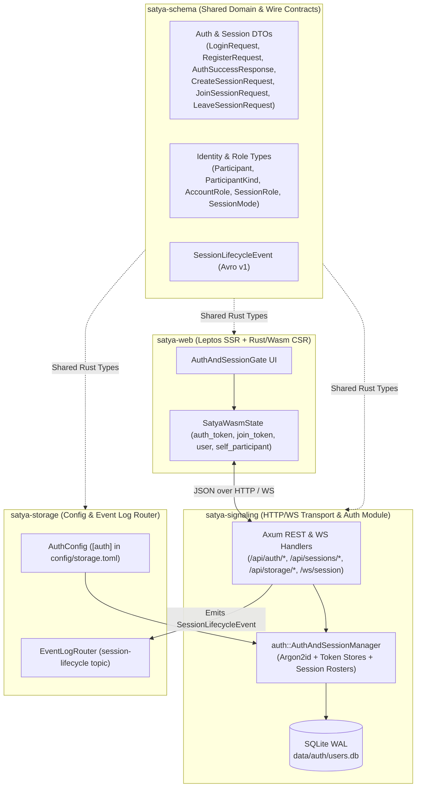
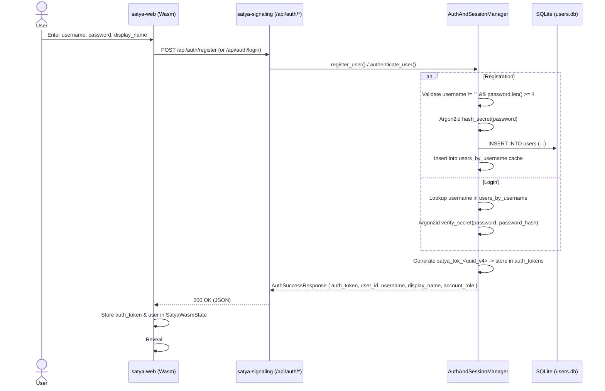
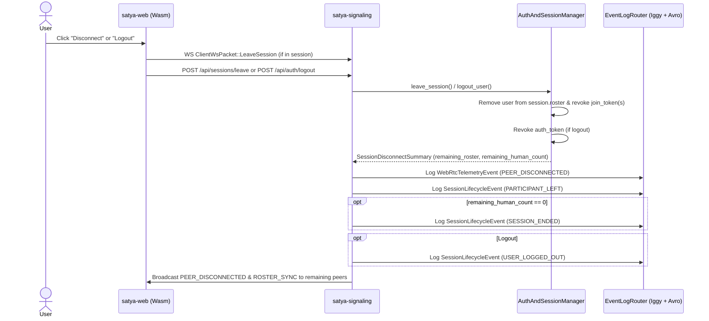

# Satya User & Authentication Module — Technical Design

## 1. Overview & Modular Monolith Context

Satya is structured as a **modular monolith**: the entire backend compiles into a single deployable binary (`satya-server`) backed by workspace crates with explicit domain boundaries, shared typed contracts, and an internal event-streaming bus.

Within this architecture, the **User & Authentication Module** is responsible for:
1. **Persistent User Identity**: Registering and authenticating human users with persistent UUIDv7 `user_id`s across sessions so downstream ML and analytics pipelines (`Apache Iggy -> Avro -> PyLance`) can correlate longitudinal user behavior.
2. **Cryptographic Secret Verification**: Hashing and verifying both user account passwords and per-room session passwords using **Argon2id** with CSPRNG salts.
3. **Two-Tier Token Management**:
   - **Account Bearer Tokens (`satya_tok_<uuid>`)** for HTTP REST API authorization.
   - **Session Join Tokens (`join_<uuid>`)** for scoped WebSocket upgrades (`/ws/session`).
4. **Two-Level Role-Based Access Control (RBAC)**:
   - **Platform Account Role (`AccountRole`)**: `USER` vs. `ADMIN` (gating storage telemetry and batch flush APIs/UI).
   - **Session Role (`SessionRole`)**: `GM`, `AI_GM`, `PLAYER`, `HOST`, `PARTICIPANT`, `OBSERVER` (gating session creation rules and chat visibility routing).
5. **Password-Protected Session Roster Lifecycle**: Managing active session rooms, human and AI GM participant rosters, and clean teardown cascades on disconnect or logout.

---

## 2. Module Boundaries Across the Workspace



| Crate / Module | File | Responsibility in User & Auth Domain |
| :--- | :--- | :--- |
| `satya-schema` | `crates/satya-schema/src/lib.rs` | Defines canonical identity structs (`Participant`, `AccountRole`, `SessionRole`, `ParticipantKind`), REST/WS request/response DTOs, and `SessionLifecycleEvent` Avro schema bindings. |
| `satya-storage` | `crates/satya-storage/src/lib.rs` | Defines `AuthConfig` (`database_url` and `bootstrap_admins`), deserialized from the `[auth]` section of `config/storage.toml`. |
| `satya-signaling::auth` | `crates/satya-signaling/src/auth.rs` | Core implementation of `AuthAndSessionManager`, SQLite `users` table persistence, Argon2id hashing, in-memory token registries, and password-protected session roster state. |
| `satya-signaling` | `crates/satya-signaling/src/lib.rs` | Axum HTTP route handlers (`/api/auth/*`, `/api/sessions/*`), `verify_admin_header` middleware helper, `/ws/session` upgrade guard, and `SessionLifecycleEvent` emission. |
| `satya-web` | `crates/satya-web/src/lib.rs`, `wasm_client.rs` | Renders the authentication and session gate UI, stores active tokens in thread-local `SatyaWasmState`, attaches `Authorization: Bearer <token>` headers, and toggles admin UI panes. |

---

## 3. Core Data Models & State

### 3.1 Persistent User Identity (`UserAccount` & `AccountRole`)

Defined in `crates/satya-signaling/src/auth.rs` and `crates/satya-schema/src/lib.rs`:

```rust
pub enum AccountRole {
    User,  // Standard platform user (default)
    Admin, // Platform administrator (storage inspector & batch flush access)
}

pub struct UserAccount {
    pub user_id: String,          // Persistent UUIDv7 (or seeded demo ID)
    pub username: String,         // Normalized lowercase login handle
    pub display_name: String,     // Default display or character name
    pub password_hash: String,    // Argon2id PHC string hash
    pub account_role: AccountRole,
    pub created_at_us: i64,       // UTC microseconds since Unix epoch
}
```

### 3.2 SQLite Schema (`data/auth/users.db`)

On startup, `AuthAndSessionManager::new` connects to the SQLite database configured in `config/storage.toml` (`sqlite://data/auth/users.db?mode=rwc`) with ` PRAGMA journal_mode = WAL` and `max_connections = 8`, executing:

```sql
CREATE TABLE IF NOT EXISTS users (
    user_id       TEXT PRIMARY KEY NOT NULL,
    username      TEXT UNIQUE NOT NULL,
    display_name  TEXT NOT NULL,
    password_hash TEXT NOT NULL,
    account_role  TEXT NOT NULL DEFAULT 'USER',
    created_at_us INTEGER NOT NULL
);
```

- **Write-Through Cache**: All rows from `users` are loaded into an in-memory `RwLock<HashMap<String, UserAccount>>` keyed by lowercase `username` on startup. New registrations and role updates write to SQLite first and then update the in-memory map under a write lock.
- **Demo Seeding & Bootstrap Admins**:
  - If the `users` table is empty (`COUNT(*) == 0`), four preset demo accounts are seeded with password `"satya-truth-2026"`:
    - `gm_sean` (`u-demo-gm-sean`, `"Sean (GM)"`)
    - `sara_valkyrie` (`u-demo-sara`, `"Sara (Valkyrie)"`)
    - `marcus_recon` (`u-demo-marcus`, `"Marcus (Recon)"`)
    - `host_elena` (`u-demo-host-elena`, `"Elena (Meeting Host)"`)
  - Any username listed in `auth.bootstrap_admins` in `config/storage.toml` (by default `["gm_sean"]`) is automatically assigned `AccountRole::Admin` both during initial seeding/registration and on subsequent startups (`UPDATE users SET account_role = 'ADMIN' WHERE username = ?1`).

### 3.3 Session Identity (`Participant` & `ProtectedSession`)

When a user creates or joins a session, their `UserAccount` is projected into a nested Avro-compatible `Participant` record:

```rust
pub struct Participant {
    pub user_id: String,
    pub username: String,
    pub display_name: String,
    pub participant_kind: ParticipantKind, // HUMAN or AI_AGENT
    pub role: SessionRole,                 // GM, AI_GM, PLAYER, HOST, PARTICIPANT, OBSERVER
    pub character_id: Option<String>,
    pub ai_agent_info: Option<AiAgentInfo>,
}
```

Active sessions are held in memory in `AuthAndSessionManager::sessions` (`RwLock<HashMap<String, ProtectedSession>>`):

```rust
pub struct ProtectedSession {
    pub session_id: String,
    pub password_hash: String,               // Argon2id hash of the room password
    pub session_mode: SessionMode,           // TTRPG or MEETING
    pub host_user_id: String,                // Creator's user_id
    pub roster: HashMap<String, Participant>,// Active participants keyed by user_id
    pub created_at_us: i64,
}
```

### 3.4 Two-Tier Token Architecture

`AuthAndSessionManager` maintains two distinct in-memory token maps:

| Token Tier | Format | Backing Map in `AuthAndSessionManager` | Lifespan & Scope |
| :--- | :--- | :--- | :--- |
| **1. Account Bearer Token** | `satya_tok_<uuid_v4>` | `auth_tokens: RwLock<HashMap<String, UserAccount>>` | Issued on `/api/auth/register` or `/api/auth/login`. Sent via `Authorization: Bearer <token>` on REST calls. Revoked on `/api/auth/logout`. |
| **2. Session Join Token** | `join_<uuid_v4>` | `join_tokens: RwLock<HashMap<String, JoinTokenClaims>>` | Issued on `/api/sessions/create` or `/api/sessions/join`. Binds `(session_id, session_mode, Participant)` to `/ws/session?join_token=...`. Revoked when leaving the session, disconnecting, or logging out. |

---

## 4. Cryptography

Both user passwords and session room passwords use the same helper functions in `AuthAndSessionManager`:

- **`AuthAndSessionManager::hash_secret(secret: &str)`**: Generates a random cryptographic salt via `SaltString::generate(&mut OsRng)` and computes an `Argon2::default()` (`Argon2id` v19) PHC hash string.
- **`AuthAndSessionManager::verify_secret(secret: &str, encoded_hash: &str)`**: Parses the PHC string and verifies the plaintext secret in constant time using `Argon2::default().verify_password(...)`.

---

## 5. End-to-End Workflows

### 5.1 User Registration & Login



### 5.2 Creating or Joining a Password-Protected Session

1. **Auto-Login Convenience**: In `satya-web`, if a user clicks **Host: Create Session** or **Join Existing Session** before logging in, `satya_create_session()` / `satya_join_session()` automatically calls `perform_login()` first using the credentials in `#auth-username` and `#auth-password`.
2. **Session Creation (`POST /api/sessions/create`)**:
   - Verifies the caller's `Authorization: Bearer satya_tok_...` header via `verify_auth_token`.
   - Validates mode/role rules:
     - `SessionMode::Ttrpg`: Creator role must be `GM` (for **TTRPG Mode (GM + Players)**, `enable_ai_gm = false`) or `PLAYER` / `GM` (for **TTRPG Mode (AI GM + Players)**, `enable_ai_gm = true`).
     - `SessionMode::Meeting`: Creator role must be `HOST`.
   - Hashes `session_password` with Argon2id.
   - Creates the creator's `Participant::human(...)` entry in `ProtectedSession.roster`.
   - If `session_mode == SessionMode::Ttrpg && enable_ai_gm`, automatically injects an autonomous AI GM participant (`Participant::ai_gm(session_id, "satya-gm-v1", "harsh-reality-arbiter")`) with `ParticipantKind::AiAgent` and `SessionRole::AiGm` into the roster.
   - Issues a `join_<uuid_v4>` token bound to `JoinTokenClaims` and logs a `SessionLifecycleEvent` (`LifecycleEventType::SessionCreated`) to the `session-lifecycle` Apache Iggy topic.
3. **Session Join (`POST /api/sessions/join`)**:
   - Verifies the caller's `Authorization: Bearer satya_tok_...` header.
   - Looks up `session_id` in `sessions` and verifies `session_password` against `session.password_hash` via Argon2id (`403 Forbidden` on mismatch).
   - Inserts the joining user's `Participant` into `session.roster`, issues a `join_<uuid_v4>` token, and logs `LifecycleEventType::ParticipantJoined`.

### 5.3 WebSocket Authentication & Chat Authorization (`/ws/session`)

1. **Upgrade Handshake**:
   - The browser connects to `ws://<host>/ws/session?join_token=join_<uuid>`.
   - `ws_session_handler` validates the query token via `state.auth.verify_join_token(&query.join_token)` (`401 Unauthorized` if invalid or revoked).
   - On upgrade, the server registers an unbounded channel in `active_sockets[session_id][user_id]` and broadcasts a `ROSTER_SYNC` packet to all session peers.
2. **In-Session Message Routing (`resolve_message_targets`)**:
   - `MessageVisibility::Public`: Delivered to all participants in `roster`.
   - `MessageVisibility::Private`: Delivered only to the sender and explicitly selected `recipient_user_ids`.
   - `MessageVisibility::GmOnly`: Delivered only to the sender and participants with `SessionRole::Gm` or `SessionRole::AiGm`.
   - `MessageVisibility::HostOnly`: Delivered only to the sender and participants with `SessionRole::Host`.

### 5.4 Session Disconnect & Account Logout Cascade



Additionally, if a user closes their browser tab without clicking Disconnect, the WebSocket read loop in `handle_ws_client` terminates and automatically invokes `state.auth.leave_session(&session_id, &user_id)` followed by `process_session_disconnect(..., LifecycleEventType::ParticipantDisconnected, "WebSocket connection closed")`.

---

## 6. Role-Based Access Control (RBAC) Summary

| Scope | Enum & Variants | Enforcement Point | Protected Capabilities |
| :--- | :--- | :--- | :--- |
| **Platform Authentication Gate** | Authenticated vs. Unauthenticated | `apply_auth_success()`, `satya_logout()`, & `satya_toggle_auth_pane()` in `crates/satya-web/src/wasm_client.rs` | `#auth-card` is the only visible pane before login; upon login, `#auth-card` hides and `#session-card` + `#workspace-panel` become active. The top-level Hamburger Menu (`#btn-hamburger-menu` / `#hamburger-menu-dropdown`) displays logged-in user details (`#menu-user-details`) and allows toggling `#auth-card` or logging out at any time. |
| **Platform Account Level** | `AccountRole::{User, Admin}` | `verify_admin_header()` in `crates/satya-signaling/src/lib.rs` & `apply_auth_success()` in `crates/satya-web/src/wasm_client.rs` | `GET /api/storage/metrics`, `POST /api/storage/flush`, and client-side `#admin-inspector-card` visibility. |
| **Session Room Level** | `SessionRole::{Gm, AiGm, Player, Host, Participant, Observer}` | `AuthAndSessionManager::create_session()` & `SignalingAppState::resolve_message_targets()` | Valid roles when creating a TTRPG or Meeting room; `GM_ONLY` and `HOST_ONLY` message delivery filtering; AI GM response triggers. |

---

## 7. Modular Monolith Assessment & Future Evolution

### Current Strengths
- **Strict Contract Separation**: `satya-schema` owns all wire DTOs and Avro event definitions, allowing `satya-web` (compiled to `wasm32-unknown-unknown`) and `satya-signaling` (compiled to native `tokio`/`axum`) to share identical Rust types without circular dependencies.
- **Self-Contained Persistence**: The SQLite WAL database (`data/auth/users.db`) is completely encapsulated inside `AuthAndSessionManager`; no other module queries SQLite directly.
- **Event-Driven Audit Trail**: Every authentication and session transition emits a strongly typed, fingerprinted `SessionLifecycleEvent` into the `session-lifecycle` stream without coupling `AuthAndSessionManager` to `satya-storage`.

### Opportunities for Further Modularization
As Satya grows as a modular monolith, the following evolutionary refinements are recommended:
1. **Separate User Identity from Session Roster Management**:
   - Currently, `AuthAndSessionManager` in `crates/satya-signaling/src/auth.rs` manages both **User Accounts/Auth Tokens** (persistent SQLite state) and **Active Sessions/Join Tokens** (ephemeral room state). Splitting this into a `UserAuthService` (accounts, Argon2id, bearer tokens, RBAC) and a `SessionRoomService` (rooms, rosters, join tokens) will keep domain boundaries crisp when adding features like character sheets or persistent campaign rooms.
2. **Move `AuthConfig` to the Auth Module**:
   - `AuthConfig` currently lives in `crates/satya-storage/src/lib.rs` because it is parsed from `config/storage.toml`. Moving top-level application configuration into a shared config module (or `satya-auth` crate) removes the need for `satya-storage` to know about `bootstrap_admins` or SQLite URLs.
3. **Token Expiration & Persistent Sessions**:
   - `auth_tokens` and `join_tokens` are currently stored in-memory (`HashMap`) without TTLs, meaning a server restart logs out active browser clients. Adding a `user_sessions` table in SQLite (or signed expiring tokens with a configurable TTL) will allow seamless server restarts without interrupting authenticated users.
4. **Emit `USER_REGISTERED`, `USER_AUTHENTICATED`, and `AUTH_FAILED` Events**:
   - `LifecycleEventType` in `satya-schema` already defines `UserRegistered`, `UserAuthenticated`, and `AuthFailed` variants alongside `UserLoggedOut`. Wiring `register_handler` and `login_handler` in `satya-signaling` to emit those lifecycle events will complete full audit coverage across the auth lifecycle.
