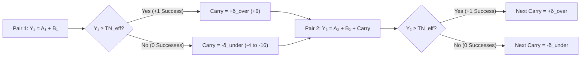

# Probability, Distribution Topology & `2d20` Calibration in Satya

Dice are a tool to inject uncertainty, risk, and surprise into a roleplaying game. Whenever a character attempts an action where the outcome is uncertain and meaningful, the game's resolution engine must answer two questions:
1. **Did the character succeed or fail?**
2. **By how much?** (Did they barely scrape by, achieve a masterwork triumph, fail cleanly, or suffer a catastrophic botch?)

Most tabletop RPGs answer these questions using one of two classic probability distributions:
- **Flat Uniform Rolls (`1d20 + Modifier` vs. Target Number):** Every number on the die is equally likely. Modifiers simply shift the win/loss cutoff linearly, producing "swingy" outcomes where mastery only shifts a flat threshold.
- **Additive Bell Curves (`3d6` or `NdK` Summed Pools):** By the Central Limit Theorem (CLT), summing independent dice rapidly converges to a symmetric **Gaussian (normal) bell curve**. Modifiers only shift the mean ($\mu$) or scale the variance ($\sigma^2$); the fundamental shape of the curve never changes.

In **Satya**—a Computer-Assisted RPG (CARPG)—we want the **shape (topology) of the probability distribution itself** (its skewness, modality, and tail behavior) to reflect the narrative reality of the task. A master performing a routine task, a novice attempting a desperate gamble, and an exhausted veteran fighting through injury should not just sit at different points on the same bell curve—they should experience fundamentally different probability distributions.

This chapter details the mathematical foundation and calibration rationale behind Satya's **Two-List Cascading ("Watershed") `2d20` Mechanic** (for the step-by-step gameplay procedure, task gates, and worked examples, see [Core `2d20` Cascade & Task Resolution](../02-core-mechanics/cascading_d20_and_tasks.md)).

---

## 1. Mathematical Structure of the Two-List Cascading ("Watershed") Process

Instead of rolling a single die or summing an independent pool, a task roll in Satya consists of $N$ sequential **pairs** of 20-sided dice (`K = 20`), where **$N \in [1, 8]$ is the character's Skill Level**:
$$\text{List A} = (A_1, A_2, \dots, A_N), \qquad \text{List B} = (B_1, B_2, \dots, B_N)$$

At each step $n \in \{1, \dots, N\}$, the unmodified pair sum $X_n = A_n + B_n$ ranges from **$2$ to $40$**, forming a discrete triangular probability mass function (PMF) centered at its exact 50% mean of **$21$**.

### 1.1 Midpoint-Anchored Roll-Over Target ($\text{TN}_{\text{eff}}$)
Because each step sums **two** `d20` dice (mean $21$) while a character's Controlling Characteristic $C$ is measured on a `1–20` scale (with the human population average at **$C = 10$**), the base target is anchored at $1.5K + 1 = 31$ so that an average character ($C = 10$) attempting a standard benchmark task ($\Delta_{\text{ext}} = 0$) needs the exact `2d20` midpoint of **$21$**:

$$\text{TN}_{\text{eff}} = (1.5K + 1) - C + \Delta_{\text{ext}} = 31 - C + \Delta_{\text{ext}}$$

### 1.2 State Transition & Carry-Over Topology (`markov_step` vs. `cumulative_snowball`)
The pairs are evaluated sequentially from $n = 1$ to $N$ using the effective pair total $Y_n = A_n + B_n + \text{Carry}_n$ against $\text{TN}_{\text{eff}}$ (starting with $\text{Carry}_1 = 0$):



Satya supports two primary state-transition modes in [`paired_list_signed_margin_pmfs`](../../../src/satya_ml/dice_probabilities.py) and [`crates/satya-engine/src/dice_probabilities.rs`](../../../crates/satya-engine/src/dice_probabilities.rs):
- **Single-Step Markov Carry (`markov_step` / `CarryMode::MarkovStep` — Standard Resolution):**
  Pair $n$ receives a single $+\delta_{\text{over}}$ (`+6`) if Pair $n-1$ succeeded, or a single $-\delta_{\text{under}}$ (`-(6 + \Delta_{\text{int}})`) if Pair $n-1$ failed. Mathematically, this forms a **first-order Markov chain** over `{Success, Failure}` states. It allows a skilled character who misses Pair 1 to fight through the $-\delta_{\text{under}}$ penalty on Pair 2 or 3, recover their footing, and flip the cascade back into positive $+\delta_{\text{over}}$ momentum.
- **Cumulative Snowball Carry (`cumulative_snowball` / `CarryMode::CumulativeSnowball` — High-Stakes Resolution):**
  Carry-over compounds across every step ($\text{Carry}_{n+1} = \text{Carry}_n \pm \delta$, yielding `+6, +12, +18...` on streaks of success, or `-6, -12, -18...` on streaks of failure). This splits the probability distribution into a stark **bimodal ("watershed") distribution** where early momentum snowballs into effortless mastery and early failure locks out recovery.

---

## 2. Eliminating the "Skilled Botch Paradox"

In many dice-pool RPGs (such as classic *World of Darkness* or *Shadowrun* variants), rolling more dice for higher skill accidentally increases the probability of rolling `1`s—penalizing masters for rolling more dice. Satya eliminates this paradox through two complementary mathematical properties of `BotchRule`:

1. **Monotonic Worst-Case Recovery (`closest_miss` / `BotchRule::ClosestMiss` — Default):**
   - A botch failure **only occurs when `total_successes == 0`**.
   - Severity is determined by the character's **best attempt across all $N$ pairs**, $Y_{\text{best}} = \max(Y_1, \dots, Y_N)$, binned into $4$-point ($K/5 = 4$) tiers below $\text{TN}_{\text{eff}}$:
     - If $\text{TN}_{\text{eff}} - 4 \le Y_{\text{best}} < \text{TN}_{\text{eff}}$, the result is **`0` (Clean Failure / Near Miss)**.
     - Every additional $4$-point tier below $\text{TN}_{\text{eff}}$ adds `-1` botch severity (`-1` to `-5`).
   - **Proof of Monotonicity:** Because $\max(Y_1, \dots, Y_N, Y_{N+1}) \ge \max(Y_1, \dots, Y_N)$ for every realization of $Y_{N+1}$, adding another skill pair $N \to N+1$ **strictly decreases** both overall failure probability and botch severity across every tier.
2. **Impossible Floor Breach (`ceiling_breach` & `SuccessWithComplication`):**
   - Because two `d20` dice have a physical minimum sum of $2$, an adjusted pair total $Y_n = A_n + B_n - \delta_{\text{under}}$ can only drop **below $2$ ($Y_n < 2$)** if the character *failed the previous pair* (incurring $-\delta_{\text{under}}$) **and** rolled near snake-eyes on the current pair (`raw_botches += 1`).
   - When `total_successes >= 1` **and** `raw_botches >= 1`, the cascade produces **`SuccessWithComplication` (`OutcomeTier::PartialSuccess`)**—modeling a skilled operator who recovers from an early stumble to complete the task, but suffers strain, noise, or equipment wear from the floor-breach step.

---

## 3. Orthogonal Roles of the Four Task Factors

Rather than inventing arbitrary target numbers for different tasks (e.g., *"Picking this lock is TN 15, shooting at 100m is TN 28"*), Satya uses a **single universal baseline target** ($\text{TN}_0 = 21$ at average $C = 10$) and separates every check into four factors, each governing a distinct topological property of the PMF:

| Task Factor | Game Variable | Mathematical Role in the Cascade | Effect on the Probability Distribution |
| :--- | :--- | :--- | :--- |
| **1. Skill Level** *(or raw Attribute check at $N=1$)* | $N \in [1, 8]$ | Number of `2d20` pairs rolled | Expands the right tail (`+1` to `+N` successes), increases `E[Margin]`, and provides extra Markov steps to recover from an early miss. |
| **2. Controlling Characteristic** *(or composite $\lfloor(C_1+C_2)/2\rfloor$)* | $C \in [1, 20]$ | Shifts $\text{TN}_{\text{eff}} = 31 - C + \Delta_{\text{ext}}$ | Shifts the success threshold on **every pair** simultaneously (including Pair 1, before any carry penalty can trigger). |
| **3. Internal Character Modifiers** *(Fatigue, Wound Shock, Dissonance)* | $\Delta_{\text{int}} \in [-2, +10]$ | Increases failure penalty: $\delta_{\text{under}} = 6 + \Delta_{\text{int}}$ | **Zero penalty on Pair 1**; if the character succeeds immediately, fatigue never slows them down. If they miss Pair 1, recovery becomes drastically harder and floor-breach risk spikes. |
| **4. External Task Modifiers** *(Range, Darkness, Tool Tier, Cover)* | $\Delta_{\text{ext}} \in [-10, +16]$ | Shifts $\text{TN}_{\text{eff}} = 31 - C + \Delta_{\text{ext}}$ | Shifts the required roll on Pair 1 and all subsequent pairs, modeling objective environmental adversity or task complexity. |

---

## 4. Core Calibration Decisions for `K = 20`

### 4.1 Why `K = 20` Over `K = 10` or `K = 100`?
Combinatorial sweeps across $K \in \{10, 20, 100\}$ (see [`summarize_cascade_odds.py`](../../../src/satya_ml/summarize_cascade_odds.py)) demonstrate that when $C = 0.5K$ and $\delta = 0.3K$ are scaled proportionally to $K$, the cascade probabilities are **nearly scale-invariant** (differing by `< 1.6%` between `d10` and `d20`).
We chose **`K = 20`** because:
- It provides **twice the granularity of `K = 10`** for differentiating character attributes ($4\dots 18$ vs. $2\dots 9$) and fine-grained environmental/equipment modifiers ($\pm 1, \pm 2$) without saturating the scale.
- It avoids the two-digit mental arithmetic bloat of summing `2d100` pairs (`2..200`), keeping `2d20` sums (`2..40`) fast and intuitive.

### 4.2 Controlling Characteristic ($C$) Calibration Table
- **Theoretical Scale:** `1` to `20` (mapped linearly from the underlying `0.0–100.0` spectrum)
- **Playable Human Range:** **`4` to `18`** (`1–3` is severely impaired; `19–20` is augmented/transhuman)
- **Population Average:** **`C = 10`** (sets $\text{TN}_{\text{eff}} = 21$ at $\Delta_{\text{ext}} = 0$)

| Characteristic $C$ | Narrative Tier | Base $\text{TN}_{\text{eff}}$ ($\Delta_{\text{ext}}=0$) | Pair 1 Success Chance (`2d20`) | Skill $N=3$ Success Chance (`markov_step`) |
|---:|:---|---:|---:|---:|
| **4** | Feeble / Severely Impaired (Playable Min) | 27 | 22.75% | 33.95% |
| **6** | Weak / Below Average | 25 | 30.00% | 45.87% |
| **8** | Slightly Below Average | 23 | 38.25% | 58.18% |
| **10** | **Human Average** | **21** | **47.50%** | **70.10%** |
| **12** | Capable / Above Average | 19 | 57.25% | 80.38% |
| **14** | Gifted / Exceptional | 17 | 66.00% | 88.14% |
| **16** | Heroic / Elite | 15 | 73.75% | 93.58% |
| **18** | Peak Human (Playable Max) | 13 | 80.50% | 96.93% |

### 4.3 Skill Level ($N$) Calibration Table
Skill levels across the population follow a **positively skewed (right-skewed) pyramid**: most people have little formal training (`1–3`), seasoned professionals sit at `4–5`, and true grandmasters (`8`) are rare.

| Skill Level $N$ | Narrative Tier | `P(Succ >= 1)` ($C=10, \delta=\pm 6$) | `P(BotchFail)` (`closest_miss`) | `P(Succ+Botch)` *(Complication)* | Expected Margin `E[Margin]` |
|---:|:---|---:|---:|---:|---:|
| **1** | Untrained / Novice Talent (`TAL`) | 47.50% | 34.00% | 0.00% | -0.17 |
| **2** | Apprentice / Dabbler | 60.68% | 20.99% | 0.00% | +0.64 |
| **3** | **Competent / Journeyman (Trained Avg)** | **70.10%** | **12.96%** | **1.13%** | **+1.27** |
| **4** | **Professional (Operative Avg)** | **77.25%** | **8.01%** | **3.02%** | **+1.82** |
| **5** | **Veteran / Specialist** | **82.69%** | **4.94%** | **5.31%** | **+2.35** |
| **6** | Expert | 86.83% | 3.05% | 7.81% | +2.85 |
| **7** | Master | 89.98% | 1.88% | 10.36% | +3.35 |
| **8** | **Grandmaster (Standard Max)** | **92.37%** | **1.16%** | **12.90%** | **+3.84** |
| **10** | Mythic Cap | 95.59% | 0.44% | 17.76% | +4.81 |

### 4.4 Cascade Step Sizes ($\delta_{\text{over}}, \delta_{\text{under}}$) & Internal Modifiers ($\Delta_{\text{int}}$)
- **Baseline Success Bonus ($\delta_{\text{over}}$):** **`+6`** ($0.3K$, with complementary `KNO` $\to$ `PHY` setup synergy boosting $\delta_{\text{over}}$ to **`+8`**).
  - *Mathematical Note:* In `markov_step`, changing $\delta_{\text{over}}$ (`+4` to `+10`) does **not** alter `P(Succ >= 1)` because $\delta_{\text{over}}$ only triggers *after* the first success is already achieved. Instead, higher $\delta_{\text{over}}$ increases **expected total successes (`E[Margin]`)** and insulates the character against subsequent floor-breach complications (`P(Succ+Botch)`).
- **Baseline Failure Penalty ($\delta_{\text{base}}$):** **`6`** ($0.3K$).
- **Internal Character Penalty Modifier ($\Delta_{\text{int}} \in [-2, +10]$):** Added directly to $\delta_{\text{under}} = 6 + \Delta_{\text{int}}$, giving a total $-\delta_{\text{under}}$ range of **`-4` (Focused / Conviction Surge) to `-16` (Critically Exhausted / Agonized)**:

| Internal State | $\Delta_{\text{int}}$ | Total $-\delta_{\text{under}}$ | Skill $N=3$ `P(Succ>=1)` | Skill $N=3$ `P(BotchFail)` | Skill $N=5$ `P(Succ>=1)` | Skill $N=8$ `P(Succ>=1)` |
|:---|---:|---:|---:|---:|---:|---:|
| **Focused / Conviction Surge** | -2 | **-4** | 75.26% | 9.37% | 88.23% | 96.14% |
| **Fresh (Standard Baseline)** | 0 | **-6** | **70.10%** | **12.96%** | **82.69%** | **92.37%** |
| **Winded / Distracted** | +4 | **-10** | 60.78% | 20.29% | 69.84% | 79.67% |
| **Battered / Shaken** | +6 | **-12** | 56.96% | 23.71% | 63.50% | 71.50% |
| **Exhausted / Agonized (Max)** | +10 | **-16** | **51.66%** | **29.41%** | **53.57%** | **56.29%** |

---

## 5. Control ($C$) vs. Skill ($N$): Sensitivity Analysis

A foundational design question is how natural capability (**Controlling Characteristic $C$**) compares to training (**Skill Level $N$**) in determining task outcomes. Below is the exact 2D probability matrix for `P(Succ >= 1)` in `markov_step` ($\delta_{\text{over}} = +6, \delta_{\text{under}} = -6, \Delta_{\text{ext}} = 0$):

| Control $C$ | $\text{TN}_{\text{eff}}$ | Skill $N=1$ | Skill $N=2$ | Skill $N=3$ | Skill $N=4$ | Skill $N=5$ | Skill $N=6$ | Skill $N=7$ | Skill $N=8$ | **Skill Swing ($N=1\dots 8$)** |
|---:|---:|---:|---:|---:|---:|---:|---:|---:|---:|---:|
| **4 (Min)** | 27 | 22.75% | 28.71% | **33.95%** | 38.80% | 43.30% | 47.46% | 51.32% | 54.90% | **`+32.15%`** |
| **6** | 25 | 30.00% | 38.62% | **45.87%** | 52.25% | 57.88% | 62.85% | 67.23% | 71.09% | **`+41.09%`** |
| **8** | 23 | 38.25% | 49.42% | **58.18%** | 65.42% | 71.40% | 76.35% | 80.44% | 83.83% | **`+45.58%`** |
| **10 (Avg)** | 21 | **47.50%** | **60.68%** | **70.10%** | **77.25%** | **82.69%** | **86.83%** | **89.98%** | **92.37%** | **`+44.87%`** |
| **12** | 19 | 57.25% | 71.30% | **80.38%** | 86.58% | 90.82% | 93.72% | 95.71% | 97.06% | **`+39.81%`** |
| **14** | 17 | 66.00% | 80.11% | **88.14%** | 92.92% | 95.78% | 97.48% | 98.50% | 99.10% | **`+33.10%`** |
| **16** | 15 | 73.75% | 87.14% | **93.58%** | 96.79% | 98.40% | 99.20% | 99.60% | 99.80% | **`+26.05%`** |
| **18 (Max)** | 13 | 80.50% | 92.36% | **96.93%** | 98.76% | 99.50% | 99.80% | 99.92% | 99.97% | **`+19.47%`** |
| **Control Swing ($C=4\dots 18$)** | **$-14$ TN** | **`+57.75%`** | **`+63.65%`** | **`+62.98%`** | **`+59.96%`** | **`+56.20%`** | **`+52.34%`** | **`+48.60%`** | **`+45.07%`** | *(Playable $C$ span)* |

### Key Design Takeaways
1. **Control ($C$) Dominates `P(Succ >= 1)` Across the Full Range (`+62.98%` vs. `+44.87%`):**
   Because $C$ lowers $\text{TN}_{\text{eff}}$ on **Pair 1** (before any $-\delta_{\text{under}}$ penalty exists) as well as every subsequent pair, a character with low Control ($C = 4 \implies \text{TN}_{\text{eff}} = 27$) who misses Pair 1 faces an effective target of $27 + 6 = 33$ on Pair 2 (only a `7.0%` chance per recovery roll). Even a Grandmaster ($N = 8$) with $C = 4$ only achieves `54.90%` `P(Succ >= 1)`.
2. **Early Skill Ranks ($N = 1 \to 3$) Give the Largest Per-Point Boost (`+13.18%` and `+9.42%`):**
   At $C = 10$, buying the first rank of training ($N = 1 \to 2$) jumps success odds by **`+13.18%`**, and $N = 2 \to 3$ adds **`+9.42%`**, whereas $+1$ to Control $C$ adds **`+5.55%`**. Beyond $N = 5$, extra skill ranks show diminishing returns on `P(Succ >= 1)`.
3. **Skill ($N$) Controls the Ceiling of Excellence (`E[Margin]`):**
   A naturally gifted novice ($C = 18, N = 1$) has an **`80.50%`** chance of getting `1` success, but has a **`0%` chance** of ever scoring `2+` successes (`E[Margin] = +0.69`). A trained specialist ($C = 10, N = 5$) has a similar **`82.69%`** chance of succeeding, but averages **`+2.35` successes** and can chain up to **`+5` masterwork successes**.

---

## 6. Codebase & Interactive Simulation Tools

- **Exact Combinatorial & DP Engine (Python, PyO3 & Rust):**
  - Python & PyO3 (`satya_py`): [`src/satya_ml/dice_probabilities.py`](../../../src/satya_ml/dice_probabilities.py) & [`crates/satya-py/src/lib.rs`](../../../crates/satya-py/src/lib.rs)
  - Rust Game Engine Crate (`satya-engine`): [`crates/satya-engine/src/dice_probabilities.rs`](../../../crates/satya-engine/src/dice_probabilities.rs)
- **CLI Odds Summary & Calibration Sweeps (Python & Rust):**
  - Python: [`src/satya_ml/summarize_cascade_odds.py`](../../../src/satya_ml/summarize_cascade_odds.py)
  - Rust Module & CLI Binary (`satya-engine`): [`crates/satya-engine/src/summarize_cascade_odds.rs`](../../../crates/satya-engine/src/summarize_cascade_odds.rs) & [`crates/satya-engine/src/bin/summarize_cascade_odds.rs`](../../../crates/satya-engine/src/bin/summarize_cascade_odds.rs)
  ```powershell
  # Rust CLI
  cargo run -p satya-engine --bin summarize-cascade-odds -- --calibration k20_full
  cargo run -p satya-engine --bin summarize-cascade-odds -- --calibration c_vs_n

  # Python CLI
  $env:PYTHONPATH="src"; python -m satya_ml.summarize_cascade_odds --calibration k20_full
  $env:PYTHONPATH="src"; python -m satya_ml.summarize_cascade_odds --calibration c_vs_n
  ```
- **Interactive Marimo Notebooks & Rules Book:** [`notebooks/dice_probability_distributions.py`](../../../notebooks/dice_probability_distributions.py) & [`notebooks/satya_rules_book.py`](../../../notebooks/satya_rules_book.py) (`pixi run notebook` / `pixi run rules-book`)
