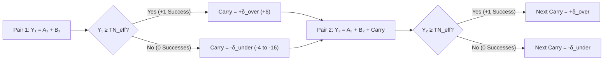

# Probability, Distribution Topology & `2d20` Calibration in Satya

> **Rust Engine Implementation**: [`crates/satya-engine/src/dice_probabilities.rs`](../../../crates/satya-engine/src/dice_probabilities.rs) (`CarryMode`, `compute_stats`, `paired_list_signed_margin_pmfs`, `paired_list_cascade_pmfs`) and [`crates/satya-engine/src/contested_cascade.rs`](../../../crates/satya-engine/src/contested_cascade.rs) (`GmResistanceMode`, `ContestedTieRule`, `contested_2d20_cascade_pmfs`).

Dice are a tool to inject uncertainty, risk, and surprise into a roleplaying game. Whenever a character attempts an action where the outcome is uncertain and meaningful, the game's resolution engine must answer two questions:
1. **Did the character succeed or fail?**
2. **By how much?** (Did they barely scrape by, achieve a masterwork triumph, fail cleanly, or suffer a catastrophic botch?)

Most tabletop RPGs answer these questions using one of two classic probability distributions:
- **Flat Uniform Rolls (`1d20 + Modifier` vs. Target Number):** Every number on the die is equally likely. Modifiers simply shift the win/loss cutoff linearly, producing "swingy" outcomes where mastery only shifts a flat threshold.
- **Additive Bell Curves (`3d6` or `NdK` Summed Pools):** By the Central Limit Theorem (CLT), summing independent dice rapidly converges to a symmetric **Gaussian (normal) bell curve**. Modifiers only shift the mean ($\mu$) or scale the variance ($\sigma^2$); the fundamental shape of the curve never changes.

In **Satya**—a Computer-Assisted RPG (CARPG)—we want the **shape (topology) of the probability distribution itself** (its skewness, modality, and tail behavior) to reflect the narrative reality of the task. A master performing a routine task, a novice attempting a desperate gamble, and an exhausted veteran fighting through injury should not just sit at different points on the same bell curve—they should experience fundamentally different probability distributions.

This chapter details the mathematical foundation and calibration rationale behind Satya's **Two-List Cascading ("Watershed") `2d20` Mechanic** (for definitions of all mathematical variables and subscripts such as $\text{TN}_P$, $\text{TN}_{GM}$, $C_P$, $\delta_{\text{over}}$, and $\delta_{\text{under}}$, see the **[Mathematical Notation, Variables & Formula Glossary](mathematical_notation_glossary.md)**; for the step-by-step gameplay procedure, task gates, and worked examples, see **[Core `2d20` Cascade & Task Resolution](../02-core-mechanics/cascading_d20_and_tasks.md)**).

---

## 1. Mathematical Structure of the Two-List Cascading ("Watershed") Process

Instead of rolling a single die or summing an independent pool, a task roll in Satya consists of $N$ sequential **pairs** of 20-sided dice (`K = 20`), where **$N \in [1, 8]$ is the character's Skill Level**:
$$\text{List A} = (A_1, A_2, \dots, A_N), \qquad \text{List B} = (B_1, B_2, \dots, B_N)$$

At each step $n \in \{1, \dots, N\}$, the unmodified pair sum $X_n = A_n + B_n$ ranges from **$2$ to $40$**, forming a discrete triangular probability mass function (PMF) centered at its exact 50% mean of **$21$**.

### 1.1 Midpoint-Anchored Roll-Over Targets ($\text{TN}_P$ and Hidden $\text{TN}_{GM}$)
Because each step sums **two** `d20` dice ($K = 20$, mean $21$) while a character's Controlling Characteristic $C_P$ (**Control of the Player**) is measured on a `1–20` scale (with the human population average at **$C_P = 10$**), the base target is anchored at $1.5K + 1 = 31$ so that an average character ($C_P = 10$) using standard equipment ($\Delta_{\text{tool}} = 0$, **Known Tool Modifier**) needs the exact `2d20` midpoint of **$21$**:

$$\text{TN}_P = (1.5K + 1) - C_P + \Delta_{\text{tool}} = 31 - C_P + \Delta_{\text{tool}}$$

where:
- **$\text{TN}_P$ (`Target Number of the Player`):** The known roll-over threshold the player's pair total $Y_n$ must beat at each step $n$.
- **$C_P$ (`Controlling Characteristic of the Player`):** The player's governing attribute (`1–20` scale; higher $C_P$ lowers $\text{TN}_P$).
- **$\Delta_{\text{tool}}$ (`Known Tool & Loadout Modifier`):** Equipment bonus or penalty known to the player before rolling (`-4` smart-rig to `+8` improvised).

To preserve **epistemic fog of war** (see [Section 6](#6-always-contested-task-resolution--the-1-pair-tiered-gm-resistance-rule)), **Hidden External Task Difficulty ($\Delta_{\text{ext}}$)** does **not** shift the player's target number $\text{TN}_P$. Instead, the player always rolls their sequential cascade against their known personal target $\text{TN}_P$, while the Game Master secretly rolls an opposing **GM Resistance Roll** ($X_{GM} = A_{GM} + B_{GM}$) against the **Target Number of the Game Master ($\text{TN}_{GM}$)**:

$$\text{TN}_{GM} = 21 - \Delta_{\text{ext}} \qquad \left(\text{equivalent to an opposing GM Controller } C_{GM} = 10 + \Delta_{\text{ext}}\right)$$

*(When evaluating uncontested baseline curves or known-difficulty benchmarks in Sections 4–5, $\text{TN}_{\text{eff}} = 31 - C + \Delta_{\text{ext}}$ denotes the **Effective Uncontested Target Number** on a single-side roll).*

### 1.2 State Transition & Carry-Over Topology (`markov_step` vs. `cumulative_snowball`)
The pairs are evaluated sequentially from $n = 1$ to $N$ using the effective pair total $Y_n = A_n + B_n + \text{Carry}_n$ against $\text{TN}_{\text{eff}}$ (starting with $\text{Carry}_1 = 0$):

Satya supports two primary state-transition modes in [`paired_list_signed_margin_pmfs`](../../../src/satya_ml/dice_probabilities.py) and [`crates/satya-engine/src/dice_probabilities.rs`](../../../crates/satya-engine/src/dice_probabilities.rs):
- **Single-Step Markov Carry (`markov_step` / `CarryMode::MarkovStep` — Standard Resolution):**
  Pair $n$ receives a single $+\delta_{\text{over}}$ (`+6`) if Pair $n-1$ succeeded, or a single $-\delta_{\text{under}}$ ($-(6 + \Delta_{\text{int}})$) if Pair $n-1$ failed. Mathematically, this forms a **first-order Markov chain** over `{Success, Failure}` states. It allows a skilled character who misses Pair 1 to fight through the $-\delta_{\text{under}}$ penalty on Pair 2 or 3, recover their footing, and flip the cascade back into positive $+\delta_{\text{over}}$ momentum.
- **Cumulative Snowball Carry (`cumulative_snowball` / `CarryMode::CumulativeSnowball` — High-Stakes Resolution):**
  Carry-over compounds across every step ($\text{Carry}_{n+1} = \text{Carry}_n \pm \delta$, yielding `+6, +12, +18...` on streaks of success, or `-6, -12, -18...` on streaks of failure). This splits the probability distribution into a stark **bimodal ("watershed") distribution** where early momentum snowballs into effortless mastery and early failure locks out recovery.

---

## 2. Eliminating the "Skilled Botch Paradox"

In many dice-pool RPGs (such as classic *World of Darkness* or *Shadowrun* variants), rolling more dice for higher skill accidentally increases the probability of rolling `1`s—penalizing masters for rolling more dice. Satya eliminates this paradox through two complementary mathematical properties of `BotchRule`:

1. **Monotonic Worst-Case Recovery (`closest_miss` / `BotchRule::ClosestMiss` — Default):**
   - A botch failure **only occurs when `total_successes == 0`**.
   - Severity is determined by the character's **best attempt across all $N$ pairs**, $Y_{\text{best}} = \max(Y_1, \dots, Y_N)$, binned into $4$-point ($K/5 = 4$) tiers below $\text{TN}_{\text{eff}}$:
     - If $\text{TN}_{\text{eff}} - 4 \le Y_{\text{best}} < \text{TN}_{\text{eff}}$, the result is **`0` (Clean Failure / Near Miss)**.
     - Every additional $4$-point tier below $\text{TN}_{\text{eff}}$ adds `-1` botch severity (`-1` to `-5`).
   - **Proof of Monotonicity:** Because $\max(Y_1, \dots, Y_N, Y_{N+1}) \ge \max(Y_1, \dots, Y_N)$ for every realization of $Y_{N+1}$, adding another skill pair $N \to N+1$ **strictly decreases** both overall failure probability and botch severity across every tier.
2. **Impossible Floor Breach (`ceiling_breach` & `SuccessWithComplication`):**
   - Because two `d20` dice have a physical minimum sum of $2$, an adjusted pair total $Y_n = A_n + B_n - \delta_{\text{under}}$ can only drop **below $2$ ($Y_n < 2$)** if the character *failed the previous pair* (incurring $-\delta_{\text{under}}$) **and** rolled near snake-eyes on the current pair (`raw_botches += 1`).
   - When `total_successes >= 1` **and** `raw_botches >= 1`, the cascade produces **`SuccessWithComplication` (`OutcomeTier::PartialSuccess`)**—modeling a skilled operator who recovers from an early stumble to complete the task, but suffers strain, noise, or equipment wear from the floor-breach step.

---

## 3. Orthogonal Roles of the Four Task Factors

Rather than inventing arbitrary target numbers for different tasks (e.g., *"Picking this lock is TN 15, shooting at 100m is TN 28"*), Satya uses a **single universal baseline target** ($\text{TN}_0 = 21$ at average $C = 10$) and separates every check into four factors, each governing a distinct topological property of the PMF:

| Task Factor | Game Variable | Mathematical Role in the Cascade | Effect on the Probability Distribution |
| :--- | :--- | :--- | :--- |
| **1. Skill Level** *(or raw Attribute check at $N=1$)* | $N \in [1, 8]$ | Number of `2d20` pairs rolled by the player | Expands the right tail (`+1` to `+N` successes), increases `E[Margin]`, and provides extra Markov steps to recover from an early miss. |
| **2. Controlling Characteristic** *(or composite $\lfloor(C_1+C_2)/2\rfloor$)* | $C_P \in [1, 20]$ | Shifts player's personal target $\text{TN}_P = 31 - C_P + \Delta_{\text{tool}}$ | Shifts the player's success threshold on **every pair** simultaneously (including Pair 1, before any carry penalty can trigger). |
| **3. Internal Character Modifiers** *(Fatigue, Wound Shock, Dissonance)* | $\Delta_{\text{int}} \in [-2, +10]$ | Increases failure penalty: $\delta_{\text{under}} = 6 + \Delta_{\text{int}}$ | **Zero penalty on Pair 1**; if the character succeeds immediately, fatigue never slows them down. If they miss Pair 1, recovery becomes drastically harder and floor-breach risk spikes. |
| **4a. Known Tool / Loadout Modifier** *(Smart-Optics, Masterwork vs. Improvised Kit)* | $\Delta_{\text{tool}} \in [-4, +8]$ | Shifts player's known target $\text{TN}_P = 31 - C_P + \Delta_{\text{tool}}$ | Transparently adjusts the player's personal target based on gear the character knows they are holding. |
| **4b. Hidden External Difficulty** *(Lock Quality, Countermeasures, Weather, Hazard Severity)* | $\Delta_{\text{ext}} \in [-10, +16]$ | Shifts the GM's hidden resistance target $\text{TN}_{GM} = 21 - \Delta_{\text{ext}}$ | Shifts the opposing GM resistance distribution (`S_GM` and `B_GM`) without revealing the obstacle's true rating to the player. |

---

## 4. Core Calibration Decisions for `K = 20`

### 4.1 Why `K = 20` Over `K = 10` or `K = 100`?
Combinatorial sweeps across $K \in \{10, 20, 100\}$ demonstrate that when $C = 0.5K$ and $\delta = 0.3K$ are scaled proportionally to $K$, the cascade probabilities are **nearly scale-invariant** (differing by `< 1.6%` between `d10` and `d20`).
We chose **`K = 20`** because:
- It provides **twice the granularity of `K = 10`** for differentiating character attributes ($4\dots 18$ vs. $2\dots 9$) and fine-grained environmental/equipment modifiers ($\pm 1, \pm 2$) without saturating the scale.
- It avoids the two-digit mental arithmetic bloat of summing `2d100` pairs (`2..200`), keeping `2d20` sums (`2..40`) fast and intuitive.

### 4.2 Controlling Characteristic ($C$) Calibration Table
- **Theoretical Scale:** `1` to `20` (mapped linearly from the underlying `0.0–100.0` spectrum)
- **Playable Human Range:** **`4` to `18`** (`1–3` is severely impaired; `19–20` is augmented/transhuman)
- **Population Average:** **`C = 10`** (sets $\text{TN}_{\text{eff}} = 21$ at $\Delta_{\text{ext}} = 0$)

| Characteristic $C$ | Narrative Tier | Base $\text{TN}_{\text{eff}}$ ($\Delta_{\text{ext}}=0$) | Pair 1 Success Chance (`2d20`) | Skill $N=3$ Success Chance (`markov_step`) |
|---:|:---|---:|---:|---:|
| **4** | Feeble / Severely Impaired (Playable Min) | 27 | 22.75% | 33.95% |
| **6** | Weak / Below Average | 25 | 30.00% | 45.87% |
| **8** | Slightly Below Average | 23 | 38.25% | 58.18% |
| **10** | **Human Average** | **21** | **47.50%** | **70.10%** |
| **12** | Capable / Above Average | 19 | 57.25% | 80.38% |
| **14** | Gifted / Exceptional | 17 | 66.00% | 88.14% |
| **16** | Heroic / Elite | 15 | 73.75% | 93.58% |
| **18** | Peak Human (Playable Max) | 13 | 80.50% | 96.93% |

### 4.3 Skill Level ($N$) Calibration Table
Skill levels across the population follow a **positively skewed (right-skewed) pyramid**: most people have little formal training (`1–3`), seasoned professionals sit at `4–5`, and true grandmasters (`8`) are rare.

| Skill Level $N$ | Narrative Tier | `P(Succ >= 1)` ($C=10, \delta=\pm 6$) | `P(BotchFail)` (`closest_miss`) | `P(Succ+Botch)` *(Complication)* | Expected Margin `E[Margin]` |
|---:|:---|---:|---:|---:|---:|
| **1** | Untrained / Novice Talent (`TAL`) | 47.50% | 34.00% | 0.00% | -0.17 |
| **2** | Apprentice / Dabbler | 60.68% | 20.99% | 0.00% | +0.64 |
| **3** | **Competent / Journeyman (Trained Avg)** | **70.10%** | **12.96%** | **1.13%** | **+1.27** |
| **4** | **Professional (Operative Avg)** | **77.25%** | **8.01%** | **3.02%** | **+1.82** |
| **5** | **Veteran / Specialist** | **82.69%** | **4.94%** | **5.31%** | **+2.35** |
| **6** | Expert | 86.83% | 3.05% | 7.81% | +2.85 |
| **7** | Master | 89.98% | 1.88% | 10.36% | +3.35 |
| **8** | **Grandmaster (Standard Max)** | **92.37%** | **1.16%** | **12.90%** | **+3.84** |
| **10** | Mythic Cap | 95.59% | 0.44% | 17.76% | +4.81 |

### 4.4 Cascade Step Sizes ($\delta_{\text{over}}, \delta_{\text{under}}$) & Internal Modifiers ($\Delta_{\text{int}}$)
- **Baseline Success Bonus ($\delta_{\text{over}}$):** **`+6`** ($0.3K$, with complementary `KNO` $\to$ `PHY` setup synergy boosting $\delta_{\text{over}}$ to **`+8`**).
  - *Mathematical Note:* In `markov_step`, changing $\delta_{\text{over}}$ (`+4` to `+10`) does **not** alter `P(Succ >= 1)` because $\delta_{\text{over}}$ only triggers *after* the first success is already achieved. Instead, higher $\delta_{\text{over}}$ increases **expected total successes (`E[Margin]`)** and insulates the character against subsequent floor-breach complications (`P(Succ+Botch)`).
- **Baseline Failure Penalty ($\delta_{\text{base}}$):** **`6`** ($0.3K$).
- **Internal Character Penalty Modifier ($\Delta_{\text{int}} \in [-2, +10]$):** Added directly to $\delta_{\text{under}} = 6 + \Delta_{\text{int}}$, giving a total $-\delta_{\text{under}}$ range of **`-4` (Focused / Conviction Surge) to `-16` (Critically Exhausted / Agonized)**:

| Internal State | $\Delta_{\text{int}}$ | Total $-\delta_{\text{under}}$ | Skill $N=3$ `P(Succ>=1)` | Skill $N=3$ `P(BotchFail)` | Skill $N=5$ `P(Succ>=1)` | Skill $N=8$ `P(Succ>=1)` |
|:---|---:|---:|---:|---:|---:|---:|
| **Focused / Conviction Surge** | -2 | **-4** | 75.26% | 9.37% | 88.23% | 96.14% |
| **Fresh (Standard Baseline)** | 0 | **-6** | **70.10%** | **12.96%** | **82.69%** | **92.37%** |
| **Winded / Distracted** | +4 | **-10** | 60.78% | 20.29% | 69.84% | 79.67% |
| **Battered / Shaken** | +6 | **-12** | 56.96% | 23.71% | 63.50% | 71.50% |
| **Exhausted / Agonized (Max)** | +10 | **-16** | **51.66%** | **29.41%** | **53.57%** | **56.29%** |

---

## 5. Control ($C$) vs. Skill ($N$): Sensitivity Analysis

A foundational design question is how natural capability (**Controlling Characteristic $C$**) compares to training (**Skill Level $N$**) in determining task outcomes. Below is the exact 2D probability matrix for `P(Succ >= 1)` in `markov_step` ($\delta_{\text{over}} = +6, \delta_{\text{under}} = -6, \Delta_{\text{ext}} = 0$):

| Control $C$ | $\text{TN}_{\text{eff}}$ | Skill $N=1$ | Skill $N=2$ | Skill $N=3$ | Skill $N=4$ | Skill $N=5$ | Skill $N=6$ | Skill $N=7$ | Skill $N=8$ | **Skill Swing ($N=1\dots 8$)** |
|---:|---:|---:|---:|---:|---:|---:|---:|---:|---:|---:|
| **4 (Min)** | 27 | 22.75% | 28.71% | **33.95%** | 38.80% | 43.30% | 47.46% | 51.32% | 54.90% | **`+32.15%`** |
| **6** | 25 | 30.00% | 38.62% | **45.87%** | 52.25% | 57.88% | 62.85% | 67.23% | 71.09% | **`+41.09%`** |
| **8** | 23 | 38.25% | 49.42% | **58.18%** | 65.42% | 71.40% | 76.35% | 80.44% | 83.83% | **`+45.58%`** |
| **10 (Avg)** | 21 | **47.50%** | **60.68%** | **70.10%** | **77.25%** | **82.69%** | **86.83%** | **89.98%** | **92.37%** | **`+44.87%`** |
| **12** | 19 | 57.25% | 71.30% | **80.38%** | 86.58% | 90.82% | 93.72% | 95.71% | 97.06% | **`+39.81%`** |
| **14** | 17 | 66.00% | 80.11% | **88.14%** | 92.92% | 95.78% | 97.48% | 98.50% | 99.10% | **`+33.10%`** |
| **16** | 15 | 73.75% | 87.14% | **93.58%** | 96.79% | 98.40% | 99.20% | 99.60% | 99.80% | **`+26.05%`** |
| **18 (Max)** | 13 | 80.50% | 92.36% | **96.93%** | 98.76% | 99.50% | 99.80% | 99.92% | 99.97% | **`+19.47%`** |
| **Control Swing ($C=4\dots 18$)** | **$-14$ TN** | **`+57.75%`** | **`+63.65%`** | **`+62.98%`** | **`+59.96%`** | **`+56.20%`** | **`+52.34%`** | **`+48.60%`** | **`+45.07%`** | *(Playable $C$ span)* |

### Key Design Takeaways
1. **Control ($C$) Dominates `P(Succ >= 1)` Across the Full Range (`+62.98%` vs. `+44.87%`):**
   Because $C$ lowers $\text{TN}_{\text{eff}}$ on **Pair 1** (before any $-\delta_{\text{under}}$ penalty exists) as well as every subsequent pair, a character with low Control ($C = 4 \implies \text{TN}_{\text{eff}} = 27$) who misses Pair 1 faces an effective target of $27 + 6 = 33$ on Pair 2 (only a `7.0%` chance per recovery roll). Even a Grandmaster ($N = 8$) with $C = 4$ only achieves `54.90%` `P(Succ >= 1)`.
2. **Early Skill Ranks ($N = 1 \to 3$) Give the Largest Per-Point Boost (`+13.18%` and `+9.42%`):**
   At $C = 10$, buying the first rank of training ($N = 1 \to 2$) jumps success odds by **`+13.18%`**, and $N = 2 \to 3$ adds **`+9.42%`**, whereas $+1$ to Control $C$ adds **`+5.55%`**. Beyond $N = 5$, extra skill ranks show diminishing returns on `P(Succ >= 1)`.
3. **Skill ($N$) Controls the Ceiling of Excellence (`E[Margin]`):**
   A naturally gifted novice ($C = 18, N = 1$) has an **`80.50%`** chance of getting `1` success, but has a **`0%` chance** of ever scoring `2+` successes (`E[Margin] = +0.69`). A trained specialist ($C = 10, N = 5$) has a similar **`82.69%`** chance of succeeding, but averages **`+2.35` successes** and can chain up to **`+5` masterwork successes**.

---

## 6. Always-Contested Task Resolution & The 1-Pair Tiered GM Resistance Rule

A core pillar of Satya's design philosophy is **Epistemic Fog of War**: a player knows their own capability ($N_P, C_P$), internal state ($\Delta_{\text{int}}$), and equipment ($\Delta_{\text{tool}}$), so they can feel how smoothly or clumsily their own execution went—but they should **never know for certain whether a high roll was enough to beat an unknown obstacle, or whether a `0`-success miss was rescued by an environmental flaw**.

### 6.1 Why Convolving Two Multi-Pair Cascades Destroys Bimodality (and How 1-Pair Tiered GM Resistance Preserves It)

If the GM rolled an independent multi-pair cascade ($N_{GM} = 3$) against the player's cascade ($N_P = 5$), the net margin $\Delta M = M_P - M_{GM}$ would be the **cross-correlation (convolution of $P_P(m)$ with $P_{GM}(-m)$)** of two distributions:
- **Variance Inflation & Skewness Cancellation:** Because $\text{Var}(M_P - M_{GM}) = \text{Var}(M_P) + \text{Var}(M_{GM})$ and the third central moment subtracts ($\mu_3(M_P - M_{GM}) = \mu_3(M_P) - \mu_3(M_{GM})$), a symmetric multi-pair GM cascade cancels out the player's skewness and pulls the net distribution back toward a Gaussian bell curve.
- **Valley In-Filling in High-Stakes (`CumulativeSnowball`) Mode:** In uncontested `CumulativeSnowball` ($N_P = 5, C_P = 10$), the player's distribution is starkly bimodal (**Sarle's Bimodality Coefficient $\text{BC} = 0.678 > 0.555$**), with peaks at `-1` and `+5` separated by a deep watershed valley at `+1..+3`. If the GM also rolls a bimodal $N_{GM} = 3$ cascade (peaks at `-1` and `+3`), then **`Player High (+5) - GM High (+3) = +2`** and **`Player Low (-1) - GM Low (-1) = 0`** dump **`16.0%`** of the total probability mass directly into the middle of the valley—collapsing $\text{BC}$ from **`0.678` (bimodal)** down to **`0.453` (unimodal)**!

By contrast, when the GM rolls a **Single `2d20` Pair (`1-Pair Tiered GM Resistance`)** for environmental and passive tasks:
- The GM's single `2d20` roll is a compact, unimodal triangular distribution with no multi-step carry-over.
- Convolving the player's $N_P$-pair cascade with a single `2d20` GM pair **preserves the bimodal watershed (`BC = 0.585 > 0.555`) and negative skewness (`-0.146`)** in `CumulativeSnowball`, while requiring only **one hidden `2d20` roll** from the GM.

### 6.2 The Canonical 4-Point Over-Tier & Under-Botch Formula (`TieredSinglePair { step_size: 4 }`)

If a single-pair GM roll only ever generated `0` or `1` success, it would saturate on **Challenging ($\Delta_{\text{ext}} = +4$)** and **Hard ($\Delta_{\text{ext}} = +8$)** tasks once $\Delta_{\text{ext}}$ is moved off the player's target number—because a competent player ($N_P = 3$ pairs, $C_P = 10$) rolling against their personal $\text{TN}_P = 21$ achieves `2+` successes **`48.00%`** of the time, which a binary `0/1` GM roll could never beat!

To give the GM's single `2d20` roll ($X_{GM} = A_{GM} + B_{GM}$, where $A_{GM}, B_{GM} \in [1, 20]$ are the GM's two `d20` dice) full multi-success scaling and botch depth using the **exact same `4`-point ($K/5 = 4$) tier ruler** on both sides of $\text{TN}_{GM} = 21 - \Delta_{\text{ext}}$:
- **GM Resistance Successes ($S_{GM}$ — Over-Tiers of `4` Points):**
  When the GM's hidden `2d20` sum $X_{GM} = A_{GM} + B_{GM}$ beats $\text{TN}_{GM}$ ($X_{GM} > \text{TN}_{GM}$ in strict mode, or $\ge$ in roll-over), let $S_{GM}$ be the **GM's Success Count**, $B_{GM}$ be the **GM's Botch Count**, and $M_{GM}$ be the **GM's Signed Margin**:
  $$S_{GM} = 1 + \left\lfloor \frac{X_{GM} - \text{TN}_{GM} - 1}{4} \right\rfloor, \qquad B_{GM} = 0, \qquad M_{GM} = +S_{GM}$$
  - Rolling $1\text{–}4$ points over $\text{TN}_{GM}$ scores **`1` GM Success** ($S_{GM} = 1, M_{GM} = +1$).
  - Rolling $5\text{–}8$ points over $\text{TN}_{GM}$ scores **`2` GM Successes** ($S_{GM} = 2, M_{GM} = +2$).
  - Rolling $9\text{–}12$ points over $\text{TN}_{GM}$ scores **`3` GM Successes** ($S_{GM} = 3, M_{GM} = +3$, and so on, up to `5+` on extreme difficulties).
- **GM Clean `0` or Environmental Botch ($B_{GM}$ — Under-Tiers of `4` Points):**
  When $X_{GM} \le \text{TN}_{GM}$:
  $$S_{GM} = 0, \qquad B_{GM} = \min\!\left(5,\; \left\lfloor \frac{\text{TN}_{GM} - X_{GM}}{4} \right\rfloor\right), \qquad M_{GM} = -B_{GM}$$
  - Missing by $0\text{–}3$ points ($\text{TN}_{GM} - 3 \le X_{GM} \le \text{TN}_{GM}$) is a **GM Clean `0`** ($B_{GM} = 0, M_{GM} = 0$).
  - Missing by $4+$ points ($\text{TN}_{GM} - X_{GM} \ge 4$) is a **GM Botch** ($B_{GM} \in [1, 5], M_{GM} \in [-1, -5]$), representing an unexpected weak spot, structural flaw, or momentary lapse in the obstacle!

### 6.3 The 7-Way Contested Outcome Matrix (`ContestedTieRule::HybridSignedMargin`)

Comparing the **Player's cascade result $(S_P, B_P, M_P)$**—where $S_P$ is Player Success Count, $B_P$ is Player Floor-Breach Count, and $M_P$ is Player Signed Margin—against the **GM's hidden roll $(S_{GM}, B_{GM}, M_{GM})$** with **Net Contested Signed Margin $\Delta M = M_P - M_{GM}$** yields seven distinct narrative and mechanical outcomes (`ContestedOutcomeKind`):

| Contested Outcome (`ContestedOutcomeKind`) | `OutcomeTier` | Mathematical Condition | Narrative & Mechanical Meaning |
| :--- | :--- | :--- | :--- |
| **1. `ExtraordinarySuccess`** | `EXTRAORDINARY_SUCCESS` | $S_P > S_{GM}$, $\Delta M \ge +3$, and $(B_P = 0 \text{ or } M_{GM} < 0)$ | **Masterwork Triumph:** Decisive victory (`-15%` duration per net success above 1, silent execution, bonus yield, or `-4` $\Delta_{\text{ext}}$ setup synergy). Note that a GM botch ($M_{GM} < 0$) boosts $\Delta M = S_P - (-B_{GM}) = S_P + B_{GM}$ and cancels a player floor breach! |
| **2. `CleanSuccess`** | `SUCCESS` | $S_P > S_{GM}$, $1 \le \Delta M \le 2$, and $(B_P = 0 \text{ or } M_{GM} < 0)$ | **Clean Professional Execution:** The player cleanly overcomes the obstacle's resistance with no complication. |
| **3. `SuccessWithFloorBreach`** | `PARTIAL_SUCCESS` | $S_P > S_{GM}$, $B_P \ge 1$, and $M_{GM} \ge 0$ | **Success with Stumble Complication:** The player out-rolled the GM's successes, but suffered an uncancelled floor breach ($Y_n < 2$) during their cascade (tool wear, noise, or `+2` $\Delta_{\text{int}}$ strain). |
| **4. `GrazingTieSuccess`** | `PARTIAL_SUCCESS` | $S_P = S_{GM} \ge 1$ | **Positive Tie (Success at a Minor Cost):** Both the player and the obstacle pushed to the same positive tier ($1\text{–}1$, $2\text{–}2$, $3\text{–}3$). The player succeeds by the skin of their teeth, incurring `+25%` Tick Cost (`TC`), minor noise, or reduced effect. |
| **5. `LuckyBreakSuccess`** | `PARTIAL_SUCCESS` | $S_P = 0, M_P = 0$ (Player Clean Miss) **and** $M_{GM} < 0$ (GM Botch) | **GM Botch Rescues Player Near-Miss:** The player stalled (`0` successes, `0` botches), **but** the environment/obstacle critically failed (a corroded lock pin sheared in their favor, a guard glanced away at a notification). The player scrapes through by sheer luck! |
| **6. `CleanFailure`** | `FAILURE` | $(S_P < S_{GM}, M_P \ge 0, B_P = 0)$ **or** $(M_P = 0 \text{ and } M_{GM} = 0)$ | **Clean Failure / Stalemate:** The obstacle held firm without catastrophic fallout; time (`TC`) is spent. |
| **7. `BotchFailure`** | `CRITICAL_FAILURE` | $M_P < 0$ **or** $(S_P < S_{GM} \text{ and } B_P \ge 1)$ | **Catastrophic Botch:** The player failed to overcome the obstacle *and* botched (or suffered a floor breach on a failed attempt). Note: if **both** the player and GM botch ($M_P < 0, M_{GM} < 0$), the player still fails, but the GM's botch softens the severity ($\Delta M = M_P - M_{GM}$). |

### 6.4 Calibration Sweep Across Skill Levels ($N_P = 1 \dots 8$, $C_P = 10, \Delta_{\text{ext}} = 0$)

Below is the exact combinatorial distribution for an average character ($C_P = 10 \implies \text{TN}_P = 21$) against a Standard Benchmark obstacle ($\Delta_{\text{ext}} = 0 \implies \text{TN}_{GM} = 21$) under the **1-Pair Tiered GM Resistance Rule (`4`-pt over-tiers)**:

| Skill $N_P$ | Uncontested `P(S>=1)` | **Contested `TotalWin%`** *(All Wins + Partials)* | **`CleanWin%`** ($S_P > S_{GM}$, No Breach) | **`ExtrWin%`** ($\Delta M \ge +3$) | **`GrazeTie%`** ($S_P = S_{GM} \ge 1$) | **`LuckyBrk%`** ($M_P=0, M_{GM}<0$) | **`FlrBrch%`** ($S_P>S_{GM}, B_P\ge 1$) | `CleanFail%` | `BotchFail%` | Expected Net `E[ΔM]` |
|---:|---:|---:|---:|---:|---:|---:|---:|---:|---:|---:|
| **1** | 47.50% | **39.54%** | **24.94%** | 9.26% | 8.31% | 6.29% | 0.00% | 26.46% | 34.00% | -0.55 |
| **2** | 60.68% | **53.44%** | **37.99%** | 16.91% | 9.22% | 6.23% | 0.00% | 25.23% | 21.33% | +0.26 |
| **3 (Avg)** | **70.10%** | **63.76%** | **48.48%** | **25.41%** | **9.31%** | **5.76%** | **0.21%** | **22.15%** | **14.09%** | **+0.89** |
| **4** | 77.25% | **71.56%** | **56.90%** | 33.81% | 8.92% | 5.01% | 0.73% | 18.56% | 9.88% | +1.45 |
| **5** | 82.69% | **77.41%** | **63.48%** | 41.50% | 8.16% | 4.20% | 1.56% | 15.23% | 7.36% | +1.97 |
| **6** | 86.83% | **81.91%** | **68.42%** | 48.32% | 7.38% | 3.44% | 2.67% | 12.32% | 5.77% | +2.48 |
| **7** | 89.98% | **85.46%** | **72.07%** | 54.18% | 6.63% | 2.77% | 4.00% | 9.83% | 4.71% | +2.97 |
| **8 (Max)** | 92.37% | **88.29%** | **74.73%** | 59.06% | 5.88% | 2.20% | 5.49% | 7.76% | 3.95% | +3.46 |

### 6.5 Diagonal Shift-Invariance & Epistemic Uncertainty Table

Because Satya's difficulty tiers ($\Delta_{\text{ext}} \in \{-8, -4, 0, +4, +8, +12, +16\}$) and the GM's over/under tiers (`4` points) use the **exact same 4-point quantum**, shifting difficulty by one tier ($\Delta_{\text{ext}} \to \Delta_{\text{ext}} + 4$) shifts the GM's entire success distribution by **exactly one column (`diagonal shift-invariance`)**:

| Hidden Difficulty Tier | $\Delta_{\text{ext}}$ | Hidden $\text{TN}_{GM}$ | `P(GM >= 1)` *(Threatens $S_P=1$)* | `P(GM >= 2)` *(Threatens $S_P=2$)* | `P(GM >= 3)` *(Threatens $S_P=3$)* | `P(GM >= 4)` | `P(GM >= 5)` | `P(GM Botch < 0)` *(Rescues $M_P=0$!)* | $N_P=3, C_P=10$ **`CleanWin%`** | $N_P=3, C_P=10$ **`TotalWin%`** |
| :--- |---:|---:|---:|---:|---:|---:|---:|---:|---:|---:|
| **Trivial / Routine** | `-8` | `29` | 16.50% | 7.00% | 1.50% | 0.00% | 0.00% | **70.00%** | 64.36% | 80.08% |
| **Easy** | `-4` | `25` | 30.00% | 16.50% | 7.00% | 1.50% | 0.00% | **52.50%** | 57.81% | 73.41% |
| **Standard Benchmark** | **`0`** | **`21`** | **47.50%** | **30.00%** | **16.50%** | **7.00%** | **1.50%** | **34.00%** | **48.48%** | **63.76%** |
| **Challenging** | `+4` | `17` | 66.00% | 47.50% | 30.00% | 16.50% | 7.00% | **19.50%** | 37.07% | 51.99% |
| **Hard** | `+8` | `13` | 80.50% | 66.00% | 47.50% | 30.00% | 16.50% | **9.00%** | 25.29% | 38.76% |
| **Extreme** | `+12` | `9` | 91.00% | 80.50% | 66.00% | 47.50% | 30.00% | **2.50%** | 15.02% | 25.83% |
| **Heroic** | `+16` | `5` | 97.50% | 91.00% | 80.50% | 66.00% | 47.50% | **0.00%** | 7.82% | 15.07% |

This guarantees **bidirectional epistemic uncertainty** on every roll:
1. **Even when the player rolls all `3` out of `3` successes ($S_P = 3$):** They still face a **`16.50%`** chance of a tie/loss on a Standard task, **`30.00%`** on a Challenging task, **`47.50%`** on a Hard task, and **`66.00%`** on an Extreme task.
2. **Even when the player rolls `0` successes (a Clean Near-Miss, $M_P = 0$):** They are **not guaranteed to fail**—there is a **`34.00%`** chance on a Standard task (`52.50%` on Easy, `19.50%` on Challenging) that the GM's hidden roll botches ($M_{GM} < 0$), rescuing them with a `LuckyBreakSuccess`!

---

## 7. Codebase & Interactive Simulation Tools

- **Exact Combinatorial & DP Engine (Python, PyO3 & Rust):**
  - Python & PyO3 (`satya_py`): [`src/satya_ml/dice_probabilities.py`](../../../src/satya_ml/dice_probabilities.py) & [`crates/satya-py/src/lib.rs`](../../../crates/satya-py/src/lib.rs)
  - Rust Game Engine Crate (`satya-engine`): [`crates/satya-engine/src/dice_probabilities.rs`](../../../crates/satya-engine/src/dice_probabilities.rs)
- **Interactive Marimo Notebooks & Rules Book:** [`notebooks/dice_probability_distributions.py`](../../../notebooks/dice_probability_distributions.py) & [`notebooks/satya_rules_book.py`](../../../notebooks/satya_rules_book.py) (`pixi run notebook` / `pixi run rules-book`)
