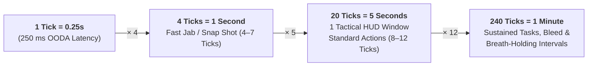
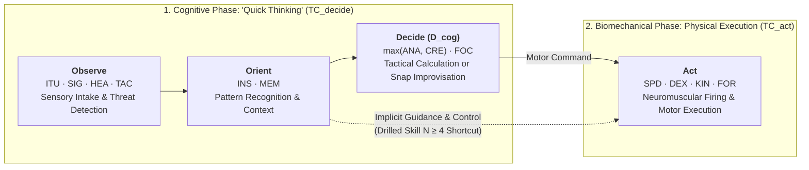
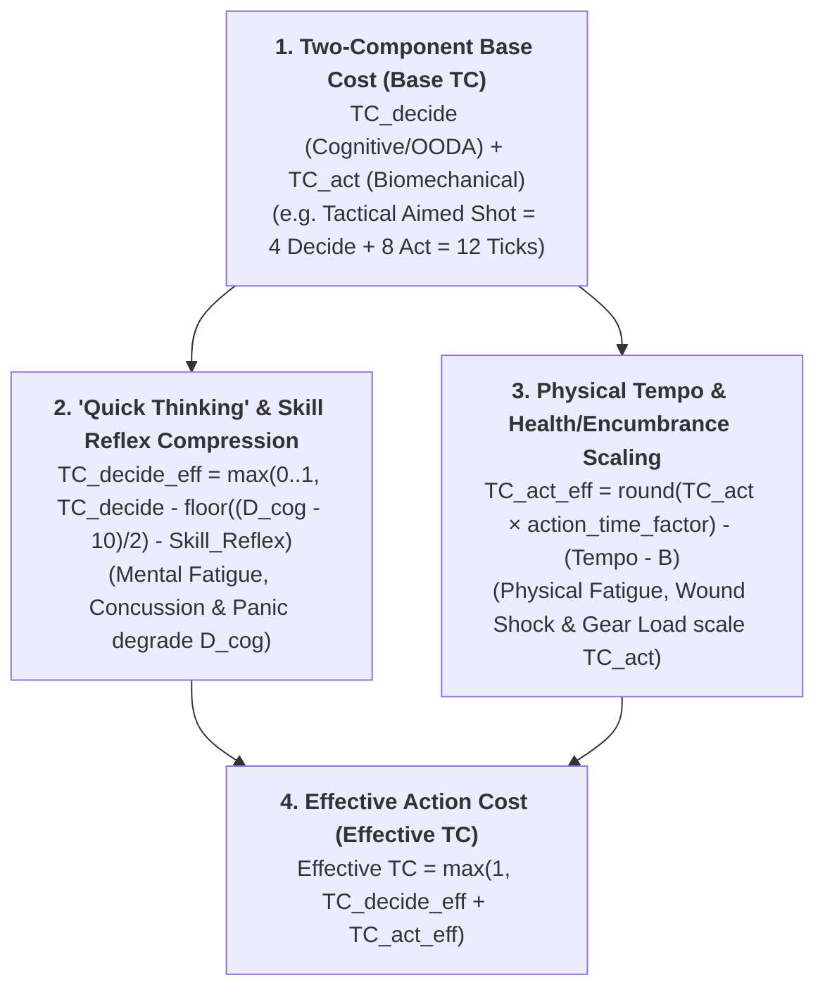

# Action Economy, OODA Loops, The Count-Up Tick Clock & Multi-Sensory Perception

This chapter defines the canonical **Action Economy, Temporal Resolution, and Multi-Sensory Perception System** for **Satya**. Unlike traditional tabletop systems that slice time into rigid, alternating 6-second turns where every participant receives an identical bundle of "1 Standard Action + 1 Move Action + 1 Bonus Action," Satya resolves time on a continuous **Count-Up Tick Clock**.

Every physical, mental, perceptual, and communicative act consumes a concrete number of **Ticks (`TC`)**. Crucially, Satya does **not** treat action speed as purely physical muscle twitch or visual nerve latency: in John Boyd's **OODA Loop (`Observe` $\to$ `Orient` $\to$ `Decide` $\to$ `Act`)**, the bottleneck in real-world engagements is just as often **cognitive processing and decision synthesis ("Quick Thinking")** as it is physical movement. Every action on the clock is therefore governed by both **Cognitive Decision Speed (`D_cog`: `ANA`, `CRE`, `FOC`)** and **Biomechanical Execution Speed (`SPD`, `DEX`, `KIN`, `FOR`, and Tactical `Tempo` $T$)**, scaled by the character's current **Health, Fatigue, and Encumbrance State (`action_time_factor`)** (for a complete reference of all mathematical variables and subscripts, see the **[Mathematical Notation, Variables & Formula Glossary](../01-foundation/mathematical_notation_glossary.md)**).

---

## 1. Temporal Calibration: Ticks, Seconds & Minutes

To bridge micro-level tactical exchanges (gunfights, blade duels, vehicular evasions) and macro-level scene tracking (hemorrhaging, breath-holding, lockpicking, security response timers), Satya anchors the **Tick** to human neuromuscular and visual reaction latency (**`250 milliseconds`**):

| Time Unit | Tick Equivalent | Real-World / Narrative Benchmark |
| :--- | :---: | :--- |
| **`1 Tick`** | **`1 Tick`** | **`0.25 Seconds` (`250 ms`)** — Human visual OODA reaction latency; dropping a held object; a single syllable or trigger break. |
| **`1 Second`** | **`4 Ticks`** | **`1.00 Second`** — A fast snap-jab, a 1-step sidestep, or `7.5 meters` of sprinting at average human `SPD 10`. |
| **`1 Tactical Window`** | **`20 Ticks`** | **`5.00 Seconds`** — One standard HUD cycle on the Satya Combat Tracker (`Round` marker advances every `20 Ticks`); typically encompasses `2–3` brisk exchanges. |
| **`1 Minute`** | **`240 Ticks`** | **`60.0 Seconds` (`12` Tactical Windows)** — Standard interval for **Venous Hemorrhage** ticks, **Asphyxiation / Breath-Holding** checks, and short technical tasks. |
| **`15 Minutes`** | **`3,600 Ticks`** | **Scene / Post-Combat Recovery Window** — Short rest interval for catching breath (`-1` `fatigue_level`), applying field dressings, or conducting a room search. |
| **`1 Hour`** | **`14,400 Ticks`** | **Overland / Investigation Interval** — Standard interval for overland march distance, surgical procedures, and environmental exposure (`Temperature` / `Hydration`). |

---

## 2. The Full OODA Loop: "Quick Thinking" (`TC_decide`) vs. Physical Execution (`TC_act`)

In traditional RPGs, a character with high physical `Speed` or `Dexterity` acts faster at *everything*, even when the situation requires complex tactical judgment or rapid improvisation. In **Satya**, every action on the timeline passes through **two distinct latency phases** mapped across the character's 25 Characteristics (see [Character Characteristics & Aptitudes](../03-character/characteristics_and_aptitudes.md)):

### 2.1 Mapping OODA Phases to Satya Characteristics

1. **Cognitive Phase (`Observe` $\to$ `Orient` $\to$ `Decide`) — "Quick Thinking" ($\text{TC}_{\text{decide}}$)**:
   - **Observe (`ITU`, `SIG`, `HEA`, `TAC`)**: Raw sensory intake and pre-conscious threat detection (`ITU` serves as the canonical **Observe** pillar in `OODA`).
   - **Orient (`INS`, `MEM`)**: Situational synthesis—reading an opponent's body language, intent, or feint (`INS` serves as the canonical **Orient** pillar in `OODA`) and recalling tactical doctrine (`MEM`).
   - **Decide ($D_{\text{cog}}$: `ANA`, `CRE`, `FOC`)**:
     - **`ANA` (Analysis)**: Rapid tactical geometry, calculating risk/reward, and selecting the optimal target, angle, or counter-move.
     - **`CRE` (Creativity)**: Snap improvisation when a plan breaks down—spotting an unorthodox environmental interaction or lateral solution on the fly.
     - **`FOC` (Focus)**: Attentional concentration and filtering out battlefield chaos to lock onto a course of action ($D_{\text{cog}} = \lfloor(\max(\text{ANA}, \text{CRE}) + \text{FOC}) / 2\rfloor$ serves as the canonical **Decide** pillar in `OODA`).
2. **Biomechanical Phase (`Act`) — Physical Execution ($\text{TC}_{\text{act}}$)**:
   - **Act (`SPD`, `DEX`, `KIN`, `FOR`)**: Neuromuscular twitch speed (`SPD` serves as the canonical **Act** pillar in `OODA`), fine manual coordination (`DEX`), whole-body agility (`KIN`), and overcoming weapon or body inertia (`FOR`).

### 2.2 The Cognitive Decision Score ($D_{\text{cog}}$ — "Quick Thinking")

Parallel to a character's physical **Speed (`SPD`)** and **Motor Tempo ($T$)**, Satya defines a character's **Cognitive Decision Score ($D_{\text{cog}}$)** as the **Decide** pillar of the OODA loop (without double-counting `INS`, which already governs the **Orient** pillar):

$$\text{Cognitive Decision Score } (D_{\text{cog}}) = \left\lfloor \frac{\max(\text{ANA}, \text{CRE}) + \text{FOC}}{2} \right\rfloor$$

- **Why $\max(\text{ANA}, \text{CRE}) + \text{FOC}$ Governs the `Decide` (`D`) Pillar**:
  - It pairs attentional concentration (`FOC`) with two distinct archetypes of real-world "quick thinkers":
    1. **The Cold Tactical Calculator (`ANA`)**: The chessmaster, engineer, or fire-team leader who instantly computes geometry, ballistics, and odds.
    2. **The Instinctive Improviser (`CRE`)**: The street-smart operative or unorthodox brawler who invents a lateral play on the spot when conventional doctrine fails.
- **How `D_cog` Shaves Decision Ticks ($\Delta\text{TC}_{\text{decide}}$)**:
  $$\Delta\text{TC}_{\text{decide}} = -\left\lfloor \frac{D_{\text{cog}} - 10}{2} \right\rfloor$$
  - For every **+2 points of $D_{\text{cog}}$ above `10`**, a character shaves **`-1 Tick` (`0.25s`)** off the cognitive decision component ($\text{TC}_{\text{decide}}$) of any non-reflexive or complex tactical action (down to a minimum floor of `1 Tick`, or `0 Ticks` for drilled reflexes).
  - Conversely, a slow or rattled thinker ($D_{\text{cog}} < 10$) suffers **`+1 Tick` per 2 points below `10`** on complex/novel decisions as they hesitate to process changing conditions.

### 2.3 Two-Component Action Cost Formula ($\text{Base TC} = \text{TC}_{\text{decide}} + \text{TC}_{\text{act}}$)

Instead of treating an action's Base Time Cost (`Base TC`) as a single monolithic physical block, Satya splits `Base TC` into **Decision Ticks ($\text{TC}_{\text{decide}}$)** and **Execution Ticks ($\text{TC}_{\text{act}}$)**:

$$\text{Base TC} = \text{TC}_{\text{decide}} + \text{TC}_{\text{act}}$$

$$\text{Effective TC} = \max\!\Big(2,\; \text{round}\big(\text{Base TC} \times \text{action\_time\_factor}\big) - (T - B) + \Delta\text{TC}_{\text{decide}}\Big)$$
*(where $\Delta\text{TC}_{\text{decide}} = 0$ for standard drilled reflex exchanges and $\Delta\text{TC}_{\text{decide}} = -\lfloor(D_{\text{cog}} - 10)/2\rfloor$ for complex, tactical, or improvised actions; or `min floor 1` for purely mental/perceptual micro-actions).*

1. **Drilled / Reflexive Actions (Low $\text{TC}_{\text{decide}} = 1\text{–}2\text{ Ticks}$, High $\text{TC}_{\text{act}}$)**:
   - A practiced boxing jab, parry, or speed-reload uses Boyd's *"Implicit Guidance & Control"* pathway (`Orient` $\to$ `Act`), bypassing slow conscious deliberation ($\Delta\text{TC}_{\text{decide}} = 0$).
   - **Skill Level ($N$) Reflex Compression**: Higher skill proficiency ($N$) converts conscious `Decide` ticks into conditioned muscle memory, reducing $\text{TC}_{\text{decide}}$ by **`-1 Tick` at $N \ge 4$** and **`-2 Ticks` at $N \ge 6$** (to a floor of `0–1 Tick`).
2. **Complex, Novel & Tactical Actions (High $\text{TC}_{\text{decide}} = 3\text{–}8\text{ Ticks}$, Low-to-Moderate $\text{TC}_{\text{act}}$)**:
   - Re-assessing a shifting battlefield, improvising an environmental trap or dirty trick, redirecting an aborted action mid-stream, issuing a coordinated squad command, or operating unfamiliar equipment ($\Delta\text{TC}_{\text{decide}} = -\lfloor(D_{\text{cog}} - 10)/2\rfloor$).
   - **Where "Quick Thinking" Beats Raw Muscle Speed**:
     - Suppose a **Sharp Tactician (`D_cog 16`, `SPD 10`)** and a **Slow-Thinking Athlete (`D_cog 8`, `SPD 15`)** both face an unexpected structural collapse or ambush requiring a novel tactical improvisation (`Base TC = 8`: $\text{TC}_{\text{decide}} = 5$, $\text{TC}_{\text{act}} = 3$).
     - The **Sharp Tactician** shaves `-3 Ticks` off $\text{TC}_{\text{decide}}$ ($5 - 3 = 2\text{ decision ticks}$) + $3\text{ physical ticks} = \mathbf{5\text{ Ticks total}}$ (`1.25s`).
     - The **Slow Athlete** suffers `+1 Tick` on $\text{TC}_{\text{decide}}$ ($5 + 1 = 6\text{ decision ticks}$) and shaves `-2 Ticks` off $\text{TC}_{\text{act}}$ ($3 - 2 = 1\text{ physical tick}$) $= \mathbf{7\text{ Ticks total}}$ (`1.75s`).
     - **Result**: The Quick Thinker acts **`2 Ticks` (`0.5s`) earlier** despite having `5` points less physical `SPD`!

---

## 3. How the Continuous Count-Up Clock Works

1. **Entering the Clock (`Starting Tick` via 4-Pillar `OODA`)**:
   - When a time-sensitive scene or combat begins, each participant calculates their **4-Pillar OODA Initiative**, where each term corresponds directly to one phase of Boyd's loop — **O**bserve (`ITU`), **O**rient (`INS`), **D**ecide ($D_{\text{cog}}$), and **A**ct (`SPD`):
     $$\text{OODA} = \left\lfloor \frac{\text{ITU} + \text{INS} + D_{\text{cog}} + \text{SPD}}{4} \right\rfloor \quad \text{where} \quad D_{\text{cog}} = \left\lfloor \frac{\max(\text{ANA}, \text{CRE}) + \text{FOC}}{2} \right\rfloor$$
   - Aware, ready participants enter the clock at:
     $$\text{Tick}_{\text{start}} = \max(1,\; 15 - \text{OODA} - \text{Awareness Margin})$$
   - **Surprise / Ambush Penalty (Orientation Freeze)**: An unaware or ambushed character adds **`+8` to `+12` Ticks** (`2.0–3.0 seconds` of startle/OODA orientation freeze) to their $\text{Tick}_{\text{start}}$, reduced by their **Quick Thinking** offset $\lfloor(D_{\text{cog}} - 10)/2\rfloor$ and **Discipline (`DIS`)**.
2. **Lowest Tick Acts Next**:
   - The clock counts upward (`Tick 1, 2, 3, ...`). Whoever is currently at the **lowest Tick** declares and initiates their action.
   - Ties on the same Tick are resolved simultaneously (or ordered by higher `OODA`, then $D_{\text{cog}}$, then `SPD`).
3. **Action Resolution & Clock Advancement**:
   - When a character on $\text{Tick}_{\text{current}}$ executes an action with an **Effective Tick Cost (`Effective TC`)**, their action resolves and advances their personal clock marker to:
     $$\text{Tick}_{\text{next}} = \text{Tick}_{\text{current}} + \text{Effective TC}$$
4. **Declaration vs. Completion & Interrupts**:
   - Actions have a **Decision & Wind-Up Phase** ($\text{TC}_{\text{decide}}$ + first half of $\text{TC}_{\text{act}}$) and a **Release / Recovery Phase** (remaining $\text{TC}_{\text{act}}$).
   - If Combatant A begins a slow, low-`Tempo` haymaker on `Tick 3` that takes `12 Ticks` (completing on `Tick 15`), and Combatant B on `Tick 5` executes a fast `5-Tick` stop-thrust or snap-shot (completing on `Tick 10`), Combatant B's strike **lands first on Tick 10** and can **interrupt or spoil** Combatant A's wind-up!

### 3.1 Quick Reference: Engine Combat Stances (`CombatStance`)
In `satya-engine` (`crates/satya-engine/src/dice_probabilities.rs`), six canonical stance presets summarize common action time costs (`TC`):
- **`POWER`** (`TC = 14` / `3.50s`): Heavy, high-impact melee or ordnance strike; slower recovery.
- **`RANGED_AIMED`** (`TC = 12` / `3.00s`): Deliberate sighted fire; grants accuracy at higher tick cost.
- **`MANEUVER`** (`TC = 11` / `2.75s`): Mobile tactical engagement, flanking, or repositioning during an exchange.
- **Unstanced / Standard Action** (`TC = 10` / `2.50s`): Default skill check or interaction.
- **`STABILITY`** (`TC = 9` / `2.25s`): Braced, defensive posture prioritizing guard and low tick recovery.
- **`RANGED_SNAP`** (`TC = 7` / `1.75s`): Fast reactive snapshot at reduced time cost.

---

## 4. Base Action Time Costs (`Base TC = TC_decide + TC_act`) Reference Catalog

### 4.1 Unarmed, Melee & Ranged Combat Actions

| Action / Maneuver | Category | Base `TC` (`Decide + Act`) | Real-Time Equiv. | Notes & Governing Mechanics |
| :--- | :--- | :---: | :---: | :--- |
| **Drop Held Object / Release Grip** | Reflexive | **`1`** (`1 + 0`) | `0.25s` | Pure neural release; free of `action_time_factor` unless fingers are cramped. |
| **Fast Jab / Knife Slash / Snap Kick** | Melee (`Reach 1`) | **`7–8`** (`1 + 6–7`) | `1.75–2.0s` | Drilled reflex (`TC_decide = 1`); high `Tempo` reduces to `4–5 ticks`. |
| **Standard Melee Strike / Baton / Blade** | Melee (`Reach 2–3`) | **`8–9`** (`2 + 6–7`) | `2.0–2.25s` | Target selection (`2`) + swing/thrust (`6–7`); `N >= 4` shaves `1` decide tick. |
| **Feint / Counter-Trap / Disarm / Joint Lock** | Tactical Melee | **`9`** (`3 + 6`) | `2.25s` | Requires reading opponent's guard (`TC_decide = 3`, reduced by `D_cog`). |
| **Heavy Unarmed Haymaker / Takedown / Throw** | Melee / Grapple | **`10`** (`2 + 8`) | `2.5s` | Contests opponent's `Effective Root` ($F + \text{MMF}$). |
| **Two-Handed Heavy Cleave / `POWER` Wind-Up** | Heavy Melee | **`12–14`** (`2 + 10–12`) | `3.0–3.5s` | High kinetic inertia (`TC_act = 10–12`); vulnerable to fast interrupts. |
| **Ranged Snap-Shot / Point-Shoot (`RANGED_SNAP`)** | Ranged | **`7`** (`2 + 5`) | `1.75s` | Threat ID (`2`) + point-index & trigger break (`5`). |
| **Controlled Double-Tap / Short Burst (`STABILITY`)** | Ranged | **`8–9`** (`2 + 6–7`) | `2.0–2.25s` | Fires `2–3` rounds; requires moderate `Force` for recoil recovery. |
| **Full-Auto Suppressive Burst (5–15 rds)** | Ranged | **`8–10`** (`2 + 6–8`) | `2.0–2.5s` | High `Recoil` (`R = 8–12`); projects suppression morale zone. |
| **Deliberate Sighted / Aimed Shot (`RANGED_AIMED`)** | Ranged | **`11–12`** (`4 + 7–8`) | `2.75–3.0s` | Lead/ballistic calculation (`TC_decide = 4`, reduced by `D_cog`) + sight alignment. |
| **Dedicated Sniper Ballistic Solution & Squeeze** | Precision Ranged | **`16–20`** (`8 + 8–12`) | `4.0–5.0s` | Windage/elevation math (`ANA/FOC` reduces `TC_decide = 8`) + breath-hold squeeze. |

### 4.2 Weapon Handling, Gear Manipulation & Reloads

| Action | Base `TC` (`Decide + Act`) | Real-Time Equiv. | Governing Skill / Characteristic & Modifiers |
| :--- | :---: | :---: | :--- |
| **Draw Pistol from Open / Speed Holster** | **`5`** (`1 + 4`) | `1.25s` | Reduced by `1 tick` per `+2` of `SPD` above `10` (min `2 ticks`). |
| **Draw Weapon from Concealment or Slung Back** | **`8`** (`1 + 7`) | `2.0s` | *Sleight of Hand* or Weapon Skill `N >= 4` reduces by `-2 ticks`. |
| **Switch Fire Selector / Activate Weapon Light/Optic** | **`2`** (`1 + 1`) | `0.5s` | Can be combined with Draw or Aim for `+1 tick`. |
| **Speed Reload (Drop Magazine, Insert Fresh Mag)** | **`10`** (`1 + 9`) | `2.5s` | Drilled motor sequence; Weapon Skill `N >= 4` + `DEX` reduces to `6–7 ticks`. |
| **Tactical Reload (Retain Partial Magazine)** | **`14`** (`2 + 12`) | `3.5s` | Stows partial magazine rather than dropping it on the ground. |
| **Revolver / Internal Tube Magazine Reload (Per Round)** | **`4 / rd`** (`0 + 4`) | `1.0s / rd` | `6 ticks` (`1.5s`) total if using a speedloader or stripper clip. |
| **Diagnose & Clear Simple Malfunction ("Tap, Rack")** | **`8`** (`3 + 5`) | `2.0s` | `TC_decide = 3` (diagnosing misfire via `D_cog` / Weapon `N`) + `TC_act = 5` (`DEX`). |
| **Diagnose & Clear Complex Jam (Double-Feed)** | **`20–32`** (`6 + 14–26`) | `5.0–8.0s` | `D_cog` shaves diagnosis ticks; `DEX` shaves stripping/clearing ticks. |
| **Retrieve Item from Tactical Vest / Belt Pouch** | **`6`** (`1 + 5`) | `1.5s` | Immediate access webbing. |
| **Retrieve Item from Closed Backpack / Rucksack** | **`24–40`** (`4 + 20–36`) | `6.0–10.0s` | Requires slinging pack off shoulder and searching compartment. |

### 4.3 Movement, Posture & Tactical Environment Actions

| Action | Base `TC` (`Decide + Act`) | Real-Time Equiv. | Notes & Governing Mechanics |
| :--- | :---: | :---: | :--- |
| **Step / Pivot Facing (`90°–180°` Rotation)** | **`2`** (`1 + 1`) | `0.5s` | Included free in any `Tempo >= 4` combat maneuver. |
| **Drop to Prone / Duck Behind Cover** | **`3`** (`1 + 2`) | `0.75s` | Immediate gravity drop; imposes `-4` to `Tempo Cap` while prone. |
| **Stand Up from Crouching / Kneeling** | **`3`** (`0 + 3`) | `0.75s` | Costs `+2 ticks` if heavily encumbered (`Tier 3+`). |
| **Stand Up from Prone (`Kip-Up` vs. Standard)** | **`8`** *(or `4`)* (`1 + 7/3`) | `2.0s` *(or `1.0s`)* | Standard rise is `8 ticks`; `KIN >= 14` acrobatic rise takes `4 ticks`. |
| **Vault Low Obstacle / Dive Through Window** | **`6`** (`2 + 4`) | `1.5s` | Path judgment (`D_cog`/`KIN`) + athletic leap (`SPD/FOR`). |
| **Improvise Environmental Action / Dirty Trick** | **`8`** (`5 + 3`) | `2.0s` | **High `TC_decide = 5`**: kicking a brazier, cutting a chandelier rope, ricochet (`D_cog` shaves up to `3 ticks`). |
| **Open Unlocked Door & Pie Corner** | **`6`** (`2 + 4`) | `1.5s` | Or `4 ticks` (`1.0s`) to kick/shoulder-breach (`FOR/MAS`). |
| **Apply Emergency Combat Tourniquet (CAT)** | **`24`** (`4 + 20`) | `6.0s` | Locate arterial bleed (`4`) + windlass tightening (`20`, *First Aid* `DEX/FOC`). |
| **Administer Auto-Injector (Epi / Analgesic / Stim)** | **`8`** (`2 + 6`) | `2.0s` | `6 ticks` draw + `2 ticks` injection through clothing. |

### 4.4 Cognitive, Perceptual (`OODA`), & Communication Actions

| Action | Base `TC` (`Decide + Act`) | Real-Time Equiv. | Governing Characteristic (`C`) |
| :--- | :---: | :---: | :--- |
| **Snap Threat Assessment / Glance Check** | **`2`** (`2 + 0`) | `0.5s` | `SIG / ITU` (`OODA` check; reduced to `1 tick` if `D_cog >= 14` or `ITU >= 14`). |
| **Deliberate Tactical Scan ("Read the Room")** | **`6`** (`5 + 1`) | `1.5s` | `SIG / FOC` or `HEA / FOC`; `D_cog` shaves `-1` to `-3 ticks` off scan synthesis. |
| **Read Opponent's Stance / Psyche (`Empathy` / `Tactics`)** | **`4`** (`4 + 0`) | `1.0s` | `INS / ANA`; estimates opponent's Morale state or `TCF` commitment (`min 1 tick`). |
| **Formulate Coordinated Squad Order / Tactical Plan** | **`6`** (`4 + 2`) | `1.5s` | `ANA / ELO` (`4 ticks` tactical synthesis reduced by `D_cog` + `2 ticks` callout). |
| **Shout Brief Warning / Tactical Callout (1–4 words)** | **`2`** (`1 + 1`) | `0.5s` | Can be performed concurrently with physical actions at `+0 TC`. |
| **Complex Verbal Order / Social Combat Exchange** | **`12–24`** (`6 + 6–18`) | `3.0–6.0s` | Argument formulation (`D_cog`: `ANA/CRE/INS`) + verbal delivery (`ELO/PRE`). |

---

## 5. How Characteristics, Quick Thinking (`D_cog`), Health & State Modify Action Costs

In Satya, two characters performing the exact same action rarely take the same number of ticks. Action speed is dynamically shaped by **four mechanical layers**:

### 5.1 Layer 1: Systemic Health, Fatigue & Encumbrance (`action_time_factor`)

Physical exhaustion, systemic trauma shock, heavy gear load, and neurological status conditions degrade both physical execution and mental processing (detailed in [Health, Anatomical Trauma, Fatigue & Mental Conditions](../06-health-and-survival/health_and_trauma.md) and [Movement, Vehicles, Encumbrance & Environmental Survival](../06-health-and-survival/movement_vehicles_and_environment.md)):

$$\text{action\_time\_factor} = 1.0 + (0.10 \times \text{fatigue\_level}) + (0.25 \times \text{wound\_shock\_index}) + \Delta_{\text{enc}} + \Delta_{\text{status}}$$

| Degrading Condition | Multiplier Added to `action_time_factor` | Cognitive vs. Physical Impact |
| :--- | :---: | :--- |
| **Per Level of `fatigue_level` (`1–5`)** | **`+0.10` (`+10%`)** per level | Slows both `TC_decide` and `TC_act` (`+30%` at `Fatigue 3`). |
| **Per Tier of `wound_shock_index` (`1–4`)** | **`+0.25` (`+25%`)** per tier | Pain/hypovolemia slows both `TC_decide` and `TC_act` (`+50%` at `Shock 2`). |
| **Encumbrance Tier 2 (`Tactical Load`)** | **`+0.10` (`+10%`)** | Applies to **physical `TC_act` only** (does not slow pure `TC_decide` thinking). |
| **Encumbrance Tier 3 (`Heavy Load`)** | **`+0.25` (`+25%`)** | Applies to **physical `TC_act` only**. |
| **Encumbrance Tier 4 (`Overloaded`)** | **`+0.50` (`+50%`)** | Applies to **physical `TC_act` only**. |
| **`Concussed` / `Dazed` / `Acute Mental Shock`** | **`+0.25` to `+0.50`** + **`-4` to `D_cog`** | Directly attacks **Quick Thinking (`TC_decide`)**, adding `+2` to `+4` decision ticks. |

> [!IMPORTANT]
> **Compounding Fatigue + Shock**:
> A combatant at **`Fatigue 2` (`+0.20`)** and **`Wound Shock 2` (`+0.50`)** operates at **`action_time_factor = 1.70`**. A `10-tick` strike now costs **`17 ticks`** (`4.25 seconds`), AND their Effective Tactical Pool ($P_{\text{eff}}$) has shrunk by **`-8` points**, making it impossible to buy those ticks back with `Tempo`!

### 5.2 Layer 2: Cognitive Speed ("Quick Thinking" $D_{\text{cog}}$ & Skill Reflex Compression)

Before physical execution begins, the character's mind must complete the `Observe` $\to$ `Orient` $\to$ `Decide` phase ($\text{TC}_{\text{decide}}$):

$$\text{TC}_{\text{decide, eff}} = \max\!\left(\text{TC}_{\text{floor}},\; \text{round}\big(\text{TC}_{\text{decide}} \times \text{mental\_time\_factor}\big) - \left\lfloor \frac{D_{\text{cog}} - 10}{2} \right\rfloor - \Delta\text{TC}_{\text{skill}}\right)$$

- **Quick Thinking Offset ($\lfloor(D_{\text{cog}} - 10)/2\rfloor$)**: Driven by $\lfloor(\max(\text{ANA}, \text{CRE}) + \text{FOC}) / 2\rfloor$. Shaves `-1 Tick` per `2` points of $D_{\text{cog}}$ above `10` (`-1` at `12`, `-2` at `14`, `-3` at `16`, `-4` at `18`).
- **Skill Reflex Compression ($\Delta\text{TC}_{\text{skill}}$)**: For drilled techniques within a trained skill (`N >= 4` shaves `-1 Tick`, `N >= 6` shaves `-2 Ticks`), training compresses conscious `Decide` time down to a conditioned reflex floor ($\text{TC}_{\text{floor}} = 0\text{ or }1$).

### 5.3 Layer 3: Combat & Athletic Physical Execution (`Tempo` $T$ & `SPD`)

Once the decision is made, **Speed (`SPD`)** defines the character's **Tempo Ceiling ($T_{\max} = \text{SPD} - \text{Leg Wounds}$)**, and the points allocated to **Tempo ($T$)** relative to their neutral baseline ($B = \lfloor P_{\text{base}} / 3 \rfloor$) directly shave or add ticks to the action (see [Tactical Triad & Combat Pools](../05-combat/tactical_triad_and_pools.md)):

$$\text{Effective TC}_{\text{combat}} = \max\!\Big(2,\; \text{round}\big(\text{Base TC} \times \text{action\_time\_factor}\big) - (T - B) + \Delta\text{TC}_{\text{decide}}\Big)$$

- **Drilled vs. Complex Combat Actions**: For standard drilled combat strikes and reloads, $\Delta\text{TC}_{\text{decide}} = 0$ (resolved directly via $\max(2, \text{round}(\text{Base TC} \times \text{action\_time\_factor}) - (T - B))$). Whenever a combatant performs a tactical scan, feint, ballistic calculation, malfunction clearance, environmental improvisation, or mid-action OODA pivot, $\Delta\text{TC}_{\text{decide}} = -\lfloor(D_{\text{cog}} - 10)/2\rfloor$ applies!
- **Leg / Hip / Ankle Wounds**: Directly slash $T_{\max}$. If a character's $T_{\max}$ is slashed below their baseline $B$ (e.g., $B = 8$, but a shattered knee locks $T_{\max} = 2$), they are **forced** to take a negative $(T - B)$ offset—automatically adding **`+6 ticks`** to every movement or melee action!

### 5.4 Layer 4: Non-Combat Physical, Technical & Mental Actions (`Characteristic Speed Scaling`)

When performing a non-combat action on the clock (such as picking a lock under fire, hacking a keypad, performing emergency triage, or analyzing a sensor readout) where the Combat Tactical Pool is not split into `TCF`:

1. **Dual Cognitive + Motor Speed Offset ($\Delta\text{TC}_{\text{decide}} + \Delta\text{TC}_{\text{act}}$)**:
   - **Cognitive Component ($\text{TC}_{\text{decide}}$)**: Adjusted by **Quick Thinking** $-\lfloor(D_{\text{cog}} - 10)/2\rfloor$.
   - **Manual / Physical Component ($\text{TC}_{\text{act}}$)**: Adjusted by $-\lfloor(C_{\text{motor}} - 10)/2\rfloor$, where $C_{\text{motor}}$ is **`DEX`** (for fine manual tasks like lockpicking, surgery, electronics, reloads) or **`SPD`/`KIN`** (for gross athletic tasks).
   - **Purely Mental / Analytical Tasks** (cryptography, tactical calculation, diagnostics, recall): `100%` of the action is $\text{TC}_{\text{decide}}$, governed by $D_{\text{cog}}$ ($\lfloor(\max(\text{ANA}, \text{CRE}) + \text{FOC}) / 2\rfloor$) and ignoring physical `Encumbrance` penalties.
2. **Extraordinary Success Time Compression**:
   - Every cascade success beyond the first (`total_successes >= 2`) on a timed task reduces the task's remaining duration by **`-15%` per extra success** (up to `-45%` at `4+` successes).

### 5.5 Aborting or Changing a Committed Action (`OODA Reset / Action Pivot`)

What happens if a character starts a `12-tick` aimed shot or heavy melee swing on `Tick 2` (scheduled to finish on `Tick 14`), but on `Tick 6` an enemy bursts through a side door with a shotgun?

- A character is never locked into suicidal inaction: on any Tick, they may **abort their in-progress action** and pivot to a new reaction (e.g., diving behind cover or firing a snap-shot).
- **The `OODA` Reset Penalty (Where `D_cog` & `ITU` Shine)**:
  Abandoning a committed motor program mid-execution, dumping the old mental plan, and orienting to a new threat costs a **Pivot Penalty** governed directly by **Quick Thinking ($D_{\text{cog}}$)** and **Intuition (`ITU`)**:
  $$\text{OODA Reset Ticks} = \max\!\left(1,\; 5 - \left\lfloor \frac{D_{\text{cog}} + \text{ITU}}{5} \right\rfloor\right)$$
  - **Adaptive Genius / High-Speed Operator ($D_{\text{cog}} = 15, \text{ITU} = 15$)**: Pivots in **`1 tick` (`0.25s`)**—almost zero hesitation between aborting the old action and initiating the new response.
  - **Average Combatant ($D_{\text{cog}} = 10, \text{ITU} = 10$)**: Pivots in **`3 ticks` (`0.75s`)**.
  - **Sluggish, Tunnel-Visioned, or Concussed Combatant ($D_{\text{cog}} = 6, \text{ITU} = 6$)**: Takes **`4–5 ticks` (`1.0–1.25s`)** just to mentally dump their old plan and re-orient before their new action's ticks begin counting.

---

## 6. Multi-Sensory Perception, Stealth & Illumination (`Observe` Phase)

Because Satya models **six distinct Sensory Characteristics (`SIG`, `HEA`, `TAC`, `OLF`, `TAS`, `ITU`)** rather than a single generic "Perception" stat, stealth, detection, and awareness on the OODA clock are resolved as an asymmetric **Multi-Channel Sensory Contest**.

### 6.1 Resolving Stealth vs. Detection (`2d20` Opposed Cascade)

- **The Infiltrator** rolls **Stealth & Sneaking (`KIN / FOC`)** (or *Camouflage & Concealment* `INS/CRE` if stationary in a hide site, or *Surveillance & Urban Tail* `FOC/SIG` in a crowd).
  - **Movement Gait & Encumbrance Modifiers**: Moving at a **Stealth Creep** (`0.34 m/Tick`) imposes `+0` $\Delta_{\text{ext}}$; moving at a **Combat Glide** imposes `+4` $\Delta_{\text{ext}}$; **Running** imposes `+8` $\Delta_{\text{ext}}$. Each **Encumbrance Tier** above Tier 1 adds **`+2` $\Delta_{\text{ext}}$** (gear rattle and footfall weight).
- **The Observer / Sentry** rolls **Observation & Awareness** using the **specific sensory channel** suited to the environment:
  - **Visual Channel (`SIG / FOC`)**: Governed by **Illumination**, **Concealment/Cover**, and **Target Motion**.
  - **Auditory Channel (`HEA / FOC`)**: Governed by **Ambient Noise**, **Surface Material** (gravel/broken glass vs. concrete), and **Weapon Suppression**.
  - **Olfactory Channel (`OLF / INS`)**: Detects smoke, fuel, blood, sweat, or chemical residues in enclosed spaces (or K9/animal trackers).
  - **Intuitive Channel (`ITU / INS`)**: Subconscious "sixth sense" when being watched by a sniper or stalked in an eerie environment—can alert the target to drop behind cover even before `SIG` or `HEA` pinpoints the attacker's coordinates!

### 6.2 Illumination, Visibility & Acoustic Modifiers ($\Delta_{\text{ext}}$)

| Environmental Condition | Visual Check (`SIG`) $\Delta_{\text{ext}}$ | Visual Stealth Bonus ($\Delta_{\text{ext}}$) | Countermeasures & Sensor Interaction |
| :--- | :---: | :---: | :--- |
| **Bright Daylight / Well-Lit Room** | `+0` | `+4` *(Harder to hide)* | Requires solid cover or urban crowd blending. |
| **Dusk / Twilight / Urban Streetlights / Shadows** | `+2` | `-2` | Flashlights create a cone of `+0` light but reveal the holder (`-6` to spot holder). |
| **Moonlight / Starlight / Power Outage Indoors** | `+6` | `-6` | **Gen-3+ Night Vision (`NVG`)** reduces visual penalty to `+1` (but narrows FOV, `-2` `OODA`). |
| **Dense Fog / Heavy Rain / Thick Smoke** | `+8` | `-8` | **Thermal / FLIR Optics** cut through smoke/darkness (`+0`), unless target wears thermal-baffled cloak. |
| **Pitch Black (Subterranean / Windowless Vault)** | **Impossible (`Blinded`)** | **Auto-Concealed vs. `SIG`** | Observer must rely on **Hearing (`HEA`)**, **Tactile (`TAC`)**, or active **IR / LiDAR**. |
