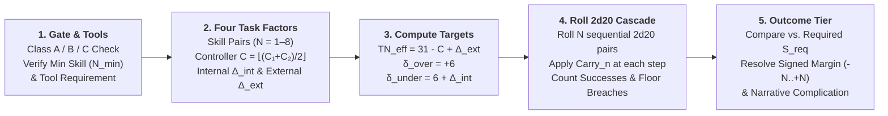

# Core `2d20` Watershed Cascade & Task Resolution Mechanics

Whenever a character performs an action with meaningful stakes and uncertainty that can influence the narrative or tactical situation, the Game Master (or the Satya AI Game Master via `evaluate_satya_cascade_task` in [`crates/satya-engine/src/dice_probabilities.rs`](../../../crates/satya-engine/src/dice_probabilities.rs)) calls for a **Task Resolution** roll.

This chapter is the single canonical ruleset for framing, gating, modifying, and resolving any task or skill check in **Satya**, uniting the mathematical calibration in [Probability, Distribution Topology & `2d20` Calibration](../01-foundation/probability_and_calibration.md) with the attribute controllers in [Character Characteristics & Aptitudes](../03-character/characteristics_and_aptitudes.md) and the skill hierarchy in [Skill System & The 8 Hierarchical Skill Trees](../03-character/skills_and_trees.md).

---

## 1. The Task Resolution Pipeline

Every task in Satya is resolved through a unified five-step pipeline:

---

## 2. Step 1: Task Gate Classifications, Prerequisites & Tools

Before any dice are rolled, the GM determines **whether the character is qualified and equipped** to attempt the task.

### 2.1 Three Task Gate Classifications (`Class A / B / C`)

Every task in Satya belongs to one of three **Gate Classifications**:

| Gate Class | Who May Attempt the Task | Effective Skill ($N$) & Untrained / Default Modifier ($\Delta_{\text{ext}}$) |
| :--- | :--- | :--- |
| **Class A: Open / Talent Task** | **Anyone** (uses an innate Talent `TAL` at $N \ge 1$ or a basic Physical `PHY` action). | Roll the character's Talent level ($N \ge 1$). If attempting a basic `PHY` skill untrained (`N = 0`), roll **`N = 1` pair** with **$\Delta_{\text{ext}} = +4$**. |
| **Class B: Trained / Defaultable Task** | Characters with the required skill ($N \ge 1$), **OR** characters who possess its immediate **Parent or Sibling Skill** at $N_{\text{parent}} \ge 2$. | If trained ($N \ge 1$), roll $N$ pairs at normal $\Delta_{\text{ext}}$. If defaulting from a Parent/Sibling skill, roll **$\max(1, N_{\text{parent}} - 1)$ pairs** with an added **$\Delta_{\text{ext}} = +4$ to $+6$**. Characters with neither cannot attempt the roll. |
| **Class C: Hard-Gated Specialist Task (`[Locked]`)** | **Only** characters who possess the exact required skill at or above **$N_{\text{min}}$** AND possess **Mandatory Tools**. | **No defaulting allowed.** Cannot be defaulted from parent skills or raw Characteristics. Without $N \ge N_{\text{min}}$ and the required tools, the character cannot meaningfully attempt the task (or automatically botches if forced under duress). |

### 2.2 Tool Dependency Tiers (`[Tool]`) & 2031–2035 Smart-Tech Modifiers

Every skill and task specifies one of three tool dependencies:

1. **`[Tool: None]`**:
   Relies purely on the character's body, voice, senses, or mind (*Running*, *Singing*, *Brawling*, *Observation*, *Mental Arithmetic*, *Persuasion*, *Empathy*).
2. **`[Tool: Situational]`**:
   Unassisted tasks can be performed barehanded ($\Delta_{\text{ext}} = 0$), while complex tasks within the same skill require tools or suffer an **Improvised/Unassisted Penalty ($\Delta_{\text{ext}} = +4\text{ to }+12$)**—e.g., *First Aid* allows direct pressure barehanded, but requires a trauma kit to tourniquet severed arterial vessels or decompress a tension pneumothorax; *Climbing* allows scrambling up a brick wall barehanded, but requires pitons/ascenders for a sheer glass skyscraper.
3. **`[Tool: Mandatory]`**:
   The skill **cannot be rolled at all** without the requisite weapon, instrument, vehicle, lab, or computing rig (*Lockpicking*, *Trauma Surgery*, *Network Exploitation*, *Firearms*, *Rotary-Wing Piloting*, *Arc Welding*).

| Equipment / Tool Tier | External Modifier ($\Delta_{\text{ext}}$) | Narrative & Mechanical Description (Earth 2031–2035) |
| :--- | :---: | :--- |
| **No Tools (on `[Tool: Mandatory]` Task)** | **Impossible** | Task cannot be attempted. |
| **No Tools (on `[Tool: Situational]` Tool Task)** | **`+8` to `+12`** | Barehanded / purely improvised under desperate conditions; triggers `SuccessWithComplication` on floor breach. |
| **Improvised / Street-Scavenged Kit** | **`+4` to `+8`** | Shoddy, worn, or makeshift tools (e.g., bent paperclips for lockpicking, unlicensed 3D-printed polymer firearm after 50 rounds). |
| **Standard Commercial / Issue Kit (Baseline)** | **`0`** | Properly maintained professional tools, standard issue service rifle, standard diagnostic tablet. |
| **Precision / Masterwork Professional Kit** | **`-2`** | Match-grade firearm, calibrated forensic lab, high-end trauma suite. |
| **2031–2035 AI-Assisted / Smart-Linked Rig** | **`-4`** | AR ballistic smart-optic synced to weapon, AI 2.0 diagnostic co-pilot, robotic micro-surgical tele-manipulator, or autonomous zero-day fuzzing cluster. |

---

## 3. Step 2: The Four Task Factors (`N` Skills, Target Number `31 - C`, $\Delta_{\text{int}}$, $\Delta_{\text{ext}}$ & Degrees of Success)

Every task in Satya is parameterized by **four orthogonal factors** (`CascadeTaskParams`), determining the Roll-Over **Target Number ($\text{TN}_{\text{eff}} = 31 - C + \Delta_{\text{ext}}$)** and the resulting **Degree of Success (`OutcomeTier`)**:

### 3.1 Factor 1: Skill Level ($N \in [1, 8]$, Mythic Cap `10`) — Number of `2d20` Pairs

When attempting a skill check or combat action, a character rolls **$N$ sequential pairs of 20-sided dice (`2d20`)**, where **$N$ is the character's Skill Level**:

$$\text{List A} = (A_1, A_2, \dots, A_N), \qquad \text{List B} = (B_1, B_2, \dots, B_N)$$

At each step $n \in \{1, \dots, N\}$, the unmodified pair sum $X_n = A_n + B_n$ ranges from **$2$ to $40$**, forming a triangular distribution centered at its exact midpoint of **$21$**.

| Skill Level ($N$) | Proficiency Tier | Pairs of `2d20` Rolled | Benchmark Success Rate ($C = 10, \Delta_{\text{int}} = 0, \Delta_{\text{ext}} = 0$) |
| :---: | :--- | :---: | :---: |
| **`N = 0`** | **Untrained** *(Non-Talent `PHY`/`KNO`)* | Cannot roll Class C; defaults to `N = 1` (`+4` to `+6` $\Delta_{\text{ext}}$) on Class A/B | — |
| **`N = 1`** | **Novice / Baseline Talent (`TAL`)** | `1` pair (`2d20`) | `47.50%` *(strict `>`) / `52.50%` (`>=`)* |
| **`N = 2`** | **Apprentice / Vocational Dabbler** | `2` pairs | `60.68%` |
| **`N = 3`** | **Competent / Journeyman (Trained Professional)** | `3` pairs | **`70.10%`** |
| **`N = 4`** | **Seasoned Specialist** | `4` pairs | `77.25%` |
| **`N = 5`** | **Veteran Expert** | `5` pairs | `82.69%` |
| **`N = 6–7`** | **Master Practitioner** | `6–7` pairs | `86.83% – 89.98%` |
| **`N = 8`** | **Grandmaster (Standard Human Cap)** | `8` pairs | **`92.37%`** |
| **`N = 10`** | **Mythic / Transcendent Cap** | `10` pairs | `95.59%` |

### 3.2 Factor 2: Controlling Characteristic ($C \in [1, 20]$) — Baseline Target Shift

Satya is a **Roll-Over** system where **higher numbers are always better**:
- A higher pair sum ($A_n + B_n$) is always better.
- A higher **Controlling Characteristic ($C$)** (such as `SPD`, `FOR`, `DEX`, `KIN`, `ANA`, `INS`, `DIS`, `FOC`, `ELO`, or `SIG`) is always better.
- **Controlling Characteristic ($C$) Scale**: Theoretical range `1–20`, playable human range **`4–18`**, with the **Human Average at `C = 10`**.
- **Composite Controlling Characteristics (`C1 / C2`)**: Most skills combine two characteristics (such as `DEX/TAC` for *Lockpicking*, `ELO/ANA` for *Persuasion*, or `DEX/SIG` for *Pistols*):
  $$C = \left\lfloor \frac{C_1 + C_2}{2} \right\rfloor$$
- **Gated Supporting Characteristic (`Min C3 >= X`)**: If a skill specifies a minimum supporting characteristic and the character falls short by $k = X - C_3$ points, each point of shortfall imposes **`+2` to $\Delta_{\text{ext}}$** (e.g., firing *Fully Automatic Weapons* with `FOR 8` against `Min FOR >= 10` adds `+4` to $\Delta_{\text{ext}}$).

### 3.3 Factor 3: Internal Character Modifiers ($\Delta_{\text{int}} \in [-2, +10]$) — Stumble Recovery Penalty

Internal modifiers reflect the character's physiological and psychological condition (**Fatigue**, **Wound Shock**, **Pain**, **Dehydration**, **Psychological Strain**, or **Cognitive Dissonance**). Rather than penalizing the character's opening motion (Pair 1), $\Delta_{\text{int}}$ increases the **negative carry-over penalty ($\delta_{\text{under}}$)** after a missed pair:

$$\delta_{\text{under}} = \delta_{\text{base}} + \Delta_{\text{int}} = 6 + \Delta_{\text{int}}, \qquad \delta_{\text{over}} = 6$$

Crucially, $\Delta_{\text{int}}$ imposes **zero penalty on Pair 1**—if a fatigued master succeeds on Pair 1, muscle memory carries them through without slowdown; if they miss Pair 1, recovery is much steeper.

| Character Internal State | $\Delta_{\text{int}}$ | Failure Carry Penalty ($-\delta_{\text{under}}$) | Mechanical & Narrative Meaning |
| :--- | :---: | :---: | :--- |
| **Focused / Conviction Surge** | **`-2`** | **`-4`** | Calm, rested, or surging with conviction; a stumble on Pair 1 is easy to recover from on Pair 2. |
| **Fresh (Baseline)** | **`0`** | **`-6`** | Symmetric watershed carry (`+6` on success, `-6` on failure). |
| **Distracted / Mild Strain** | **`+2`** | **`-8`** | Flustered (`1` stack of Rhetorical Strain or `Fatigue Level 1`). |
| **Winded / Shaken** | **`+4`** | **`-10`** | Breathing hard or Rattled (`Fatigue Level 2` or `Wound Shock 1`). |
| **Battered / Moderately Wounded** | **`+6`** | **`-12`** | Bleeding or in significant pain (`Fatigue Level 3`); missing Pair 1 makes recovery steep. |
| **Exhausted / Severely Wounded** | **`+8` to `+10`** | **`-14` to `-16`** | On the verge of collapse; if Pair 1 succeeds, muscle memory carries through (`+6`), but a miss almost guarantees cascade failure or a floor-breach complication. |

### 3.4 Factor 4: External Task Difficulty ($\Delta_{\text{ext}} \in [-10, +16]$) — Environmental Target Shift

External modifiers represent the objective complexity of the task, environmental hazards, lighting, range, tool quality, and opponent resistance. They directly shift the **Midpoint-Anchored Target Number ($\text{TN}_{\text{eff}}$)**:

$$\text{TN}_{\text{eff}} = (1.5K + 1) - C + \Delta_{\text{ext}} = 31 - C + \Delta_{\text{ext}}$$

- Each **+1 to Controlling Characteristic ($C$)** *lowers* $\text{TN}_{\text{eff}}$ by `1` on every pair (making the check easier).
- Each **+1 to External Task Difficulty ($\Delta_{\text{ext}}$)** *raises* $\text{TN}_{\text{eff}}$ by `1` on every pair (making the check harder).

| Task Difficulty Tier | $\Delta_{\text{ext}}$ | Target $\text{TN}_{\text{eff}}$ at Average $C = 10$ | Example Situational Conditions |
| :--- | :---: | :---: | :--- |
| **Trivial / Routine** | `-8` to `-10` | `11 – 13` | Ideal lab conditions, abundant time, AI diagnostic guidance. |
| **Easy** | `-4` | `17` | Good lighting, superior tools (`-2`), cooperative subject. |
| **Standard Benchmark** | **`0`** | **`21`** *(Exact `2d20` midpoint)* | Standard professional challenge under field conditions. |
| **Challenging** | `+4` | `25` | Poor lighting, rain, rushed execution, commercial high-security hardware, or untrained Class A default. |
| **Hard** | `+8` | `29` | Pitch darkness, improvised tools, active combat stress, encrypted military-grade countermeasures. |
| **Extreme** | `+12` | `33` | Near-impossible conditions requiring both high Characteristic $C$ and multi-pair momentum. |
| **Heroic / Nearly Impossible** | `+16` | `37` | Achievable on Pair 1 only by elite specialists ($C \ge 17$), or on Pair 2+ after riding a $+\delta_{\text{over}}$ cascade. |

---

## 4. Step 3 & 4: Resolving the Sequential `2d20` Cascade

Once $N$, $\text{TN}_{\text{eff}} = 31 - C + \Delta_{\text{ext}}$, $\delta_{\text{over}} = 6$, and $\delta_{\text{under}} = 6 + \Delta_{\text{int}}$ are set, the character rolls **$N$ sequential pairs of `2d20`**:

1. **Pair 1 ($n = 1$)**:
   - Compute $Y_1 = A_1 + B_1$ (since $\text{Carry}_1 = 0$).
   - If $Y_1 \ge \text{TN}_{\text{eff}}$ *(or $> \text{TN}_{\text{eff}}$ when strict comparison is selected)*:
     - Record **`+1` Success**.
     - Set carry-over for Pair 2 to **$+\delta_{\text{over}}$ (`+6`)**.
   - If $Y_1 < \text{TN}_{\text{eff}}$:
     - Record **`0` Successes** on Pair 1.
     - Set carry-over for Pair 2 to **$-\delta_{\text{under}}$ (`-(6 + \Delta_{\text{int}})` )**.
2. **Subsequent Pairs ($n = 2 \dots N$)**:
   - Compute the modified pair sum:
     $$Y_n = A_n + B_n + \text{Carry}_n$$
   - Compare $Y_n$ against $\text{TN}_{\text{eff}}$:
     - If $Y_n \ge \text{TN}_{\text{eff}}$: Record **`+1` Success**!
     - If $Y_n < \text{TN}_{\text{eff}}$: Record **`0` Successes** on Pair $n$.
     - If $Y_n < 2$ (dropping below the physical `2d20` minimum of snake-eyes `2` due to negative carry $-\delta_{\text{under}}$): Record **`+1` Floor Breach (`raw_botches += 1`)**.
   - Update $\text{Carry}_{n+1}$ according to the task's **Carry Mode**:
     - **Standard Carry Mode (`markov_step` / `CarryMode::MarkovStep` — Default)**: $\text{Carry}_{n+1} = +\delta_{\text{over}}$ (`+6`) if Pair $n$ succeeded, or $-\delta_{\text{under}}$ (`-4` to `-16`) if Pair $n$ failed. Carry does not stack beyond a single step, allowing a skilled practitioner who stumbles on Pair 1 to fight through $-\delta_{\text{under}}$ on Pair 2 or 3 and flip the cascade back into positive `+6` momentum!
     - **High-Stakes Carry Mode (`cumulative_snowball` / `CarryMode::CumulativeSnowball`)**: $\text{Carry}_{n+1} = \text{Carry}_n + \delta_{\text{over}}$ on success, or $\text{Carry}_n - \delta_{\text{under}}$ on failure. Used for unforgiving high-stakes procedures (*Neurosurgery*, *EOD Disarming*, *Orbital Docking*) where early mistakes compound rapidly.
     - **Linear Margin Carry Mode (`linear_margin` / `CarryMode::LinearMargin`)**: Exact difference carry ($\text{Carry}_{n+1} = Y_n - \text{TN}_{\text{eff}}$).

---

## 5. Step 5: Signed Outcome Spectrum (`-N` to `+N`), Botch Rules & `OutcomeTier`

A single cascading roll resolves both **how well the character succeeds (degree of success)** and **how badly they fail (degree of failure)** on a unified signed margin spectrum (`signed_margin` in `-N..=+N`):

### 5.1 Positive Outcomes (`+1` to `+N` Successes)
- **`+1` Success (Bare Minimum)**: Accomplishes the task with minimal margin.
- **`+2` Successes (Solid Execution)**: Clean, reliable professional execution.
- **`+3` to `+4` Successes (Extraordinary / Critical)**: Faster, quieter, higher yield, or secondary tactical advantage (`OutcomeTier::ExtraordinarySuccess`).
- **`+5+` Successes (Masterwork / Legendary)**: Achievable only by highly trained specialists ($N \ge 5$).

### 5.2 Botch Severity (`-1` to `-N`) & `SuccessWithComplication`
Satya evaluates negative and mixed outcomes through two rules (`BotchRule`):
1. **Worst-Case Recovery (`closest_miss` / `BotchRule::ClosestMiss` — Default)**:
   - A botch failure only occurs when **`total_successes == 0`**.
   - Severity is determined by the character's **closest attempt across all $N$ pairs**, $Y_{\text{best}} = \max(Y_1, \dots, Y_N)$, binned in 4-point ($K / 5 = 4$) tiers below $\text{TN}_{\text{eff}}$ (`min_miss_tier` in `0..=5`):
     - If $\text{TN}_{\text{eff}} - 4 \le Y_{\text{best}} \le \text{TN}_{\text{eff}}$ (`min_miss_tier == 0`): **`0` (Clean Failure / Near Miss)**.
     - Each additional 4-point tier below $\text{TN}_{\text{eff}}$ adds `-1` botch severity (`-1` to `-5`).
2. **Impossible Floor Breach (`ceiling_breach` & "Success with a Complication")**:
   - Because two `d20` dice have a minimum sum of `2`, an effective pair total $Y_n = A_n + B_n - \delta_{\text{under}}$ can only drop **below `2` ($Y_n < 2$)** after a prior failed pair applies $-\delta_{\text{under}}$ and the current pair rolls near snake-eyes (`raw_botches += 1`).
   - If a character achieves **`total_successes >= 1` AND `raw_botches >= 1`** in the same cascade, the result is **`CascadeOutcomeKind::SuccessWithComplication`** (`OutcomeTier::PartialSuccess` — succeeding at a cost, noise, tool damage, weapon stovepipe jam, or strain).

### 5.3 Canonical `CascadeOutcomeKind` & `OutcomeTier` Mapping

| Outcome Tier (`OutcomeTier`) | Engine Classification (`CascadeOutcomeKind`) | Condition | Narrative & Mechanical Result |
| :--- | :--- | :--- | :--- |
| **`EXTRAORDINARY_SUCCESS`** | `Success` | `total_successes >= 3` and `raw_botches == 0` | Masterful execution: accomplishes the task faster (`-15%` duration per extra success), silently, with bonus yield, or grants `-4` $\Delta_{\text{ext}}$ setup synergy. |
| **`SUCCESS`** | `Success` | `1 <= total_successes <= 2` (meets $S_{\text{req}}$) and `raw_botches == 0` | Clean professional execution of the task. |
| **`PARTIAL_SUCCESS`** | `SuccessWithComplication` | `total_successes >= 1` **AND** `raw_botches >= 1` ($Y_n < 2$ on a failed pair) | **Success at a Cost**: The character achieves their goal, but the floor-breach pair causes a complication (e.g., snapping a lockpick inside the cylinder after it turns, weapon stovepipe jam if `raw_botches > Rel`, making noise, or taking `+2` $\Delta_{\text{int}}$ strain). |
| **`FAILURE`** | `CleanFailure` | `total_successes == 0` and `effective_botches == 0` ($\max Y_n \ge \text{TN}_{\text{eff}} - 4$) | **Near Miss / Clean Failure**: The task does not succeed and time (`TC`) is spent, but no catastrophic mistake occurs. |
| **`CRITICAL_FAILURE`** | `BotchFailure` | `total_successes == 0` and `effective_botches >= 1` (`signed_margin < 0`) | **Botch (`-1` to `-N`)**: Something goes actively wrong—tools jam, alarms trigger, patient destabilizes, or the character exposes themselves to counterattack. |

---

## 6. Complementary Skills, Composite Tasks & Extended Project Clocks

### 6.1 Complementary Knowledge-to-Physical Synergy (`KNO` $\to$ `PHY`)
When a character uses an analytical or academic **Knowledge (`KNO`)** skill to plan, diagnose, or calculate a physical or technical execution (e.g., *Clinical Diagnostics* before *Paramedicine*, *Basic Electronics* before *Lockpicking* an electronic strike plate, *Trigonometry* before *Precision Rifle*, or *Mechanical Engineering* before placing *Military Demolitions*), resolve the `KNO` setup roll first:
- **`3+` Successes (`ExtraordinarySuccess`)**: Grants **`-4` to $\Delta_{\text{ext}}$** AND boosts positive carry $\delta_{\text{over}}$ from `+6` to **`+8`** on the execution roll.
- **`1–2` Successes (`Success`)**: Grants **`-2` to $\Delta_{\text{ext}}$** on the execution roll.
- **`0` Successes (`CleanFailure`)**: No modifier (`+0`).
- **Botch (`CriticalFailure`)**: Flawed assessment imposes **`+4` to $\Delta_{\text{ext}}$** on the execution roll.

### 6.2 Dual-Skill Gate (Simultaneous Multi-Skill Execution)
When a single continuous action simultaneously demands two skills (e.g., *FPV Kamikaze Drone Strike in Heavy Electronic Jamming* requiring both *Tactical Recon & Loitering Munition* and *Electronic Warfare / C-UAS*), the character rolls a number of `2d20` pairs equal to:
$$N_{\text{eff}} = \min(N_1, N_2) + \begin{cases} 1 & \text{if } \max(N_1, N_2) \ge \min(N_1, N_2) + 2 \\ 0 & \text{otherwise} \end{cases}$$

### 6.3 Downtime, Training, Research & Extended Project Clocks
When characters are between active scenes—recovering from surgery, engineering a custom piece of hardware, decrypting an archive, or studying to raise a Skill Level ($N$)—Satya resolves progress using **Extended Project Cascades**:
1. **Extended Project Progress Clock**:
   - The GM sets a **Project Complexity Requirement** in **Total Cascade Successes Needed** (e.g., `10 Successes` to fabricate a custom drone frame, or `15 Successes` to trace a shell corporation across three offshore jurisdictions) and a **Time Interval per Roll** (`1 Hour`, `1 Day`, or `1 Week`).
   - At each interval, the character rolls their governing skill (`2d20` cascade) and adds their **`signed_margin`** to the Project Clock:
     - Positive successes (`+1` to `+N`) advance the project.
     - A **`SuccessWithComplication`** advances the project, but consumes extra raw materials, money, or leaves a forensic trace (`+1 Heat`).
     - A **`BotchFailure` (`< 0`)** sets progress back by the botch margin or damages a component.
2. **Post-Lifepath Skill Advancement (In-Campaign Training)**:
   - Improving an existing Skill from Level $N$ to $N+1$ (or learning a new `N = 1` skill) during a campaign uses the same **Exponential Study Curve** and **Discipline (`DIS + Mental + APT`) Advancement Check** defined in [Lifepath Character Creation, Economy & Heat](../03-character/lifepaths_and_economy.md).
   - Combat, crisis, and high-stakes field experience count as **accelerated study hours** whenever a character succeeds (or survives a `SuccessWithComplication`) on a Challenging ($\Delta_{\text{ext}} \ge +4$) task using that skill.

---

## 7. Complete Worked Examples

### 7.1 Worked Example 1: Sarah's Lockpicking Task (Standard vs. Stumble-and-Recovery)

> **Scenario**: Sarah needs to pick the mechanical pin-tumbler cylinder on a heavy hardened-steel bike lock in a dimly lit alley before a security patrol rounds the corner.

1. **Character Profile & Gate Check**:
   - **Characteristics**: **Dexterity (`DEX`) = `13`** (steady hands), **Tactile (`TAC`) = `12`** (sensitive fingertips), **Focus (`FOC`) = `11`**.
   - **Skill**: **Lockpicking & Physical Security Bypass** (`PHY/KNO`, `DEX/TAC`, Minimum `DEX 10, TAC 10, FOC 9`) at **Skill Level `N = 3`** (Competent Journeyman).
   - **Gate & Tools**: Picking a mechanical pin-tumbler lock is a **Class B (Trained / Defaultable)** task with **`[Tool: Mandatory]`**. Sarah has a professional tension wrench and hook pick set (`+0` tool modifier).
2. **The Four Task Factors**:
   - **Skill Level ($N$)**: **`3` pairs of `2d20`**.
   - **Controlling Characteristic ($C$)**:
     $$C = \left\lfloor \frac{\text{DEX } 13 + \text{TAC } 12}{2} \right\rfloor = \mathbf{12}$$
   - **Internal Modifier ($\Delta_{\text{int}}$)**: Sarah is winded from sprinting two blocks (**`fatigue_level = 1` $\implies \Delta_{\text{int}} = +2$**).
     - Her positive momentum carry is $\delta_{\text{over}} = \mathbf{+6}$.
     - Her failure stumble carry is $\delta_{\text{under}} = 6 + 2 = \mathbf{8}$ (`-8` penalty after a missed pair).
   - **External Modifier ($\Delta_{\text{ext}}$)**: Standard commercial lock (`0`) in dim alley lighting (`+2`) = **$\Delta_{\text{ext}} = +2$**, requiring **$S_{\text{req}} = 1$ success** to open (`2+` successes to pop it silently in half the time).
   - **Effective Target Number ($\text{TN}_{\text{eff}}$)**:
     $$\text{TN}_{\text{eff}} = 31 - C + \Delta_{\text{ext}} = 31 - 12 + 2 = \mathbf{21}$$
3. **Rolling the `N = 3` Sequential `2d20` Cascade**:
   - **Pair 1 ($n = 1$, $\text{Carry}_1 = 0$)**:
     - Sarah rolls $A_1 = 7, B_1 = 11 \implies Y_1 = 7 + 11 + 0 = \mathbf{18}$.
     - Comparing $Y_1 = 18$ vs. $\text{TN}_{\text{eff}} = 21$: **Miss!** A stiff security spool pin catches her tension wrench.
     - Because Sarah is slightly winded ($\Delta_{\text{int}} = +2$), her stumble passes **$\text{Carry}_2 = -\delta_{\text{under}} = -8$** to Pair 2!
   - **Pair 2 ($n = 2$, $\text{Carry}_2 = -8$)**:
     - Sarah steadies her breathing and feels for the counter-rotation on the spool pin. She rolls $A_2 = 16, B_2 = 14$.
     - Modified total: $Y_2 = 16 + 14 - 8 = \mathbf{22} \ge 21$!
     - **+1 Success (`total_successes = 1`)!** Despite the `-8` stumble penalty from Pair 1, her strong roll (`30` raw) overcomes the bind and sets the spool pin!
     - Under standard `markov_step` carry, her success flips the cascade into positive momentum: **$\text{Carry}_3 = +\delta_{\text{over}} = +6$**!
   - **Pair 3 ($n = 3$, $\text{Carry}_3 = +6$)**:
     - Riding the `+6` momentum as the plug begins to turn, Sarah rolls $A_3 = 9, B_3 = 10$.
     - Modified total: $Y_3 = 9 + 10 + 6 = \mathbf{25} \ge 21$!
     - **+1 Success (`total_successes = 2`, `raw_botches = 0`)!**
4. **Final Resolution**:
   - With **`2` Total Successes** (`OutcomeTier::Success`, exceeding $S_{\text{req}} = 1$), the shackle clicks open cleanly and silently on the first try before the patrol's flashlight beam sweeps the alley!

### 7.2 Worked Example 2: What If a Complication Occurs? (`SuccessWithComplication`)

Suppose on **Pair 1** above, Sarah had rolled $A_1 = 4, B_1 = 5 \implies Y_1 = 9 < 21$ (Miss, $\text{Carry}_2 = -8$), and then on **Pair 2** she rolled low dice $A_2 = 3, B_2 = 5$:
- Her modified Pair 2 total would be $Y_2 = 3 + 5 - 8 = \mathbf{0} < 2$!
- Because $Y_2 < 2$ drops below the physical minimum of `2d20`, Pair 2 triggers a **Floor Breach (`raw_botches = 1`)**.
- If she then rolled $A_3 = 15, B_3 = 15 \implies Y_3 = 30 - 8 = \mathbf{22} \ge 21$ on Pair 3 (`total_successes = 1`, `raw_botches = 1`), the engine returns **`CascadeOutcomeKind::SuccessWithComplication` (`OutcomeTier::PartialSuccess`)**:
  - **Narrative Result**: Sarah forces the final pin and pops the bike lock open (`1` success), **but** the Pair 2 floor breach snaps the tip of her hook pick off inside the keyway (leaving forensic evidence behind and degrading her lockpick kit until replaced)!

---

## 8. Master Task Requirements Table (Skills, Prerequisites, Tools & Difficulty)

The following canonical reference table defines the exact skills, minimum skill ranks ($N_{\text{min}}$), controlling characteristics ($C$), and tools necessary for benchmark tasks across all categories:

| Task Description | Category | Gate Class | Primary Skill ($N_{\text{min}}$) | Complementary / Alt Skill | Control ($C$) | Tool Requirement | Base $\Delta_{\text{ext}}$ | Required Successes ($S_{\text{req}}$) |
| :--- | :--- | :---: | :--- | :--- | :---: | :--- | :---: | :---: |
| **Sprint across open street under fire & vault a 1.5m barrier** | `Athletic`, `Combat` | Class A | *Parkour* (`N>=1`) or *Running* (`TAL N>=1`) | *Jumping* (`TAL`) | `KIN/SPD` *(or `FIT/SPD`)* | `[Tool: None]` | `0` *(Parkour)* / `+4` *(Running)* | `1` (`2+` reduces Tick Cost by 2) |
| **Scale a rain-slicked brick warehouse drainpipe (3 stories)** | `Athletic`, `Fieldcraft` | Class A | *Climbing* (`TAL N>=1`) | *Parkour* (`N>=1`) | `FOR/KIN` | `[Tool: Situational]` *(Gloves/Rope `-2`)* | `+4` | `2` |
| **Identify a tail in a crowded 2033 transit hub** | `Fieldcraft` | Class A | *Surveillance & Counter-Surveillance* (`N>=1`) | Default: *Observation* (`TAL`, $\Delta_{\text{ext}} +4$) | `FOC/ITU` *(or `FOC/SIG`)* | `[Tool: Situational]` *(AR Smart-Glasses `-2`)* | Opposed vs. Tail's *Surveillance* | Beat opponent's successes |
| **Pick a mechanical pin-tumbler padlock or deadbolt** | `Fieldcraft`, `Technical` | Class B | *Lockpicking & Security Bypass* (`N>=1`) | Default: *Basic Tool Use* (`N>=2`, $\Delta_{\text{ext}} +6$) | `DEX/TAC` | **`[Tool: Mandatory]`** *(Tension wrench & picks; improvised bobby pins `+6`)* | `0` *(Standard)* / `+4` *(High-Sec)* | `1` (`2+` silent/fast) |
| **Bypass a 2033 biometric / encrypted RFID smart-lock** | `Fieldcraft`, `Cyber` | Class C (`[Locked]`) | *Lockpicking & Security Bypass* (`N>=2`) | *Basic Electronics* (`N>=2`) or *Network Exploitation* (`N>=2`) | `ANA/DEX` | **`[Tool: Mandatory]`** *(RFID/BLE Signal Spoofer or Logic Probe)* | `+4` | `2` |
| **Hotwire an older IC car vs. spoof a 2032 encrypted EV keyfob** | `Fieldcraft`, `Technical` | Class B / C | *Vehicle Hotwiring & Transponder Spoofing* (`N>=1` IC / `N>=2` EV) | *Automotive Mechanics* (`N>=2`, IC only) | `DEX/ANA` | **`[Tool: Mandatory]`** *(Strippers/Screwdriver for IC; CAN-bus/OBD-II injector for EV)* | `0` *(IC)* / `+4` *(2032 EV)* | `1` *(IC)* / `2` *(EV)* |
| **Fire a semi-automatic pistol at 15m under combat stress** | `Combat` | Class B | *Pistols & Revolvers* (`N>=1`) | *Tactical Handgun* or *Street Shooting* (`N>=1`) | `DEX/SIG` | **`[Tool: Mandatory]`** *(Handgun & Ammunition)* | `0` *(Aimed `TC 12`)* / `+4` *(Snap `TC 7`)* | `1+` |
| **Control a 5-round burst from a submachine gun or assault rifle** | `Combat` | Class B | *Fully Automatic Weapons* (`N>=1`) | Default from *Long Guns* / *Pistols* at **$\Delta_{\text{ext}} = +6$** *(or `+8` if `FOR < 10`)* | `DEX/FOR` | **`[Tool: Mandatory]`** *(Select-fire or sear-modified weapon)* | `+2` *(Braced)* / `+6` *(Moving)* | `1` per hit (`+1` hit per extra success) |
| **Engage a point target at 900m in 15 mph crosswind** | `Combat`, `Science` | Class C (`[Locked]`) | *Precision Rifle & Sniping* (`N>=2`) | Setup: *Trigonometry* (`N>=2`) | `DEX/FOC` *(Min `SIG 12`)* | **`[Tool: Mandatory]`** *(Precision Rifle, Magnified Optic, Wind Meter/Ballistic Solver)* | `+6` (`+2` with AI Ballistic Scope) | `2` |
| **Convert a semi-auto pistol to full-auto or mill a ghost-gun receiver** | `Technical`, `Combat` | Class C (`[Locked]`) | *Gunsmithing & Armorer* (`N>=2`) or *Improvised Munitions* (`N>=2`) | *Metalworking / CNC* (`N>=2`) | `DEX/ANA` *(or `DEX/CRE`)* | **`[Tool: Mandatory]`** *(Machining tools / 3D printer & jigs)* | `+2` | `2` (`PartialSuccess` = gun jams on floor breach) |
| **Stop severe arterial extremity bleeding in an alley** | `Medical` | Class A | *First Aid* (`N>=1`) or *Paramedicine* (`N>=1`) | Default: Raw `DEX/DIS` (`N=1`, $\Delta_{\text{ext}} +4$) | `DEX/DIS` | `[Tool: Situational]` *(CAT Tourniquet `0`; improvised belt/rag `+6`)* | `0` | `1` |
| **Decompress a tension pneumothorax or establish a surgical airway** | `Medical` | Class C (`[Locked]`) | *Paramedicine & TCCC* (`N>=2`) or *Trauma Surgery* (`N>=1`) | Setup: *Clinical Diagnostics* (`N>=1`) | `DEX/DIS` | **`[Tool: Mandatory]`** *(14ga decompression needle / cricothyrotomy kit; improvised blade/tube `+8`)* | `+4` | `2` |
| **Extract a fragmented rifle round near the abdominal aorta** | `Medical` | Class C (`[Locked]`) | *Trauma & General Surgery* (`N>=3`) | *Human Anatomy* (`N>=3`), *Diagnostics* (`N>=2`) | `DEX/FOC` *(Min `TAC 11`)* | **`[Tool: Mandatory]`** *(Sterile Surgical Suite or Mobile Field OR; back-alley ripperdoc clinic `+6`)* | `+6` | `3` *(High-Stakes `cumulative_snowball`)* |
| **Disarm a dual-trigger improvised explosive device (IED) with anti-handling tilt switch** | `Combat`, `Technical` | Class C (`[Locked]`) | *Explosive Ordnance Disposal (EOD)* (`N>=2`) | *Basic Electronics* (`N>=2`), *Improvised Munitions* (`N>=3`, $\Delta_{\text{ext}} +4$) | `DEX/FOC` *(Min `DIS 12`)* | **`[Tool: Mandatory]`** *(EOD Diagnostic & Disarm Kit)* | `+6` | `2` *(Botch detonates device)* |
| **Spear-phish a corporate employee and deploy a credential stealer** | `Cyber`, `Social` | Class B | *Street Phishing & Script Intrusion* (`N>=1`) or *Network Exploitation* (`N>=1`) | Setup: *Research & OSINT* (`N>=1`) + *Deception* (`TAL`) | `CRE/INS` *(or `ELO/CRE`)* | **`[Tool: Mandatory]`** *(Laptop/Deck & C2 Server)* | `0` | `1` |
| **Chain a kernel privilege-escalation exploit across an air-gapped industrial SCADA network** | `Cyber` | Class C (`[Locked]`) | *Zero-Day Exploit Dev* (`N>=2`) or *Network Exploitation* (`N>=4`) | *Software Engineering* (`N>=3`) | `ANA/CRE` | **`[Tool: Mandatory]`** *(Custom Hardware Implant & Exploit Framework)* | `+8` | `3` |
| **Fine-tune a 2033 multimodal AI 2.0 model to detect forged satellite telemetry** | `Cyber`, `Science` | Class C (`[Locked]`) | *Machine Learning & Neural Architecture* (`N>=2`) | *Calculus & Linear Algebra* (`N>=3`), *Applied Statistics* (`N>=3`) | `ANA/INS` | **`[Tool: Mandatory]`** *(GPU/TPU Compute Cluster & Training Dataset)* | `+4` | `2` |
| **Cook high-purity synthetic methamphetamine or fentanyl analogues** | `Science`, `Technical` | Class C (`[Locked]`) | *Clandestine Narcotics Synthesis* (`N>=2`) or *Organic Chemistry* (`N>=3`) | *Pharmacology* (`N>=2`) | `MEM/DEX` *(or `ANA/DEX`)* | **`[Tool: Mandatory]`** *(Precursor Chemicals & Glassware/Ventilation)* | `+2` *(Lab)* / `+6` *(Street RV/Basement)* | `2` (`PartialSuccess` = toxic fumes or impure yield) |
| **Charm a hostile VIP or disarm tension at a high-society gala** | `Social` | Class A | *Charm & Rapport* (`TAL N>=1`) or *Seduction* (`N>=1`) | Setup: *Etiquette & Corporate Protocol* (`N>=1`) | `PRE/ELO` *(or `COM/PRE`)* | `[Tool: Situational]` *(Tailored Wardrobe `-2`; street clothes `+4`)* | `0` *(Neutral)* / `+4` *(Suspicious)* | `1` (`2+` gains private invitation/trust) |
| **Run a live voice-cloned pretext call to trick a security desk into opening a vault door** | `Social`, `Fieldcraft`, `Cyber` | Class B | *Con Artistry & Social Engineering* (`N>=1`) | Default: *Deception* (`TAL`, $\Delta_{\text{ext}} +4$); Setup: *AI 2.0 Synth-Media* (`N>=1`) | `ELO/CRE` | `[Tool: Situational]` *(Spoofed Caller-ID & Voice Clone Rig `-2`)* | `+2` | Opposed vs. Guard's *Empathy* (`INS/ITU`) |
| **Subtly elicit classified project details from an engineer over drinks without alerting them** | `Social`, `Fieldcraft` | Class B | *Investigative Interviewing & Subtle Elicitation* (`N>=1`) | Default: *Charm* or *Empathy* (`TAL`, $\Delta_{\text{ext}} +4$) | `INS/ELO` | `[Tool: None]` | Opposed vs. Target's *Empathy* / *Discipline* | `2` (`PartialSuccess` = gets info, but target grows suspicious later) |
| **Break a hardened syndicate courier or operative under high-pressure interrogation** | `Social`, `Fieldcraft` | Class B / C | *Coercive Interrogation & Psychological Breaking* (`N>=1`) | Default: *Intimidation* (`TAL`, $\Delta_{\text{ext}} +6$ vs. trained target) | `DIS/INS` | `[Tool: Situational]` *(2033 Biometric Pupillometry / Voice-Stress Monitor `-2`)* | Opposed vs. Subject's *Counter-Interrogation (SERE)* (`DIS/FOC`) | Net `2+` successes over subject |
