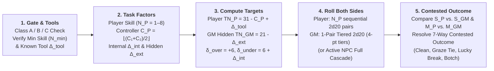

# Core `2d20` Watershed Cascade & Always-Contested Task Resolution

Whenever a character performs an action with meaningful stakes and uncertainty that can influence the narrative or tactical situation, the Game Master (or the Satya AI Game Master via `ContestedCascadeTaskParams` and `evaluate_satya_cascade_task` in [`crates/satya-engine/src/dice_probabilities.rs`](../../../crates/satya-engine/src/dice_probabilities.rs)) calls for an **Always-Contested Task Resolution** roll.

In Satya, **every task is contested**: the player rolls their sequential `2d20` cascade against their **known personal target number ($\text{TN}_P = 31 - C_P + \Delta_{\text{tool}}$)**, while the Game Master secretly rolls an opposing **GM Resistance Roll** (`1-Pair Tiered GM Resistance` for environmental/technical obstacles against $\text{TN}_{GM} = 21 - \Delta_{\text{ext}}$, or a full opposing cascade for an active NPC opponent). Because the GM's target and roll are hidden, the player can feel their own execution momentum and floor-breach strain on the dice, **but never knows for certain whether a high roll beat the hidden resistance or whether a `0`-success near-miss was rescued by a GM botch** until the narrative outcome unfolds.

This chapter is the single canonical ruleset for framing, gating, modifying, and resolving any task or skill check in **Satya**, uniting the mathematical calibration in [Probability, Distribution Topology & `2d20` Calibration](../01-foundation/probability_and_calibration.md) and the [Mathematical Notation, Variables & Formula Glossary](../01-foundation/mathematical_notation_glossary.md) with the attribute controllers in [Character Characteristics & Aptitudes](../03-character/characteristics_and_aptitudes.md) and the skill hierarchy in [Skill System & The 8 Hierarchical Skill Trees](../03-character/skills_and_trees.md).

> [!TIP]
> **Mathematical Notation Reference:** See the **[Mathematical Notation, Variables & Formula Glossary](../01-foundation/mathematical_notation_glossary.md)** for complete definitions of all symbols and subscripts (`_P` = Player, `_GM` = Game Master, `_n` = Cascade Step $n$, $\text{TN}_P$, $\text{TN}_{GM}$, $C_P$, $\Delta_{\text{tool}}$, $\Delta_{\text{int}}$, $\Delta_{\text{ext}}$, $\delta_{\text{over}}$, $\delta_{\text{under}}$, and $\Delta M$).

---

## 1. The Always-Contested Task Resolution Pipeline

Every task in Satya is resolved through a unified five-step pipeline:

---

## 2. Step 1: Task Gate Classifications, Prerequisites & Tools

Before any dice are rolled, the GM determines **whether the character is qualified and equipped** to attempt the task.

### 2.1 Three Task Gate Classifications (`Class A / B / C`)

Every task in Satya belongs to one of three **Gate Classifications**:

| Gate Class | Who May Attempt the Task | Effective Skill ($N$) & Untrained / Default Modifier ($\Delta_{\text{ext}}$) |
| :--- | :--- | :--- |
| **Class A: Open / Talent Task** | **Anyone** (uses an innate Talent `TAL` at $N \ge 1$ or a basic Physical `PHY` action). | Roll the character's Talent level ($N \ge 1$). If attempting a basic `PHY` skill untrained (`N = 0`), roll **`N = 1` pair** with **$\Delta_{\text{ext}} = +4$**. |
| **Class B: Trained / Defaultable Task** | Characters with the required skill ($N \ge 1$), **OR** characters who possess its immediate **Parent or Sibling Skill** at $N_{\text{parent}} \ge 2$. | If trained ($N \ge 1$), roll $N$ pairs at normal $\Delta_{\text{ext}}$. If defaulting from a Parent/Sibling skill, roll **$\max(1, N_{\text{parent}} - 1)$ pairs** with an added **$\Delta_{\text{ext}} = +4$ to $+6$**. Characters with neither cannot attempt the roll. |
| **Class C: Hard-Gated Specialist Task (`[Locked]`)** | **Only** characters who possess the exact required skill at or above **$N_{\text{min}}$** AND possess **Mandatory Tools**. | **No defaulting allowed.** Cannot be defaulted from parent skills or raw Characteristics. Without $N \ge N_{\text{min}}$ and the required tools, the character cannot meaningfully attempt the task (or automatically botches if forced under duress). |

### 2.2 Tool Dependency Tiers (`[Tool]`) & 2031–2035 Smart-Tech Modifiers

Every skill and task specifies one of three tool dependencies:

1. **`[Tool: None]`**:
   Relies purely on the character's body, voice, senses, or mind (*Running*, *Singing*, *Brawling*, *Observation*, *Mental Arithmetic*, *Persuasion*, *Empathy*).
2. **`[Tool: Situational]`**:
   Unassisted tasks can be performed barehanded ($\Delta_{\text{ext}} = 0$), while complex tasks within the same skill require tools or suffer an **Improvised/Unassisted Penalty ($\Delta_{\text{ext}} = +4\text{ to }+12$)**—e.g., *First Aid* allows direct pressure barehanded, but requires a trauma kit to tourniquet severed arterial vessels or decompress a tension pneumothorax; *Climbing* allows scrambling up a brick wall barehanded, but requires pitons/ascenders for a sheer glass skyscraper.
3. **`[Tool: Mandatory]`**:
   The skill **cannot be rolled at all** without the requisite weapon, instrument, vehicle, lab, or computing rig (*Lockpicking*, *Trauma Surgery*, *Network Exploitation*, *Firearms*, *Rotary-Wing Piloting*, *Arc Welding*).

| Equipment / Tool Tier | External Modifier ($\Delta_{\text{ext}}$) | Narrative & Mechanical Description (Earth 2031–2035) |
| :--- | :---: | :--- |
| **No Tools (on `[Tool: Mandatory]` Task)** | **Impossible** | Task cannot be attempted. |
| **No Tools (on `[Tool: Situational]` Tool Task)** | **`+8` to `+12`** | Barehanded / purely improvised under desperate conditions; triggers `SuccessWithComplication` on floor breach. |
| **Improvised / Street-Scavenged Kit** | **`+4` to `+8`** | Shoddy, worn, or makeshift tools (e.g., bent paperclips for lockpicking, unlicensed 3D-printed polymer firearm after 50 rounds). |
| **Standard Commercial / Issue Kit (Baseline)** | **`0`** | Properly maintained professional tools, standard issue service rifle, standard diagnostic tablet. |
| **Precision / Masterwork Professional Kit** | **`-2`** | Match-grade firearm, calibrated forensic lab, high-end trauma suite. |
| **2031–2035 AI-Assisted / Smart-Linked Rig** | **`-4`** | AR ballistic smart-optic synced to weapon, AI 2.0 diagnostic co-pilot, robotic micro-surgical tele-manipulator, or autonomous zero-day fuzzing cluster. |

---

## 3. Step 2: The Four Task Factors (`N` Skills, Target Number `31 - C`, $\Delta_{\text{int}}$, $\Delta_{\text{ext}}$ & Degrees of Success)

Every task in Satya is parameterized by **four orthogonal factors** (`CascadeTaskParams`), determining the Roll-Over **Target Number ($\text{TN}_{\text{eff}} = 31 - C + \Delta_{\text{ext}}$)** and the resulting **Degree of Success (`OutcomeTier`)**:

### 3.1 Factor 1: Skill Level ($N \in [1, 8]$, Mythic Cap `10`) — Number of `2d20` Pairs

When attempting a skill check or combat action, a character rolls **$N$ sequential pairs of 20-sided dice (`2d20`)**, where **$N$ is the character's Skill Level**:

$$\text{List A} = (A_1, A_2, \dots, A_N), \qquad \text{List B} = (B_1, B_2, \dots, B_N)$$

At each step $n \in \{1, \dots, N\}$, the unmodified pair sum $X_n = A_n + B_n$ ranges from **$2$ to $40$**, forming a triangular distribution centered at its exact midpoint of **$21$**.

| Skill Level ($N$) | Proficiency Tier | Pairs of `2d20` Rolled | Benchmark Success Rate ($C = 10, \Delta_{\text{int}} = 0, \Delta_{\text{ext}} = 0$) |
| :---: | :--- | :---: | :---: |
| **`N = 0`** | **Untrained** *(Non-Talent `PHY`/`KNO`)* | Cannot roll Class C; defaults to `N = 1` (`+4` to `+6` $\Delta_{\text{ext}}$) on Class A/B | — |
| **`N = 1`** | **Novice / Baseline Talent (`TAL`)** | `1` pair (`2d20`) | `47.50%` *(strict `>`) / `52.50%` (`>=`)* |
| **`N = 2`** | **Apprentice / Vocational Dabbler** | `2` pairs | `60.68%` |
| **`N = 3`** | **Competent / Journeyman (Trained Professional)** | `3` pairs | **`70.10%`** |
| **`N = 4`** | **Seasoned Specialist** | `4` pairs | `77.25%` |
| **`N = 5`** | **Veteran Expert** | `5` pairs | `82.69%` |
| **`N = 6–7`** | **Master Practitioner** | `6–7` pairs | `86.83% – 89.98%` |
| **`N = 8`** | **Grandmaster (Standard Human Cap)** | `8` pairs | **`92.37%`** |
| **`N = 10`** | **Mythic / Transcendent Cap** | `10` pairs | `95.59%` |

### 3.2 Factor 2: Controlling Characteristic ($C \in [1, 20]$) — Baseline Target Shift

Satya is a **Roll-Over** system where **higher numbers are always better**:
- A higher pair sum ($A_n + B_n$) is always better.
- A higher **Controlling Characteristic ($C$)** (such as `SPD`, `FOR`, `DEX`, `KIN`, `ANA`, `INS`, `DIS`, `FOC`, `ELO`, or `SIG`) is always better.
- **Controlling Characteristic ($C$) Scale**: Theoretical range `1–20`, playable human range **`4–18`**, with the **Human Average at `C = 10`**.
- **Composite Controlling Characteristics (`C1 / C2`)**: Most skills combine two characteristics (such as `DEX/TAC` for *Lockpicking*, `ELO/ANA` for *Persuasion*, or `DEX/SIG` for *Pistols*):
  $$C = \left\lfloor \frac{C_1 + C_2}{2} \right\rfloor$$
- **Gated Supporting Characteristic (`Min C3 >= X`)**: If a skill specifies a minimum supporting characteristic and the character falls short by $k = X - C_3$ points, each point of shortfall imposes **`+2` to $\Delta_{\text{ext}}$** (e.g., firing *Fully Automatic Weapons* with `FOR 8` against `Min FOR >= 10` adds `+4` to $\Delta_{\text{ext}}$).

### 3.3 Factor 3: Internal Character Modifiers ($\Delta_{\text{int}} \in [-2, +10]$) — Stumble Recovery Penalty

Internal modifiers reflect the character's physiological and psychological condition (**Fatigue**, **Wound Shock**, **Pain**, **Dehydration**, **Psychological Strain**, or **Cognitive Dissonance**). Rather than penalizing the character's opening motion (Pair 1), $\Delta_{\text{int}}$ increases the **negative carry-over penalty ($\delta_{\text{under}}$)** after a missed pair:

$$\delta_{\text{under}} = \delta_{\text{base}} + \Delta_{\text{int}} = 6 + \Delta_{\text{int}}, \qquad \delta_{\text{over}} = 6$$

Crucially, $\Delta_{\text{int}}$ imposes **zero penalty on Pair 1**—if a fatigued master succeeds on Pair 1, muscle memory carries them through without slowdown; if they miss Pair 1, recovery is much steeper.

| Character Internal State | $\Delta_{\text{int}}$ | Failure Carry Penalty ($-\delta_{\text{under}}$) | Mechanical & Narrative Meaning |
| :--- | :---: | :---: | :--- |
| **Focused / Conviction Surge** | **`-2`** | **`-4`** | Calm, rested, or surging with conviction; a stumble on Pair 1 is easy to recover from on Pair 2. |
| **Fresh (Baseline)** | **`0`** | **`-6`** | Symmetric watershed carry (`+6` on success, `-6` on failure). |
| **Distracted / Mild Strain** | **`+2`** | **`-8`** | Flustered (`1` stack of Rhetorical Strain or `Fatigue Level 1`). |
| **Winded / Shaken** | **`+4`** | **`-10`** | Breathing hard or Rattled (`Fatigue Level 2` or `Wound Shock 1`). |
| **Battered / Moderately Wounded** | **`+6`** | **`-12`** | Bleeding or in significant pain (`Fatigue Level 3`); missing Pair 1 makes recovery steep. |
| **Exhausted / Severely Wounded** | **`+8` to `+10`** | **`-14` to `-16`** | On the verge of collapse; if Pair 1 succeeds, muscle memory carries through (`+6`), but a miss almost guarantees cascade failure or a floor-breach complication. |

### 3.4 Factor 4: Known Tool Modifier ($\Delta_{\text{tool}}$) vs. Hidden External Difficulty ($\Delta_{\text{ext}}$)

To ensure the player can roll and resolve their entire sequential `2d20` cascade step-by-step **without ever knowing the true difficulty of the obstacle**, Satya separates external modifiers into two components:

1. **Known Tool & Loadout Modifier ($\Delta_{\text{tool}} \in [-4, +8]$ — Applied to Player's $\text{TN}_P$):**
   Represents transparent modifiers that the character is directly aware of before starting the action—such as using a `-2` masterwork toolkit, a `-4` AI-assisted smart-optic, `+4` improvised street tools, or an untrained/defaulting penalty (`+4` to `+6`). This shifts the **Player's Personal Target Number ($\text{TN}_P$)**:
   $$\text{TN}_P = (1.5K + 1) - C_P + \Delta_{\text{tool}} = 31 - C_P + \Delta_{\text{tool}}$$
   - Each **+1 to Controlling Characteristic ($C_P$)** *lowers* $\text{TN}_P$ by `1` on every pair.
   - Each **+1 to Known Tool Penalty ($\Delta_{\text{tool}}$)** *raises* $\text{TN}_P$ by `1` on every pair (while a `-2` or `-4` tool bonus *lowers* $\text{TN}_P$).

2. **Hidden External Task Difficulty ($\Delta_{\text{ext}} \in [-10, +16]$ — Applied to GM's Hidden $\text{TN}_{GM}$):**
   Represents the objective complexity of the task, hidden security countermeasures, lock tolerances, target armor/cover, environmental hazards, and weather. Instead of shifting the player's target number, $\Delta_{\text{ext}}$ shifts the **GM's Hidden Resistance Target ($\text{TN}_{GM}$)**:
   $$\text{TN}_{GM} = 21 - \Delta_{\text{ext}} \qquad \left(\text{equivalent to an opposing Controller } C_{GM} = 10 + \Delta_{\text{ext}}\right)$$
   - Higher $\Delta_{\text{ext}}$ *lowers* the GM's target number $\text{TN}_{GM}$, making it easier for the GM's hidden roll to score multiple resistance successes ($S_{GM}$) and harder for the environment to botch ($B_{GM}$).
   - Lower $\Delta_{\text{ext}}$ (easy/routine conditions) *raises* $\text{TN}_{GM}$, making GM resistance successes rare and GM environmental botches frequent!

| Task Difficulty Tier | Hidden $\Delta_{\text{ext}}$ | Hidden $\text{TN}_{GM} = 21 - \Delta_{\text{ext}}$ | `P(GM >= 1)` | `P(GM >= 2)` | `P(GM >= 3)` | `P(GM Botch < 0)` | Example Situational Conditions |
| :--- | :---: | :---: | :---: | :---: | :---: | :---: | :--- |
| **Trivial / Routine** | `-8` | **`29`** | `16.50%` | `7.00%` | `1.50%` | **`70.00%`** | Ideal lab conditions, abundant time, poorly maintained civilian hardware. |
| **Easy** | `-4` | **`25`** | `30.00%` | `16.50%` | `7.00%` | **`52.50%`** | Good lighting, favorable terrain, distracted or low-grade opposition. |
| **Standard Benchmark** | **`0`** | **`21`** *(Exact `2d20` midpoint)* | **`47.50%`** | **`30.00%`** | **`16.50%`** | **`34.00%`** | Standard professional challenge under field conditions. |
| **Challenging** | `+4` | **`17`** | `66.00%` | `47.50%` | `30.00%` | **`19.50%`** | Poor lighting, rain, rushed execution, commercial high-security hardware. |
| **Hard** | `+8` | **`13`** | `80.50%` | `66.00%` | `47.50%` | **`9.00%`** | Pitch darkness, active combat stress, encrypted military-grade countermeasures. |
| **Extreme** | `+12` | **`9`** | `91.00%` | `80.50%` | `66.00%` | **`2.50%`** | Hardened black-site systems or severe environmental storms. |
| **Heroic / Nearly Impossible** | `+16` | **`5`** | `97.50%` | `91.00%` | `80.50%` | **`0.00%`** | Achievable only by elite specialists chaining `3+` successes against near-certain resistance. |

---

## 4. Step 3 & 4: Rolling the Player's Cascade & The GM's Hidden Resistance

### 4.1 The Player's Sequential `2d20` Cascade (Against Known $\text{TN}_P = 31 - C_P + \Delta_{\text{tool}}$)

Once $N_P$, $\text{TN}_P = 31 - C_P + \Delta_{\text{tool}}$, $\delta_{\text{over}} = 6$, and $\delta_{\text{under}} = 6 + \Delta_{\text{int}}$ are set, the player rolls **$N_P$ sequential pairs of `2d20`**:

1. **Pair 1 ($n = 1$)**:
   - Compute $Y_1 = A_1 + B_1$ (since $\text{Carry}_1 = 0$).
   - If $Y_1 > \text{TN}_P$ *(or $\ge \text{TN}_P$ in roll-over mode)*:
     - Record **`+1` Player Success ($S_P \mathrel{+}= 1$)**.
     - Set carry-over for Pair 2 to **$+\delta_{\text{over}}$ (`+6`)**.
   - If $Y_1 \le \text{TN}_P$:
     - Record **`0` Successes** on Pair 1.
     - Set carry-over for Pair 2 to **$-\delta_{\text{under}}$ ($-(6 + \Delta_{\text{int}})$)**.
2. **Subsequent Pairs ($n = 2 \dots N_P$)**:
   - Compute the modified pair sum:
     $$Y_n = A_n + B_n + \text{Carry}_n$$
   - Compare $Y_n$ against $\text{TN}_P$:
     - If $Y_n > \text{TN}_P$ *(or $\ge \text{TN}_P$)*: Record **`+1` Player Success ($S_P \mathrel{+}= 1$)**!
     - If $Y_n \le \text{TN}_P$: Record **`0` Successes** on Pair $n$.
     - If $Y_n < 2$ (dropping below the physical `2d20` minimum of snake-eyes `2` due to negative carry $-\delta_{\text{under}}$): Record **`+1` Floor Breach ($B_P \mathrel{+}= 1$)**.
   - Update $\text{Carry}_{n+1}$ according to the task's **Carry Mode**:
     - **Standard Carry Mode (`markov_step` / `CarryMode::MarkovStep` — Default)**: $\text{Carry}_{n+1} = +\delta_{\text{over}}$ (`+6`) if Pair $n$ succeeded, or $-\delta_{\text{under}}$ (`-4` to `-16`) if Pair $n$ failed. Carry does not stack beyond a single step, allowing a skilled practitioner who stumbles on Pair 1 to fight through $-\delta_{\text{under}}$ on Pair 2 or 3 and flip the cascade back into positive `+6` momentum!
     - **High-Stakes Carry Mode (`cumulative_snowball` / `CarryMode::CumulativeSnowball`)**: $\text{Carry}_{n+1} = \text{Carry}_n + \delta_{\text{over}}$ on success, or $\text{Carry}_n - \delta_{\text{under}}$ on failure. Used for unforgiving high-stakes procedures (*Neurosurgery*, *EOD Disarming*, *Orbital Docking*) where early mistakes compound rapidly.
     - **Linear Margin Carry Mode (`linear_margin` / `CarryMode::LinearMargin`)**: Exact difference carry ($\text{Carry}_{n+1} = Y_n - \text{TN}_P$).
3. **Player's Signed Margin ($M_P$)**:
   - If $S_P \ge 1$, then $M_P = +S_P$.
   - If $S_P = 0$, the player's closest attempt $Y_{\text{best}} = \max(Y_1, \dots, Y_{N_P})$ is measured in `4`-point ($K/5 = 4$) tiers below $\text{TN}_P$:
     $$B_{\text{eff}} = \min\!\left(5,\; \left\lfloor \frac{\text{TN}_P - Y_{\text{best}}}{4} \right\rfloor\right), \qquad M_P = -B_{\text{eff}}$$
     (So missing by $0\text{–}3$ points yields a **Player Clean Miss ($M_P = 0$)**, while missing by $4+$ points yields a **Player Botch ($M_P \in [-1, -5]$)**).

### 4.2 The GM's Hidden Resistance Roll (`1-Pair Tiered` vs. `Full Cascade`)

Simultaneously, the GM resolves the opposing resistance using one of two modes (`GmResistanceMode`):

1. **Mode A — 1-Pair Tiered GM Resistance (`GmResistanceMode::TieredSinglePair { step_size: 4 }` — Default for Environment, Locks, Medical, Cyber & Hazard Tasks):**
   - The GM secretly rolls **a single `2d20` pair** ($X_{GM} = A_{GM} + B_{GM} \in [2, 40]$) against the hidden resistance target $\text{TN}_{GM} = 21 - \Delta_{\text{ext}}$.
   - **GM Resistance Successes ($S_{GM}$ — `4`-Point Over-Tiers):** If $X_{GM} > \text{TN}_{GM}$ *(or $\ge \text{TN}_{GM}$)*, the obstacle scores `1` base success plus **`+1` additional success for every `4` points above $\text{TN}_{GM}$**:
     $$S_{GM} = 1 + \left\lfloor \frac{X_{GM} - \text{TN}_{GM} - 1}{4} \right\rfloor, \qquad B_{GM} = 0, \qquad M_{GM} = +S_{GM}$$
   - **GM Clean `0` or Environmental Botch ($B_{GM}$ — `4`-Point Under-Tiers):** If $X_{GM} \le \text{TN}_{GM}$, the obstacle scores $S_{GM} = 0$ successes and `1` botch tier for every `4` points below $\text{TN}_{GM}$:
     $$S_{GM} = 0, \qquad B_{GM} = \min\!\left(5,\; \left\lfloor \frac{\text{TN}_{GM} - X_{GM}}{4} \right\rfloor\right), \qquad M_{GM} = -B_{GM}$$
     - If $\text{TN}_{GM} - 3 \le X_{GM} \le \text{TN}_{GM}$, the GM rolled a **Clean `0`** ($M_{GM} = 0$).
     - If $X_{GM} \le \text{TN}_{GM} - 4$, the GM rolled an **Environmental/Obstacle Botch** ($M_{GM} \in [-1, -5]$)—an unexpected flaw, brittle pin, or lucky opening!
2. **Mode B — Active Opponent Full Cascade (`GmResistanceMode::FullCascade` — For Opposed NPC Combat, Social & Stealth Exchanges):**
   - When the task directly opposes an active NPC with their own Skill Level $N_{NPC}$ and Controller $C_{NPC}$ (e.g., *Melee Parry*, *Counter-Surveillance*, *Social Interrogation*), the GM rolls the NPC's full $N_{NPC}$-pair cascade against $\text{TN}_{NPC} = 31 - C_{NPC} + \Delta_{\text{tool,NPC}}$, producing $(S_{GM}, B_{GM}, M_{GM})$.

---

## 5. Step 5: The 7-Way Contested Outcome Matrix (`ContestedOutcomeKind` & `OutcomeTier`)

Once both the Player $(S_P, B_P, M_P)$ and the GM $(S_{GM}, B_{GM}, M_{GM})$ have rolled, compute the **Net Signed Margin ($\Delta M = M_P - M_{GM}$)** and resolve the contested check using `ContestedTieRule::HybridSignedMargin`:

### 5.1 How Successes, Ties, Floor Breaches & GM Botches Interact
- **To Win Cleanly ($S_P > S_{GM}$):** The player must roll **strictly more successes** than the GM's resistance roll ($S_P > S_{GM}$).
  - If the player suffered a Floor Breach ($B_P \ge 1$) during their cascade and the GM did not botch ($M_{GM} \ge 0$), the win becomes a **`SuccessWithFloorBreach` (`PartialSuccess`)**.
  - If the GM *botched* ($M_{GM} < 0$), the GM's botch **cancels the player's floor breach** and boosts the player's net margin ($\Delta M = S_P - (-B_{GM}) = S_P + B_{GM}$), making it much easier to reach **`ExtraordinarySuccess` ($\Delta M \ge +3$)**!
- **Positive Ties ($S_P = S_{GM} \ge 1 \implies$ `GrazingTieSuccess`):** When both the player and the GM score the same positive number of successes (`1 vs 1`, `2 vs 2`, `3 vs 3`), the player **succeeds at a minor cost (`OutcomeTier::PartialSuccess`)**—accomplishing the core objective, but taking `+25%` extra time (`TC`), making minor noise, or achieving reduced yield.
- **Zero Ties ($S_P = 0, M_P = 0$ vs. $M_{GM} = 0 \implies$ `CleanFailure`):** If neither side scores a success and neither side botches (`0 vs 0`), the status quo holds and the player's attempt fails cleanly.
- **Lucky Break ($S_P = 0, M_P = 0$ vs. $M_{GM} < 0 \implies$ `LuckyBreakSuccess`):** If the player rolled `0` successes without botching (a Clean Near-Miss, $M_P = 0$) **and the GM botched ($M_{GM} < 0$)**, the obstacle's internal failure rescues the player! They scrape through with a **`LuckyBreakSuccess` (`OutcomeTier::PartialSuccess`)**.
- **Player Botch ($M_P < 0 \implies$ `BotchFailure`):** If the player botched ($M_P < 0$), an environmental botch by the GM ($M_{GM} < 0$) cannot turn a player botch into a success, though it softens the net botch severity ($\Delta M = M_P - M_{GM}$).

### 5.2 Canonical 7-Way Contested Outcome Table

| Contested Outcome (`ContestedOutcomeKind`) | `OutcomeTier` | Condition (`HybridSignedMargin`) | Narrative & Mechanical Result |
| :--- | :--- | :--- | :--- |
| **`ExtraordinarySuccess`** | `EXTRAORDINARY_SUCCESS` | $S_P > S_{GM}$, $\Delta M = M_P - M_{GM} \ge +3$, and $(B_P = 0 \text{ or } M_{GM} < 0)$ | **Masterwork Triumph**: Accomplishes the task faster (`-15%` duration per net success above 1), silently, with bonus yield, or grants `-4` $\Delta_{\text{ext}}$ setup synergy. |
| **`CleanSuccess`** | `SUCCESS` | $S_P > S_{GM}$, $1 \le \Delta M \le 2$, and $(B_P = 0 \text{ or } M_{GM} < 0)$ | **Clean Professional Execution**: The character cleanly overcomes the obstacle with no complication. |
| **`SuccessWithFloorBreach`** | `PARTIAL_SUCCESS` | $S_P > S_{GM}$, $B_P \ge 1$ ($Y_n < 2$ on a failed pair), and $M_{GM} \ge 0$ | **Success with Stumble Complication**: The character beats the GM's resistance, but their floor-breach pair causes a complication (e.g., snapping a lockpick inside the cylinder after it turns, weapon stovepipe jam if `B_P > Rel`, or taking `+2` $\Delta_{\text{int}}$ strain). |
| **`GrazingTieSuccess`** | `PARTIAL_SUCCESS` | $S_P = S_{GM} \ge 1$ *(Positive Tie)* | **Grazing Success (Tie Goes to Action at a Cost)**: Both sides matched successes (`1–1`, `2–2`, etc.). The task succeeds by the skin of the character's teeth, incurring `+25%` Tick Cost (`TC`), minor noise, or reduced effect. |
| **`LuckyBreakSuccess`** | `PARTIAL_SUCCESS` | $S_P = 0, M_P = 0$ *(Player Clean Miss)* **AND** $M_{GM} < 0$ *(GM Botch)* | **Lucky Break**: The character's technique stalled (`0` successes, `0` botches), **but** the obstacle/environment suffered a botch (a rusted bolt sheared, a sensor glitched, a guard looked away). The character succeeds through sheer fortune! |
| **`CleanFailure`** | `FAILURE` | $(S_P < S_{GM}, M_P \ge 0, B_P = 0)$ **OR** $(M_P = 0 \text{ and } M_{GM} = 0)$ | **Clean Failure / Near Miss**: The obstacle's resistance holds firm and time (`TC`) is spent, but no catastrophic mistake occurs. |
| **`BotchFailure`** | `CRITICAL_FAILURE` | $M_P < 0$ **OR** $(S_P < S_{GM} \text{ and } B_P \ge 1)$ | **Catastrophic Botch**: Something goes actively wrong—tools jam, alarms trigger, patient destabilizes, or the character exposes themselves to counterattack. |

---

## 6. Complementary Skills, Composite Tasks & Extended Project Clocks

### 6.1 Complementary Knowledge-to-Physical Synergy (`KNO` $\to$ `PHY`)
When a character uses an analytical or academic **Knowledge (`KNO`)** skill to plan, diagnose, or calculate a physical or technical execution (e.g., *Clinical Diagnostics* before *Paramedicine*, *Basic Electronics* before *Lockpicking* an electronic strike plate, *Trigonometry* before *Precision Rifle*, or *Mechanical Engineering* before placing *Military Demolitions*), resolve the `KNO` setup roll first:
- **`3+` Successes (`ExtraordinarySuccess`)**: Grants **`-4` to $\Delta_{\text{ext}}$** AND boosts positive carry $\delta_{\text{over}}$ from `+6` to **`+8`** on the execution roll.
- **`1–2` Successes (`Success`)**: Grants **`-2` to $\Delta_{\text{ext}}$** on the execution roll.
- **`0` Successes (`CleanFailure`)**: No modifier (`+0`).
- **Botch (`CriticalFailure`)**: Flawed assessment imposes **`+4` to $\Delta_{\text{ext}}$** on the execution roll.

### 6.2 Dual-Skill Gate (Simultaneous Multi-Skill Execution)
When a single continuous action simultaneously demands two skills (e.g., *FPV Kamikaze Drone Strike in Heavy Electronic Jamming* requiring both *Tactical Recon & Loitering Munition* and *Electronic Warfare / C-UAS*), the character rolls a number of `2d20` pairs equal to:
$$N_{\text{eff}} = \min(N_1, N_2) + \begin{cases} 1 & \text{if } \max(N_1, N_2) \ge \min(N_1, N_2) + 2 \\ 0 & \text{otherwise} \end{cases}$$

### 6.3 Downtime, Training, Research & Extended Project Clocks
When characters are between active scenes—recovering from surgery, engineering a custom piece of hardware, decrypting an archive, or studying to raise a Skill Level ($N$)—Satya resolves progress using **Extended Project Cascades**:
1. **Extended Project Progress Clock**:
   - The GM sets a **Project Complexity Requirement** in **Total Cascade Successes Needed** (e.g., `10 Successes` to fabricate a custom drone frame, or `15 Successes` to trace a shell corporation across three offshore jurisdictions) and a **Time Interval per Roll** (`1 Hour`, `1 Day`, or `1 Week`).
   - At each interval, the character rolls their governing skill (`2d20` cascade) and adds their **`signed_margin`** to the Project Clock:
     - Positive successes (`+1` to `+N`) advance the project.
     - A **`SuccessWithComplication`** advances the project, but consumes extra raw materials, money, or leaves a forensic trace (`+1 Heat`).
     - A **`BotchFailure` (`< 0`)** sets progress back by the botch margin or damages a component.
2. **Post-Lifepath Skill Advancement (In-Campaign Training)**:
   - Improving an existing Skill from Level $N$ to $N+1$ (or learning a new `N = 1` skill) during a campaign uses the same **Exponential Study Curve** and **Discipline (`DIS + Mental + APT`) Advancement Check** defined in [Lifepath Character Creation, Economy & Heat](../03-character/lifepaths_and_economy.md).
   - Combat, crisis, and high-stakes field experience count as **accelerated study hours** whenever a character succeeds (or survives a `SuccessWithComplication`) on a Challenging ($\Delta_{\text{ext}} \ge +4$) task using that skill.

---

## 7. Complete Worked Examples

### 7.1 Worked Example 1: Sarah's Lockpicking Task (Player Cascade vs. Hidden 1-Pair Tiered GM Roll)

> **Scenario**: Sarah needs to pick the mechanical pin-tumbler cylinder on a heavy hardened-steel bike lock in a dimly lit alley before a security patrol rounds the corner. Crucially, Sarah knows her own skill, hands, and tools, **but she does not know whether the lock inside the weathered casing is a cheap standard core ($\Delta_{\text{ext}} = 0$) or fitted with anti-pick security spool pins ($\Delta_{\text{ext}} = +4$)**.

1. **Character Profile & Gate Check**:
   - **Characteristics**: **Dexterity (`DEX`) = `13`** (steady hands), **Tactile (`TAC`) = `12`** (sensitive fingertips), **Focus (`FOC`) = `11`**.
   - **Skill**: **Lockpicking & Physical Security Bypass** (`PHY/KNO`, `DEX/TAC`, Minimum `DEX 10, TAC 10, FOC 9`) at **Skill Level `N_P = 3`** (Competent Journeyman).
   - **Gate & Tools**: Picking a mechanical pin-tumbler lock is a **Class B (Trained / Defaultable)** task with **`[Tool: Mandatory]`**. Sarah has a professional tension wrench and hook pick set (**Known Tool Modifier $\Delta_{\text{tool}} = 0$**).
2. **Known Player Factors vs. Hidden GM Factors**:
   - **Player Skill Level ($N_P$)**: **`3` pairs of `2d20`**.
   - **Player Controlling Characteristic ($C_P$)**:
     $$C_P = \left\lfloor \frac{\text{DEX } 13 + \text{TAC } 12}{2} \right\rfloor = \mathbf{12}$$
   - **Player's Known Personal Target ($\text{TN}_P$)**:
     $$\text{TN}_P = 31 - C_P + \Delta_{\text{tool}} = 31 - 12 + 0 = \mathbf{19}$$
     *(Notice that Sarah knows her target is `19` (`> 19`, so `20+` on `2d20`) regardless of how hard the lock is!)*
   - **Player Internal Modifier ($\Delta_{\text{int}}$)**: Sarah is winded from sprinting two blocks (**`fatigue_level = 1` $\implies \Delta_{\text{int}} = +2$**).
     - Her positive momentum carry is $\delta_{\text{over}} = \mathbf{+6}$.
     - Her failure stumble carry is $\delta_{\text{under}} = 6 + 2 = \mathbf{8}$ (`-8` penalty after a missed pair).
   - **GM's Hidden External Difficulty ($\Delta_{\text{ext}}$)**: Unknown to Sarah, the lock has a hardened security spool pin (`+2`) and the alley is dimly lit (`+2`), giving a hidden **$\Delta_{\text{ext}} = +4$ (Challenging)**.
     - The GM's hidden resistance target is:
       $$\text{TN}_{GM} = 21 - \Delta_{\text{ext}} = 21 - 4 = \mathbf{17}$$
3. **Step A — Sarah Rolls Her `N_P = 3` Sequential `2d20` Cascade (Against $\text{TN}_P = 19$)**:
   - **Pair 1 ($n = 1$, $\text{Carry}_1 = 0$)**:
     - Sarah rolls $A_1 = 7, B_1 = 11 \implies Y_1 = 7 + 11 + 0 = \mathbf{18}$.
     - Comparing $Y_1 = 18$ vs. $\text{TN}_P = 19$: **Miss!** Her pick slips past the first pin.
     - Because Sarah is slightly winded ($\Delta_{\text{int}} = +2$), her stumble passes **$\text{Carry}_2 = -\delta_{\text{under}} = -8$** to Pair 2!
   - **Pair 2 ($n = 2$, $\text{Carry}_2 = -8$)**:
     - Sarah steadies her breathing and rolls $A_2 = 16, B_2 = 14$.
     - Modified total: $Y_2 = 16 + 14 - 8 = \mathbf{22} > 19$!
     - **+1 Player Success ($S_P = 1$)!** Despite the `-8` stumble penalty from Pair 1, her strong roll (`30` raw) recovers her rhythm!
     - Under standard `markov_step` carry, her success flips the cascade into positive momentum: **$\text{Carry}_3 = +\delta_{\text{over}} = +6$**!
   - **Pair 3 ($n = 3$, $\text{Carry}_3 = +6$)**:
     - Riding the `+6` momentum, Sarah rolls $A_3 = 9, B_3 = 10$.
     - Modified total: $Y_3 = 9 + 10 + 6 = \mathbf{25} > 19$!
     - **+1 Player Success ($S_P = 2, B_P = 0, M_P = +2$)!**
   - *Epistemic Moment:* Sarah looks at her dice: she scored **`2` Successes** cleanly! She knows she executed well—but she still doesn't know if `2` successes is enough to beat the lock until the GM's hidden roll is compared!
4. **Step B — Comparing Against the GM's Hidden 1-Pair Tiered Roll ($\text{TN}_{GM} = 17$, `4`-Point Over-Tiers)**:
   - Look at how three different hidden `2d20` rolls by the GM resolve Sarah's `2` successes:
     - **Case 1 — GM Rolls $A_{GM} = 10, B_{GM} = 9 \implies X_{GM} = 19$ (Clean Win):**
       - $X_{GM} = 19 > \text{TN}_{GM} (17)$ by `2` points ($1\text{–}4$ over-tier) $\implies$ **`S_GM = 1` GM Success ($M_{GM} = +1$)**.
       - Sarah's $S_P = 2 > S_{GM} = 1$ (Net Margin $\Delta M = +2 - 1 = +1$): **`ContestedOutcomeKind::CleanSuccess` (`OutcomeTier::Success`)**! The shackle clicks open cleanly before the patrol rounds the corner.
     - **Case 2 — GM Rolls $A_{GM} = 13, B_{GM} = 11 \implies X_{GM} = 24$ (Grazing Tie):**
       - $X_{GM} = 24 > \text{TN}_{GM} (17)$ by `7` points:
         $$S_{GM} = 1 + \left\lfloor \frac{24 - 17 - 1}{4} \right\rfloor = 1 + 1 = \mathbf{2\text{ GM Successes}} \quad (M_{GM} = +2)$$
       - Sarah's $S_P = 2$ **ties** the GM's $S_{GM} = 2$: **`ContestedOutcomeKind::GrazingTieSuccess` (`OutcomeTier::PartialSuccess`)**! The deep security spool pin binds hard at the last millimeter; Sarah manages to wrench the shackle open, but it takes `+25%` longer (`+3 Ticks`) and lets out a sharp metallic *clank* just as the patrol's footsteps echo down the alley!
     - **Case 3 — GM Rolls $A_{GM} = 15, B_{GM} = 14 \implies X_{GM} = 29$ (Clean Failure Despite 2 Player Successes!):**
       - $X_{GM} = 29 > \text{TN}_{GM} (17)$ by `12` points $\implies$ **`S_GM = 3` GM Successes ($M_{GM} = +3$)**.
       - Even though Sarah rolled `2` successes, $S_P = 2 < S_{GM} = 3$: **`ContestedOutcomeKind::CleanFailure` (`OutcomeTier::Failure`)**! She sets two pins cleanly, but discovers a third mushroomed anti-pick pin that refuses to budge in the time she has.

### 7.2 Worked Example 2: Floor Breach (`SuccessWithFloorBreach`) & Lucky Break (`LuckyBreakSuccess`)

1. **Floor Breach Complication (`SuccessWithFloorBreach`)**:
   - Suppose on **Pair 1** above, Sarah rolled $A_1 = 4, B_1 = 5 \implies Y_1 = 9 \le 19$ (Miss, $\text{Carry}_2 = -8$), and on **Pair 2** she rolled $A_2 = 3, B_2 = 5 \implies Y_2 = 3 + 5 - 8 = \mathbf{0} < 2$!
   - Because $Y_2 < 2$ drops below the physical minimum of `2d20`, Pair 2 triggers a **Floor Breach ($B_P = 1$)**.
   - If she then rolled $A_3 = 15, B_3 = 15 \implies Y_3 = 30 - 8 = \mathbf{22} > 19$ on Pair 3 ($S_P = 1, B_P = 1$) while the GM rolled $X_{GM} = 16 \le 17$ ($S_{GM} = 0, M_{GM} = 0$), Sarah wins ($S_P = 1 > S_{GM} = 0$) with an uncancelled floor breach: **`ContestedOutcomeKind::SuccessWithFloorBreach` (`OutcomeTier::PartialSuccess`)**—she pops the lock open, **but** snaps the tip of her hook pick off inside the keyway!
2. **Lucky Break via GM Botch (`LuckyBreakSuccess`)**:
   - Suppose Sarah missed all three pairs with a best attempt of $Y_{\text{best}} = 18$ against $\text{TN}_P = 19$. Because $\lfloor(19 - 18)/4\rfloor = 0$, she has a **Player Clean Miss ($S_P = 0, M_P = 0$)**—she thinks she failed!
   - However, the GM secretly rolls $A_{GM} = 4, B_{GM} = 5 \implies X_{GM} = \mathbf{9}$ against $\text{TN}_{GM} = 17$:
     $$B_{GM} = \left\lfloor \frac{17 - 9}{4} \right\rfloor = \mathbf{2} \implies M_{GM} = \mathbf{-2}\text{ (GM Botch!)}$$
   - Under `HybridSignedMargin`, Sarah's Clean Miss ($M_P = 0$) against the GM's Botch ($M_{GM} = -2$) resolves as **`ContestedOutcomeKind::LuckyBreakSuccess` (`OutcomeTier::PartialSuccess`)**: as Sarah twists her tension wrench in frustration, a corroded internal spring inside the weathered lock snaps on its own and the shackle pops free!

---

## 8. Master Task Requirements Table (Skills, Prerequisites, Tools & Hidden GM Resistance)

The following canonical reference table defines the exact skills, minimum skill ranks ($N_{\text{min}}$), controlling characteristics ($C_P$), known tool requirements ($\Delta_{\text{tool}}$), and hidden GM resistance modifiers ($\Delta_{\text{ext}}$ where $\text{TN}_{GM} = 21 - \Delta_{\text{ext}}$ in `1-Pair Tiered GM Resistance` or Opposed NPC cascade) for benchmark tasks across all categories:

| Task Description | Category | Gate Class | Primary Skill ($N_{\text{min}}$) | Complementary / Alt Skill | Control ($C_P$) | Tool Requirement ($\Delta_{\text{tool}}$) | Hidden $\Delta_{\text{ext}}$ ($\text{TN}_{GM} = 21 - \Delta_{\text{ext}}$) | Contested Resolution (`S_P vs. S_GM`) |
| :--- | :--- | :---: | :--- | :--- | :---: | :--- | :---: | :--- |
| **Sprint across open street under fire & vault a 1.5m barrier** | `Athletic`, `Combat` | Class A | *Parkour* (`N>=1`) or *Running* (`TAL N>=1`) | *Jumping* (`TAL`) | `KIN/SPD` *(or `FIT/SPD`)* | `[Tool: None]` | `0` *(Parkour)* / `+4` *(Running)* | Beat $S_{GM}$ (`ΔM >= +2` reduces Tick Cost by 2) |
| **Scale a rain-slicked brick warehouse drainpipe (3 stories)** | `Athletic`, `Fieldcraft` | Class A | *Climbing* (`TAL N>=1`) | *Parkour* (`N>=1`) | `FOR/KIN` | `[Tool: Situational]` *(Gloves/Rope `-2`)* | `+4` ($\text{TN}_{GM} = 17$) | Beat $S_{GM}$ (`GrazingTie` = slow/noisy climb) |
| **Identify a tail in a crowded 2033 transit hub** | `Fieldcraft` | Class A | *Surveillance & Counter-Surveillance* (`N>=1`) | Default: *Observation* (`TAL`, $\Delta_{\text{tool}} +4$) | `FOC/ITU` *(or `FOC/SIG`)* | `[Tool: Situational]` *(AR Smart-Glasses `-2`)* | Opposed vs. Tail's *Surveillance* | Beat opponent's $S_{GM}$ |
| **Pick a mechanical pin-tumbler padlock or deadbolt** | `Fieldcraft`, `Technical` | Class B | *Lockpicking & Security Bypass* (`N>=1`) | Default: *Basic Tool Use* (`N>=2`, $\Delta_{\text{tool}} +6$) | `DEX/TAC` | **`[Tool: Mandatory]`** *(Tension wrench & picks; improvised bobby pins `+6`)* | `0` *(Standard, $\text{TN}_{GM}=21$)* / `+4` *(High-Sec, $\text{TN}_{GM}=17$)* | Beat $S_{GM}$ (`ΔM >= +2` silent/fast) |
| **Bypass a 2033 biometric / encrypted RFID smart-lock** | `Fieldcraft`, `Cyber` | Class C (`[Locked]`) | *Lockpicking & Security Bypass* (`N>=2`) | *Basic Electronics* (`N>=2`) or *Network Exploitation* (`N>=2`) | `ANA/DEX` | **`[Tool: Mandatory]`** *(RFID/BLE Signal Spoofer or Logic Probe)* | `+4` ($\text{TN}_{GM} = 17$) | Beat $S_{GM}$ |
| **Hotwire an older IC car vs. spoof a 2032 encrypted EV keyfob** | `Fieldcraft`, `Technical` | Class B / C | *Vehicle Hotwiring & Transponder Spoofing* (`N>=1` IC / `N>=2` EV) | *Automotive Mechanics* (`N>=2`, IC only) | `DEX/ANA` | **`[Tool: Mandatory]`** *(Strippers/Screwdriver for IC; CAN-bus/OBD-II injector for EV)* | `0` *(IC, $\text{TN}_{GM}=21$)* / `+4` *(2032 EV, $\text{TN}_{GM}=17$)* | Beat $S_{GM}$ |
| **Fire a semi-automatic pistol at 15m under combat stress** | `Combat` | Class B | *Pistols & Revolvers* (`N>=1`) | *Tactical Handgun* or *Street Shooting* (`N>=1`) | `DEX/SIG` | **`[Tool: Mandatory]`** *(Handgun & Ammunition)* | `0` *(Aimed `TC 12`)* / `+4` *(Snap `TC 7`)* | Beat $S_{GM}$ (or target's Evasion/Cover) |
| **Control a 5-round burst from a submachine gun or assault rifle** | `Combat` | Class B | *Fully Automatic Weapons* (`N>=1`) | Default from *Long Guns* / *Pistols* at **$\Delta_{\text{tool}} = +6$** *(or `+8` if `FOR < 10`)* | `DEX/FOR` | **`[Tool: Mandatory]`** *(Select-fire or sear-modified weapon)* | `+2` *(Braced, $\text{TN}_{GM}=19$)* / `+6` *(Moving, $\text{TN}_{GM}=15$)* | `1` hit on beat/tie (`+1` hit per net success $\Delta M$) |
| **Engage a point target at 900m in 15 mph crosswind** | `Combat`, `Science` | Class C (`[Locked]`) | *Precision Rifle & Sniping* (`N>=2`) | Setup: *Trigonometry* (`N>=2`) | `DEX/FOC` *(Min `SIG 12`)* | **`[Tool: Mandatory]`** *(Precision Rifle, Optic; AI Ballistic Scope `-4` $\Delta_{\text{tool}}$)* | `+6` ($\text{TN}_{GM} = 15$) | Beat $S_{GM}$ |
| **Convert a semi-auto pistol to full-auto or mill a ghost-gun receiver** | `Technical`, `Combat` | Class C (`[Locked]`) | *Gunsmithing & Armorer* (`N>=2`) or *Improvised Munitions* (`N>=2`) | *Metalworking / CNC* (`N>=2`) | `DEX/ANA` *(or `DEX/CRE`)* | **`[Tool: Mandatory]`** *(Machining tools / 3D printer & jigs)* | `+2` ($\text{TN}_{GM} = 19$) | Beat $S_{GM}$ (`PartialSuccess` = gun jams on floor breach) |
| **Stop severe arterial extremity bleeding in an alley** | `Medical` | Class A | *First Aid* (`N>=1`) or *Paramedicine* (`N>=1`) | Default: Raw `DEX/DIS` (`N=1`, $\Delta_{\text{tool}} +4$) | `DEX/DIS` | `[Tool: Situational]` *(CAT Tourniquet `0`; improvised belt/rag `+6` $\Delta_{\text{tool}}$)* | `0` ($\text{TN}_{GM} = 21$) | Beat $S_{GM}$ |
| **Decompress a tension pneumothorax or establish a surgical airway** | `Medical` | Class C (`[Locked]`) | *Paramedicine & TCCC* (`N>=2`) or *Trauma Surgery* (`N>=1`) | Setup: *Clinical Diagnostics* (`N>=1`) | `DEX/DIS` | **`[Tool: Mandatory]`** *(14ga decompression needle / cricothyrotomy kit; improvised blade/tube `+8`)* | `+4` ($\text{TN}_{GM} = 17$) | Beat $S_{GM}$ |
| **Extract a fragmented rifle round near the abdominal aorta** | `Medical` | Class C (`[Locked]`) | *Trauma & General Surgery* (`N>=3`) | *Human Anatomy* (`N>=3`), *Diagnostics* (`N>=2`) | `DEX/FOC` *(Min `TAC 11`)* | **`[Tool: Mandatory]`** *(Sterile Surgical Suite; back-alley ripperdoc clinic `+6`)* | `+6` ($\text{TN}_{GM} = 15$) | Beat $S_{GM}$ *(High-Stakes `cumulative_snowball`)* |
| **Disarm a dual-trigger improvised explosive device (IED) with anti-handling tilt switch** | `Combat`, `Technical` | Class C (`[Locked]`) | *Explosive Ordnance Disposal (EOD)* (`N>=2`) | *Basic Electronics* (`N>=2`), *Improvised Munitions* (`N>=3`, $\Delta_{\text{tool}} +4$) | `DEX/FOC` *(Min `DIS 12`)* | **`[Tool: Mandatory]`** *(EOD Diagnostic & Disarm Kit)* | `+6` ($\text{TN}_{GM} = 15$) | Beat $S_{GM}$ *(Botch detonates device)* |
| **Spear-phish a corporate employee and deploy a credential stealer** | `Cyber`, `Social` | Class B | *Street Phishing & Script Intrusion* (`N>=1`) or *Network Exploitation* (`N>=1`) | Setup: *Research & OSINT* (`N>=1`) + *Deception* (`TAL`) | `CRE/INS` *(or `ELO/CRE`)* | **`[Tool: Mandatory]`** *(Laptop/Deck & C2 Server)* | `0` ($\text{TN}_{GM} = 21$) | Beat $S_{GM}$ |
| **Chain a kernel privilege-escalation exploit across an air-gapped industrial SCADA network** | `Cyber` | Class C (`[Locked]`) | *Zero-Day Exploit Dev* (`N>=2`) or *Network Exploitation* (`N>=4`) | *Software Engineering* (`N>=3`) | `ANA/CRE` | **`[Tool: Mandatory]`** *(Custom Hardware Implant & Exploit Framework)* | `+8` ($\text{TN}_{GM} = 13$) | Beat $S_{GM}$ |
| **Fine-tune a 2033 multimodal AI 2.0 model to detect forged satellite telemetry** | `Cyber`, `Science` | Class C (`[Locked]`) | *Machine Learning & Neural Architecture* (`N>=2`) | *Calculus & Linear Algebra* (`N>=3`), *Applied Statistics* (`N>=3`) | `ANA/INS` | **`[Tool: Mandatory]`** *(GPU/TPU Compute Cluster & Training Dataset)* | `+4` ($\text{TN}_{GM} = 17$) | Beat $S_{GM}$ |
| **Cook high-purity synthetic methamphetamine or fentanyl analogues** | `Science`, `Technical` | Class C (`[Locked]`) | *Clandestine Narcotics Synthesis* (`N>=2`) or *Organic Chemistry* (`N>=3`) | *Pharmacology* (`N>=2`) | `MEM/DEX` *(or `ANA/DEX`)* | **`[Tool: Mandatory]`** *(Precursor Chemicals & Glassware/Ventilation)* | `+2` *(Lab, $\text{TN}_{GM}=19$)* / `+6` *(Street RV, $\text{TN}_{GM}=15$)* | Beat $S_{GM}$ (`PartialSuccess` = toxic fumes or impure yield) |
| **Charm a hostile VIP or disarm tension at a high-society gala** | `Social` | Class A | *Charm & Rapport* (`TAL N>=1`) or *Seduction* (`N>=1`) | Setup: *Etiquette & Corporate Protocol* (`N>=1`) | `PRE/ELO` *(or `COM/PRE`)* | `[Tool: Situational]` *(Tailored Wardrobe `-2`; street clothes `+4` $\Delta_{\text{tool}}$)* | `0` *(Neutral, $\text{TN}_{GM}=21$)* / `+4` *(Suspicious, $\text{TN}_{GM}=17$)* | Beat $S_{GM}$ (`ΔM >= +2` gains private invitation/trust) |
| **Run a live voice-cloned pretext call to trick a security desk into opening a vault door** | `Social`, `Fieldcraft`, `Cyber` | Class B | *Con Artistry & Social Engineering* (`N>=1`) | Default: *Deception* (`TAL`, $\Delta_{\text{tool}} +4$); Setup: *AI 2.0 Synth-Media* (`N>=1`) | `ELO/CRE` | `[Tool: Situational]` *(Spoofed Caller-ID & Voice Clone Rig `-2` $\Delta_{\text{tool}}$)* | `+2` *(or Opposed vs. Guard's Empathy)* | Beat Guard's $S_{GM}$ |
| **Subtly elicit classified project details from an engineer over drinks without alerting them** | `Social`, `Fieldcraft` | Class B | *Investigative Interviewing & Subtle Elicitation* (`N>=1`) | Default: *Charm* or *Empathy* (`TAL`, $\Delta_{\text{tool}} +4$) | `INS/ELO` | `[Tool: None]` | Opposed vs. Target's *Empathy* / *Discipline* | Beat $S_{GM}$ (`PartialSuccess` = gets info, but target grows suspicious later) |
| **Break a hardened syndicate courier or operative under high-pressure interrogation** | `Social`, `Fieldcraft` | Class B / C | *Coercive Interrogation & Psychological Breaking* (`N>=1`) | Default: *Intimidation* (`TAL`, $\Delta_{\text{tool}} +6$ vs. trained target) | `DIS/INS` | `[Tool: Situational]` *(2033 Biometric Pupillometry / Voice-Stress Monitor `-2`)* | Opposed vs. Subject's *Counter-Interrogation (SERE)* (`DIS/FOC`) | Net $\Delta M \ge +2$ over subject |
