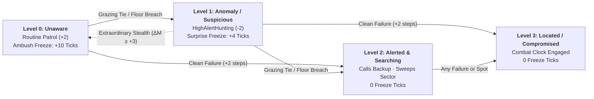

# Stealth, Passive Awareness, Active Observation & Investigation

> **Rust Engine Implementation**: [`crates/satya-engine/src/action_catalog_stealth.rs`](../../../crates/satya-engine/src/action_catalog_stealth.rs) (`ObservationMode`, `ActiveSensoryChannel`, `ObserverAttentionState`, `AlertnessLevel`, `AcousticSurfaceKind`, `AmbientNoiseMask`, `ThermalStealthProfile`, `DigitalRfHygiene`, `SocialStealthWardrobeFit`, `TailStance`, `ForensicDecayContext`, `ClueDiscoveryTier`, `compute_watch_duty_fatigue_delta_ext`, `evaluate_alertness_transition`, `evaluate_multi_spectrum_stealth_modifiers`, `evaluate_surveillance_tail_exchange`, `evaluate_forensic_clue_search`).  
> **Companion Chapters**: [Action Economy & OODA Loop (`action_economy_and_ooda.md`)](action_economy_and_ooda.md) · [Characteristics & Senses (`characteristics_and_aptitudes.md`)](../03-character/characteristics_and_aptitudes.md) · [Lifepaths, Cover Identities & Safehouses (`lifepaths_and_economy.md`)](../03-character/lifepaths_and_economy.md#33-contacts-networks--favors).

In **Satya**, stealth, detection, surveillance, and crime-scene investigation do not collapse into a single "Perception vs. Sneak" binary roll. An operative sneaking across wet gravel in pitch darkness faces different acoustic, thermal, and RF constraints than a clean operative walking past security checkpoints under a forged biometric legend—and a bored security guard scrolling on a tablet processes sensory evidence completely differently from a hunter actively sweeping a room with thermal optics.

---

## 1. Passive Awareness vs. Active Observation (`ObservationMode`)

Satya enforces a strict mechanical boundary between **Passive Awareness** (background notice while your attention is elsewhere) and **Active Observation** (deliberately committing OODA Ticks to sweep a sector, audit a person, or search a room).

| Detection Mode | Time Cost | Controlling Score ($C$) | Observer Dice Pairs ($N$) | When Used |
| :--- | :---: | :--- | :---: | :--- |
| **`PassiveAwareness`** | **`0 Ticks`** *(Free, GM-Hidden)* | General Awareness Score: $\text{AWR} = \lfloor(\max(\text{SIG}, \text{HEA}) + \text{FOC} + \text{ITU})/3\rfloor$ | Degraded by `ObserverAttentionState` (`N = 1` if Distracted/Routine; $\lfloor N/2 \rfloor$ if Vigilant) | Sentries on patrol, pedestrians, operatives walking into an ambush, ambient anomaly cues. |
| **`ActiveObservation`** | **`6 Ticks` (`1.5s`)** Tactical Sweep *or* **`15 min`** Room Search | Specific channel pair via `ActiveSensoryChannel` (`SIG/FOC`, `HEA/FOC`, `TAC/FOC`, `OLF/INS`, `TAS/INS`, `ITU/INS`) | **Full skill pairs $N$** (*Observation & Awareness*, *Surveillance*, or *Forensics*) | Deliberately slicing a doorway (`ActiveScanRoomOrSectorSweep`), patting down a suspect, inspecting electronics with a sensor. |

### 1.1 Observer Attention States (`ObserverAttentionState`) & Watch Duty Fatigue

Human vigilance degrades rapidly under boredom, multitasking, and long static shifts:

| `ObserverAttentionState` | $\Delta_{\text{ext}}$ Shift on Observer | Passive Pairs ($N_{\text{obs}}$) | Operational Profile |
| :--- | :---: | :---: | :--- |
| **`DistractedEngrossed`** | **`+4`** *(Penalty)* | Capped at **`N = 1`** | Reading a phone/terminal, arguing, tending an injury, repairing machinery. |
| **`RoutinePatrolBored`** | **`+2`** *(Penalty)* | Capped at **`N = 1`** | Standard checkpoint duty, pacing a quiet corridor with no recent incidents (`Alertness Level 0`). |
| **`VigilantWatch`** | **`+0`** | **`max(1, floor(N / 2))`** | Disciplined overwatch sniper, bodyguard detail scanning a crowd, alerted lookout before contact. |
| **`HighAlertHunting`** | **`-2`** *(Bonus)* | **Promotes to Active `full N`** | Actively hunting an intruder or anomaly (`Alertness Level 1+`); immediately unlocks `ActiveObservation`. |

- **Watch Duty Fatigue ($\Delta_{\text{watch}}$)**: Staring at monitors or standing static sentry post imposes **`+1` $\Delta_{\text{ext}}$ per full `2 hours`** of continuous uninterrupted watch, capped at **`+4` $\Delta_{\text{ext}}$** at `8+` hours:
  $$\Delta_{\text{watch}} = \min\!\left(4,\; \left\lfloor \frac{\text{watch\_hours}}{2.0} \right\rfloor\right)$$

### 1.2 Explicit 6-Sense Channel Isolation (`ActiveSensoryChannel`)

During **Active Observation**, the searcher declares **one primary channel** (and optional specialized hardware yielding `-2` to `-4` $\Delta_{\text{tool}}$):

| Sensory Channel | Attribute Pair ($C$) | Physical / 2035 Tactical Application |
| :--- | :---: | :--- |
| **Visual (`VisualSigFoc`)** | `SIG / FOC` | Silhouette breaks, micro-expressions, tripwires, IR/NVG/FLIR contrast, muzzle glint. |
| **Auditory (`AuditoryHeaFoc`)** | `HEA / FOC` | Footstep cadence, fabric rustle, weapon click, suppressed subsonic action clack, quadrotor buzz. |
| **Tactile (`TactileTacFoc`)** | `TAC / FOC` | Concealed holster frisking, sub-surface wall voids, pressure plates, floor vibration through boots. |
| **Olfactory (`OlfactoryOlfIns`)** | `OLF / INS` | Unburnt gunpowder, gun oil, bleach/solvent scrubbing, diesel exhaust, ozone/shorted wiring, sweat. |
| **Gustatory (`GustatoryTasIns`)** | `TAS / INS` | Trace metallic/alkaloid adulteration in water/food, airborne chemical bitterness in tight vents. |
| **Intuitive (`SixthSenseItuIns`)** | `ITU / INS` | "Hair on the back of the neck"—detecting hostile intent, sniper stare, or an uncanny mismatch in an AI proxy's cadence. |

---

## 2. Escalating Alertness & Suspicion Ladder (`AlertnessLevel`)

In realistic tactical stealth, a single slightly imperfect die roll rarely teleports every guard in a compound into lethal gunfight awareness. Instead, **Alertness escalates across four discrete rungs**, controlled directly by the infiltrator's `2d20` Contested Outcome (`evaluate_alertness_transition`):

| `AlertnessLevel` | Surprise OODA Freeze (`Ticks`) | Attention Posture | Behavior & De-Escalation |
| :--- | :---: | :--- | :--- |
| **`Level 0: Unaware`** | **`+10 Ticks`** *(range `+8..+12`)* | `RoutinePatrolBored` | Normal patrol intervals. An attack from here triggers full **Surprise OODA Freeze**. |
| **`Level 1: Anomaly / Suspicious`** | **`+4 Ticks`** | `HighAlertHunting` | Guard heard a click or glimpsed shadow movement; shifts immediately to **Active Observation (`HighAlertHunting`, `-2` $\Delta_{\text{ext}}$)** and inspects the anomaly. Returns to `Level 0` only if infiltrator scores `ExtraordinarySuccess` (`ΔM >= +3`) relocating/freezing. |
| **`Level 2: Alerted & Searching`** | **`+0 Ticks`** | `HighAlertHunting` | Guard confirmed a breach sign (muddy bootprint, cut fence, missing badge), **radios backup**, draws weapon, and sweeps chokepoints. Cannot be reset cleanly once triggered. |
| **`Level 3: Located / Compromised`** | **`+0 Ticks`** | `HighAlertHunting` | Visual/thermal lock acquired on the infiltrator (`BotchFailure` from any level jumps directly here). Scene immediately enters the **Count-Up Combat Clock**. |

> [!TIP]
> **GM Pacing Rule on Partial Stealth Results**:
> - **`CleanSuccess` (`ΔM = +1..+2`)**: Holds `AlertnessLevel` unchanged.
> - **`GrazingTieSuccess` / `LuckyBreakSuccess` / `SuccessWithFloorBreach`**: Advances `AlertnessLevel` by **`+1` step** without blowing cover—turning `Level 0` into tense `Level 1` cat-and-mouse instead of an instant combat slog!
> - **`CleanFailure`**: Advances **`+2` steps** (`Level 0` $\to$ `Level 2`, `Level 1+` $\to$ `Level 3`).
> - **`BotchFailure`**: Jumps straight to **`Level 3: Located / Compromised`**.

---

## 3. Multi-Spectrum & Social Stealth

In 2035 operational environments, hiding from unaided human eyes is only the first layer. **Satya** tracks **Visual/Illumination**, **Acoustic Surface & Ambient Noise**, **Thermal/FLIR Signature**, **Digital/RF Emissions**, and **Social Camouflage ("Hiding in Plain Sight")** uniformly through `evaluate_multi_spectrum_stealth_modifiers`.

### 3.1 Visual Stealth, Movement Gait, Encumbrance & Illumination

- **Gait & Encumbrance (`KIN / ITU`)**:
  - `StationaryCamouflaged` (`0 m/Tick`): **`+0`** movement penalty; adds trained **Camouflage & Concealment** bonus ($\Delta_{\text{cam}}$).
  - `StealthCreep` (`18%` sprint, `~0.34 m/Tick` at `SPD 10`): **`+0`** movement penalty; stationary camouflage bonus does **not** apply while creeping.
  - `CombatGlide` (`35%` sprint, `~0.65 m/Tick`): **`+4`** $\Delta_{\text{ext}}$ movement penalty.
  - `RunningDash` (`65–100%` sprint): **`+8`** $\Delta_{\text{ext}}$ movement penalty.
  - **Encumbrance**: Adds **`+0` (`Tier 0–1`)**, **`+2` (`Tier 2`)**, **`+4` (`Tier 3`)**, or **`+6` (`Tier 4`)** $\Delta_{\text{ext}}$ per [Movement, Encumbrance & Vehicles](../06-health-and-survival/movement_encumbrance_and_vehicles.md#2-encumbrance-equipment-bulk--ergonomic-carry).

| `IlluminationCondition` | Visual Check (`SIG`) $\Delta_{\text{ext}}$ | Visual Stealth $\Delta_{\text{ext}}$ | Sensor & Countermeasure Interaction |
| :--- | :---: | :---: | :--- |
| **`BrightDaylight`** | `+0` | `+4` *(Harder to hide)* | Requires solid hard cover or urban crowd blending (§3.4). |
| **`DimLightDuskShadows`** | `+2` | `-2` | Tactical flashlights eliminate penalty in cone (`+0`), but expose holder at distance. |
| **`MoonlightStarlight`** | `+6` | `-6` | **`Gen3PlusNvg`** reduces observer visual penalty to **`+1`**. |
| **`HeavyFogRainSmoke`** | `+8` | `-8` | **`ThermalFlir`** reduces observer visual penalty to **`+0`** unless target wears thermal-baffled cloak; imposes **`+2`** auditory penalty (`HEA`). |
| **`PitchBlackTotalDarkness`** | **`+10`** *(Blinded Unaided)* | `-10` | **`Gen3PlusNvg`** reduces to **`+4`**; **`ThermalFlir`** reduces to **`+0`** unless target is thermally baffled. |

### 3.2 Acoustic Surfaces & Ambient Noise Masking

When moving at any non-stationary gait (`StealthCreep`, `CombatGlide`, `RunningDash`), add the floor surface penalty and subtract the ambient noise mask (`AcousticSurfaceKind`, `AmbientNoiseMask`):

| Floor / Terrain Surface (`AcousticSurfaceKind`) | Infiltrator $\Delta_{\text{ext}}$ *(While Moving)* |
| :--- | :---: |
| **Thick Carpet / Soft Grass Turf (`ThickCarpetOrTurf`)** | **`-2`** |
| **Concrete / Asphalt / Tile (`ConcreteAsphaltOrTile`)** | **`+0`** |
| **Hardwood / Creaky Stairs (`HardwoodOrCreakyStairs`)** | **`+2`** |
| **Loose Gravel / Dry Leaves (`GravelOrDryLeaves`)** | **`+4`** |
| **Broken Glass / Metal Grate (`BrokenGlassOrMetalGrate`)** | **`+6`** |

| Environmental Noise Backdrop (`AmbientNoiseMask`) | Infiltrator Stealth $\Delta_{\text{ext}}$ | Observer Auditory (`HEA`) $\Delta_{\text{ext}}$ |
| :--- | :---: | :---: |
| **Dead Silent Vault / Server Bunker (`DeadSilentVault`)** | **`+2`** | **`-2`** |
| **Quiet Suburban Night (`QuietSuburbanNight`)** | **`+0`** | **`+0`** |
| **HVAC / Steady Rain (`HvacOrSteadyRain`)** | **`-2`** | **`+2`** |
| **Urban Traffic / Bustling Crowd (`UrbanTrafficOrCrowd`)** | **`-4`** | **`+4`** |
| **Heavy Storm / Factory / Nightclub (`HeavyStormMachineryOrClub`)** | **`-6`** | **`+6`** |

### 3.3 Thermal / IR Signatures & Digital RF Hygiene

- **Thermal Signature (`ThermalStealthProfile`)**:
  - `UnshieldedStandard`: **`+0`** vs. FLIR (`+0` visual penalty once `ThermalFlir` cuts darkness/smoke).
  - `HotEquipmentOrSuppressor`: **`-4`** $\Delta_{\text{ext}}$ **bonus** to a FLIR observer (freshly fired suppressors, hot motors, and idling exhaust glow white-hot against nocturnal backgrounds).
  - `ThermalBaffledCloak`: **`+6`** $\Delta_{\text{ext}}$ **penalty** to a FLIR observer and restores full illumination/smoke concealment against thermal optics.
- **Digital & RF Signature Hygiene (`DigitalRfHygiene`)**:
  - `AirGappedFaradayPouch`: **`+0`** electronic footprint; completely silent to IMSI catchers and BLE beacons.
  - `AirplaneModePassiveWearable`: **`+2`** $\Delta_{\text{ext}}$ vs. RF/sensor sweeps (unshielded crystal/NFC leakage).
  - `ActiveSmartphoneOrBleTrail`: **`+4`** $\Delta_{\text{ext}}$ AND **automatically pings 2035 municipal/corporate checkpoint logs** whenever the bearer carries **`Operational Heat >= 3`** (`lifepaths_and_economy.md` §3.2).

### 3.4 Social Stealth ("Hiding in Plain Sight")

When infiltrating a corporate lobby, hospital wing, or checkpoint crowd rather than sneaking through ceiling vents, roll **Etiquette (`PRE/MEM`)**, **Deception (`ELO/BEA`)**, or **Con Artistry (`ELO/CRE`)** (governed by **`BEA / SAV`** in unified Social Blending resolution) against the sentry's **Observation (`SIG/FOC`)** or **Empathy (`SAV/ITU`)**:

| Wardrobe & Credential Fit (`SocialStealthWardrobeFit`) | Infiltrator $\Delta_{\text{ext}}$ | Cover Identity Resistance ($\text{PR}_{\text{id}}$) |
| :--- | :---: | :--- |
| **`AuthenticUniformOrCredentials`** *(Janitor, Medic, Courier, Exec)* | **`-2`** | Subtract **Cover Identity $\text{PR}_{\text{id}}$** (`-2` Tier 1 to `-8` Tier 4; see [Cover Identities](../03-character/lifepaths_and_economy.md#34-layered-cover-identities--paper-trails)) |
| **`BlendsIntoCrowdNeutral`** *(Street clothes in transit hub)* | **`+0`** | Subtract Cover $\text{PR}_{\text{id}}$ |
| **`ConspicuousOrMismatched`** *(Muddy boots in penthouse, wrong badge color)* | **`+4`** | Subtract Cover $\text{PR}_{\text{id}}$ |
| **`ArmedOrBloodiedObvious`** *(Visible long gun, tactical plate, fresh trauma)* | **`+8`** | Cover $\text{PR}_{\text{id}}$ cannot prevent immediate challenge |

---

## 4. Surveillance, Tail Craft, Forensic Clues & Post-Truth Verification

### 4.1 Urban Surveillance & Surveillance Detection Routes (`SDR`)

Trailing a target through a city or running counter-surveillance (`SDR`) to spot a tail resolves across **`15–30 minute` route legs** using **Surveillance, Tail Craft & Counter-Surveillance (`FOC / SIG`)** (`Class B` — untrained operatives default from *Observation* at `+4` $\Delta_{\text{tool}}$):

| Tail Stance (`TailStance`) | Detection Risk Shift (`SDR`) | Tracking Difficulty Shift | Tactical Trade-Off |
| :--- | :---: | :---: | :--- |
| **`LooseTail`** *(2+ blocks back, swapping jackets, parallel lanes)* | **`-2`** *(Harder for target to spot)* | **`+4`** *(Higher risk of losing target at metro transfers)* | Prioritizes operational secrecy over continuous visual lock. |
| **`TightTail`** *(Within 15–30m, crossing same lights/doors)* | **`+4`** *(High risk of burning tail)* | **`-2`** *(Easier to hold contact)* | Required in dense crowds/rain; any `GrazingTie` / `FloorBreach` burns the shadower on an SDR. |

- **`ExtraordinarySuccess` (`ΔM >= +3`)**: Completes the route leg in **`15 min`** cleanly and grants **`-2` $\Delta_{\text{ext}}$** on the following leg.
- **`CleanFailure`**: Target slips the tail at a blind corner or transit transfer without noticing (`+4` to re-acquire).
- **`BotchFailure`**: Target both slips the tail **and** photographs/logs the shadower (`target_burned_shadower = true`).

### 4.2 Forensic Clue Discovery & Trace Evidence Decay

Satya distinguishes between **Core Leads** (necessary to keep an investigation moving—never locked behind an unfair single-roll dead end when an operative has relevant training) and **Deep / Hidden Links**:

| Discovery Tier (`ClueDiscoveryTier`) | Triggering Outcome | Investigative Yield |
| :--- | :--- | :--- |
| **`NoClueFound`** | `CleanFailure` / `BotchFailure` | Trail goes cold on this pass (`BotchFailure` contaminates sample or generates an active false lead!). |
| **`CoreLeadOnly`** | `GrazingTie` / `LuckyBreak` / `SuccessWithFloorBreach` | Surfaces the core operational lead (`FloorBreach` degrades delicate secondary evidence or costs extra time). |
| **`CoreAndDeepAnalysis`** | `CleanSuccess` (`ΔM = +1..+2`) | Surfaces both the core lead and corroborating deep technical/chemical forensics (batch numbers, tool marks, caliber striation). |
| **`HiddenLinkOrZeroCostBreakthrough`** | `ExtraordinarySuccess` (`ΔM >= +3`) | Recovers core + deep forensics **plus hidden conspiratorial/attribution links** in a single pass with **zero extra time**. |

Crime scenes and physical/RF traces decay with time and deliberate cleanup (`ForensicDecayContext`):

| Environment / Tampering (`ForensicDecayContext`) | Trace Decay Penalty ($\Delta_{\text{ext}}$) | Cap |
| :--- | :--- | :---: |
| **`IndoorsControlled`** | **`+1`** per full **`24 hours`** elapsed | `+8` |
| **`OutdoorsExposed`** | **`+2`** per full **`6 hours`** elapsed | `+10` |
| **`RainOrHeavyWeather`** | **`+4`** per full **`6 hours`** elapsed | `+12` |
| **`ProfessionallyScrubbed`** | **`+6` baseline** + **`+1`** per **`24 hours`** | `+12` |

### 4.3 2035 Post-Truth Verification: Deepfakes & Synth-Media Audits

In 2035, audio recordings, bodycam feeds, and biometric logs are routinely fabricated by *AI 2.0* generative pipelines. Auditing disputed media requires **`Digital Forensics & DFIR`** (`ANA / FOC`) or **`AI 2.0 Synth-Media`** (`ANA / INS`), modified by forensic tool quality (`-2` specialized workstation, `+4` smartphone viewer only) against the forger's **Net Margin** ($\Delta_{\text{ext}}$ set by forger skill). Scoring **`CleanSuccess`** identifies manipulation artifacts; scoring **`ExtraordinarySuccess` (`ΔM >= +3`)** extracts the generator watermark, model family, or origin hardware signature!

> [!EXAMPLE] At the Table: Night Infiltration vs. Bored Sentry (`Action` + `Multi-Spectrum` + `Alertness`)
> Mara (`KIN 13, ITU 12 -> C = 12`, *Stealth* `N = 3`, Tier-1 Encumbrance `+0`) creeps (`StealthCreep`) across wet courtyard **gravel (`+4`)** during **steady rain (`-2` ambient mask)** in **moonlight (`-6` visual concealment)** inside a **Faraday pouch (`+0`)** wearing a thermal-baffled cloak (`+6` vs FLIR). Her net movement modifier is `+4 - 2 = +2` $\Delta_{\text{ext}}$ ($\text{TN}_P = 31 - 12 = 19$ for Stealth, while the guard faces hidden difficulty shifts). Meanwhile, the guard has been standing post for **5 hours** (**Watch Fatigue `+2`**) on **`RoutinePatrolBored` (`+2` attention, `N = 1` passive)**, with derived $\text{AWR} = 11$. If Mara ties on a `GrazingTieSuccess`, the guard does **not** magically open fire—he escalates to **`Level 1: Anomaly / Suspicious`** (`+4` Surprise Freeze, shifts to `HighAlertHunting` with full $N$ and `-2` attention) and walks over with a flashlight to check the gravel!
