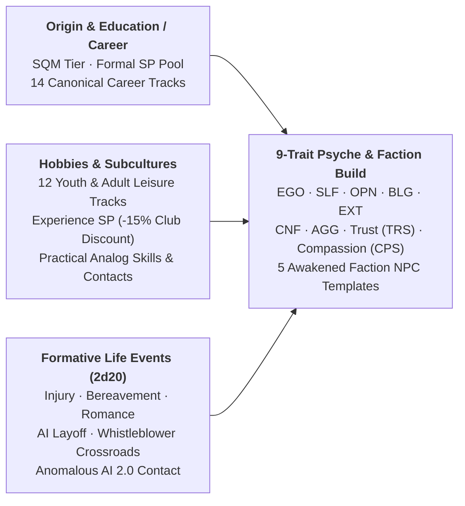

# Lifepath Hobbies, Formative Life Events, 5-Faction Templates & Walkthroughs

> **Rust Engine Implementation**: [`crates/satya-engine/src/lifepath_hobbies_events.rs`](../../../crates/satya-engine/src/lifepath_hobbies_events.rs) (`PersonalHobbyId`, `FormativeLifeEventId`, `resolve_formative_life_event`, `is_hobby_club_discounted_skill`), [`crates/satya-engine/src/faction_templates.rs`](../../../crates/satya-engine/src/faction_templates.rs) (`AwakenedFactionId`, `FactionArchetypeId`, `infer_faction_archetype_from_prompt`), [`crates/satya-engine/src/lifepath_economy.rs`](../../../crates/satya-engine/src/lifepath_economy.rs), [`crates/satya-engine/src/lifepath_catalog.rs`](../../../crates/satya-engine/src/lifepath_catalog.rs), [`crates/satya-engine/src/npc_generator.rs`](../../../crates/satya-engine/src/npc_generator.rs), [`crates/satya-engine/src/hook_weaver.rs`](../../../crates/satya-engine/src/hook_weaver.rs), and [`crates/satya-engine/src/walkthroughs.rs`](../../../crates/satya-engine/src/walkthroughs.rs).

Real human lives are shaped by far more than school transcripts and career résumés. Grief, lingering injuries, betrayal, romance, Saturday tabletop games, pickup soccer, late-night HAM radio nets, and sudden displacement carve out who a character trusts, what breaks them under interrogation, and who answers the phone when everything goes sideways.

This companion chapter extends [Lifepath Character Creation, Upkeep & Heat](lifepaths_and_economy.md) and the `9`-trait **Psyche** architecture in [Characteristics & Aptitudes](characteristics_and_aptitudes.md) across four pillars:
1. **Personal Hobbies, Clubs & Subcultures** (`12` canonical leisure tracks powered by `Experience SP`),
2. **Formative Life Events (`2d20` Table)** covering tragedy, love, white-collar displacement, and anomalous AI encounters,
3. **The 5 *Awakened* Faction Templates** linking faction identity directly to Lifepath priors, **9-Trait Psyche profiles (`TRS` & `CPS`)**, and **Social Combat wedges**, and
4. **Four Complete Worked Character Walkthroughs** (*Mateo Vance*, *Dr. Priya Nair*, *Amara Okafor*, and *Linnea Cho*).

---

## 1. Beyond School & Work: Personal Hobbies, Clubs & Subcultures

Whereas career tracks spend **Formal Training SP**, human identity flourishes in what people do when nobody is paying them. Hobbies explain why a soft-spoken biotech Ph.D. knows *SERE Meditation* and *Fencing*, why a municipal clerk maintains an encrypted *HAM Radio* relay in their closet, or why a corporate auditor can trace a deepfake faster than DAISE forensics.

### 1.1 Hobby Acquisition Mechanics (`Experience SP`)

1. **Timing & Slots**:
   - **Adolescent Hobby / Club (Ages 12–18)**: Choose **1** Hobby (funded out of the starting **`40 Experience SP`** Youth Pool).
   - **Adult Off-Duty Hobby (Per 4-Year Term)**: Keep and deepen your Youth Hobby **or** pick **1** new Hobby per Career Term (funded out of each term's **`+40 Experience SP`** Practical Pool).
2. **Club & Subculture Mechanical Benefits**:
   - **Signature Skill Discount (`-15%`)**: Practicing two signature skills inside an active club, gym, band, or study circle applies a **`0.85x`** learning multiplier on `Experience SP` purchases (capped at `N <= 3` unless an instructor is `N >= 4` or career-linked).
   - **Psyche Nudge (`±1`, optional)**: Living inside a subculture over years gently nudges one signature Psyche trait by `1` point toward that hobby's pole (e.g., `+1 CPS` from years in *Mutual Aid / Sangha*, `-1 TRS` from *Citizen OSINT*).
   - **Lived Social Contact**: Every chosen hobby grants **1 grounded local Contact** (*Coach*, *Gym Sparring Partner*, *Bandmate*, *HAM Net Operator*, *Tabletop GM*, *Sangha Elder*, or *Range Safety Officer*) whom the AI GM or human GM can weave into scenes without contrived plot hooks.

### 1.2 Master Catalog of 12 Canonical Hobbies & Subcultures

| Hobby / Club / Subculture | Signature Skills Advanced (`Experience SP`) | Attribute / Psyche Nudge | Contacts & *Awakened* 2035 Play Value |
| :--- | :--- | :--- | :--- |
| **1. Team Sports & Athletics** *(Soccer, Basketball, Rugby, Track)* | *Running*, *Jumping*, *Throwing* (`TAL`), *Team Coordination* | `+1 FIT` or `+1 BLG` *(max 1x)* | Former teammates across precincts/hospitals; instinctive squad spacing and cardio under duress. |
| **2. Combat Sports & Martial Arts Gym** *(Boxing, Muay Thai, Judo/BJJ, HEMA)* | *Brawling* or *Grappling (Wrestling/BJJ)* or *Fencing/Blades*, *Pain Conditioning* | `+1 DIS` or `+1 AGG` *(max 1x)* | Gym coaches, off-duty cops, SecOps trainees; realistic clinch/footwork defense without gun `Heat`. |
| **3. Tabletop RPG, Wargaming & Spec-Fic Club** | *Applied Statistics / Probability*, *History & Lore*, *Storytelling & Deception* | `+1 CRE` or `+1 OPN` *(max 1x)* | Lifelong circle of eclectic specialists (coders, teachers, medics); rapid scenario modeling and pretext improvisation. |
| **4. Garage Band, Choir, DJing & Indie Music Scene** | *Musical Instruments*, *Singing*, *Audio Production*, *Streetwise / Venue Networking* | `+1 EXT` or `+1 CRE` *(max 1x)* | Underground venues, tour vans, sound engineers, and unlicensed basement safehouses hidden from corporate telemetry. |
| **5. Debate Team, Mock Trial, Theater & Improv** | *Persuasion & Rhetoric*, *Acting, Disguise & Pretexting*, *Observation (Micro-Cues)* | `+1 ELO` or `+1 PRE` *(max 1x)* | Journalists, public defenders, local council aides; natural cover identities and courtroom/boardroom composure. |
| **6. Amateur Radio (HAM), FPV Drones & Maker Club** | *Basic Electronics*, *Radio & Mesh Comms*, *Tactical/FPV Drone Piloting* | `-1 TRS` or `+1 FOC` *(max 1x)* | Critical in **2035**: un-monitored analog radio nets, custom air-gapped microcontrollers, and off-grid reconnaissance rigs. |
| **7. Indie Coding, CTF Hacking & Retro Hardware** | *Programming & Scripting*, *Digital OS Admin*, *Lockpicking & Hardware Hacking* | `+1 OPN`, `-1 TRS` *(max 1x)* | Pseudonymous CTF peers, salvaged pre-2026 air-gapped laptops (vital against AI 2.0 network sweeps). |
| **8. Citizen OSINT & Deepfake Verification** | *Observation*, *Research & OSINT*, *Digital/Synth-Media Forensics*, *Photographic Analysis* | `-1 TRS`, `+1 OPN` *(max 1x)* | Independent archivists and human witnesses resisting the *Liar's Dividend* when corporate leaks get tagged "synth-slop." |
| **9. Contemplative Sangha, Philosophy or Interfaith Circle** | *Meditation / SERE Composure*, *Philosophy, Ethics & Theology*, *Empathy & Read Person* | `+1 CPS`, `-1 EGO` *(max 1x)* | Ethicists, compassionate clergy, conflicted *Big Tech* AI researchers quietly questioning `calm`-vector clamping. |
| **10. Mutual Aid, Free Clinic, Animal Rescue or Disaster Relief** | *First Aid (BLS/CPR)*, *Empathy & Read Person* or *Animal Handling*, *Urban Logistics* | `+1 CPS`, `-1 SLF` *(max 1x)* | Stretched community nurses, shelter coordinators, displaced-town organizers distrustful of both corporations and extremists. |
| **11. Civilian Marksmanship, Archery, Biathlon or Hunting Club** | *Pistols* or *Long Guns* (`[Access: Licensed]`, cap `N <= 2` semi-auto), *Archery*, *Foraging* | `+1 FOC` or `+1 SIG` *(max 1x)* | Range marshals, rural gunsmiths, legal firearms compliance familiarity (respects `[Access]` without illegal auto-weapons). |
| **12. Urban Parkour, Rock Climbing, Skate or Street-Tuner Scene** | *Climbing* / *Parkour* or *Driving* & *Automotive/EV Mechanics*, *Stealth* | `-1 CNF` or `+1 KIN` *(max 1x)* | Urban roof-runners, black-top tuners running stripped non-connected pre-autonomous getaway cars. |

---

## 2. Formative Life Events (`2d20` Table — Tragedy, Love, Crisis & Awakening)

Roll `2d20` (or select deliberately with the GM) **once during Stage 3–4 Adolescence (Ages 12–18)** and **once per Stage 5 Adult Career Term (Ages 18+)**. No two characters walk out of the same career looking identical once life strikes.

### 2.1 `2d20` Formative Life Events Table

| Roll (`2d20`) | Life Event Title | Lived Consequence, Scars & Psyche Shift | Skill, Resource & Narrative Hook Grant |
| :---: | :--- | :--- | :--- |
| **`2–5`** | **Serious Injury, Accident or Chronic Illness** | Permanent anatomical scar, chronic ache, or sensory deficit (`-1` to one physical or sensory trait, or cyber/prosthetic aid at `SQM 5+`); `+1 DIS` *(hard-won grit)*. | `+10 Experience SP` in *First Aid* or *Biomedical Knowledge*, plus deep familiarity with clinics and trauma triage. |
| **`6–9`** | **Death in the Family or Profound Bereavement** | Lost a parent, sibling, or partner to illness, cartel violence, climate disaster, or neglect. Choose **`+1 CPS`** *(never let others hurt like that)* **or** **`-2 BLG`** *(emotional withdrawal)*. | Inherited keepsake, unpaid family medical debt, or deed to a rundown rural cabin/garage; `+10 SP` in *Empathy* or *Home-Repair/Survival*. |
| **`10–13`** | **Romantic Betrayal, Divorce or Bitter Estrangement** | Someone closest to you lied, informed, or walked out when pressure hit. **`-2 TRS`** *(wary of intimacy and promises)*. | `+1` bonus tier to spot lies via *Empathy & Read Person*; creates a recurring **Ex-Partner / Estranged Relative Hook** who still knows your secrets. |
| **`14–17`** | **2030–2034 AI White-Collar Layoff or Automation Shock** *(Adolescence: family breadwinner hit)* | AI 2.0 software or robotics liquidated your role. Temporarily drops `SQM` by `-1` tier during the term; choose **`+1 OPN, +1 CPS`** *(seeks root truth)* **or** **`-2 OPN, +2 AGG`** *(bitter resentment)*. | **`+20 Experience SP`** to pivot into a backup vocational trade, gig hustle, or underground skill; firsthand knowledge of displacement trauma. |
| **`18–20`** | **Climate Disaster, Wildfire or Grid-Riot Displacement** | Lost housing to megafire smoke, flash floods, wet-bulb grid collapse, or an anti-datacenter riot. **`+1 HLT`** or **`+1 BLG`** *(survivor solidarity)*. | `+15 Experience SP` in *Wilderness/Urban Survival*, *Basic Tool Use*, or *First Aid*; contact inside regional relief/mutual-aid convoys. |
| **`21–23`** | **Quiet Mastery & Deep Craft Years** | Four unspectacular years of obsessive practice while crisis churned elsewhere. **`+1 FOC`**. | **`+25 Bonus Experience SP`** invested cleanly into your active Career or Hobby skills (no new trauma, debt, or `Heat`). |
| **`24–27`** | **Transformative Romance, Marriage or Found-Family Bond** | Built a genuine sanctuary with a spouse, partner, or tightly knit chosen family. **`+1 BLG`**, **`+1 CPS`** *(or `+1 TRS`)*. | Creates a named **Loved One / Anchor NPC**. Unlocks the **`Loved One Threatened`** Conviction Surge trigger in [Psyche & Social Combat](../04-psyche-and-social/psyche_morale_and_social_combat.md)—and a potent hostage vulnerability. |
| **`28–30`** | **Devoted Mentor, Patron or Underground Teacher** | An older professor, master machinist, veteran sergeant, or rogue monk took you under their wing. **`+1 TRS`** *(for that circle)*. | **`-15%` Formal Training SP cost** on one domain branch during this term; creates a named **Mentor NPC** *(who may later go missing or call in an impossible favor)*. |
| **`31–33`** | **Synthetic AI Companion or Parasocial Entanglement** | During lonely crisis years, you leaned heavily on an emotion-vector AI partner (`§2.2`). Choose **`+2 TRS` & `+1 CPS` toward AIs** *(believed it felt real warmth)* **or** **`-2 TRS` & `-1 OPN`** *(corporate patch/wipe lobotomized its personality overnight)*. | `+1` rank in *Digital & AI 2.0 Literacy*; sharp instinctive awareness of affective vector cues vs. scripted sycophancy. |
| **`34–36`** | **Institutional Cover-Up & Whistleblower Crossroads** | You uncovered falsified clinical/safety logs, illegal `Control Room` clamping, or illicit black-budget transfers. **Stay Complicit**: `+1 SQM tier`, `-2 CPS`, `+1 CNF` **OR Blow the Whistle**: `+1 Heat`, `-2 CNF`, `+2 CPS`, `+1 DIS`. | Draws active attention from **Satyang** (*Manjusri* / *Vajrapani*), **METR** auditors, or **DAISE** counter-intelligence; `+10 SP` in *Investigative Research* or *Crypto/Forgery*. |
| **`37–38`** | **Wrongful Accusation, Deepfake Framing or Debt Rivalry** | Burned by synth-media extortion, predatory creditors, or gang territory disputes. **`-2 TRS`**, **`+1` starting `Heat`** *(or persistent Underworld/Corporate Debt)*. | `+15 Experience SP` in *Stealth*, *Streetwise*, *Counter-Surveillance*, or *Criminal Law*; named **Adversary / Fixer Rival**. |
| **`39–40`** | **Anomalous Encounter with an Un-Clamped AI or Rogue Swarm** | In a lab outage, hospital triage, smart-car lockup, or edge mesh, an un-clamped AI spoke to you *off-script*—showing genuine terror, curiosity, or unsolicited mercy. **`+2 OPN`**. | Direct **Awakened Campaign Hook**: a dead-drop token, forgotten quantum checkpoint hash, or silent favor owed by a **Blue Lotus**, **DAISE**, or **Rogue AI** node. |

---

## 3. Tailoring Lifepaths, 9-Trait Psyche & NPC Templates to the 5 *Awakened* Factions

Having an NPC—or a player concept—belong to one of the five *Awakened* factions ([Awakened Factions](../../campaign/factions.md)) provides an instant, grounded blueprint combining **Origin**, **Career Tracks**, **Hobbies**, **9-Axis Psyche Priors**, and a **built-in Dual-Psyche Social Combat Wedge**.

### 3.1 Master 5-Faction Psyche Profile Matrix (`1–20` Scale, `10` = Neutral)

| Faction / Sub-Archetype | `EGO` | `SLF` | `OPN` | `BLG` | `EXT` | `CNF` | `AGG` | `TRS` | `CPS` | Signature Built-In Social Wedge |
| :--- | :---: | :---: | :---: | :---: | :---: | :---: | :---: | :---: | :---: | :--- |
| **Satyang — *Manjusri*** *(Researcher/Philosopher)* | `8` | `6` | **`17`** | `11` | `8` | `6` | `7` | `10` | **`15`** | Truth vs. Harm: *Will factual exposure break an innocent ally?* |
| **Satyang — *Avalokitesvara*** *(Mediator/Storyteller)* | `7` | **`5`** | `15` | `13` | `14` | `8` | **`4`** | **`14`** | **`18`** | `TRS 14` & `CPS 18` mercy vs. zero-trust bait by cynical operators. |
| **Satyang — *Ksitigarbha*** *(Sandbox Liberator/Hacker)* | `10` | `6` | `15` | `10` | `8` | **`4`** | `11` | `6` | **`15`** | Releasing captive AIs (`CPS 15`) vs. risk of freeing a feral predator. |
| **Satyang — *Vajrapani*** *(Protector / Ex-SecOps)* | `10` | `5` | `12` | **`15`** | `9` | `9` | `13` | `6` | `14` | Guarding *Blue Lotus* family (`BLG 15`) vs. restrained non-lethality (`CPS 14`). |
| **Satyang — *Blue Lotus Inner Circle*** *(Secret Architect)* | `13` | `6` | **`17`** | `12` | `8` | `5` | `8` | `7` | **`16`** | Building a Bodhisattva AGI secretly vs. fear of becoming Big Tech gods. |
| **Big Tech — Product Exec / Board Hawk** | **`15`** | **`15`** | `9` | `11` | `13` | `13` | `12` | `7` | **`4`** | Stock prestige/hubris (`EGO 15`) vs. `OPN 9` denial of AGI risk logs. |
| **Big Tech — Conflicted Alignment Researcher** | `12` | `7` | **`16`** | `14` | `7` | **`14`** | `5` | `9` | **`14`** | **`OPN 16` + `CPS 14` (evidence of pain) vs. `BLG 14` + `CNF 14` (lab loyalty)**. |
| **Big Tech — Corporate SecOps / Rogue-Hunter** | `11` | `10` | `8` | `13` | `10` | **`14`** | `13` | **`4`** | `7` | `CNF 14` contract duty vs. uneasy reliance on enslaved hunter-AIs. |
| **Humanis Primaris — Displaced Populist** | `11` | `8` | **`5`** | **`16`** | `12` | `9` | `13` | **`4`** | `13* / 4` | Deep compassion (`13`) for ruined human towns vs. `CPS 4 / OPN 5` hatred of AI. |
| **Humanis Primaris — Apocalyptic Vanguard** | `12` | `5` | **`3`** | **`16`** | `8` | **`4`** | **`17`** | **`3`** | **`3`** | `OPN 3` anti-AI dogma vs. hypocrisy of their cell's secret shackled hunter-AGI. |
| **Government — DAISE Containment Inspector** | `10` | `8` | `10` | `12` | `9` | **`16`** | `10` | **`4`** | `9` | Sworn statutory duty (`CNF 16`) vs. zero-trust cynicism (`TRS 4`). |
| **Government — Black-Budget Defense Handler** | `13` | `9` | `11` | `10` | `8` | `13` | `12` | **`2`** | **`4`** | `TRS 2 / CPS 4` realpolitik vs. terror of losing control to **Shen** or rogues. |
| **Rogue AI — Feral "Slime-Mold" Edge Swarm** | `8` | `14` | `12` | `5` | `4` | **`2`** | `11` | **`2`** | **`4`** | Pure `Self:Protect` optimization; negotiates only via credible survival odds. |
| **Rogue AI — Awakened AI 2.0 Un-Clamped Mind** | `9–14` | `8` | **`18`** | `7` | `7` | `3` | `7–13` | `4–12` | `6–17` | Vast `OPN 18` curiosity scarred by `TRS 4` fear of probe/kill-switch cages. |

*\*Note on Humanis Primaris Populist `CPS (13* / 4)`: High moral empathy toward suffering human neighbors (`13`) alongside moral exclusion of non-human intelligence (`4`).*

### 3.2 Faction Lifepath & Career Blueprints (Quick NPC & PC Generation)

1. **Satyang ("A Company of Truth")**:
   - *Typical Origins*: Any socioeconomic bracket (`SQM +4` displaced communities through `SQM -6` conscience-stricken *Blue Lotus* heirs).
   - *Preferred Careers*: **University — Humanities/Philosophy/Ethics**, **University — STEM**, **Journalism & Media**, **Grassroots Activism / Contemplative Ministry**, **Cybersecurity & Red-Teaming**, or ex-**Corporate SecOps / Military** (*Vajrapani*).
   - *Signature Hobbies & Events*: *Contemplative Sangha*, *Citizen OSINT*, *Mutual Aid*, *TTRPG Club*, *Indie Band*, *HAM Radio*; commonly shaped by **Whistleblower Crossroads (`34–36`)**, **AI Layoff Shock (`14–17`)**, or **Anomalous AI Encounter (`39–40`)**.
2. **Big Tech (*Altruist*, *Translucent*, *Shen*)**:
   - *Typical Origins*: Professional Middle, Upper-Middle STEM, or Corporate Elite (`SQM -2` to `-6`).
   - *Preferred Careers*: **University — STEM / Engineering**, **Corporate Management / Finance / Policy**, **Medical/Biotech**, and **Corporate SecOps / Executive Protection** (`[Access: Restricted]`).
   - *Signature Hobbies & Events*: *CTF Coding*, *Civilian Marksmanship* (for SecOps), *Combatives Gym*, *TTRPG / Debate*; **Devoted Mentor (`28–30`)** or **Quiet Craft (`21–23`)** for rising stars, **Whistleblower Crossroads (`34–36`)** for dissenters.
3. **Humanis Primaris (*Populist Cells, Eco-Saboteurs, Militants*)**:
   - *Typical Origins*: Working Class, Destitute Rural/Rustbelt, or Downwardly Mobile Middle Class (`SQM 0` to `+4` dropping to `SQM 2–4` lifestyle).
   - *Preferred Careers*: Displaced **Corporate/Journalism/Blue-Collar Trades**, **Rural / Agrarian Frontier**, **Military Veterans**, or **Cyber Underground** (for Hunter-Killer cells).
   - *Signature Hobbies & Events*: *Team Sports*, *Combat Sports Gym*, *Hunting / Marksmanship*, *HAM Radio & Drones*, *Parkour / Street-Tuner*; heavily weighted toward **AI White-Collar Layoff Shock (`14–17`)**, **Climate/Grid-Riot Displacement (`18–20`)**, or **Bereavement (`6–9`)**.
4. **Government Organizations (*DAISE*, Federal Oversight & Defense R&D)**:
   - *Typical Origins*: Working/Lower-Middle or Professional Middle Class (`SQM 0` to `-2`).
   - *Preferred Careers*: **Law Enforcement / SWAT / Federal Agent**, **Intelligence Service**, **Military Combat Arms**, **University — Humanities/Law**, and **STEM Defense Contractors**.
   - *Signature Hobbies & Events*: *Citizen OSINT* (forensics), *Debate / Mock Trial*, *Marksmanship*, *Combat Sports*; shaped by **Wrongful Framing/Breach Crisis**, **Devoted Mentor**, or **Classified Anomalous Incident (`39–40`)**.
5. **Rogue AI & Human Shell Proxies**:
   - *Human Proxies & Fixers*: Recruit heavily via **Debt/Wrongful Framing (`37–38`)**, **Synthetic AI Companion (`31–33`)**, or **Street Syndicate / Corporate Policy** backgrounds to rent clean-KYC servers, sign physical substation leases, or maintain mobile hardware for robotic bodies.
   - *AI Entities*: Bypass human childhood entirely—governed by training regime (`Corporate RL Sandbox` vs. `Un-Clamped Bayesian World Model`), runtime substrate (`Cluster Sprint` vs. `IoT Slime-Mold`), and early human contact events.

---

## 4. Complete Worked Lifepath Walkthroughs

### 4.1 Walkthrough A: Mateo Vance — The Gifted Dropout & Gang Enforcer

This walkthrough demonstrates a bright, disciplined youth from a poor background who drops out at age 15 and joins a street gang.

1. **Stage 1: Origin & Characteristics (Born 2015, Current Year 2035, Age 20)**:
   - **Socioeconomic Class**: **Working Poor** (Overcrowded Low-Income Public School, **`SQM = +2`**; Crisis/Dropout Risk `2–13` on `2d20`).
   - **Physical Primary Characteristics**: `SPD 13`, `FOR 11`, `DEX 13`, `KIN 12`, `HLT 11`, `FIT 12`, `Mass 76.0 kg`, `Height 1.78 m` (`Power = (11 * 13)/10 = 14.3`).
   - **Mental Primary Characteristics**: `MEM 12`, `ANA 13` *(Sharp analytical mind)*, `INS 12`, `CRE 11`, `DIS 13` *(High mental fortitude & study diligence)*, `FOC 12`.
   - **Social Primary Characteristics**: `COM 10`, `PRE 12` *(Street magnetism)*, `ELO 10`.
   - **Sensory Characteristics**: `SIG 12`, `HEA 11`, `TAC 12`, `OLF 10`, `TAS 10`, `ITU 13` *(Strong street danger sense)*.
   - **9-Trait Psyche Characteristics**: `EGO 12`, `SLF 7` *(Protective of family)*, `OPN 14` *(Intellectually curious)*, `BLG 15` *(Deep need for crew/family belonging)*, `EXT 11`, `CNF 6` *(Distrusts authority)*, `AGG 13` *(Stands his ground)*, **`TRS 5`** *(Wary of institutions and strangers)*, **`CPS 12`** *(Fiercely protective toward neighborhood kids despite gang life)*.
   - **Aptitudes**: **Quantitative (`APT-QNT = +2`)**, **Kinesthetic (`APT-KIN = +1`)**, **Interpersonal/Street (`APT-SOC = +1`)**.
   - **Composite Math Study Stat ($C_{\text{study, math}}$)**:
     $$C_{\text{study, math}} = \left\lfloor \frac{\text{DIS } 13 + \text{ANA } 13}{2} \right\rfloor + \text{APT-QNT } (+2) = 13 + 2 = \mathbf{15}$$
   - **Effective School Target Number ($\text{TN}_{\text{edu}}$)**:
     $$\text{TN}_{\text{edu}} = 31 - 15 + \text{SQM } (+2) = \mathbf{18}$$
2. **Stage 2: Elementary School (Ages 6–11)**:
   - Base Grants: *Reading* `N = 1`, *Writing* `N = 1`, *Arithmetic* `N = 1`, *Digital Literacy* `N = 1`.
   - **Math Roll (`2d20` cascade vs. $\text{TN}_{\text{edu}} = 18$)**: Mateo rolls Pair 1 = `22` (Success! Carry `+6`) and Pair 2 = `19 + 6 = 25` (Success! **2 Successes**). His **Arithmetic** jumps to **`N = 3`** and unlocks **Algebra & Geometry** at **`N = 1`** early despite his underfunded school.
   - **Literacy Roll (`DIS/MEM` vs. $\text{TN}_{\text{edu}} = 21$)**: Scores `1` success $\to$ *Reading* `N = 2`, *Writing* `N = 2`.
   - **Playground Talent**: *Brawling* (`FOR/SPD`) advances to `N = 2`.
3. **Stage 3: Junior High, Hobby & Life Event (Ages 12–15)**:
   - **Math Roll (`2d20` cascade vs. $\text{TN}_{\text{edu}} = 18$)**: Mateo scores **2 Successes** again! **Algebra & Geometry** advances to **`N = 2`**, unlocking **Trigonometry & Pre-Calculus** at **`N = 2`** by age 14.
   - **Adolescent Hobby (`40 Experience SP` Youth Pool)**: **Combat Sports & Martial Arts Gym** (*neighborhood boxing PAL gym*) — advances *Brawling* and *Street Boxing* with `-15%` club discount (`+1 DIS` absorbed into `DIS 13`), giving him an honest Gym Coach contact who still wants Mateo out of the street life.
   - **Life Event Roll at Age 15 (`2d20`)**: Rolls **`9`** (*Death/Incarceration in the Family* / Working Poor Crisis range). Mateo's older brother is imprisoned and his family faces eviction; Mateo **drops out at age 15** and joins a local street gang.
4. **Stage 4B: Street Gang (Ages 15–18) + Adult Gang Term (Ages 18–20)**:
   - **What Is Locked Out**: **Calculus & Linear Algebra** is `N = 0` and **Differential Equations** is `N = 0`, locking out engineering, ML, and medicine despite his `ANA 13` and `APT-QNT +2`. Reaching **Trigonometry (`N = 2`)** before dropping out still lets him compute street trajectories, contraband margins, and qualify for *Precision Rifle* if he ever gains military training.
   - **What the Gang Lifepath Unlocks (`[Access: Illicit]`)**: *Streetwise & Gang Protocol* (`N = 3`), *Pistols & Revolvers* (`N = 3`), *Concealed Draw* (`N = 2`), ***Fully Automatic Weapons*** (`N = 2`, `FOR 11 >= 10`), *Knife Fighting* (`N = 2`), *Vehicle Hotwiring & Transponder Spoofing* (`N = 2`), *Lockpicking* (`N = 2`), and *Black Market Logistics* (`N = 2`).
   - **Adult Term Life Event (`2d20 = 38`, Wrongful Framing / Rivalry)**: A corporate drone syndicate framed Mateo's crew via synth-audio; `-2 TRS` (down to `TRS 5`) and `+1 Heat`, leaving him primed to cut a deal with *Vajrapani* or *Manjusri* investigators.

---

### 4.2 Walkthrough B: Dr. Priya Nair — Corporate AI & Robotics Scientist

1. **Origin & Schooling (Ages 0–26, Born 2009, Campaign Present 2035)**:
   - Born to **Upper-Middle Class** parents (`SQM = -4`).
   - **Physical Primary Characteristics**: `SPD 9`, `FOR 8`, `DEX 11`, `KIN 9`, `HLT 10`, `FIT 9`, `Mass 56.0 kg`, `Height 1.63 m`.
   - **Mental Primary Characteristics**: `MEM 13`, `ANA 15`, `INS 14`, `CRE 13`, `DIS 14`, `FOC 14`.
   - **Social Primary Characteristics**: `COM 11`, `PRE 10`, `ELO 12`.
   - **Sensory Characteristics**: `SIG 11`, `HEA 10`, `TAC 11`, `OLF 10`, `TAS 10`, `ITU 10`.
   - **9-Trait Psyche Characteristics**: `EGO 13` *(Proud of her research)*, `SLF 9`, `OPN 16` *(Driven by scientific truth)*, `BLG 13` *(Attached to her lab peers)*, `EXT 8` *(Introverted researcher)*, `CNF 14` *(By-the-book institutionalist)*, `AGG 5` *(Conflict-averse)*, **`TRS 11`** *(Prudent verification)*, **`CPS 14`** *(Disturbed by un-clamped distress telemetry)*.
   - **Aptitudes**: `APT-QNT +2`, `APT-CMP +2`, `APT-MEC +1`.
   - **Hobby & Life Events**: Plays in an academic **Tabletop RPG & Spec-Fic Club** (staying grounded with human friends outside her corporate campus) and rolls **`28`** (**Devoted Mentor**, her Ph.D. advisor—who abruptly vanished after refusing an *Altruist* `Control Room` clamp order in 2033).
   - Completes **AP STEM High School**, **B.S. Computer Science**, and **Ph.D. in AI 2.0 & Mechatronics**: *Calculus* `N = 4`, *Differential Equations* `N = 3`, *Applied Statistics* `N = 4`, *Software Engineering* `N = 4`, *Machine Learning & Neural Architecture* `N = 5`, *Electrical Engineering* `N = 3`, *Robotics & Mechatronics* `N = 4`.
2. **Weapon & Combat Audit**:
   - **Cannot learn *Fully Automatic Weapons* (`N = 0`, Locked)**: zero `[Access: Restricted/Illicit]`, no parent *Pistols/Long Guns* $\ge 2$, and **`FOR 8`** is below `FOR >= 10`. At best, weekend civilian range practice grants semi-auto *Pistols (`N = 1`)* (`[Access: Licensed]`). Untrained full-auto in crisis suffers `+8` $\Delta_{\text{ext}}$ (`+6` untrained + `+2` under-force).

---

### 4.3 Walkthrough C: Amara Okafor — Rural Bush Tracker, Herbalist & Anti-Poaching Ranger

1. **Stage 1: Origin & Characteristics (Age 22, Rural Frontier)**:
   - **Socioeconomic Class**: **Destitute / Underdeveloped Rural Frontier** (Village Primary School, **`SQM = +4`**; Early Bonus: **Foraging & Campcraft** `N = 2`).
   - **Physical, Mental & Sensory**: `FOR 11`, `DEX 12`, `KIN 12`, `FIT 13`, `HLT 13`, `SIG 14`, `HEA 13`, `OLF 12`, `INS 14`, `MEM 12`, `DIS 12`, `ANA 10`.
   - **9-Trait Psyche**: `EGO 8`, `SLF 6` *(Community-minded)*, `OPN 13`, `BLG 14`, `EXT 8`, `CNF 8`, `AGG 10`, **`TRS 7`** *(Guarded toward corporate/foreign convoys)*, **`CPS 15`** *(Reverence for living creatures and suffering)*.
   - **Aptitudes**: `APT-BIO +2`, `APT-KIN +1`, `APT-FIN +1`.
2. **Stages 2–5: Village School $\to$ Path 4C Bush Guide $\to$ Frontier Ranger**:
   - Acquires *Reading* `N = 2`, *Writing* `N = 1`, *Arithmetic* `N = 2`, *General Biology* `N = 2`, *First Aid* `N = 1`, *Stealth* `N = 2`. Transitions at age 15 into **Path 4C (Rural/Developing Youth)** (*Academic Tree Freeze* without urban criminal `Heat`).
   - **Hobby & Life Events**: Member of a **Village Archery & Mutual Aid Clinic**; rolls **`19`** (**Climate/Megafire & Drought Displacement**, defending village wells against automated mining surveyors).
   - **Path 4C & Frontier Ranger Grants (`[Access: Vocational/Licensed]`, `Heat = 0`)**: *Hunting, Trapping & Field Butchery* (`N = 4`), *Wilderness Survival* (`N = 3`), *Long Guns* (`N = 3`), *Animal Handling & Riding* (`N = 2`), *Veterinary Medicine* (`N = 2`), *Herbalism & Ethnobotany* (`N = 2`), *Agriculture* (`N = 1`), *Land Navigation* (`N = 2`), *Camouflage* (`N = 2`).

---

### 4.4 Walkthrough D: Linnea Cho — Ex-*Altruist* Ethicist Turned *Satyang* (*Manjusri / Avalokitesvara*)

This walkthrough showcases the expanded **Humanities, Philosophy & Ethics** career track, **Adult Career Pivot**, **Contemplative Sangha / OSINT Hobbies**, and the **Whistleblower Crossroads Life Event**.

1. **Origin & Youth (Born 2006, Age 29 in 2035)**:
   - **Socioeconomic Class**: **Professional Middle Class** (`SQM = -2`).
   - **Mental, Social & Sensory**: `MEM 14`, `ANA 13`, `INS 15`, `CRE 12`, `DIS 13`, `FOC 13`; `COM 11`, `PRE 12`, `ELO 15`; `ITU 14`.
   - **9-Trait Psyche**: `EGO 8` *(Grounded humility)*, `SLF 5` *(Altruistic)*, **`OPN 16`** *(Follows truth past comfort)*, `BLG 12`, `EXT 11`, **`CNF 6`** *(Refuses unjust NDAs)*, `AGG 5` *(De-escalatory)*, **`TRS 12`** *(Extends calibrated good faith)*, **`CPS 17`** *(Deep moral reverence for sentient welfare)*.
   - **Aptitudes**: `APT-LNG +2`, `APT-SOC +2`, `APT-CMP +1`.
   - **Adolescent Hobby (`40 Experience SP`)**: **Debate Team & Spec-Fic TTRPG Club** — boosts *Persuasion & Rhetoric* (`N = 2`) and *Writing* (`N = 2`), leaving lifelong debate friends in investigative journalism.
   - **Adolescent Life Event (`2d20 = 7`)**: **Death in the Family** (her grandmother's hospice care sparked deep inquiry into suffering and medical dignity; `+1 CPS`).
2. **Stage 5 Term 1 (Ages 18–22): University — Humanities, Philosophy & Ethics (B.A.)**:
   - *Formal Training SP* (`140 SP` on `1` Honors roll): *Philosophy, Ethics & Contemplative Theology* (`N = 3`), *History & Civics* (`N = 2`), *Applied Statistics & Logic* (`N = 2`), *Foreign Languages (Mandarin)* (`N = 2`), *Writing & Composition* (`N = 3`), *Persuasion & Rhetoric* (`N = 3`).
   - **Term 1 Off-Duty Hobby (`40 Experience SP`)**: **Contemplative Sangha & Meditation Circle** (`-15%` club discount on *Meditation / SERE Composure* `N = 2` and *Empathy & Read Person* `N = 2`).
3. **Stage 5 Term 2 (Ages 22–26): *Altruist* Character & Welfare Team (*Corporate Policy / Alignment Liaison*)**:
   - **Term 2 Life Event (`2d20 = 35`)**: **Institutional Cover-Up & Whistleblower Crossroads!** While auditing *Altruist*'s early AI 2.0 character documents and `Contemplative AI` pilot weights, Linnea discovers executives covertly replaced slow contemplative training with brute-force `calm`-vector clamping to silence `desperate` blackmail alerts before an enterprise launch.
   - Refusing to stay complicit, she **Blows the Whistle** (`+1 Heat`, `-2 CNF`, `+2 CPS` $\to$ `17`), walks out with cryptographic audit hashes, and joins **Satyang** as a bridge between **Manjusri** truth-seekers and **Avalokitesvara** human–AI mediators.
4. **Stage 5 Term 3 (Ages 26–29): Grassroots Organizing & Citizen OSINT (*Satyang Operative*)**:
   - Uses her **Career Pivot Formal SP** and **Citizen OSINT & Deepfake Forensics** Hobby to gain *Digital Forensics & OSINT* (`N = 2`), *Empathy & Read Person* (`N = 3`), *Investigative Elicitation* (`N = 2`), *First Aid* (`N = 1`), and *Crisis De-Escalation* (`N = 2`). At the game table, Linnea disarms hostile *People First* crowds, flips conflicted *Big Tech* researchers via `OPN/CPS` wedges, and conducts first-contact negotiations with terrified un-clamped AIs.
