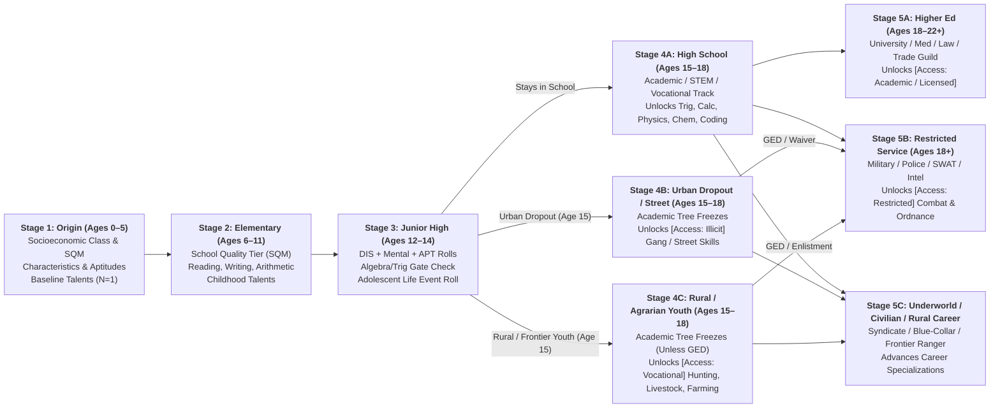

# Lifepath Character Creation, Socioeconomic Upkeep (`SQM`), `[Access]` Gates & `Heat`

> **Rust Engine Implementation**: [`crates/satya-engine/src/lifepath_economy.rs`](../../../crates/satya-engine/src/lifepath_economy.rs) (`LifepathStageId`, `SocioeconomicTier`, `CareerTermAdvancementInput`, `MonthlyUpkeepInput`, `BlackMarketAcquisitionInput`, `OperationalHeatState`, `compute_lifepath_skill_progression`, `evaluate_career_term_advancement`, `evaluate_monthly_upkeep`, `evaluate_black_market_acquisition`, `evaluate_operational_heat`), [`crates/satya-engine/src/lifepath_catalog.rs`](../../../crates/satya-engine/src/lifepath_catalog.rs) (`CareerTemplateId`, `CareerTrackTemplate`, `CANONICAL_CAREER_TEMPLATES`), and [`crates/satya-engine/src/walkthroughs.rs`](../../../crates/satya-engine/src/walkthroughs.rs) (`build_mateo_vance_lifepath`, `build_priya_nair_lifepath`).  
> **Guided Play Example**: See [Guide 01: Session Zero — Lifepaths, Characteristics, Economy & Heat](../../ttrpg-examples/01-lifepath-session-zero.md).

In **Satya**, characters are not assembled from an unconstrained point-buy shopping cart where an academic researcher can arbitrarily purchase *Heavy Machine Guns* or a street teen can buy *Aerospace Engineering* without knowing *Algebra*. Instead, characters are created chronologically through **Lifepath Stages**, and their ongoing campaign operations are grounded by their **Socioeconomic Tier (`SQM`)**, **Black-Market `[Access]` Procurement Gates**, and **Operational `Heat`**.

This chapter builds directly on [Character Characteristics & Aptitudes](characteristics_and_aptitudes.md), the skill prerequisites in [Skill System & The 8 Hierarchical Skill Trees](skills_and_trees.md), and the [Mathematical Notation, Variables & Formula Glossary](../01-foundation/mathematical_notation_glossary.md).

---

## 1. Chronological Lifepath Architecture

At every lifepath stage, the character's **Socioeconomic Class**, **School Quality (`SQM`)**, **Discipline (`DIS`)**, **Mental Primary Characteristics (`ANA`, `MEM`, `INS`, `CRE`, `FOC`)**, **Aptitudes (`APT`)**, and **Life Events** determine which skill trees open and how high those skills advance:

> **See this in play**: [Guide 01 — Walking the Lifepaths Roll-by-Roll](../../ttrpg-examples/01-lifepath-session-zero.md#3-walking-the-lifepaths-roll-by-roll) walks through generating three complete characters across urban poor, middle-class academic, and rural frontier tracks.

---

### 1.1 Stage 1: Socioeconomic Origin & School Quality (Ages 0–5)

The character's starting family background establishes their **Socioeconomic Class**, which directly sets the **School Quality Modifier (`SQM`)** for their K–12 education and shifts the probability of disruptive adolescent Life Events:

| Roll (`2d20`) | Socioeconomic Class | School System Assigned | School Quality Modifier (`SQM`) | Early Environment Exposure (Bonus `N = 1` or `+1` Talent) | Dropout / Crisis Event Risk (Age 12–17) |
| :---: | :--- | :--- | :---: | :--- | :---: |
| **`2–7`** | **Destitute / Urban Underclass** | Chronically Underfunded / Blighted Public School | **`+4` to $\text{TN}_{\text{edu}}$** *(Harder)* | *Stealth*, *Observation*, or *Brawling* `+1` (to `N = 2`) | **High** (`2–16` on `2d20` = `30.0%`) |
| **`8–14`** | **Working Poor** | Overcrowded Low-Income Public School | **`+2` to $\text{TN}_{\text{edu}}$** *(Harder)* | *Brawling*, *Running*, or *Basic Tool Use* (`N = 1`) | **Elevated** (`2–13` on `2d20` = `19.5%`) |
| **`15–26`** | **Working / Lower-Middle Class** | Standard Municipal Public School | **`0` (Baseline)** | *Ground Vehicle*, *Basic Tool Use*, or *Digital Literacy* (`N = 1`) | **Moderate** (`2–9` on `2d20` = `9.0%`) |
| **`27–33`** | **Professional Middle Class** | Suburban Magnet / Charter School | **`-2` to $\text{TN}_{\text{edu}}$** *(Easier)* | *Digital Literacy* (`N = 1`) + one *Artistic* or *Athletic* skill (`N = 1`) | **Low** (`2–6` on `2d20` = `3.75%`) |
| **`34–38`** | **Upper-Middle / Technocratic** | STEM Preparatory Academy | **`-4` to $\text{TN}_{\text{edu}}$** *(Easier)* | *Digital Literacy* (`N = 2`), *Foreign Language* (`N = 1`) | **Very Low** (`2–4` on `2d20` = `1.5%`) |
| **`39–40`** | **Wealthy / Corporate Elite** | Elite Private Boarding Academy + AI Tutors | **`-6` to $\text{TN}_{\text{edu}}$** *(Much Easier)* | *Foreign Language* (`N = 2`), *Persuasion* (`N = 2`), *Fencing/Riding/Music* (`N = 1`) | **Minimal** (`2` on `2d20` = `0.25%`) |

#### Universal Childhood Baseline (Granted to All Characters at Age 5)
- **Native Language Speech**: `N = 2`
- **All Other Talents (`TAL`)**: `N = 1` (*Running*, *Jumping*, *Climbing*, *Swimming*, *Brawling*, *Throwing*, *Observation*, *Stealth*, *Charm & Rapport*, *Persuasion & Rhetoric*, *Deception & Fast-Talk*, *Intimidation & Coercion*, *Empathy & Read Person*, *Singing*, *Drawing*).

---

### 1.2 The Educational Advancement Roll Mechanic (`DIS` + Mental Characteristic + `APT`)

At the end of each schooling stage (Elementary, Junior High, High School, University), the character makes an **Educational Advancement Roll** for each core academic track (Literacy/Humanities, Mathematics, Science/Tech, and Electives) to see how many Skill Levels ($N$) they gain and whether they unlock the next node in the Skill Tree.

The roll uses the standard Satya `2d20` Cascading Engine (`N = 2` pairs representing multi-year study over the school stage), governed by a **Composite Study Characteristic ($C_{\text{study}}$)** combining **Discipline (`DIS`)** (or **Focus (`FOC`)**) with the track's primary Mental Characteristic ($C_{\text{mental}}$: **`ANA`** for Math/Physics/CS, **`MEM`** for Literacy/Law/Biology, **`INS`** for Social Sciences/Diagnostics, or **`CRE`** for Arts):

$$C_{\text{study}} = \left\lfloor \frac{\text{DIS} + C_{\text{mental}}}{2} \right\rfloor + \text{APT}_{\text{domain}}$$

$$\text{TN}_{\text{edu}} = 31 - C_{\text{study}} + \text{SQM}$$

- **Why Discipline (`DIS`) Is Equal to Raw Mental Ability ($C_{\text{mental}}$)**:
  A brilliant analytical thinker with `ANA 16` and terrible study habits (`DIS 6`) has $C_{\text{study}} = 11$, whereas a diligent student with `ANA 12`, `DIS 14`, and `APT +2` has $C_{\text{study}} = 15$ ($\text{TN}_{\text{edu}} = 16$ at a standard school).
- **Interpreting the Cascade Successes (`0` to `2` pairs rolled per stage)**:
  - **`0` Successes (Struggled / Barely Passed)**: The foundational skill advances by **`+0` levels** (or remains at its entry floor `N = 1`). Does **not** unlock the next advanced branch in the tree during this stage.
  - **`1` Success (Solid Academic Progress)**: Increases the current stage's target skill by **`+1` level** (or unlocks the stage's standard next node at `N = 1`).
  - **`2` Successes (Honor Roll / Accelerated Mastery)**: Increases the current skill by **`+1` level AND unlocks the next tier node in the Skill Tree at `N = 1` (or `+2` total levels)**—allowing a bright, disciplined student to jump ahead to *Algebra* or *Trigonometry* early!

---

### 1.3 Stage 2: Elementary School (Ages 6–11)

1. **Automatic Curriculum Grants (Entry Floor)**:
   Every child attending elementary school (even in a poor district) acquires the four foundational `KNO` roots at **`N = 1`**:
   - **Reading** (`N = 1`)
   - **Writing & Composition** (`N = 1`)
   - **Arithmetic** (`N = 1`)
   - **Digital & AI Literacy** (`N = 1` — ubiquitous by 2020–2031)
2. **Elementary Advancement Rolls (`N = 2` pairs of `2d20` vs. $\text{TN}_{\text{edu}}$)**:
   - **Literacy Roll (`DIS/MEM + APT-LNG`)**:
     - `0` Successes: *Reading* `N = 1`, *Writing* `N = 1` (Functional / rudimentary literacy).
     - `1` Success: *Reading* `N = 2`, *Writing* `N = 2`.
     - `2` Successes: *Reading* `N = 3`, *Writing* `N = 2`, *History & Civics* `N = 1`.
   - **Mathematics Roll (`DIS/ANA + APT-QNT`)**:
     - `0` Successes: *Arithmetic* remains `N = 1` (Struggles with fractions/long division).
     - `1` Success: *Arithmetic* advances to `N = 2` (Meets prerequisite for *Algebra & Geometry*).
     - `2` Successes: *Arithmetic* advances to `N = 3` AND unlocks **Algebra & Geometry** at `N = 1` in 6th grade!
   - **Playground / Recess Talent Development**:
     Pick **two** Talents (e.g., *Running*, *Brawling*, *Climbing*, *Observation*, *Singing*, *Drawing*, *Deception*) and increase one to `N = 2`.

---

### 1.4 Stage 3: Junior High / Middle School (Ages 12–14)

During Junior High (Grades 7–9, ages 12–14), students build on their Elementary foundation—and face the first **Adolescent Life Event Check**.

1. **Junior High Advancement Rolls (`N = 2` pairs of `2d20` vs. $\text{TN}_{\text{edu}}$)**:
   - **Mathematics Progression Roll (`DIS/ANA + APT-QNT`)**:
     - *If entering Junior High with Arithmetic `N = 1`*:
       - `0` Successes: *Arithmetic* stays `N = 1`.
       - `1` Success: *Arithmetic* reaches `N = 2`.
       - `2` Successes: *Arithmetic* reaches `N = 2` and unlocks *Algebra & Geometry* `N = 1`.
     - *If entering Junior High with Arithmetic `N >= 2`*:
       - Automatically unlocks **Algebra & Geometry** `N = 1`.
       - `0` Successes: *Algebra & Geometry* remains `N = 1`.
       - `1` Success: *Algebra & Geometry* advances to `N = 2`.
       - `2` Successes (Bright/Disciplined or High `APT-QNT`): *Algebra & Geometry* advances to `N = 2` AND unlocks **Trigonometry & Pre-Calculus** at `N = 1` (or `N = 2` if they already unlocked *Algebra* in Elementary School)!
   - **General Science Roll (`DIS/ANA + APT-QNT` or `DIS/MEM + APT-BIO`)**:
     - Requires *Reading* $\ge 2$ and *Arithmetic* $\ge 2$.
     - `0` Successes: *General Physical Science* `N = 1` OR *General Biology* `N = 1`.
     - `1` Success: *General Physical Science* `N = 1` AND *General Biology* `N = 1` (or one at `N = 2`).
     - `2` Successes: Both at `N = 2`.
   - **Literacy & Social Studies Roll (`DIS/MEM + APT-LNG`)**:
     - `1+` Successes: Raises *Reading* or *Writing* by `+1` (up to `N = 3`) and grants *History & Civics* `N = 1`.
2. **Adolescent Life Event Check (Age 14–15)**:
   Roll `2d20` against the character's Socioeconomic Class **Dropout / Crisis Risk Threshold** (or choose deliberately)—and roll on the full **`2d20` Formative Life Events Table** and choose an **Adolescent Hobby / Club** in [Lifepath Hobbies, Formative Life Events & Factions](lifepath_events_hobbies_and_factions.md):
   - If the crisis check falls within the Crisis range (e.g., `2–13` for Working Poor, or `2–16` for Underclass), a **Disruptive Life Event** occurs at age 15 (such as family eviction, incarceration of a parent, school expulsion, or neighborhood gang war), forcing or pressuring the character out of formal schooling!

---

### 1.5 Stage 4: Ages 15–18 — High School Track vs. Urban Street Gang vs. Rural / Developing-Region Youth

At age 15, the character's lifepath branches into one of three distinct adolescent paths depending on whether they remain in formal secondary education, drop out into an urban street gang, or transition into rural, agrarian, pastoral, or developing-region field work—all shaped further by the character's chosen **Hobby / Club** and **Life Events** ([Lifepath Hobbies, Life Events & Factions](lifepath_events_hobbies_and_factions.md)).

#### Path 4A: Formal High School (Ages 15–18)
Students who remain in High School select (or qualify for) one of three sub-tracks:
- **Standard / College-Prep Track**:
  - Advances *Algebra & Geometry* to `N = 2–3`, unlocks **Trigonometry & Pre-Calculus** (`N = 1–2`), **General Chemistry** (`N = 1–2`), **Classical Physics** (`N = 1–2`), **Foreign Language** (`N = 1–2`), and **Ground Vehicle Driving** (`N = 1`).
- **AP / Honors STEM Track** (Requires *Algebra & Geometry* $\ge 2$, `ANA >= 11`, `DIS >= 11`):
  - Advances **Trigonometry & Pre-Calculus** to `N = 3`, unlocks **Calculus & Linear Algebra** (`N = 1–2`), **Applied Statistics** (`N = 1–2`), **Programming Fundamentals** (`N = 1–2`), **Classical Physics** (`N = 2`), and **General Chemistry** (`N = 2`).
  - *Crucial Gate*: Completing this track (or University Layer 1) is the gateway to **all University Engineering, Hard Science, and AI/ML degrees**.
- **Vocational / Technical High School Track**:
  - Caps formal math at *Algebra & Geometry* (`N = 2`) or *Trigonometry* (`N = 1`), and grants `[Access: Vocational]` practical skills: **Basic Tool Use** (`N = 2`), **Automotive & EV Mechanics** (`N = 2`), **Basic Electronics** (`N = 2`), **Metalworking & Welding** (`N = 1–2`), or **Digital OS Administration** (`N = 2`).

#### Path 4B: Urban School Dropout & Street Gang / Underworld Path (Ages 15–18)
When an urban character drops out of school at age 15 and joins a street gang:
1. **Academic Tree Freeze**:
   - The character receives **zero access** to `[Access: Academic]` courses (*Calculus*, *Classical Physics*, *Organic Chemistry*, *Software Engineering*).
   - Their Mathematics Spine freezes permanently at whatever level they reached by age 15 (*Arithmetic* `N = 2`, *Algebra* `N = 1–2`, or at absolute best *Trigonometry* `N = 1–2` if they were exceptionally bright/disciplined in Junior High).
   - Because *Calculus & Linear Algebra* (`N >= 3`) is a mandatory prerequisite for *Mechanical Engineering*, *Electrical Engineering*, *Aerospace Engineering*, *Chemical Engineering*, *Machine Learning*, and *Quantum Physics*, **those scientific and engineering disciplines are locked out**.
2. **Exclusive Gang / Underworld Skill Grants (`[Access: Illicit]`)**:
   Instead of classroom subjects, surviving 3 years in a street gang (ages 15–18) grants direct access to the **Street Gang Skill Package** (advancing via survival/discipline rolls governed by `DIS`, `SPD`, `KIN`, and `DEX`):
   - **Mandatory Core Gang Grants**:
     - **Streetwise & Gang Protocol**: `N = 2`
     - **Brawling** (`TAL`): Advances from `N = 1` to `N = 2` (or unlocks **Street Fighting & Dirty Tricks** `N = 1`)
     - **Intimidation** (`TAL`) or **Deception** (`TAL`): Advances to `N = 2`
     - **Simple Melee Weapons (Knife/Club)**: `N = 1` (unlocks **Knife Fighting** `N = 1`)
   - **Gang Role Elective Specialization (Choose 1 or Roll by Role)**:
     - **Shooter / Enforcer**: Unlocks **Pistols & Revolvers** (`N = 2`), **Concealed Draw & Street Shooting** (`N = 1`), and—if `FOR >= 10`—grants `[Access: Illicit]` to **Fully Automatic Weapons** (`N = 1`, representing illegal auto-sears/Glock switches and submachine guns)!
     - **Boost / Wheelman / Tech Thief**: Unlocks **Lockpicking & Security Bypass** (`N = 1`), **Vehicle Hotwiring & Transponder Spoofing** (`N = 2`), **Ground Vehicle** (`N = 2`), and **High-Speed Pursuit & Evasive Driving** (`N = 1`).
     - **Runner / Lookout / Burglar**: Unlocks **Parkour & Urban Free-Running** (`N = 1–2`), **Stealth** (`N = 2`), **Observation** (`N = 2`), **Sleight of Hand** (`N = 1`), and **Black Market Logistics / Street Dealing** (`N = 1`).
     - **Back-Alley Cook / Modder** (Requires *Algebra* $\ge 1$ or *Basic Tool Use* $\ge 1$): Unlocks **Clandestine Narcotics Synthesis** (`N = 1–2`) or **Improvised Munitions & Street Weapon Mods** (`N = 1–2`).

#### Path 4C: Rural, Agrarian & Developing-Region Youth Path (Ages 15–18)
Not every adolescent who leaves formal schooling at age 15 is an urban gang member. In rural heartlands, pastoral steppe/savanna communities, mountain villages, and underdeveloped regions or nations where secondary schools are distant or families depend on youth labor, adolescents spend ages 15–18 working the land, tending livestock, hunting and trapping, repairing off-grid machinery, or patrolling frontier borders:
1. **Academic Tree Freeze Without Criminal `Heat`**:
   - Leaving classroom education after age 15 triggers the **Academic Tree Freeze** on `[Access: Academic]` university-prep courses (*Calculus*, *Organic Chemistry*, *Classical Physics*) unless the character later completes an Adult GED / Equivalency Waiver in Stage 5.
   - However, unlike Path 4B, Path 4C unlocks **`[Access: Vocational/Licensed]`**, starts at **`Operational Heat = 0`** (except for the *Frontier Scout / Border Smuggler* archetype at `Heat = 1`), and builds deep self-reliance in **Tree 3 (Biology, Agriculture, Veterinary & Ethnobotany)** and **Tree 7 (Survival, Hunting & Animal Handling)**.
2. **Mandatory Core Rural / Developing-Region Youth Grants**:
   - **Foraging & Campcraft** (`TAL`, `INS/OLF`): Advances to `N = 2`
   - **Wilderness Survival (Biome-Specific)** (`INS/HLT`): Unlocks at `N = 1`
   - **Manual Dexterity & Tinkering** (`TAL`, `DEX/TAC`): Advances to `N = 2`
3. **Rural & Developing-Region Youth Specialization Archetypes (Choose 1)**:
   - **Subsistence Hunter, Trapper & Bush Guide**:
     - Advances **Stealth** to `N = 2` and **Wilderness Survival (Biome-Specific)** to `N = 2`.
     - Unlocks **Hunting, Trapping & Field Butchery** (`SIG/INS`) at `N = 2`, **Long Guns (Rifles, Carbines & Shotguns)** (`DEX/SIG`) at `N = 2`, and **Archery, Bows & Crossbows** (`DEX/SIG`) at `N = 1`.
   - **Agrarian Homesteader & Rural Mechanist**:
     - Unlocks **Agriculture, Agronomy & Crop Husbandry** (`INS/FOR`) at `N = 2`, **Animal Handling, Husbandry & Riding** (`INS/KIN`) at `N = 1`, **Automotive & Small-Engine Mechanics** (`DEX/ANA`, tractors, generators, irrigation pumps, bush bikes) at `N = 2`, **Carpentry & Woodworking** (`DEX/FOR`) at `N = 1`, and **Driving (Wheeled & Tracked Vehicles)** (`DEX/SIG`) at `N = 1`.
   - **Pastoral Herder, Stockman & Outrider**:
     - Unlocks **Animal Handling, Husbandry & Riding** (`INS/KIN`) at `N = 2`, **First Aid (BLS / CPR)** (`DEX/MEM`) at `N = 1`, **Veterinary Medicine & Livestock Care** (`INS/DEX`) at `N = 1`, **Herbalism, Ethnobotany & Field Remedies** (`MEM/OLF`) at `N = 1`, and **Land Navigation & Cartography** (`ANA/SIG`) at `N = 1`.
   - **Frontier Scout, Border Smuggler & Village Militia**:
     - Unlocks both `[Access: Vocational/Licensed]` and `[Access: Illicit]`.
     - Advances **Alertness & Situational Awareness** to `N = 2` and **Stealth** to `N = 2`.
     - Unlocks **Camouflage & Concealment** (`INS/SIG`) at `N = 2`, **Long Guns (Rifles, Carbines & Shotguns)** (`DEX/SIG`) at `N = 2`, and **Land Navigation & Cartography** (`ANA/SIG`) at `N = 1`.

---

### 1.6 Stage 5: Adult Career & Higher Education Terms (Ages 18+, 4-Year Terms)

Each 4-year adult term grants skill advancements strictly bounded by the career's `[Access]` tags and the character's existing Skill Tree prerequisites. Notice that all `14` canonical adult tracks fall into four broad clusters: **Academia & Applied Professions**, **Civic, Media & Contemplative Organizing**, **Restricted Security & State Enforcement**, and **Vocational, Rural & Clandestine Underground**:

| Career / Institution Path | Entry Prerequisites | `[Access]` Tags Granted | Skills Taught & Advanced (Max $N$ per 4-yr Term: `+1` to `+2`) |
| :--- | :--- | :--- | :--- |
| **University — STEM / Engineering (B.S. / M.S. / Ph.D.)** | High School Diploma, *Trigonometry* $\ge 2$, `ANA >= 11`, `DIS >= 10` | `[Access: Academic]` | *Calculus & Linear Algebra*, *Differential Equations*, *Applied Statistics*, *Classical Physics*, *Organic Chemistry*, *Mechanical/Electrical/Aerospace/Chemical Engineering*, *Machine Learning & AI 2.0*, *Biotechnology*. **Zero Combat Skills.** |
| **Medical School & Surgical Residency** | B.S. Pre-Med (*General Biology* $\ge 3$, *Organic Chemistry* $\ge 2$, `MEM >= 12, ANA >= 11, DIS >= 12`) | `[Access: Academic]`, `[Access: Licensed]` | *Human Anatomy*, *Pharmacology*, *Clinical Diagnostics*, *Paramedicine*, *Trauma & General Surgery*, *Neurosurgery & Cyber-Implants*, *Forensic Pathology*. **Zero Combat Skills.** |
| **University — Humanities, Law, Philosophy & Ethics (B.A. / J.D. / Ph.D.)** | High School Diploma, *Reading* $\ge 3$, *Writing* $\ge 2$, `MEM >= 10, INS >= 10` | `[Access: Academic]` *(J.D. Bar adds `[Access: Licensed]`)* | *History & Civics*, *Philosophy, Ethics & Contemplative Theology*, *Constitutional & Corporate Law*, *Foreign Languages*, *Writing & Composition*, *Persuasion & Rhetoric*, *Investigative Research*. **Zero Combat Skills.** |
| **Corporate Management, Quantitative Finance & Policy** | University Degree or Business Honors (*Algebra* $\ge 2$, `ANA >= 11, ELO >= 10`) | `[Access: Academic]`, `[Access: Licensed]` | *Applied Statistics*, *Economics & Corporate Finance*, *Etiquette & Corporate Protocol*, *Negotiation*, *Command & Leadership*, *Bureaucracy & Regulatory Compliance*, *AI 2.0 Business Orchestration*. |
| **Journalism, Media, PR & Performing Arts** | High School Diploma or Portfolio (*Writing* $\ge 2$ or Artistic Talent, `CRE >= 10` or `ELO >= 10`) | `[Access: Vocational]` | *Investigative Elicitation*, *Writing & Composition*, *Persuasion & Rhetoric*, *Charm & Rapport*, *Deception / PsyOps & Synth-Media Verification*, *Photography & Audio-Visual Production*, *Musical Instruments / Acting*. |
| **Grassroots Activism, Humanitarian NGO & Contemplative Ministry** | Any Origin (*Empathy* $\ge 1$ or *Persuasion* $\ge 1$, `INS >= 10` or `CPS >= 12`) | `[Access: Vocational]` | *Empathy & Read Person*, *Persuasion & Rhetoric*, *First Aid (BLS / CPR)*, *Community Organizing & Streetwise*, *Crisis De-Escalation*, *Foreign Languages*, *Contemplative / Counseling Practice* (`DIS`/`FOC` training). |
| **Cybersecurity, AI Red-Teaming & Underground Collective** | *Programming* $\ge 2$ or Self-Taught Hack Waiver (`ANA >= 11, CRE >= 10`) | `[Access: Vocational]`, `[Access: Illicit]` | *Programming & Scripting*, *Digital OS & Network Administration*, *Network Exploitation & Penetration Testing*, *Cryptography & Steganography*, *AI 2.0 Probe Evasion & Orchestration*, *Electronic Counter-Surveillance*. |
| **Military Service — Combat Arms (Infantry / Armor / Special Ops)** | Age 18+, Physical Exam (`FOR >= 9, FIT >= 10, HLT >= 10`), clean record or moral waiver | **`[Access: Restricted]`** | *Long Guns*, *Pistols*, ***Fully Automatic Weapons***, ***Heavy Weapons (ATGM/MANPADS)***, *Tactical Carbine*, *Grenades*, *Military Demolitions*, *Precision Rifle* (if *Trigonometry* $\ge 2$ & `SIG >= 12`), *Small-Unit Tactics*, *Paramedicine (TCCC)*, *Lethal CQC*. |
| **Law Enforcement / SWAT / Federal Agent** | High School/College, clean criminal record (`DIS >= 10, SIG >= 10, INS >= 10`) | **`[Access: Restricted]`**, `[Access: Licensed]` | *Pistols*, *Tactical Handgun*, *Long Guns*, *Riot Batons*, *Arrest Grappling*, *Criminal Law*, *Interrogation*, *Surveillance*, *Digital/Physical Forensics*. *(SWAT adds *Tactical Carbine*, *Fully Automatic Weapons*, *Precision Rifle*).* |
| **Corporate SecOps & Private Military / Executive Protection** | Military/Police vet or SecOps Academy (`FOR >= 10, DIS >= 11, SIG >= 11`) | **`[Access: Restricted]`**, `[Access: Licensed]` | *Pistols & Tactical Handgun*, *Long Guns & Tactical Carbine*, *Arrest Grappling & Bodyguard Escort*, *Electronic Surveillance & Threat Assessment*, *High-Speed Evasive Driving*, *Tactical Recon Drones*, *First Aid (TCCC)*. |
| **Intelligence Service / Clandestine Operations** | University Degree or Special Ops recruitment (`INS >= 11, DIS >= 11, ELO >= 10`) | **`[Access: Restricted]`**, `[Access: Illicit]` | *Surveillance & Counter-Surveillance*, *Interrogation & Elicitation*, *Foreign Languages*, *Strategic Intelligence*, *Forgery & Identity Washing*, *Concealed Draw*, *Lockpicking*, *Network Exploitation*, *Tactical Recon Drones*. |
| **Organized Crime / Cartel / Street Syndicate** | Juvenile Gang background or underworld recruitment | **`[Access: Illicit]`** | *Streetwise*, *Pistols*, *Concealed Draw*, ***Fully Automatic Weapons***, *Knife Fighting*, *Street Fighting*, *Black Market Logistics*, *Extortion/Intimidation*, *Hotwiring*, *Lockpicking*, *Clandestine Narcotics Synthesis*, *Forgery*. |
| **Blue-Collar Trades / Industrial Technician** | Vocational High School or Apprenticeship (*Arithmetic* $\ge 2$) | `[Access: Vocational]` | *Automotive & EV Mechanics*, *Metalworking & Welding*, *CNC & Robotics Repair*, *Basic Electronics*, *Heavy Commercial Vehicles*, *Gunsmithing*. |
| **Rural, Agrarian, Wilderness Guide & Frontier Ranger** | *Foraging* $\ge 2$, *Agriculture* $\ge 1$, or *Animal Handling* $\ge 1$ (or `FIT >= 9, HLT >= 9`) | `[Access: Vocational]` | *Hunting, Trapping & Field Butchery*, *Agriculture & Agronomy*, *Animal Handling & Riding*, *Wilderness Survival*, *Herbalism & Ethnobotany*, *Veterinary Medicine*, *Long Guns*, *Archery*, *Land Navigation*, *Camouflage*, *Small-Engine Mechanics*, *Small-Boat Seamanship*. |

---

### 1.7 Per-Term Skill Point (`SP`) Budgets & The 5-Factor Skill Cost Formula

Rather than treating every skill rank as a flat 1-for-1 point purchase—which would make learning to fly a helicopter (`Difficulty 5`) cost the same as learning to swim (`Difficulty 1`)—Stage 5 Career Terms and Post-School Advancement use a **Multi-Factor Skill Point (`SP`) Cost & Budget System**:

1. **Per-Term Skill Point (`SP`) Budgets**:
   - **Youth / Young-Adult Experience Pool**: Every character begins Stage 5 with **`40 Experience SP`** representing **Adolescent Hobbies, Clubs & Subcultures**, street practice, and formative youth experience (see [Lifepath Hobbies, Life Events & Factions](lifepath_events_hobbies_and_factions.md)).
   - **Per 4-Year Adult Career Term (`1` to `4` Terms)**:
     - **Formal Training SP (`FOC + INS` Pool)**: **`120 Formal SP`** base per 4-year term + **`+20 Formal SP` per Term Advancement Roll success** (`0` successes = **`120 Formal SP`**, `1` success = **`140 Formal SP`**, `2` successes / Honors = **`160 Formal SP`**). Spent on the active Career Track's formal curriculum (`recommended_skills()`).
     - **Practical Experience SP (`INS` Pool)**: **`+40 Experience SP`** per 4-year term for on-the-job, **Off-Duty Hobby / Club**, or **Formative Life Event** skills.
2. **The 5-Factor Skill Step Cost Formula ($\text{SP}(s, N)$)**:
   Advancing a skill $s$ by `1` level from $N - 1 \to N$ costs:
   $$\text{SP}(s, N) = \max\!\Big(3,\; \text{round}\big(\text{Base}(N) \times M_{\text{diff}}(s) \times M_{\text{ctrl}}(C_{\text{eff}}) \times M_{\text{apt}}(A) \times M_{\text{train}}(\text{mode}, \text{FOC}, \text{INS})\big)\Big)$$
   - **Factor 1 — Triangular Target Level Scaling ($\text{Base}(N) = 10 \times N$)**:
     - Advancing to $N = 1$ costs **`10 SP`** base; $N = 1 \to 2$ costs **`20 SP`** (cumulative `30 SP`); $N = 2 \to 3$ costs **`30 SP`** (cumulative `60 SP`); $N = 3 \to 4$ costs **`40 SP`** (cumulative `100 SP`); $N = 4 \to 5$ costs **`50 SP`** (cumulative `150 SP`).
   - **Factor 2 — Inherent Skill Difficulty Rating ($D \in \{1, 2, 3, 4, 5\}$)**:
     - **`Difficulty 1 (Basic)`**: `0.80x` (`TAL`) / `1.00x` (`PHY`/`KNO`, e.g., *Swimming & Diving*, *Climbing*, *Basic Cooking*).
     - **`Difficulty 2 (Standard)`**: `1.25x` (e.g., *Pistols & Handguns*, *Long Guns*, *Driving*, *Algebra & Geometry*).
     - **`Difficulty 3 (Complex)`**: `1.60x` (e.g., *Fully Automatic Weapons*, *Calculus & Linear Algebra*, *Paramedic Trauma Care*).
     - **`Difficulty 4 (Advanced)`**: `2.00x` (e.g., *Piloting (Fixed-Wing Aircraft)*, *Precision Marksmanship & Sniping*, *Demolitions & EOD*).
     - **`Difficulty 5 (Extreme)`**: `2.50x` (e.g., *Piloting (Rotary-Wing / Helicopter & VTOL)*, *Trauma, Orthopedic & General Surgery*, *Machine Learning & AI Engineering*).
   - **Factor 3 — Controlling Characteristic Modifier ($C_{\text{eff}} \in [1, 20]$)**:
     $$M_{\text{ctrl}}(C_{\text{eff}}) = \text{clamp}\big(1.0 - 0.04 \times (C_{\text{eff}} - 10),\; 0.65,\; 1.40\big)$$
     Each point of effective Controlling Characteristic above `10` reduces SP cost by **`-4%`** (and below `10` increases cost by **`+4%`**).
   - **Factor 4 — Governing Domain Aptitude ($A \in [-2, +3]$)**:
     $$M_{\text{apt}}(A) = \begin{cases} 1.0 - 0.15 A & A \ge 0 \\ 1.0 + 0.20 |A| & A < 0 \end{cases}$$
     (`+1 -> 0.85x`, `+2 -> 0.70x`, `+3 -> 0.55x`; `-1 -> 1.20x`, `-2 -> 1.40x`).
   - **Factor 5 — Training Mode (`FormalTraining` via `FOC + INS` vs. `Experience` via `INS`)**:
     - **Formal Training (`Career Pool`)**: Institutional instruction, simulators, and structured syllabi grant a **`0.85x`** base efficiency, modified by **`-3%` per point of Focus (`FOC`) above `10`** and **`-3%` per point of Insight (`INS`) above `10`**:
       $$M_{\text{train, formal}} = \text{clamp}\Big(0.85 \times \big(1.0 - 0.03(\text{FOC} - 10) - 0.03(\text{INS} - 10)\big),\; 0.45,\; 1.35\Big)$$
     - **Experience / Self-Study (`Elective / Street Pool`)**: Learning by trial-and-error without formal instruction uses a base of **`1.00x`** for physical/talent skills (`TAL`, `PHY`) and **`1.25x`** for theoretical/hybrid skills (`KNO`, `PHY/KNO`), modified by **`-2%` per point of Insight (`INS`) above `10`**:
       $$M_{\text{train, exp}} = \text{clamp}\Big(B_{\text{type}} \times \big(1.0 - 0.02(\text{INS} - 10)\big),\; 0.65,\; 1.60\Big)$$
3. **Worked Benchmark — *Swimming & Diving* (`Diff 1`) vs. *Piloting (Rotary-Wing / Helicopter & VTOL)* (`Diff 5`)**:
   - **Human Baseline (`all C = 10, APT = 0, FOC = 10, INS = 10`)**:
     - *Swimming & Diving* (`Difficulty 1`, `PHY`, `FIT/KIN`): **`9 SP`** (`N=1`), **`17 SP`** (`N=2`), **`26 SP`** (`N=3`) via Formal Training (**`52 SP`** cumulative for `N = 3`), or **`10 / 20 / 30 SP`** (**`60 SP`** cumulative) via Experience.
     - *Piloting (Rotary-Wing / Helicopter & VTOL)* (`Difficulty 5`, `PHY/KNO`, `KIN/DEX`): **`21 SP`** (`N=1`), **`43 SP`** (`N=2`), **`64 SP`** (`N=3`) via Formal Flight School (**`128 SP`** cumulative for `N = 3`, plus parent prerequisites), or **`31 / 63 / 94 SP`** (**`188 SP`** cumulative) via unassisted Experience.
   - **Gifted Army Aviator (`KIN = 15, DEX = 14 -> C_eff = 15`, `APT-KIN = +2`, `FOC = 14, INS = 13`)**:
     - $M_{\text{ctrl}}(15) = 0.80$, $M_{\text{apt}}(+2) = 0.70$, $M_{\text{train, formal}} = 0.85 \times 0.79 = 0.6715$.
     - *Helicopter Piloting* step costs drop to **`10 SP`** (`N=1`), **`19 SP`** (`N=2`), **`28 SP`** (`N=3`) (**`57 SP`** total for `N = 3`)!

---

> [!TIP]
> **Hobbies, Formative Life Events, 5-Faction Templates & Complete Walkthroughs**:
> Life is more than school and a résumé. For **Personal Hobbies & Subcultures** (`12` archetypes funded by `Experience SP`), the **`2d20` Formative Life Events Table** (injury, family bereavement, romance, AI layoff shock, whistleblower crossroads), **5-Faction Psyche & NPC Templates** (*Satyang, Big Tech, Humanis Primaris, DAISE, Rogue AI*), and the complete worked walkthroughs of **Mateo Vance**, **Dr. Priya Nair**, **Amara Okafor**, and **Linnea Cho**, proceed to [Lifepath Hobbies, Formative Life Events & Factions](lifepath_events_hobbies_and_factions.md).

---

## 2. Campaign Economy, Upkeep (`SQM 1–10`), `[Access]` Procurement & `Heat`

Rather than forcing players to track every cup of coffee while ignoring how a street operative acquires a military-grade anti-materiel rifle, Satya uses a two-tier economic model anchored by the character's post-Lifepath **Socioeconomic / Material Tier (`SQM 1–10`)**:

> **See this in play**: [Guide 01 — Living in 2035: `SQM` Upkeep, `[Access]` Procurement & `Heat`](../../ttrpg-examples/01-lifepath-session-zero.md#4-living-in-2035-sqm-upkeep-access-procurement--heat).

### 3.1 Socioeconomic Tier (`SQM 1–10`) & Lifestyle Upkeep

| `SQM` Tier | Socioeconomic Bracket | Monthly Liquid Baseline (`2032 Credits / USD`) | Routine Purchases (No Roll) | Lifestyle & Safe-House Quality |
| :---: | :--- | :---: | :--- | :--- |
| **`1–2`** | **Destitute / Unhoused / Off-Grid Squat** | `< $500 / mo` | Street food, transit token | Exposed to street hazards; starts days at `+1` $\Delta_{\text{int}}$ unless shelter found. |
| **`3–4`** | **Working Class / Hustler** | `$2,000 – $4,000 / mo` | Basic tools, civilian clothes, burner phone | Cramped apartment, shared garage, older economy vehicle. |
| **`5–6`** | **Middle Class / Salaried Professional** | `$6,000 – $12,000 / mo` | Commercial electronics, legal firearms, clinic visits | Secure apartment, reliable sedan/SUV, clean credit identity. |
| **`7–8`** | **Affluent / Corporate Executive / Syndicate Boss** | `$25,000 – $100,000 / mo` | High-end cyberdecks, private charters, bribes | Gated penthouse, biometric security, private retainers/lawyers. |
| **`9–10`** | **Ultra-High Net Worth / Sovereign Oligarch** | `$500,000+ / mo` | Private security teams, orbital berths, shell corps | Compound, private VTOL/yacht, diplomatic/corporate immunity channels. |

### 3.2 Black-Market Procurement (`[Access]` Gates) & Law Enforcement `Heat`

1. **Legality & `[Access]` Procurement Gates**:
   - Money alone cannot buy restricted military ordnance, zero-day exploits, or Schedule-I combat stims at a retail store. Restricted items have an **`[Access]` Gate** (`Class I: Licensed`, `Class II: Illicit / Street`, `Class III: Syndicate / Paramilitary`, `Class IV: State Secret / Black-Ops`).
   - To locate and purchase a restricted item, the buyer must pass a **Black Market Logistics, Smuggling & Fencing (`INS/ELO`)**, **Streetwise & Gang Protocol (`INS/PRE`)**, or **Etiquette & Corporate Protocol (`PRE/MEM`)** cascade check with $\Delta_{\text{ext}}$ set by the item's `[Access]` class.
2. **Operational `Heat` & Digital Footprint (`0–10` Scale)**:
   - Leaving shell casings, biometric DNA, unlooped CCTV footage, loud unsuppressed gunfights, or dead law-enforcement officers generates **Operational `Heat`** in that jurisdiction:
     - **`Heat 1–2` (*Local Beat Inquiry*)**: Routine patrol awareness; basic disguise or alternate ID bypasses scrutiny.
     - **`Heat 3–5` (*Detective Task Force & APB*)**: Facial recognition alerts on public transit/cameras (`+4` $\Delta_{\text{ext}}$ to travel openly); known safe-houses surveilled.
     - **`Heat 6–8` (*Federal / Corporate Strike Team*)**: Active manhunt, frozen bank accounts (`SQM` temporarily locked to cash-in-hand), tactical SWAT/SecOps response within minutes of a spotted signature.
     - **`Heat 9–10` (*Burned / Most Wanted*)**: Shoot-on-sight or high-priority rendition; requires burning identity (*Forgery, Counterfeiting & Identity Washing* `DEX/CRE`) and relocating out of theater.
