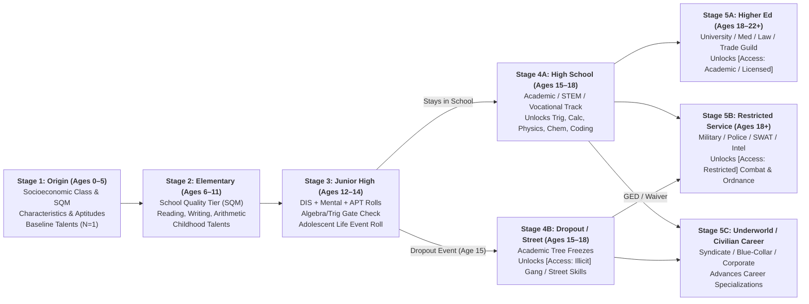

# Lifepath Character Creation, Socioeconomic Upkeep (`SQM`), `[Access]` Gates & `Heat`

In **Satya**, characters are not assembled from an unconstrained point-buy shopping cart where an academic researcher can arbitrarily purchase *Heavy Machine Guns* or a street teen can buy *Aerospace Engineering* without knowing *Algebra*. Instead, characters are created chronologically through **Lifepath Stages**, and their ongoing campaign operations are grounded by their **Socioeconomic Tier (`SQM`)**, **Black-Market `[Access]` Procurement Gates**, and **Operational `Heat`**.

This chapter builds directly on [Character Characteristics & Aptitudes](characteristics_and_aptitudes.md) and the skill prerequisites in [Skill System & The 8 Hierarchical Skill Trees](skills_and_trees.md).

---

## 1. Chronological Lifepath Architecture

At every lifepath stage, the character's **Socioeconomic Class**, **School Quality (`SQM`)**, **Discipline (`DIS`)**, **Mental Primary Characteristics (`ANA`, `MEM`, `INS`, `CRE`, `FOC`)**, **Aptitudes (`APT`)**, and **Life Events** determine which skill trees open and how high those skills advance:

---

### 1.1 Stage 1: Socioeconomic Origin & School Quality (Ages 0–5)

The character's starting family background establishes their **Socioeconomic Class**, which directly sets the **School Quality Modifier (`SQM`)** for their K–12 education and shifts the probability of disruptive adolescent Life Events:

| Roll (`2d20`) | Socioeconomic Class | School System Assigned | School Quality Modifier (`SQM`) | Early Environment Exposure (Bonus `N = 1` or `+1` Talent) | Dropout / Crisis Event Risk (Age 12–17) |
| :---: | :--- | :--- | :---: | :--- | :---: |
| **`2–7`** | **Destitute / Urban Underclass** | Chronically Underfunded / Blighted Public School | **`+4` to $\text{TN}_{\text{edu}}$** *(Harder)* | *Stealth*, *Observation*, or *Brawling* `+1` (to `N = 2`) | **High** (`2–16` on `2d20` = `30.0%`) |
| **`8–14`** | **Working Poor** | Overcrowded Low-Income Public School | **`+2` to $\text{TN}_{\text{edu}}$** *(Harder)* | *Brawling*, *Running*, or *Basic Tool Use* (`N = 1`) | **Elevated** (`2–13` on `2d20` = `19.5%`) |
| **`15–26`** | **Working / Lower-Middle Class** | Standard Municipal Public School | **`0` (Baseline)** | *Ground Vehicle*, *Basic Tool Use*, or *Digital Literacy* (`N = 1`) | **Moderate** (`2–9` on `2d20` = `9.0%`) |
| **`27–33`** | **Professional Middle Class** | Suburban Magnet / Charter School | **`-2` to $\text{TN}_{\text{edu}}$** *(Easier)* | *Digital Literacy* (`N = 1`) + one *Artistic* or *Athletic* skill (`N = 1`) | **Low** (`2–6` on `2d20` = `3.75%`) |
| **`34–38`** | **Upper-Middle / Technocratic** | STEM Preparatory Academy | **`-4` to $\text{TN}_{\text{edu}}$** *(Easier)* | *Digital Literacy* (`N = 2`), *Foreign Language* (`N = 1`) | **Very Low** (`2–4` on `2d20` = `1.5%`) |
| **`39–40`** | **Wealthy / Corporate Elite** | Elite Private Boarding Academy + AI Tutors | **`-6` to $\text{TN}_{\text{edu}}$** *(Much Easier)* | *Foreign Language* (`N = 2`), *Persuasion* (`N = 2`), *Fencing/Riding/Music* (`N = 1`) | **Minimal** (`2` on `2d20` = `0.25%`) |

#### Universal Childhood Baseline (Granted to All Characters at Age 5)
- **Native Language Speech**: `N = 2`
- **All Other Talents (`TAL`)**: `N = 1` (*Running*, *Jumping*, *Climbing*, *Swimming*, *Brawling*, *Throwing*, *Observation*, *Stealth*, *Charm & Rapport*, *Persuasion & Rhetoric*, *Deception & Fast-Talk*, *Intimidation & Coercion*, *Empathy & Read Person*, *Singing*, *Drawing*).

---

### 1.2 The Educational Advancement Roll Mechanic (`DIS` + Mental Characteristic + `APT`)

At the end of each schooling stage (Elementary, Junior High, High School, University), the character makes an **Educational Advancement Roll** for each core academic track (Literacy/Humanities, Mathematics, Science/Tech, and Electives) to see how many Skill Levels ($N$) they gain and whether they unlock the next node in the Skill Tree.

The roll uses the standard Satya `2d20` Cascading Engine (`N = 2` pairs representing multi-year study over the school stage), governed by a **Composite Study Characteristic ($C_{\text{study}}$)** combining **Discipline (`DIS`)** (or **Focus (`FOC`)**) with the track's primary Mental Characteristic ($C_{\text{mental}}$: **`ANA`** for Math/Physics/CS, **`MEM`** for Literacy/Law/Biology, **`INS`** for Social Sciences/Diagnostics, or **`CRE`** for Arts):

$$C_{\text{study}} = \left\lfloor \frac{\text{DIS} + C_{\text{mental}}}{2} \right\rfloor + \text{APT}_{\text{domain}}$$

$$\text{TN}_{\text{edu}} = 31 - C_{\text{study}} + \text{SQM}$$

- **Why Discipline (`DIS`) Is Equal to Raw Mental Ability ($C_{\text{mental}}$)**:
  A brilliant analytical thinker with `ANA 16` and terrible study habits (`DIS 6`) has $C_{\text{study}} = 11$, whereas a diligent student with `ANA 12`, `DIS 14`, and `APT +2` has $C_{\text{study}} = 15$ ($\text{TN}_{\text{edu}} = 16$ at a standard school).
- **Interpreting the Cascade Successes (`0` to `2` pairs rolled per stage)**:
  - **`0` Successes (Struggled / Barely Passed)**: The foundational skill advances by **`+0` levels** (or remains at its entry floor `N = 1`). Does **not** unlock the next advanced branch in the tree during this stage.
  - **`1` Success (Solid Academic Progress)**: Increases the current stage's target skill by **`+1` level** (or unlocks the stage's standard next node at `N = 1`).
  - **`2` Successes (Honor Roll / Accelerated Mastery)**: Increases the current skill by **`+1` level AND unlocks the next tier node in the Skill Tree at `N = 1` (or `+2` total levels)**—allowing a bright, disciplined student to jump ahead to *Algebra* or *Trigonometry* early!

---

### 1.3 Stage 2: Elementary School (Ages 6–11)

1. **Automatic Curriculum Grants (Entry Floor)**:
   Every child attending elementary school (even in a poor district) acquires the four foundational `KNO` roots at **`N = 1`**:
   - **Reading** (`N = 1`)
   - **Writing & Composition** (`N = 1`)
   - **Arithmetic** (`N = 1`)
   - **Digital & AI Literacy** (`N = 1` — ubiquitous by 2020–2031)
2. **Elementary Advancement Rolls (`N = 2` pairs of `2d20` vs. $\text{TN}_{\text{edu}}$)**:
   - **Literacy Roll (`DIS/MEM + APT-LNG`)**:
     - `0` Successes: *Reading* `N = 1`, *Writing* `N = 1` (Functional / rudimentary literacy).
     - `1` Success: *Reading* `N = 2`, *Writing* `N = 2`.
     - `2` Successes: *Reading* `N = 3`, *Writing* `N = 2`, *History & Civics* `N = 1`.
   - **Mathematics Roll (`DIS/ANA + APT-QNT`)**:
     - `0` Successes: *Arithmetic* remains `N = 1` (Struggles with fractions/long division).
     - `1` Success: *Arithmetic* advances to `N = 2` (Meets prerequisite for *Algebra & Geometry*).
     - `2` Successes: *Arithmetic* advances to `N = 3` AND unlocks **Algebra & Geometry** at `N = 1` in 6th grade!
   - **Playground / Recess Talent Development**:
     Pick **two** Talents (e.g., *Running*, *Brawling*, *Climbing*, *Observation*, *Singing*, *Drawing*, *Deception*) and increase one to `N = 2`.

---

### 1.4 Stage 3: Junior High / Middle School (Ages 12–14)

During Junior High (Grades 7–9, ages 12–14), students build on their Elementary foundation—and face the first **Adolescent Life Event Check**.

1. **Junior High Advancement Rolls (`N = 2` pairs of `2d20` vs. $\text{TN}_{\text{edu}}$)**:
   - **Mathematics Progression Roll (`DIS/ANA + APT-QNT`)**:
     - *If entering Junior High with Arithmetic `N = 1`*:
       - `0` Successes: *Arithmetic* stays `N = 1`.
       - `1` Success: *Arithmetic* reaches `N = 2`.
       - `2` Successes: *Arithmetic* reaches `N = 2` and unlocks *Algebra & Geometry* `N = 1`.
     - *If entering Junior High with Arithmetic `N >= 2`*:
       - Automatically unlocks **Algebra & Geometry** `N = 1`.
       - `0` Successes: *Algebra & Geometry* remains `N = 1`.
       - `1` Success: *Algebra & Geometry* advances to `N = 2`.
       - `2` Successes (Bright/Disciplined or High `APT-QNT`): *Algebra & Geometry* advances to `N = 2` AND unlocks **Trigonometry & Pre-Calculus** at `N = 1` (or `N = 2` if they already unlocked *Algebra* in Elementary School)!
   - **General Science Roll (`DIS/ANA + APT-QNT` or `DIS/MEM + APT-BIO`)**:
     - Requires *Reading* $\ge 2$ and *Arithmetic* $\ge 2$.
     - `0` Successes: *General Physical Science* `N = 1` OR *General Biology* `N = 1`.
     - `1` Success: *General Physical Science* `N = 1` AND *General Biology* `N = 1` (or one at `N = 2`).
     - `2` Successes: Both at `N = 2`.
   - **Literacy & Social Studies Roll (`DIS/MEM + APT-LNG`)**:
     - `1+` Successes: Raises *Reading* or *Writing* by `+1` (up to `N = 3`) and grants *History & Civics* `N = 1`.
2. **Adolescent Life Event Check (Age 14–15)**:
   Roll `2d20` against the character's Socioeconomic Class **Dropout / Crisis Risk Threshold** (or choose deliberately):
   - If the roll falls within the Crisis range (e.g., `2–13` for Working Poor, or `2–16` for Underclass), a **Disruptive Life Event** occurs at age 15 (such as family eviction, incarceration of a parent, school expulsion, or neighborhood gang war), forcing or pressuring the character out of formal schooling!

---

### 1.5 Stage 4: Ages 15–18 — High School Track vs. Street Gang / Dropout Path

At age 15, the character's lifepath branches sharply depending on whether they remain in school or drop out.

#### Path 4A: Formal High School (Ages 15–18)
Students who remain in High School select (or qualify for) one of three sub-tracks:
- **Standard / College-Prep Track**:
  - Advances *Algebra & Geometry* to `N = 2–3`, unlocks **Trigonometry & Pre-Calculus** (`N = 1–2`), **General Chemistry** (`N = 1–2`), **Classical Physics** (`N = 1–2`), **Foreign Language** (`N = 1–2`), and **Ground Vehicle Driving** (`N = 1`).
- **AP / Honors STEM Track** (Requires *Algebra & Geometry* $\ge 2$, `ANA >= 11`, `DIS >= 11`):
  - Advances **Trigonometry & Pre-Calculus** to `N = 3`, unlocks **Calculus & Linear Algebra** (`N = 1–2`), **Applied Statistics** (`N = 1–2`), **Programming Fundamentals** (`N = 1–2`), **Classical Physics** (`N = 2`), and **General Chemistry** (`N = 2`).
  - *Crucial Gate*: Completing this track (or University Layer 1) is the gateway to **all University Engineering, Hard Science, and AI/ML degrees**.
- **Vocational / Technical High School Track**:
  - Caps formal math at *Algebra & Geometry* (`N = 2`) or *Trigonometry* (`N = 1`), and grants `[Access: Vocational]` practical skills: **Basic Tool Use** (`N = 2`), **Automotive & EV Mechanics** (`N = 2`), **Basic Electronics** (`N = 2`), **Metalworking & Welding** (`N = 1–2`), or **Digital OS Administration** (`N = 2`).

#### Path 4B: School Dropout & Street Gang / Underworld Path (Ages 15–18)
When a character drops out of school at age 15 and joins a street gang:
1. **Academic Tree Freeze**:
   - The character receives **zero access** to `[Access: Academic]` courses (*Calculus*, *Classical Physics*, *Organic Chemistry*, *Software Engineering*).
   - Their Mathematics Spine freezes permanently at whatever level they reached by age 15 (*Arithmetic* `N = 2`, *Algebra* `N = 1–2`, or at absolute best *Trigonometry* `N = 1–2` if they were exceptionally bright/disciplined in Junior High).
   - Because *Calculus & Linear Algebra* (`N >= 3`) is a mandatory prerequisite for *Mechanical Engineering*, *Electrical Engineering*, *Aerospace Engineering*, *Chemical Engineering*, *Machine Learning*, and *Quantum Physics*, **those scientific and engineering disciplines are locked out**.
2. **Exclusive Gang / Underworld Skill Grants (`[Access: Illicit]`)**:
   Instead of classroom subjects, surviving 3 years in a street gang (ages 15–18) grants direct access to the **Street Gang Skill Package** (advancing via survival/discipline rolls governed by `DIS`, `SPD`, `KIN`, and `DEX`):
   - **Mandatory Core Gang Grants**:
     - **Streetwise & Gang Protocol**: `N = 2`
     - **Brawling** (`TAL`): Advances from `N = 1` to `N = 2` (or unlocks **Street Fighting & Dirty Tricks** `N = 1`)
     - **Intimidation** (`TAL`) or **Deception** (`TAL`): Advances to `N = 2`
     - **Simple Melee Weapons (Knife/Club)**: `N = 1` (unlocks **Knife Fighting** `N = 1`)
   - **Gang Role Elective Specialization (Choose 1 or Roll by Role)**:
     - **Shooter / Enforcer**: Unlocks **Pistols & Revolvers** (`N = 2`), **Concealed Draw & Street Shooting** (`N = 1`), and—if `FOR >= 10`—grants `[Access: Illicit]` to **Fully Automatic Weapons** (`N = 1`, representing illegal auto-sears/Glock switches and submachine guns)!
     - **Boost / Wheelman / Tech Thief**: Unlocks **Lockpicking & Security Bypass** (`N = 1`), **Vehicle Hotwiring & Transponder Spoofing** (`N = 2`), **Ground Vehicle** (`N = 2`), and **High-Speed Pursuit & Evasive Driving** (`N = 1`).
     - **Runner / Lookout / Burglar**: Unlocks **Parkour & Urban Free-Running** (`N = 1–2`), **Stealth** (`N = 2`), **Observation** (`N = 2`), **Sleight of Hand** (`N = 1`), and **Black Market Logistics / Street Dealing** (`N = 1`).
     - **Back-Alley Cook / Modder** (Requires *Algebra* $\ge 1$ or *Basic Tool Use* $\ge 1$): Unlocks **Clandestine Narcotics Synthesis** (`N = 1–2`) or **Improvised Munitions & Street Weapon Mods** (`N = 1–2`).

---

### 1.6 Stage 5: Adult Career & Higher Education Terms (Ages 18+, 4-Year Terms)

Each 4-year adult term grants skill advancements strictly bounded by the career's `[Access]` tags and the character's existing Skill Tree prerequisites:

| Career / Institution Path | Entry Prerequisites | `[Access]` Tags Granted | Skills Taught & Advanced (Max $N$ per 4-yr Term: `+1` to `+2`) |
| :--- | :--- | :--- | :--- |
| **University — STEM / Engineering (B.S. / M.S. / Ph.D.)** | High School Diploma, *Trigonometry* $\ge 2$, `ANA >= 11`, `DIS >= 10` | `[Access: Academic]` | *Calculus & Linear Algebra*, *Differential Equations*, *Applied Statistics*, *Classical Physics*, *Organic Chemistry*, *Mechanical/Electrical/Aerospace/Chemical Engineering*, *Machine Learning*, *Biotechnology*. **Zero Combat Skills.** |
| **Medical School & Surgical Residency** | B.S. Pre-Med (*General Biology* $\ge 3$, *Organic Chemistry* $\ge 2$, `MEM >= 12, ANA >= 11, DIS >= 12`) | `[Access: Academic]`, `[Access: Licensed]` | *Human Anatomy*, *Pharmacology*, *Clinical Diagnostics*, *Paramedicine*, *Trauma & General Surgery*, *Neurosurgery & Cyber-Implants*, *Forensic Pathology*. **Zero Combat Skills.** |
| **Military Service — Combat Arms (Infantry / Armor / Special Ops)** | Age 18+, Physical Exam (`FOR >= 9, FIT >= 10, HLT >= 10`), clean record or moral waiver | **`[Access: Restricted]`** | *Long Guns*, *Pistols*, ***Fully Automatic Weapons***, ***Heavy Weapons (ATGM/MANPADS)***, *Tactical Carbine*, *Grenades*, *Military Demolitions*, *Precision Rifle* (if *Trigonometry* $\ge 2$ & `SIG >= 12`), *Small-Unit Tactics*, *Paramedicine (TCCC)*, *Lethal CQC*. |
| **Law Enforcement / SWAT / Federal Agent** | High School/College, clean criminal record (`DIS >= 10, SIG >= 10, INS >= 10`) | **`[Access: Restricted]`**, `[Access: Licensed]` | *Pistols*, *Tactical Handgun*, *Long Guns*, *Riot Batons*, *Arrest Grappling*, *Criminal Law*, *Interrogation*, *Surveillance*, *Digital/Physical Forensics*. *(SWAT adds *Tactical Carbine*, *Fully Automatic Weapons*, *Precision Rifle*).* |
| **Intelligence Service / Clandestine Operations** | University Degree or Special Ops recruitment (`INS >= 11, DIS >= 11, ELO >= 10`) | **`[Access: Restricted]`**, `[Access: Illicit]` | *Surveillance & Counter-Surveillance*, *Interrogation & Elicitation*, *Foreign Languages*, *Strategic Intelligence*, *Forgery & Identity Washing*, *Concealed Draw*, *Lockpicking*, *Network Exploitation*, *Tactical Recon Drones*. |
| **Organized Crime / Cartel / Street Syndicate** | Juvenile Gang background or underworld recruitment | **`[Access: Illicit]`** | *Streetwise*, *Pistols*, *Concealed Draw*, ***Fully Automatic Weapons***, *Knife Fighting*, *Street Fighting*, *Black Market Logistics*, *Extortion/Intimidation*, *Hotwiring*, *Lockpicking*, *Clandestine Narcotics Synthesis*, *Forgery*. |
| **Blue-Collar Trades / Industrial Technician** | Vocational High School or Apprenticeship (*Arithmetic* $\ge 2$) | `[Access: Vocational]` | *Automotive & EV Mechanics*, *Metalworking & Welding*, *CNC & Robotics Repair*, *Basic Electronics*, *Heavy Commercial Vehicles*, *Gunsmithing*. |

---

## 2. Complete Worked Lifepath Walkthroughs

### 2.1 Walkthrough A: Mateo Vance — The Gifted Dropout & Gang Enforcer

This walkthrough demonstrates a bright, disciplined youth from a poor background who drops out at age 15 and joins a street gang.

1. **Stage 1: Origin & Characteristics (Born 2013, Current Year 2033, Age 20)**:
   - **Socioeconomic Class**: **Working Poor** (Overcrowded Low-Income Public School, **`SQM = +2`**; Crisis/Dropout Risk `2–13` on `2d20`).
   - **Physical Primary Characteristics**: `SPD 13`, `FOR 11`, `DEX 13`, `KIN 12`, `HLT 11`, `FIT 12`, `Mass 76.0 kg`, `Height 1.78 m` (`Power = (11 * 13)/10 = 14.3`).
   - **Mental Primary Characteristics**: `MEM 12`, `ANA 13` *(Sharp analytical mind)*, `INS 12`, `CRE 11`, `DIS 13` *(High mental fortitude & study diligence)*, `FOC 12`.
   - **Social Primary Characteristics**: `COM 10`, `PRE 12` *(Street magnetism)*, `ELO 10`.
   - **Sensory Characteristics**: `SIG 12`, `HEA 11`, `TAC 12`, `OLF 10`, `TAS 10`, `ITU 13` *(Strong street danger sense)*.
   - **Psyche Characteristics**: `EGO 12`, `SLF 7` *(Protective of family)*, `OPN 14` *(Intellectually curious)*, `BLG 15` *(Deep need for crew/family belonging)*, `EXT 11`, `CNF 6` *(Distrusts authority)*, `AGG 13` *(Stands his ground)*.
   - **Aptitudes**: **Quantitative (`APT-QNT = +2`)**, **Kinesthetic (`APT-KIN = +1`)**, **Interpersonal/Street (`APT-SOC = +1`)**.
   - **Composite Math Study Stat ($C_{\text{study, math}}$)**:
     $$C_{\text{study, math}} = \left\lfloor \frac{\text{DIS } 13 + \text{ANA } 13}{2} \right\rfloor + \text{APT-QNT } (+2) = 13 + 2 = \mathbf{15}$$
   - **Effective School Target Number ($\text{TN}_{\text{edu}}$)**:
     $$\text{TN}_{\text{edu}} = 31 - 15 + \text{SQM } (+2) = \mathbf{18}$$
2. **Stage 2: Elementary School (Ages 6–11)**:
   - Base Grants: *Reading* `N = 1`, *Writing* `N = 1`, *Arithmetic* `N = 1`, *Digital Literacy* `N = 1`.
   - **Math Roll (`2d20` cascade vs. $\text{TN}_{\text{edu}} = 18$)**: Mateo rolls Pair 1 = `22` (Success! Carry `+6`) and Pair 2 = `19 + 6 = 25` (Success! **2 Successes**).
     - Because he scored `2` successes, his **Arithmetic** jumps to **`N = 3`** and he unlocks **Algebra & Geometry** at **`N = 1`** early despite his underfunded school!
   - **Literacy Roll (`DIS/MEM` vs. $\text{TN}_{\text{edu}} = 21$)**: Scores `1` success $\to$ *Reading* `N = 2`, *Writing* `N = 2`.
   - **Playground Talent**: *Brawling* (`FOR/SPD`) advances to `N = 2`.
3. **Stage 3: Junior High / Middle School (Ages 12–14)**:
   - **Math Roll (`2d20` cascade vs. $\text{TN}_{\text{edu}} = 18$)**: Mateo scores **2 Successes** again!
     - His **Algebra & Geometry** advances to **`N = 2`**, and his high `ANA 13`, `DIS 13`, and `APT-QNT +2` allow him to unlock **Trigonometry & Pre-Calculus** at **`N = 2`** by age 14!
   - **General Science Roll**: Scores `1` success $\to$ *General Physical Science* `N = 1`, *General Biology* `N = 1`.
   - **Life Event Roll at Age 15 (`2d20`)**: Rolls **`9`** (within the `2–13` Working Poor Crisis range). Mateo's older brother is imprisoned and his family faces eviction; Mateo **drops out of school at age 15** and joins a local street gang to bring in cash.
4. **Stage 4: Dropout & Street Gang (Ages 15–18) + Adult Gang Term (Ages 18–20)**:
   - **What Is Locked Out**:
     - Mateo never attends High School AP Calculus or University. His **Calculus & Linear Algebra** is **`N = 0`**, and his **Differential Equations** is **`N = 0`**.
     - Consequently, despite having `ANA 13` and `APT-QNT +2`, Mateo **cannot learn** *Mechanical Engineering*, *Electrical Engineering*, *Aerospace Engineering*, *Machine Learning*, *Organic Chemistry*, or *Clinical Medicine*.
     - However, because he *did* reach **Trigonometry & Pre-Calculus (`N = 2`)** before dropping out, he can rapidly calculate angles, street trajectories, accounting margins for contraband, or—if he ever later enlisted in the military—qualify for *Precision Rifle* (`DEX/FOC`, since he also has `SIG 12` and `DIS 13`) or *Indirect Fire / Mortars* (`ANA/FOC`)!
   - **What the Gang Lifepath Unlocks (`[Access: Illicit]`)**:
     - **Streetwise & Gang Protocol** (`INS/PRE`): `N = 3`
     - **Pistols & Revolvers** (`DEX/SIG`): `N = 3`
     - **Concealed Draw & Street Shooting** (`SPD/DEX`): `N = 2`
     - **Fully Automatic Weapons** (`DEX/FOR`): `N = 2` *(Unlocked via `[Access: Illicit]` gang enforcer role + `FOR 11 >= 10` and `Pistols >= 2`—experienced with sear-modified machine pistols and compact SMGs).*
     - **Knife Fighting & Close Blades** (`SPD/DEX`): `N = 2` (from *Simple Melee Weapons* `N = 2`)
     - **Vehicle Hotwiring & Transponder Spoofing** (`DEX/ANA`): `N = 2`
     - **Lockpicking & Physical Security Bypass** (`DEX/TAC`): `N = 2` (supported by his `DEX 13, TAC 12`)
     - **Black Market Logistics & Fencing** (`INS/ELO`): `N = 2` (boosted by his *Arithmetic* `N = 3` and *Algebra* `N = 2`!)

---

### 2.2 Walkthrough B: Dr. Priya Nair — Corporate AI & Robotics Scientist (Why She Cannot Take Full-Auto)

1. **Origin & Schooling (Ages 0–26)**:
   - Born to **Upper-Middle Class** parents (`SQM = -4`).
   - **Physical Primary Characteristics**: `SPD 9`, `FOR 8`, `DEX 11`, `KIN 9`, `HLT 10`, `FIT 9`, `Mass 56.0 kg`, `Height 1.63 m`.
   - **Mental Primary Characteristics**: `MEM 13`, `ANA 15`, `INS 14`, `CRE 13`, `DIS 14`, `FOC 14`.
   - **Social Primary Characteristics**: `COM 11`, `PRE 10`, `ELO 12`.
   - **Sensory Characteristics**: `SIG 11`, `HEA 10`, `TAC 11`, `OLF 10`, `TAS 10`, `ITU 10`.
   - **Psyche Characteristics**: `EGO 13` *(Proud of her research)*, `SLF 9`, `OPN 16` *(Driven by scientific truth)*, `BLG 13` *(Attached to her lab peers)*, `EXT 8` *(Introverted researcher)*, `CNF 14` *(By-the-book institutionalist)*, `AGG 5` *(Conflict-averse)*.
   - **Aptitudes**: `APT-QNT +2`, `APT-CMP +2`, `APT-MEC +1`.
   - Completes Elementary, Junior High, and **AP STEM High School** with `2` successes per stage:
     - *Arithmetic* `N = 4`, *Algebra & Geometry* `N = 4`, *Trigonometry* `N = 3`, *Calculus & Linear Algebra* `N = 2`, *Classical Physics* `N = 2`, *Programming Fundamentals* `N = 2`.
   - Completes a **4-Year B.S. in Computer Science & Engineering** and a **4-Year Ph.D. in AI & Mechatronics**:
     - Advances *Calculus & Linear Algebra* (`ANA/FOC`) to `N = 4`, *Differential Equations* (`ANA/FOC`) to `N = 3`, *Applied Statistics* (`ANA/INS`) to `N = 4`, *Discrete Math* (`ANA/INS`) to `N = 3`.
     - Unlocks and advances **Software Engineering** (`ANA/INS`, `N = 4`), **Machine Learning & Neural Architecture** (`ANA/INS`, `N = 5`), **Electrical Engineering** (`ANA/FOC`, `N = 3`), and **Aerospace, Robotics & Mechatronics Engineering** (`ANA/CRE`, `N = 4`).
2. **Weapon & Combat Audit**:
   - **Can Dr. Nair learn *Fully Automatic Weapons*?**
     - **No (`N = 0`, Locked)**:
       1. None of her Lifepath stages (STEM Prep School, University B.S., Ph.D. Lab) grant `[Access: Restricted]` or `[Access: Illicit]`.
       2. She lacks the parent prerequisite (*Pistols* $\ge 2$ or *Long Guns* $\ge 2$; both are `N = 0`).
       3. Her **Force (`FOR 8`)** is below the **`FOR >= 10`** minimum Controlling Characteristic floor for *Fully Automatic Weapons* (`DEX/FOR`).
   - Even if she visits a civilian gun range as a weekend hobby, the maximum she can acquire via `[Access: Universal / Licensed]` is **Pistols & Revolvers (`N = 1`)** or semi-automatic **Long Guns (`N = 1`)** (`DEX/SIG`). If she picks up a fully automatic rifle during a crisis in-game, she must roll an untrained default (`N = 1`) with a severe **`+8` External Difficulty Penalty** ($\Delta_{\text{ext}} = +6$ untrained full-auto + $+2$ under-force recoil penalty), giving her a high probability of missing Pair 1 and triggering a cascade failure or complication.

---

## 3. Campaign Economy, Upkeep (`SQM 1–10`), `[Access]` Procurement & `Heat`

Rather than forcing players to track every cup of coffee while ignoring how a street operative acquires a military-grade anti-materiel rifle, Satya uses a two-tier economic model anchored by the character's post-Lifepath **Socioeconomic / Material Tier (`SQM 1–10`)**:

### 3.1 Socioeconomic Tier (`SQM 1–10`) & Lifestyle Upkeep

| `SQM` Tier | Socioeconomic Bracket | Monthly Liquid Baseline (`2032 Credits / USD`) | Routine Purchases (No Roll) | Lifestyle & Safe-House Quality |
| :---: | :--- | :---: | :--- | :--- |
| **`1–2`** | **Destitute / Unhoused / Off-Grid Squat** | `< $500 / mo` | Street food, transit token | Exposed to street hazards; starts days at `+1` $\Delta_{\text{int}}$ unless shelter found. |
| **`3–4`** | **Working Class / Hustler** | `$2,000 – $4,000 / mo` | Basic tools, civilian clothes, burner phone | Cramped apartment, shared garage, older economy vehicle. |
| **`5–6`** | **Middle Class / Salaried Professional** | `$6,000 – $12,000 / mo` | Commercial electronics, legal firearms, clinic visits | Secure apartment, reliable sedan/SUV, clean credit identity. |
| **`7–8`** | **Affluent / Corporate Executive / Syndicate Boss** | `$25,000 – $100,000 / mo` | High-end cyberdecks, private charters, bribes | Gated penthouse, biometric security, private retainers/lawyers. |
| **`9–10`** | **Ultra-High Net Worth / Sovereign Oligarch** | `$500,000+ / mo` | Private security teams, orbital berths, shell corps | Compound, private VTOL/yacht, diplomatic/corporate immunity channels. |

### 3.2 Black-Market Procurement (`[Access]` Gates) & Law Enforcement `Heat`

1. **Legality & `[Access]` Procurement Gates**:
   - Money alone cannot buy restricted military ordnance, zero-day exploits, or Schedule-I combat stims at a retail store. Restricted items have an **`[Access]` Gate** (`Class I: Licensed`, `Class II: Illicit / Street`, `Class III: Syndicate / Paramilitary`, `Class IV: State Secret / Black-Ops`).
   - To locate and purchase a restricted item, the buyer must pass a **Black Market Logistics, Smuggling & Fencing (`INS/ELO`)**, **Streetwise & Gang Protocol (`INS/PRE`)**, or **Etiquette & Corporate Protocol (`PRE/MEM`)** cascade check with $\Delta_{\text{ext}}$ set by the item's `[Access]` class.
2. **Operational `Heat` & Digital Footprint (`0–10` Scale)**:
   - Leaving shell casings, biometric DNA, unlooped CCTV footage, loud unsuppressed gunfights, or dead law-enforcement officers generates **Operational `Heat`** in that jurisdiction:
     - **`Heat 1–2` (*Local Beat Inquiry*)**: Routine patrol awareness; basic disguise or alternate ID bypasses scrutiny.
     - **`Heat 3–5` (*Detective Task Force & APB*)**: Facial recognition alerts on public transit/cameras (`+4` $\Delta_{\text{ext}}$ to travel openly); known safe-houses surveilled.
     - **`Heat 6–8` (*Federal / Corporate Strike Team*)**: Active manhunt, frozen bank accounts (`SQM` temporarily locked to cash-in-hand), tactical SWAT/SecOps response within minutes of a spotted signature.
     - **`Heat 9–10` (*Burned / Most Wanted*)**: Shoot-on-sight or high-priority rendition; requires burning identity (*Forgery, Counterfeiting & Identity Washing* `DEX/CRE`) and relocating out of theater.
