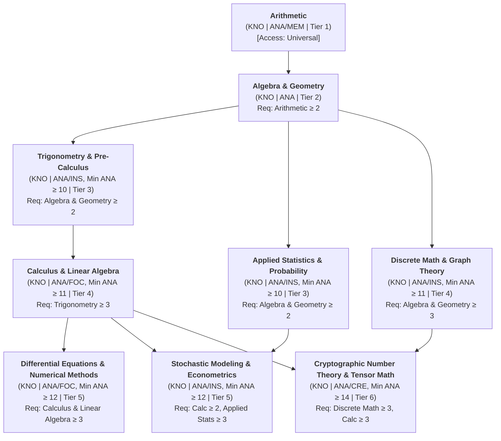
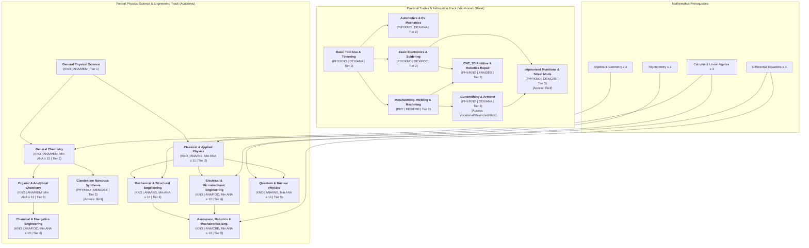
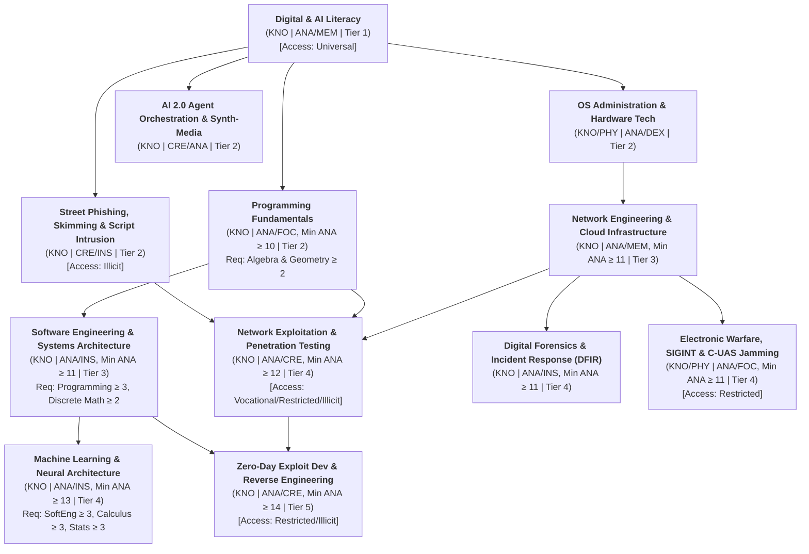
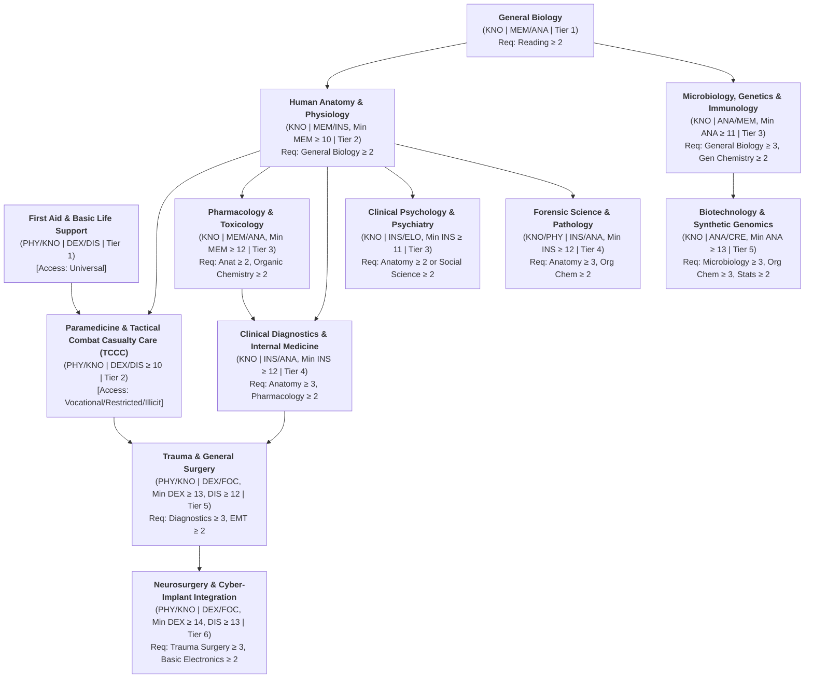

# Satya TTRPG Skill System & Hierarchical Skill Trees

> **Rust Engine Implementation**: [`crates/satya-engine/src/skills_trees.rs`](../../../crates/satya-engine/src/skills_trees.rs) (`SkillTreeId`, `SkillType`, `SkillCategory`, `AccessTier`, `SkillNode`, `evaluate_skill_prerequisites`, `evaluate_skill_tree_default`, `compute_skill_controller`) and [`crates/satya-engine/src/skills_catalog.rs`](../../../crates/satya-engine/src/skills_catalog.rs) (`CANONICAL_SKILL_TREES` — Trees 1–4 in this chapter; Trees 5–8 in **[`skills_trees_tactical_and_social.md`](skills_trees_tactical_and_social.md)**).

This chapter defines the canonical **Skill System, Skill Classifications, and the 8 Hierarchical Skill Trees** for **Satya** (set on near-future Earth, 5 years in the future, ca. 2031–2035). It integrates directly with:
- **[Mathematical Notation, Variables & Formula Glossary](../01-foundation/mathematical_notation_glossary.md)** (for definitions of all mathematical variables and subscripts such as $N, C_P, \text{TN}_P, \text{TN}_{GM}, \Delta_{\text{tool}}, \Delta_{\text{ext}}$),
- **[Characteristics, Senses, Psyche & Aptitudes](characteristics_and_aptitudes.md)** (for Controlling Characteristics $C \in [1, 20]$ and domain Aptitudes $A \in [-2, +3]$),
- **[Cascading `2d20` Engine & Task Resolution](../02-core-mechanics/cascading_d20_and_tasks.md)** (for the `2d20` Watershed Cascade, Tool Dependency Tiers, Task Prerequisite Gates Class A/B/C, and the Master Task Requirements Table), and
- **[Lifepath Character Creation, Economy & Heat](lifepaths_and_economy.md)** (for chronological skill acquisition from childhood through adult careers).

---

## 1. Core Design Philosophy

Satya's skill system is built on five foundational design pillars:

1. **Lifepath Grounding & Plausibility ("No Scientist with Random Full-Auto")**:
   A character's skills are the organic record of their upbringing, socioeconomic class, schooling quality, life events, and adult careers. A university researcher cannot arbitrarily purchase *Fully Automatic Weapons* or *Clandestine Narcotics Synthesis* at character creation unless their lifepath explicitly routed them through military service, law enforcement tactical training, or a criminal syndicate.
2. **Deep Prerequisite Hierarchies (The Skill Tree)**:
   Complex disciplines are gated behind foundational skills. A character who drops out of school at age 15 with only basic *Arithmetic* (or at best *Trigonometry* if exceptionally gifted and disciplined) lacks the *Calculus*, *Linear Algebra*, and *Differential Equations* required to learn advanced *Aerospace Engineering*, *Quantum Cryptography*, or *Machine Learning Architecture*. Conversely, street or military lifepaths open restricted and illicit branches inaccessible to sheltered academics.
3. **Nature of Proficiency (Talents vs. Physical Skills vs. Knowledge Skills)**:
   Every skill is classified by how humans acquire and execute it:
   - **Talents (`TAL`)**: Innate, universal human capacities (such as *Running*, *Singing*, *Observation*, or *Brawling*) in which every non-impaired person possesses a baseline proficiency (`N = 1`).
   - **Physical Skills (`PHY`)**: Trained motor, somatic, and kinesthetic abilities (`N = 0` untrained) governed by physical attributes and muscle memory.
   - **Knowledge Skills (`KNO`)**: Trained cognitive, academic, and analytical disciplines (`N = 0` untrained) governed by mental attributes, study discipline, and formal or street education.
   - **Hybrid Skills (`PHY/KNO`)**: High-complexity disciplines (such as *Trauma Surgery* or *Explosive Ordnance Disposal*) that require both deep theoretical mastery and precise physical execution.
4. **Multi-Category Taxonomy**:
   Skills belong to **one or more categories** (`Combat`, `Athletic`, `Technical`, `Science`, `Knowledge`, `Artistic`, `Social`, `Fieldcraft`, `Medical`, `Cyber`), allowing lifepaths, aptitudes, and equipment systems to reference overlapping domains cleanly.
5. **Explicit Tool & Task Dependencies**:
   Every skill specifies whether it requires tools (`[Tool: None]`, `[Tool: Situational]`, or `[Tool: Mandatory]`), and task resolution rules in **[Cascading `2d20` Engine & Task Resolution](../02-core-mechanics/cascading_d20_and_tasks.md)** explicitly define which skill(s), minimum skill levels, controlling characteristics, and tools are necessary to attempt any given action.

---

## 2. Skill Classifications, Categories, Access Gates, and Tool Tags

### 2.1 Skill Nature: Talent (`TAL`), Physical (`PHY`), Knowledge (`KNO`), and Hybrid (`PHY/KNO`)

| Skill Type | Untrained Baseline ($N$) | Defaulting When Untrained | Fatigue & Injury Impact ($\Delta_{\text{int}}$) | Decay & Study Profile |
| :--- | :---: | :--- | :--- | :--- |
| **Talent (`TAL`)** | **`N = 1`** *(Everyone starts at Level 1)* | Always usable at `N = 1` with $\Delta_{\text{ext}} = 0$ on basic tasks. | Standard $\Delta_{\text{int}}$ (`FOR`/`SPD`/`KIN`/`FIT` tasks) or half $\Delta_{\text{int}}$ (`SIG`/`HEA`/`ITU`/`PRE`/`ELO` tasks). | Never decays below `N = 1`; improves through natural use or dedicated training. |
| **Physical (`PHY`)** | **`N = 0`** *(Untrained)* | Can default to a root Talent or Parent Skill at `N = 1` with **$\Delta_{\text{ext}} = +4$ to $+8$** *(unless task is gated)*. | Full physical Fatigue and Wound Shock apply to both $\delta_{\text{under}}$ and Action Time Cost (`TC`). | Retained via muscle memory; requires physical practice or drills to advance. |
| **Knowledge (`KNO`)** | **`N = 0`** *(Untrained)* | **Cannot default** unless the character holds a directly related Parent/Sibling `KNO` skill (at **$\Delta_{\text{ext}} = +4$ to $+8$**). | Physical wounds impose half $\Delta_{\text{int}}$ unless in active combat; mental exhaustion/sleep deprivation degrades `FOC`/`ANA`/`MEM` and imposes full $\Delta_{\text{int}}$. | Requires literacy/math prerequisites and formal instruction, mentorship, or study materials. |
| **Hybrid (`PHY/KNO`)** | **`N = 0`** *(Untrained)* | Requires **both** the parent `KNO` prerequisite and `PHY` motor control; cannot be attempted untrained. | Full physical and cognitive $\Delta_{\text{int}}$ penalties apply. | Requires clinical, laboratory, or tactical field apprenticeship. |

---

### 2.2 Multi-Category System

Every skill is assigned **one or more** category tags. A single skill frequently bridges multiple domains:

- **`Athletic`**: Locomotion, gymnastics, swimming, climbing, physical conditioning, sports.
- **`Combat`**: Unarmed striking/grappling, melee weapons, firearms, heavy ordnance, tactical movement.
- **`Technical`**: Mechanical repair, electronics, fabrication, piloting, gunsmithing, structural/industrial engineering.
- **`Science`**: Mathematics, physics, chemistry, biology, earth/space sciences, formal research methodology.
- **`Knowledge`**: Literacy, humanities, history, law, finance, geopolitics, bureaucracy, intelligence analysis, street lore.
- **`Cyber`**: Programming, systems administration, AI/ML engineering, network exploitation, electronic warfare, cryptography.
- **`Medical`**: First aid, paramedicine, pharmacology, clinical diagnostics, trauma surgery, cyber-implant medicine.
- **`Artistic`**: Vocal/instrumental music, visual/digital arts, culinary arts, creative writing, acting/performance, synth-media.
- **`Social`**: Persuasion, deception, intimidation, negotiation, command, interrogation, etiquette, streetwise.
- **`Fieldcraft`**: Stealth, observation, tracking, urban/wilderness survival, lockpicking, surveillance, tradecraft.

> [!TIP]
> **Why Multi-Category Tags Matter**:
> Multi-category membership determines which **Aptitudes** ([`characteristics_and_aptitudes.md`](characteristics_and_aptitudes.md#10-aptitudes-a-in--2-3-human-baseline-0)), **Lifepath Career Tables** ([`lifepaths_and_economy.md`](lifepaths_and_economy.md)), and **Facility/Workshop Bonuses** apply to a skill. For example, *Explosive Ordnance Disposal (EOD)* carries the tags `[Combat, Technical, Science]`, while *Forensic Pathology* carries `[Science, Medical, Knowledge]`.

---

### 2.3 Lifepath Access & Restriction Tiers (`[Access]`)

To prevent immersion-breaking character builds, every skill is gated by an **Access Tier**:

| Access Tag | Who Can Acquire This Skill | Examples |
| :--- | :--- | :--- |
| **`[Access: Universal]`** | Any character via childhood upbringing, public schooling, hobbies, or daily life. | *Running*, *Singing*, *Reading*, *Writing*, *Arithmetic*, *Brawling*, *Ground Vehicle Driving*. |
| **`[Access: Academic]`** | Characters enrolled in secondary Honors/STEM tracks, Universities, or Research Institutes (plus math/literacy prerequisites). | *Calculus*, *Differential Equations*, *Organic Chemistry*, *Quantum Physics*, *Machine Learning Architecture*. |
| **`[Access: Vocational / Licensed]`** | Characters in accredited trade schools, apprenticeships, medical/legal residencies, or licensed corporate roles. | *Trauma Surgery*, *Commercial Aviation*, *CNC Fabrication*, *High-Voltage Electrical*, *Corporate Law*. |
| **`[Access: Restricted]`** | Strictly gated behind **Military, Police/SWAT, Federal Law Enforcement, Intelligence Agency, or licensed PMC** lifepaths. | *Fully Automatic Weapons*, *Heavy Weapons (ATGM/MANPADS)*, *Artillery/Mortars*, *CQB Breaching*, *CBRN Warfare*, *Counter-Interrogation*. |
| **`[Access: Illicit]`** | Gated behind **Street Gang, Organized Crime Syndicate, Cartel, Black-Hat Collective, Insurgent Cell, or Prison** lifepaths. | *Street Full-Auto / Sear Modification*, *Narcotics Synthesis*, *Hotwiring & Transponder Spoofing*, *Forgery & Identity Washing*, *Extortion*, *Improvised Munitions*. |

---

### 2.4 Tool Dependency Tags (`[Tool]`)

Every skill in the tables below carries a tool dependency tag (see **[Cascading `2d20` Engine & Task Resolution](../02-core-mechanics/cascading_d20_and_tasks.md#44-tool-dependency-classification-tool--2035-smart-tech-modifiers)** for the full Tool Tier $\Delta_{\text{ext}}$ table):
- **`[Tool: None]`**: Relies entirely on the body, voice, senses, or mind.
- **`[Tool: Situational]`**: Unassisted basic tasks work at $\Delta_{\text{ext}} = 0$, while complex tasks require tools or suffer an Improvised Penalty (`+4` to `+12`).
- **`[Tool: Mandatory]`**: Cannot be rolled at all without the required weapon, instrument, vehicle, lab, or computing rig.

---

## 3. The Hierarchical Skill Tree & Prerequisite Mechanics

### 3.1 Rules of the Skill Tree

Skills in Satya form a **Directed Acyclic Graph (DAG)**—a multi-tier skill tree where broad foundational roots unlock specialized branches:

1. **Parent Skill Thresholds ($N_{\text{parent}} \ge X$)**:
   To learn a Child Skill at Level `N = 1`, the character must already possess its Parent Skill(s) at or above the specified minimum rank (typically `N = 2` for intermediate skills, `N = 3` for professional specializations, and `N = 4` for advanced scientific/surgical disciplines).
2. **The Foundation Ceiling Rule ($N_{\text{child}} \le N_{\text{parent}} + 2$)**:
   A specialized child skill cannot exceed its primary foundational parent skill by more than **2 levels** (`N_child <= N_parent + 2`).
   - *Example*: If a character has *Calculus & Linear Algebra* at `N = 2`, their *Machine Learning & Neural Architecture* skill is capped at `N = 4` until they raise *Calculus & Linear Algebra* to `N = 3+`.
3. **Tree Defaulting Rules**:
   - **Down-Tree Defaulting (Parent $\to$ Child)**: If a character lacks a specific Child Skill (`N = 0`) but possesses its immediate Parent Skill at `N >= 1`, and the task is marked **Defaultable**, they may roll their Parent Skill level $N_{\text{parent}}$ with an External Difficulty Penalty of **$\Delta_{\text{ext}} = +4$ per tier step** down the tree.
   - **Sibling Defaulting (Branch $\leftrightarrow$ Branch)**: If two skills share an immediate Parent (e.g., *Pistols* and *Long Guns* under firearms fundamentals, or *Organic Chemistry* and *Analytical Chemistry*), a character may default from one sibling to another at **$\Delta_{\text{ext}} = +4$ to $+6$**, provided the target skill is not `[Tool/Training Locked]`.
   - **Hard-Gated Nodes (`[No Default]`)**: High-tier `KNO` and `PHY/KNO` nodes (such as *Neurosurgery*, *Differential Equations*, *Zero-Day Exploit Development*, or *Rotary-Wing Piloting*) **cannot be defaulted** from low-tier roots.

---

### 3.2 Tree 1: The Mathematics & Quantitative Spine (`Science`, `Knowledge`)

Mathematics is the master gatekeeper for all hard sciences, engineering, advanced computing/AI, ballistics, and quantitative finance. Rather than relying on a single generic intelligence score, foundational arithmetic combines **Analysis (`ANA`)** and **Memory (`MEM`)**, statistical and geometric modeling pairs **Analysis (`ANA`)** with **Insight (`INS`)**, multi-step calculus/differential equations require **Analysis (`ANA`)** and **Focus (`FOC`)**, and frontier cryptographic/tensor research demands **Analysis (`ANA`)** and **Creativity (`CRE`)**.

| Skill Name | Type | Categories | Control ($C$) | Min $C$ | Prerequisites | Access | Tools | What It Unlocks / Governs |
| :--- | :---: | :--- | :---: | :---: | :--- | :--- | :---: | :--- |
| **Arithmetic** | `KNO` | `Knowledge`, `Science` | `ANA/MEM` | — | None | `Universal` | `None` | Counting, fractions, percentages, street bookkeeping, basic budgeting; unlocks *Algebra & Geometry*. |
| **Algebra & Geometry** | `KNO` | `Science`, `Knowledge` | `ANA` | `ANA 8` | *Arithmetic* $\ge 2$ | `Universal` | `Situational` | Linear equations, spatial area/volume, trade drafting, basic carpentry/machining math; unlocks *Trigonometry*, *General Chemistry*, *Programming Fundamentals*. |
| **Trigonometry & Pre-Calculus** | `KNO` | `Science`, `Knowledge` | `ANA/INS` | `ANA 10` | *Algebra & Geometry* $\ge 2$ | `Universal` / `Academic` | `Situational` | Sine/cosine waves, vectors, triangulation, navigation, long-range ballistics (*Precision Rifle*), *Classical Physics*, *Surveying*. |
| **Applied Statistics & Probability** | `KNO` | `Science`, `Knowledge` | `ANA/INS` | `ANA 10` | *Algebra & Geometry* $\ge 2$ | `Academic` | `Situational` | Hypothesis testing, epidemiology, actuarial analysis, quality control, data science foundations. |
| **Discrete Math & Graph Theory** | `KNO` | `Science`, `Cyber` | `ANA/INS` | `ANA 11` | *Algebra & Geometry* $\ge 3$ | `Academic` | `Situational` | Boolean logic, combinatorics, formal algorithms, network topology, cryptography foundations. |
| **Calculus & Linear Algebra** | `KNO` | `Science` | `ANA/FOC` | `ANA 11, FOC 10` | *Trigonometry* $\ge 3$ | `Academic` | `Situational` | Derivatives, integrals, matrix operations, vector spaces; **mandatory prerequisite** for university *Engineering*, *Machine Learning*, and *Advanced Physics*. |
| **Differential Equations & Numerical Methods** | `KNO` | `Science` | `ANA/FOC` | `ANA 12, FOC 11` | *Calculus & Linear Algebra* $\ge 3$ | `Academic` | `Mandatory` *(Compute/Paper)* | Fluid dynamics, orbital mechanics, structural stress modeling, control theory, advanced simulation. |
| **Stochastic Modeling & Econometrics** | `KNO` | `Science`, `Knowledge` | `ANA/INS` | `ANA 12, INS 11` | *Calculus* $\ge 2$, *Statistics* $\ge 3$ | `Academic` / `Licensed` | `Mandatory` | Algorithmic trading, macroeconomic forecasting, complex risk modeling. |
| **Cryptographic Number Theory & Tensor Math** | `KNO` | `Science`, `Cyber` | `ANA/CRE` | `ANA 14, FOC 12` | *Discrete Math* $\ge 3$, *Calculus* $\ge 3$ | `Academic` / `Restricted` | `Mandatory` | Post-quantum cryptography, zero-knowledge proofs, theoretical physics, frontier AI 2.0 foundation models. |

---

### 3.3 Tree 2: Physical Sciences, Engineering & Practical Trades (`Science`, `Technical`)

Notice how this tree splits into **two parallel tracks**:
- The **Practical Trade Track** (accessible with *Arithmetic* or *Algebra* via vocational training, blue-collar work, or street gangs; controlled by **Dexterity (`DEX`)**, **Force (`FOR`)**, **Focus (`FOC`)**, **Analysis (`ANA`)**, and **Creativity (`CRE`)**).
- The **Formal Science & Engineering Track** (strictly gated behind *Trigonometry*, *Calculus*, and *Differential Equations*; controlled by **Analysis (`ANA`)**, **Memory (`MEM`)**, **Insight (`INS`)**, **Focus (`FOC`)**, and **Creativity (`CRE`)**).

| Skill Name | Type | Categories | Control ($C$) | Min $C$ | Prerequisites | Access | Tools |
| :--- | :---: | :--- | :---: | :---: | :--- | :--- | :---: |
| **Basic Tool Use & Tinkering** | `PHY/KNO` | `Technical` | `DEX/ANA` | — | None | `Universal` | `Mandatory` |
| **Automotive & EV Mechanics** | `PHY/KNO` | `Technical` | `DEX/ANA` | — | *Basic Tool Use* $\ge 1$, *Arithmetic* $\ge 1$ | `Universal` / `Vocational` | `Mandatory` |
| **Basic Electronics & Soldering** | `PHY/KNO` | `Technical` | `DEX/FOC` | `DEX 9, SIG 9` | *Basic Tool Use* $\ge 1$, *Arithmetic* $\ge 2$ | `Universal` / `Vocational` | `Mandatory` |
| **Metalworking, Welding & Machining** | `PHY` | `Technical` | `DEX/FOR` | `FOR 9, FOC 9` | *Basic Tool Use* $\ge 1$, *Algebra & Geometry* $\ge 1$ | `Vocational` | `Mandatory` |
| **Gunsmithing & Armorer** | `PHY/KNO` | `Technical`, `Combat` | `DEX/ANA` | `DEX 10, TAC 9` | *Metalworking* $\ge 2$ or *Basic Tool Use* $\ge 2$ | `Vocational` / `Restricted` / `Illicit` | `Mandatory` |
| **Improvised Munitions & Street Mods** | `PHY/KNO` | `Technical`, `Combat` | `DEX/CRE` | `DEX 10, CRE 10` | *Basic Electronics* $\ge 2$ or *Gunsmithing* $\ge 2$ | `Illicit` / `Restricted` | `Mandatory` |
| **CNC, 3D Additive & Robotics Repair** | `PHY/KNO` | `Technical`, `Cyber` | `ANA/DEX` | `ANA 10` | *Basic Electronics* $\ge 2$, *Metalworking* $\ge 2$, *Algebra* $\ge 2$ | `Vocational` | `Mandatory` |
| **General Physical Science** | `KNO` | `Science`, `Knowledge` | `ANA/MEM` | — | *Reading* $\ge 2$, *Arithmetic* $\ge 2$ | `Universal` | `Situational` |
| **General Chemistry** | `KNO` | `Science` | `ANA/MEM` | `ANA 10` | *General Physical Science* $\ge 2$, *Algebra & Geometry* $\ge 2$ | `Academic` | `Mandatory` *(Lab)* |
| **Classical & Applied Physics** | `KNO` | `Science` | `ANA/INS` | `ANA 11` | *General Physical Science* $\ge 2$, *Trigonometry* $\ge 2$ | `Academic` | `Situational` |
| **Clandestine Narcotics Synthesis** | `PHY/KNO` | `Science`, `Technical` | `MEM/DEX` | `MEM 9, OLF 9` | *General Chemistry* $\ge 1$ *(or gang cook apprenticeship)* | `Illicit` | `Mandatory` *(Lab)* |
| **Organic & Analytical Chemistry** | `KNO` | `Science` | `ANA/MEM` | `ANA 12, MEM 11` | *General Chemistry* $\ge 3$, *Algebra & Geometry* $\ge 3$ | `Academic` | `Mandatory` *(Lab)* |
| **Mechanical & Structural Engineering** | `KNO` | `Science`, `Technical` | `ANA/INS` | `ANA 12` | *Classical Physics* $\ge 3$, *Calculus & Linear Algebra* $\ge 3$ | `Academic` / `Licensed` | `Mandatory` |
| **Electrical & Microelectronic Engineering** | `KNO` | `Science`, `Technical`, `Cyber` | `ANA/FOC` | `ANA 12` | *Classical Physics* $\ge 3$, *Calculus & Linear Algebra* $\ge 3$ | `Academic` / `Licensed` | `Mandatory` |
| **Chemical & Energetics Engineering** | `KNO` | `Science`, `Technical` | `ANA/FOC` | `ANA 13` | *Organic Chemistry* $\ge 3$, *Calculus & Linear Algebra* $\ge 3$ | `Academic` / `Restricted` | `Mandatory` |
| **Aerospace, Robotics & Mechatronics Eng.** | `KNO` | `Science`, `Technical`, `Cyber` | `ANA/CRE` | `ANA 13, INS 11` | *Mechanical Eng.* $\ge 3$, *Electrical Eng.* $\ge 3$, *Diff. Equations* $\ge 3$ | `Academic` / `Restricted` | `Mandatory` |
| **Quantum & Nuclear Physics** | `KNO` | `Science` | `ANA/INS` | `ANA 14, CRE 12` | *Classical Physics* $\ge 4$, *Differential Equations* $\ge 3$ | `Academic` / `Restricted` | `Mandatory` |

---

### 3.4 Tree 3: Computing, AI 2.0 & Cyberwarfare (`Cyber`, `Technical`, `Science`)

In 2031–2035, computing spans basic user operation, script-kiddie/street hacking, enterprise software engineering, and frontier AI 2.0 neural architecture. Notice how **Programming (`ANA/FOC`)**, **Systems Architecture (`ANA/INS`)**, and **Exploit Development / AI Orchestration (`ANA/CRE`)** leverage distinct combinations of Mental Primary Characteristics.

| Skill Name | Type | Categories | Control ($C$) | Min $C$ | Prerequisites | Access | Tools |
| :--- | :---: | :--- | :---: | :---: | :--- | :--- | :---: |
| **Digital & AI Literacy** | `KNO` | `Cyber`, `Knowledge` | `ANA/MEM` | — | *Reading* $\ge 1$ | `Universal` | `Mandatory` |
| **AI 2.0 Agent Orchestration & Synth-Media** | `KNO` | `Cyber`, `Artistic`, `Knowledge` | `CRE/ANA` | `CRE 9, ANA 9` | *Digital & AI Literacy* $\ge 2$ | `Universal` | `Mandatory` |
| **OS Administration & Hardware Tech** | `KNO/PHY` | `Cyber`, `Technical` | `ANA/DEX` | `ANA 9` | *Digital & AI Literacy* $\ge 2$ | `Universal` / `Vocational` | `Mandatory` |
| **Street Phishing, Skimming & Script Intrusion** | `KNO` | `Cyber`, `Fieldcraft` | `CRE/INS` | `CRE 9` | *Digital & AI Literacy* $\ge 2$ | `Illicit` | `Mandatory` |
| **Programming Fundamentals** | `KNO` | `Cyber`, `Technical` | `ANA/FOC` | `ANA 10, FOC 9` | *Digital & AI Literacy* $\ge 2$, *Algebra & Geometry* $\ge 2$ | `Universal` / `Academic` | `Mandatory` |
| **Network Engineering & Cloud Infrastructure** | `KNO` | `Cyber`, `Technical` | `ANA/MEM` | `ANA 11` | *OS Administration* $\ge 2$, *Programming Fundamentals* $\ge 1$ | `Vocational` / `Academic` | `Mandatory` |
| **Software Engineering & Systems Architecture** | `KNO` | `Cyber`, `Science` | `ANA/INS` | `ANA 11, FOC 10` | *Programming Fundamentals* $\ge 3$, *Discrete Math* $\ge 2$ | `Academic` / `Vocational` | `Mandatory` |
| **Network Exploitation & Penetration Testing** | `KNO` | `Cyber`, `Fieldcraft` | `ANA/CRE` | `ANA 12, CRE 11` | *Network Eng.* $\ge 2$ & *Programming* $\ge 2$ *(or Street Intrusion $\ge 3$ + Programming $\ge 2$)* | `Licensed` / `Restricted` / `Illicit` | `Mandatory` |
| **Digital Forensics & Incident Response** | `KNO` | `Cyber`, `Knowledge` | `ANA/INS` | `ANA 11, INS 11, FOC 10` | *Network Engineering* $\ge 2$, *Programming* $\ge 2$ | `Licensed` / `Restricted` | `Mandatory` |
| **Electronic Warfare, SIGINT & C-UAS Jamming** | `KNO/PHY` | `Cyber`, `Combat`, `Technical` | `ANA/FOC` | `ANA 11, FOC 11` | *Network Engineering* $\ge 2$ or *Basic Electronics* $\ge 3$ | `Restricted` | `Mandatory` |
| **Machine Learning & Neural Architecture** | `KNO` | `Cyber`, `Science` | `ANA/INS` | `ANA 13, CRE 11` | *Software Eng.* $\ge 3$, *Calculus & Linear Algebra* $\ge 3$, *Statistics* $\ge 3$ | `Academic` | `Mandatory` |
| **Zero-Day Exploit Dev & Reverse Engineering** | `KNO` | `Cyber`, `Science` | `ANA/CRE` | `ANA 14, CRE 12, FOC 12` | *Network Exploitation* $\ge 3$, *Software Eng.* $\ge 3$, *Discrete Math* $\ge 3$ | `Restricted` / `Illicit` | `Mandatory` |

---

### 3.5 Tree 4: Biology, Medicine, Biotech & Forensics (`Medical`, `Science`)

Medicine showcases the distinction between **Memory (`MEM`)** (anatomical and pharmacological recall), **Insight (`INS`)** (clinical diagnostics and pathology pattern recognition), **Dexterity (`DEX`) + Focus (`FOC`) + Tactile (`TAC`)** (surgical execution), and **Discipline (`DIS`)** (tactical combat casualty care under fire).

| Skill Name | Type | Categories | Control ($C$) | Min $C$ | Prerequisites | Access | Tools |
| :--- | :---: | :--- | :---: | :---: | :--- | :--- | :---: |
| **First Aid & Basic Life Support** | `PHY/KNO` | `Medical` | `DEX/DIS` | — | None | `Universal` | `Situational` |
| **General Biology & Natural History** | `KNO` | `Science` | `MEM/ANA` | `MEM 9` | *Reading* $\ge 2$ *(or rural field lore)* | `Universal` / `Academic` | `Situational` |
| **Agriculture, Agronomy & Crop Husbandry** | `PHY/KNO` | `Science`, `Fieldcraft` | `INS/FOR` | `INS 8, FOR 8` | *Foraging & Campcraft* $\ge 1$ or *Hygiene* $\ge 1$ | `Universal` / `Vocational` / `Academic` | `Mandatory` |
| **Herbalism, Ethnobotany & Field Remedies** | `KNO` | `Medical`, `Fieldcraft` | `MEM/OLF` | `MEM 9, INS 9` | *Foraging & Campcraft* $\ge 2$, *First Aid* $\ge 1$ | `Universal` / `Vocational` | `Situational` |
| **Veterinary Medicine & Livestock Care** | `PHY/KNO` | `Medical`, `Fieldcraft` | `INS/DEX` | `INS 9, DEX 9` | *Animal Handling* $\ge 1$, *First Aid* $\ge 1$ | `Universal` / `Vocational` / `Academic` | `Mandatory` |
| **Paramedicine & TCCC (Combat Medic)** | `PHY/KNO` | `Medical`, `Combat` | `DEX/DIS` | `DEX 10, DIS 10, FOC 10` | *First Aid* $\ge 2$ | `Vocational` / `Restricted` / `Illicit` | `Mandatory` |
| **Human Anatomy & Physiology** | `KNO` | `Science`, `Medical` | `MEM/INS` | `MEM 10, ANA 10` | *General Biology* $\ge 2$ | `Academic` / `Vocational` | `Situational` |
| **Microbiology, Genetics & Immunology** | `KNO` | `Science`, `Medical` | `ANA/MEM` | `ANA 11, MEM 11` | *General Biology* $\ge 3$, *General Chemistry* $\ge 2$ | `Academic` | `Mandatory` *(Lab)* |
| **Pharmacology & Toxicology** | `KNO` | `Science`, `Medical` | `MEM/ANA` | `MEM 12, ANA 11` | *Human Anatomy* $\ge 2$, *Organic Chemistry* $\ge 2$ | `Academic` / `Licensed` | `Mandatory` |
| **Clinical Psychology & Psychiatry** | `KNO` | `Medical`, `Social`, `Knowledge` | `INS/ELO` | `INS 11, ELO 10` | *Human Anatomy* $\ge 2$, *Applied Statistics* $\ge 1$ | `Academic` / `Licensed` | `None` / `Situational` |
| **Clinical Diagnostics & Internal Medicine** | `KNO` | `Medical`, `Science` | `INS/ANA` | `INS 12, ANA 11, MEM 11` | *Human Anatomy* $\ge 3$, *Pharmacology* $\ge 2$ | `Licensed` *(Med School)* | `Situational` |
| **Forensic Science & Pathology** | `KNO/PHY` | `Science`, `Medical`, `Knowledge` | `INS/ANA` | `INS 12, ANA 11, FOC 11` | *Human Anatomy* $\ge 3$, *Organic Chemistry* $\ge 2$ | `Licensed` / `Restricted` | `Mandatory` *(Lab/Kit)* |
| **Trauma & General Surgery** | `PHY/KNO` | `Medical` | `DEX/FOC` | `DEX 13, FOC 12, DIS 12, TAC 11` | *Clinical Diagnostics* $\ge 3$, *Paramedicine* $\ge 2$ | `Licensed` / `Restricted` | `Mandatory` |
| **Neurosurgery & Cyber-Implant Integration** | `PHY/KNO` | `Medical`, `Cyber`, `Technical` | `DEX/FOC` | `DEX 14, FOC 13, DIS 13, TAC 12` | *Trauma Surgery* $\ge 3$, *Basic Electronics* $\ge 2$ | `Licensed` / `Illicit` *(Ripperdoc)* | `Mandatory` |
| **Biotechnology & Synthetic Genomics** | `KNO` | `Science`, `Medical` | `ANA/CRE` | `ANA 13, MEM 12` | *Microbiology* $\ge 3$, *Organic Chemistry* $\ge 3$, *Statistics* $\ge 2$ | `Academic` / `Restricted` | `Mandatory` *(Lab)* |

---

> **Continued in Companion Chapter**: See **[Hierarchical Skill Trees 5–8: Combat, Vehicles, Social & Tradecraft (`skills_trees_tactical_and_social.md`)](skills_trees_tactical_and_social.md)** for **Sections 3.6–3.9 (Trees 5–8)**.
