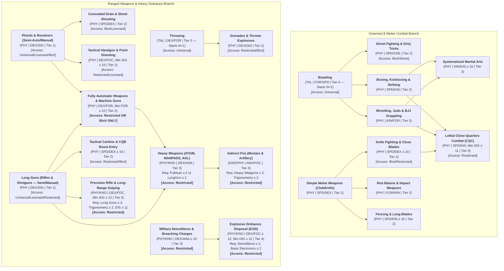
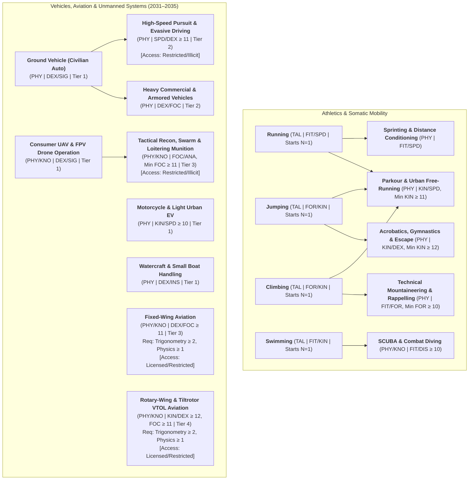
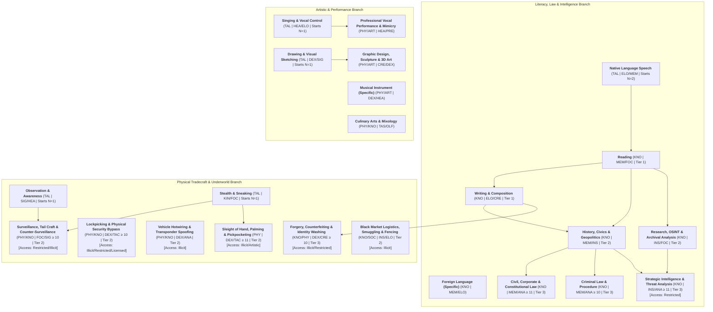

# Satya TTRPG Hierarchical Skill Trees 5–8: Combat, Vehicles, Social & Tradecraft

> **Rust Engine Implementation**: [`crates/satya-engine/src/skills_trees.rs`](../../../crates/satya-engine/src/skills_trees.rs) (`SkillTreeId`, `SkillNode`, `evaluate_skill_prerequisites`, `evaluate_skill_tree_default`) and [`crates/satya-engine/src/skills_catalog.rs`](../../../crates/satya-engine/src/skills_catalog.rs) (`CANONICAL_SKILL_TREES` — Trees 5–8). Companion chapter to **[Skill System & Hierarchical Skill Trees 1–4 (`skills_and_trees.md`)](skills_and_trees.md)**.

### 3.6 Tree 5: Combat — Unarmed, Melee, Firearms & Heavy Ordnance (`Combat`, `Athletic`, `Technical`)

This tree enforces the strict distinction between universal brawling, civilian/street weapon handling, and military/SWAT restricted ordnance, while leveraging Satya's physical and sensory characteristics:
- **Unarmed & Melee**: Uses **Force (`FOR`)** and **Speed (`SPD`)** ($\text{Power} = \text{Force} \times \text{Speed}$) for raw brawling, **Kinesthesis (`KIN`)** for martial arts footwork and grappling body control, and **Dexterity (`DEX`)** for precise blade work (see **[Melee Combat](../05-combat/melee_combat.md)**).
- **Ranged Marksmanship**: Pairs **Dexterity (`DEX`)** (trigger control and hand-eye coordination) with **Sight (`SIG`)** (visual target acquisition), **Speed (`SPD`)** (concealed fast-draw and CQB room entry), **Force (`FOR`)** (full-auto recoil control), or **Focus (`FOC`)** (long-range sniping; see **[Ranged Combat & Armor](../05-combat/ranged_combat_and_armor.md)**).

| Skill Name | Type | Categories | Control ($C$) | Min $C$ | Prerequisites | Access | Tools |
| :--- | :---: | :--- | :---: | :---: | :--- | :--- | :---: |
| **Brawling** | `TAL` | `Combat`, `Athletic` | `FOR/SPD` | — | None *(Starts at `N = 1`)* | `Universal` | `None` |
| **Street Fighting & Dirty Tricks** | `PHY` | `Combat`, `Fieldcraft` | `SPD/CRE` | — | *Brawling* $\ge 2$ | `Illicit` | `Situational` |
| **Boxing, Kickboxing & Striking** | `PHY` | `Combat`, `Athletic` | `SPD/KIN` | `SPD 9, KIN 9` | *Brawling* $\ge 1$ | `Universal` | `Situational` |
| **Wrestling, Judo & BJJ Grappling** | `PHY` | `Combat`, `Athletic` | `KIN/FOR` | `KIN 9, FOR 9` | *Brawling* $\ge 1$ | `Universal` | `None` |
| **Systematized Martial Arts** | `PHY` | `Combat`, `Athletic` | `KIN/DIS` | `KIN 10, DIS 10, SPD 10` | *Striking* $\ge 2$ or *Grappling* $\ge 2$ | `Universal` | `None` |
| **Lethal Close-Quarters Combat (CQC)** | `PHY` | `Combat` | `SPD/KIN` | `SPD 11, KIN 11, DIS 11` | *Striking* $\ge 2$, *Grappling* $\ge 2$, or *Knife Fighting* $\ge 2$ | `Restricted` | `Situational` |
| **Simple Melee Weapons (Club/Knife)** | `PHY` | `Combat` | `SPD/DEX` | — | *Brawling* $\ge 1$ | `Universal` | `Mandatory` |
| **Knife Fighting & Close Blades** | `PHY` | `Combat` | `SPD/DEX` | `DEX 10, SPD 10` | *Simple Melee Weapons* $\ge 2$ | `Illicit` / `Restricted` | `Mandatory` |
| **Riot Batons & Impact Weapons** | `PHY` | `Combat` | `FOR/KIN` | `FOR 9` | *Simple Melee Weapons* $\ge 1$ | `Restricted` / `Illicit` | `Mandatory` |
| **Fencing & Long Blades** | `PHY` | `Combat`, `Athletic` | `SPD/KIN` | `SPD 10, KIN 10, DEX 10` | *Simple Melee Weapons* $\ge 1$ | `Universal` | `Mandatory` |
| **Throwing** | `TAL` | `Combat`, `Athletic` | `DEX/FOR` | — | None *(Starts at `N = 1`)* | `Universal` | `Situational` |
| **Grenades & Thrown Explosives** | `PHY` | `Combat` | `DEX/DIS` | `DIS 9, FOR 8` | *Throwing* $\ge 2$ | `Restricted` / `Illicit` | `Mandatory` |
| **Pistols & Revolvers (Semi-Auto/Manual)** | `PHY` | `Combat` | `DEX/SIG` | — | None | `Universal` / `Licensed` / `Illicit` | `Mandatory` |
| **Concealed Draw & Street Shooting** | `PHY` | `Combat`, `Fieldcraft` | `SPD/DEX` | `SPD 10, DEX 10` | *Pistols & Revolvers* $\ge 2$, *Stealth/Concealment* $\ge 1$ | `Illicit` / `Licensed` / `Restricted` | `Mandatory` |
| **Tactical Handgun & Point Shooting** | `PHY` | `Combat` | `DEX/FOC` | `DEX 10, SIG 10, FOC 10` | *Pistols & Revolvers* $\ge 2$ | `Restricted` / `Licensed` | `Mandatory` |
| **Long Guns (Rifles/Shotguns — Semi/Manual)** | `PHY` | `Combat` | `DEX/SIG` | — | None | `Universal` / `Licensed` / `Restricted` | `Mandatory` |
| **Tactical Carbine & CQB Room Entry** | `PHY` | `Combat` | `SPD/DEX` | `SPD 10, DEX 10, FOC 10` | *Long Guns* $\ge 2$ | `Restricted` / `Illicit` | `Mandatory` |
| **Fully Automatic Weapons & Machine Guns** | `PHY` | `Combat` | `DEX/FOR` | **`FOR 10`** | *Long Guns* $\ge 2$ or *Pistols* $\ge 2$ | **`Restricted` or `Illicit` ONLY** | `Mandatory` |
| **Precision Rifle & Long-Range Sniping** | `PHY/KNO` | `Combat`, `Science`, `Fieldcraft` | `DEX/FOC` | `DEX 12, SIG 12, FOC 12, DIS 11` | *Long Guns* $\ge 3$, ***Trigonometry* $\ge 2$**, *Stealth/Camo* $\ge 2$ | **`Restricted` ONLY** | `Mandatory` |
| **Heavy Weapons (ATGM, MANPADS, AGL)** | `PHY/KNO` | `Combat`, `Technical` | `DEX/ANA` | `FOR 10, FOC 10, ANA 9` | *Fully Automatic Weapons* $\ge 2$ or *Long Guns* $\ge 2$ | **`Restricted` (or Cartel/Paramilitary)** | `Mandatory` |
| **Indirect Fire (Mortars & Artillery)** | `KNO/PHY` | `Combat`, `Science`, `Technical` | `ANA/FOC` | `ANA 10` | *Heavy Weapons* $\ge 2$, ***Trigonometry* $\ge 2$** | **`Restricted` ONLY** | `Mandatory` |
| **Military Demolitions & Breaching** | `PHY/KNO` | `Combat`, `Technical` | `DEX/ANA` | `ANA 10, DIS 10` | *Arithmetic* $\ge 2$ | **`Restricted` (or Insurgent)** | `Mandatory` |
| **Explosive Ordnance Disposal (EOD)** | `PHY/KNO` | `Combat`, `Technical`, `Science` | `DEX/FOC` | `DEX 12, FOC 12, DIS 12, TAC 11, ANA 11` | *Military Demolitions* $\ge 2$, *Basic Electronics* $\ge 2$ | **`Restricted` ONLY** | `Mandatory` |

> [!IMPORTANT]
> **Why *Precision Rifle / Sniping* Uses `DEX/FOC` (with `SIG >= 12, DIS >= 11` and *Trigonometry* $\ge 2$)**:
> Shooting a rifle at 50 meters uses *Long Guns* (`DEX/SIG`). Engaging a target at 1,200 meters requires **Sight (`SIG >= 12`)** to resolve the target, **Trigonometry & Pre-Calculus (`N >= 2`)** (`ANA/INS`) to compute milliradian holdovers, Coriolis drift, and high-angle cosine corrections, **Discipline (`DIS >= 11`)** to remain motionless for hours, and **Dexterity + Focus (`DEX/FOC`)** to break the trigger between heartbeats. Similarly, controlling an automatic rifle or sear-modified machine pistol requires **Force (`FOR >= 10`)** (`DEX/FOR`) and `[Access: Restricted or Illicit]`.

---

### 3.7 Tree 6: Athletics, Vehicles, Aviation & Drone Operations (`Athletic`, `Technical`, `Fieldcraft`)

Athletics and vehicle handling directly showcase **Fitness (`FIT`)**, **Speed (`SPD`)**, **Force (`FOR`)**, and **Kinesthesis (`KIN`)** (body awareness in 3D space—essential for parkour, gymnastics, motorcycles, and rotary-wing VTOL aircraft; see **[Movement, Vehicles & Environment](../06-health-and-survival/movement_vehicles_and_environment.md)**).

| Skill Name | Type | Categories | Control ($C$) | Min $C$ | Prerequisites | Access | Tools |
| :--- | :---: | :--- | :---: | :---: | :--- | :--- | :---: |
| **Running** | `TAL` | `Athletic` | `FIT/SPD` | — | None *(Starts at `N = 1`)* | `Universal` | `None` |
| **Jumping** | `TAL` | `Athletic` | `FOR/KIN` | — | None *(Starts at `N = 1`)* | `Universal` | `None` |
| **Climbing** | `TAL` | `Athletic`, `Fieldcraft` | `FOR/KIN` | — | None *(Starts at `N = 1`)* | `Universal` | `Situational` |
| **Swimming** | `TAL` | `Athletic`, `Fieldcraft` | `FIT/KIN` | — | None *(Starts at `N = 1`)* | `Universal` | `None` |
| **Sprinting & Distance Conditioning** | `PHY` | `Athletic` | `FIT/SPD` | `FIT 10` | *Running* $\ge 2$ | `Universal` | `None` |
| **Parkour & Urban Free-Running** | `PHY` | `Athletic`, `Fieldcraft` | `KIN/SPD` | `KIN 11, SPD 10, FOR 10` | *Running* $\ge 2$, *Jumping* $\ge 2$, *Climbing* $\ge 2$ | `Universal` / `Illicit` | `None` |
| **Technical Mountaineering & Rappelling** | `PHY` | `Athletic`, `Fieldcraft` | `FIT/FOR` | `FOR 10, FIT 10, KIN 10, DIS 10` | *Climbing* $\ge 2$ | `Universal` / `Restricted` | `Mandatory` |
| **SCUBA & Combat Diving** | `PHY/KNO` | `Athletic`, `Fieldcraft` | `FIT/DIS` | `FIT 10, DIS 10, KIN 9` | *Swimming* $\ge 2$, *General Physical Science* $\ge 1$ | `Licensed` / `Restricted` | `Mandatory` |
| **Acrobatics, Gymnastics & Escape** | `PHY` | `Athletic` | `KIN/DEX` | `KIN 12, SPD 10` | *Jumping* $\ge 2$ | `Universal` / `Illicit` | `None` |
| **Ground Vehicle (Civilian Auto)** | `PHY` | `Technical` | `DEX/SIG` | — | None | `Universal` | `Mandatory` |
| **High-Speed Pursuit & Evasive Driving** | `PHY` | `Technical`, `Combat` | `SPD/DEX` | `SPD 11, DEX 11, SIG 10, FOC 10` | *Ground Vehicle* $\ge 2$ | `Restricted` / `Illicit` | `Mandatory` |
| **Heavy Commercial & Armored Vehicles** | `PHY` | `Technical` | `DEX/FOC` | `DEX 9, SIG 9` | *Ground Vehicle* $\ge 2$ | `Vocational` / `Restricted` | `Mandatory` |
| **Motorcycle & Light Urban EV** | `PHY` | `Technical`, `Athletic` | `KIN/SPD` | `KIN 10, SPD 10` | None | `Universal` / `Illicit` | `Mandatory` |
| **Watercraft & Small Boat Handling** | `PHY` | `Technical`, `Fieldcraft` | `DEX/INS` | — | *Swimming* $\ge 1$ | `Universal` / `Vocational` | `Mandatory` |
| **Consumer UAV & FPV Drone Operation** | `PHY/KNO` | `Technical`, `Cyber` | `DEX/SIG` | `DEX 10` | *Digital & AI Literacy* $\ge 1$ | `Universal` | `Mandatory` |
| **Tactical Recon, Swarm & Loitering Munition** | `PHY/KNO` | `Combat`, `Technical`, `Cyber` | `FOC/ANA` | `FOC 11, ANA 10, DEX 10` | *Consumer UAV* $\ge 2$ | `Restricted` / `Illicit` | `Mandatory` |
| **Fixed-Wing Aviation** | `PHY/KNO` | `Technical` | `DEX/FOC` | `DEX 11, FOC 11, ANA 11, SIG 10` | *Trigonometry* $\ge 2$, *Classical Physics* $\ge 1$ | `Licensed` / `Restricted` | `Mandatory` |
| **Rotary-Wing & Tiltrotor VTOL Aviation** | `PHY/KNO` | `Technical` | `KIN/DEX` | `KIN 12, DEX 12, FOC 11, ANA 11` | *Trigonometry* $\ge 2$, *Classical Physics* $\ge 1$ | `Licensed` / `Restricted` | `Mandatory` |

---

### 3.8 Tree 7: Social, Influence, Interrogation & Psychological Warfare (`Social`, `Knowledge`, `Fieldcraft`)

Social skills leverage Satya's three distinct Social Primary Characteristics—**Comeliness (`COM`)** (physical beauty), **Presence (`PRE`)** (silent charisma and physical magnetism), and **Eloquence (`ELO`)** (how well one speaks and verbally influences others)—paired with **Insight (`INS`)**, **Intuition (`ITU`)**, **Analysis (`ANA`)**, **Creativity (`CRE`)**, **Memory (`MEM`)**, **Discipline (`DIS`)**, and **Focus (`FOC`)** (see **[Psyche, Morale & Social Combat](../04-psyche-and-social/psyche_morale_and_social_combat.md)**).

```mermaid
flowchart TD
    subgraph SocialTalents["Foundational Social Talents (Start at N=1)"]
        Charm["<b>Charm & Rapport</b><br/>(TAL | PRE/ELO | Tier 0 — Starts N=1)<br/>[Access: Universal]"]
        Persuade["<b>Persuasion & Rhetoric</b><br/>(TAL | ELO/ANA | Tier 0 — Starts N=1)<br/>[Access: Universal]"]
        Deceive["<b>Deception & Fast-Talk</b><br/>(TAL | ELO/CRE | Tier 0 — Starts N=1)<br/>[Access: Universal]"]
        Intim["<b>Intimidation & Coercion</b><br/>(TAL | PRE/DIS | Tier 0 — Starts N=1)<br/>[Access: Universal]"]
        Empathy["<b>Empathy & Read Person</b><br/>(TAL | INS/ITU | Tier 0 — Starts N=1)<br/>[Access: Universal]"]
    end

    subgraph InfluenceBranch["Influence, Etiquette & Deception Specializations"]
        Seduct["<b>Seduction & Honey-Trap Tradecraft</b><br/>(PHY/SOC | COM/PRE ≥ 10 | Tier 2)<br/>Req: Charm ≥ 2, Deception or Empathy ≥ 2"]
        Etiquette["<b>Etiquette, High Society & Corporate Protocol</b><br/>(KNO/SOC | PRE/MEM | Tier 2)<br/>Req: Charm ≥ 2 or Persuasion ≥ 2"]
        Streetwise["<b>Streetwise & Gang Protocol</b><br/>(KNO/SOC | INS/PRE | Tier 2)<br/>Req: Intimidation ≥ 1 or Deception ≥ 1<br/>[Access: Illicit/Restricted]"]
        ConArt["<b>Con Artistry, Social Engineering & Impersonation</b><br/>(KNO/SOC | ELO/CRE ≥ 10 | Tier 2)<br/>Req: Deception ≥ 2, Charm ≥ 2<br/>[Access: Illicit/Restricted]"]
        Negotiate["<b>Diplomacy, Mediation & High-Stakes Negotiation</b><br/>(KNO/SOC | ELO/INS ≥ 10 | Tier 2)<br/>Req: Persuasion ≥ 2, Empathy ≥ 2"]
        Oratory["<b>Public Speaking, Oratory & Media Spin</b><br/>(KNO/SOC | ELO/PRE ≥ 10 | Tier 2)<br/>Req: Persuasion ≥ 2, Writing ≥ 2"]
        Command["<b>Leadership, Command & Small-Unit Tactics</b><br/>(KNO/SOC | PRE/DIS ≥ 10, INS ≥ 10 | Tier 3)<br/>Req: Persuasion ≥ 2 or Intimidation ≥ 2<br/>[Access: Restricted/Illicit/Licensed]"]
    end

    subgraph InterrogationBranch["Elicitation, Interrogation & PsyOps Branch"]
        Elicit["<b>Investigative Interviewing & Subtle Elicitation</b><br/>(KNO/SOC | INS/ELO ≥ 11 | Tier 3)<br/>Req: Empathy ≥ 2, Charm or Persuasion ≥ 2<br/>[Access: Restricted/Licensed]"]
        Interrog["<b>Coercive Interrogation & Psychological Breaking</b><br/>(KNO/SOC | DIS/INS ≥ 11 | Tier 3)<br/>Req: Intimidation ≥ 2, Empathy ≥ 2<br/><b>[Access: Restricted OR Illicit ONLY]</b>"]
        SERE["<b>Counter-Interrogation & Resistance (SERE)</b><br/>(KNO/SOC | DIS/FOC ≥ 12 | Tier 3)<br/>Req: Deception ≥ 2<br/><b>[Access: Restricted OR Illicit ONLY]</b>"]
        PsyOps["<b>Psychological Operations (PsyOps) & Disinformation</b><br/>(KNO/SOC | CRE/INS ≥ 12 | Tier 4)<br/>Req: Oratory ≥ 2, AI Synth-Media ≥ 2<br/>[Access: Restricted/Illicit]"]
    end

    Charm --> Seduct
    Charm --> Etiquette
    Charm --> ConArt
    Charm --> Elicit
    Persuade --> Etiquette
    Persuade --> Negotiate
    Persuade --> Oratory
    Persuade --> Command
    Deceive --> Seduct
    Deceive --> Streetwise
    Deceive --> ConArt
    Deceive --> SERE
    Intim --> Streetwise
    Intim --> Interrog
    Intim --> Command
    Empathy --> Negotiate
    Empathy --> Elicit
    Empathy --> Interrog
    Oratory --> PsyOps
```

| Skill Name | Type | Categories | Control ($C$) | Min $C$ | Prerequisites | Access | Tools |
| :--- | :---: | :--- | :---: | :---: | :--- | :--- | :---: |
| **Charm & Rapport** | `TAL` | `Social` | `PRE/ELO` | — | None *(Starts at `N = 1`)* | `Universal` | `None` |
| **Persuasion & Rhetoric** | `TAL` | `Social` | `ELO/ANA` | — | None *(Starts at `N = 1`)* | `Universal` | `None` |
| **Deception & Fast-Talk** | `TAL` | `Social`, `Fieldcraft` | `ELO/CRE` | — | None *(Starts at `N = 1`)* | `Universal` | `None` |
| **Intimidation & Coercion** | `TAL` | `Social`, `Combat` | `PRE/DIS` | — | None *(Starts at `N = 1`)* | `Universal` | `Situational` |
| **Empathy & Read Person** | `TAL` | `Social` | `INS/ITU` | — | None *(Starts at `N = 1`)* | `Universal` | `None` |
| **Seduction & Honey-Trap Tradecraft** | `PHY/KNO` | `Social`, `Fieldcraft` | `COM/PRE` | `COM 10` *(or `PRE 10`)* | *Charm & Rapport* $\ge 2$, *Deception* $\ge 2$ or *Empathy* $\ge 2$ | `Universal` / `Restricted` / `Illicit` | `Situational` |
| **Etiquette, High Society & Corporate Protocol** | `KNO` | `Social`, `Knowledge` | `PRE/MEM` | — | *Charm & Rapport* $\ge 2$ or *Persuasion* $\ge 2$ | `Universal` / `Academic` / `Licensed` | `Situational` *(Wardrobe)* |
| **Streetwise & Gang Protocol** | `KNO` | `Social`, `Knowledge`, `Fieldcraft` | `INS/PRE` | — | *Deception* $\ge 1$ or *Intimidation* $\ge 1$ | `Illicit` / `Restricted` *(Vice/Gang Unit)* | `None` |
| **Con Artistry, Social Engineering & Impersonation** | `KNO` | `Social`, `Fieldcraft`, `Cyber` | `ELO/CRE` | `ELO 10, CRE 10, DIS 10` | *Deception* $\ge 2$, *Charm & Rapport* $\ge 2$ | `Illicit` / `Restricted` | `Situational` *(Props/Spoofer)* |
| **Diplomacy, Mediation & High-Stakes Negotiation** | `KNO` | `Social`, `Knowledge` | `ELO/INS` | `ELO 10, INS 10` | *Persuasion* $\ge 2$, *Empathy* $\ge 2$ | `Academic` / `Licensed` / `Restricted` | `None` |
| **Public Speaking, Oratory & Media Spin** | `KNO` | `Social`, `Artistic`, `Knowledge` | `ELO/PRE` | `ELO 10, PRE 10` | *Persuasion* $\ge 2$, *Writing* $\ge 2$ | `Universal` / `Academic` | `Situational` |
| **Leadership, Command & Small-Unit Tactics** | `KNO` | `Social`, `Combat`, `Knowledge` | `PRE/DIS` | `PRE 10, DIS 10, INS 10` | *Persuasion* $\ge 2$ or *Intimidation* $\ge 2$, *Observation* $\ge 2$ | `Restricted` / `Illicit` *(Shot-Caller)* / `Licensed` | `Situational` *(Comms)* |
| **Investigative Interviewing & Subtle Elicitation** | `KNO` | `Social`, `Fieldcraft`, `Knowledge` | `INS/ELO` | `INS 11, ELO 10` | *Empathy* $\ge 2$, *Charm* $\ge 2$ or *Persuasion* $\ge 2$ | `Restricted` / `Licensed` *(Detective/Reporter/Spy)* | `Situational` |
| **Coercive Interrogation & Psychological Breaking** | `KNO` | `Social`, `Fieldcraft` | `DIS/INS` | `DIS 11, INS 11, PRE 10` | *Intimidation* $\ge 2$, *Empathy* $\ge 2$ | **`Restricted` or `Illicit` ONLY** | `Situational` *(Biometric/Polygraph `-2`)* |
| **Counter-Interrogation & Resistance (SERE)** | `KNO` | `Social`, `Fieldcraft` | `DIS/FOC` | `DIS 12, FOC 11` | *Deception* $\ge 2$ | **`Restricted` or `Illicit` ONLY** | `None` |
| **Psychological Operations (PsyOps) & Disinformation** | `KNO` | `Social`, `Cyber`, `Knowledge` | `CRE/INS` | `CRE 11, INS 12, ELO 10` | *Public Speaking* $\ge 2$, *AI 2.0 Synth-Media* $\ge 2$ | `Restricted` / `Illicit` | `Mandatory` *(Media/Botnet)* |

> [!NOTE]
> **Elicitation, Coercive Interrogation & Social Combat (Psyche Resonance & Cognitive Dissonance)**:
> - **Investigative Interviewing & Subtle Elicitation** (`INS/ELO`) uses *Charm*, *Empathy*, pattern insight, and conversational framing to draw out secrets from a subject who does not even realize they are being interrogated (or via rapport-based detective questioning).
> - **Coercive Interrogation & Psychological Breaking** (`DIS/INS`) is used when a captive knows they are being interrogated and is actively resisting. It pits the interrogator's *Coercive Interrogation* (`DIS/INS`) against the subject's *Counter-Interrogation & Resistance* (`DIS/FOC`, or raw `DIS` at `N = 1` if untrained).
> - **Targeting Psyche in Social Combat**: As detailed in **[Psyche, Morale & Social Combat](../04-psyche-and-social/psyche_morale_and_social_combat.md)**, social skills interact directly with the target's seven **Psyche** traits (`EGO`, `SLF`, `OPN`, `BLG`, `EXT`, `CNF`, `AGG`).

---

### 3.9 Tree 8: Literacy, Law, Intelligence, Tradecraft & Artistic (`Knowledge`, `Fieldcraft`, `Artistic`)

This tree highlights the interplay of **Memory (`MEM`)** and **Eloquence (`ELO`)** in language and law, **Insight (`INS`)** and **Focus (`FOC`)** in intelligence and OSINT, **Tactile (`TAC`)** and **Dexterity (`DEX`)** in lockpicking and sleight of hand, and **Hearing (`HEA`)**, **Sight (`SIG`)**, **Taste (`TAS`)**, **Olfactory (`OLF`)**, and **Creativity (`CRE`)** across the arts.

| Skill Name | Type | Categories | Control ($C$) | Min $C$ | Prerequisites | Access | Tools |
| :--- | :---: | :--- | :---: | :---: | :--- | :--- | :---: |
| **Native Language Speech** | `TAL` | `Knowledge`, `Social` | `ELO/MEM` | — | None *(Starts at `N = 2` for native speakers)* | `Universal` | `None` |
| **Reading** | `KNO` | `Knowledge` | `MEM/FOC` | — | *Native Language Speech* $\ge 1$ | `Universal` | `None` |
| **Writing & Composition** | `KNO` | `Knowledge`, `Artistic` | `ELO/CRE` | — | *Reading* $\ge 1$ | `Universal` | `Mandatory` |
| **Foreign Language (Specific)** | `KNO` | `Knowledge`, `Social` | `MEM/ELO` | — | None *(Oral)*; *Reading* $\ge 1$ *(Literate)* | `Universal` | `None` |
| **History, Civics & Geopolitics** | `KNO` | `Knowledge` | `MEM/INS` | `MEM 9` | *Reading* $\ge 2$, *Writing* $\ge 2$ | `Universal` / `Academic` | `Situational` |
| **Research, OSINT & Archival Analysis** | `KNO` | `Knowledge`, `Cyber`, `Fieldcraft` | `INS/FOC` | `ANA 10, FOC 10` | *Reading* $\ge 2$, *Digital Literacy* $\ge 2$ | `Universal` / `Academic` | `Mandatory` |
| **Criminal Law & Procedure** | `KNO` | `Knowledge` | `MEM/ANA` | `MEM 10, ANA 10` | *History & Civics* $\ge 2$ *(or Streetwise $\ge 3$ for `N=1`)* | `Academic` / `Restricted` / `Illicit` | `Situational` |
| **Civil, Corporate & Constitutional Law** | `KNO` | `Knowledge` | `MEM/ANA` | `MEM 11, ANA 11, ELO 10` | *History & Civics* $\ge 3$, *Writing* $\ge 3$ | `Academic` / `Licensed` *(Law School)* | `Situational` |
| **Strategic Intelligence & Threat Analysis** | `KNO` | `Knowledge`, `Fieldcraft` | `INS/ANA` | `INS 11, ANA 11` | *Research & OSINT* $\ge 2$, *History & Civics* $\ge 2$ | `Restricted` | `Mandatory` |
| **Observation & Awareness** | `TAL` | `Fieldcraft` | `SIG/HEA` | — | None *(Starts at `N = 1`; swaps to `ITU`/`FOC` by context)* | `Universal` | `Situational` |
| **Stealth & Sneaking** | `TAL` | `Fieldcraft`, `Athletic` | `KIN/FOC` | — | None *(Starts at `N = 1`)* | `Universal` | `Situational` |
| **Foraging & Campcraft** | `TAL` | `Fieldcraft` | `INS/OLF` | — | None *(Starts at `N = 1`)* | `Universal` | `Situational` |
| **Hunting, Trapping & Field Butchery** | `PHY/KNO` | `Fieldcraft`, `Combat` | `SIG/INS` | `SIG 9, INS 8` | *Foraging & Campcraft* $\ge 1$, *Stealth* $\ge 1$ | `Universal` / `Vocational` | `Mandatory` |
| **Animal Handling, Husbandry & Riding** | `PHY/KNO` | `Fieldcraft`, `Athletic`, `Social` | `INS/KIN` | `INS 8, KIN 8` | *Empathy* $\ge 1$ or *Foraging & Campcraft* $\ge 1$ | `Universal` / `Vocational` | `Situational` |
| **Wilderness Survival (Biome-Specific)** | `KNO/PHY` | `Fieldcraft` | `INS/HLT` | `INS 9, HLT 9` | *Foraging & Campcraft* $\ge 2$ | `Universal` / `Vocational` / `Restricted` | `Situational` |
| **Sleight of Hand, Palming & Pickpocketing** | `PHY` | `Fieldcraft`, `Artistic` | `DEX/TAC` | `DEX 11, TAC 10` | *Stealth* $\ge 1$ | `Illicit` / `Artistic` | `None` |
| **Lockpicking & Physical Security Bypass** | `PHY/KNO` | `Fieldcraft`, `Technical` | `DEX/TAC` | `DEX 10, TAC 10, FOC 9` | *Basic Tool Use* $\ge 1$ or *Sleight of Hand* $\ge 1$ | `Illicit` / `Restricted` / `Licensed` | `Mandatory` |
| **Vehicle Hotwiring & Transponder Spoofing** | `PHY/KNO` | `Fieldcraft`, `Technical`, `Cyber` | `DEX/ANA` | `DEX 9` | *Streetwise* $\ge 1$ or *Basic Electronics* $\ge 1$ | `Illicit` / `Restricted` | `Mandatory` |
| **Forgery, Counterfeiting & Identity Washing** | `KNO/PHY` | `Fieldcraft`, `Cyber`, `Artistic` | `DEX/CRE` | `DEX 10, SIG 10, FOC 10` | *Writing* $\ge 2$, *Digital Literacy* $\ge 2$ | `Illicit` / `Restricted` | `Mandatory` |
| **Surveillance, Tail Craft & Counter-Surveillance** | `PHY/KNO` | `Fieldcraft` | `FOC/SIG` | `FOC 10, SIG 10, ITU 10` | *Observation* $\ge 2$, *Stealth* $\ge 2$ | `Restricted` / `Illicit` | `Situational` |
| **Black Market Logistics, Smuggling & Fencing** | `KNO` | `Social`, `Knowledge`, `Fieldcraft` | `INS/ELO` | `INS 9` | *Streetwise* $\ge 2$, *Arithmetic* $\ge 2$ | `Illicit` | `Situational` |
| **Singing & Vocal Control** | `TAL` | `Artistic`, `Social` | `HEA/ELO` | — | None *(Starts at `N = 1`; assisted by `FIT`)* | `Universal` | `None` |
| **Drawing & Visual Sketching** | `TAL` | `Artistic` | `DEX/SIG` | — | None *(Starts at `N = 1`; paired with `CRE`)* | `Universal` | `Mandatory` |
| **Professional Vocal Performance & Mimicry** | `PHY` | `Artistic`, `Fieldcraft` | `HEA/PRE` | `HEA 10, PRE 10` | *Singing* $\ge 2$ | `Universal` / `Artistic` | `Situational` |
| **Musical Instrument (Specific)** | `PHY` | `Artistic` | `DEX/HEA` | `DEX 9, HEA 9` | None *(paired with `CRE/DIS`)* | `Universal` / `Artistic` | `Mandatory` |
| **Graphic Design, Sculpture & 3D Synth-Art** | `PHY/KNO` | `Artistic`, `Cyber` | `CRE/DEX` | `CRE 9, DEX 9, SIG 9` | *Drawing* $\ge 2$ | `Universal` / `Artistic` | `Mandatory` |
| **Culinary Arts & Mixology** | `PHY/KNO` | `Artistic`, `Technical` | `TAS/OLF` | — | None *(paired with `CRE/DEX`)* | `Universal` / `Vocational` | `Mandatory` |
