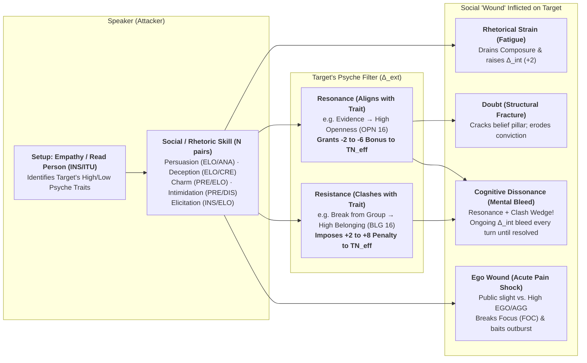

# Satya TTRPG Psyche, Morale & Social Combat

> **Rust Engine Implementation**: [`crates/satya-engine/src/psyche_social.rs`](../../../crates/satya-engine/src/psyche_social.rs) (`PsycheTraitId`, `PurposeStrength`, `PsychologicalDriveState`, `MotivationTier`, `CombatMoraleCondition`, `evaluate_psyche_friction`, `evaluate_conviction_surge`, `evaluate_psychological_drives`, `evaluate_aggression_escalation`, `evaluate_combat_morale_check`) and [`crates/satya-engine/src/social_combat.rs`](../../../crates/satya-engine/src/social_combat.rs) (`RhetoricalVector`, `SocialLeverageTier`, `CognitiveDissonanceTier`, `SocialExchangeInput`, `compute_social_dissonance_check`, `evaluate_social_combat_exchange`).

This chapter defines the canonical **Psyche Mechanics (Behavioral Friction, Trait Drift & Conviction Surges), Psychological Drives & Combat Morale, and Social Combat ("Mental Wounds" & Cognitive Dissonance)** for **Satya**. It builds directly upon:
- **[Mathematical Notation, Variables & Formula Glossary](../01-foundation/mathematical_notation_glossary.md)** (for definitions of all mathematical symbols and subscripts such as $\text{TN}_P, \text{TN}_{GM}, \Delta_{\text{psyche}}, \Delta_{\text{mot}}, C_{\text{morale}}, \text{CMP}$),
- **[Characteristics, Senses, Psyche & Aptitudes](../03-character/characteristics_and_aptitudes.md)** (for the Social Primary Characteristics `COM`, `PRE`, `ELO`, Mental Characteristics `MEM`, `ANA`, `INS`, `CRE`, `DIS`, `FOC`, and the seven Psyche Characteristics `EGO`, `SLF`, `OPN`, `BLG`, `EXT`, `CNF`, `AGG`),
- **[Skill System & Hierarchical Skill Trees](../03-character/skills_and_trees.md#38-tree-7-social-influence-interrogation--psychological-warfare-social-knowledge-fieldcraft)** (for Tree 7 Social, Influence & Interrogation skills), and
- **[Combat Architecture & Tactical Pools](../05-combat/tactical_triad_and_pools.md)** (where Morale states directly constrain Tactical Pool allocations across `Tempo`, `Control`, and `Force`).

---

## 1. Acting Against One's Psyche: Friction Checks & Trait Drift

While players always retain agency over their characters, acting in direct violation of a deeply ingrained **Psyche** trait ($P \ge 13$ or $P \le 7$; see **[Characteristics](../03-character/characteristics_and_aptitudes.md#7-psyche-the-invisible-traits)**) creates internal psychological friction.

### 1.1 When a Psyche Friction Check Triggers

The GM calls for a **Psyche Friction Check** when a character attempts a deliberate action that violently contradicts one of their extreme Psyche traits:
- A character with **High `Ego` (`EGO 16`)** willingly groveling, begging, or accepting public humiliation without retaliating.
- A character with **Low `Selfishness` (`SLF 4`)** abandoning an innocent bystander to die for a bag of cash.
- A character with **High `Conformity` (`CNF 16`)** falsifying evidence, breaking sacred protocol, or shooting a superior officer.
- A character with **Low `Aggressiveness` (`AGG 4`)** executing an unarmed captive in cold blood.
- A character with **High `Belongingness` (`BLG 16`)** informing on or betraying their own crew, faction, or family.

### 1.2 Resolving the Friction Check (`DIS` vs. Psyche Deviation)

1. Compute the trait's **Psyche Deviation** from neutral (`10`):
   $$\Delta_{\text{psyche}} = |P - 10|$$
2. The character rolls **Discipline (`DIS`)** (`N_P = 1` pair of `2d20`, or `N_P = 2` if trained in *Counter-Interrogation & Resistance (SERE)*) against their personal target $\text{TN}_P = 31 - \text{DIS}$, opposed by the GM's hidden **1-Pair Tiered Resistance Roll** against $\text{TN}_{GM} = 21 - \Delta_{\text{psyche}}$ (`4`-point over-tiers):
   $$\text{TN}_P = 31 - \text{DIS}, \qquad \text{TN}_{GM} = 21 - \Delta_{\text{psyche}}$$
3. **Contested Outcomes**:
   - **`CleanSuccess` / `ExtraordinarySuccess` ($S_P > S_{GM}$)**: Clean self-mastery. The character suppresses their nature and executes the action without hesitation.
   - **`PartialSuccess` (`GrazingTieSuccess`, `LuckyBreakSuccess`, or `SuccessWithFloorBreach`)**: The character forces themselves to go through with the act, but suffers **Internal Psychological Strain (`+2` to $\Delta_{\text{int}}$)** for the remainder of the scene as guilt, shame, or suppressed rage gnaws at their focus.
   - **`CleanFailure` / `BotchFailure`**: The character balks at the threshold—freezing for `6 ticks` on the Action Clock, pulling their punch, blurting telltale hesitation, or refusing to cross the line unless they spend a full turn steeling themselves at **`+4` to $\Delta_{\text{int}}$**.

### 1.3 Psyche Drift (How Behavior Reshapes Personality Over Time)

Personality in Satya is not static stone; it is shaped by lived choices and trauma:
- Whenever a character **overrides a Psyche trait** on a Friction Check (or is forced by a traumatic life event or coercive interrogation to violate it), they record **1 Drift Mark** alongside that Psyche trait.
- When **Drift Marks $= \max(2, \lfloor \text{DIS} / 4 \rfloor)$** (typically `3` marks), the character's Psyche score **permanently shifts by `1` point** toward the behavior they practiced (e.g., an idealistic rookie cop with `CNF 15, SLF 6` who repeatedly takes dirty money and plants evidence gradually drifts toward `CNF 11, SLF 10`).

---

## 2. Purpose, Principles & Conviction Surges (Pushing Past Limits)

Just as violating one's Psyche imposes friction, acting as a pure vessel of one's deepest **Psyche** drives or core **Principles** during a desperate crisis unlocks extraordinary reserves of resolve:

- **Triggering a Conviction Surge (Once per Scene / Session)**:
  When a battered or exhausted character ($\Delta_{\text{int}} \ge +4$) takes a high-stakes risk that directly embodies an extreme Psyche trait ($P \ge 15$ or $P \le 6$):
  - **Altruistic / Tribal Sacrifice (`BLG >= 15` or `SLF <= 5`)**: Holding a doorway under heavy fire so the rest of the team can escape.
  - **Unbowed Defiance (`AGG >= 15` or `EGO >= 15`)**: Refusing to stay down after taking a critical wound against a rival who mocked them.
  - **Iconoclastic Truth (`OPN >= 15` or `CNF <= 5`)**: Broadcasting a regime's classified war crimes while security forces breach the server room.
- **Mechanical Benefit**:
  For that decisive action (or combat exchange):
  1. Internal Fatigue and Wound Shock penalties ($\Delta_{\text{int}}$) are **reduced by `-6`** (allowing the character to reach the **Focused/Resolved** state of $\Delta_{\text{int}} = -2$, so $\delta_{\text{under}} = 4$).
  2. The character ignores the `action_time_factor` penalty from Fatigue and Wound Shock for that action and gains **`+2` to their Effective Tactical Pool ($P_{\text{eff}}$)**.

---

## 3. Psychological State of Combat, Aggression & Morale

Combat is greatly affected by the psychological state of the fighters. A combatant's mind and will to fight will often be defeated before their body.

### 3.1 Psychological Drives (`Harm:Other` vs. `Self:Protect`)

To model the psychological state of a character under fire, Satya tracks four dynamic drives anchored by **Discipline (`DIS`)** and the seven **Psyche Characteristics (`AGG`, `SLF`, `EGO`, `BLG`, `CNF`, `OPN`, `EXT`)**:

- **Fight (`Harm:Other`)**: How willing and driven you are to do harm (anchored by **Aggressiveness `AGG`** and situational motivation).
- **Preservation (`Self:Protect`)**: How needful you are to stay alive and unharmed (anchored by **Selfishness `SLF`** vs. **Belongingness `BLG`**).
- **Rage**: Acute adrenaline and emotional spike that surges `Harm:Other` while collapsing `Self:Protect` (capping **Control** and forcing pool points into **Force + Tempo**).
- **Fear**: Acute threat response that spikes `Self:Protect` while collapsing `Harm:Other` (capping **Force** and forcing pool points into **Control + Tempo**, or **Pure Tempo** in a rout).

### 3.2 Motivation & Psyche Alignment ($\Delta_{\text{mot}}$)

Fighters who have nothing to lose or are fighting for a cause greater than themselves are much harder to break than mercenaries fighting only for a paycheck. If a character's or unit's morale drops, the will to fight collapses and only defensive or self-preservation moves can be taken.

A combatant's situational **Motivation Modifier ($\Delta_{\text{mot}}$)** shifts their **Discipline (`DIS`)** Morale Checks and **Self-Preservation Threshold** based on how the fight aligns with their **Psyche**:
- **Fighting for Crew, Family, or Homeland (`BLG >= 14` or `SLF <= 6`)**: Grants **`-2` to `-4` to $\text{TN}_{\text{eff}}$** on all Morale checks and **`+2` to the Tactical Pool** during a **Conviction Surge** (e.g., holding a doorway so allies can escape).
- **Mercenary / Transactional Motive (`SLF >= 14` and `BLG <= 8`)**: Imposes **`+2` to `+4` to $\text{TN}_{\text{eff}}$** on Morale checks as soon as the character takes a wound (`wound_shock_index >= 1`) or the odds turn against them—they are fighting for money, not to die.
- **Sworn Duty / Chain of Command (`CNF >= 14`)**: Grants **`-2` to $\text{TN}_{\text{eff}}$** on Morale checks while a commanding officer is present and issuing orders, but imposes **`+4` Morale Shock** if command breaks down.

### 3.3 Aggressiveness (`Harm:Other / Self:Protect`) & Emotional Triggers

As Churchill famously said, *"It's not the size of the dog in the fight, but the size of the fight in the dog."* Conversely, some people are timid, meek, or conflict-averse, and either have no heart to harm others or are terrified of harm being done to themselves.

Essentially, aggressiveness is the ratio of **desire to do harm to others (`Harm:Other`)** versus **willingness to be harmed (`Self:Protect`)**. Notice the distinction between *desire* and *willingness*: a berserker has a high baseline `AGG`, whereas a cold professional assassin may be completely capable of killing without feeling emotional aggression unless triggered. If a character has a very low `Self:Protect` (`SLF <= 5`, `BLG >= 15`), they are willing to sacrifice themselves to achieve their goal.

#### How the Balance Changes Under Fire
Aggression starts from **Personality (`AGG` vs. `SLF`)** and **Situation** (e.g., hatred of a rival faction, sense of honor when an opponent is disadvantaged, or revulsion at innocent suffering), and shifts dynamically during combat. Whenever a psychological trigger occurs, the character makes a **Discipline (`DIS`) Composure Check** (`2d20` cascade with $\text{TN}_{\text{eff}} = 31 - \text{DIS} + \Delta_{\text{trigger}}$):

| Trigger | Controlling Check & Psyche Modifier | Effect on Failed `DIS` Check |
| :--- | :--- | :--- |
| **Being Wounded** | `DIS` check ($\Delta_{\text{ext}} = +2 \times \text{Wound Tier}$; `+2` harder if `SLF >= 13`, `-2` easier if `AGG >= 14`) | Shifts toward **Self:Protect** (**Wavering** morale, or **Rage** if `AGG >= 15` and `SLF <= 8`). |
| **Good Friend / Squadmate Wounded** | `DIS` check ($\Delta_{\text{ext}} = +2$ if `BLG >= 13`) | If `AGG >= 12`, triggers **Rage** against the attacker; if `AGG <= 8`, drops morale by `-1` step toward **Wavering**. |
| **Loved One Attacked or Wounded** | `DIS` check ($\Delta_{\text{ext}} = +4$ if `BLG >= 14` or `SLF <= 7`) | Immediate shift into **Vengeful Rage** (`+2` Pool, `Control` capped) or **Altruistic Conviction Surge** to shield them. |
| **Insulted or Taunted** | `DIS` check ($\Delta_{\text{ext}} = |\text{EGO} - 10|$ or $|\text{AGG} - 10|$) | If `EGO >= 13` or `AGG >= 13`, character is baited into **Aggressive / Rage** allocation (must commit to **Force + Tempo**). |
| **Publicly Humiliated** | `DIS` check ($\Delta_{\text{ext}} = +4$ if `EGO >= 14`) | Inflicts an **Ego Wound** (`+2` to $\Delta_{\text{int}}$) and triggers reckless **Rage** (`AGG >= 12`) or **Broken** withdrawal (`AGG <= 8`). |
| **Seeing Innocent Suffering** | `DIS` check (if `SLF <= 7`) | Lessens aggression toward surrendering foes, or triggers protective resolve against the perpetrator. |

#### Tactical Effects of Aggression vs. Timidity
- **High Aggression / Rage (`Harm:Other >> Self:Protect`)**: Grants an adrenaline surge (**`+2` to Tactical Pool** and ignores `-2` of pain shock), **but** imposes tunnel vision—you **must** allocate at least `50%` of your pool into **Force**, and your **Control (Guard & Precision)** is capped at $\le \lfloor P_{\text{eff}} / 4 \rfloor$. You become a terrifying blitz against a stunned or timid opponent, but walk straight into traps and counter-strikes against a composed master.
- **High Self-Protection / Timidity (`Self:Protect >> Harm:Other`)**: Preserves **Control (Guard/Cover)** and **Tempo (Escape)**, **but** caps **Force** ($\text{Force} \le \text{Control}$), making it difficult to finish an armored or braced opponent or push through suppressive fire.

---

### 3.4 Combat Morale, Tactical OODA Behavior & The Five Conditions of Morale

Having a character be automatically immune to fear cheapens heroism; nothing is valuable without the cost of overcoming fear.

#### Psyche & OODA Tactical Behavior Table
In physical firefights and melee engagements, NPCs and PCs under extreme shock make **Morale / Composure Checks** using **Discipline (`DIS`)** modified by their Psyche profile:

| Combat Situation | Relevant Psyche Traits | Mechanical Modifier to `DIS` Morale Check & AI GM Behavior |
| :--- | :--- | :--- |
| **Pinned by Heavy Suppressing Fire** | **`Aggressiveness (AGG)`** | **`AGG >= 14`**: `-2` to $\text{TN}_{\text{eff}}$ to push forward or return fire (`POWER` / `RANGED_SNAP` stance), but **`+4` to $\text{TN}_{\text{eff}}$** to retreat or stay hidden! **`AGG <= 7`**: Prefers `STABILITY` stance and full cover; will not advance into fire without a `DIS` override. |
| **Fighting Alongside Squad / Crew** | **`Belongingness (BLG)`** & **`Conformity (CNF)`** | **`BLG >= 14`**: Grants **`-2` to $\text{TN}_{\text{eff}}$** on all Morale checks while allies are within sight/comms. **Squad Leader Killed / Unit Routed**: High-`BLG` / High-`CNF` combatants suffer an immediate **`+6` Morale Shock** check! |
| **Outnumbered, Wounded, or Losing** | **`Selfishness (SLF)`** & **`Belongingness (BLG)`** | **`SLF >= 14` & `BLG <= 8`** (*Mercenary Survivor*): As soon as `wound_shock_index >= 2` or survival odds drop below `30%`, the NPC attempts to flee, surrender, or flip on their employer. **`SLF <= 6` & `BLG >= 14`** (*Fanatic / Protector*): Fights to the last breath to protect the group. |
| **Taunted, Challenged, or Insulted in Combat** | **`Ego (EGO)`** & **`Aggressiveness (AGG)`** | **`EGO >= 14` or `AGG >= 14`**: An opponent's *Intimidation* or *Deception (Taunt)* check gains a **`-4` Resonance bonus** to bait the character out of cover or into a reckless `POWER` strike. |

#### Circumstantial Morale Penalties ($\Delta_{\text{morale}}$)

| Battlefield Trigger | Morale Penalty ($\Delta_{\text{morale}}$) |
| :--- | :---: |
| **25% of your party/unit is down** | `+2` *(or `-1` step)* |
| **50% of your party/unit is down** | `+4` *(or `-2` steps)* |
| **75% of your party/unit is down** | `+6` *(or `-3` steps)* |
| **Outnumbered 2 to 1** | `+2` |
| **Outnumbered 3 to 1** | `+4` |
| **Outnumbered $> 4$ to 1** | `+6` |
| **Leader is unreachable / killed** | `+2` *(`+4` if `CNF >= 14`)* |
| **Headquarters / position is overrun** | `+6` |
| **Down to $\le 20\%$ ammunition** | `+4` |
| **Attacks are doing nothing (e.g., vs. heavy armor)** | `+6` |
| **Started the fight already Fatigued** | `+2` |

#### Base Morale & Rolling for Morale

A character's **Base Morale Controller ($C_{\text{morale}}$)** is anchored by their **Discipline (`DIS`, `1–20` scale)** plus their situational **Motivation Modifier ($\Delta_{\text{mot}}$)**:

$$C_{\text{morale}} = \text{DIS} + \Delta_{\text{mot}}$$

Whenever a Morale Trigger occurs, the character rolls a contested `2d20` cascade check (`N_P = 1` pair for civilians, `N_P = 2` for hardened combat veterans or characters trained in *SERE* / *Command*) against their personal target $\text{TN}_P = 31 - C_{\text{morale}}$, opposed by the GM's hidden **1-Pair Tiered Resistance Roll** against $\text{TN}_{GM} = 21 - \Delta_{\text{morale}}$ (`4`-point over-tiers):

$$\text{TN}_P = 31 - C_{\text{morale}}, \qquad \text{TN}_{GM} = 21 - \Delta_{\text{morale}}$$

- **`CleanSuccess` / `ExtraordinarySuccess` / `PartialSuccess` ($S_P \ge S_{GM}$ or `LuckyBreakSuccess`)**: The character holds their nerve and remains at their current Morale Condition (or rallies `+1` step on `ExtraordinarySuccess` with net margin $\Delta M \ge +2$).
- **`CleanFailure` ($S_P < S_{GM}$ with $M_P \ge 0$)**: Morale drops by **`1` Condition Step** (e.g., `Steady` $\to$ `Wavering`, or `Wavering` $\to$ `Broken`).
- **`BotchFailure` ($M_P < 0$)**: Morale drops by **`2` Condition Steps** (e.g., `Steady` $\to$ `Broken`, or `Wavering` $\to$ `Panic`).

#### The Five Conditions of Morale

| Morale Condition | Pool Mod ($\Delta P_{\text{morale}}$) | Tactical Triad (`Tempo / Control / Force`) Allocation Constraint | Behavioral Description |
| :--- | :---: | :--- | :--- |
| **1. High** | **`+2` Pool** | No restriction (`+1` to $F_{\max}$ or $T_{\max}$). | Eager and ready to take the fight to the enemy. |
| **2. Steady** | **`0` Pool** | Full freedom of allocation up to normal Aspect Ceilings. | Default composed state; equally capable of offense and defense. |
| **3. Wavering** | **`-2` Pool** | **Force cannot exceed Control ($F \le C$)**. | Doubt creeps in; switches to a cautious mode prioritizing cover/guard over commitment. |
| **4. Broken** | **`-4` Pool** | **Active offensive `Force = 0`** (`Control + Tempo` only). | Will to attack collapses; tries to disengage using cover, dodges, parries, or blind covering fire. |
| **5. Panic** | **`-4` Pool** | **`Control = 0` and `Force = 0`** (`100% Pure Tempo`). | Full-blown rout; turns back to the enemy (`Guard = 0`) and flees at maximum speed (or surrenders on a `DIS`/`INS` check if flight is hopeless). |

---

## 4. Social Combat, Debate & Cognitive Dissonance ("Mental Wounds")

Satya treats high-stakes debates, ideological arguments, courtroom cross-examinations, boardroom takeovers, and interrogations with the same tactical depth as physical firefights. Just as physical combat targets a body's structural integrity and blood volume, **Social Combat** targets a character's **Psyche** to inflict **Doubt**, **Ego Wounds**, and **Cognitive Dissonance**.

### 4.1 Reading the Target (`Empathy & Read Person` Setup)

Before launching a decisive argument, a skilled negotiator or manipulator sizes up their counterpart:
- Rolling **Empathy & Read Person** (`INS/ITU`) or **Investigative Elicitation** (`INS/ELO`) opposed by the target's **Deception** (`ELO/CRE`) or **Discipline** (`DIS`) reveals the target's most salient **Psyche poles**:
  - **`1` Success**: Reveals the target's single most extreme Psyche trait (e.g., `Belongingness 16`).
  - **`2` Successes**: Reveals two extreme Psyche traits (e.g., `Belongingness 16` and `Openness 16`) and whether they are in potential tension.
  - **`3+` Successes (`ExtraordinarySuccess`)**: Reveals the target's full Psyche profile and grants **`-2` to $\Delta_{\text{ext}}$** on the subsequent social maneuver.

---

### 4.2 Psyche Resonance vs. Resistance ($\Delta_{\text{ext}}$ Modifiers)

When a speaker makes a Social skill roll to convince, sway, or pressure a target, the GM compares the **nature of the argument** against the target's **Psyche**:

| Argument Vector / Appeal Type | Primary Skill (`Control`) | Resonates With ($\Delta_{\text{ext}}$ Bonus) | Clashes With ($\Delta_{\text{ext}}$ Penalty) |
| :--- | :--- | :--- | :--- |
| **Empirical Evidence, Logic & Novel Ideas** | *Persuasion & Rhetoric* (`ELO/ANA`) | **High `Openness` (`OPN >= 13`)**: $\Delta_{\text{ext}} = -(\text{OPN} - 10)$ | **Low `Openness` (`OPN <= 7`)**: $\Delta_{\text{ext}} = +(10 - \text{OPN})$ |
| **Group Consensus, Loyalty & Shared Identity** | *Persuasion* (`ELO/INS`) or *Charm* (`PRE/ELO`) | **High `Belongingness` (`BLG >= 13`)**: $\Delta_{\text{ext}} = -(\text{BLG} - 10)$ | **Low `Belongingness` (`BLG <= 7`)** *(or asking High `BLG` to betray their group: $+(\text{BLG} - 10)$)* |
| **Flattery, Prestige, Legacy & Status** | *Charm* (`PRE/ELO`) or *Deception* (`ELO/CRE`) | **High `Ego` (`EGO >= 13`)**: $\Delta_{\text{ext}} = -(\text{EGO} - 10)$ | **Humiliation / Admitting Fault vs. High `Ego`**: $\Delta_{\text{ext}} = +(\text{EGO} - 10)$ |
| **Personal Profit, Immunity & Self-Interest** | *Negotiation* (`ELO/INS`) or *Bribery* | **High `Selfishness` (`SLF >= 13`)**: $\Delta_{\text{ext}} = -(\text{SLF} - 10)$ | **Low `Selfishness` (`SLF <= 7`)**: $\Delta_{\text{ext}} = +(10 - \text{SLF})$ |
| **Self-Sacrifice, Humanitarian Duty & Mercy** | *Persuasion* (`ELO/INS`) | **Low `Selfishness` (`SLF <= 7`)**: $\Delta_{\text{ext}} = -(10 - \text{SLF})$ | **High `Selfishness` (`SLF >= 13`)**: $\Delta_{\text{ext}} = +(\text{SLF} - 10)$ |
| **Rules, Law, Protocol & Chain of Command** | *Diplomacy* / *Command* (`PRE/DIS`) | **High `Conformity` (`CNF >= 13`)**: $\Delta_{\text{ext}} = -(\text{CNF} - 10)$ | **Low `Conformity` (`CNF <= 7`)** *(or asking High `CNF` to break the law: $+(\text{CNF} - 10)$)* |
| **Dominance, Threat, Dare & Confrontation** | *Intimidation* (`PRE/DIS`) | **Low `Aggressiveness` (`AGG <= 7`)** *(yields)* or **High `AGG`** *(to bait into a fight)* | **High `Aggressiveness` (`AGG >= 13`)** *(when trying to force submission: $+(\text{AGG} - 10)$)* |

---

### 4.3 The Four Social "Wound" Types: Composure, Doubt, Cognitive Dissonance & Ego Wounds

In an extended debate or social duel, each participant has a **Social Composure Threshold (`CMP`)** equal to:

$$\text{CMP} = \left\lfloor \frac{\text{DIS} + \text{FOC}}{4} \right\rfloor$$

(typically **`5`** at human average `DIS 10, FOC 10`). Opposed social exchanges inflict four distinct psychological conditions that mirror Satya's [physical trauma system](../06-health-and-survival/health_and_trauma.md):

| Social Wound Type | Physical Equivalent | How It Is Inflicted | Mechanical Effect on the Target |
| :--- | :--- | :--- | :--- |
| **1. Rhetorical Strain (Composure Loss)** | **Fatigue (`fatigue_level`)** | Inflicted by any exchange where the speaker scores **`+1` net success** over the target's defense. | Reduces Composure by `1` and increases the target's internal difficulty **$\Delta_{\text{int}}$ by `+2`** ($\delta_{\text{under}} = 6 + \Delta_{\text{int}}$) as they become flustered and defensive. |
| **2. Doubt (Conviction Fracture)** | **Structural Fracture (Broken Bone)** | Inflicted when the speaker scores **`+2+` net successes** with a logical, evidentiary, or empathetic argument (*Persuasion*, *Negotiation*, *Elicitation*). | **Fractures 1 Pillar of Conviction.** Reduces the target's effective Skill Level $N$ by **`-1` pair** when arguing that point. Accumulating **3 Doubt fractures** demolishes the target's position and convinces them of the speaker's thesis. |
| **3. Cognitive Dissonance ("Mental Bleed")** | **Arterial Hemorrhage / Bleeding** | Inflicted when a successful argument **simultaneously resonates with one high Psyche trait ($P_1 \ge 13$) while clashing with another high Psyche trait ($P_2 \ge 13$)**! | **Active Psychological Bleed (`dissonance_index += 1`)**. Pits two of the target's core drives against each other. Deals **`+2` $\Delta_{\text{int}}$ per turn/scene** (compounding with every exchange) until the target resolves the contradiction! |
| **4. Ego Wound (Narcissistic Shock)** | **Acute Pain / Wound Shock** | Inflicted when a speaker scores **`+2+` net successes** using mockery, public refutation, or dominance against a target with **`EGO >= 13` or `AGG >= 13`**. | Target must immediately pass a **`DIS` check** ($\text{TN} = 31 - \text{DIS} + (\text{EGO} - 10)$) or lose **`-3` Focus (`FOC`)**, abandon defensive caution, and lash out (blurting secrets in prideful anger or escalating to violence). |

---

### 4.4 Worked Example of Cognitive Dissonance: High `Openness` vs. High `Belongingness`

Consider an NPC scientist or mid-level syndicate lieutenant, **Marcus**:
- **Marcus's Relevant Psyche Profile**:
  - **`Openness (OPN) = 16`** *(Deeply curious, respects hard evidence and rational merit; Resonance `-6` to logical proof).*
  - **`Belongingness (BLG) = 16`** *(Deeply attached to his faction/peer group; Resistance `+6` against any belief that would alienate him from his peers).*
  - **`Discipline (DIS) = 11`**, **`Focus (FOC) = 11`** (`Composure Threshold = 5`).
- **The Debate Exchange**:
  1. The player character, **Nadia**, wants to convince Marcus that his faction's leadership falsified clinical trial data and is knowingly killing patients—a belief that Marcus's entire peer group fiercely denies.
  2. Nadia presents undeniable forensic logs and biochemical proof using **Persuasion & Rhetoric (`ELO/ANA`)**.
  3. **The Dual-Psyche Wedge**:
     - Because the evidence has undeniable intellectual merit, it **resonates with Marcus's `Openness 16`** ($\Delta_{\text{ext, res}} = -6$).
     - Because accepting this truth means turning against his tribe and facing total ostracism, it **clashes with Marcus's `Belongingness 16`** ($\Delta_{\text{ext, clash}} = +6$).
     - The two modifiers cancel to $\Delta_{\text{ext}} = 0$ on the initial roll—**but the wedge is armed!**
  4. Nadia rolls her cascade and scores **`2` net successes** over Marcus's counter-argument.
  5. **The Result — Severe Cognitive Dissonance**:
     - Marcus takes **1 Doubt fracture** AND **2 stacks of Cognitive Dissonance (`dissonance_index = 2`)**.
     - Inside Marcus's mind, his `Openness 16` knows Nadia's data is real, while his `Belongingness 16` is terrified of being cast out by his friends and colleagues.
     - At the start of the next exchange, the Cognitive Dissonance bleeds for **`+4` $\Delta_{\text{int}}$** ($\delta_{\text{under}}$ jumps from `6` to `10`), making it nearly impossible for Marcus to mount a coherent defense if he misses Pair 1.
     - **How Marcus Resolves the Dissonance**: To stop the psychological bleeding, Marcus is forced into one of four **Dissonance Resolution Paths**:
       1. **Conversion / Defection (`Openness` Wins)**: If Nadia follows up with **Charm & Rapport (`PRE/ELO`)** or offers him a new community of truth-seekers (soothing his `Belongingness`), Marcus **converts**—handing over the master encryption keys and drifting his `BLG` toward Nadia's group.
       2. **Dogmatic Denial (`Belongingness` Wins)**: If Nadia instead insults his colleagues (triggering a defensive tribal reaction), Marcus slams the door in **Dogmatic Denial**, clearing the dissonance by permanently burning a point of his own `Openness` (`OPN 16 -> 15`) via Drift to protect his tribal identity!
       3. **Compartmentalization (Secret Informant)**: Marcus outwardly conforms to his group while secretly leaking data to Nadia (`+4` $\Delta_{\text{int}}$ whenever forced to act against his conscience).
       4. **Emotional Lashing Out**: If pushed while high in `AGG` or `EGO`, Marcus snaps to silence the source of his inner torment.
