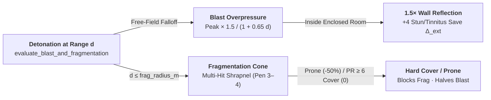

# Expanded Arsenal, Explosives, Breaching & Tactical Gear (`2035`)

> **Rust Engine Implementation**: [`crates/satya-engine/src/explosives_and_arsenal.rs`](../../../crates/satya-engine/src/explosives_and_arsenal.rs) (`ShotgunLoadId`, `SHOTGUN_LOAD_CATALOG`, `NonFirearmWeaponId`, `NON_FIREARM_WEAPON_CATALOG`, `evaluate_less_lethal_exposure`, `ExplosiveOrdnanceId`, `EXPLOSIVE_ORDNANCE_CATALOG`, `evaluate_blast_and_fragmentation`, `evaluate_explosive_breach`, `TacticalOpticOrGearId`, `TACTICAL_OPTICS_GEAR_CATALOG`), [`crates/satya-engine/src/ballistics.rs`](../../../crates/satya-engine/src/ballistics.rs) (`17` canonical firearms across `17` calibers), and [`crates/satya-engine/src/barrier_ballistics.rs`](../../../crates/satya-engine/src/barrier_ballistics.rs) (`MaterialClass` $\text{PR}_{\text{barrier}}$).  
> **Companion Chapters**: [Firearm Engineering & Ballistics (`firearms_and_ballistics.md`)](firearms_and_ballistics.md) · [Ranged Combat & Armor (`ranged_combat_and_armor.md`)](ranged_combat_and_armor.md) · [Melee Weapons & Shields (`melee_combat.md`)](melee_combat.md#4-melee-weapons-reach-tiers--base-action-costs-tc).

Every firearm, specialty shotgun load, bow, less-lethal launcher, grenade, breaching charge, and weapon optic in this chapter obeys the exact same thermochemical, ballistic, armor-penetration (`PR` vs. `BABT`), and Count-Up Clock physics established in Chapters 16–17.

---

## 1. Expanded Firearms, Specialty Calibers & Shotgun Loads

### 1.1 Six Additional Calibers (`.22 LR` through `.300 BLK` & Magnum)

In addition to the 11 core calibers in [Firearm Engineering & Ballistics](firearms_and_ballistics.md#3-ammunition-architecture--internalexternal-ballistics), `ballistics.rs` (`AmmoCaliberId`) models six covert, backcountry, and PDW chamberings:

| Caliber (`AmmoCaliberId`) | Diameter ($d_{\text{cal}}$) | Proj. Mass ($m_{\text{proj}}$) | Powder ($m_{\text{prop}}$) | $L_{\text{opt}}$ | $E_{\text{chem}}$ / Decay | Operational Role |
| :--- | :---: | :---: | :---: | :---: | :---: | :--- |
| **`.22 LR` Subsonic (`Rimfire22Lr`)** | `5.6 mm` | `40 gr` | `1.8 gr` | `40.0 cm` | `180 J` / `130 m` | Whisper-quiet suppressed Sentry/Dog neutralizer (`-10 HEA`, weak vs armor). |
| **`.380 ACP` (`Acp380`)** | `9.0 mm` | `95 gr` | `3.2 gr` | `9.5 cm` | `275 J` / `140 m` | Pocket deep-concealment backup pistols; sharp blowback snap (`OAL 15.5 cm`). |
| **`10mm Auto` (`Auto10mm`)** | `10.0 mm` | `180 gr` | `9.2 gr` | `12.7 cm` | `880 J` / `210 m` | High-impulse woods defense & heavy barrier pistol (defeats windshields/bears). |
| **`4.6×30mm` HK AP (`Hk46x30`)** | `4.6 mm` | `31 gr` | `6.8 gr` | `18.0 cm` | `520 J` / `240 m` | Ultra-high-velocity hardened steel PDW dart (`+3 SD Pen`); defeats NIJ IIIA Kevlar (`Pen 6`). |
| **`.300 BLK` Subsonic (`Blackout300Subsonic`)** | `7.62 mm` | `220 gr` | `10.5 gr` | `22.9 cm` | `680 J` / `320 m` | Subsonic suppressed CQB (`< 315 m/s`, zero supersonic crack); heavy `220 gr` momentum. |
| **`.300 BLK` Supersonic (`Blackout300Supersonic`)** | `7.62 mm` | `110 gr` | `19.5 gr` | `22.9 cm` | `1,840 J` / `460 m` | Carbine-power out of a tiny `22.9 cm (9")` barrel with same lower/mag as `5.56mm`. |

### 1.2 Ten Expanded Benchmark Firearms (`#13–#22` Extending Chapter 17)

Every model below is registered in `CANONICAL_FIREARM_PRESETS` (`lookup_firearm_preset`):

| Preset Slug & Model | Caliber & Action | Feed (`Cap`) | Weight (`Loaded`) | `OAL / Barrel` | $\text{Acc}$ / $\text{Rel}$ | Impact / `Pen` / Recoil | Cost (`USD`) & `[Access]` |
| :--- | :--- | :---: | :---: | :---: | :---: | :---: | :--- |
| **`ruger_mk4_suppressed_22lr`** Ruger Mk IV Covert `.22 LR` | `.22 LR` · `SA` Integrally Suppressed | Box `10 rds` | `1.05 kg` | `28.0 / 14.0 cm` | **`+2 Acc`** / **`+2 Rel`** | Impact `3` / `Pen 1` / **`R 1`** | `$1,150` (`[Class II]`) |
| **`walther_ppk_380`** Walther PPK/S `.380 ACP` | `.380 ACP` · Delayed Blowback | Box `7 rds` | `0.68 kg` | `15.5 / 8.3 cm` | `-1 Acc` / `+1 Rel` | Impact `5` / `Pen 1` / `R 2` | `$680` (`[Class I]`) |
| **`glock20_10mm`** Glock 20 Gen5 `10mm Auto` | `10mm Auto` · Striker-Fired | Box `15 rds` | `1.15 kg` | `20.5 / 11.7 cm` | `+1 Acc` / `+2 Rel` | **Impact `7`** / `Pen 4` / **`R 5`** | `$720` (`[Class I]`) |
| **`mp7a2_46x30`** HK MP7A2 PDW `4.6×30mm` | `4.6×30mm` · Short-Stroke + Sup | Box `40 rds` | `2.25 kg` | `41.5 / 18.0 cm` | **`+2 Acc`** / **`+3 Rel`** | Impact `5` / **`Pen 6` (vs IIIA)** / `R 2` | `$2,450` (`[Class III]`) |
| **`honey_badger_300blk_sub`** Q Honey Badger `.300 BLK` Sub | `.300 BLK Sub` · `DI` + Integral Sup | Box `30 rds` | `2.65 kg` | `64.0 / 17.8 cm` | **`+2 Acc`** / `+1 Rel` | Impact `5` / `Pen 4` / **`R 2`** *(Quiet)* | `$3,300` (`[Class III]`) |
| **`mcx_rattler_300blk_super`** SIG MCX Rattler `.300 BLK` Super | `.300 BLK Super` · Short-Stroke | Box `30 rds` | `3.20 kg` | `60.0 / 22.9 cm` | **`+2 Acc`** / **`+3 Rel`** | **Impact `8`** / `Pen 6` / `R 4` | `$2,950` (`[Class III]`) |
| **`saiga12_mag_shotgun`** Saiga-12K Mag-Fed Semi Shotgun | `12-Gauge` · Long-Stroke Piston | Box `10 rds` | `4.45 kg` | `94.0 / 48.0 cm` | `-1 Acc` / **`+3 Rel`** | Impact `11` / `Pen 3–5` / `R 6` | `$1,450` (`[Class II]`) |
| **`m249_saw_556`** FN M249 SAW Squad Automatic | `5.56×45mm` · Open-Bolt Belt | **Belt `200 rds`** | `10.20 kg` | `104.0 / 46.5 cm` | `-1 Acc` / `+1 Rel` | Impact `8` / `Pen 5` / `R 5` (`R 8` burst) | `$6,200` (`[Class III/IV]`) |
| **`trg42_338_lapua`** Sako TRG-42 `.338 Lapua` | `.338 Lapua` · Bolt + Muzzle Brake | Box `5 rds` | `6.40 kg` | `120.0 / 69.0 cm` | **`+4 Acc`** / **`+2 Rel`** | **Impact `10`** / **`Pen 10`** / `R 6` | `$7,800` (`[Class II/III]`) |
| **`barrett_m107_50bmg`** Barrett M107A1 `.50 BMG` | `.50 BMG` · Recoiling Short-Stroke | Box `10 rds` | `15.20 kg` | `144.8 / 73.7 cm` | **`+2 Acc`** / `+2 Rel` | **Impact `12`** / **`Pen 12+`** / **`R 8`** | `$13,500` (`[Class III/IV]`) |

### 1.3 Specialty `12-Gauge` Shotgun Loads (`ShotgunLoadId`)

Any `12-Gauge` shotgun (`Benelli M4`, `Remington 870`, `Saiga-12K`) swaps terminal performance by shell (`SHOTGUN_LOAD_CATALOG`):

| Shell Load (`ShotgunLoadId`) | Type | Raw Impact | `Base Pen` | Eff. Range | Close $\Delta_{\text{ext}}$ / `Rel` Mod | Cost per `10 rds` | Special Ballistic Rule |
| :--- | :---: | :---: | :---: | :---: | :---: | :---: | :--- |
| **`Buckshot00`** *(9-Pellet Lead)* | Ballistic | **`11`** | `3` | `35 m` | **`-2`** (`<= 15 m`) / `0` | `$15` | Spread bonus at CQB; loses `-3 Impact / 10m` past `15 m`. |
| **`RifledFosterSlug`** *(1 oz Lead)* | Ballistic | **`10`** | **`5`** | `100 m` | `0` / `0` | `$22` | Single massive `437 gr` slug; shatters ribs cleanly through `NIJ IIIA` (`BABT 8`!). |
| **`BreacherFrangibleLockBuster`** | Blunt | `8` | **`6`** *(vs Locks)* | **`3 m`** | `-2` / `0` | `$45` | Sintered zinc dust turns locks/hinges to powder at muzzle contact without dangerous ricochet! |
| **`DragonsBreathIncendiary`** | Ballistic | `6` | `1` | `20 m` | **`-4`** / **`-2`** | `$75` | Magnesium sparks ignite flammables (`Burn` check on hit); heavy barrel fouling (`-2 Rel`). |
| **`BeanbagLessLethal`** | Blunt | `7` | `0` | `25 m` | `0` / `-1` | `$40` | Pure blunt shock; triggers Less-Lethal knockdown check (lethal only to head/neck `[19–20]` `< 5 m`). |

---

## 2. Muscle-Powered & Less-Lethal Weapons (`NonFirearmWeaponId`)

Silent hunting arms and 2035 compliance tools operate without gunpowder signatures (`NON_FIREARM_WEAPON_CATALOG`):

| System (`NonFirearmWeaponId`) | Damage Type | Impact / `Pen` | Range / Min `FOR` | `Base TC` / Reload | Acoustic (`HEA`) | Mass / Cost & `[Access]` | Notes |
| :--- | :---: | :---: | :---: | :---: | :---: | :---: | :--- |
| **`CompoundBow70Lb`** *(Broadhead)* | `Edged` | `7` / **`3`** | `65 m` / `FOR 11` | `11` / `10 Ticks` | **`-10 HEA`** | `1.95 kg` · `$950` (`[Class I]`) | Defeats soft Kevlar better than pistol bullets (`PR_Edged` only)! |
| **`TacticalCrossbow`** | `Icepick` | `7` / **`4`** | `75 m` / `FOR 9` | `9` / **`24 Ticks`** | **`-9 HEA`** | `3.10 kg` · `$1,200` (`[Class I]`) | Slow crank reload (`6.0s`), but targets armor weave at `PR_Icepick`! |
| **`PcpAirRifleSuppressed`** *(.357 PCP)* | `Ballistic` | `5` / `2` | `90 m` / `FOR 8` | `10` / `12 Ticks` | **`-11 HEA`** | `3.40 kg` · `$1,450` (`[Class I]`) | Compressed-air bolt rifle (`10-rd` rotary mag); near-silent subsonic sentry dropper. |
| **`TaserCewDualProbe`** *(X10 Dart)* | `Blunt` | `2` / `1` | `10 m` / `FOR 6` | `7` / `14 Ticks` | `-6 HEA` | `0.42 kg` · `$1,100` (`[Class II]`) | Stopped completely if target wears `PR_Ballistic >= 2`; otherwise triggers neuromuscular save. |
| **`OcPepperSprayStream`** | `Blunt` | `0` / `0` | `4.5 m` / `FOR 5` | **`6`** / `0` | `-8 HEA` | `0.14 kg` · `$35` (`[Class I]`) | Blocked completely by sealed goggles/gas mask (`mitigated_by_ppe_or_armor`). |
| **`Baton40MmSpongeRound`** | `Blunt` | **`8`** | `45 m` / `FOR 9` | `9` / `16 Ticks` | `-2 HEA` | `2.30 kg` · `$1,850` (`[Class II]`) | Transfers `BABT` straight through soft armor (`+8` Brutal Knockdown check). |

- **Incapacitation Saves (`evaluate_less_lethal_exposure`)**: Unarmored targets struck by TASER probes, OC spray, or 40mm sponge batons roll **`HLT / DIS`** (or `FIT / DIS`) vs. hidden GM difficulty (`Base + 2 × attacker_net_successes`):
  - `ExtraordinarySuccess`: Shrugs off cleanly (`0` penalty).
  - `CleanSuccess`: Brief flinch (`+1` $\Delta_{\text{int}}$).
  - `GrazingTie` / `FloorBreach`: `+2` $\Delta_{\text{int}}$ and `4 Ticks` OODA stutter.
  - `CleanFailure`: `+4` $\Delta_{\text{int}}$, `8 Ticks` freeze (`Blinded` or winded knockdown).
  - `BotchFailure`: **Full `20-Tick` (`5.0s`) Neuromuscular Lockout** (`triad_locked_zero = true`) or acute choking blindness!

---

## 3. Explosives, Blast Overpressure, Fragmentation & Tactical Breaching

Explosive ordnance separates **Blast Overpressure** (crushing lungs/eardrums indoors), **High-Velocity Fragmentation Cones** (stopped by hard cover and `NIJ IIIA+` vests), and **Directed Shaped Breaching Jets** (`EXPLOSIVE_ORDNANCE_CATALOG`):

| Ordnance (`ExplosiveOrdnanceId`) | `TNT` Eq. | Peak Blast Trauma | Frag Radius / Hits (`3 m`) | Frag `Pen / Imp` | Breach `PR` | Stun $\Delta_{\text{ext}}$ | Mass / Cost (`[Access]`) | Tactical Effect |
| :--- | :---: | :---: | :---: | :---: | :---: | :---: | :--- | :--- |
| **`M67FragmentationGrenade`** | `0.24 kg` | `9` | **`15.0 m`** (`4 hits`) | `Pen 3` / `Imp 6` | `4` | `+4` | `0.40 kg` · `$150` (`[Class III]`) | Lethal fragmentation bowl; `PR 6+` wall blocks 100% of splinters. |
| **`Mk3A2ConcussionGrenade`** | `0.23 kg` | **`11`** | `2.0 m` (`0 hits`) | `0` / `0` | `5` | `+6` | `0.44 kg` · `$180` (`[Class III]`) | Pure shockwave for CQB rooms—crushes lungs & ruptures eardrums indoors (`1.5×`). |
| **`M84FlashbangStunGrenade`** | `0.01 kg` | `1` | `7.0 m` (`0 hits`) | `0` / `0` | `0` | **`+6`** | `0.24 kg` · `$120` (`[Class II]`) | `20 Ticks` (`5s`) `Blinded` + `Tinnitus` outdoors; **`32 Ticks` indoors**! |
| **`SmokeScreeningGrenadeIr`** | `0.00 kg` | `0` | `12.0 m` | `0` / `0` | `0` | `0` | `0.54 kg` · `$95` (`[Class I]`) | Brass/graphite multispectral smoke blocks **both visual (`+8`) AND Thermal/FLIR optics**! |
| **`ThermiteIncendiaryCharge`** | `0.00 kg` | `0` | `2.0 m` | Melt `10` | **`10`** | `0` | `0.90 kg` · `$450` (`[Class III]`) | `2,200°C` silent slag cuts steel hinges, vehicle engine blocks, and drives (`2 m` safe standoff). |
| **`C4SemtexBlock500g`** | `0.67 kg` | **`14`** | `12.0 m` (`3 hits`) | `Pen 4` / `Imp 7` | **`10`** | **`+8`** | `0.55 kg` · `$800` (`[Class III]`) | High-order demolition; **`8.0 m`** minimum friendly standoff against backblast! |
| **`LinearShapedBreachingCharge`** | `0.16 kg` | `8` | `3.0 m` (`1 hit`) | `Pen 4` / `Imp 6` | **`10`** | `+6` | `0.45 kg` · `$1,100` (`[Class III]`) | Focused copper liner slices `SheetSteel` (`PR 3`) to `ArmorSteel` (`PR 10`) doors at just **`3.0 m` standoff** while stunning room defenders (`12 Ticks`)! |

### 3.1 Tactical Breaching (`evaluate_explosive_breach`)

1. Compare **`Effective Breach PR = Spec Breach PR + max(0, Demolitions Net Successes)`** against the barrier's **`MaterialClass` `PR_barrier`** (`barrier_ballistics.rs`): if `Effective Breach PR >= barrier_pr`, the door or wall opens cleanly on detonation.
2. Breachers standing closer than **`safe_standoff_m`** (`3.0 m` linear shaped charge, `2.0 m` thermite, `8.0 m` `500g C4`, `6.0 m` grenades) suffer full backblast (`friendly_caught_in_backblast = true`).
3. Clean explosive breaches into an enclosed interior immediately slap occupants inside `4 m` with **`12 Ticks` (`3.0s`)** overpressure stun—opening a surgical OODA entry window.

---

## 4. Optics, Ballistic Computers & Tactical Field Gear (`TacticalOpticOrGearId`)

| Equipment (`TacticalOpticOrGearId`) | Aim $\Delta_{\text{tool}}$ | CQB Snap $\Delta_{\text{tool}}$ | Recoil Mod | EMP Vulnerable? | Mass / Cost (`[Access]`) | Operational Mechanics |
| :--- | :---: | :---: | :---: | :---: | :--- | :--- |
| **`MicroRedDotReflex`** | **`-2`** | **`-2`** | `0` | **Yes** | `0.05 kg` · `$550` (`[Class I]`) | Crisp parallax-free red dot for pistols and CQB carbines. |
| **`Lpvo1To8VariableOptic`** | **`-2`** | **`-1`** | `0` | **No** *(Etched)* | `0.58 kg` · `$1,900` (`[Class I]`) | Etched first-focal glass works dead-battery/post-EMP; toggle magnification (`2 Ticks`). |
| **`PrecisionLongRangeScope5To25`** | **`-3`** | **`+4`** *(Penalty)* | `0` | **No** *(Etched)* | `0.96 kg` · `$3,400` (`[Class I]`) | Heavy magnification eliminates distant aiming error; tight eyebox punishes `< 25 m` snapshots. |
| **`SmartBallisticComputerScope2035`** | **`-4`** | **`+2`** | `0` | **Yes** *(Drops to `-1`)* | `1.15 kg` · `$6,800` (`[Class II]`) | Integrated laser rangefinder + crosswind LiDAR auto-adjusts holdover (`-4` $\Delta_{\text{tool}}$). |
| **`ClipOnThermalFlirWeaponSight`** | **`-2`** | `+1` | `0` | **Yes** | `0.72 kg` · `$8,500` (`[Class III]`) | Cuts pitch blackness and non-IR smoke (`+0`), defeated only by thermal cloaks or IR smoke! |
| **`IrLaserDesignatorPeq`** | `-1` | **`-2`** | `0` | **Yes** | `0.21 kg` · `$2,200` (`[Class II]`) | Passive aiming through **Gen-3+ NVGs** (`-2` CQB), but visible IR laser beam betrays shooter to rival NVGs! |
| **`BipodOrShootingTripod`** | **`-2`** | `+2` | **`-3`** | **No** | `0.45 kg` · `$420` (`[Class I]`) | Cuts weapon recoil by **`-3`** and grants `-2` stability once braced in prone or on cover. |
| **`HydraulicBreachingKitAndMirror`** | **`-2`** | `0` | `0` | **No** | `7.40 kg` · `$3,600` (`[Class II]`) | Silent zero-blast hydraulic door spreader + under-door fiber camera (`-2` Observation sweep). |

> [!EXAMPLE] At the Table: Linear Shaped Breach & `.300 BLK` Suppressed Entry
> A four-operator entry team stacks outside a locked **`SheetSteel` security door (`PR 3`)** at **`3.5 m` standoff** (`> 3.0 m` safe line) using a **`LinearShapedBreachingCharge` (`Breach PR 10 >= 3`)**. Zero friendly backblast hits the stack; inside the `4×4 m` server room, the **`Mk3A2`/`LinearShaped` shockwave (`1.5×` indoor reflection)** slaps two unarmored security techs with **`+10` stun save $\Delta_{\text{ext}}$** and **`12 Ticks` (`3.0s`)** of OODA disorientation. Point man steps in with an **`MCX` / `Honey Badger` `.300 BLK` Suppressed Carbine** (`R = 2`) and **`MicroRedDotReflex` (`-2` CQB Snap)** before the defenders clear `Tinnitus`!
