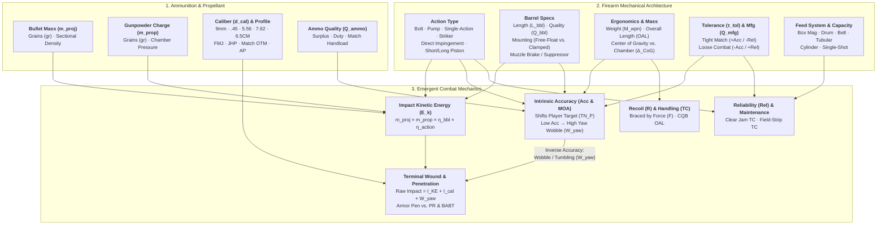

# Satya TTRPG Granular Ballistics, Ammunition Physics & Firearm Engineering

> **Rust Engine Implementation**: [`crates/satya-engine/src/ballistics.rs`](../../../crates/satya-engine/src/ballistics.rs) (`AmmoCaliber`, `BulletConstruction`, `AmmoQuality`, `MuzzleAttachment`, `FirearmActionType`, `FeedMechanism`, `CenterOfGravityProfile`, `BarrelQualityTier`, `BarrelMountType`, `ToleranceSpec`, `ManufacturingQuality`, `CartridgeBallisticSpec`, `GranularFirearmSpec`, `compute_impact_kinetic_energy_joules`, `evaluate_firearm_ballistics`). Companion chapter to **[Ranged Combat, Weapon Reliability, Master Catalogs & Armor (`ranged_combat_and_armor.md`)](ranged_combat_and_armor.md)**.

This chapter defines the canonical rules for **Ranged Firefights, Internal/External/Terminal Ballistics, Granular Firearm Engineering, Ammunition Physics, Weapon Reliability (`Rel`), and Body Armor (`PR` vs. Behind-Armor Blunt Trauma `BABT`)** in **Satya**. It builds directly upon:
- **[Mathematical Notation, Variables & Formula Glossary](../01-foundation/mathematical_notation_glossary.md)** (for all mathematical variables and ballistics/combat symbols $E_k, m_{\text{proj}}, m_{\text{prop}}, L_{\text{bbl}}, \text{OAL}, M_{\text{wpn}}, \Delta_{\text{CoG}}, \tau_{\text{tol}}, \text{Acc}, W_{\text{yaw}}, \text{Pen}, R, \text{PR}_{\text{Edged}}, \text{PR}_{\text{Ballistic}}, \text{BABT}, \text{Rel}$),
- **[Combat Architecture, Tactical Triad & Pools](tactical_triad_and_pools.md)** (for the "Envelope & Fill" Tactical Pool $P_{\text{base}} = C_{\text{combat}} + 3N$),
- **[Psyche, Morale & Social Combat](../04-psyche-and-social/psyche_morale_and_social_combat.md#34-combat-morale-tactical-ooda-behavior--the-five-conditions-of-morale)** (for Suppression Morale Checks and the Five Conditions of Morale), and
- **[Health, Anatomical Trauma, Fatigue & Mental Conditions](../06-health-and-survival/health_and_trauma.md)** (for Hit Locations, Called Shots, Structural Wounds, and Hemorrhaging).

---

## 1. Why Guns Don't Feel the Same in Satya: Granular Engineering Architecture

In most tabletop RPGs, firearms are reduced to interchangeable reskins of the same stat block (`1d8` or `2d6` damage, a flat range increment, and a magazine size). A cheap street-printed `9mm` pistol, a match-grade competition handgun, a loose-tolerance stamped `7.62×39mm` AKM, and a free-floated direct-impingement `5.56mm` carbine feel virtually identical at the table.

**Satya rejects generic weapon dice.** Every firearm is a physical machine governed by **four coupled engineering causal chains**:
1. **Internal & External Ballistics ($\to$ Kinetic Energy $E_k$)**: How projectile mass ($m_{\text{proj}}$), gunpowder charge ($m_{\text{prop}}$ in grains), barrel length ($L_{\text{bbl}}$), muzzle devices (suppressors, muzzle brakes), and the action's gas seal ($\eta_{\text{action}}$) generate muzzle velocity and retain kinetic energy downrange.
2. **Terminal Ballistics ($\to$ Trauma Magnitude, Penetration & Wound Channels)**: How impact kinetic energy ($E_k$), projectile caliber ($d_{\text{cal}}$), bullet construction, and **inverse accuracy / projectile wobble ($W_{\text{yaw}}$)** interact with armor plates (`Pen` vs. `PR` & `BABT`) and soft tissue (permanent crush cavity, hydrostatic shock, and erratic tumbling/keyholing wound channels).
3. **Mechanical & Ergonomic Engineering ($\to$ Accuracy $\text{Acc}$, Recoil $R$, & Handling `TC`)**: How action type, weapon weight ($M_{\text{wpn}}$), Center of Gravity relative to the chamber ($\Delta_{\text{CoG}}$), Overall Length ($\text{OAL}$), barrel length ($L_{\text{bbl}}$), barrel quality ($Q_{\text{bbl}}$), barrel mounting (e.g., **free-floating** vs. clamped), mechanical tolerances ($\tau_{\text{tol}}$), and ammunition quality ($Q_{\text{ammo}}$) govern marksmanship precision and recoil recovery.
4. **Tribology, Tolerances & Feed Mechanics ($\to$ Reliability $\text{Rel}$, Clear Jam Time $\text{TC}_{\text{clear}}$, & Strip Time $\text{TC}_{\text{strip}}$)**: How action geometry, feed mechanism (box magazine, drum, belt, tubular, cylinder, single-shot), **machining tolerance ($\tau_{\text{tol}}$ — which helps accuracy but hurts reliability!)**, and manufacturing quality ($Q_{\text{mfg}}$) determine malfunction thresholds and how many Count-Up Ticks it takes to clear a jam or field-strip the weapon.

---

## 3. Ammunition Architecture & Internal/External Ballistics

Every cartridge in Satya is defined by **six physical and operational parameters** that drive both kinetic energy and weapon handling:

1. **Caliber ($d_{\text{cal}}$ in $\text{mm}$ / inches)**: The bore diameter and frontal cross-section of the projectile (e.g., `9×19mm`, `.45 ACP` [`11.43mm`], `5.56×45mm`, `6.5mm Creedmoor` [`6.72mm`], `7.62×39mm`, `7.62×51mm NATO`, `12-Gauge` [`18.5mm`]).
2. **Projectile Mass ($m_{\text{proj}}$ in grains $\text{gr}$)**: Mass of the bullet ($1\text{ gram} = 15.432\text{ grains}$; $1\text{ grain} = 0.0648\text{ grams}$). Combined with caliber, this defines **Sectional Density ($\text{SD} = \frac{m_{\text{proj}}}{7000 \cdot d_{\text{in}}^2}$)**—how much mass sits behind each square millimeter of frontal area to punch through armor and resist air drag.
3. **Gunpowder / Propellant Charge ($m_{\text{prop}}$ in grains $\text{gr}$)**: The mass of chemical propellant inside the cartridge case. Propellant grains provide the thermochemical energy that accelerates the bullet down the barrel—and also create the high-pressure gas jet that adds to recoil and muzzle blast!
4. **Bullet Profile & Construction**:
   - **Full Metal Jacket (`FMJ` / Ball)**: Standard lead/copper-alloy core in a gilding-metal jacket ($\epsilon_{\text{exp}} = 1.0$, standard penetration).
   - **Jacketed Hollow Point (`JHP` / Expanding)**: Mushrooms on soft-tissue impact to `1.5×–1.8×` caliber diameter (`+1` Caliber Crush $I_{\text{cal}}$, **`-2` Armor Penetration `Pen`**).
   - **Open-Tip Match Boat-Tail (`OTM` / Match)**: Aerodynamic boat-tail with precision jacket concentricity (`+1.0` Accuracy, extended energy retention $D_{\text{decay}}$).
   - **Armor-Piercing (`AP` — Tungsten-Carbide / Hardened Steel Penetrator)**: Sub-caliber dense core (`+2` to `+3` Armor Penetration `Pen`, **`-1` Soft-Tissue Crush $I_{\text{cal}}$** on clean through-and-through hits unless it yaws).
   - **Subsonic Heavy Load**: Reduced powder charge ($m_{\text{prop}}$) paired with a heavy projectile so muzzle velocity stays below Mach 1 (`< 340 m/s`), eliminating the supersonic ballistic crack when paired with a suppressor (`-25%` to `-40%` $E_k$).
   - **Overpressure (`+P` / `+P+` / Hybrid-Case High-Pressure)**: `+15–25%` higher powder charge/chamber pressure (`+1` $I_{\text{KE}}$ or `Pen`, **`+1` Recoil $R$**, **`-1` Reliability $\text{Rel}$** from accelerated extractor/parts wear).
5. **Ammunition Quality ($Q_{\text{ammo}}$)**:
   - **Salvaged / Corroded / Street Hand-Loads (`Q_ammo = -1.5`)**: Inconsistent powder weights and seated depths (`-1.5` Accuracy, `-1` Reliability, `+1` Wobble $W_{\text{yaw}}$).
   - **Bulk Steel-Cased / Military Surplus (`Q_ammo = -0.5`)**: Bimetal jacket, lacquered steel case (`-0.5` Accuracy, `-1` Reliability in tight chambers due to lower case obturation/extraction lubricity).
   - **Standard Commercial Brass / Mil-Spec Duty (`Q_ammo = 0.0`)**: Baseline (`0.0` Accuracy, `0` Reliability).
   - **Match-Grade / Precision Hand-Loaded (`Q_ammo = +1.0`)**: Extruded temperature-stable propellant weighed to $\pm 0.02\text{ gr}$ and concentric cases (`+1.0` Accuracy).
6. **Feed System & Capacity**: How ammunition is stored and presented to the breech (detailed in **Section 3.3**).

---

### 3.1 How Kinetic Energy ($E_k$) Is Calculated

The **Kinetic Energy at Impact ($E_k$, measured in Joules $\text{J}$)** is not a static lookup—it emerges from the cartridge's **bullet mass ($m_{\text{proj}}$)**, **gunpowder charge ($m_{\text{prop}}$)**, **barrel length & muzzle devices ($\eta_{\text{bbl}}$)**, **action gas seal ($\eta_{\text{action}}$)**, and **target distance ($d$)**:

$$E_k(d) = \underbrace{E_{\text{chem}}(m_{\text{proj}}, m_{\text{prop}})}_{\text{Cartridge Base Energy}} \times \underbrace{\eta_{\text{bbl}}(L_{\text{bbl}}, \text{Muzzle})}_{\text{Barrel & Muzzle Factor}} \times \underbrace{\eta_{\text{action}}}_{\text{Action Gas Factor}} \times \underbrace{e^{-d / D_{\text{decay}}}}_{\text{Aerodynamic Retention}}$$

#### 1. Cartridge Base Thermochemical Energy ($E_{\text{chem}}$)
Each grain of smokeless propellant releases $\approx 260\text{ J}$ of chemical energy. The fraction transferred into the projectile depends on the mass ratio between the bullet ($m_{\text{proj}}$ in $\text{gr}$) and the expanding powder gas ($m_{\text{prop}}$ in $\text{gr}$):

$$E_{\text{chem}} \approx 105 \cdot m_{\text{prop}} \cdot \left(\frac{m_{\text{proj}}}{m_{\text{proj}} + 2.2\,m_{\text{prop}}}\right) \quad [\text{in Joules}]$$

- *Why Both Bullet Mass and Powder Grains Matter*:
  - **`.45 ACP`** has a massive **`230 gr` bullet** but only **`5.6 gr` of powder**: the heavy slug extracts a high fraction of that small charge ($E_{\text{chem}} \approx 560\text{ J}$) at slow, subsonic velocity (`260 m/s`).
  - **`5.56×45mm NATO`** has a light **`62 gr` bullet** backed by **`27.0 gr` of powder**: the huge powder-to-bullet ratio drives the projectile to `~920 m/s` ($E_{\text{chem}} \approx 1,850\text{ J}$).
  - **`6.5mm Creedmoor`** pairs a long, sleek **`140 gr` bullet** with **`42.5 gr` of powder** ($E_{\text{chem}} \approx 3,300\text{ J}$ at `835 m/s`), while **`7.62×51mm NATO (.308)`** pairs a **`147–168 gr` bullet** with **`45.0 gr` of powder** ($E_{\text{chem}} \approx 3,500\text{ J}$).

#### 2. Barrel Length ($\eta_{\text{bbl}}$) & Muzzle Device Effects
Gunpowder requires barrel length ($L_{\text{bbl}}$) to burn completely and expand behind the bullet. Every cartridge class has an **Optimal Burn Reference Barrel Length ($L_{\text{opt}}$)**:
- **Pistol / SMG Calibers (`9mm`, `.45 ACP`)**: $L_{\text{opt}} = 12.0\text{ cm}$ (`4.7 in`)
- **Magnum Handgun / PDW (`5.7×28mm`, `.357 Mag`)**: $L_{\text{opt}} = 16.5\text{ cm}$ (`6.5 in`)
- **Intermediate Rifles & Shotguns (`5.56×45mm`, `7.62×39mm`, `12-Gauge`)**: $L_{\text{opt}} = 45.7\text{ cm}$ (`18.0 in`)
- **Full-Power Battle & Precision Rifles (`6.5mm Creedmoor`, `7.62×51mm`)**: $L_{\text{opt}} = 56.0\text{ cm}$ (`22.0 in`)
- **Magnum & Anti-Materiel Rifles (`.338 Lapua`, `.50 BMG`)**: $L_{\text{opt}} = 68.5\text{ cm}$ (`27.0 in`)

$$\eta_{\text{bbl}} = \text{clamp}\!\left(0.60,\; 1.15,\; 1.0 + 0.35 \ln\!\left(\frac{L_{\text{bbl}}}{L_{\text{opt}}}\right)\right) + \Delta\eta_{\text{muzzle}}$$

- **Short-Barrel Velocity Loss & Blast**: Cutting a `5.56×45mm` barrel down from `50.8 cm (20")` to a `26.2 cm (10.3")` CQB Mk18 drops $\eta_{\text{bbl}}$ from `1.04` down to **`0.81`** (`-22%` kinetic energy!) because unburned powder detonates outside the muzzle—imposing **`+2` Muzzle Flash / Indoor Concussion (`Tinnitus` risk)**!
- **Muzzle Attachments ($\Delta\eta_{\text{muzzle}}$ & Handling)**:
  - **Bare Crown / Thread Protector**: $\Delta\eta_{\text{muzzle}} = 0.00$, Recoil `+0`, Length `+0 cm`.
  - **Flash Hider / Birdcage**: $\Delta\eta_{\text{muzzle}} = 0.00$, Recoil **`-0.5`**, suppresses night-vision flash bloom, Length `+4 cm`.
  - **Muzzle Brake / Compensator**: Redirects propellant gas laterally/upward against baffle plates: $\Delta\eta_{\text{muzzle}} = -0.01$, **Recoil $R$ reduced by `-1` to `-2`**, Length `+5 cm`, **but** vents a violent overpressure wave sideways (`+2` `Tinnitus`/`Dazzled` hazard to anyone within `2m` of the muzzle indoors!).
  - **Sound Suppressor / Silencer**: Traps and cools expanding gases inside internal baffles: **$\Delta\eta_{\text{muzzle}} = +0.02$ ("Freebore Boost")**, **Recoil $R$ reduced by `-1`**, reduces gunshot hearing detection (`HEA`) by `-8` (`-12` with subsonic ammo) and eliminates indoor `Tinnitus`, **but** adds **`+16 to +20 cm` to Overall Length ($\text{OAL}$)**, adds **`+0.40 to +0.55 kg`** at the muzzle tip (shifting $\Delta_{\text{CoG}}$ forward by `+1` tier), and increases gas blowback/carbon fouling in Direct Impingement actions (**`-1` $\text{Rel}$** after `60` rounds unless using an adjustable gas block or flow-through suppressor)!

#### 3. Action Type Gas Efficiency ($\eta_{\text{action}}$)
Different firearm actions bleed off different amounts of chamber gas before the bullet exits the crown:

| Action Mechanism | Gas Seal Efficiency ($\eta_{\text{action}}$) | Physical Explanation |
| :--- | :---: | :--- |
| **Bolt-Action / Break-Action / Single-Shot** | **`1.00×` (`100%`)** | Rotating lugs lock the breech completely shut; **zero gas is bled off** to cycle an action. Delivers maximum velocity and kinetic energy! |
| **Single-Action (SA) / Striker / Pump-Action** | **`0.99×` (`99%`)** | Locked breech (tilting barrel or rotating slide lock) remains sealed during peak pressure; tiny energy fraction goes into unlocking recoil mass. |
| **Short-Stroke / Long-Stroke Gas Piston** | **`0.97×` (`97%`)** | Bleeds off `~3%` of high-pressure propellant gas through a barrel port to drive the piston and bolt carrier group. |
| **Direct Impingement (`DI`)** | **`0.97×` (`97%`)** | Pipes propellant gas down a narrow gas tube directly into the bolt carrier's internal expansion chamber. |
| **Simple / Delayed Blowback** | **`0.95×` (`95%`)** | Breech is held closed only by bolt inertia and spring/roller mechanical advantage, moving slightly rearward during pressure peak. |
| **Revolver (Standard Cylinder Gap)** | **`0.92×` (`92%`)** | Vents `~8%` of propellant gas sideways through the `0.15 mm` clearance gap between the revolving cylinder and barrel forcing cone *(cannot be suppressed unless gas-sealed)*. |

---

### 3.2 Master Ammunition Reference Table

| Cartridge / Caliber ($d_{\text{cal}}$) | Standard Bullet Mass ($m_{\text{proj}}$) | Powder Charge ($m_{\text{prop}}$) | Optimal Barrel ($L_{\text{opt}}$) | Reference Muzzle Velocity & Energy ($E_0$ at $L_{\text{opt}}$) | Energy Decay Scale ($D_{\text{decay}}$) | Base KE Index ($I_{\text{KE}}$) | Caliber Crush ($I_{\text{cal}}$) | Sectional Density Bonus ($\text{SD}_{\text{bonus}}$) | Typical Cost (`50 rds`) |
| :--- | :---: | :---: | :---: | :---: | :---: | :---: | :---: | :---: | :---: |
| **`9×19mm Parabellum`** *(9.0 mm)* | `124 gr` *(8.0 g)* | `5.2 gr` | `12.0 cm` *(4.7")* | `360 m/s` · **`520 J`** | `220 m` | **`3`** | **`2`** *(FMJ)* / **`3`** *(JHP)* | `+0` | `$20` |
| **`.45 ACP`** *(11.43 mm)* | `230 gr` *(14.9 g)* | `5.6 gr` | `12.7 cm` *(5.0")* | `260 m/s` · **`505 J`** *(Subsonic)* | `180 m` | **`3`** | **`3`** *(FMJ)* / **`4`** *(JHP)* | `-1` *(Fat/Slow)* | `$32` |
| **`5.7×28mm`** *(5.7 mm)* | `40 gr` *(2.6 g)* | `7.2 gr` | `16.0 cm` *(6.3")* | `620 m/s` · **`500 J`** | `280 m` | **`3`** | **`1`** | **`+2`** *(Spitzer)* | `$45` |
| **`.357 Magnum`** *(9.1 mm)* | `158 gr` *(10.2 g)* | `14.5 gr` | `16.5 cm` *(6.5")* | `435 m/s` · **`970 J`** | `260 m` | **`4`** | **`2`** *(FMJ)* / **`3`** *(JHP)* | `+1` | `$40` |
| **`5.56×45mm NATO`** *(5.56 mm)* | `62 gr` *(4.0 g)* | `27.0 gr` | `45.7 cm` *(18.0")* | `915 m/s` · **`1,680 J`** | `500 m` | **`5`** | **`1`** *(+1 Yaw)* | **`+2`** | `$38` |
| **`7.62×39mm`** *(7.62 mm)* | `123 gr` *(8.0 g)* | `25.5 gr` | `41.5 cm` *(16.3")* | `715 m/s` · **`2,040 J`** | `420 m` | **`5`** | **`2`** | **`+2`** | `$30` |
| **`6.5mm Creedmoor`** *(6.72 mm)* | `140 gr` *(9.1 g)* | `42.5 gr` | `56.0 cm` *(22.0")* | `835 m/s` · **`3,165 J`** | **`950 m`** *(High BC)* | **`6`** | **`1`** *(FMJ)* / **`2`** *(OTM)* | **`+3`** *(Ultra SD)* | `$75` |
| **`7.62×51mm NATO (.308)`** *(7.62 mm)* | `147 gr` *(9.5 g)* | `45.0 gr` | `56.0 cm` *(22.0")* | `840 m/s` · **`3,355 J`** | `750 m` | **`6`** | **`2`** | **`+2`** | `$55` |
| **`12-Gauge (2¾" 00 Buck / Slug)`** *(18.5 mm)* | `437 gr` *(28.3 g)* | `32.0 gr` | `47.0 cm` *(18.5")* | `475 m/s` · **`3,200 J`** | `80 m` *(Buck)* / `200 m` *(Slug)* | **`6`** *(Close)* | **`4`** | `-2` *(Buck)* / `+0` *(Slug)* | `$45` |
| **`.338 Lapua Magnum`** *(8.6 mm)* | `250 gr` *(16.2 g)* | `90.0 gr` | `68.5 cm` *(27.0")* | `900 m/s` · **`6,560 J`** | `1,300 m` | **`7`** | **`2`** | **`+3`** | `$220` |
| **`.50 BMG (12.7×99mm)`** *(12.7 mm)* | `660 gr` *(42.8 g)* | `235.0 gr` | `73.7 cm` *(29.0")* | `890 m/s` · **`16,950 J`** | `1,800 m` | **`9`** | **`3`** | **`+4`** | `$380` |

---

### 3.3 Feed Mechanisms, Capacity & Reload Dynamics

How a weapon stores and feeds cartridges directly affects its **Capacity**, **Reliability ($\text{Rel}_{\text{feed}}$)**, **Center of Gravity ($\Delta_{\text{CoG}}$)**, **Reload Tick Cost ($\text{TC}_{\text{reload}}$)**, and **Clear Jam Time ($\text{TC}_{\text{clear}}$)**:

| Feed Mechanism | Typical Capacity | Reliability Mod ($\text{Rel}_{\text{feed}}$) | Reload Time Cost (`Base TC`) | Operational Mechanics, Ergonomics & Tactical Trade-Offs |
| :--- | :---: | :---: | :---: | :--- |
| **1. Detachable Box Magazine** *(Single or Staggered Double-Stack)* | `7–20 rds` *(Pistol/BR)* `30–40 rds` *(Carbine)* | **`+0`** *(Standard)* `-1` *(Quad-stack `60-rd` casket)* | **`12 Ticks` (3.0s)** *(Speed drop)* **`16 Ticks` (4.0s)** *(Retain mag)* | Fastest tactical reload. Closed-bolt weapons hold **`+1` round in the chamber**. Weak/worn magazine follower springs or dented feed lips impose `-2 Rel` for that specific magazine. |
| **2. Drum / Helical Magazine** *(`50–100 rds`)* | `50–100 rds` | **`-2`** | **`20 Ticks` (5.0s)** | Sustained fire without reloading, **but** heavy clockwork spring tension and feed-tower friction reduce reliability (`-2 Rel`), add `+1.2–2.2 kg` loaded mass, shift $\Delta_{\text{CoG}}$ forward/downward (`+1` Base `TC` on Snap Shots), and rattle audibly (`+2` $\Delta_{\text{ext}}$ on Stealth). |
| **3. Belt-Fed** *(Disintegrating Link Box / Assault Pouch)* | `100–250 rds` | **`+0`** *(Braced)* **`-1`** *(Moving / Unbagged)* | **`32 Ticks` (8.0s)** *(Solo)* **`14 Ticks` (3.5s)** *(With Asst. Gunner)* | Ideal for sustained suppressive fire. Opening the feed tray cover, seating the first link on the pawl, and closing the cover takes `32 Ticks` solo (`8s`), or `14 Ticks` (`3.5s`) with a trained Assistant Gunner. |
| **4. Tubular Magazine** *(Under-Barrel / Stock Tube)* | `4–8 rds` *(+1 chamber)* | **`+0`** *(Immune to mag lip dents)* | **`6 Ticks` (1.5s)** *per shell* (`+4 Ticks` combat-load into open port) | Cannot swap a whole magazine at once—topped off **one shell at a time** between exchanges (`Tactical Topping-Off`), allowing instant ammo-type switching ("Slug Select Drill": `8 Ticks` to thumb a slug into the tube and rack). **Dynamic CoG**: Starts Front-Heavy when full, shifting toward Neutral as shells are fired! Pointed spitzer bullets cannot be loaded tip-to-primer in a tube without risking chain-detonation (uses flat-nose, buckshot, or slugs). |
| **5. Revolving Cylinder** *(Swing-Out or Loading Gate)* | `5–8 rds` | **`+1`** *(Zero feed ramp)* | **`8 Ticks` (2.0s)** *per round* **`14 Ticks` (3.5s)** *(Speedloader / Moon Clip)* | Each chamber is its own feed ramp—if a primer fails to ignite (dud), pulling a Double-Action trigger immediately indexes the next live chamber (`2 Ticks`, zero tap-rack needed!). High-pressure dirt inside the extractor star or bent crane rod requires `28 Ticks` to clear. |
| **6. Single-Shot / Internal Fixed Magazine** *(Break-Action, Bolt Internal Box, Stripper Clip)* | `1 rd` *(Single)* `5 rds` *(Internal Box)* | **`+1` to `+2`** | **`10 Ticks` (2.5s)** *(Single/Clip)* **`6 Ticks`/rd** *(Loose top-load)* | No detachable feed lips to bend or lose; ultra-reliable in mud/arctic cold. Internal box magazines can be charged `5` rounds at once via a stripper clip (`12 Ticks`) or topped off individually (`6 Ticks` per cartridge). |

---

## 4. Terminal Ballistics: How Kinetic Energy, Caliber & Inverse Accuracy Determine Damage

When a projectile strikes a target, **Satya** computes **Raw Ballistic Impact (`Raw Impact`)** and **Base Armor Penetration (`Pen`)** directly from three physical inputs:
1. **Impact Kinetic Energy ($E_k(d)$ $\to$ KE Index $I_{\text{KE}}$)**
2. **Projectile Caliber & Expansion ($d_{\text{cal}}$ $\to$ Caliber Crush Index $I_{\text{cal}}$)**
3. **Inverse of Accuracy ($\to$ Projectile Wobble / Yaw Factor $W_{\text{yaw}}$)**

### 4.1 The Three Components of Ballistic Damage

#### 1. Kinetic Energy Index ($I_{\text{KE}}$)
Kinetic energy at the moment of impact ($E_k(d)$ in Joules, after accounting for barrel length $\eta_{\text{bbl}}$, action type $\eta_{\text{action}}$, and range decay $e^{-d/D_{\text{decay}}}$) governs overall tissue disruption and armor-cracking force:

$$I_{\text{KE}} = \text{round}\!\left(1.85 \cdot \ln\!\left(1 + \frac{E_k(d)}{150\text{ J}}\right)\right)$$

| Impact Kinetic Energy $E_k(d)$ | KE Index ($I_{\text{KE}}$) | Ballistic Benchmark Examples |
| :---: | :---: | :--- |
| `< 180 J` | **`1`** | `.22 LR` pistol, spent long-range ricochet, sub-lethal beanbag. |
| `180 – 380 J` | **`2`** | `.380 ACP`, short-barrel `5.7×28mm`, `9mm` at `150m`. |
| `381 – 700 J` | **`3`** | Duty **`9×19mm`** (`520 J`), **`.45 ACP`** (`505 J`), `5.7×28mm` carbine (`500 J`). |
| `701 – 1,350 J` | **`4`** | **`.357 Magnum`** (`970 J`), `10mm Auto`, `5.56mm` from `10.3"` CQB barrel at `100m`. |
| `1,351 – 2,500 J` | **`5`** | **`5.56×45mm NATO`** (`1,680–1,800 J`), **`7.62×39mm`** (`2,040 J`). |
| `2,501 – 4,500 J` | **`6`** | **`6.5mm Creedmoor`** (`3,165 J`), **`7.62×51mm NATO`** (`3,355 J`), **`12-Gauge`** (`3,200 J`). |
| `4,501 – 9,000 J` | **`7`** | **`.338 Lapua Magnum`** (`6,560 J`), `.300 Norma Magnum`. |
| `9,001 – 14,000 J` | **`8`** | `.338 Lapua` AP point-blank / heavy anti-materiel at `800m`. |
| `> 14,000 J` | **`9`** | **`.50 BMG (12.7×99mm)`** (`16,950 J`). |

#### 2. Caliber Crush Index ($I_{\text{cal}}$)
While kinetic energy stretches tissue temporarily, **caliber ($d_{\text{cal}}$)** determines the cross-sectional diameter of the permanent crush channel (and spreads blunt impact over a wider surface area):

$$I_{\text{cal}} = \left\lfloor \frac{d_{\text{cal}} \times \epsilon_{\text{exp}}}{4.5\text{ mm}} \right\rfloor \quad \text{where } \epsilon_{\text{exp}} = \begin{cases} 1.00 & \text{FMJ / AP / Solid} \\ 1.55 & \text{JHP / Soft-Point Expanding (in unarmored flesh)} \end{cases}$$

- **`5.56mm / 5.7mm / 6.5mm` FMJ**: $I_{\text{cal}} = \mathbf{1}$ (narrow frontal area; relies on velocity/KE and yaw to cavitate).
- **`7.62mm / 9mm / .338` FMJ** *(or expanding `5.56mm/6.5mm` OTM)*: $I_{\text{cal}} = \mathbf{2}$.
- **`.45 ACP` (`11.43mm`) FMJ / `9mm` JHP / `.50 BMG` (`12.7mm`)**: $I_{\text{cal}} = \mathbf{3}$.
- **`.45 ACP` JHP / `12-Gauge` (`18.5mm` Bore)**: $I_{\text{cal}} = \mathbf{4}$.

#### 3. Inverse of Accuracy: Projectile Wobble & Erratic Wound Channels ($W_{\text{yaw}}$)
In real-world terminal ballistics, a bullet that flies with laser-tight gyroscopic stability (`High Accuracy`, $\text{Acc} \ge +2$) strikes nose-first at a $0^\circ$ angle of attack. If it is a non-expanding FMJ or AP bullet, it often drills a clean, narrow "icepick" channel straight through soft tissue before dumping its kinetic energy.

Conversely, a bullet fired from an **inaccurate weapon** ($\text{Acc} < 0$—due to loose combat tolerances, worn/short rifling, non-free-floated barrel whip, or poor-quality surplus ammo) exits the crown with significant **nutation and precession (wobble/yaw)**. Although this wobble makes the round harder to place on small targets at long range, **any wobbling round that hits a target strikes at an oblique angle of attack**—causing the bullet to immediately **tumble end-over-end (`keyholing`), deform, or tear a wide, jagged, erratic wound channel** through muscle, organs, and blood vessels!

$$\text{Wobble / Yaw Factor } (W_{\text{yaw}}) = \text{clamp}\!\big(0,\; 3,\; \max(0,\; 1 - \text{Acc}) + \Delta W_{\text{spitzer}}\big)$$

*(where $\Delta W_{\text{spitzer}} = +1$ for high-aspect-ratio spitzer bullets like `5.56×45mm` or `7.62×39mm M67` impacting at $> 700\text{ m/s}$).*

- **Mechanical Effect of $W_{\text{yaw}}$**:
  1. **Erratic Soft-Tissue Cavitation**: Adds **$+W_{\text{yaw}}$ directly to `Raw Ballistic Impact`** against unarmored targets (or when armor is penetrated), and if $W_{\text{yaw}} \ge 2$, increases the resulting **Hemorrhage Grade by `+1`** (up to Grade 4 Arterial)!
  2. **Sideways Armor Strike Penalty**: Because a wobbling bullet strikes hard armor slightly sideways rather than point-first, it suffers **$-\lfloor W_{\text{yaw}} / 2 \rfloor$ to Armor Penetration (`Pen`)**!

---

### 4.2 Unified Ballistic Impact, Penetration & Wound Tier Formulas

Combining all three terms yields the weapon's **Raw Ballistic Impact** and **Base Armor Penetration (`Pen`)**:

$$\text{Raw Ballistic Impact} = I_{\text{KE}} + I_{\text{cal}} + W_{\text{yaw}}$$

$$\text{Base Armor Penetration (Pen)} = \max\!\left(1,\; I_{\text{KE}} + \text{SD}_{\text{bonus}} + \Delta\text{Pen}_{\text{ammo}} - \left\lfloor \frac{I_{\text{cal}}}{2} \right\rfloor - \left\lfloor \frac{W_{\text{yaw}}}{2} \right\rfloor\right)$$

When a shot hits (scoring $\text{Net Successes } \Delta M \ge 1$ on the `2d20` cascade), the shooter's marksmanship placement adds **$\lfloor \Delta M / 2 \rfloor$** to both **Effective Penetration** and **Effective Trauma Magnitude**. After resolving Armor (`PR` vs. `BABT`; see **Section 7.2**), the net **Effective Trauma** maps directly to **[Anatomical Structural Wound Tiers (`Tiers 1–5`) and Hemorrhaging](../06-health-and-survival/health_and_trauma.md#31-structural-wound-severity-tiers-tiers-15)**:

| Net Effective Trauma | Structural Wound Tier | Aspect Ceiling Slashed | Wound Shock Added | Base Hemorrhage Grade *(if Penetrated; `+1` if $W_{\text{yaw}} \ge 2$)* |
| :---: | :--- | :---: | :---: | :--- |
| **`1 – 2`** | **Tier 1 — Superficial / Graze** | **`-2`** | `+0` | **Grade 1** *(Capillary: `0.25 Units/hr`)* |
| **`3 – 5`** | **Tier 2 — Moderate Trauma** | **`-5`** | **`+1` Tier** | **Grade 2** *(Venous: `0.5 Units/min`)* |
| **`6 – 8`** | **Tier 3 — Severe / Fracture** | **`-10` (Limb Disabled)** | **`+2` Tiers** | **Grade 3** *(Major Venous/Visceral: `1.0 Unit / 20 Ticks`)* |
| **`9 – 11`** | **Tier 4 — Critical / Maiming** | **Locked at `0`** | **`+3` Tiers** | **Grade 4** *(Arterial Severance: `1.0 Unit / 4 Ticks`)* |
| **`12+`** | **Tier 5 — Catastrophic / Lethal** | **Destroyed (`0`)** | **`+4` Tiers** | **Grade 4+** *(Immediate traumatic amputation / fatal organ rupture)* |

> [!IMPORTANT]
> **Why `9mm`, `.45 ACP`, `5.56mm`, `7.62×39mm`, and `6.5mm Creedmoor` Now Behave Completely Differently**:
> - **`.45 ACP` (`230 gr` JHP, `5.6 gr` powder)**: Low velocity (`260 m/s`, $I_{\text{KE}} = 3$), huge expanded frontal diameter ($I_{\text{cal}} = 4$) $\implies$ **`Raw Impact = 7–8` (`Tier 3 Severe Wound` on unarmored flesh!)**, **but `Base Pen = 1–2`**—stopped cold by even a light NIJ II/IIIA Kevlar vest (`PR 4`), transferring heavy blunt rib shock (`BABT`) instead!
> - **`5.7×28mm` (`40 gr` AP, `7.2 gr` powder)**: Same ~`500 J` energy ($I_{\text{KE}} = 3$), tiny frontal area ($I_{\text{cal}} = 1$), high sectional/AP bonus (`+3`) $\implies$ **`Base Pen = 6`** (punches right through a `PR 4` Soft Kevlar Vest!), but deals a narrower **`Raw Impact = 4–5`** (`Tier 2` wound unless placed into a vital box via high `Control`).
> - **Loose-Tolerance `7.62×39mm` AKM (`123 gr` FMJ, `25.5 gr` powder, $\text{Acc} = -1$)**: $I_{\text{KE}} = 5, I_{\text{cal}} = 2$, plus **Inverse Accuracy Wobble $W_{\text{yaw}} = 2$** $\implies$ **`Raw Impact = 9` (`Tier 4 Critical Maiming Wound` with `+1` erratic tumbling bleed!)** at close/medium range, while its `-1` Accuracy and `420m` drag decay make it much harder to hit small targets past `300m`.
> - **Free-Floated Bolt-Action `6.5mm Creedmoor` (`140 gr` Match OTM, `42.5 gr` powder, $\text{Acc} = +4$)**: Sealed bolt ($\eta_{\text{action}} = 1.00$), long `61 cm` match barrel ($\eta_{\text{bbl}} = 1.03$), ultra-low drag ($D_{\text{decay}} = 950\text{ m}$), zero wobble ($W_{\text{yaw}} = 0$) $\implies$ retains $I_{\text{KE}} = 6$ and **`Base Pen = 8`** all the way out to `600m+`, with `-4` to the shooter's Target Number ($\text{TN}_P$)!

---

## 5. Firearm Architecture, Accuracy ($\text{Acc}$) & Recoil Engineering

A weapon's **Intrinsic Accuracy ($\text{Acc} \in [-4, +4]$)** measures its mechanical precision (dispersion in **Minutes of Angle, $\text{MOA}$**, where $1.0\text{ MOA} \approx 2.9\text{ cm}$ at `100m`). In Satya, $\text{Acc}$ is not an arbitrary bonus—it is the sum of **seven physical engineering factors**:

$$\text{Acc} = \text{round}\!\Big(\Delta\text{Acc}_{\text{action}} + \Delta\text{Acc}_{\text{weight}} + \Delta\text{Acc}_{\text{CoG}} + \Delta\text{Acc}_{\text{bbl\_len}} + Q_{\text{bbl}} + \Delta\text{Acc}_{\text{mount}} + \tau_{\text{tol}} + Q_{\text{ammo}}\Big)$$

- **How $\text{Acc}$ Works in the `2d20` Cascade**:
  - On any **Deliberate Sighted / Aimed Shot** (or Braced Overwatch shot), the weapon's $\text{Acc}$ applies directly to the shooter's Known Tool Modifier ($\Delta_{\text{tool}} = -\text{Acc}$, so a **`+3` Accuracy** rifle lowers $\text{TN}_P = 31 - C_P + \Delta_{\text{tool}}$ by **`-3`**, while a **`-2` Accuracy** street gun raises $\text{TN}_P$ by **`+2`**!).
  - On a rushed **Single Snap-Shot / Point-Shoot**, positive barrel/scope accuracy above `+1` cannot be exploited (capped at `+1`), though negative accuracy ($\text{Acc} < 0$) still penalizes the shot in full—and always feeds into the projectile's **Inverse Accuracy Wobble ($W_{\text{yaw}} = \max(0, 1 - \text{Acc})$)**!

---

### 5.1 Action Types: Cycle Mechanics, Gas Loss, Accuracy & Reliability

| Action Type | Gas Efficiency ($\eta_{\text{action}}$) | Accuracy Mod ($\Delta\text{Acc}_{\text{action}}$) | Reliability Mod ($\text{Rel}_{\text{action}}$) | Follow-Up / Cycling `TC` Mod | Mechanical & Tactical Engineering Profile |
| :--- | :---: | :---: | :---: | :---: | :--- |
| **1. Bolt-Action** *(Rotating Mauser / 3-Lug Manual Breech)* | **`1.00×`** *(Zero gas loss)* | **`+1.5`** | **`+2`** | **`+4 Ticks` (1.0s)** *to cycle bolt between shots* | **The Precision & Power Benchmark**: Locked rigid breech loses zero gas; zero moving carrier parts during firing; short firing-pin lock time; camming lugs extract stuck cases with massive leverage. Cannot fire semi-auto bursts. |
| **2. Single-Action (`SA`)** *(Cocked Hammer Pistol / Revolver)* | **`0.99×`** *(Pistol)* **`0.92×`** *(Revolver)* | **`+1.0`** | **`+1`** *(Auto)* **`+2`** *(Revolver)* | `+0` *(Semi-Auto)* `+3 Ticks` *(Thumb-cock SA Revolver)* | Hammer is already cocked; pulling the trigger only releases the sear (`1.5–2.0 kg` crisp glass-rod break), minimizing sight disturbance at the moment of ignition. |
| **3. Striker-Fired** *(Partially Cocked Internal Striker + Tilting Barrel)* | **`0.99×`** | **`+0.0`** | **`+1`** | **`+0 Ticks`** | Consistent trigger pull from first to last shot, low bore axis (reduces muzzle flip `-1 R`), enclosed action seals out lint/holster debris, few moving parts. Slight striker take-up creep vs. a tuned Single-Action sear. |
| **4. Direct Impingement (`DI`)** *(Gas Tube into Internal Bolt Carrier Piston)* | **`0.97×`** | **`+0.5`** | **`+0`** *(`-1` when fouled/unlubed)* | **`+0 Ticks`** | **In-Line Precision Carbine**: Eliminates the operating rod and piston block above the barrel; light reciprocating mass travels dead-center down the bore axis (`+0.5` Acc, `-1` Recoil $R$). **Trade-Off**: Vents hot, carbon-laden propellant gas directly into the receiver and bolt group—drying out lubricant and dropping `Rel` faster under sustained fire! |
| **5. Short-Stroke Gas Piston** *(Tappet / Pusher Rod with Independent Return Spring)* | **`0.97×`** | **`+0.0`** | **`+1`** | **`+0 Ticks`** | A short gas piston strikes the bolt carrier and vents hot gas out the front gas block—keeping the receiver cool and clean even with a suppressor (`+1` Rel). Slightly heavier front-end and sharp piston tap (`0.0` Acc). |
| **6. Long-Stroke Gas Piston** *(Piston Rod Rigidly Attached to Heavy Bolt Carrier)* | **`0.97×`** | **`-0.5`** | **`+2`** | **`+0 Ticks`** | **Unstoppable Service Workhorse** (AK/PKM pattern): Massive, heavy bolt-carrier + piston assembly travels the full length of the receiver, smashing through carbon, ice, and mud (`+2` Rel). However, that heavy mass reciprocating above the bore causes harmonic barrel whip and rocks the sight picture (`-0.5` Acc, `+1` Recoil $R$). |
| **7. Pump-Action** *(Manual Sliding Forend + Dual Action Bars)* | **`0.99×`** | **`+0.0`** | **`+2`** | **`+2 Ticks` (0.5s)** *to rack slide between shots* | Powered by the shooter's arm rather than cartridge gas—so it reliably cycles low-pressure specialty rounds (beanbags, flares, subsonic, dragon's breath) that fail to cycle semi-auto shotguns! Under extreme stress (`Wavering/Broken` morale), a failed roll can cause "short-shucking" the slide. |
| **8. Blowback / Open-Bolt** *(Simple Inertia or Sear-Held Open Bolt)* | **`0.95×`** | **`-1.0`** *(Open-Bolt `-1.5`)* | **`+0`** *(Closed)* **`-1`** *(Open-Bolt / Auto-Sear)* | **`+0 Ticks`** | Cheap to manufacture and runs cool in open-bolt SMGs/LMGs, but heavy bolt slamming forward on trigger pull pitches the muzzle off-target before the primer even fires! |

---

### 5.2 Weight, Center of Gravity ($\Delta_{\text{CoG}}$), Length ($\text{OAL}$), Barrel Specs & Tolerances

#### 1. Weapon Weight ($M_{\text{wpn}}$) & Recoil Physics ($R$)
By conservation of momentum, the free recoil velocity of a firearm is inversely proportional to its mass ($M_{\text{wpn}}$ in $\text{kg}$), while the upward torque depends on the cartridge impulse ($m_{\text{proj}}, m_{\text{prop}}$):

$$\text{Base Weapon Recoil } (R_{\text{wpn}}) = \max\!\left(1,\; \text{round}\!\left(\frac{0.025 \cdot m_{\text{proj}} + 0.14 \cdot m_{\text{prop}}}{\sqrt{M_{\text{wpn}}}}\right) + \Delta R_{\text{CoG}} + \Delta R_{\text{muzzle}} + \Delta R_{\text{action}}\right)$$

- **How Weapon Weight Affects Accuracy ($\Delta\text{Acc}_{\text{weight}}$)**:
  - **Ultralight (`< 0.65 kg` Pistol or `< 2.4 kg` Rifle)**: Easy to carry all day, **but** violent recoil impulse causes sight jump and shooter flinch (**`-0.5` Accuracy**, high $R_{\text{wpn}}$).
  - **Standard Duty Weight (`0.7–1.2 kg` Pistol; `2.8–4.0 kg` Carbine/Rifle)**: **`+0.0` Accuracy**.
  - **Heavy Target / Bull-Barrel Chassis (`> 1.3 kg` Pistol; `4.5–7.5+ kg` Precision Rifle / LMG)**: Mass damps micro-tremors and recoil impulse (**`+0.5` to `+1.0` Accuracy when braced**, reduces $R_{\text{wpn}}$ by `-1` to `-2`), at the cost of Encumbrance (`kg`) and **`+1` Exertion Mark per `20 Ticks`** if fired standing unsupported!

#### 2. Center of Gravity Compared to the Chamber ($\Delta_{\text{CoG}}$)
Where a weapon's Center of Gravity sits relative to the chamber and the firing hand's fulcrum determines how the weapon pivots during target transitions (`Tempo`) and under recoil (`Control` / `Force`):

| Center of Gravity Profile ($\Delta_{\text{CoG}}$) | Typical Weapon Examples | Accuracy Mod ($\Delta\text{Acc}_{\text{CoG}}$) | Recoil Mod ($\Delta R_{\text{CoG}}$) | Snap-Shot `TC` Mod | Biomechanical & Handling Behavior |
| :--- | :--- | :---: | :---: | :---: | :--- |
| **Rear-Biased (`Bullpup`)** *(CoG `8–15 cm` **behind** firing grip / chamber)* | Steyr AUG, IWI Tavor X95, Desert Tech SRS | **`-0.5`** *(Long trigger linkage)* | `+0` | **`-1 Tick`** *(Fast pivot)* | Weight sits tucked into the shoulder pocket—effortless to hold one-handed or pivot around tight hallways (`-1` Snap `TC`, compact $\text{OAL}$ with full barrel length!). However, the light front end can feel "whippy," the long trigger transfer bar adds creep (`-0.5` Acc), and the chamber sits right beside the shooter's cheek/ear (`+2` Reload/Clear Jam `TC`). |
| **Chamber-Centered (`Neutral / In-Line`)** *(CoG at or within `4 cm` of chamber)* | AR-15/M4 Carbine, Duty Striker Pistols, MP5 | **`+0.5`** | **`-1`** *(In-line bore)* | **`+0 Ticks`** | Ideal ergonomic balance between the firing grip and support hand. Recoil pushes straight back into the shoulder/wrist rather than levering the muzzle upward. |
| **Moderate Forward-Biased** *(CoG `5–14 cm` **ahead** of chamber)* | Long-barrel Battle Rifles, Full-Size Revolvers, Half-Full Tubular Shotguns | **`+0.5`** *(Braced)* `+0.0` *(Off-hand)* | **`-1`** *(Muzzle weight damps climb)* | **`+1 Tick`** | Forward mass acts as a natural counterweight against muzzle flip (`-1 R`) and steadies deliberate tracking swings, at the cost of a slightly slower initial mount (`+1` Snap `TC`). |
| **Extreme Front-Heavy (`Overhung`)** *(CoG `15+ cm` ahead of chamber)* | Heavy Rifle + Suppressor + Laser Box, Full `8-rd` Tube Shotgun, `100-rd` Drum | **`-1.0`** *(Unsupported)* `+0.5` *(Bipod)* | **`-1`** | **`+2 Ticks`** | High rotational moment of inertia—slow to swing between targets (`+2` Snap `TC`), pulls the support arm down during off-hand aiming (`-1.0` Acc unsupported; `+1` Exertion Mark every `20 Ticks`), unless rested on a bipod/parapet! |

#### 3. Overall Length ($\text{OAL}$) vs. Barrel Length ($L_{\text{bbl}}$) in Close Quarters
- **Overall Length ($\text{OAL}$ in $\text{cm}$)**:
  - **Concealability**: Concealing a weapon under clothing (*Sleight of Hand* or *Concealed Draw*) applies a modifier based on $\text{OAL}$ and weight:
    - **Subcompact / Pocket (`OAL < 18 cm`)**: **`-2` $\Delta_{\text{ext}}$** (Easy to conceal in pocket/waistband; `-1` Draw `TC`).
    - **Full-Size Duty Handgun (`OAL 18–23 cm`)**: **`+0` $\Delta_{\text{ext}}$** (Standard IWB/shoulder holster).
    - **PDW / Folded Stock SMG (`OAL 35–55 cm`)**: **`+4` $\Delta_{\text{ext}}$** (Requires long coat, sling bag, or briefcase).
    - **Carbine / Bullpup Rifle (`OAL 65–85 cm`)**: **`+8` $\Delta_{\text{ext}}$** (Cannot be concealed on the body without bulky trench coat + stiffness penalty; fits in tennis bag/guitar case).
    - **Full-Length Rifle / Suppressed Sniper (`OAL > 90 cm`)**: **Impossible to conceal on body** (`+12` or requires long hard case).
  - **Close-Quarters Crowding (`Reach 1` Clinch & Tight Interior Corridors)**:
    - In Clinch Range (`Reach 1`) or confined spaces (vehicles, ventilation shafts, narrow stairwells), any weapon with **$\text{OAL} > 50\text{ cm}$** suffers **`+1` $\Delta_{\text{ext}}$ and `+1` `TC` per `20 cm` over `50 cm`** (because the long barrel must be canted or pulled back across the chest to clear doorways, and gives a close opponent a long lever to grab/deflect with `+2` to their Disarm `Control`!).
    - *Why Bullpups & Folding Stocks Exist*: A bullpup rifle packs a full **`42–51 cm` barrel** into a **`67–72 cm` Overall Length**—achieving full `5.56mm` / `7.62mm` muzzle velocity ($\eta_{\text{bbl}} = 1.00$) while suffering `20 cm` less CQB crowding than a conventional rifle!

#### 4. Barrel Length ($L_{\text{bbl}}$), Barrel Quality ($Q_{\text{bbl}}$) & Barrel Mounting ($\Delta\text{Acc}_{\text{mount}}$)

| Engineering Subsystem | Tier / Specification | Accuracy Mod | Mechanical & Physical Rationale |
| :--- | :--- | :---: | :--- |
| **Barrel Length ($L_{\text{bbl}}$)** | **Snub / Micro** (`< 9 cm / 3.5"`) **Compact / Pistol** (`9–25 cm / 3.5–10"`) **Standard Carbine** (`26–44 cm / 10.5–17"`) **Full Rifle** (`45–55 cm / 18–21.5"`) **Match Long Barrel** (`56–74 cm / 22–29"`) | **`-1.5`** **`-0.5`** **`+0.0`** **`+0.5`** **`+1.0`** | Longer barrels provide a longer sight radius, higher muzzle velocity (flatter trajectory, less wind drift time-of-flight), and lower uncorking pressure at the muzzle crown so escaping gas doesn't tip the bullet base as it leaves the rifling. |
| **Barrel Quality ($Q_{\text{bbl}}$)** | **Improvised / Worn / Pitted** **Commercial Button-Rifled / Stamped** **Mil-Spec Cold-Hammer Forged (`CHF`) Chrome-Lined** **Stainless 5R Match / Hand-Lapped** **Cut-Rifled / Carbon-Wrapped Cryo Match** | **`-2.0`** **`-0.5`** **`+0.0`** **`+1.0`** **`+1.5`** | *Chrome-lined CHF* barrels resist throat erosion and heat distortion during full-auto fire (`+1` durability), whereas *Hand-Lapped Stainless / Cut-Rifled Match* barrels have sub-micron bore uniformity (`< 0.5 MOA`). |
| **Barrel Mounting ($\Delta\text{Acc}_{\text{mount}}$)** | **Clamped / Non-Free-Floated** *(Handguard, sling swivel, or gas/mag tube touches barrel)* | **`-0.5`** *(`-1.5` when braced/slung!)* | Whenever the shooter rests a non-free-floated handguard on a wall, deploys a barrel-mounted bipod, or pulls tight on a sling, external force bends the barrel slightly and alters its harmonic whip node—shifting point of impact! |
| **Barrel Mounting ($\Delta\text{Acc}_{\text{mount}}$)** | **Free-Floating Barrel** *(Cantilevered from receiver barrel nut only; rigid chassis)* | **`+1.0`** | The handguard/chassis bridges over the barrel without touching it anywhere forward of the chamber. Sling tension, barricade pressure, and bipod loading transmit straight into the receiver, leaving barrel harmonics completely undisturbed! |

---

> **Continued in Companion Chapter**: See **[Ranged Combat, Weapon Reliability, Master Catalogs & Armor (`ranged_combat_and_armor.md`)](ranged_combat_and_armor.md)** for **Section 2 (Ranged Fire Modes & Recoil Bracing)** and **Sections 6–9 (Reliability, Malfunctions, Master Firearms Catalog, Body Armor `PR` vs. `BABT`, and Worked Examples)**.
