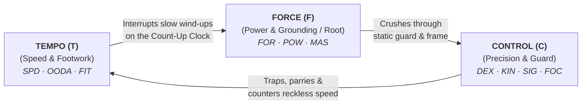

# Satya TTRPG Melee Combat, Close-Quarters Tactics & The Tactical Triad

Melee combat in **Satya** is fundamentally different from ranged firefights—not only in its physical mechanics of reach, leverage, balance (`Root`), and structural defense (`Guard`), but also in its psychological immediacy. This chapter builds directly upon the core combat engine, **[Mathematical Notation, Variables & Formula Glossary](../01-foundation/mathematical_notation_glossary.md)**, **[Count-Up Action Clock](../02-core-mechanics/action_economy_and_ooda.md)**, **[Morale System](../04-psyche-and-social/psyche_morale_and_social_combat.md)**, and **["Envelope & Fill" Tactical Pool Architecture ($P_{\text{base}} = C_{\text{combat}} + 3N$)](tactical_triad_and_pools.md)**.

---

## 1. Anatomy of a Melee Exchange

Unlike traditional RPGs where two fighters stand toe-to-toe trading static "I swing / You swing" turns, a melee fight in Satya is a continuous, asymmetric contest for **distance (Reach)**, **timing (Tempo)**, **structural openings (Control / Guard)**, and **grounded kinetic power (Force / Root)**:

1. **Determine Psychological & Morale State**: Establish each fighter's **Discipline (`DIS`)** composure, **Motivation ($\Delta_{\text{mot}}$)**, and starting **Combat Mode** (*Disengaging*, *Defensive*, *Opportunistic*, *Offensive*, or *Aggressive*; see **[Psyche, Morale & Social Combat](../04-psyche-and-social/psyche_morale_and_social_combat.md#3-psychological-state-of-combat-aggression--morale)**).
2. **Determine Awareness & Distance to Contact (`Reach`)**: Compare **OODA Initiative** ($\lfloor(\text{ITU} + \text{INS} + D_{\text{cog}} + \text{SPD})/4\rfloor$) and establish whether combatants are at **Standoff Range**, **Long Weapon / Kick Reach**, **Punch / Close Blade Reach**, or **Clinch / Grappling Range**.
3. **Secretly Allocate the Tactical Pool ($P_{\text{eff}} = T + C + F$)**: Each combatant distributes their Effective Tactical Pool across **Tempo (`T`)**, **Control (`C`)**, and **Force (`F`)**, bounded by their anatomical **Aspect Ceilings ($T_{\max}, C_{\max}, F_{\max}$)** and any active **Morale / Rage Constraints**.
4. **Read the Opponent (`Observation` / `Combat Awareness`)**: On the Count-Up Clock, a fighter with superior `OODA` or `INS/SIG` can read a low-`Tempo`, telegraphed wind-up before it lands and adjust their defensive or counter-striking allocation.
5. **Resolve the Contested `2d20` Cascade**:
   - The attacker's **Tempo ($T$)** (and Quick Thinking $\Delta\text{TC}_{\text{decide}}$ on complex feints/traps) determines the maneuver's **Effective Tick Cost (`TC`)**:
     $$\text{Effective TC} = \max\!\Big(2,\; \text{round}\big(\text{Base TC} \times \text{action\_time\_factor}\big) - (T - B) + \Delta\text{TC}_{\text{decide}}\Big)$$
   - The **Control Differential ($\Delta_{\text{control}} = C_{\text{def}} - C_{\text{att}}$)** shifts the attacker's External Task Difficulty ($\Delta_{\text{ext}}$) on their `2d20` cascade roll.
   - If the attack lands, **Force ($F$)** scales kinetic impact ($\text{Strike Impact} = \text{POW} \times \frac{F}{B}$) or throw leverage against the defender's **Root ($F_{\text{def}} + \text{MMF}$)**.
   - If the attack fails against a defender with higher **Control ($C_{\text{def}} > C_{\text{att}}$)**, the defender **seizes the initiative**—imposing $(C_{\text{def}} - C_{\text{att}})$ recovery ticks (or pool drain) on the overextended attacker!

---

## 2. The Tactical Triad in Close Quarters (`Tempo`, `Control`, `Force` — `TCF`)

Every melee maneuver—whether a probing jab, a leg sweep, a joint lock, a parry-riposte, or a full-body tackle—is governed by how the fighter splits their Tactical Pool across the **Tactical Triad**:

- **Tempo (`T`) — *Speed, Footwork & Reach Transition***: How rapidly you execute the motion and step into or out of range. Governs Count-Up Action Cost (`TC`), interrupting slower attacks, closing or breaking engagement reach, and evasive slips.
- **Control (`C`) — *Precision, Leverage & Guard***: How accurately structured and protected your body is during the technique. Governs targeting vital gaps, securing joint locks/traps, parrying, and **Guard** (how little of your own centerline you leave exposed to a counterattack).
- **Force (`F`) — *Kinetic Power & Grounded Root***: How much mass, muscular commitment, and grounded stability are behind the move. Governs strike stopping power (`Magnitude`), crushing through blocks, and **Root** (resistance to throws, trips, sweeps, shoves, and takedowns).

> [!NOTE]
> **Design Evolution (Why 5 Aspects `GRAMS` Consolidated Into 3 `TCF`)**:
> Earlier drafts split the tactical pool across five aspects (`GRAMS`: *Guard*, *Root*, *Accuracy*, *Magnitude*, *Speed*). Consolidating into **Tempo, Control, and Force** resolves three structural overlaps:
> 1. **Resolving the `Root` Polarity Paradox**: Previously, high `Root` meant stable/immobile while low `Root` meant mobile (making mobility the result of spending *zero* points, while `Magnitude` and `Speed` also governed evasion distance). Now, grounded stability lives in **Force**, while evasive mobility lives in **Tempo**.
> 2. **Merging Posture Retention Into Execution**: Instead of taxing the pool twice for defensive posture (`Guard` vs. strikes and `Root` vs. throws), **Control** naturally combines precision with structural **Guard** (`DEX`/`KIN`/`SIG`/`FOC`), while **Force** combines impact power with grounded **Root** (`FOR`/`POW`/`MAS`).
> 3. **6 Distinct Tactical Archetypes Instead of 10 Overlapping Combos**: Splitting across 3 aspects yields a clean tactical triangle where every commitment creates a distinct strength and an intuitive vulnerability across both melee and ranged combat.

---

### 2.1 Tempo *(Speed, Footwork & Reach)*

How quickly you pull off a maneuver and how rapidly you cover or yield ground is determined by how much **Tempo** you put behind it (`Ceiling:` $T_{\max} = \text{SPD} - \text{Leg Wounds}$). The higher this rating relative to your neutral baseline ($B = \lfloor P_{\text{base}} / 3 \rfloor$), the lower your **Count-Up Action Cost (`TC`)** and the harder it becomes for an opponent to react in time.

- **Melee Offense**: Fast exploratory jabs, feints, flurries, and lunges that beat slower attacks on the Count-Up Clock; stepping inside a spear/staff's reach or darting out of clinch range.
- **Reaction Defense & Footwork**: A quick reaction block, head slip, or sidestep is needed to defend a high-Tempo strike. High **Tempo** also powers evasive footwork and breaking contact when disengaging.

---

### 2.2 Control *(Precision, Limb Traps & Guard)*

**Control** (`Ceiling:` $C_{\max} = \max(\text{KIN}, \text{DEX}) - \text{Arm/Head Wounds}$) combines two inseparable halves of martial discipline: **Precision (Accuracy)** and **Guard (Structural Protection)**.

1. **Precision & Technical Leverage**:
   - Targeting anatomical weak points (chin, liver, carotid, unarmored joints; see **[Hit Locations](../06-health-and-survival/health_and_trauma.md#1-hit-locations--specificity-of-damage-effects)**) or threading a blade thrust past a shield.
   - Executing technical grappling transitions—wrist locks, kimuras, rear-naked chokes, disarms, and off-balancing setups (*Kuzushi*) that rely on body mechanics (`KIN`/`DEX`) rather than brute muscle.
   - Defensively, clean parrying, deflecting, or limb-trapping that redirects an incoming blow onto an angle where the attacker cannot follow up.
2. **Guard (Exposure vs. Protection & Seizing the Initiative)**:
   - **Guard** measures how open or vulnerable you leave yourself during and immediately after an action. Fighters who go all-out (dumping **Control** to maximize **Tempo** and **Force**) must expose their centerline—dropping their rear hand on a wide hook or over-committing their weight on a lunge.
   - **Seizing the Initiative**: Whenever an attacker misses their `2d20` cascade roll against a defender whose **Control ($C_{\text{def}}$)** exceeds the attacker's **Control ($C_{\text{att}}$)**, the defender traps, checks, or turns the attacker's overextension against them—imposing **$(C_{\text{def}} - C_{\text{att}})$ extra recovery ticks** on the attacker's clock (or draining that many points from the attacker's next Tactical Pool)!

---

### 2.3 Force *(Kinetic Impact & Grounded Root)*

**Force** (`Ceiling:` $F_{\max} = \text{FOR} - \text{Arm/Shoulder/Torso Wounds}$) measures how much physical mass, kinetic energy (`POW`), and grounded stability (`Root`) are committed to the action:

1. **Impact & Stopping Power (`Magnitude`)**:
   - Scales the character's derived **Power ($\text{POW} = \frac{\text{FOR} \times \text{SPD}}{10}$)** according to commitment relative to baseline $B$:
     $$\text{Strike Impact} = \text{POW} \times \left(\frac{F}{B}\right)$$
   - A light range-finding jab ($F \ll B$) stings and disrupts vision or balance without risking exhaustion, whereas a planted haymaker or slam ($F > B$) transfers devastating structural trauma and wound shock.
   - Defensively, hard-blocking a heavy two-handed club or axe without giving ground requires matching its **Force** (or else using high **Control** + **Tempo** to parry/sidestep away from the line of force).
2. **Grounding & Balance (`Root`)**:
   - **Root** measures how hard it is to throw, trip, sweep, shove, or knock a fighter off balance:
     $$\text{Effective Root} = F + \text{MMF}, \qquad \text{where } \text{MMF} = \left(\frac{\text{MAS}}{70\text{ kg}}\right) \times \text{SPD}$$
   - Because points spent on movement (**Tempo**) cannot simultaneously be spent on **Force**, a flying kick or sprinting lunge (`Tempo + Force` or high `Tempo`) sacrifices either structure (`Control`) or planted balance, whereas a low, rooted stance (`Control + Force`) resists takedowns and sweeps at the cost of mobility (`Tempo`).

---

## 3. Techniques & The Six Core Tactical Allocations

Every combat exchange is defined by a technique and how the combatant distributes $P_{\text{eff}} = T + C + F$:

| Action Domain | **Tempo** *(Speed & Mobility)* | **Control** *(Precision & Guard)* | **Force** *(Power & Root)* |
| :--- | :--- | :--- | :--- |
| **Melee Offense** *(Strike, Grab, Throw)* | Reduces Count-Up `TC`; interrupts slow wind-ups; closes/opens Reach; feints & flurries. | Targets vitals/armor gaps; secures joint locks; maintains **Guard** against counters. | Scales strike impact (`POW`); breaks through blocks; powers throws & knockdowns. |
| **Reaction Defense** *(Parry, Block, Dodge, Trap)* | Reacts in time to fast strikes; slips/dodges blows; steps outside weapon arc. | Parries, deflects, disarms, or traps limbs; creates counter-openings against low-Control foes. | Hard-blocks heavy 2H weapons; **Roots** stance against charges, tackles, sweeps, or throws. |
| **Maneuver & Clinch** *(Advance, Flank, Break)* | Sprints; closes into clinch or breaks contact in fewer ticks; evasive weaving. | Footwork to claim dominant angle/flank, pummel for underhooks, or establish guard. | Bull-rushes through lines; shoves opponents into walls/obstacles; sprawl weight. |

### 3.1 Paired Tactical Allocations (2 Primary Aspects, 1 Deliberate Vulnerability)

1. **`TC` — Tempo + Control *(Low Force — The Probe / Counter-Riposte)***:
   - *Execution*: Fast, accurate, tightly guarded strike or defensive trap, but light impact and unrooted—e.g., a boxer's weaving jab, a fencer's stop-thrust, a Muay Thai teep/calf check, or an Aikido/Wing Chun parry-and-trap.
   - *Strength*: Finishes in minimal ticks (`Low TC`), hits with high precision (`High C`), and keeps your Guard impenetrable so you cannot be countered.
   - *Vulnerability*: Deals light damage and lacks grounded mass (`Low F`); can be bulled through or clinched by a heavy opponent committing **Force**.
2. **`TF` — Tempo + Force *(Low Control — The Blitz / Lunging Rush)***:
   - *Execution*: Hitting hard and fast, but poorly guarded and imprecise—e.g., a lunging overhand, flying knee, blitzing tackle, or all-out flurry against a stunned opponent "on the ropes."
   - *Strength*: Beats slow defenders on the clock while delivering full kinetic `POW`.
   - *Vulnerability*: Leaves your **Guard** wide open (`Low C`). If a composed defender survives or parries the rush with high **Control**, they automatically **seize the initiative** and punish the exposed attacker.
3. **`CF` — Control + Force *(Low Tempo — The Finisher / Rooted Anchor)***:
   - *Execution*: Accurate, powerful, and deeply rooted/guarded, but slow on the Count-Up Clock—e.g., a planted liver hook/uppercut against an off-balance foe, a heavy Judo hip throw (*Harai Goshi*), a submission crank, or a braced two-handed weapon strike.
   - *Strength*: High accuracy, high impact/throw leverage, tight Guard, and maximum Root.
   - *Vulnerability*: High Count-Up Action Cost (`TC`) due to low **Tempo**; an agile opponent who is not pinned or stunned can interrupt it with a fast `TC` strike or step out of reach before it lands.

### 3.2 Focused Allocations (All-In Commitment)

- **Pure `T` — All-Out Tempo *(Sprint / Snap-Interrupt / Panic Retreat)***: Maximum speed and footwork to beat the clock or escape range, with zero stopping power (`Force`) and minimal structure (`Control`).
- **Pure `C` — All-Out Control *(High Shell Guard / Patient Counter-Wait)***: Sizing up the opponent, holding a tight defensive shell, and waiting purely to trap, parry, or sweep an incoming attack to steal the initiative.
- **Pure `F` — All-Out Force *(Wild Haymaker / Desperate Shove)***: Maximum physical commitment and impact, telegraphing the move (`Low Tempo`, adding wind-up ticks) and leaving yourself completely exposed (`Low Control`).

### 3.3 Starting Combat Modes

At the start of an engagement, each fighter declares (or the AI GM selects based on Psyche) a **Combat Mode**:
- **Disengaging**: Trying to break contact and escape (biases pool toward **Tempo + Control**).
- **Defensive**: Conserving stamina (`0` Exertion Marks), maintaining high **Control**, and waiting for the opponent to overextend.
- **Opportunistic**: Probing with low-commitment `TC` actions (`Tempo + Control`) to chip away at limb ceilings or bait a rash swing.
- **Offensive**: Pressing the fight with balanced pressure across **Tempo, Control, and Force**.
- **Aggressive**: Taking the fight to the enemy to overwhelm their guard or put them on the ropes (biases pool toward **Force + Tempo** at the expense of **Control**).

---

## 4. Melee Weapons, Reach Tiers & Base Action Costs (`TC`)

Unlike generic RPGs where weapons are differentiated only by a damage die (`1d6` vs. `1d8`), melee weapons in Satya have distinct **Reach Tiers**, **Base Tick Costs (`TC`)**, **Control/Parry Modifiers**, and **Damage Profiles** (Blunt/Crushing, Incising/Slashing, or Piercing/Impaling; see **[Ranged Combat & Armor](ranged_combat_and_armor.md#2-armor-penetration--behind-armor-blunt-trauma-babt)** for how armor resists Edged vs. Blunt trauma):

| Weapon / Unarmed Mode | Governing Skill (`Control`) | Reach Tier | Base `TC` | Guard / Parry Mod | Force & Trauma Profile |
| :--- | :--- | :---: | :---: | :---: | :--- |
| **Unarmed Jab / Low Kick / Clinch Knee** | *Brawling* (`FOR/SPD`) or *Striking* (`SPD/KIN`) | `1` *(Close / Body)* | `8` | `+0` | Blunt (`POW × F/B`); targets head (daze), ribs, liver (shock), or legs ($-T_{\max}$). |
| **Unarmed Haymaker / High Kick / Throw** | *Striking* (`SPD/KIN`) or *Grappling* (`KIN/FOR`) | `1–2` *(Close / Step)* | `10` | `-1` *(Kick)* / `+1` *(Throw)* | Heavy Blunt or Takedown vs. opponent's `Root` ($F + \text{MMF}$). |
| **Combat Knife / Karambit / Shiv** | *Knife Fighting* (`SPD/DEX`) or *Simple Melee* (`FOR/DEX`) | `1` *(Close)* | `7` | `-1` *(vs. long weapons)* | Piercing / Lacerating; high bleed & tendon cuts (slashes $T_{\max}, C_{\max}, F_{\max}$ even at moderate `Force`). |
| **Expandable Baton / Tonfa / Club** | *Riot Batons & Impact* (`FOR/DEX`) | `2` *(Medium)* | `8` | **`+2` Control** *(Parry/Block)* | Focused Blunt impact; excels at fracturing wrists/clavicles ($-C_{\max}, -F_{\max}$) and joint locks. |
| **Machete / Wakizashi / Tactical Blade** | *Fencing & Long Blades* (`SPD/DEX`) | `2–3` *(Medium-Long)* | `9` | **`+1` Control** | Deep Lacerating / Impaling; severe arterial hemorrhage and structural limb damage. |
| **Two-Handed Staff / Spear / Riot Shield + Baton** | *Polearms & Staff* (`KIN/FOR`) | `4` *(Long)* | `10–11` | **`+3` Control** *(Keep-Out / Frame)* | High leverage (`+2` effective `Force` on blocks/sweeps); penalizes opponents trying to enter Reach `1` by `+4` $\Delta_{\text{ext}}$ unless they beat the wielder's `Tempo`. |

> [!TIP]
> **How Reach Advantage Works**:
> When Fighter A holds a longer Reach weapon (e.g., Reach `3` Blade or Reach `4` Staff) against Fighter B (`Reach 1` Knife or Unarmed) at standoff distance, Fighter B must **spend `Tempo` to step inside the arc** (`+2` $\Delta_{\text{ext}}$ per step of Reach disadvantage). Once Fighter B successfully steps inside into **Clinch Range (`Reach 1`)**, the polarity flips: the long weapon is crowded (`+4` $\Delta_{\text{ext}}$ to the long-weapon wielder), while the knife or grappler operates at full efficiency!

---

## 5. Complete Worked Examples

### 5.1 Worked Example 1: Heavy Street Bruiser (Viktor) vs. Trained Kickboxer (Elena)

This example illustrates how the **Envelope & Fill** model, the **Count-Up Clock**, and **Psyche/Morale Constraints** create a realistic fight flow—showing why a skilled lighter fighter uses `Tempo + Control` probes to dismantle a heavier opponent before committing `Force`.

#### The Combatants
1. **Viktor ("The Hammer") — Heavy Street Enforcer**:
   - **Characteristics**: `FOR 15`, `SPD 8`, `KIN 9`, `DEX 9`, `INS 10`, `ITU 9`, `ANA 9`, `FOC 9` ($D_{\text{cog}} = 9$), `DIS 9`, `Mass 102 kg` ($\text{POW} = 12.0$, $\text{OODA} = \lfloor(9 + 10 + 9 + 8)/4\rfloor = 9$).
   - **Psyche**: `AGG 16` *(Combative hothead)*, `EGO 15` *(Easily baited)*, `SLF 12`.
   - **Skill**: *Brawling* (`TAL`, `FOR/SPD`, $C_{\text{skill}} = 11$, **`N = 2`**).
   - **Tactical Pool ($P_{\text{base}}$)**: $C_{\text{combat}} = \lfloor(11 + 9)/2\rfloor = 10 \implies P_{\text{base}} = 10 + 3(2) = \mathbf{16}$ points (Neutral baseline $B = 5$).
   - **Aspect Ceilings (The Envelope)**: **`Tempo Cap = 8`** (`SPD 8`), **`Control Cap = 9`** (`KIN 9`), **`Force Cap = 15`** (`FOR 15`).
   - *Profile*: Viktor can hit like a wrecking ball (`Force` up to `15`), but his slow `SPD 8` caps his `Tempo` at `8`, and his `16`-point pool means that if he swings hard, he has almost nothing left for `Tempo` or `Control`.

2. **Elena — Trained Kickboxer & Close-Protection Operative**:
   - **Characteristics**: `FOR 10`, `SPD 13`, `KIN 13`, `DEX 12`, `INS 12`, `ITU 13`, `ANA 12`, `FOC 12` ($D_{\text{cog}} = 12$), `DIS 13`, `Mass 65 kg` ($\text{POW} = 13.0$, $\text{OODA} = \lfloor(13 + 12 + 12 + 13)/4\rfloor = 12$).
   - **Psyche**: `AGG 10` *(Measured)*, `EGO 10`, `DIS 13` *(Cool under pressure)*.
   - **Skill**: *Boxing, Kickboxing & Striking* (`SPD/KIN`, $C_{\text{skill}} = 13$, **`N = 4`**).
   - **Tactical Pool ($P_{\text{base}}$)**: $C_{\text{combat}} = \lfloor(13 + 12)/2\rfloor = 12 \implies P_{\text{base}} = 12 + 3(4) = \mathbf{24}$ points (Neutral baseline $B = 8$).
   - **Aspect Ceilings (The Envelope)**: **`Tempo Cap = 13`** (`SPD 13`), **`Control Cap = 13`** (`KIN 13`), **`Force Cap = 10`** (`FOR 10`).
   - *Profile*: Elena cannot match Viktor's raw `Force 15` ceiling (`Force Cap = 10`), but her `24`-point pool lets her fill nearly her entire `Tempo` (`13`) and `Control` (`13`) envelope simultaneously.

#### Tick-by-Tick Exchange
- **Tick 1 — The Opening Probe (`TC: Tempo + Control`)**:
  - Elena starts at **Tick 1** (higher `OODA 12` vs. Viktor's `OODA 9`). She doesn't try to trade heavy blows with a `102 kg` bruiser while he is fresh. Instead, she throws a **fast, guarded range-finding jab + low calf kick (`TC` allocation)**:
    - Elena allocates **`11 Tempo / 11 Control / 2 Force`** ($11 + 11 + 2 = 24$).
    - Because her `Tempo` (`11`) is `+3` above her baseline ($B = 8$), her Base Unarmed `TC` (`8`) drops to **`5 ticks`** (she will act again on **Tick 6**!).
  - Viktor (`Tick 3`) defends with a clumsy balanced shell: **`5 Tempo / 6 Control / 5 Force`** ($5 + 6 + 5 = 16$).
  - **Resolution**: Elena's `Control 11` beats Viktor's `Control 6` by `+5`, giving her `-5` to $\text{TN}_{\text{eff}}$ on her `N = 4` cascade roll. She scores `3` successes! Because she only put `2` into `Force`, the low kick doesn't knock Viktor out—instead, it slices his lead calf (`Minor Leg Wound: -2 to Viktor's Tempo Cap`, dropping his $T_{\max}$ from `8` to **`6`**) and stings his pride.

- **Tick 3 — Viktor Loses His Cool (`Psyche` Rage Constraint)**:
  - Stung and publicly embarrassed (`EGO 15`, `AGG 16`), Viktor fails his **Discipline (`DIS 9`)** check against his `AGG 16` deviation ($\Delta_{\text{psyche}} = +6$) and enters **Rage**!
  - **Rage Constraint**: Viktor gets **`+2` Adrenaline Pool** ($P_{\text{eff}} = 18$), **but** he *must* put at least `50%` (`9+`) into **Force**, and his **Control** is capped at $\lfloor 18/4 \rfloor = \mathbf{4}$!
  - Seeing red, Viktor throws a massive overhand right (`Pure F` commitment): **`3 Tempo / 3 Control / 12 Force`** ($3 + 3 + 12 = 18$).
  - Because Viktor dumped `Tempo` to `3` (`-2` below his baseline $B=5$), his heavy swing (`Base TC 10`) takes **`12 ticks`** to complete—resolving on **Tick 15**, with his Guard wide open (`Control = 3`)!

- **Tick 6 — Seizing the Initiative & Putting Viktor "On the Ropes"**:
  - Elena's clock reaches **Tick 6** while Viktor is still winding up his telegraphed haymaker (which won't land until Tick 15)!
  - Seeing Viktor's wide-open stance (`Control = 3`), Elena steps inside the arc of his punch and fires a **Counter-Trap & Liver Hook (`CF: Control + Force`)**:
    - Elena allocates **`6 Tempo / 10 Control / 8 Force`** ($6 + 10 + 8 = 24$).
    - Against Viktor's exposed `Control 3`, Elena has a **`+7` Control advantage** (`-7` to $\text{TN}_{\text{eff}}$) AND `8 Force` (`100%` of her base `POW 13.0`).
    - She rolls `4` cascade successes (`ExtraordinarySuccess`)! The liver shot inflicts **`2` tiers of Wound Shock (`-4` to Viktor's Pool)**, interrupts his haymaker, and because her `Control 10` beat his `Control 3` by `7`, Viktor is knocked off-balance (**`+4` recovery ticks**).
  - Viktor is now **"on the ropes"**: gassed (`Fatigue 1` from his all-out `Force 12` swing = `-2` Pool) and in `Wound Shock 2` (`-4` Pool). His effective Tactical Pool has collapsed from `16` down to **`10` points**, allowing Elena to finish him cleanly on her next tick.

---

### 5.2 Worked Example 2: Clinch, Off-Balancing (`Kuzushi`) & Hip Throw vs. `Root`

What happens when a grappler (*Wrestling, Judo & Grappling* `KIN/FOR`) faces an opponent who tries to blitz or bull-rush them?

- Suppose an attacker charges Elena with a **Knife Blitz (`TF`: `9 Tempo / 2 Control / 7 Force`)**, sacrificing structure (`Control 2`) for speed and stabbing power.
- Elena (`Grappling N = 3`, $P_{\text{eff}} = 21$) responds with a **Deflecting Wrist-Trap & Hip Throw (`CF`: `5 Tempo / 9 Control / 7 Force`)**:
  1. **Control Differential ($\Delta_{\text{control}}$)**: Elena's `Control 9` crushes the knife attacker's `Control 2` by **`+7`**, trapping the knife wrist off-line (`-7` to Elena's $\text{TN}_{\text{eff}}$) and breaking the attacker's balance (*Kuzushi*).
  2. **Overcoming `Root`**: Because the attacker spent `9 Tempo` rushing forward and left their structure open (`Control 2`), their effective `Root` against a redirection throw is shattered by Elena's `Control 9 + Force 7`, slamming the attacker onto the pavement (`Blunt Impact` + disarm + prone `-4` `Tempo Cap` penalty)!
