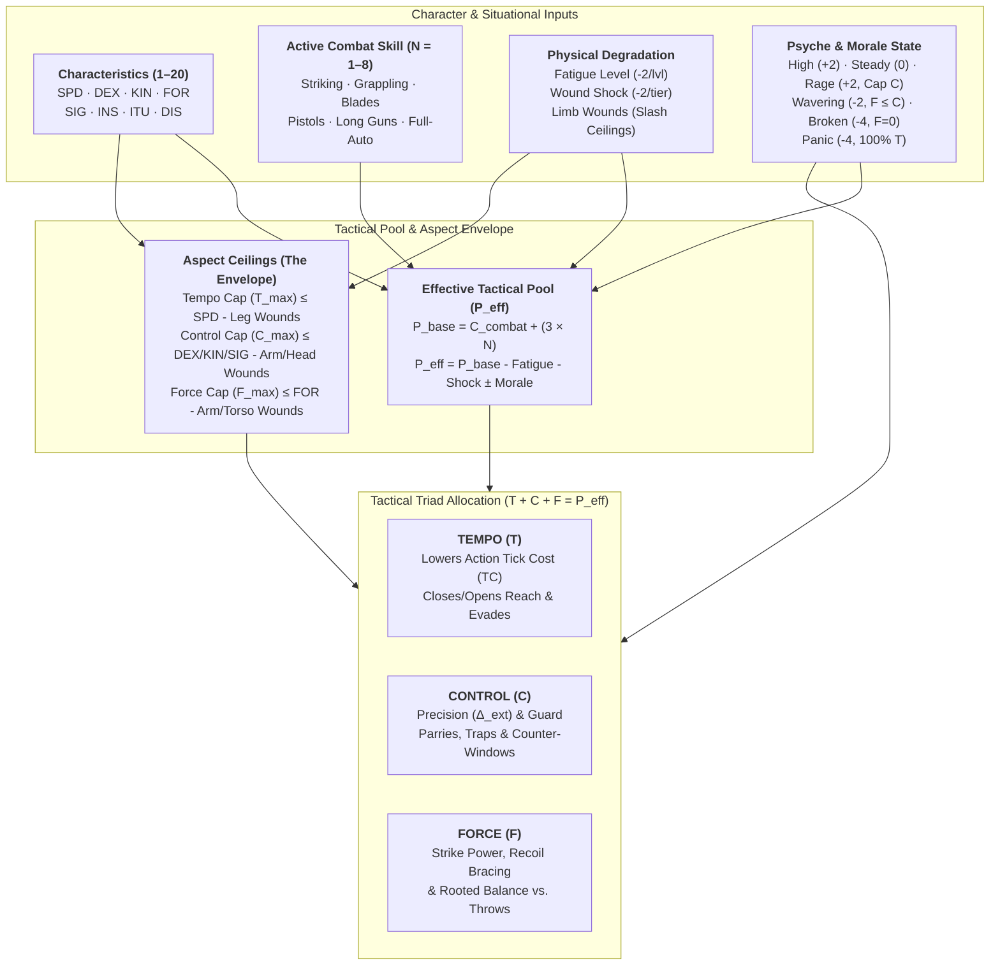

# Satya TTRPG Combat Architecture, Tactical Triad & Pools

> **Rust Engine Implementation**: [`crates/satya-engine/src/combat.rs`](../../../crates/satya-engine/src/combat.rs) (`TacticalPoolEnvelopeInput`, `TacticalPoolEnvelope`, `TacticalTriadAllocation`, `CombatPosture`, `compute_tactical_pool_envelope`, `validate_triad_allocation`) and [`crates/satya-engine/src/combat_techniques.rs`](../../../crates/satya-engine/src/combat_techniques.rs) (`CombatDomain`, `CombatMoveCategory`, `CombatTechniqueId`, `COMBAT_TECHNIQUE_CATALOG`, `evaluate_technique_with_triad`, `resolve_technique_exchange`).

Because simulation-style tactical agency is at the heart of **Satya**, combat is a deeply integrated extension of **[Cascading `2d20` Engine & Task Resolution](../02-core-mechanics/cascading_d20_and_tasks.md)**. As in all Task Resolutions, every combat exchange—including ranged combat—is a contested system using the Two-List Cascading (`2d20`) Watershed Mechanic.

What separates combat in Satya from mainstream RPGs is the depth of tactical agency, psychological realism, and anatomical consequence—achieved through a single unified architecture (**[The Count-Up Action Clock](../02-core-mechanics/action_economy_and_ooda.md)**, **[Psyche & Morale](../04-psyche-and-social/psyche_morale_and_social_combat.md)**, and the **"Envelope & Fill" Tactical Pool**; see the **[Mathematical Notation, Variables & Formula Glossary](../01-foundation/mathematical_notation_glossary.md)** for all combat symbols $C_{\text{combat}}, P_{\text{base}}, P_{\text{eff}}, B, T_{\max}, C_{\max}, F_{\max}$) rather than hundreds of disjointed special-case "Feat" rules. Both **[Melee Combat](melee_combat.md)** and **[Ranged Combat & Armor](ranged_combat_and_armor.md)** share this exact foundation.

---

## 1. Aspects of Combat & Genre Support

So what makes Satya different?

Most games only factor in skill of the adversaries, how fast they are, weapon damage, and armor. Most games typically resolve combat along these lines:

- Determine who has initiative, so that their actions go first or can preempt others
- Choose an action (some kind of attack or feat)
- One being attacked can determine some kind of active or passive defense if possible
- Determine odds of attacker hitting
- If hit, roll for damage, possibly rolling for hit location and subtract armor if any from damage
- The character with the next initiative repeats the above, rinse, lather, repeat

Most games don't consider (or bolt them on in a very ad-hoc manner via feats or advantages) any of the following:

- **Morale**: If you are scared, you may not even get to choose your action or may be at severe tactical disadvantage (see **[Psyche, Morale & Social Combat](../04-psyche-and-social/psyche_morale_and_social_combat.md#3-psychological-state-of-combat-aggression--morale)**)
- **Aggressiveness**: "It's not the size of the dog in the fight, it's the size of the fight in the dog"
- **Fatigue**: It doesn't matter how skilled you are if you are too tired to move
- **Anatomical Trauma**: Wounds, concussions, broken limbs, blood loss, pain, and shock drastically reduce effectiveness and slash specific physical capabilities (see **[Health & Trauma](../06-health-and-survival/health_and_trauma.md)**)
- **Reach**: If your weapon can't reach your target, you have to get into range (which can be difficult and takes time)
- **Time (Action Duration)**: How fast does your (re)action take? It's not just when an action starts that matters, but how soon it finishes on the Count-Up Clock
- **Reliability**: Especially for modern weapons, how prone is your weapon to malfunction under stress or poor maintenance?

Some will argue that factoring in the above is too much minutiae to keep track of, and will bog down the "fun" of the game. We argue that without consideration of these elements, the narrative value of the action is lost, and perhaps worse, the unrealism will tar victories with a poor brush. When done smartly and consistently, all of the above can be factored in with the added benefits:

- Make combat much more visceral and narratively exciting by providing meaningful tactical choices on every exchange
- Realism makes hard-earned victories all the more rewarding
- The added simulation depth is governed by one consistent set of rules rather than a library of exception-based Feats
- While each combat decision carries more weight, overall real-world time spent in combat remains fast because combat is decisive and lethal
- Makes characters think twice before treating violence as their default first resort

### 1.1 Genre Support

Satya is not a super-hero fantasy system at its heart. While it could model such things, Satya is geared towards modeling real-world human-level skills. Moreover, player characters do not have any inherent plot-armor advantages over NPCs. They do not get to dodge bullets, and most solid gunshots (a decent margin of success) will incapacitate a character no matter how much experience and training they have.

The idea behind the realism is twofold:

- Make combat interesting by providing genuine tactical choices
- Make combat memorable and consequential by making it deadly

Too many game systems that are not war-related make combat a first-choice option. This is because in most systems, characters can take multiple solid hits until they are *hors de combat*, and helpful healing spells or sci-fi med kits can instantaneously heal at least some of the damage done. Also, many game systems don't take into account how being wounded or fatigued affects performance. In many game systems, as long as your "hit points" are not `0` or less, your character functions at 100% normal capacity. This is not only unrealistic from a simulation point of view, it is boring from a storytelling point of view. How many stories are made more dramatic and memorable because the protagonist has to overcome pain, fatigue, or physical constraints imposed by wounds? Hit-point style systems without wounding effects are not just unrealistic—leading to one-dimensional play—they are poor at storytelling as well.

In other words, Satya is designed to dispel two pervasive myths:

- That realism is too time-consuming
- That realism isn't fun or interesting because it doesn't let you do cinematic things

---

## 2. Design Philosophy of Combat in Satya

Most combat in RPGs is neither realistic nor narratively interesting. Most games typically allow each participant in the combat an equal number of actions and reactions. And even games that let characters have more actions than others still allow automatic defensive reactions, and generally apply an evenness or "fairness" to combat. Combat, however, is anything but fair—and if you are playing fair, either you are in a sporting duel, or you are doing it wrong. Most games show this fairness by trading action for action:

```text
Character A attacks
NPC B blocks/dodges
NPC B attacks
Character A blocks/dodges
```

This is not only unrealistic, it is narratively boring. How many boxing matches or UFC fights do you see alternating like that? None. In the real world, opponents size each other up and then unleash a flurry of attacks, stopping only to catch their breath, regain balance, or because the defender was able to counter and **seize the initiative**. For example, the defender might trap the attack, sweep the lead leg, or sidestep out of the line of attack. Or maybe one combatant only throws out an exploratory jab or thrust—perhaps as a feint, or perhaps to judge their opponent's reflexes—while the other combatant holds a tight guard, waiting for an opening to counter or escape.

In the latter scenario where a defender only defends, what is in it for them game-wise in most systems? All they have done is allow the attacker a free shot. Without rules for fatigue, guard exposure, or tactical advantage, there is no reason from a metagame perspective for a character to ever probe or hold back. Although Satya initially looks more detailed, in practice it is cleaner because tactical behavior emerges naturally from the **Tactical Pool** rather than special-case rules.

Even if proponents of traditional turn-based systems argue that a single attack roll abstracts a whole exchange of feints, footwork, and parries, why does each side still get the exact same rhythmic opportunity to attack and defend every round? That is not how real fights work—as we hear in boxing: *"he's got him on the ropes," "he's on his last legs," "the enemy has seized the initiative," "the unit is pinned down."* By making **Tempo**, **Control**, and **Force** explicit in the rules, tactical decision-making directly drives the story.

> [!IMPORTANT]
> **Why Satya Replaces Hit Points with Anatomical Trauma, Shock & Fatigue**:
> The popularity of classic RPGs has made the notion of ablative Hit Points ubiquitous. Yet it strains verisimilitude to the breaking point when a high-HP character shrugs off a point-blank gunshot or assassination attempt. The old excuse is that Hit Points abstract "skill, luck, and stamina" turning a lethal blow into a graze—until luck runs out.
>
> If Hit Points are mostly "luck and stamina," why do healing rules require weeks of bedrest or multiple medical treatments to restore a high-level character's "luck"? Worse, a single bag of Hit Points fosters a cavalier attitude toward violence and forces GMs to artificially "level up" bandits and guards so combat stays threatening.
>
> In **Satya**, Hit Points are replaced by **[Anatomical Wound Tracks, Systemic Shock, Blood Loss, and Fatigue](../06-health-and-survival/health_and_trauma.md)**:
> - **Systemic Drain**: Every tier of **Fatigue (`fatigue_level`)** and **Wound Shock (`wound_shock_index`)** drains **`-2` points** from the character's Effective Tactical Pool ($P_{\text{eff}}$), increases internal cascade difficulty ($\Delta_{\text{int}}$), and slows all actions via `action_time_factor`.
> - **Structural Limb & Organ Trauma**: Wounds to specific hit locations (legs, arms, torso, head/eyes) directly slash the character's **Aspect Ceilings ($T_{\max}, C_{\max}, F_{\max}$)**—so a sliced calf immediately caps **Tempo**, a fractured wrist caps **Control**, and cracked ribs or a dislocated shoulder cap **Force**.

---

## 3. The Action Economy & Overview of a Combat Exchange

Determining **what** a character does, **how long** it takes, and **when** it resolves is governed by Satya's continuous **[Count-Up Action Clock](../02-core-mechanics/action_economy_and_ooda.md)**:

1. **Starting Tick (OODA Initiative & Awareness)**:
   - At the onset of combat, each participant computes their **4-Pillar OODA Readiness** (**O**bserve `ITU`, **O**rient `INS`, **D**ecide $D_{\text{cog}}$, **A**ct `SPD`):
     $$\text{OODA} = \left\lfloor \frac{\text{ITU} + \text{INS} + D_{\text{cog}} + \text{SPD}}{4} \right\rfloor \quad \text{where} \quad D_{\text{cog}} = \left\lfloor \frac{\max(\text{ANA}, \text{CRE}) + \text{FOC}}{2} \right\rfloor$$
   - Combatants who are aware and ready enter the clock at $\text{Starting Tick} = \max(1, 15 - \text{OODA})$ (modified by *Observation* / *Combat Awareness* margins on ambush checks). The combatant on the **lowest Tick** acts first.
2. **Base Action Time Cost (`TC`) & Stances**:
   - Every weapon mode, movement, or combat stance has a **Base Tick Cost (`TC`)**:
     - **`POWER` / Heavy Melee Wind-Up**: `TC = 14` (`10–12` for standard heavy unarmed/melee)
     - **`RANGED_AIMED` / Deliberate Sighted Shot**: `TC = 12`
     - **`MANEUVER` / Bounding Advance**: `TC = 11`
     - **Standard Unstanced Action**: `TC = 10`
     - **`STABILITY` / Controlled Double-Tap / Guarded Strike**: `TC = 8–9`
     - **`RANGED_SNAP` / Quick Point-Shoot / Fast Jab or Knife Slash**: `TC = 7`
3. **Fatigue & Wound Shock Time Multiplier (`action_time_factor`)**:
   - Physical exhaustion and pain slow neuromuscular execution:
     $$\text{action\_time\_factor} = 1.0 + (0.10 \times \text{fatigue\_level}) + (0.25 \times \text{wound\_shock\_index})$$
4. **Tempo ($T$) & Quick Thinking ($\Delta\text{TC}_{\text{decide}}$) Adjustment to Effective Tick Cost**:
   - Allocating **Tempo ($T$)** above your neutral baseline ($B = \lfloor P_{\text{base}} / 3 \rfloor$) shaves ticks directly off your action; dumping **Tempo** below $B$ adds wind-up/recovery ticks:
     $$\text{Effective TC} = \max\!\Big(2,\; \text{round}\big(\text{Base TC} \times \text{action\_time\_factor}\big) - (T - B) + \Delta\text{TC}_{\text{decide}}\Big)$$
     *(where $\Delta\text{TC}_{\text{decide}} = 0$ for standard drilled reflex strikes/reloads, and $\Delta\text{TC}_{\text{decide}} = -\lfloor(D_{\text{cog}} - 10)/2\rfloor$ for complex tactical actions, feints, ballistic calculations, or environmental improvisations).*
   - When a character initiates an action on $\text{Tick}_{\text{start}}$, it resolves and advances their clock to $\text{Tick}_{\text{next}} = \text{Tick}_{\text{start}} + \text{Effective TC}$. If an opponent on an earlier tick executes a fast, high-`Tempo` action whose completion tick is *less than* a slow attacker's completion tick, the faster combatant **interrupts** the slow wind-up before it lands!

### 3.1 Six-Step Sequence of a Combat Exchange

1. **Determine psychological and morale state** (`High`, `Steady`, `Wavering`, `Broken`, `Panic`, or `Rage`; see **[Psyche, Morale & Social Combat](../04-psyche-and-social/psyche_morale_and_social_combat.md#34-combat-morale-tactical-ooda-behavior--the-five-conditions-of-morale)**).
2. **Determine awareness (surprise) and starting OODA tick**.
3. **Determine engagement distance / reach and cover**.
4. **Plan maneuver and allocate Effective Tactical Pool ($P_{\text{eff}}$)**:
   - Split pool across the Tactical Triad: **Tempo** (speed/mobility), **Control** (precision/guard), **Force** (power/grounding).
5. **Make combat awareness check** (`INS/SIG` or `ITU`) to read when and how the opponent's move will resolve.
6. **Resolve contested `2d20` cascade** (factoring in any reaction time penalty if changing a committed action mid-tick).

---

## 4. The Tactical Pool Architecture: "Envelope & Fill"

In Satya, a combatant's **Tactical Pool ($P_{\text{eff}}$)** and how they can distribute it across **Tempo (`T`)**, **Control (`C`)**, and **Force (`F`)** are governed by the **"Envelope & Fill" Model**:

1. **Characteristics Set Your Physical Envelope (Aspect Ceilings)**:
   Your physical and sensory attributes (`SPD`, `KIN`, `DEX`, `FOR`, `SIG`) define the **maximum number of points** you can put into any single aspect on a single action ($T_{\max}, C_{\max}, F_{\max}$). A slow heavyweight (`FOR 15, SPD 8`) has a massive `Force` ceiling (`15`) but a low `Tempo` ceiling (`8`); he cannot magically convert his muscle mass into lightning footwork.
2. **Skill Fills Your Envelope (Pool Size)**:
   An untrained athletic prodigy (`SPD 14, KIN 12, FOR 14`, *Brawling* `N = 1`) has high ceilings (`14 / 12 / 14`), but a small total pool—so to throw a max-power `Force 14` punch, they *must* starve `Tempo` and `Control` down to almost `0` (telegraphing the swing and leaving their chin wide open). A trained martial artist (`N = 5`) with the exact same physique has a large enough pool to fill **Tempo**, **Control**, and **Force** *simultaneously*!



### 4.1 Calculating the Base & Effective Tactical Pool ($P_{\text{eff}}$)

Every combat action uses a specific **Combat Skill ($N \in [1, 8]$)** (or `N = 1` *Brawling* / *Throwing* Talent if untrained) and its **Controlling Characteristic ($C_{\text{skill}} = \lfloor(C_1 + C_2)/2\rfloor$)** from **[Skill System & Hierarchical Skill Trees](../03-character/skills_and_trees.md#36-tree-5-combat--unarmed-melee-firearms--heavy-ordnance-combat-athletic-technical)**, paired with the character's **4-Pillar OODA Initiative ($\text{OODA} = \lfloor(\text{ITU} + \text{INS} + D_{\text{cog}} + \text{SPD})/4\rfloor$)** and **Cognitive Decision Score ($D_{\text{cog}} = \lfloor(\max(\text{ANA}, \text{CRE}) + \text{FOC})/2\rfloor$)** from **[Action Economy & OODA](../02-core-mechanics/action_economy_and_ooda.md)**:

$$\text{Combat Readiness } (C_{\text{combat}}) = \left\lfloor \frac{C_{\text{skill}} + \text{OODA}}{2} \right\rfloor$$

$$\text{Base Tactical Pool } (P_{\text{base}}) = C_{\text{combat}} + (3 \times N)$$

$$\text{Effective Tactical Pool } (P_{\text{eff}}) = \max\!\big(0,\; P_{\text{base}} - (2 \times \text{Fatigue Level}) - (2 \times \text{Wound Shock}) + \Delta P_{\text{morale}}\big)$$

- **Why $C_{\text{combat}} + 3N$ Has Zero Arbitrary Cutoffs**:
  Every single point of Characteristic (`1–20`) and every level of Skill (`1–8`) directly increases your tactical pool.
- **What Is a Character's "Neutral Baseline" ($B$)?**
  A character's neutral, balanced per-aspect baseline is **$B = \lfloor P_{\text{base}} / 3 \rfloor$** (for an average human with $C_{\text{combat}} = 10$ and trained skill $N = 3$, $P_{\text{base}} = 19$ and balanced allocation is **`6 / 7 / 6`**).

### 4.2 Characteristic Aspect Ceilings ($T_{\max}, C_{\max}, F_{\max}$)

When splitting $P_{\text{eff}} = T + C + F$, no aspect may receive more points than its **Aspect Ceiling**:

| Aspect | Melee Ceiling Formula | Ranged Ceiling Formula | Degraded By (Structural Wounds) |
| :--- | :--- | :--- | :--- |
| **Tempo Cap ($T_{\max}$)** | **`SPD`** $-\text{ Leg/Hip/Foot Penalty}$ | **`SPD`** $-\text{ Leg/Hip/Foot Penalty}$ | Sprained ankle, knee tear, thigh laceration, heavy encumbrance. |
| **Control Cap ($C_{\max}$)** | **$\max(\text{KIN}, \text{DEX})$** $-\text{ Arm/Head Penalty}$ | **$\lfloor\frac{\text{DEX} + \text{SIG}}{2}\rfloor$** *(or `DEX/FOC`)* $-\text{ Arm/Head/Eye Penalty}$ | Concussion/daze, fractured wrist/arm, eye injury, suppressed tunnel vision. |
| **Force Cap ($F_{\max}$)** | **`FOR`** $-\text{ Arm/Shoulder/Torso Penalty}$ | **`FOR`** $-\text{ Arm/Shoulder/Torso Penalty}$ | Dislocated shoulder, cracked ribs, severed biceps/tendons. |

> [!TIP]
> **Mastery Technique Overflow ($N \ge 5$)**:
> A true master ($N \ge 5$) who has trained for decades to maximize leverage and body mechanics may add **$\lfloor (N - 3) / 2 \rfloor$** (`+1` at $N=5$, `+2` at $N=7$) to their **Control** and **Force** ceilings within their specialized martial art or weapon skill.

### 4.3 Physical & Psychological Modifiers to the Pool

1. **Systemic Drain (Shrinks Total Pool $P_{\text{eff}}$)**:
   - **Fatigue (`fatigue_level`)**: Reduces $P_{\text{eff}}$ by **`-2` points per Fatigue Level** (and increases `action_time_factor` by `+10%` per level).
     - *How Combat Generates Fatigue*: Fighting with economy of motion (**Control**) conserves breath. Whenever a combatant allocates **more than `50%` of their Aspect Ceiling into `Force` or `Tempo`** on an action, they accumulate **1 Exertion Mark** (or **2 Marks** if *both* `Force` and `Tempo` exceed `50%` of their ceilings, as in an all-out blitz). When **Exertion Marks $= \text{Fatigue Threshold}$** ($\text{FT} = \text{FIT} + \lfloor\text{DIS}/2\rfloor$), the character gains **`+1` Fatigue Level**.
   - **Wound Shock & Pain (`wound_shock_index`)**: Acute pain, blood loss, and shock reduce $P_{\text{eff}}$ by **`-2` points per unmitigated Shock Tier**.
2. **Localized Structural Wounds (Slash Specific Aspect Ceilings)**:
   - Slash the specific **Aspect Ceiling** ($T_{\max}, C_{\max}, F_{\max}$) tied to that anatomy by **`-2` (Minor Sprain/Flesh Wound)**, **`-5` (Moderate Tear/Deep Cut)**, or **`-10` / Locked at `0` (Fracture / Severed / Disabled)**.
3. **Psychological & Morale Constraints on Allocation** (see **[Psyche, Morale & Social Combat](../04-psyche-and-social/psyche_morale_and_social_combat.md#34-combat-morale-tactical-ooda-behavior--the-five-conditions-of-morale)** for full trigger & roll rules):
   - **High Morale / Conviction Surge**: **`+2` Pool**; no restriction (`+1` to $F_{\max}$ or $T_{\max}$).
   - **Steady Morale**: **`0` Pool**; full freedom up to normal Aspect Ceilings.
   - **Rage / Bloodlust**: **`+2` Pool** (Adrenaline); **must allocate $F \ge \lfloor P_{\text{eff}} / 2 \rfloor$, and `Control` is capped at $C \le \lfloor P_{\text{eff}} / 4 \rfloor$**.
   - **Wavering Morale**: **`-2` Pool**; **cannot allocate more to `Force` than `Control` ($F \le C$)**.
   - **Broken Morale**: **`-4` Pool**; **active offensive `Force = 0`** (all points must go into **`Control` + `Tempo`** for covering fire, parries, dodges, and withdrawal).
   - **Panic**: **`-4` Pool**; **`Control = 0` and `Force = 0`** (`100%` of pool locked into **Pure `Tempo`** to flee with back turned).

### 4.4 Mechanical Resolution of Tempo, Control, and Force

1. **Tempo ($T$) $\to$ Action Count Cost (`TC`) & Reach/Evasion**:
   $$\text{Effective TC} = \max\!\Big(2,\; \text{round}\big(\text{Base Weapon/Move TC} \times \text{action\_time\_factor}\big) - (T - B) + \Delta\text{TC}_{\text{decide}}\Big)$$
   *Investing above baseline ($B = \lfloor P_{\text{base}}/3 \rfloor$) in **Tempo** shaves ticks directly off your action; dumping **Tempo** below baseline adds wind-up/recovery ticks ($\Delta\text{TC}_{\text{decide}} = 0$ for drilled reflex actions, or $-\lfloor(D_{\text{cog}} - 10)/2\rfloor$ for complex/improvised actions).*
2. **Control ($C$) $\to$ Contested Precision ($\Delta_{\text{ext}}$), Guard & Counter-Initiative**:
   - **Guard & Precision Differential**: In a contested exchange, $\Delta_{\text{control}} = C_{\text{def}} - C_{\text{att}}$ shifts $\Delta_{\text{ext}}$ on the attacker's `2d20` cascade roll.
   - **Seizing the Initiative (Counter-Opening)**: If an attacker fails their attack roll against a defender with $C_{\text{def}} > C_{\text{att}}$, the defender traps, sweeps, or off-balances them—imposing **$(C_{\text{def}} - C_{\text{att}})$ extra recovery ticks** (or draining that many points from the attacker's next Tactical Pool)!
3. **Force ($F$) $\to$ Impact Power, Recoil Bracing & Rooted Stability**:
   - **Melee Kinetic Impact**: Scales derived **Power ($\text{POW} = \frac{\text{FOR} \times \text{SPD}}{10}$)**:
     $$\text{Strike Impact} = \text{POW} \times \text{Multiplier}_{\text{tech}} \times \left(\frac{F}{B}\right)$$
   - **Block & Throw / Sweep Resistance (`Root`)**: Resisting a knockdown, throw, shove, or guard-crush uses **$F + \text{MMF}$** ($\text{MMF} = \frac{\text{MAS}}{70\text{ kg}} \times \text{SPD}$).
   - **Ranged Recoil & Burst Control**: In rapid or automatic fire (*Fully Automatic Weapons* `DEX/FOR`), each point of **Force ($F$)** above/below the weapon's recoil rating offsets or increases burst dispersion ($\Delta_{\text{ext}}$).

### 4.5 Orthogonality: Technique Selection (*What You Do*) vs. Triad Allocation (*How You Execute It*)

A crucial design principle in Satya is separating **which Combat Technique** a fighter declares (`Punch`, `Kick`, `Thrust`, `Swing`, `Grab`, `Throw`, `Block`, `Parry`, `Snap Shot`, `Aimed Shot`) from **how they allocate their Tactical Pool ($P_{\text{eff}} = T + C + F$)**:

1. **The Technique (`CombatTechniqueId`) Defines the Biomechanical Baseline**:
   Every move in the **30-Entry Canonical Combat Technique Catalog** has fixed anatomical or mechanical properties: its **Move Category** (`Control`, `Strike`, `Intercept`, `Maneuver`, `RangedShot`, `RangedManeuver`), **Engagement Reach Window**, **Two-Component Base Tick Cost ($\text{Base TC} = \text{TC}_{\text{decide}} + \text{TC}_{\text{act}}$)**, **Power Multiplier**, and inherent **Guard / Root Posture Modifiers**.
2. **The Triad Allocation (`T / C / F`) Shapes the Execution**:
   A quick, guarded jab (`Tempo + Control`, low `Force`) and a wide-open knockout haymaker (`Force`, low `Tempo` and `Control`) are **both `Punch` strikes**. The technique sets the baseline hand-strike biomechanics (`Reach 1`, `Base TC 7`, `1.00× POW`, `Guard +0`), while your **Tactical Triad allotment** determines whether it finishes in `4 ticks` as a tight probe or winds up for `10 ticks` as a devastating finisher! Similarly, a `Kick` can be thrown as a fast range-finding teep (`Tempo + Control`) or a full-power roundhouse (`Force`), and any **Control Technique** (`Grab`, `Disarm`, `Takedown`, `Throw`, `Trap`, `Lock`, `Push`) uses **Tempo** for entry speed, **Control** for technical leverage/*Kuzushi* and Guard retention, and **Force** for uprooting power or joint torque.

---

## 5. Companion Combat Chapters

- **[Melee Combat, Close-Quarters Tactics & The Tactical Triad](melee_combat.md)**: Close-quarters Reach Tiers, `Guard` & Seizing the Initiative, `Root` vs. throws/sweeps, the Six Core Tactical Allocations (`TC`, `TF`, `CF`, `Pure T/C/F`), Melee Weapon Profiles, and the complete **Viktor vs. Elena** melee walkthrough.
- **[Ranged Combat, Suppression, Armor & Weapon Reliability](ranged_combat_and_armor.md)**: Ranged fire modes & Recoil Ratings (`R`), Suppression vs. Morale, Armor Penetration (`PR`) vs. Behind-Armor Blunt Trauma (`BABT`), Weapon Reliability (`Rel`) & Malfunctions, and the **Mateo vs. Sgt. Vance** & **Sniper Overwatch** walkthroughs.
