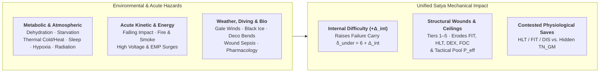

# Satya TTRPG Environmental Hazards, Survival & Field Pharmacology

> **Rust Engine Implementation**: [`crates/satya-engine/src/environmental_hazards.rs`](../../../crates/satya-engine/src/environmental_hazards.rs) (`HydrationEnvironment`, `DehydrationStage`, `StarvationEvaluation`, `ClothingSuitTier`, `HypothermiaStage`, `HyperthermiaStage`, `ThermalStressEvaluation`, `SleepDeprivationEvaluation`, `AltitudeVacuumEvaluation`, `ToxinAgentId`, `ToxinOrPathogenProfile`, `RadiationExposureTier`, `AcuteRadiationEvaluation`, `LandingSurfaceClass`, `FallImpactEvaluation`, `FireExposureSource`, `BurnDegree`, `BurnEvaluation`, `SmokeDensityTier`, `RespiratoryProtectionTier`, `SmokeInhalationEvaluation`, `ElectricalHazardTier`, `ElectricalShockResult`, `WindIntensityTier`, `SurfaceTractionTier`, `WeatherAndFootingEvaluation`, `BreathingGasMix`, `DecompressionSicknessTier`, `DivingPressureEvaluation`, `WoundContaminationLevel`, `SepsisStage`, `SepsisEvaluation`, `FieldDrugId`, `FieldDrugSpec`, `evaluate_dehydration`, `evaluate_starvation_and_caloric_deficit`, `evaluate_thermal_stress`, `evaluate_frostbite_exposure`, `evaluate_sleep_deprivation`, `evaluate_altitude_and_vacuum_hypoxia`, `evaluate_acute_radiation`, `evaluate_fall_impact`, `evaluate_burn_trauma`, `evaluate_smoke_inhalation`, `evaluate_electrical_shock`, `evaluate_weather_and_footing`, `evaluate_diving_pressure_and_deco`, `evaluate_wound_sepsis`, `canonical_field_pharmacology_catalog`). Companion chapter to **[Movement, Encumbrance & Vehicles](movement_encumbrance_and_vehicles.md)**.  
> **Guided Play Example**: See [Guide 06 §5.3 (What Happens Tomorrow Morning: Why Violence & Weather Have Weight)](../../ttrpg-examples/06-firefights-trauma-and-survival.md#53-what-happens-tomorrow-morning-why-violence--weather-have-weight).

This chapter defines the canonical **Environmental Survival, Acute Physical Hazards (Falling, Fire, Smoke, Electricity, Weather, Diving), Wound Sepsis, and Field Pharmacology Systems** for **Satya** (for definitions of all mathematical variables and formulas such as $W_{\text{req}}, \text{CLO}, \text{Sv}, M_{\text{surface}}, P_{\text{atm}}, \Delta_{\text{int}}, \Delta_{\text{ext}}$, see the **[Mathematical Notation, Variables & Formula Glossary](../01-foundation/mathematical_notation_glossary.md)**).

Environmental stressors and acute physical hazards operate through the exact same physiological levers as combat trauma: **Internal Cascade Modifiers ($\Delta_{\text{int}}$)**, **Fatigue Levels (`fatigue_level`)**, **Structural Wound Tiers (`Tiers 1–5`)**, **Wound Shock (`wound_shock_index`)**, and temporary **Characteristic Degradation (`HLT`, `FIT`, `DEX`, `FOC`, `ANA`)**.

---

## 1. Metabolic & Atmospheric Survival: Water, Food, Temperature & Atmosphere

### 1.1 Hydration & Water Deprivation

Water is the most acute survival resource after breathable air. A human can survive weeks without food, but in arid heat or heavy combat exertion, lethal dehydration occurs within **`24 to 72 hours`**.

#### Daily Water Requirement ($W_{\text{req}}$)
- **Temperate Climate, Low Activity**: **`3.0 Liters / Day`** (`3.0 kg` mass).
- **Heavy Physical Labor / Forced March**: **`5.0 Liters / Day`**.
- **Hot / Arid Desert or Tropical Jungle (`> 35°C`) + Tactical Gear**: **`8.0 to 10.0 Liters / Day`** (`0.5–0.8 L/hour` sweat loss during daytime movement!).

#### The Five Stages of Dehydration

For every **25% of Daily Water Requirement missed** (or every `2 Liters` of unreplaced sweat deficit), the character advances **+1 Dehydration Stage**:

| Stage | Body Water Deficit | Internal Mod ($\Delta_{\text{int}}$) | Characteristic & Stamina Penalties | Physiological Symptoms & `HLT` Saves |
| :---: | :---: | :---: | :--- | :--- |
| **Stage 0** | `< 2%` | `0` | None | Euhydrated baseline. |
| **Stage 1: Thirsty** | `2–4%` (`~1.5–2.5 L`) | **`+2`** | **`-1` `FIT`**, **`-1` `FOC`**, **`+1` `fatigue_level` floor** | Dry mouth, dark urine, mild headache. Cleared in `30 min` by drinking `1.5 L` water. |
| **Stage 2: Parched** | `5–7%` (`~3.5–5.0 L`) | **`+4`** | **`-3` `FIT`**, **`-2` `SPD/HLT/ANA`**, **`+2` `fatigue_level` floor** | Tachycardia, orthostatic **`Dizzy`** (`-2 KIN`), muscle cramps, cessation of sweating (high **Heatstroke** risk). |
| **Stage 3: Severe** | `8–10%` (`~6.0–7.0 L`) | **`+8`** | **`-6` `FIT/HLT/ANA/FOC`**, **`+4` `fatigue_level` floor** | Sunken eyes, oliguria, delirium/hallucinations (`INS 4`); must roll **`HLT`** every `4 hours` or collapse **Unconscious**. Requires oral rehydration salts or IV saline. |
| **Stage 4: Lethal** | `> 12%` (`> 8.5 L`) | **`+10`** | **Comatose (`All Caps = 0`)** | Hypovolemic shock, acute renal failure, and fatal cardiac arrest within **`1–6 hours`** without IV fluid resuscitation. |

> [!NOTE]
> **Fatigue Floor**: A Dehydration Stage's "`fatigue_level` floor" means the character **cannot reduce their `fatigue_level` below that number** through rest or sleep until they rehydrate!

---

### 1.2 Nutrition, Caloric Deficit & Starvation

- **Daily Caloric Requirement**:
  - **Sedentary / Watch Duty**: `2,000–2,400 kcal/day` (`~0.5 kg` dry field rations).
  - **Standard Patrol / Active Operations**: `3,200–3,800 kcal/day` (`~0.75 kg` MRE / nutrient ration).
  - **Arctic Cold or Heavy Mountain March**: `4,500–6,000 kcal/day` (`~1.2 kg` high-fat rations).
- **Short-Term Fasting & Glycogen Depletion (`Days 1–3` Without Food)**:
  - **First `24 Hours`**: Mild hunger pangs (`+0` mechanical penalty for characters with `DIS >= 10`; `+1` $\Delta_{\text{int}}$ if `DIS < 10`).
  - **`48–72 Hours` (Glycogen Depletion & Early Ketosis)**: Liver glycogen empties; blood glucose dips. Imposes **`+2` to $\Delta_{\text{int}}$**, **`+1` `fatigue_level` floor**, and **`-2` to `FOC` and `FIT`**.
- **Prolonged Caloric Deficit & Starvation (`Days 4–30+`)**:
  - For every **`3 Days` of total starvation** (or every cumulative `10,000 kcal` deficit), the character must make a **`HLT` check ($\Delta_{\text{ext}} = +2 \times \text{Week}$)**:
    - **Catabolic Muscle & Mass Loss**: Body Mass (**`MAS`**) drops by **`-1.5 kg`**, and **`Force (FOR)`**, **`Fitness (FIT)`**, and **`Health (HLT)`** each erode by **`-1` point** (`+2` $\Delta_{\text{int}}$ per week).
    - When **`HLT` or `FOR` reaches `0`** (typically after `30–45 days` without food depending on starting `MAS` and `HLT`), fatal organ failure occurs.

---

### 1.3 Temperature Extremes: Cold (Hypothermia) & Heat (Hyperthermia)

Human core body temperature must remain within a narrow window around **`37.0°C` (`98.6°F`)**. Both extreme cold and extreme heat are governed by the balance between **Ambient Effective Temperature** (including windchill or humidity), **Clothing Insulation / Cooling (`CLO` Rating)**, and **Metabolic Heat Production**.

| Clothing / Suit Tier | Comfort Zone (Light Activity) | Cold Protection Bonus ($\Delta_{\text{cold}}$) | Heat Retention Penalty ($\Delta_{\text{heat}}$) |
| :--- | :---: | :---: | :---: |
| **Light Streetwear / Tropical Uniform** | `+18°C` to `+32°C` | `+0` | `+0` |
| **Cold-Weather Field Jacket & Layers** | `-5°C` to `+15°C` | **`-4` to $\Delta_{\text{ext}}$** vs. Cold | **`+4` to $\Delta_{\text{ext}}$** in Heat `> 28°C` |
| **Extreme Arctic Parka / ECWCS Level 7** | `-35°C` to `-5°C` | **`-8` to $\Delta_{\text{ext}}$** vs. Cold | **`+8` to $\Delta_{\text{ext}}$** in Heat `> 20°C` |
| **Sealed NBC / Heavy Ballistic Armor** | `+10°C` to `+22°C` | `-2` vs. Cold | **`+6` to $\Delta_{\text{ext}}$** *(blocks sweat evaporation!)* |
| **Climate-Controlled EVA / Exo-Rig** | `-150°C` to `+80°C` | **Immune** *(while battery lasts)* | **Immune** *(while coolant/power lasts)* |

#### A. Cold Exposure, Hypothermia & Frostbite
When exposed to temperatures below their clothing's comfort threshold (accelerated `×10` if **submerged in cold water** or soaked in rain with high wind), the character rolls **`HLT / FIT`** every **Hour** (or every **`5 Minutes`** in freezing water):
1. **Cold Stress & Shivering (Core `36.0–35.0°C`)**: Peripheral vasoconstriction numbs fingers and toes. **`Dexterity (DEX)` and `Tactile (TAC)` reduced by `-3`**; **`+2` $\Delta_{\text{int}}$**; `+1` `fatigue_level` from constant shivering.
2. **Mild-to-Moderate Hypothermia (Core `34.9–32.0°C`)**: Violent shivering gives way to muscle rigidity and apathy. **`DEX`, `TAC`, `SPD`, `KIN`, `ANA`, and `FOC` reduced by `-6`**; **`+0.30` `action_time_factor`**; **`+6` $\Delta_{\text{int}}$**.
3. **Severe Hypothermia (Core `< 32.0°C`)**: Shivering stops; paradoxical undressing/delirium, followed by **Unconsciousness** and ventricular fibrillation.
4. **Frostbite (Localized Tissue Freezing)**: In sub-zero windchill (`< -10°C`), exposed skin (fingers, nose, ears, toes) requires a separate **`HLT` check** or suffers **Tier 1 (`Frostnip`: `-2 DEX/TAC`)** to **Tier 3/4 (`Deep Frostbite`: gangrene / permanent digit amputation)** structural damage.

#### B. Heat Exposure, Heat Exhaustion & Heatstroke
When operating in high ambient temperatures (`> 32°C` dry or `> 26°C` at high humidity), especially while wearing body armor or performing high-exertion combat/marching:
- **Sweat Multiplier**: Water consumption requirement increases by **`×2` to `×4`** (`0.5–1.0 L/hour`).
- Every **Hour** (or every **`15 Minutes`** of heavy combat/marching in armor), the character rolls **`FIT / HLT`**:
  1. **Heat Cramps (Stage 1)**: Painful spasms in calves and abdomen; **`-2` to $T_{\max}$ and $F_{\max}$**, **`+1` `fatigue_level`**.
  2. **Heat Exhaustion (Stage 2 — Core `38.5–39.9°C`)**: Profuse sweating, pallor, throbbing headache, **`Dizzy`** (`-4 KIN`) and **`Nausea`** (`+4` $\Delta_{\text{int}}$); **`+3` `fatigue_level`**. Must stop exertion, remove armor, and cool/hydrate in shade immediately.
  3. **Heatstroke (Stage 3 — Core `>= 40.0°C` / `104°F` — Medical Emergency)**: Thermoregulation fails completely; skin becomes hot and dry, CNS dysfunction triggers delirium, seizures, and **Coma**. Inflicts **`+1` Tier of systemic organ trauma every `15 minutes`** until core temperature is rapidly cooled (ice bath, evaporative cooling).

---

### 1.4 Sleep Deprivation & Circadian Debt

- Humans require **`6–8 hours` of sleep per `24-hour` cycle** (`4 hours` minimum maintenance with a successful `DIS` check).
- **24 Hours Awake**: **`+2` $\Delta_{\text{int}}$**, **`-1` to `FOC`, `INS`, `ITU`, and `OODA`**.
- **48 Hours Awake**: **`+4` $\Delta_{\text{int}}$**, **`-3` to `FOC`, `ANA`, `INS`, `ITU`, `MEM`, `OODA`**, **`+2` `fatigue_level` floor**.
- **72+ Hours Awake**: **`+8` $\Delta_{\text{int}}$**, **`-6` to all Mental & Sensory Characteristics**; auditory/visual micro-hallucinations; whenever stationary for more than `5 minutes`, must pass a **`DIS` check ($\Delta_{\text{ext}} = +6$)** or fall into an involuntary **Microsleep (`Unconscious`)**.

### 1.5 Altitude & Atmospheric Hypoxia

- Above **`2,500 meters` (`8,200 ft`)** unacclimatized (or in a partially depressurized habitat with low $\text{pO}_2$): **`Fitness (FIT)` is reduced by `-2` per `1,000 meters`** above `2,000 m`.
- Above **`5,500 meters`** without supplemental oxygen: Acute Mountain Sickness (`Dizzy`, `Nausea`), progressing to **HAPE / HACE** (High-Altitude Pulmonary / Cerebral Edema — `HLT` checks every `6 hours`).
- **Hard Vacuum / Explosive Decompression (`0 atm`)**: Ebullism and rapid deoxygenation of venous blood in the lungs reduces useful consciousness to **`12–16 seconds` (`48–64 Ticks`)**, with `-2` `HLT` cold/barotrauma per `20 ticks` after unconsciousness.

### 1.6 Toxins, Venoms, Chemical Agents & Pathogens (`HLT` Saves)

- Model every poison, nerve agent, or biological pathogen with **Four Parameters**: **Vector** (*Inhalation*, *Contact*, *Ingestion*, *Injection/Wound*), **Onset Delay** (*Ticks*, *Minutes*, or *Days*), **Virulence ($\Delta_{\text{ext}}$ on the victim's `HLT` cascade save)**, and **Target Effect** (e.g., *Tear Gas / CS*: `Onset 4 ticks, Virulence +2, Effect: Blinded/Dazzled + Coughing`; *Neurotoxin / Sarin*: `Onset 12 ticks, Virulence +10, Effect: Paralysis + Asphyxiation + Convulsions`).

### 1.7 Ionizing Radiation (`Sievert / Gray` Exposure Tiers)

- Tracked in cumulative **Acute Dose Equivalents (`Sv`)**:
  - `< 0.5 Sv`: Subclinical (no acute symptoms).
  - `0.5 – 1.5 Sv` (*Mild ARS*): `Nausea` and `+1` `fatigue_level` after `6–12 hours`; temporary `-2 HLT`.
  - `1.5 – 4.0 Sv` (*Moderate-Severe Hematopoietic ARS*): Vomiting within `2 hours`, hair loss, severe leukopenia (`HLT` halved against infection over `2–6 weeks`; requires bone-marrow/stem-cell therapy).
  - `> 6.0 Sv` (*Lethal GI / Neurovascular ARS*): Acute shock, internal mucosal hemorrhage, fatal within days without advanced 2035 nanomedical regeneration.

---

## 2. Falling & Gravity Impact Physics

Falling from ledges, fire escapes, stairwells, or damaged hovercraft is governed by gravitational acceleration ($g = 9.81\text{ m/s}^2$), **Breakfall Mitigation** (*Parkour* / *Acrobatics* `KIN/SPD`), and the **Surface Hardness Multiplier ($M_{\text{surface}}$)**:

### 2.1 Impact Velocity, Breakfall & Trauma Formula

1. **Unmitigated Impact Velocity ($v_{\text{impact}}$)**:
   $$v_{\text{impact}} = \sqrt{2 g h} = \sqrt{19.62 \cdot h} \quad [\text{m/s}]$$
2. **Breakfall Mitigation (*Parkour* / *Acrobatics* `KIN/SPD`)**:
   If conscious and not immobilized, the character may roll a contested check to tuck-and-roll on impact. Scoring net successes $\Delta M_{\text{breakfall}} \ge 1$ reduces effective fall height by **`1.5 meters` per net success** and redirects trauma away from the spine/cranium into lower extremities or shoulders:
   $$h_{\text{eff}} = \max\!\big(0,\; h - 1.5 \times \max(0, \Delta M_{\text{breakfall}})\big)$$
3. **Raw Fall Trauma**:
   - Falls with **$h_{\text{eff}} \le 1.5\text{ m}$** inflict **`0` Trauma** (safe landing).
   - Above `1.5 m`, raw blunt impact scales linearly with effective height and surface stiffness:
     $$\text{Raw Fall Trauma} = \max\!\Big(1,\; \text{round}\big((h_{\text{eff}} - 1.5) \times 1.25 \times M_{\text{surface}}\big)\Big)$$
   - Map `Raw Fall Trauma` directly onto **[Structural Wound Tiers (`Tiers 1–5`)](health_and_trauma.md#31-structural-wound-severity-tiers-tiers-15)** (`1–2` Tier 1, `3–5` Tier 2, `6–8` Tier 3 Fracture, `9–11` Tier 4 Critical, `12+` Tier 5 Catastrophic/Lethal).

| Landing Surface Class (`LandingSurfaceClass`) | Hardness Multiplier ($M_{\text{surface}}$) | Physical & Tactical Notes |
| :--- | :---: | :--- |
| **Deep Snow / Canvas Awning / Car Roof** | **`0.50×`** | Crumple zone or deep drift absorbs kinetic energy cleanly (`~3 m` falls land unharmed). |
| **Packed Dirt / Turf / Deep Water (`<= 15 m`)** | **`0.75×`** | **Surface Tension Rule**: Above `15 m` (`v >= 17 m/s`), water hardens to **`1.00×`** unless the diver executes a clean vertical entry (*Swimming & Diving* check)! |
| **Hardwood / Asphalt / Concrete** | **`1.00×`** | Standard rigid urban surface (`~7 m` = 2-story drop inflicts `Raw 7` Tier 3 leg fracture; `~12 m` = `Raw 13` Tier 5 lethal trauma). |
| **Jagged Steel / Rebar / Shallow Water** | **`1.35×`** | Unforgiving hazard spikes or shallow rock; adds **Grade 2–3 Laceration Bleed** on Tier 2+ impact. |

---

## 3. Fire, Thermal Burns & Smoke Inhalation

Firefights involving incendiary munitions, ruptured fuel tanks, or **[EV Lithium Thermal Runaway](movement_encumbrance_and_vehicles.md#36-vehicle-component-trauma--ev-battery-thermal-runaway)** create simultaneous **Thermal Burn** and **Toxic Smoke** hazards.

### 3.1 Fire Exposure & Extinguishing

| Fire Exposure Source (`FireExposureSource`) | Base Raw Thermal Trauma | Interval / Mitigation |
| :--- | :---: | :--- |
| **Flash Flame / Molotov Splash** | **`3`** *(Brief)* | Single-pulse thermal flash; ignites loose synthetic clothing on failed `KIN` dodge. |
| **Open Flame / Engulfed Clothing** | **`4`** per **`4 Ticks` (`1.0s`)** | Persists until extinguished via **Drop & Roll** (*Kinesthesis* `KIN` check, `8 Ticks`) or **Fire Extinguisher** (`4 Ticks`). |
| **Industrial / EV Lithium Thermal Runaway (`1,000°C+`)** | **`7`** per **`4 Ticks` (`1.0s`)** | Cannot be smothered by rolling or water; requires Class D dry powder or immediate evacuation out of jet radius (`+3` `PR` thermal coat delays 1 cycle). |

### 3.2 Burn Severity Degrees (`BurnDegree`)

| Burn Degree (`Raw Trauma`) | Structural Wound Mapping | Mechanical Impact ($\Delta_{\text{int}}$, Ceilings & Shock) | Hydration & Sepsis Escalation |
| :--- | :---: | :--- | :--- |
| **First-Degree (Superficial, `Raw 1–2`)** | `Tier 1` | **`-2` Location Cap**, **`+1` $\Delta_{\text{int}}$** | `+0` dehydration; `+0` Sepsis modifier. |
| **Second-Degree (Partial Thickness, `Raw 3–6`)** | `Tier 2–3` | **`-5` Location Cap**, **`+2` $\Delta_{\text{int}}$**, **`+1` Wound Shock** | Blistering plasma loss advances **`+1` Dehydration stage per `2` burned zones**; **`+4` Sepsis $\Delta_{\text{ext}}$**. |
| **Third-Degree (Full Thickness, `Raw 7+`)** | `Tier 4` | **Limb Locked `0`**, **`+4` $\Delta_{\text{int}}$**, **`+3` Wound Shock** | Requires immediate IV fluid resuscitation & burn-unit surgical debridement; **`+8` Sepsis $\Delta_{\text{ext}}$**. |

### 3.3 Smoke Inhalation & Carbon Monoxide (`CO`)

Every **`20 Ticks` (`5.0s`)** inside smoke, a character rolls a **`HLT` save** against $\text{TN}_{GM} = 21 - (\Delta_{\text{smoke}} + \Delta_{\text{mask}})$:

| Smoke Density Tier | Base Save $\Delta_{\text{ext}}$ | Failed Save Effect (`20 Ticks`) | Respiratory Protection Mitigator ($\Delta_{\text{mask}}$) |
| :--- | :---: | :--- | :--- |
| **Light Haze / Venting Steam** | **`+0`** | Mild coughing only (`0` penalty unless asthmatic). | **None / Unmasked**: `+0` |
| **Heavy Structural Smoke (`CO`)** | **`+4`** | **`Dazzled`**, **`+2` $\Delta_{\text{int}}$**, **`+1` `fatigue_level`**. | **Wet Cloth Over Face**: **`-2` $\Delta_{\text{ext}}$** |
| **Toxic Chemical / Lithium Battery Fumes** | **`+8`** | **`Nausea`**, **`+4` $\Delta_{\text{int}}$**, **`+2` `fatigue_level`** (+ chemical lung trauma on Botch). | **Particulate / CBRN Respirator**: **`-6` $\Delta_{\text{ext}}$** *(immune to haze & structural smoke)* **Sealed SCBA / EVA Suit**: **Immune** *(while air cylinder lasts)* |

---

## 4. Electricity, High Voltage & EMP / Surge Hazards

Electrical trauma combines external thermal arc burns, involuntary **Tetanic Muscle Lock** (clamping the victim's fingers around an energized conductor), and **Cardiac Ventricular Fibrillation**, resolved as a **1-Pair Tiered GM Resistance `HLT` Save**:

| Electrical Hazard Tier | Typical Source | Raw Burn Trauma | Base `HLT` Save $\Delta_{\text{ext}}$ | Tetanic Lock & Acute Mechanical Result |
| :--- | :--- | :---: | :---: | :--- |
| **1. Taser / CEW Pulsed (`50 kV` Low Current)** | Police Taser dart or stun baton | **`1`** *(Dart)* | **`+4`** | Locks **`Tempo = 0, Control = 0, Force = 0`** during **`20-Tick` (`5.0s`)** pulse; failed `HLT` save leaves victim **`Stunned` for `8 Ticks`** afterward. |
| **2. Household / Commercial Mains (`120–240 V`)** | Cut building wire, flooded breaker box | **`3`** *(`Tier 2`)* | **`+2`** | **Tetanic Grip Lock**: Requires **`FOR / DIS` check ($\Delta_{\text{ext}} = +2$)** (`4 Ticks`) to break free; inflicts `Raw 2` per `4 Ticks` while locked. |
| **3. Industrial Three-Phase (`480 V – 5 kV`)** | Substation busbar, EV high-voltage orange harness, rail line | **`7`** *(`Tier 3`)* | **`+6`** | **`+2` Wound Shock**; failed `HLT` save triggers cardiac arrhythmia / **`Unconscious`** (`Botch` = cardiac arrest!). |
| **4. High-Tension Transmission / Lightning (`10 kV+`)** | Overhead grid pylon, lightning strike | **`12`** *(`Tier 5`)* | **`+10`** | **`+4` Wound Shock**; massive internal entry/exit burns; failed `HLT` save causes immediate cardiac arrest unless defibrillated within `2 minutes`. |

- **Conductivity & PPE Modifiers**: Standing in **water or soaked rain clothing** adds **`+4` $\Delta_{\text{ext}}$** and **`+2` Raw Trauma**. Wearing **insulated dielectric boots/gloves (`PPE`)** applies **`-4` $\Delta_{\text{ext}}$** and **`-3` Raw Trauma** (min `0`).
- **EMP / Electrical Surge on Gear & Drones**: Unshielded electronics, cyberdecks, smart-optics, or autonomous drones caught in an arc discharge or EMP pulse suffer a **`20–80 Tick` reboot freeze** (or permanent circuit burnout on a critical surge) unless **Faraday / TEMPEST shielded**.

---

## 5. Dynamic Weather, Wind, Footing & Underwater Diving Pressure

### 5.1 Wind Intensity & Surface Traction

| Wind Intensity Tier | Speed (`km/h`) | Ballistic $\Delta_{\text{ext}}$ *(per `200 m`)* | Micro-UAV / Drone $\Delta_{\text{ext}}$ | Auditory Masking (`HEA`) & Smoke |
| :--- | :---: | :---: | :---: | :--- |
| **Calm** | `< 15 km/h` | `+0` | `+0` | `+0`; smoke lingers normally. |
| **Fresh Breeze** | `15 – 35 km/h` | **`+1`** | **`+1`** | `+0`; clears open-air smoke in `20 Ticks` (`5s`). |
| **Gale** | `36 – 65 km/h` | **`+3`** | **`+4`** | **`-2` `HEA` stealth masking** (wind roar); clears smoke in `8 Ticks`. |
| **Storm / Hurricane** | `65+ km/h` | **`+6`** | **Grounds small UAVs** | **`-6` `HEA` masking**; advancing upwind requires `FOR/KIN` check ($\Delta_{\text{ext}} = +4$). |

| Surface Traction Tier | Sprint / Dodge $\Delta_{\text{ext}}$ | Movement & Balance Effects |
| :--- | :---: | :--- |
| **Dry Solid Ground** | `+0` | Normal full-speed footing. |
| **Wet Rain Pavement / Dew Grass** | **`+1`** | Minor braking loss (`+1` vehicle braking distance/chase check). |
| **Mud / Loose Gravel / Oil Slick** | **`+3`** | Failing a Sprint or Dodge check knocks the character **Prone**. |
| **Black Ice / Slick Glass** | **`+6`** | Caps maximum unassisted gait at **Combat Glide** unless wearing **ice crampons / cleats** (`+0`). |

### 5.2 Underwater Depth Pressure, Nitrogen Narcosis & Decompression Sickness ("The Bends")

For operations utilizing *SCUBA & Combat Diving*:
1. **Ambient Hydrostatic Pressure ($P_{\text{atm}}$)**:
   $$P_{\text{atm}} = 1.0 + \frac{\text{depth\_m}}{10.0} \quad [\text{atm}]$$
   *(At `30 m`, pressure is `4.0 atm`—consuming open-circuit air tanks `4×` faster than at the surface!)*
2. **Nitrogen Narcosis (Below `30 m` on Compressed Air)**:
   - On standard air (or Nitrox), depths past `30 m` inflict **`-2` to `ANA`, `FOC`, and `INS` per `10 m` below `30 m`** plus **`+2` $\Delta_{\text{int}}$** (euphoria and fatal judgment errors).
   - **Trimix / Heliox** breathing gases eliminate Nitrogen Narcosis down to `100+ m`.
3. **Decompression Sickness ("The Bends")**:
   - Ascending faster than **`9 m/min`** from depths below **`12 m`** without completing required decompression stops triggers a **1-Pair Tiered `HLT` Save**:
     $$\Delta_{\text{ext, deco}} = \max\!\left(0,\; \text{round}\!\left(\frac{\text{depth\_m}}{5.0}\right) + 2 \times \text{missed\_stops}\right)$$
   - **`CleanFailure`**: **Mild Joint Bends** (`-4` to $T_{\max}$ and $C_{\max}$, `+4` $\Delta_{\text{int}}$ agonizing joint bubbles).
   - **`BotchFailure`**: **Severe Neurological / Pulmonary Bends** (`Dizzy`, `+3` Wound Shock, arterial gas embolism risk—requires emergency hyperbaric recompression chamber!).

---

## 6. Wound Infection, Sepsis & Field Pharmacology

### 6.1 Untreated Wound Infection & Sepsis Progression

Surviving a firefight is only half the battle if dirt, clothing fibers, or gut flora contaminate a penetrating wound. Roll a daily **`HLT` save** against the wound's **Contamination Level** (reduced by **`-6` $\Delta_{\text{ext}}$** while on active broad-spectrum antibiotics, or penalized by **`+4` $\Delta_{\text{ext}}$** under radiation leukopenia):

- **Contamination Levels**: `Clean / Irrigated` (`+0` $\Delta_{\text{ext}}$), `Dirty Field Wound / 2nd-Degree Burn` (`+4` $\Delta_{\text{ext}}$), `Perforated Gut / 3rd-Degree Burn / Fecal-Soil` (`+8` $\Delta_{\text{ext}}$).
- **Sepsis Stages (`Stage 0–3`)**:
  - **`Stage 0: Clean`**: Normal healing timeline.
  - **`Stage 1: Localized Infection`**: Swelling, pus, warm erythema; **`+2` $\Delta_{\text{int}}$** and **halts natural wound healing** until irrigated/treated.
  - **`Stage 2: Systemic Sepsis`**: Fever, rigors, tachycardia; **`+4` $\Delta_{\text{int}}$**, **`-3` to `FIT`, `HLT`, and `FOC`**, **`+2` `fatigue_level` floor**.
  - **`Stage 3: Septic Shock`**: Hypotensive organ failure; **`+8` $\Delta_{\text{int}}$**, **`+3` Wound Shock**, **`Unconscious`**—fatal within **`24–48 hours`** without IV antibiotics and ICU vasopressors.

### 6.2 Canonical Field Pharmacology & Combat Drugs

| Pharmacological Agent (`FieldDrugId`) | Vector & Onset | Active Duration | Primary Mechanical Effect | Side Effect / Crash & Overdose $\Delta_{\text{ext}}$ | Cost & `[Access]` |
| :--- | :---: | :---: | :--- | :--- | :---: |
| **1. Combat Stimulant Auto-Injector** *(Modafinil / Amphetamine)* | Injection **`4 Ticks`** | `4 Hours` | Suppresses **`2` `fatigue_level` penalties** and grants **`+2` `OODA` & `FOC`** (ignores microsleep). | Crash adds **`+2` `fatigue_level` + `+2` $\Delta_{\text{int}}$** (`8h` recovery); Overdose `HLT` $\Delta_{\text{ext}} = +4$ (tachycardia). | **`$120`** · `[Class II/III]` |
| **2. Field Analgesic Lozenge / Auto-Injector** *(Ketamine / Fentanyl)* | Buccal / Inj. **`8 Ticks`** | `2 Hours` | Reduces **`wound_shock_index` by `-2` tiers**. | Imposes **`-3` to `FOC`, `ANA`, and `SPD`** (sedation); Overdose `HLT` $\Delta_{\text{ext}} = +6$ (respiratory arrest). | **`$85`** · `[Class I/II]` |
| **3. Marksmanship Beta-Blocker** *(Propranolol)* | Oral **`15 Min`** | `4 Hours` | Steadies hands & lowers pulse (**`-2` $\Delta_{\text{tool}}$** on *Precision Rifle* / *Microsurgery*). | Caps aerobic output (**`-2` `FIT`** on sprinting/marches); Overdose `HLT` $\Delta_{\text{ext}} = +2$. | **`$45`** · `[Class I: Licensed]` |
| **4. Broad-Spectrum Antibiotic Pack** *(IV / Oral)* | Oral / IV **`6 Hours`** | `7 Days` | Grants **`-6` $\Delta_{\text{ext}}$ on Sepsis `HLT` saves** and steps down `Stage 1–2` infections. | Mild GI upset (`+1` $\Delta_{\text{int}}$ if taken on empty stomach); Overdose $\Delta_{\text{ext}} = +0$. | **`$60`** · `[Universal/Licensed]` |
| **5. Antiemetic Auto-Injector** *(Ondansetron)* | Injection **`2 Min`** | `6 Hours` | Suppresses **`Nausea`** (`-4` $\Delta_{\text{int}}$ relief against motion, chemo/ARS, or visceral blows). | Minimal drowsiness (`0` penalty); Overdose $\Delta_{\text{ext}} = +0$. | **`$40`** · `[Class I: Licensed]` |
| **6. Sedative / Tranquilizer Dart** *(Midazolam / Medetomidine)* | Injection **`12 Ticks`** | `1 Hour` | Contested **`HLT` save ($\Delta_{\text{ext}} = +6$)**: `CleanFailure` = **`Dazed`** (`-6 SPD/FOC/ANA`); `Botch` (or 2nd dose) = **`Unconscious`**. | Respiratory depression in elderly/wounded targets (`+4` $\Delta_{\text{ext}}$); Overdose `HLT` $\Delta_{\text{ext}} = +8$. | **`$140`** · `[Class II/III]` |
