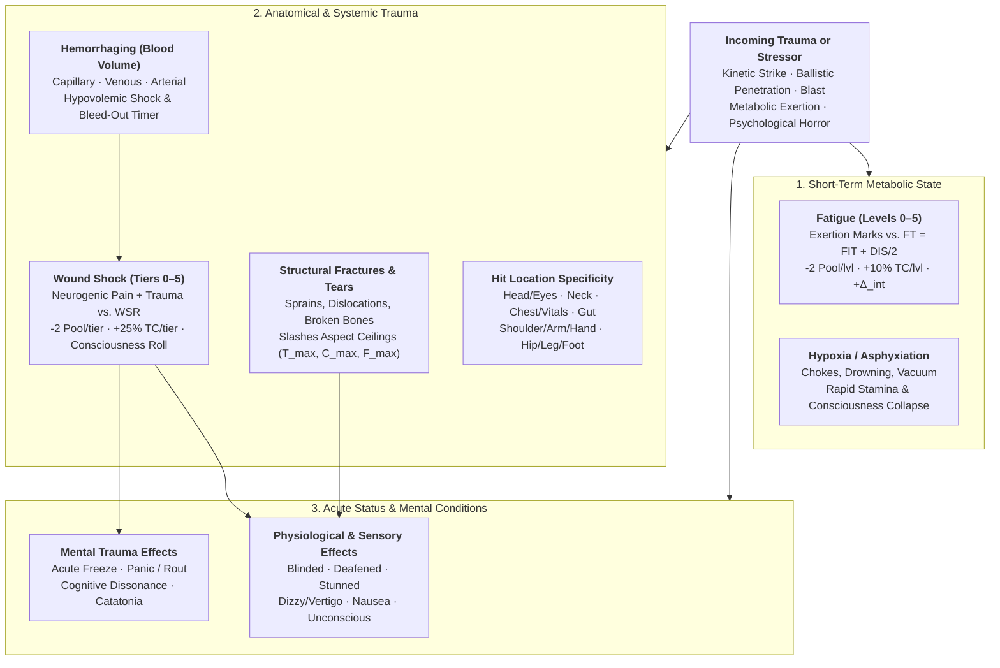

# Satya TTRPG Health, Anatomical Trauma, Fatigue & Mental Conditions

This chapter defines the canonical **Health, Anatomical Trauma, Physiological Status, and Mental Condition System** for **Satya** (for definitions of all mathematical variables and trauma/stamina symbols such as $\text{FT}, \text{WSR}, T_{\max}, C_{\max}, F_{\max}, \text{TN}_P, \text{TN}_{GM}$, see the **[Mathematical Notation, Variables & Formula Glossary](../01-foundation/mathematical_notation_glossary.md)**). As established in **[Combat Architecture, Tactical Triad & Pools](../05-combat/tactical_triad_and_pools.md)**, Satya completely rejects ablative "Hit Points" (`HP`). A human being is not a uniform sack of numeric points that operates at `100%` efficiency until reaching `0`.

Instead, Satya models human survivability and degradation across **five interconnected physiological and psychological tracks**:
1. **Hit Locations & Anatomical Specificity** (Where the trauma lands and which biomechanical ceilings $T_{\max}, C_{\max}, F_{\max}$ or senses it disables)
2. **Physical Short-Term Damage** (Metabolic **Fatigue**, Lactic Burn, and Breath/Oxygen Deprivation)
3. **Physical Long-Term & Acute Structural Damage** (**Broken Bones & Dislocations**, **Hemorrhaging & Blood Loss**, **Internal Organ Trauma**, and **Systemic Wound Shock**)
4. **Physiological & Sensory Status Effects** (`Blinded`, `Deafened`, `Stunned`, `Dizzy`, `Nausea`, `Unconscious`, etc.)
5. **Mental & Psychological Damage Effects** (`Acute Mental Shock`, `Panic`, `Dissociation`, and `Catatonia`)

---

## 1. Hit Locations & Specificity of Damage Effects

When a melee strike, projectile, or shrapnel fragment hits a target, **where** it lands determines its mechanical effect.

### 1.1 Determining Hit Location (`1d20` Roll vs. `Control` Called Shots)

- **Default / Unaimed Hit (`1d20` Roll)**: If the attacker did not target a specific zone (or scored only `+1` net success on a called shot), roll `1d20` on the **Anatomical Hit Location Table** below.
- **Targeted / Called Shot (`Control` Precision)**:
  - An attacker may declare a specific Hit Location before rolling by accepting an External Difficulty modifier ($\Delta_{\text{ext, loc}}$) offset by their **`Control` ($C$)** allocation:
    - **Broad Zone** (Torso, Left/Right Leg, Left/Right Arm): **$\Delta_{\text{ext}} = +2$** (waived if attacker's `Control` exceeds defender's `Control` by `+3+`).
    - **Specific Sub-Zone / Joint** (Knee, Wrist/Hand, Shoulder, Pelvis, Liver, Face/Jaw): **$\Delta_{\text{ext}} = +4$**.
    - **Vital Pinpoint / Gap in Armor** (Eye/Optic Slit, Carotid Artery, Cranial Ocular Box, Heart): **$\Delta_{\text{ext}} = +8$**.

### 1.2 Master Anatomical Hit Location & Specificity Table

| `1d20` | Hit Location (Sub-Zones) | Called Shot $\Delta_{\text{ext}}$ | Primary Aspect Ceiling Slashed | Specific Anatomical & Mechanical Effects |
| :---: | :--- | :---: | :---: | :--- |
| **`1`** | **Foot / Ankle** *(L or R)* | `+4` | **Tempo Cap ($T_{\max}$)** `-2` / `-5` / `-10` | **Mobility Anchor**: Fractured tarsals or severed Achilles locks running/sprinting; `-4` to `Effective Root` against sweeps. |
| **`2–3`** | **Calf / Shin (Tibia/Fibula)** *(L or R)* | `+2` *(Leg)* | **Tempo Cap ($T_{\max}$)** `-2` / `-5` / `-10` | **Footwork Degradation**: Muscle cramp or tibial fracture; Tier 3+ fracture prevents standing without support. |
| **`4`** | **Knee Joint (Patella/ACL)** *(L or R)* | `+4` | **Tempo Cap ($T_{\max}$)** & **Root** `-4` / `-8` / `Locked 0` | **Joint Collapse**: High susceptibility to Blunt/Leverage trauma; Tier 2+ tear/dislocation forces immediate **Prone** check. |
| **`5–6`** | **Thigh (Femur / Femoral)** *(L or R)* | `+2` *(Leg)* | **Tempo Cap ($T_{\max}$)** & **Force ($F_{\max}$)** | **Arterial Hazard**: Deep Piercing/Slashing wounds risk **Femoral Arterial Bleed**; broken femur inflicts immediate `Wound Shock +3`. |
| **`7`** | **Pelvis / Hip Girdle / Groin** | `+4` | **Tempo ($T_{\max}$)** & **Force ($F_{\max}$)** | **Center of Mass Structural Lock**: Pelvic fracture locks `Tempo = 0` (cannot walk/stand) and inflicts excruciating neurogenic shock. |
| **`8–10`** | **Abdomen / Gut / Liver / Spleen** | `+2` *(Torso)* | **Force Cap ($F_{\max}$)** & **Pool ($P_{\text{eff}}$)** | **Visceral Shock & Nausea**: Blunt liver/solar-plexus hit triggers **`Nausea` / `Winded`**; penetrating gut wound causes sepsis & internal bleed. |
| **`11–13`** | **Chest / Ribcage / Lungs** | `+2` *(Torso)* | **Force Cap ($F_{\max}$)** & **`FIT`** | **Respiratory Trauma**: Cracked ribs slash `Force Cap` and impose pain when breathing (`-4 FIT`); penetrating hit causes **Pneumothorax** (collapsed lung). |
| **`14`** | **Vital Thoracic (Heart / Spine / Aorta)** | `+8` | **All Ceilings ($T, C, F$)** | **Catastrophic Vitals**: Penetrating trauma causes massive **Arterial Hemorrhage**; spinal hit causes immediate lower-body **Paralysis**. |
| **`15`** | **Shoulder / Clavicle / Scapula** *(L or R)* | `+4` | **Force Cap ($F_{\max}$)** & **Control ($C_{\max}$)** | **Shoulder Girdle Failure**: Dislocated shoulder or broken collarbone disables lifting, two-handed bracing, and heavy swings with that arm. |
| **`16–17`** | **Upper Arm / Elbow / Forearm** *(L or R)* | `+2` *(Arm)* | **Control ($C_{\max}$)** & **Force ($F_{\max}$)** | **Brachial & Lever Trauma**: Slashes parry/aiming stability (`Control`) and striking power (`Force`); deep cuts risk **Brachial Artery**. |
| **`18`** | **Wrist / Hand / Fingers** *(L or R)* | `+4` | **Control Cap ($C_{\max}$)** & **`DEX`** | **Disarm & Manual Lock**: Tier 2+ hit forces immediate **`FOR/DEX` Disarm Check**; fractured wrist/fingers prevent firing or gripping with that hand. |
| **`19`** | **Neck / Throat / Carotid / Cervical** | `+8` | **All Ceilings** + **Airway/Bleed** | **Lethal Vulnerability**: Blunt strike crushes trachea (**Asphyxiation** + mutes speech `ELO = 0`); blade/bullet severs **Carotid/Jugular** or cervical spine. |
| **`20`** | **Head (Cranium / Face / Jaw / Eyes)** | `+6` to `+8` | **Control Cap ($C_{\max}$)**, **`SIG`**, **`FOC`**, **`ANA`** | **Neurological & Sensory Apex**: Blunt impact triggers **`Stunned` / `Concussed` / `Unconscious`**; eye hit causes **`Blinded`**; jaw hit impairs speech. |

---

## 2. Physical Short-Term Damage: Fatigue, Exertion & Asphyxiation

Short-term physical damage represents reversible metabolic exhaustion, lactic acid accumulation, and oxygen debt that degrade performance within minutes or seconds, but recover with rest, hydration, and breath without requiring surgical intervention.

### 2.1 Exertion Marks & The Fatigue Threshold (`FT`)

Every character has a **Fatigue Threshold (`FT`)** derived from their **Fitness (`FIT`)** and **Discipline (`DIS`)**:

$$\text{Fatigue Threshold (FT)} = \text{FIT} + \left\lfloor \frac{\text{DIS}}{2} \right\rfloor$$

*(At human average `FIT 10, DIS 10`, $\text{FT} = 15$ Exertion Marks per Fatigue Level).*

- **How Exertion Marks Accumulate**:
  1. **Combat High-Output Exchanges**: Allocating $> 50\%$ of your `Tempo Cap` or `Force Cap` on an action adds **`+1` Exertion Mark** (`+2` Marks if *both* exceed `50%`).
  2. **All-Out Sprinting**: Every `20 Ticks` (`5 seconds`) of all-out sprinting adds **`+2` Exertion Marks** (modified by Encumbrance Tier).
  3. **Grappling & Clinch Wrestling**: Every contested grappling exchange adds **`+1` Base Exertion Mark** (plus `+1` if carrying heavier opponent's weight).
  4. **Overland Forced March / Heavy Labor**: Every hour of heavy physical labor or forced marching triggers a `FIT` check or adds **`+1` `fatigue_level`**.
- Whenever accumulated **Exertion Marks $\ge \text{FT}$**, reset Exertion Marks by subtracting $\text{FT}$ and increase **`fatigue_level` by `+1`**.

### 2.2 The Six Fatigue Levels (`0–5`)

| `fatigue_level` | Condition Name | Internal Mod ($\Delta_{\text{int}}$) | Tactical Pool Drain ($\Delta P$) | Time Penalty (`action_time_factor`) | Physiological Symptoms & Recovery Time |
| :---: | :--- | :---: | :---: | :---: | :--- |
| **`0`** | **Fresh / Rested** | `0` *(or `-2` if Focused)* | `0` | `×1.00` (`+0%`) | Normal baseline respiration and neuromuscular response. |
| **`1`** | **Winded / Warm** | **`+2`** ($\delta_{\text{under}} = 8$) | **`-2` Pool** | `×1.10` (`+10%`) | Heavy breathing, light sweat. Recovers `-1` level after **`5 minutes`** of sitting/hydration. |
| **`2`** | **Tired / Gassed** | **`+4`** ($\delta_{\text{under}} = 10$) | **`-4` Pool** | `×1.20` (`+20%`) | Burning muscles, slowed footwork. Recovers `-1` level after **`15–30 minutes`** of rest + water. |
| **`3`** | **Exhausted** | **`+6`** ($\delta_{\text{under}} = 12$) | **`-6` Pool** | `×1.30` (`+30%`) | Trembling limbs, tunnel vision; `SPD` and `FOR` caps reduced by `-2`. Requires **`2 hours`** rest + meal. |
| **`4`** | **Spent / Agonized** | **`+8`** ($\delta_{\text{under}} = 14$) | **`-8` Pool** | `×1.40` (`+40%`) | Near physical collapse; cannot Sprint; must pass `FIT/DIS` check to stay standing after high exertion. Requires **`8 hours`** sleep. |
| **`5`** | **Metabolic Collapse** | **`+10`** ($\delta_{\text{under}} = 16$) | **`-10` Pool** | `×1.50` (`+50%`) | **Unconscious** (or `Pinned/Prone` gasping); risks rhabdomyolysis or cardiac arrest if forced further. Requires **`24+ hours`** bedrest. |

### 2.3 Breath-Holding, Choking & Asphyxiation

- **Breath-Holding Capacity**: A character who takes a full breath before submerging or entering toxic smoke can hold their breath for **$40 \times \text{FIT}$ Ticks** ($10 \times \text{FIT}$ seconds; `100 seconds` at `FIT 10`) while calm/stationary, or **$16 \times \text{FIT}$ Ticks** ($4 \times \text{FIT}$ seconds; `40 seconds` at `FIT 10`) while fighting or swimming vigorously.
- **Airway Crush / Drowning / Vacuum**: Once breath runs out (or immediately if surprised without air), the character suffers **`+1` `fatigue_level` every `20 Ticks` (`5 seconds`)** until reaching `Fatigue 5` (**Unconscious**), followed by hypoxic brain death after `12–20` additional Tactical Windows (`1–2 minutes`) unless resuscitated.
- **Vascular Blood Choke (Rear-Naked Choke / Triangle Choke)**: Compressing the carotid arteries bypasses lung oxygen entirely—cutting cerebral blood flow so the victim loses consciousness in **`24–40 Ticks` (`6–10 seconds`)** if they fail to break the grapple!

---

## 3. Physical Long-Term Damage: Broken Bones, Hemorrhaging & Shock

Long-term physical trauma damages the body's structural skeleton, musculature, vasculature, and organs. Unlike Fatigue, structural wounds do not vanish after a short rest; they require medical stabilization, surgery, and weeks or months of biological healing.

### 3.1 Structural Wound Severity Tiers (`Tiers 1–5`)

When a strike or projectile hits a target (after resolving Armor Protection Rating $\text{PR}$ vs. Penetration $\text{Pen}$ and Behind-Armor Blunt Trauma $\text{BABT}$; see **[Ranged Combat, Granular Ballistics & Armor](../05-combat/ranged_combat_and_armor.md#4-terminal-ballistics-how-kinetic-energy-caliber--inverse-accuracy-determine-damage)**), the net **Effective Trauma Magnitude**—derived for firearms from **Impact Kinetic Energy ($I_{\text{KE}}$)**, **Caliber Crush ($I_{\text{cal}}$)**, **Inverse Accuracy Projectile Wobble/Yaw ($W_{\text{yaw}}$)**, and $+\lfloor \Delta M / 2 \rfloor$ cascade successes—inflicts one of **5 Structural Wound Tiers** on the struck Hit Location:

| Wound Tier *(Net Effective Trauma)* | Clinical Severity | Aspect Ceiling Penalty ($T_{\max}, C_{\max}, F_{\max}$) | Wound Shock Added (`wound_shock_index`) | Typical Tissue, Bone & Vascular Damage *(Note: Penetrating rounds with Wobble $W_{\text{yaw}} \ge 2$ inflict **`+1` Bleed Grade** from tumbling/keyholing cavitation!)* |
| :---: | :--- | :---: | :---: | :--- |
| **Tier 1** *(`Trauma 1–2`)* | **Superficial / Minor** | **`-2`** to Location's Ceiling | `+0` *(or `+1` if `WSR < 10`)* | Contusion, shallow laceration, mild Grade-I sprain; **Capillary Bleed (Grade 1)**. Heals in `3–7 days`. |
| **Tier 2** *(`Trauma 3–5`)* | **Moderate Trauma** | **`-5`** to Location's Ceiling | **`+1` Shock Tier** | Deep muscle tear, Grade-II ligament tear, hairline bone fracture, or clean through-and-through flesh wound; **Venous Bleed (Grade 2)**. Heals in `2–4 weeks`. |
| **Tier 3** *(`Trauma 6–8`)* | **Severe / Fracture** | **`-10` (Limb Disabled)** | **`+2` Shock Tiers** | **Complete Bone Fracture**, joint dislocation, severed tendon, or perforated hollow organ; **Major Venous / Visceral Bleed (Grade 3)**. Requires surgery; `6–12 weeks` recovery. |
| **Tier 4** *(`Trauma 9–11`)* | **Critical / Maiming** | **Locked at `0`** | **`+3` Shock Tiers** | **Comminuted / Compound Fracture**, shattered joint, ruptured solid organ (liver/spleen/lung), or **Arterial Severance (Grade 4)**. Immediate life threat; `3–6 months` rehab. |
| **Tier 5** *(`Trauma 12+`)* | **Catastrophic / Lethal** | **Locked at `0` (Destroyed)** | **`+4` Shock Tiers** | **Traumatic Amputation**, crushed cranium, transected spinal cord, or ruptured heart/aorta. Instant incapacitation; fatal within seconds without trauma surgery. |

### 3.2 Broken Bones & Joint Dislocations

Skeletal integrity is the mechanical frame through which muscles transmit **Force (`FOR`)**, maintain **Control (`DEX/KIN`)**, and generate **Tempo (`SPD`)**:

1. **Hairline / Non-Displaced Fracture (Tier 2)**:
   - The bone remains aligned but cracks under load. Slashes the limb's Aspect Ceiling by **`-5`**.
   - **Aggravation Risk**: If the character allocates $> 50\%$ of their base ceiling into that limb's aspect (e.g., sprinting on a hairline tibial fracture or punching with a cracked metacarpal), they must pass a **`HLT` check ($\Delta_{\text{ext}} = +4$)** or the bone snaps into a **Tier 3 Complete Fracture**!
2. **Joint Dislocation (Shoulder, Patella, Elbow, Hip, Finger — Tier 2/3)**:
   - Mechanically locks the joint (`Control` and `Force` for that limb reduced by `-8` or locked to `0`) until reduced ("popped back in") via a *First Aid* or *Orthopedic Medicine* check (`DEX/INS`, taking `20 ticks`), which leaves a `-3` residual sprain penalty.
3. **Complete / Compound Fracture (Tier 3/4 — Femur, Humerus, Radius/Ulna, Ribs, Pelvis, Spine)**:
   - **Extremity Fracture**: Locks the limb's functional contribution to `0`. A broken arm cannot hold a weapon or shield; a broken leg reduces standing `Tempo` to `0` (hopping/crawling only) and halves `Effective Root`.
   - **Ribcage Fracture / Flail Chest**: Slashes `Force Cap` by `-5` to `-10` and imposes **`+1` Exertion Mark every `20 ticks`** of combat due to shallow, agonizing respiration.
   - **Bone Fragment Vascular Hazard**: A displaced fracture of the **Femur** or **Humerus** has a `50%` chance (on a failed `HLT` roll) of lacerating the adjacent **Femoral** or **Brachial Artery**, triggering **Arterial Hemorrhage**!

### 3.3 Hemorrhaging & Blood Volume (`bleed_rate`)

Every human character has a baseline **Blood Volume Track of `10.0 Units`** (representing `~5.0 liters` of circulating blood, where `1 Unit ≈ 500 mL`, roughly one standard blood donation bag).

#### The Four Hemorrhage Grades

| Bleed Grade | Vascular Source | Blood Volume Loss Rate | Natural Clotting (`HLT` Check) | Medical Intervention Required |
| :--- | :--- | :---: | :--- | :--- |
| **Grade 0** | **None / Contusion** | `0 Units` | Automatic | None. |
| **Grade 1** | **Capillary / Minor Ooze** | `0.25 Units / Hour` | Clots automatically in `5–10 min` (`HLT >= 8`). | Direct pressure or simple adhesive bandage (`8 ticks`). |
| **Grade 2** | **Venous Hemorrhage** | **`0.5 Units / Minute`** (`1 Unit / 480 Ticks`) | Roll `HLT` ($\Delta_{\text{ext}} = +4$) every `5 min` to slow by `1` grade. | Pressure dressing / wound packing (*First Aid* `N=1`, `20 ticks`). |
| **Grade 3** | **Major Venous / Visceral** | **`1.0 Unit / 20 Ticks`** (`1 Unit / 5 Seconds`) | **Cannot clot naturally.** | Hemostatic gauze packing (`QuikClot`) + pressure or *Trauma Surgery*. |
| **Grade 4** | **Arterial Severance** *(Carotid, Femoral, Brachial, Subclavian, Aorta)* | **`1.0 Unit / 4 Ticks`** (`1 Unit / 1 Second`) | **Cannot clot naturally.** Unconsciousness in `4–6 seconds` (`16–24 ticks`)! | Immediate **Tourniquet (`CAT`, `24 ticks`)** for limbs, or surgical clamping for junctional/torso arteries. |

#### Hypovolemic Shock Progression (Cumulative Blood Volume Lost)

As **Blood Volume Lost** increases from `0` toward `10 Units`, the character suffers progressive hypovolemic degradation:
- **`1.0–1.5 Units Lost` (Class I — `10–15%` Blood Loss)**: Mild tachycardia; `+1` `fatigue_level`.
- **`2.0–3.0 Units Lost` (Class II — `20–30%` Blood Loss)**: Pallor, cold clammy skin, anxiety; **`+1` `wound_shock_index`**, **`+2` `fatigue_level`**, `Dizzy` (`-2 KIN`).
- **`3.5–4.5 Units Lost` (Class III — `35–45%` Blood Loss)**: Severe hypotension, confusion, air hunger; **`+3` `wound_shock_index`**, **`+4` `fatigue_level`**, must roll `HLT/DIS` every `20 ticks` (`5s`) or fall **Unconscious**.
- **`5.0+ Units Lost` (Class IV — `> 50%` Blood Loss)**: **Immediate Unconsciousness & Coma**; fatal cardiac arrest occurs within **`240 Ticks` (`1 minute`)** unless whole blood / plasma volume expanders are transfused and the bleed is halted.

### 3.4 Systemic Wound Shock (`wound_shock_index`) & `WSR` Saves

**Wound Shock (`wound_shock_index`, `0–5`)** represents the combined neurogenic shock (overwhelming nociceptive pain overload) and physiological trauma response:

- **Wound Shock Resistance (`WSR`)**:
  $$\text{WSR} = \text{HLT} + \left\lfloor \frac{\text{DIS}}{2} \right\rfloor$$
- **Immediate Consciousness & Shock Check**:
  Whenever a character takes a **Tier 2+ Wound** (or accumulates **`wound_shock_index >= 2`**), they immediately roll a contested `2d20` check using **`HLT / DIS`** ($C_P = \lfloor(\text{HLT} + \text{DIS})/2\rfloor$, $\text{TN}_P = 31 - C_P$) against the GM's hidden **1-Pair Tiered Resistance Roll** ($\text{TN}_{GM} = 21 - \Delta_{\text{ext}}$ with $\Delta_{\text{ext}} = +2 \times \text{wound\_shock\_index}$):
  - **`ExtraordinarySuccess` ($\Delta M \ge +2$)**: The character grits their teeth through the agony, reducing the effective `wound_shock_index` penalty by **`-1` tier** for the current scene.
  - **`CleanSuccess` / `PartialSuccess` ($S_P \ge S_{GM}$ or `LuckyBreakSuccess`)**: The character stays conscious, suffering the standard `wound_shock_index` penalties (`-2` Tactical Pool per tier, `+25%` `action_time_factor` per tier, and $+\Delta_{\text{int}}$).
  - **`CleanFailure`**: The character is **`Stunned` for `8 Ticks` (`2 seconds`)**, drops to their knees or Prone, and must make an immediate **Morale Check**.
  - **`BotchFailure`** *(or any failure at `wound_shock_index >= 4`)*: Neurogenic syncope—the character blacks out and falls **Unconscious**!

---

## 4. Acute Physiological & Sensory Status Conditions

Status effects in Satya are never arbitrary labels; each condition directly modifies specific **Characteristics**, **Aspect Ceilings**, or **Tick Clock behavior**:

| Status Condition | Typical Causes | Mechanical Effects on Characteristics, Pool & Action Clock | Recovery / Mitigation |
| :--- | :--- | :--- | :--- |
| **`Dazzled` / `Blurred Vision`** | Tactical flashlight strobe, sweat/blood in eyes, mild concussion, tear gas. | **`Sight (SIG)` reduced by `-4` to `-6`**; Ranged `Control Cap` reduced by **`-3`**; `+2` $\Delta_{\text{ext}}$ on visual tasks. | Wipe eyes (`6 ticks`) or blink clear after `20–40 ticks` (`5–10s`). |
| **`Blinded`** | Flashbang detonation, pepper spray/CS gas, optic nerve/eye trauma, pitch darkness. | **`Sight (SIG) = 0`**; Ranged combat impossible except blind suppression (`Control = 0`); Melee `Control Cap` halved (unless compensated by `HEA`/`TAC` check in clinch range); `-4` to `Tempo Cap`. | Temporary flash blindness clears in `1–3 minutes` (`HLT` check); structural eye trauma requires surgery. |
| **`Tinnitus` / `Deafened`** | Unsuppressed gunfire indoors, grenade blast overpressure, ruptured eardrum. | **`Hearing (HEA)` reduced by `-6` (`Tinnitus`) or locked to `0` (`Deafened`)**; cannot hear verbal callouts/footsteps; **`+2` penalty to `OODA` Initiative**. | Electronic ear-pro prevents it; blast tinnitus fades over hours; ruptured tympanic membrane heals in `2–4 weeks`. |
| **`Stunned` / `Dazed` (`Concussed`)** | Blunt head impact (hook to the jaw, baton strike, blast wave), taser/stun gun. | **Immediate Clock Freeze**: Advances character's clock by **`+4` to `+12` Ticks (`1–3s`)** with **`Guard = 0`**; afterwards, **`Concussed`** imposes **`-4` to `ANA`, `FOC`, `INS`, `MEM`** and **`+0.25` `action_time_factor`**. | `HLT` check clears acute `Stun`; true cerebral concussion requires `3–14 days` cognitive rest. |
| **`Dizzy` / `Vertigo` / `Disoriented`** | Inner-ear (vestibular) trauma, blood loss, hypoxia, neurotoxins, zero-G spin. | **`Kinesthesis (KIN)` reduced by `-6`**; **`Effective Root` halved** (easily tripped/thrown); moving faster than a walk requires a `KIN` check ($\Delta_{\text{ext}} = +4$) or character stumbles **Prone**. | Stabilizing against a wall/floor (`8 ticks`) halves penalty while stationary; clears when underlying cause resolves. |
| **`Nausea` / `Sickened` / `Retching`** | Solar plexus / liver / groin strike, radiation sickness, poison, severe pain, motion sickness. | **`+4` to Internal Difficulty ($\Delta_{\text{int}}$)**; **`Fitness (FIT)` halved**; on a failed `HLT` check under exertion, spends **`12 Ticks` (`3s`) retching** (`Control = 0, Tempo = 0`). | Antiemetic medication (`Ondansetron` auto-injector) suppresses symptoms in `2 minutes`; visceral blow nausea fades in `1–5 minutes`. |
| **`Pinned` / `Immobilized` / `Paralyzed`** | Grappling mount/pin, structural debris, neurotoxin/spinal cord trauma, neuromuscular taser lock. | **`Tempo (T) = 0`** (cannot translate in space); if **Paralyzed** (neurological/taser), **`Control = 0` and `Force = 0`** for affected limbs. | Break grapple (`FOR/KIN` vs. opponent's `Control + Force`); taser lock ends when current ceases (`20 ticks`). |
| **`Unconscious` / `Comatose`** | `Wound Shock >= 4`, `Fatigue 5`, carotid choke, cranial knockout, Class III/IV blood loss. | **`Tempo = 0, Control = 0, Force = 0`**; collapses Prone; completely unaware of surroundings (`AWR = 0`). | Vascular choke wakes in `20–60s`; concussive KO wakes in `1–30 min` (`HLT` check); **Coma** requires ICU care. |

---

## 5. Mental Damage & Psychological Trauma Effects

Just as physical force fractures bone and drains blood, extreme terror, horrific violence, ideological shattering, and prolonged **Cognitive Dissonance** (see **[Psyche, Morale & Social Combat](../04-psyche-and-social/psyche_morale_and_social_combat.md)**) inflict acute and chronic **Mental Trauma**.

### 5.1 Acute Mental Trauma Conditions

When a character suffers a catastrophic failure on a **Discipline (`DIS`) Morale / Horror / Composure Check**—or when their **Social Composure (`CMP`)** is reduced below `0` while under extreme psychological stress—they suffer one of four acute mental states:

| Mental Condition | Severity Tier | Psychological Mechanism & Trigger | Mechanical Effect on Action Clock, Pool & Behavior |
| :--- | :---: | :--- | :--- |
| **1. Acute Mental Shock (`OODA Freeze`)** | **Tier 1** *(Transient)* | Startle overload, witnessing sudden gruesome death, or unexpected ambush (`Tachypsychia` / auditory exclusion). | **Freezes for `6–12 Ticks` (`1.5–3.0s`)** on the Action Clock (cannot initiate actions; passive `Control` capped at baseline $B$). Clears after the freeze ticks elapse or when an ally shouts/shakes them (`4 ticks`). |
| **2. Panic / Fight-or-Flight Override** | **Tier 2** *(Acute)* | Morale drops to **Panic**, claustrophobic entrapment, fire, or imminent execution. | **Pool `-4`**; **Amygdala Hijack**: Rational `ANA` and `FOC` drop by `-6`. If flight is possible, **`100%` of Pool is locked into `Pure Tempo`** to flee; if cornered with high `AGG`, shifts into blind **Feral Rage** (`Control <= P_eff / 4`). |
| **3. Dissociation / Shell Shock ("Thousand-Yard Stare")** | **Tier 3** *(Sub-Acute)* | Prolonged bombardment, surviving a mass-casualty event, or executing an act that violently shatters a core `Psyche` trait (`P >= 16` or `P <= 4`). | **Emotional & Sensory Detachment**: The character goes numb—immune to further **Fear/Panic**, **but** suffers **`-6` to `ITU`, `INS`, `FOC`, and `ELO`**, **`+0.30` `action_time_factor`**, and cannot initiate complex plans without direct step-by-step guidance from a leader. |
| **4. Catatonia (Psychomotor Shutdown)** | **Tier 4** *(Critical)* | Complete collapse of psychological defense (`Botch` on `DIS` check at `0` Composure, `3+` unresolved **Cognitive Dissonance** stacks during existential trauma, or prolonged torture). | **Total Psychomotor Lock**: The character curls up, stares blankly into space, or becomes rigid and mute (**`Tempo = 0`, `Control = 0`, `Force = 0`, `ELO = 0`**). Completely unresponsive to threats until stabilized in a safe environment via *Clinical Psychology & Psychiatry* (`INS/ELO`) or anchored by a trusted loved one (`BLG`). |

### 5.2 Long-Term Psychological Scars & Trauma Recovery

- **Accumulated Trauma & `Psyche` Drift**: Surviving **Tier 3 (`Dissociation`)** or **Tier 4 (`Catatonia`)** mental trauma permanently marks the character with **`2` Drift Marks** on the relevant `Psyche` axis (e.g., shifting `Aggressiveness`, `Belongingness`, or `Openness`) and may leave a situational **Trauma Trigger** (imposing `+4` $\Delta_{\text{morale}}$ when exposed to the specific stressor, such as enclosed spaces, fire, or a specific faction).
- **Decompression & Psychiatric Therapy**: Removing long-term mental strain and Trauma Triggers requires Downtime scenes combining safe shelter, supportive social bonds (`BLG`/`EXT`), or professional *Clinical Psychology & Psychiatry* (`INS/ELO`) cascade rolls over weeks of campaign time.

---

## 6. Medical Triage, Stabilization & Healing Timelines

1. **The "Golden Hour" & Field Stabilization (*First Aid / Paramedicine* `DEX/DIS`)**:
   - Halting **Grade 2–4 Hemorrhage** (via tourniquets, hemostatic packing, and pressure dressings) and clearing obstructed airways within the first `60 minutes` (`14,400 ticks`) prevents death from hypovolemic shock.
   - Administering field analgesics (morphine/ketamine/fentanyl lozenge) temporarily reduces **`wound_shock_index` by `-1` or `-2` tiers**, but imposes **`-2` to `-4` on `FOC`, `ANA`, and `SPD`** (drowsiness/sedation).
2. **Definitive Surgical Repair (*Trauma & General Surgery* `DEX/FOC`, Gate `Class A`)**:
   - **Tier 3–5 Structural Wounds** (internal organ repair, vascular grafting, open-reduction internal fixation of fractures) require a sterile operating theater (`Tool Tier +0` to `-4`) and a *Trauma Surgery* cascade check.
3. **Natural & Assisted Recovery Rate (`HLT`)**:
   - Once stabilized and surgically set, a character rolls a weekly **`HLT`** recovery cascade (`N = 1` natural, or `N = Medicine Skill` of attending physician):
     - **Tier 1 (Superficial)**: `3–7 days` (`-1` day per `HLT` success).
     - **Tier 2 (Moderate / Hairline Fracture / Grade II Tear)**: `2–4 weeks`.
     - **Tier 3 (Complete Fracture / Major Surgery)**: `6–12 weeks` (transitions to a Tier 1 `-2` stiffness penalty during final rehabilitation).
     - **Tier 4–5 (Maiming / Amputation)**: Permanent structural loss unless reconstructed via **2031–2035 Cybernetic / Myomer Prosthetics** or bio-printed tissue grafts.
