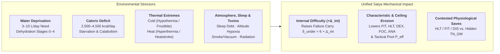

# Satya TTRPG Movement, Encumbrance, Vehicles & Environmental Survival

This chapter defines the canonical **Movement, Load-Bearing Encumbrance, Vehicular Pursuits & G-Force Physics, and Environmental Survival Systems** for **Satya** (for definitions of all mathematical variables and formulas such as $\text{SF}, V_{\text{sprint}}, W_{\text{req}}, \text{CLO}, \text{Sv}$, see the **[Mathematical Notation, Variables & Formula Glossary](../01-foundation/mathematical_notation_glossary.md)**). In keeping with Satya's simulation philosophy, movement speed is not an arbitrary fixed integer (`"30 feet per turn"`) shared by every human regardless of stature, conditioning, or backpack weight, nor are environmental hazards hand-waved when operators deploy into deserts, mountains, maritime storms, or depressurized orbital habitats.

---

## 1. Movement Architecture: Combat & Non-Combat Gaits

A character's movement velocity is governed by their **Speed (`SPD`)**, **Fitness (`FIT`)**, **Kinesthesis (`KIN`)**, **Height (`HGT` stride length)**, **Encumbrance Tier**, and any **[Lower-Extremity Wounds](health_and_trauma.md#1-hit-locations--specificity-of-damage-effects)** (which directly slash their **Tempo Cap $T_{\max}$**).

### 1.1 Baseline Velocity Formulas (`SPD`, `FIT` & `HGT`)

1. **Stride Factor (`SF`)**:
   $$\text{SF} = \frac{\text{HGT}}{1.75\text{ m}}$$
   *(Equals `1.00` for a `1.75 m` human; `~1.09` for a `1.90 m` tall runner; `~0.91` for a `1.60 m` character).*
2. **Maximum Sprint Velocity ($V_{\text{sprint}}$ in Meters per Second)**:
   $$V_{\text{sprint}} = \big(4.0 + 0.35 \times \text{SPD}_{\text{eff}}\big) \times \text{SF}$$
   - At Human Average (`SPD 10, HGT 1.75 m`): **$7.50\text{ m/s}$** (`27.0 km/h`, or **`1.88 meters per Tick`** since `1 second = 4 Ticks`).
   - At Athletic (`SPD 14`): **$8.90\text{ m/s}$** (`32.0 km/h`, or **`2.23 m/Tick`**).
   - At Peak Human (`SPD 18`, Olympic Sprinter): **$10.30\text{ m/s}$** (`37.1 km/h`, or **`2.58 m/Tick`** — matching a sub-10-second 100m dash!).
3. **Sustained Overland Pace Factor**:
   While **`SPD`** governs explosive short-term burst speed, **`Fitness (FIT)`** governs how long a character can sustain a run or forced march without accumulating **Fatigue (`fatigue_level`)**.

---

### 1.2 Tactical Combat Movement (Meters per Tick & Triad Interaction)

On the **[Count-Up Action Clock](../02-core-mechanics/action_economy_and_ooda.md)** (`1 Tick = 0.25s`, `4 Ticks = 1s`, `20 Ticks = 5s`), a combatant chooses their **Movement Gait**, which determines how far they move per Tick and how much of their **[Tactical Pool ($P_{\text{eff}}$)](../05-combat/tactical_triad_and_pools.md)** is available for simultaneous shooting or melee (`Control` & `Force`):

| Combat Gait Mode | Fraction of $V_{\text{sprint}}$ | Speed at `SPD 10` (`m/s` · `m/Tick`) | Distance per `10 Ticks` (`2.5s`) | Tactical Triad (`TCF`) & Exertion Impact |
| :--- | :---: | :---: | :---: | :--- |
| **1. Prone / Low Crawl** | `8%` | `0.6 m/s` · **`0.15 m/Tick`** | `1.5 m` | Maximizes low cover profile (`+4` cover bonus vs. ranged); melee `Tempo Cap` reduced by `-4`; `+1` Exertion Mark per `20 ticks`. |
| **2. Stealth Creep / Crouch-Walk** | `18%` | `1.35 m/s` · **`0.34 m/Tick`** | `3.4 m` | Quiet footplacement (*Stealth* `KIN/FOC` at `+0` $\Delta_{\text{ext}}$); full weapon sight alignment (`Control` uncapped). |
| **3. Combat Glide / Tactical Walk** | `35%` | `2.6 m/s` · **`0.65 m/Tick`** | `6.5 m` | Brisk heel-to-toe advance ("slicing the pie"); allows simultaneous aimed/controlled fire at **`+2` to Recoil (`R`)** and `0` Exertion Marks. |
| **4. Bounding Run / Hustle** | `65%` | `4.9 m/s` · **`1.22 m/Tick`** | `12.2 m` | Requires allocating at least **`Tempo >= B`** (neutral baseline); shooting on the move imposes **`+4` to Recoil (`R`)** and caps ranged `Control` at $\lfloor C_{\max}/2 \rfloor$; `+1` Exertion Mark per `20 ticks`. |
| **5. All-Out Sprint (`Pure Tempo`)** | `100%` | `7.5 m/s` · **`1.88 m/Tick`** | `18.8 m` | Requires **`Pure Tempo` allocation** (`Force = 0`, `Control <= 2`); cannot fire aimed shots; accumulates **`+2` Exertion Marks per `20 ticks` (`5s`)**. |

### 1.3 Special Movement Modes (Jumping, Climbing, Swimming & Zero-G)

1. **Jumping & Vaulting (*Jumping* / *Parkour* `KIN/SPD`, powered by `POW`)**:
   - **Running Broad Jump**: Base distance $= 2.0\text{ m} + (0.25\text{ m} \times \text{POW}) + (0.3\text{ m} \times \text{Cascade Successes})$ (`4.5 m` baseline at `POW 10`).
   - **Standing Broad Jump**: `55%` of Running Broad Jump (`~2.5 m` at `POW 10`).
   - **Running High Jump / Wall Scaling**: Base vertical clearance $= 0.6\text{ m} + (0.06\text{ m} \times \text{POW}) + (0.1\text{ m} \times \text{Successes})$ (`1.2 m` waist/chest vault without hands; add `0.8 × HGT` when grabbing a ledge with hands and pulling up via `FOR/KIN`).
2. **Climbing (`FOR/KIN`)**:
   - **Ladder / Knotted Rope**: `0.5 m/Tick` (`2.0 m/s`).
   - **Rough Wall / Drainpipe / Rock Face**: `0.15 m/Tick` (`0.6 m/s`), requiring a *Climbing* (`FOR/KIN`) cascade check with $\Delta_{\text{ext}}$ set by surface holds and **Encumbrance Tier** (`+2` per Encumbrance Tier).
3. **Swimming (*Swimming & Diving* `FIT/KIN`)**:
   - Unencumbered surface swim speed is **`20%` of $V_{\text{sprint}}$** (`1.5 m/s` or `0.38 m/Tick` at `SPD 10, FIT 10`).
   - **Encumbrance in Water**: Tier 2 (`Tactical Load`) imposes **`+4` $\Delta_{\text{ext}}$** to stay afloat; Tier 3+ (`Heavy Load` / steel plates without flotation) drags the character downward at `1.0 m/s` unless jettisoned (`12 ticks` quick-release cutout)!
4. **Zero-G / Microgravity EVA Movement (*Zero-G Maneuver* `KIN/INS`)**:
   - In orbital or deep-space microgravity, movement follows Newtonian momentum: pushing off a bulkhead imparts a constant velocity vector ($v = \text{Impulse} / \text{MAS}$) that continues indefinitely until arrested by a handhold, mag-boot lock, or RCS thruster burst.
   - Missing a *Zero-G Maneuver* check while translating across an open bay leaves the character **Adrift** (`Tempo = 0` for directional changes unless firing a thruster or tether).

---

### 1.4 Non-Combat & Overland Travel Pace

For campaign travel across cities, wilderness, or operational theaters, movement is tracked per **Minute** (`240 Ticks`) or per **Hour** (`14,400 Ticks`):

| Overland Pace | Speed at `SPD 10, FIT 10` (`km/h` · `m/min`) | Daily Range (`8 hrs`) | Metabolic & Fatigue Cost (`FIT` Check) |
| :--- | :---: | :---: | :--- |
| **Cautious Recon / Trail-Finding** | **`3.0 km/h`** (`50 m/min`) | `24 km` | Allows active *Observation* (`SIG/HEA`) and *Stealth* without penalty; `0` Fatigue if `FIT >= 8`. |
| **Standard Marching / Walking Pace** | **`5.0 km/h`** (`83 m/min`) | `40 km` | `+1` `fatigue_level` after `8 hours` (or `4 hours` at Encumbrance Tier 2+). |
| **Forced March / Double-Time** | **`7.0 km/h`** (`117 m/min`) | `56 km` | Roll **`FIT / DIS`** every **`2 hours`** ($\Delta_{\text{ext}} = +2 \times \text{Encumbrance Tier}$) or gain **`+1` `fatigue_level`**. |
| **Sustained Cross-Country Run** | **`11.0+ km/h`** (`183+ m/min`) | *Burst / 1–2 hrs* | Roll **`FIT`** every **`15 minutes`** or gain **`+1` `fatigue_level`** (marathon runners use *Running* skill `N`). |

#### Terrain Multipliers to Movement Speed
- **Paved Road / Corridor / Dry Sidewalk**: `×1.00`
- **Broken Ground / Tall Grass / Light Woods / Stairs**: `×0.75`
- **Dense Jungle / Mud / Sand Dunes / Rubble**: `×0.50` (`+1` Exertion Mark per interval)
- **Deep Snow / Chest-Deep Marsh / Steep Scree**: `×0.25` (`+2` Exertion Marks per interval)

---

## 2. Encumbrance & Load-Bearing Architecture

Every piece of armor, weapon, ammunition magazine, battery, ration, and medical kit has physical mass in kilograms (`kg`). Satya models encumbrance continuously from the character's **Force (`FOR`)**, **Body Mass (`MAS`)**, and **Load-Bearing Ergonomics**.

### 2.1 Calculating Base Comfort Load ($L_{\text{base}}$)

A character's **Base Uninhibited Load ($L_{\text{base}}$)**—the weight they can wear or carry in balanced webbing without any degradation to combat speed or reflexes—is:

$$L_{\text{base}} = \left(\frac{\text{MAS}}{70.0\text{ kg}}\right) \times \big(\text{FOR} \times 1.2\text{ kg}\big)$$

- **Human Average (`MAS = 70 kg, FOR = 10`)**: **$L_{\text{base}} = 12.0\text{ kg}$** (`~26.5 lbs` — e.g., clothing, light covert vest, service pistol, spare mags, comms, and EDC kit).
- **Strong Operator (`MAS = 85 kg, FOR = 14`)**: **$L_{\text{base}} = 20.4\text{ kg}$** (`~45 lbs` — can carry a carbine, plate carrier, and assault pack at Tier 0/1!).
- **Slight Civilian (`MAS = 55 kg, FOR = 8`)**: **$L_{\text{base}} = 7.5\text{ kg}$** (`~16.5 lbs`).

### 2.2 Ergonomic Load Multipliers (How Weight Is Carried)

Not all kilograms are equal. Twenty kilograms distributed across a padded internal-frame rucksack and hip belt is vastly easier to move with than a 20 kg steel ammo crate carried in one's hands:

$$\text{Effective Load } (L_{\text{eff}}) = \sum \big(\text{Item Mass}_i \times \text{Ergonomic Factor}_i\big) - \text{Exo-Frame Offset}$$

| Carry Method / Ergonomic Distribution | Ergonomic Factor | Mechanical Explanation |
| :--- | :---: | :--- |
| **Tailored Clothing / Articulated Body Armor / Duty Belt** | **`×0.8`** | Distributed snugly across the body's center of mass. |
| **Standard Tactical Webbing / Balanced Internal-Frame Rucksack** | **`×1.0`** | Standard benchmark load transfer to hips and shoulders. |
| **Slung Bag / Asymmetric Duffel / Unbalanced Pack** | **`×1.3`** | Swings during movement; shifts center of balance (`KIN`). |
| **Carried in Hands / Fireman-Carrying a Body** | **`×1.5`** | Occupies hands (`Control` penalty) and taxes arm/back muscles directly. |
| **Powered Exo-Rig / Load-Bearing Exoskeleton** *(e.g. Valkyrie Rig)* | **`-15 kg` to `-35 kg` Offset** | Myomer/servo frame transfers load directly to the ground while powered. |

### 2.3 The Five Encumbrance Tiers (`Tiers 0–4`)

Compare the character's **Effective Load ($L_{\text{eff}}$)** against multiples of their **Base Comfort Load ($L_{\text{base}}$)**:

| Encumbrance Tier | Load Ratio ($L_{\text{eff}} / L_{\text{base}}$) | Weight at `70 kg, FOR 10` ($L_{\text{base}} = 12\text{ kg}$) | Tempo Cap ($T_{\max}$) & `KIN` Penalty | Time Multiplier ($\Delta_{\text{enc}}$ to `action_time_factor`) | Exertion & Stamina Impact |
| :--- | :---: | :---: | :---: | :---: | :--- |
| **Tier 0: Unencumbered** | $\le 1.0 \times L_{\text{base}}$ | `0 – 12.0 kg` | `0` | `+0.00` (`+0%`) | Normal exertion and recovery. |
| **Tier 1: Light / Patrol Load** | $1.01\text{–}1.5 \times L_{\text{base}}$ | `12.1 – 18.0 kg` | **`-1` $T_{\max}$** | `+0.05` (`+5%`) | Slight inertia on acrobatic leaps (`+1` $\Delta_{\text{ext}}$ on *Parkour/Swimming*). |
| **Tier 2: Tactical / Fighting Load** | $1.51\text{–}2.5 \times L_{\text{base}}$ | `18.1 – 30.0 kg` | **`-3` $T_{\max}$**, **`-2` `KIN`** | **`+0.10` (`+10%`)** | Standard infantry fighting load; `+1` extra Exertion Mark per combat window. |
| **Tier 3: Heavy / March Load** | $2.51\text{–}4.0 \times L_{\text{base}}$ | `30.1 – 48.0 kg` | **`-6` $T_{\max}$**, **`-4` `KIN`** | **`+0.25` (`+25%`)** | Heavy rucksack; **cannot Sprint** (capped at Bounding Run); dropping rucksack (`4 ticks` quick-release) immediately restores Tier 1/2! |
| **Tier 4: Overloaded / Staggering** | $4.01\text{–}6.0 \times L_{\text{base}}$ | `48.1 – 72.0 kg` | **`-10` $T_{\max}$**, **`-8` `KIN`** | **`+0.50` (`+50%`)** | Walking/staggering only (`0.3 m/Tick`); `+2` Exertion Marks every `20 ticks`. Maximum deadlift/drag limit is $8 \times L_{\text{base}}$. |

---

## 3. Vehicles, High-Speed Chases & Crash / G-Force Physics

Satya's **[Tactical Triad (`Tempo`, `Control`, `Force`)](../05-combat/tactical_triad_and_pools.md)** scales seamlessly from close-quarters foot combat to **vehicular pursuits, aerial dogfights, and orbital docking**:

1. **The Vehicle as a Physical Envelope**:
   - A vehicle provides its own mechanical **Envelope Ceilings**: **Top Speed / Acceleration (`Vehicle Tempo Cap`)**, **Handling & Braking (`Vehicle Control Cap`)**, and **Chassis Mass & Armor (`Vehicle Force / Root Cap`)**.
   - The driver/pilot fills this envelope using their **[Driving / Piloting Skill ($N$)](../03-character/skills_and_trees.md#37-tree-6-athletics-vehicles-aviation--drone-operations-athletic-technical-fieldcraft)** and **`SPD / KIN`** (or **`DEX / FOC`** for remote drones), bounded by the vehicle's ceilings!
2. **Tactical Triad in a Chase or Dogfight**:
   - **Tempo ($T$)**: Throttle commitment—closing or opening the **Chase Range Band** (`Bumper-to-Bumper` $\leftrightarrow$ `Close [15m]` $\leftrightarrow$ `Medium [50m]` $\leftrightarrow$ `Long [150m+]` $\leftrightarrow$ `Lost Visual`).
   - **Control ($C$)**: Steering precision—threading through oncoming traffic, drifting a hairpin corner without spinning out, holding a steady platform for passengers firing from windows, and evading PIT maneuvers.
   - **Force ($F$)**: Ramming, PIT maneuvers, sideswiping, and holding the road (`Vehicle Root`) against collisions or crosswinds.
3. **Collision Kinetic Trauma & High-G Maneuvers**:
   - **Collisions**: Impact severity scales with relative velocity ($\Delta v$) and mass ratio ($m_1 / m_2$), inflicting **Blunt Trauma** across multiple random **[Hit Locations](health_and_trauma.md#1-hit-locations--specificity-of-damage-effects)** (mitigated by seatbelts, airbags, or crash harnesses).
   - **High-G Blackout (`G-LOC`)**: In high-performance aircraft or orbital burn maneuvers exceeding `5G+`, crew members must roll **`HLT / FIT`** (assisted by anti-G flight suits) or suffer **Tunnel Vision (`Dazzled`)** followed by **`G-LOC` (`Unconscious`)**.

---

## 4. Environment & Survival Systems: Water, Food, Temperature & Atmosphere

Environmental survival in Satya operates through the exact same physiological levers as combat trauma: **Internal Cascade Modifiers ($\Delta_{\text{int}}$)**, **Fatigue Levels (`fatigue_level`)**, **Wound Shock (`wound_shock_index`)**, and temporary **Characteristic Degradation (`HLT`, `FIT`, `DEX`, `FOC`, `ANA`)**.

---

### 4.1 Hydration & Water Deprivation

Water is the most acute survival resource after breathable air. A human can survive weeks without food, but in arid heat or heavy combat exertion, lethal dehydration occurs within **`24 to 72 hours`**.

#### Daily Water Requirement ($W_{\text{req}}$)
- **Temperate Climate, Low Activity**: **`3.0 Liters / Day`** (`3.0 kg` mass).
- **Heavy Physical Labor / Forced March**: **`5.0 Liters / Day`**.
- **Hot / Arid Desert or Tropical Jungle (`> 35°C`) + Tactical Gear**: **`8.0 to 10.0 Liters / Day`** (`0.5–0.8 L/hour` sweat loss during daytime movement!).

#### The Five Stages of Dehydration

For every **25% of Daily Water Requirement missed** (or every `2 Liters` of unreplaced sweat deficit), the character advances **+1 Dehydration Stage**:

| Stage | Body Water Deficit | Internal Mod ($\Delta_{\text{int}}$) | Characteristic & Stamina Penalties | Physiological Symptoms & `HLT` Saves |
| :---: | :---: | :---: | :--- | :--- |
| **Stage 0** | `< 2%` | `0` | None | Euhydrated baseline. |
| **Stage 1: Thirsty** | `2–4%` (`~1.5–2.5 L`) | **`+2`** | **`-1` `FIT`**, **`-1` `FOC`**, **`+1` `fatigue_level` floor** | Dry mouth, dark urine, mild headache. Cleared in `30 min` by drinking `1.5 L` water. |
| **Stage 2: Parched** | `5–7%` (`~3.5–5.0 L`) | **`+4`** | **`-3` `FIT`**, **`-2` `SPD/HLT/ANA`**, **`+2` `fatigue_level` floor** | Tachycardia, orthostatic **`Dizzy`** (`-2 KIN`), muscle cramps, cessation of sweating (high **Heatstroke** risk). |
| **Stage 3: Severe** | `8–10%` (`~6.0–7.0 L`) | **`+8`** | **`-6` `FIT/HLT/ANA/FOC`**, **`+4` `fatigue_level` floor** | Sunken eyes, oliguria, delirium/hallucinations (`INS 4`); must roll **`HLT`** every `4 hours` or collapse **Unconscious**. Requires oral rehydration salts or IV saline. |
| **Stage 4: Lethal** | `> 12%` (`> 8.5 L`) | **`+10`** | **Comatose (`All Caps = 0`)** | Hypovolemic shock, acute renal failure, and fatal cardiac arrest within **`1–6 hours`** without IV fluid resuscitation. |

> [!NOTE]
> **Fatigue Floor**: A Dehydration Stage's "`fatigue_level` floor" means the character **cannot reduce their `fatigue_level` below that number** through rest or sleep until they rehydrate!

---

### 4.2 Nutrition, Caloric Deficit & Starvation

- **Daily Caloric Requirement**:
  - **Sedentary / Watch Duty**: `2,000–2,400 kcal/day` (`~0.5 kg` dry field rations).
  - **Standard Patrol / Active Operations**: `3,200–3,800 kcal/day` (`~0.75 kg` MRE / nutrient ration).
  - **Arctic Cold or Heavy Mountain March**: `4,500–6,000 kcal/day` (`~1.2 kg` high-fat rations).
- **Short-Term Fasting & Glycogen Depletion (`Days 1–3` Without Food)**:
  - **First `24 Hours`**: Mild hunger pangs (`+0` mechanical penalty for characters with `DIS >= 10`; `+1` $\Delta_{\text{int}}$ if `DIS < 10`).
  - **`48–72 Hours` (Glycogen Depletion & Early Ketosis)**: Liver glycogen empties; blood glucose dips. Imposes **`+2` to $\Delta_{\text{int}}$**, **`+1` `fatigue_level` floor**, and **`-2` to `FOC` and `FIT`**.
- **Prolonged Caloric Deficit & Starvation (`Days 4–30+`)**:
  - For every **`3 Days` of total starvation** (or every cumulative `10,000 kcal` deficit), the character must make a **`HLT` check ($\Delta_{\text{ext}} = +2 \times \text{Week}$)**:
    - **Catabolic Muscle & Mass Loss**: Body Mass (**`MAS`**) drops by **`-1.5 kg`**, and **`Force (FOR)`**, **`Fitness (FIT)`**, and **`Health (HLT)`** each erode by **`-1` point** (`+2` $\Delta_{\text{int}}$ per week).
    - When **`HLT` or `FOR` reaches `0`** (typically after `30–45 days` without food depending on starting `MAS` and `HLT`), fatal organ failure occurs.

---

### 4.3 Temperature Extremes: Cold (Hypothermia) & Heat (Hyperthermia)

Human core body temperature must remain within a narrow window around **`37.0°C` (`98.6°F`)**. Both extreme cold and extreme heat are governed by the balance between **Ambient Effective Temperature** (including windchill or humidity), **Clothing Insulation / Cooling (`CLO` Rating)**, and **Metabolic Heat Production**.

| Clothing / Suit Tier | Comfort Zone (Light Activity) | Cold Protection Bonus ($\Delta_{\text{cold}}$) | Heat Retention Penalty ($\Delta_{\text{heat}}$) |
| :--- | :---: | :---: | :---: |
| **Light Streetwear / Tropical Uniform** | `+18°C` to `+32°C` | `+0` | `+0` |
| **Cold-Weather Field Jacket & Layers** | `-5°C` to `+15°C` | **`-4` to $\Delta_{\text{ext}}$** vs. Cold | **`+4` to $\Delta_{\text{ext}}$** in Heat `> 28°C` |
| **Extreme Arctic Parka / ECWCS Level 7** | `-35°C` to `-5°C` | **`-8` to $\Delta_{\text{ext}}$** vs. Cold | **`+8` to $\Delta_{\text{ext}}$** in Heat `> 20°C` |
| **Sealed NBC / Heavy Ballistic Armor** | `+10°C` to `+22°C` | `-2` vs. Cold | **`+6` to $\Delta_{\text{ext}}$** *(blocks sweat evaporation!)* |
| **Climate-Controlled EVA / Exo-Rig** | `-150°C` to `+80°C` | **Immune** *(while battery lasts)* | **Immune** *(while coolant/power lasts)* |

#### A. Cold Exposure, Hypothermia & Frostbite
When exposed to temperatures below their clothing's comfort threshold (accelerated `×10` if **submerged in cold water** or soaked in rain with high wind), the character rolls **`HLT / FIT`** every **Hour** (or every **`5 Minutes`** in freezing water):
1. **Cold Stress & Shivering (Core `36.0–35.0°C`)**: Peripheral vasoconstriction numbs fingers and toes. **`Dexterity (DEX)` and `Tactile (TAC)` reduced by `-3`**; **`+2` $\Delta_{\text{int}}$**; `+1` `fatigue_level` from constant shivering.
2. **Mild-to-Moderate Hypothermia (Core `34.9–32.0°C`)**: Violent shivering gives way to muscle rigidity and apathy. **`DEX`, `TAC`, `SPD`, `KIN`, `ANA`, and `FOC` reduced by `-6`**; **`+0.30` `action_time_factor`**; **`+6` $\Delta_{\text{int}}$**.
3. **Severe Hypothermia (Core `< 32.0°C`)**: Shivering stops; paradoxical undressing/delirium, followed by **Unconsciousness** and ventricular fibrillation.
4. **Frostbite (Localized Tissue Freezing)**: In sub-zero windchill (`< -10°C`), exposed skin (fingers, nose, ears, toes) requires a separate **`HLT` check** or suffers **Tier 1 (`Frostnip`: `-2 DEX/TAC`)** to **Tier 3/4 (`Deep Frostbite`: gangrene / permanent digit amputation)** structural damage.

#### B. Heat Exposure, Heat Exhaustion & Heatstroke
When operating in high ambient temperatures (`> 32°C` dry or `> 26°C` at high humidity), especially while wearing body armor or performing high-exertion combat/marching:
- **Sweat Multiplier**: Water consumption requirement increases by **`×2` to `×4`** (`0.5–1.0 L/hour`).
- Every **Hour** (or every **`15 Minutes`** of heavy combat/marching in armor), the character rolls **`FIT / HLT`**:
  1. **Heat Cramps (Stage 1)**: Painful spasms in calves and abdomen; **`-2` to $T_{\max}$ and $F_{\max}$**, **`+1` `fatigue_level`**.
  2. **Heat Exhaustion (Stage 2 — Core `38.5–39.9°C`)**: Profuse sweating, pallor, throbbing headache, **`Dizzy`** (`-4 KIN`) and **`Nausea`** (`+4` $\Delta_{\text{int}}$); **`+3` `fatigue_level`**. Must stop exertion, remove armor, and cool/hydrate in shade immediately.
  3. **Heatstroke (Stage 3 — Core `>= 40.0°C` / `104°F` — Medical Emergency)**: Thermoregulation fails completely; skin becomes hot and dry, CNS dysfunction triggers delirium, seizures, and **Coma**. Inflicts **`+1` Tier of systemic organ trauma every `15 minutes`** until core temperature is rapidly cooled (ice bath, evaporative cooling).

---

### 4.4 Sleep Deprivation, Atmospheric Pressure, Radiation & Toxins

1. **Sleep Deprivation & Circadian Debt**:
   - Humans require **`6–8 hours` of sleep per `24-hour` cycle** (`4 hours` minimum maintenance with a successful `DIS` check).
   - **24 Hours Awake**: **`+2` $\Delta_{\text{int}}$**, **`-1` to `FOC`, `INS`, `ITU`, and `OODA`**.
   - **48 Hours Awake**: **`+4` $\Delta_{\text{int}}$**, **`-3` to `FOC`, `ANA`, `INS`, `ITU`, `MEM`, `OODA`**, **`+2` `fatigue_level` floor**.
   - **72+ Hours Awake**: **`+8` $\Delta_{\text{int}}$**, **`-6` to all Mental & Sensory Characteristics**; auditory/visual micro-hallucinations; whenever stationary for more than `5 minutes`, must pass a **`DIS` check ($\Delta_{\text{ext}} = +6$)** or fall into an involuntary **Microsleep (`Unconscious`)**.
2. **Altitude & Atmospheric Hypoxia**:
   - Above **`2,500 meters` (`8,200 ft`)** unacclimatized (or in a partially depressurized habitat with low $\text{pO}_2$): **`Fitness (FIT)` is reduced by `-2` per `1,000 meters`** above `2,000 m`.
   - Above **`5,500 meters`** without supplemental oxygen: Acute Mountain Sickness (`Dizzy`, `Nausea`), progressing to **HAPE / HACE** (High-Altitude Pulmonary / Cerebral Edema — `HLT` checks every `6 hours`).
   - **Hard Vacuum / Explosive Decompression (`0 atm`)**: Ebullism and rapid deoxygenation of venous blood in the lungs reduces useful consciousness to **`12–16 seconds` (`48–64 Ticks`)**, with `-2` `HLT` cold/barotrauma per `20 ticks` after unconsciousness.
3. **Toxins, Venoms, Chemical Agents & Pathogens (`HLT` Saves)**:
   - Model every poison, nerve agent, or biological pathogen with **Four Parameters**: **Vector** (*Inhalation*, *Contact*, *Ingestion*, *Injection/Wound*), **Onset Delay** (*Ticks*, *Minutes*, or *Days*), **Virulence ($\Delta_{\text{ext}}$ on the victim's `HLT` cascade save)**, and **Target Effect** (e.g., *Tear Gas / CS*: `Onset 4 ticks, Virulence +2, Effect: Blinded/Dazzled + Coughing`; *Neurotoxin / Sarin*: `Onset 12 ticks, Virulence +10, Effect: Paralysis + Asphyxiation + Convulsions`).
4. **Ionizing Radiation (`Sievert / Gray` Exposure Tiers)**:
   - Tracked in cumulative **Acute Dose Equivalents (`Sv`)**:
     - `< 0.5 Sv`: Subclinical (no acute symptoms).
     - `0.5 – 1.5 Sv` (*Mild ARS*): `Nausea` and `+1` `fatigue_level` after `6–12 hours`; temporary `-2 HLT`.
     - `1.5 – 4.0 Sv` (*Moderate-Severe Hematopoietic ARS*): Vomiting within `2 hours`, hair loss, severe leukopenia (`HLT` halved against infection over `2–6 weeks`; requires bone-marrow/stem-cell therapy).
     - `> 6.0 Sv` (*Lethal GI / Neurovascular ARS*): Acute shock, internal mucosal hemorrhage, fatal within days without advanced 2035 nanomedical regeneration.
