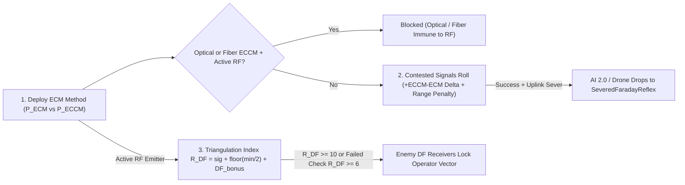

# Electronic Warfare, 2035 Surveillance, ECM & ECCM

> **Rust Engine Implementation**: [`crates/satya-engine/src/electronic_warfare.rs`](../../../crates/satya-engine/src/electronic_warfare.rs) (`SurveillanceNodeKind`, `SURVEILLANCE_NODE_CATALOG`, `NetworkIntrusionPhase`, `evaluate_network_or_sensor_intrusion`, `EcmMethodId`, `ECM_METHOD_CATALOG`, `EccmHardeningId`, `ECCM_HARDENING_CATALOG`, `evaluate_ecm_vs_eccm_contest`, `EwHardwareRole`, `evaluate_custom_ew_hardware_design`), reusing [`crates/satya-engine/src/engineering_design.rs`](../../../crates/satya-engine/src/engineering_design.rs) and [`crates/satya-engine/src/awakened_ai_substrate.rs`](../../../crates/satya-engine/src/awakened_ai_substrate.rs) (`SyntheticMetabolicMode`).  
> **Companion Chapters**: [Stealth, Awareness & Investigation (`stealth_awareness_and_investigation.md`)](../02-core-mechanics/stealth_awareness_and_investigation.md#33-thermal--ir-signatures--digital-rf-hygiene) · [Workshops & Weapon Design (`engineering_and_weapon_design.md`)](engineering_and_weapon_design.md) · [Robotics, Drones & AI 2.0 (`robotics_drones_and_ai_architecture.md`)](robotics_drones_and_ai_architecture.md) · [Lifepaths, Black Market & Heat (`lifepaths_and_economy.md`)](../03-character/lifepaths_and_economy.md#32-black-market-logistics-access-gates--heat).

In **Satya**, fighting 2035 surveillance and autonomous hunter-killer networks is governed by the physics of the electromagnetic spectrum: **active RF jamming is never invisible concealment**. Flooding a city block with broadband noise jams unshielded drones, yet turns the jammer itself into a blinding beacon for passive **Direction-Finding (`DF`)** receivers (`+R_DF`). Operatives must weigh passive optical/adversarial spoofing and physical Faraday air-gapping against the risk of tripling `Heat` and summoning a kinetic response.

---

## 1. The 2035 Surveillance Stack & Network Intrusion

### 1.1 Surveillance Node Catalog (`SurveillanceNodeKind`)

| Surveillance Node (`SurveillanceNodeKind`) | Base $\Delta_{\text{ext}}$ | Sensor Vector | Air-Gapped? | Trip `Heat` | Operational Role |
| :--- | :---: | :--- | :---: | :---: | :--- |
| **`AlprTrafficCamera`** | `0` | Optical Plate OCR | No | `+1` | Municipal traffic intersections, toll gantries, garage gates. |
| **`BiometricFacialGaitCheckpoint`** | **`+4`** | Facial, Iris & Gait CV | No | `+2` | Corporate tower lobbies, transit hubs, secure elevator banks. |
| **`ImsiCellSiteSimulator`** | `+2` | Cellular / BLE (`RF`) | No | `+2` | StingRay IMSI/IMEI interceptors logging active radios (`Heat 3+`). |
| **`PassiveAcousticGunshotArray`** | `+2` | Time-of-Arrival Acoustic | No | `+2` | Rooftop mic clusters triangulating unsuppressed gunfire (`< 30 s`). |
| **`ThermalMotionPerimeterTurret`** | `+4` | LWIR Thermal (`FLIR`) | No | `+2` | Compound fence & rooftop IR sentries cutting fog/darkness. |
| **`RfSpectrumDirectionFinder`** | `+4` | Multi-Element RF `DF` | No | **`+3`** | Dedicated spectrum monitors hunting illegal jammers & burst uplinks. |
| **`AirGappedScadaEnclave`** | **`+8`** | Physical Bus Only | **Yes** | **`+3`** | Industrial SCADA controllers, black-site server vaults, air-gapped cages. |

### 1.2 Four-Phase Intrusion Workflow & The Hard Air-Gap Rule

Technical infiltration (`Network Exploitation` or `Signals Intelligence` under `ANA / CRE`) steps cleanly through `NetworkIntrusionPhase`:
1. **`ReconAndFootprint`** (`+0` $\Delta_{\text{ext}}$) $\to$ 2. **`CredentialOrExploitEntry`** (`+2`) $\to$ 3. **`LateralMovementAndEscalation`** (`+4`) $\to$ 4. **`PayloadOrFeedInjection`** (`+4`).
- **Hard Air-Gap Rule**: Any `AirGappedScadaEnclave` **blocks remote exploitation (`access_blocked_by_air_gap = true`)** unless `is_physically_tapped = true` (requiring an operative or manipulator-arm drone to plug in a hardware implant, optical bridge, or acoustic/EM side-channel probe).
- **IDS Trace ($\text{IDS}_{\text{trace}}$) & Heat Fallout**:
  - `ExtraordinarySuccess`: gains `-2` $\Delta_{\text{ext}}$ setup advantage into the next intrusion phase with **`0` trace**.
  - `PartialSuccess` / `GrazingTie` / `CleanFailure`: adds **`+1` $\text{IDS}_{\text{trace}}$**.
  - `BotchFailure`: adds **`+3` $\text{IDS}_{\text{trace}}$** and triggers immediate **`+trip_heat` Operational Heat** on the station alert board.

---

## 2. Electronic Countermeasures (`ECM`) & The Active-Emission Paradox

| `ECM` Countermeasure (`EcmMethodId`) | $P_{\text{ECM}}$ | Radius | Draw | Beacon $R_{\text{DF}}$ | Uplink Sever? | Cost | `[Access]` |
| :--- | :---: | :---: | :---: | :---: | :---: | :---: | :---: |
| **`BroadbandRfBarrageJammer`** | `4` | `80 m` | `45 W` | **`+8`** *(Loud Beacon)* | **Yes** | `$2,800` | Class III |
| **`DirectionalTightBeamJammer`** | `5` | `150 m` | `30 W` | **`+3`** *(Narrow Lobe)* | **Yes** | `$6,500` | Class III |
| **`GnssSpooferDeceptionRig`** | `4` | `120 m` | `22 W` | `+4` | No *(Drift Only)* | `$5,200` | Class III |
| **`AdversarialVisionPatch2035`** | `4` | Passive | `2 W` | **`0`** *(Silent)* | No | `$1,400` | Class II |
| **`CameraFeedLoopInjector`** | `5` | Tap / Cyber | `8 W` | **`0`** *(Silent)* | No | `$3,600` | Class II |
| **`FaradayMeshEnclosureTarp`** | **`6`** | `3 m` *(Shield)* | `0 W` | **`0`** *(Passive)* | **Yes** *(Zero Signal)* | `$950` | Class I |

---

## 3. Electronic Counter-Countermeasures (`ECCM`) & Contested EW

| Hardening Tier (`EccmHardeningId`) | $P_{\text{ECCM}}$ | RF Immune? | Auto-`DF` Bonus | Cost | `[Access]` |
| :--- | :---: | :---: | :---: | :---: | :---: |
| **`UnshieldedCommercialLink`** | `0` | No | `+0` | `$0` | Class I |
| **`FhssFrequencyHoppingSpread`** | `3` | No | `+1` | `$2,400` | Class II |
| **`DirectionalPhasedArrayNulling`** | `4` | No | `+2` | `$8,500` | Class III |
| **`OpticalLaserOrFiberTether`** | `6` | **Yes** | `+0` | `$4,200` | Class II |
| **`AiAdaptiveCognitiveRadio2035`** | `5` | No | **`+3`** | `$18,000` | Class III |

- **Contested Difficulty Formula**: `hidden_ext = (P_ECCM - P_ECM) * 2 + range_penalty`, where operating beyond `effective_radius_m` adds `+4` $\Delta_{\text{ext}}$ per extra radius bracket (`max +12`).
- **Optical / Fiber Immunity**: `OpticalLaserOrFiberTether` (burst laser or spooling fiber-optic FPV micro-drone) is **immune to active RF jammers**, requiring physical line-of-sight blocking, scissors, or a `FaradayMeshEnclosureTarp` over an enclosed bay.
- **Splitting Embodied AI Uplinks**: Successfully landing an uplink-severing ECM attack forces remote-tethered AI 2.0 proxies from `QuantumTetheredSprint` down to **`SyntheticMetabolicMode::SeveredFaradayReflex`** (`robotics_drones_and_ai_architecture.md` §3).
- **Direction-Finding Exposure ($R_{\text{DF}}$)**: Every active RF emitter accumulates:

$$R_{\text{DF}} = \text{sig}_{\text{beacon}} + \left\lfloor \frac{t_{\text{active,min}}}{2.0} \right\rfloor + \text{bonus}_{\text{DF}}$$

When $R_{\text{DF}} \ge 10$ (or $R_{\text{DF}} \ge 6$ on any Partial/Failed jam), passive spectrum hunter arrays lock the emitter's firing line within seconds.

---

## 4. Custom EW Hardware Designer (`evaluate_custom_ew_hardware_design`)

Engineers fabricate bespoke RF gear (`PortableJammerPod`, `DirectionalSpooferRifle`, `PassiveDfSniffer`, `EccmShieldedTransceiver`, `AdversarialStealthRig`) using Chapter 22's **Workshop Facility Tiers** and **Project Clocks**:

| `WorkshopFacilityTier` | Max Fabricated $P_{\text{EW}}$ | Masterwork Bonus ($+1 P_{\text{EW}}$) | Rushed / Breached Penalty |
| :--- | :---: | :--- | :--- |
| **`FieldBenchImprovised`** | **`2`** *(Clamped)* | None | `+2 R_DF` RF Bleed + `HairTriggerOrLoudAction` + `ProprietaryPartsOnly` |
| **`HomeGarageShop`** | **`3`** *(Clamped)* | None | `+2 R_DF` Spurious RF Harmonics |
| **`CommercialCncMachineShop`** | **`5`** | Yes *(Cap `6`)* | `+2 R_DF` RF Bleed |
| **`AerospaceCleanroomLab`** | **`6`** | Yes *(Cap `6`)* | `+2 R_DF` RF Bleed |

- **Optional RF Baffling (`rf_stealth_baffled = true`)**: Adds `+0.40 kg`, `+3 W` shielded choke draw, `1.25×` parts cost, and trims active emitter signature **`-2 R_DF`**.
- **Battery Endurance**: Computes exact field run-time via $T_{\text{endurance}} = \frac{E_{\text{bat,Wh}}}{P_{\text{total,W}}} \times 60\text{ min}$.

---

## 5. Worked Example: Tight-Beam Jamming, Fiber Immunity & Custom Jammer Pod

> [!EXAMPLE]
> **1. Severing an `FHSS` Corporate Hunter-AI Uplink at `90 m` for `3.0 min`**:
> - *Matchup*: `DirectionalTightBeamJammer` ($P_{\text{ECM}}=5$, `150 m` radius, $R_{\text{base}}=3$) vs. `FhssFrequencyHoppingSpread` ($P_{\text{ECCM}}=3$, `+1` DF bonus).
> - *Result*: Within range (`90 m <= 150 m`, `0` range penalty), Net Advantage **`+2`** (`hidden_ext = -4`). On a Clean Win: **`target_uplink_severed = true`**, dropping the drone/AI substrate into **`SyntheticMetabolicMode::SeveredFaradayReflex`**. Triangulation index $R_{\text{DF}} = 3 + \lfloor 3/2 \rfloor + 1 = \mathbf{5}$—below lock thresholds (`triangulation_lock_triggered = false`).
>
> **2. Contrast — Broadband Barrage vs. `AiAdaptiveCognitiveRadio2035` (`110 m`, `4 min`) & Fiber FPV**:
> - *Broadband (`80 m` radius)* at `110 m` suffers `+4` range attenuation and drives $R_{\text{DF}} = 8 + \lfloor 4/2 \rfloor + 3 = \mathbf{13} \ge 10$, **immediately locking the operator's position (`triangulation_lock_triggered = true`)**.
> - *Fiber / Optical Drone (`OpticalLaserOrFiberTether`)*: Active RF jamming is **blocked (`blocked_by_optical_or_fiber_immunity = true`)**.
>
> **3. Designing a Baffled `PortableJammerPod` (`CommercialCncMachineShop`, `CustomSubassembly`, Masterwork)**:
> - Requesting `P_EW = 4` (`<= 5` CNC ceiling) with `MasterworkExtraordinary` yields **`effective_ew_power = 5`**, baffled signature **`R_DF = 4`** (`6 - 2`), **`58.0 W`** draw, **`124.1 min`** endurance on a `120 Wh` pack, mass `3.55 kg`, cost **`$6,497`** (`Class III`).
