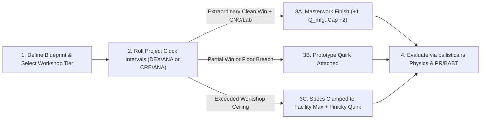

# Engineering, Workshops & Custom Weapon/Armor Design

> **Rust Engine Implementation**: [`crates/satya-engine/src/engineering_design.rs`](../../../crates/satya-engine/src/engineering_design.rs) (`WorkshopFacilityTier`, `ProjectClockComplexity`, `PrototypeQuirkId`, `BulletConstructionKind`, `build_custom_ammunition_profile`, `build_custom_firearm_design`, `evaluate_custom_melee_design`, `evaluate_custom_armor_design`), wrapping [`crates/satya-engine/src/ballistics.rs`](../../../crates/satya-engine/src/ballistics.rs) (`evaluate_granular_firearm_ballistics`).  
> **Companion Chapters**: [Extended Project Clocks (`cascading_d20_and_tasks.md`)](../02-core-mechanics/cascading_d20_and_tasks.md#63-extended-project-clocks-research-crafting-intrusion--surgery) · [Firearm Engineering & Ballistics (`firearms_and_ballistics.md`)](../05-combat/firearms_and_ballistics.md) · [Ranged Combat & Armor (`ranged_combat_and_armor.md`)](../05-combat/ranged_combat_and_armor.md) · [Lifepaths, Black Market & Heat (`lifepaths_and_economy.md`)](../03-character/lifepaths_and_economy.md#32-black-market-logistics-access-gates--heat).

In **Satya**, characters do not fabricate aerospace-grade firearm barrels or NIJ IV ceramic strike plates with a cordless Dremel in a motel room. Custom engineering extends the core **Extended Project Clock** (`cascading_d20_and_tasks.md` §6.3) and couples directly into the existing **Granular Ballistics** engine (`ballistics.rs`) and **Body Armor `PR` / `BABT`** architecture (`ranged_combat_and_armor.md`). No separate arbitrary damage system exists—your workshop tier caps your achievable machining tolerance $\tau_{\text{tol}}$ and manufacturing quality $Q_{\text{mfg}}$, and every physical dimension you select flows straight through the equations in Chapter 16.

---

## 1. Engineering R&D Pipeline: Workshops, Project Clocks & Quirks

### 1.1 Workshop Facility Tiers (`WorkshopFacilityTier`)

Your machining hardware establishes both your known **`Tool Modifier` ($\Delta_{\text{tool}}$)** and hard physical ceilings on machining tolerance ($\tau_{\max}$), barrel bore uniformity ($Q_{\text{bbl},\max}$), and metallurgy/coating finish ($Q_{\text{mfg},\max}$). Attempting to build beyond a facility's ceiling **clamps** the finished hardware to the shop's limit and injects a **Prototype Quirk**.

| Facility Tier (`WorkshopFacilityTier`) | Tool Mod ($\Delta_{\text{tool}}$) | Tolerance Ceiling ($\tau_{\max}$) | Barrel Quality Max ($Q_{\text{bbl},\max}$) | Mfg Quality Max ($Q_{\text{mfg},\max}$) | Setup / Access Cost |
| :--- | :---: | :---: | :---: | :---: | :---: |
| **`FieldBenchImprovised`** | **`+4`** *(Penalty)* | `-0.5` | `-1.0` | `-1` | `$400` *(vise, rotary tool, hand files)* |
| **`HomeGarageShop`** | **`0`** | `0.0` | `0.0` | `0` | `$4,500` *(bench lathe, drill mill, TIG, polymer 3D printer)* |
| **`CommercialCncMachineShop`** | **`-2`** *(Bonus)* | `+1.0` | `+1.0` | `+1` | `$45,000` *(5-axis CNC, wire EDM, kiln, clean bench)* |
| **`AerospaceCleanroomLab`** | **`-4`** *(Bonus)* | `+1.5` | `+1.5` | `+2` | `$450,000` *(CMM metrology, DMLS sinter, vacuum furnace)* |

### 1.2 Project Clock Complexity (`ProjectClockComplexity`)

Every fabrication project is resolved via an **Extended Project Clock** rolled per work interval (`Gunsmithing & Armorer`, `Metalworking / CNC`, or `Materials Engineering`):

| Complexity Tier (`ProjectClockComplexity`) | Clock Target | Interval Length | Parts Multiplier | Min Skill ($N_{\min}$) | Typical Scope |
| :--- | :---: | :---: | :---: | :---: | :--- |
| **`FieldModification`** | **`4` Successes** | `2 hours` | `1.0×` | `N >= 1` | Trigger job, glass-bedding, rail retrofit, custom holster/vest insert. |
| **`CustomSubassembly`** | **`8` Successes** | `8 hours` | `1.35×` | `N >= 2` | Free-floating upper receiver, baffled suppressor, custom plate carrier, tactical blade. |
| **`FullCustomPrototype`** | **`14` Successes** | `24 hours` | `2.0×` | `N >= 3` | Ground-up bespoke firearm receiver & barrel, articulated armor suit, custom UGV. |
| **`NextGenBreakthrough`** | **`22` Successes** | `72 hours` | `3.5×` | `N >= 4` | Novel metamaterial laminate, magnetically damped caseless bolt, bespoke AI hardware. |

### 1.3 Prototype Quirks (`PrototypeQuirkId`) & Masterwork Finish

- **Masterwork Bonus (`BuildOutcomeQuality::MasterworkExtraordinary`)**: Achieving at least one `ExtraordinarySuccess` interval with **zero unresolved Floor Breaches** inside a `CommercialCncMachineShop` or `AerospaceCleanroomLab` grants **`+1 Q_mfg`** (capped at `+2`), raising Reliability $\text{Rel}$ or Armor `BTD` by `+1`.
- **Clamping & Floor-Breach Quirks (`PrototypeQuirkId`)**:

| Quirk ID | Mechanical Effect in Combat | Common Trigger |
| :--- | :--- | :--- |
| **`FinickyAmmoTolerance`** | Suffers **`-1 Rel`** unless fed tuned handloads or factory Match ammunition. | Clamped past $\tau_{\max}$, or building extreme $\tau \ge 1.25$ precision actions. |
| **`ThermalDriftBarrel`** | Suffers **`-1 Acc`** after firing `> 10` rounds within `60 s` until barrel cools (`5 min`). | Finishing on a `PartialSuccess` or carrying a `FloorBreach` through the clock. |
| **`ProprietaryPartsOnly`** | Field repairs or spare-part fabrication suffer **`+4` $\Delta_{\text{ext}}$**. | Rushing high-grade alloys/ceramics (`S7`, `Ti-Carbide`, `Ceramic`) in a `FieldBench`. |
| **`OverweightForwardBalance`** | Adds **`+0.6 kg`** weight and **`+1` Snap Shot `TC`** crowding penalty. | Over-built rushed frame reinforcement (`RushedOrBreached` armor/melee). |
| **`HairTriggerOrLoudAction`** | Adds **`+2 HEA`** report signature; `FloorBreach` during aiming risks negligent discharge. | Aggressive sear lightening without metrology inspection. |

---

## 2. Custom Firearm & Ammunition Designer

Custom firearms assemble six engineering choices (`caliber`, `bullet`, `action_type`, `feed_type`, `barrel_length_cm` + `barrel_mounting`, and `muzzle_device` + `center_of_gravity`) and pass the resulting `GranularFirearmSpec` straight into `evaluate_granular_firearm_ballistics(&spec, distance_m)` (`firearms_and_ballistics.md` §3–§6):

$$\eta_{\text{bbl}} = \operatorname{clamp}\!\left(1 + 0.35 \ln\!\left(\frac{L_{\text{bbl}}}{L_{\text{opt}}}\right),\; 0.60,\; 1.15\right) + \Delta\eta_{\text{muzzle}}, \qquad E_k(d) = E_{\text{chem}} \cdot \eta_{\text{bbl}} \cdot \eta_{\text{action}} \cdot e^{-d / D_{\text{decay}}}$$

$$\text{Acc} = \operatorname{clamp}\!\left(\operatorname{round}\!\left(\Delta\text{Acc}_{\text{action}} + \Delta\text{Acc}_{\text{wt}} + \Delta\text{Acc}_{\text{CoG}} + \Delta\text{Acc}_{\text{len}} + Q_{\text{bbl}} + \Delta\text{Acc}_{\text{mount}} + \tau_{\text{tol}} + Q_{\text{ammo}}\right),\; -4,\; +4\right)$$

### 2.1 Custom Bullet Construction & Handloading (`BulletConstructionKind`)

Handloaders select any of the **17 canonical calibers** (`AmmoCaliberId`: `.22 LR` through `.50 BMG`) and pair it with specialized projectile geometry and powder charging (note: natively subsonic cartridges such as `.300 BLK Subsonic`, `.22 LR`, and `.45 ACP` retain their native subsonic charge without double-reduction under `SubsonicHeavy`):

| Construction (`BulletConstructionKind`) | Expansion Mult ($\epsilon_{\text{exp}}$) | $\Delta\text{Pen}_{\text{SD}}$ | Energy Mult | $\Delta Q_{\text{ammo}}$ | Operational Tradeoff |
| :--- | :---: | :---: | :---: | :---: | :--- |
| **`FmjBall`** | `1.00×` | `0` | `1.00×` | `0.00` | Reliable feeding, balanced barrier penetration and cost. |
| **`HollowPointJhp`** | `1.45×` | `-1` | `1.00×` | `+0.25` | Maximizes unarmored tissue crush ($I_{\text{cal}}$), stops on soft Kevlar (`PR`). |
| **`MatchOtm`** | `1.20×` | `0` | `1.02×` | `+1.00` | Precision uniform jacket (`+1 Acc`), consistent long-range velocity. |
| **`ArmorPiercingAp`** | `0.85×` | `+2` | `1.05×` | `+0.50` | Hardened tungsten/steel penetrator; Class III Restricted (`lifepaths_and_economy.md` §3.2). |
| **`SubsonicHeavy`** | `1.10×` | `-1` | `0.58×` *(if supersonic)* | `+0.25` | Keeps $v_{\text{muzzle}} < 330\text{ m/s}$ so a suppressor eliminates ballistic crack. |
| **`OverpressurePlusP`** | `1.15×` | `+1` | `1.15×` | `0.00` | Hotter chamber pressure increases $E_k$ & recoil; reduces `Q_mfg` / chamber life by `-1`. |

- **`[Access]` Classification**: Selecting `OpenBoltOrAutoSwitch` (full-auto conversion), `BeltFed`, `SoundSuppressor`, `ArmorPiercingAp`, `.338 Lapua`, or `.50 BMG` elevates the completed firearm to **Class III (`Military Ordnance`)** during `Black-Market` valuation or checkpoint inspection.

---

## 3. Custom Melee Weapon & Body Armor Designer

### 3.1 Custom Blades, Breaching Tools & Shields (`evaluate_custom_melee_design`)

Select a **Chassis Form Factor** (`Knife`, `BatonOrClub`, `SwordOrMachete`, `AxeOrBreacher`, `Polearm`, `BallisticOrRiotShield`), **Metallurgy** (`MeleeMaterialGrade`), and **Ergonomic Tuning** (`Balanced`, `SpeedLightened`, `HeavyImpact`):

| Material Grade (`MeleeMaterialGrade`) | Trauma Mod | Weight Mult | Durability `Rel` Mod | Cost Mult | Notes |
| :--- | :---: | :---: | :---: | :---: | :--- |
| **`MildScrapSteel`** | `-1` | `1.15×` | `-2` | `0.5×` | Improvised rebar/spring steel; rolls edge quickly against armor. |
| **`SpringCarbonSteel`** | `0` | `1.00×` | `0` | `1.0×` | Benchmark `1095`/`5160` differential heat-treated steel. |
| **`ToolSteelS7`** | `+1` | `1.00×` | `+2` | `2.2×` | Shock-resistant pry/axe steel; immune to brittle chipping on locks/doors. |
| **`TitaniumCarbideEdge`** | `0` | `0.72×` | `+1` | `4.0×` | Ultra-light non-magnetic covert edge (evades passive magnetometers). |
| **`CarbonPolyComposite`** | `-1` | `0.62×` | `+1` | `2.8×` | Aerospace riot shield / baton layup; high stiffness at minimal weight. |

### 3.2 Custom Body Armor Assembly (`evaluate_custom_armor_design`)

Combine a **Laminate Architecture** (`ArmorMaterialArchitecture`) with a **Coverage Tier** (`ConcealableTorso` `0.85× kg` / `0 DEX`, `TacticalCarrier` `1.25× kg` / `-1 DEX`, `FullBodyHeavy` `2.35× kg` / `-3 DEX`) to compute exact `PR_Edged`, `PR_Icepick`, `PR_Ballistic`, and `BTD` values (`ranged_combat_and_armor.md` §8.2):

| Armor Architecture | `PR_Edged` | `PR_Icepick` | `PR_Ballistic` | `BTD` | Base Mass | Base Cost | `[Access]` Class |
| :--- | :---: | :---: | :---: | :---: | :---: | :---: | :---: |
| **`SynthLeather`** | `2` | `1` | `0` | `1` | `1.8 kg` | `$240` | Class I (`Civilian`) |
| **`ParaAramidSoftWeave`** | `4` | `2` | `3` | `3` | `2.2 kg` | `$780` | Class I (`Civilian`) |
| **`UhmwpePlate`** | `6` | `5` | `6` | `5` | `4.5 kg` | `$1,850` | Class II (`LE / Paramilitary`) |
| **`BoronCarbideCeramic`** | `7` | `7` | `8` | `6` | `6.8 kg` | `$3,200` | Class III (`Military`) |
| **`StfNanotubeCarapace`** | `8` | `8` | `8` | `8` | `5.4 kg` | `$18,000` | Class IV (`Restricted R&D`) |

> [!CAUTION]
> **Ceramic Autoclave Requirement**: Fabricating `BoronCarbideCeramic` or `StfNanotubeCarapace` in a facility below `CommercialCncMachineShop` reduces `PR_Ballistic` by **`-1`** due to laminate voids and attaches **`ProprietaryPartsOnly`**.

---

## 4. Worked Example: CNC Suppressed `.300 BLK` Carbine vs. Garage Improv

> [!EXAMPLE]
> **Scenario**: *Amara Okafor* wants a custom `"Covert Whisper-300 (.300 BLK Sub)"` direct-impingement upper (`CustomSubassembly` = `8` Successes, `22.9 cm` free-float barrel, integral `SoundSuppressor`, `20`-rd box mag, `MatchOtm` `220 gr` subsonic handloads, requesting $\tau_{\text{tol}} = +0.5$, $Q_{\text{bbl}} = +1.0$, $Q_{\text{mfg}} = +1$).
>
> 1. **Built in a `CommercialCncMachineShop` (`-2` $\Delta_{\text{tool}}$) with `MasterworkExtraordinary` Roll**:
>    - Facility ceilings ($\tau_{\max}=+1.0, Q_{\text{bbl},\max}=+1.0, Q_{\text{mfg},\max}=+1$) accept her specs un-clamped, and the Extraordinary interval pushes $Q_{\text{mfg}} = \mathbf{+2}$ with **0 Quirks**.
>    - Via `evaluate_granular_firearm_ballistics` at `50 m`: $\eta_{\text{bbl}} = 1.02$, $\eta_{\text{action}} = 0.97$, $E_{\text{muzzle}} = 686.2\text{ J}$, $E_k(50\text{ m}) = 587.0\text{ J}$ $\implies I_{\text{KE}} = 3, I_{\text{cal}} = 2$, **`Acc = +4`**, `W_yaw = 0`, `Raw Impact = 5`, `Pen = 4`, **`Rel = +1`**, estimated cost **`$3,542`**, Class III (`SoundSuppressor`).
> 2. **Built on a `FieldBenchImprovised` (`+4` $\Delta_{\text{tool}}$) with a `FloorBreach`**:
>    - Facility ceilings clamp tolerances to $\tau = -0.5, Q_{\text{bbl}} = -1.0, Q_{\text{mfg}} = -1$, dropping precision to **`Acc = +1`**, **`Rel = 0`**, and attaching **`FinickyAmmoTolerance`**, **`ThermalDriftBarrel`**, and **`ProprietaryPartsOnly`**.
