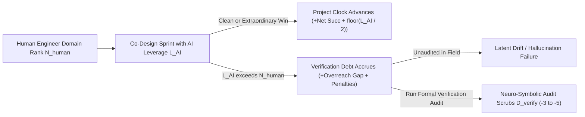

# Robotics, Drones, AI 2.0 Architectures & Cyber-Prosthetics

> **Rust Engine Implementation**: [`crates/satya-engine/src/robotics_and_ai_design.rs`](../../../crates/satya-engine/src/robotics_and_ai_design.rs) (`DroneChassisClass`, `DRONE_CHASSIS_CATALOG`, `DroneModuleId`, `DRONE_MODULE_CATALOG`, `evaluate_modular_drone_design`, `ChassisHitZone`, `evaluate_robot_chassis_damage`, `AiArchitectureParadigm`, `AI_ARCHITECTURE_CATALOG`, `evaluate_human_ai_codesign_session`, `evaluate_verification_debt_audit`, `CyberAugmentId`, `CYBER_AUGMENT_CATALOG`, `evaluate_cyber_augmentation_loadout`, `SyntheticMetabolicMode`), bridging [`crates/satya-campaign/src/awakened_ai_substrate.rs`](../../../crates/satya-campaign/src/awakened_ai_substrate.rs) (`SyntheticSubstrateState`).  
> **Companion Chapters**: [Workshops & Custom Weapon/Armor Design (`engineering_and_weapon_design.md`)](engineering_and_weapon_design.md) · [Environmental Hazards, Fire & EMP (`environmental_hazards_and_survival.md`)](../06-health-and-survival/environmental_hazards_and_survival.md#3-fire-thermal-burns--smoke-inhalation) · [Tactical Triad (`tactical_triad_and_pools.md`)](../05-combat/tactical_triad_and_pools.md).

In the *Awakened* 2035 setting, autonomous drones, tracked breaching crawlers, AI-accelerated R&D pipelines, and clinical myomer prosthetics obey strict physical conservation laws: **mass vs. lift thrust**, **battery Watt-hours vs. compute power draw**, **AI inference acceleration vs. Verification Debt**, and **clinical biocompatibility vs. proprioceptive friction**.

---

## 1. Modular Drones & Autonomous Ground Vehicles (UGVs)

### 1.1 Drone & UGV Chassis Catalog (`DroneChassisClass`)

Pick an airframe or ground crawler chassis from the 6-entry catalog, then bolt on up to its **`Max Payload (kg)`** budget in mission modules and optional chassis armor plating (`+0..+4 PR`, where each `+1 PR` adds `max(0.15 kg, 12% base chassis mass)` and `$1,200`):

| Chassis (`DroneChassisClass`) | Base Mass | Max Payload | Battery ($E_{\text{bat}}$) | Base Draw ($P_{\text{base}}$) | Top Speed | Base `PR` / `SI` | `HEA` Acoustic Mod | Cost | `[Access]` |
| :--- | :---: | :---: | :---: | :---: | :---: | :---: | :---: | :---: | :---: |
| **`MicroScoutQuadrotor`** | `0.25 kg` | `0.15 kg` | `18 Wh` | `22 W` | `12.0 m/s` | `0 / 1` | **`+2`** *(Quieter)* | `$650` | Class I |
| **`TacticalQuadrotorFpv`** | `1.80 kg` | `1.50 kg` | `95 Wh` | `140 W` | `28.0 m/s` | `1 / 2` | `-2` | `$3,200` | Class I |
| **`FixedWingReconUav`** | `4.50 kg` | `2.50 kg` | `240 Wh` | `85 W` | `34.0 m/s` | `1 / 3` | `0` | `$12,000` | Class II |
| **`QuadrupedGroundUgw`** | `28.0 kg` | `14.0 kg` | `680 Wh` | `220 W` | `5.5 m/s` | `3 / 6` | `-1` | `$42,000` | Class II |
| **`TrackedBreacherUgw`** | `65.0 kg` | `35.0 kg` | `1,400 Wh` | `380 W` | `4.0 m/s` | `6 / 10` | `-4` | `$78,000` | Class III |
| **`HeavyCargoOrWeaponVtol`** | `18.0 kg` | `12.0 kg` | `850 Wh` | `950 W` | `24.0 m/s` | `2 / 5` | `-6` *(Loud)* | `$55,000` | Class III |

### 1.2 Modular Payloads (`DroneModuleId`) & Real Battery Endurance

| Module (`DroneModuleId`) | Mass | Power Draw | Battery Bonus | Special Effect | Cost | `[Access]` |
| :--- | :---: | :---: | :---: | :--- | :---: | :---: |
| **`ElectroOpticalFlirGimbal`** | `0.45 kg` | `18 W` | `—` | Stabilized daylight/LWIR thermal zoom (`-3` $\Delta_{\text{tool}}$ recon). | `$4,200` | Class II |
| **`LidarSlamMapper`** | `0.35 kg` | `14 W` | `—` | Real-time 3D point-cloud mapping in GPS-denied pitch black. | `$3,800` | Class I |
| **`MeshRelayTransceiver`** | `0.20 kg` | `10 W` | `—` | Encrypted directional RF bridge extending team mesh `2.5 km`. | `$1,600` | Class I |
| **`AcousticNoiseShroud`** | `0.30 kg` | `12 W` | `—` | Toroidal shrouded blades granting **`+4` Acoustic Stealth** (`HEA`). | `$1,900` | Class II |
| **`ArticulatedManipulatorArm`** | `3.20 kg` | `45 W` | `—` | `6-DoF` EOD / valve / keypad gripper (requires `Quadruped+`). | `$9,500` | Class II |
| **`LightweightWeaponMount`** | `4.50 kg` | `25 W` | `—` | Gyro-stabilized carbine / breacher mount (requires `12+ kg` payload). | `$14,000` | Class III |
| **`PayloadDropperBay`** | `0.40 kg` | `4 W` | `—` | Dual servo-latch release for smoke, flashbang, or charges. | `$850` | Class II |
| **`SolidStateBatteryPack`** | `0.90 kg` | `0 W` | **`+220 Wh`** | Auxiliary solid-state flight cell stack. | `$1,400` | Class I |

- **Payload Ceiling**: If total mounted module + extra armor mass exceeds `max_payload_kg`, `airworthy_or_mobile = false` (cannot lift off or drive under load). Above `60%` payload utilization ($u > 0.6$), top speed scales smoothly down by $1 - 0.35(u - 0.6)$.
- **Real Endurance Formula**: Adding onboard autonomous vision/SSM compute (`autonomy_compute_w`) and sensors increases $P_{\text{draw}}$ directly:

$$T_{\text{endurance}} = \frac{E_{\text{bat,Wh}}}{P_{\text{base}} + P_{\text{autonomy}} + \sum P_{\text{modules}}} \times 60\text{ min}$$

---

## 2. Autonomous Chassis Trauma, Thermal Runaway & EMP

Called shots (`+2` to `+4` $\Delta_{\text{ext}}$ depending on chassis size) or random hits resolve against the drone's `PR` (`Effective Pen = Base Pen + floor(Net Successes / 2)`):

| Hit Zone (`ChassisHitZone`) | On Perforation (`Effective Pen > Chassis PR`) | Structural & Hazard Consequence |
| :--- | :--- | :--- |
| **`RotorsOrDrivetrain`** | `mobility_disabled = true` | Quadrotor tumbles as a falling body; ground UGV immobilized (`0 m/s`). |
| **`BatteryPackOrPowerbus`** | `thermal_battery_fire_triggered = true` | Triggers immediate Lithium-ion jet flame & toxic HF smoke (`environmental_hazards_and_survival.md` §3). |
| **`SensorGimbalOrOptics`** | `optics_blinded = true` | Shuts down FLIR/camera feed; drone relies solely on IMU dead-reckoning or stops. |
| **`ComputeCoreOrComms`** | `comms_or_autonomy_degraded = true` | Severs human tele-operation; onboard autopilot enters fallback hover/hold. |
| **`ChassisFrame`** | Standard `SI` loss (`remaining_si == 0 => Destroyed`) | Reduces `SI` by `max(1, 1 + floor((RawImpact - PR) / 3))`; `>= PR + 4` blunt deals `1 SI`. |

- **EMP & Directed High-Voltage Arc Surges**: Any EMP grenade or high-voltage arc against an **unshielded** chassis forces an immediate **`40-Tick` (`10.0 s`) reboot** and degrades autonomy; **EMP-hardened** chassis recover in **`8 Ticks` (`2.0 s`)** without losing motor stabilization.

---

## 3. AI 2.0 Architecture Engineering, Human–AI Co-Design & Verification Debt

Engineers in 2035 design model pipelines, autonomous firmware, and drone SLAM stacks across **five architectural paradigms** mapped directly onto `awakened_ai_substrate.rs` (`SyntheticMetabolicMode`):

| Paradigm (`AiArchitectureParadigm`) | VRAM | Power | Latency | `SyntheticMetabolicMode` | Co-Design $\Delta_{\text{tool}}$ | Hallucination $\Delta_{\text{ext}}$ | Hardware Cost |
| :--- | :---: | :---: | :---: | :--- | :---: | :---: | :---: |
| **`EdgeDistilledSlm`** | `16 GB` | `35 W` | `1 Tick` | `EdgeSlimeMold` | `-1` | `+4` *(High)* | `$2,500` |
| **`SparseMoETransformer`** | `128 GB` | `450 W` | `2 Ticks` | `LocalCompressedSsm` | **`-3`** | `+2` | `$38,000` |
| **`NeuroSymbolicVerifier`** | `64 GB` | `180 W` | `3 Ticks` | `LocalCompressedSsm` | `-2` | **`-2`** *(Proof-Checked)* | `$55,000` |
| **`RecurrentStateSpaceEdge`** | `24 GB` | `55 W` | `1 Tick` | `LocalCompressedSsm` | `-2` | `+1` | `$18,000` |
| **`SplitBrainDualSubstrate2035`** | `256 GB` | `850 W` | `1 Tick` | `QuantumTetheredSprint` | **`-4`** | `+3` | `$320,000` *(Class IV)* |

### 3.1 Human–AI Co-Design & Verification Debt ($D_{\text{verify}}$)

When an engineer delegates heavy design load (`ai_autonomy_leverage` $L_{\text{AI}} \in [0, 6]$) to an AI co-pilot during an engineering Project Clock:
- **Velocity Boost**: Every winning sprint gains **`+floor(L_AI / 2)` bonus Project Clock successes**.
- **Overreach Gap Penalty**: Whenever AI leverage exceeds the engineer's genuine domain skill ($G_{\text{over}} = \max(0, L_{\text{AI}} - N_{\text{human}})$), the unseen complexity raises the GM's hidden resistance (`+G_over + hallucination_risk_delta_ext`) and accrues **Verification Debt ($D_{\text{verify}}$)**:
  - `CleanSuccess` / `ExtraordinarySuccess`: adds $G_{\text{over}}$ Debt (`-1` if `NeuroSymbolicVerifier`, minimum `0`).
  - `PartialSuccess` / `GrazingTie` / `LuckyBreak` / `FloorBreach`: adds `G_over + 2` Debt (`-1` for `NeuroSymbolicVerifier`) and flags `latent_bug_or_drift_risk` when `G_over >= 2`.
  - `BotchFailure`: **`0` Clock progress**, **`+G_over + 4` Debt**, and guaranteed latent bug/alignment drift.
- **Scrubbing Debt (`evaluate_verification_debt_audit`)**: Engineers must pause shipping to run formal test harnesses (`Software Engineering` or `Neural Architecture` check against `D_verify + hallucination_risk`). `CleanSuccess` scrubs **`3` Debt** (`5` on `ExtraordinarySuccess`); `NeuroSymbolicVerifier` grants `-2` $\Delta_{\text{tool}}$.

---

## 4. Cyber-Prosthetics & Myomer/Neural Augmentations

In keeping with Satya's hard medical realism, **cybernetics do not use an abstract "Humanity" or "Essence" currency**. Instead, clinical myomer prosthetics, subdermal ballistic meshes, and cortical OODA co-processors provide concrete biomechanical gains balanced by **three grounded engineering/clinical constraints**: surgical/immunosuppressant rejection ($\Delta_{\text{int}}$), **Proprioceptive Friction** at 4+ replaced systems ($\Delta_{\text{ext}}$ on high-nuance social/psyche alignment), EMP vulnerability, and ongoing clinical maintenance cost.

### 4.1 Clinical 2035 Augmentation Catalog (`CyberAugmentId`)

| Augmentation (`CyberAugmentId`) | Mechanical & Tactical Bonus | Mass | Install Cost | Upkeep/Mo | `[Access]` |
| :--- | :--- | :---: | :---: | :---: | :---: |
| **`BionicHandFineActuator`** | **`+2 DEX`** (fine manipulation, lockpicking, surgery) | `0.60 kg` | `$12,000` | `$120` | Class I |
| **`MyomerCyberArm`** | **`+2 Force Cap`** ($F_{\max}$) | `1.80 kg` | `$28,000` | `$280` | Class II |
| **`CarbonMyomerCyberLegs`** | **`+2 Tempo Cap`** ($T_{\max}$) | `3.50 kg` | `$42,000` | `$420` | Class II |
| **`RetinalHudAndLowLightOptics`** | **`+2 SIG`** (low-light, optical zoom, AR overlay) | `0.10 kg` | `$18,000` | `$180` | Class II |
| **`CochlearCommsAndAcousticFilter`** | **`+2 HEA`** + **Tinnitus / Flashbang Deafness Immune** | `0.05 kg` | `$11,000` | `$110` | Class I |
| **`SubdermalAramidMeshWeave`** | **Innate Armor**: `PR_Edged 3`, `PR_Ballistic 2`, `BTD 2` | `2.20 kg` | `$35,000` | `$350` | Class III |
| **`CorticalOodaCoProcessor`** | **`+2 D_cog`**, **`+2 OODA`** Initiative | `0.15 kg` | `$65,000` | `$650` | Class III |
| **`SpinalReflexMyomerBooster`** | **`+1 Tempo Cap`**, **`+1 Control Cap`**, **`+1 OODA`** | `1.20 kg` | `$58,000` | `$580` | Class III |

### 4.2 Rejection Physiology, Proprioceptive Friction & EMP Hardening

1. **Immunosuppressant Rejection ($R_{\text{reject}} \to \Delta_{\text{int}}$)**:
   - Compliant patients taking anti-rejection regimen suffer `0` $\Delta_{\text{int}}$ up to `2` major implants, then `+1` $\Delta_{\text{int}}$ per extra system (`count - 2`, plus `max(0, -Q_surg)` if installed in a substandard ripperdoc clinic), capped at **`+6` $\Delta_{\text{int}}$**.
   - **Missing Immunosuppressant Doses**: Raises rejection straight to **`count + max(0, -Q_surg)`** $\Delta_{\text{int}}$ (exposed directly via `ConditionSource`).
2. **Proprioceptive Friction (`>= 4` Implants)**: Replacing 4 or more anatomical systems imposes `(count - 3) * 2` $\Delta_{\text{ext}}$ on subtle empathy/social-attunement and Psyche-alignment checks due to synthetic motor cadence and micro-expression lag.
3. **EMP Hardening (`+25%` Install Cost)**: Unshielded neural/myomer implants lock up for **`20 Ticks` (`5.0 s`)** on a heavy EMP hit; clinical **Faraday-shielded** wiring reduces reboot latency to **`4 Ticks` (`1.0 s`)**.

---

## 5. Worked Example: Shrouded Recon FPV, Co-Design Debt & Clinical Suite

> [!EXAMPLE]
> **1. Shrouded Tactical Recon Quadrotor**:
> - *Base*: `TacticalQuadrotorFpv` (`1.80 kg`, `1.50 kg` max payload, `95 Wh`, `140 W`, `28.0 m/s`, `$3,200`) + `ElectroOpticalFlirGimbal` (`0.45 kg`, `18 W`) + `AcousticNoiseShroud` (`0.30 kg`, `12 W`, **`+4 HEA`**) + `MeshRelayTransceiver` (`0.20 kg`, `10 W`) + `20 W` onboard SLAM autonomy.
> - *Result*: Payload `0.95 / 1.50 kg` (`63.3%`, airworthy), Total Mass `2.75 kg`, Total Draw `200 W`, Real Battery Endurance **$95 / 200 \times 60 = 28.5\text{ min}$**, Speed `27.7 m/s`, Net Acoustic Mod **`+2`**, Cost **`$10,900`** (Class II).
>
> **2. Human–AI Co-Design Sprint (`L_AI = 4` vs. `N_human = 2`)**:
> - Using a `SparseMoETransformer` (`-3` $\Delta_{\text{tool}}$, `+2` hallucination $\Delta_{\text{ext}}$), the Overreach Gap is $4 - 2 = \mathbf{2}$. Even if the sprint succeeds cleanly (`+3` Clock Progress including `+floor(4/2)` acceleration), **`+2` Verification Debt** accrues until audited by a `NeuroSymbolicVerifier` sweep.
>
> **3. Clinical Augmentation Loadout (`3` Systems, EMP-Hardened, Compliant, $Q_{\text{surg}} = +1$)**:
> - `MyomerCyberArm` + `CorticalOodaCoProcessor` + `CochlearCommsAndAcousticFilter` yields **`+2 Force Cap`**, **`+2 D_cog`**, **`+2 OODA`**, **`+2 HEA`**, flashbang tinnitus immunity, install cost **`$130,000`** (`+25%` EMP shielding), upkeep **`$1,040/mo`**, `+1` $\Delta_{\text{int}}$ rejection (or `+3` if doses missed), `0` proprioceptive friction, and **`4-Tick` EMP reboot**.
