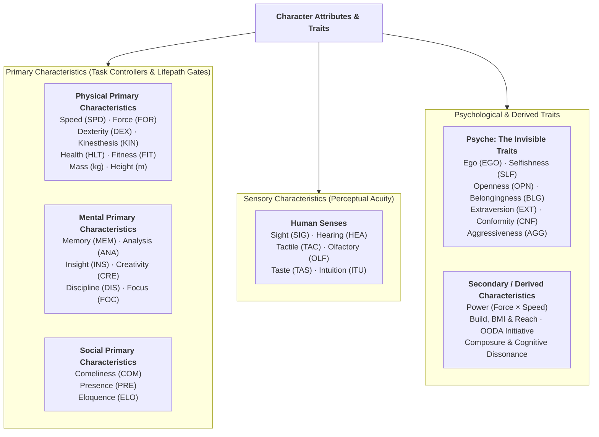

# Satya TTRPG Character Characteristics & Attribute Architecture

This document defines the canonical **Character Characteristics System** for **Satya**. It establishes the primary physical, mental, social, sensory, and psychological (`Psyche`) attributes that define a character, how they are scaled and represented, how secondary mechanical properties (such as **Power**, **Reach**, and **Action Speed**) are derived from them, how **Psyche** governs behavior and **Social Combat / Cognitive Dissonance**, and how Characteristics anchor task resolution in the [`2d20` Cascading Engine](../satya_d20_rules.md) and the [Skill System](../skill-design.md).

---

## 1. Architectural Overview & Taxonomy

Unlike traditional tabletop systems that collapse physicality into "Strength/Dexterity," reduce the mind to a single monolithic "Intelligence" score, and leave personality entirely unquantified, Satya models a character across **five distinct attribute categories**:

1. **Physical Primary Characteristics**: Attributes expressed physically in the real world—speed, muscular force, fine hand-eye coordination, full-body spatial control, physiological hardiness, endurance, and physical dimensions (`Mass` and `Height`).
2. **Mental Primary Characteristics**: Attributes of the mind—recall, analytical problem-solving, pattern wisdom, lateral creativity, mental fortitude, and sustained concentration.
3. **Social Primary Characteristics**: Attributes that influence other people's behavior, perceptions, or attitudes—physical beauty, silent magnetism, and verbal articulateness.
4. **Sensory Characteristics**: The six perceptual channels through which an entity senses the environment and detects subtle cues—sight, hearing, touch, smell, taste, and gut intuition.
5. **Psyche Characteristics (The Invisible Traits)**: Seven foundational personality spectrums (`Ego`, `Selfishness`, `Openness`, `Belongingness`, `Extraversion`, `Conformity`, and `Aggressiveness`) that quantify behavioral drives, guide NPC/AI roleplay, trigger friction checks when violated, govern combat morale, and serve as the target vectors in **Social Combat & Cognitive Dissonance**.

---

## 2. Characteristic Scales: Spectrum (`0.0–100.0`) & `2d20` Controlling Scale (`1–20`)

In Satya's underlying data model, every non-dimensional characteristic is represented on a continuous **Spectrum (`0.00` to `100.00`)**, which maps linearly (`5.0` spectrum points = `1` d20 step) onto the **`1–20` Controlling Characteristic ($C$) Scale** used by the `2d20` Cascading Dice Engine:

$$\text{TN}_{\text{eff}} = 31 - C + \Delta_{\text{ext}}$$

| Controlling Scale ($C$) | Underlying Spectrum (`0.0–100.0`) | Population Tier | Mechanical & Narrative Benchmark |
| :---: | :---: | :--- | :--- |
| **`1–3`** | `0.0 – 17.4` | **Severely Impaired / Extreme Low Pole** | Debilitating deficit (or extreme low-pole Psyche trait) ($\text{TN}_{\text{eff}} = 28\text{–}30$). |
| **`4–6`** | `17.5 – 32.4` | **Deficient / Strong Low Pole** | Noticeably weak, slow, clumsy, or strongly low-pole in a Psyche trait ($\text{TN}_{\text{eff}} = 25\text{–}27$). |
| **`7–8`** | `32.5 – 42.4` | **Below Average / Moderate Low Pole** | Functional but unsuited for demanding specialist work in this attribute ($\text{TN}_{\text{eff}} = 23\text{–}24$). |
| **`9–11`** | `42.5 – 57.4` | **Human Average (`C = 10` / `50.0`)** | Typical adult civilian baseline; yields exact midpoint **$\text{TN}_{\text{eff}} = 21$** at $C = 10, \Delta_{\text{ext}} = 0$. |
| **`12–13`** | `57.5 – 67.4` | **Above Average / Gifted** | Varsity athlete, honors student, sharp-eyed scout, or naturally magnetic speaker ($\text{TN}_{\text{eff}} = 18\text{–}19$). |
| **`14–15`** | `67.5 – 77.4` | **Exceptional / Elite Professional** | Special operations selection standard, premier neurosurgeon, or frontier mathematician ($\text{TN}_{\text{eff}} = 16\text{–}17$). |
| **`16–17`** | `77.5 – 87.4` | **World-Class / Olympic / Genius** | Top `0.1%` of unaugmented humanity ($\text{TN}_{\text{eff}} = 14\text{–}15$). |
| **`18`** | `87.5 – 92.4` | **Peak Unaugmented Human Cap** | Historical human maximum ($\text{TN}_{\text{eff}} = 13$). |
| **`19–20`** | `92.5 – 100.0` | **Augmented / Transhuman Apex** | Reserved for 2031–2035 experimental cybernetic/myomer prosthesis or neural co-processor augmentation ($\text{TN}_{\text{eff}} = 11\text{–}12$). |

---

## 3. Physical Primary Characteristics

**Physical Primary Characteristics** describe character attributes that are expressed physically in the real world. Rather than conflating all agility or all strength into single numbers, Satya separates reaction speed, force transmission, fine finger dexterity, full-body spatial awareness, tissue hardiness, and aerobic stamina.

| Abbr | Characteristic | Value Type / Range | Default | Core Definition & Mechanical Role |
| :--- | :--- | :---: | :---: | :--- |
| **`SPD`** | **Speed** | Spectrum `0–100` (`C: 1–20`) | `50.0` (`C = 10`) | **A measure of how quickly one can move; a combination of reflexes and quickness.** Governs reaction time, OODA loop tick speed, sprinting burst, fast-draw reflexes, dodging/parrying speed, and high-speed evasive driving. |
| **`FOR`** | **Force** | Spectrum `0–100` (`C: 1–20`) | `50.0` (`C = 10`) | **Similar to strength in that it determines the mechanical energy that can be transmitted (`Force × Speed = Power`).** Governs melee impact, recoil control for automatic/heavy weapons, grappling leverage, climbing/pulling power, and load bearing. |
| **`DEX`** | **Dexterity** | Spectrum `0–100` (`C: 1–20`) | `50.0` (`C = 10`) | **Measures hand-eye coordination and fine manual precision.** Think *surgeon, watchmaker, pickpocket, gunsmith, lockpick, or marksman*. Governs trigger control, micro-manipulation, soldering, sleight of hand, and manual tool use. |
| **`KIN`** | **Kinesthesis** | Spectrum `0–100` (`C: 1–20`) | `50.0` (`C = 10`) | **The ability to sense and control the body in space (proprioception and whole-body coordination).** Think *gymnast, acrobat, martial artist, traceur (parkour), diver, or helicopter pilot*. Governs balance, footwork, grappling transitions, tumbling, stealth movement, and 3D spatial orientation. |
| **`HLT`** | **Health** | Spectrum `0–100` (`C: 1–20`) | `50.0` (`C = 10`) | **A measure of physiological hardiness and resistance to damage, shock, toxins, radiation, or disease.** Governs wound shock thresholds (`wound_shock_index`), recovery from trauma, coagulation/bleed resistance, and immune/toxicological saves. |
| **`FIT`** | **Fitness** | Spectrum `0–100` (`C: 1–20`) | `50.0` (`C = 10`) | **A measure of cardiovascular and muscular endurance.** Governs sustained physical exertion (running, swimming, mountaineering, prolonged melee), breath control, and how slowly a character accumulates internal Fatigue penalties ($\Delta_{\text{int}}$). |
| **`MAS`** | **Mass** | Kilograms (`0.0 – ∞ kg`) | `70.0 kg` | **Measures the physical weight of the character in kilograms.** Directly impacts physical momentum ($p = m \cdot v$), grappling/shoving weight advantages, recoil absorption, encumbrance ratios, and structural weight limits. |
| **`HGT`** | **Height** | Meters / Centimeters (`0.0 – ∞`) | `1.50–1.75 m` (`150–175 cm`) | **Measures the stature of the character.** Determines unarmed and melee **Reach**, stride length, high-ground/vertical clearance in climbing, and visual profile/concealability behind cover. |

### 3.1 Key Physical Distinctions in Satya
- **`Speed (SPD)` vs. `Dexterity (DEX)` vs. `Kinesthesis (KIN)`**:
  - A **watchmaker or microsurgeon** needs extraordinary **Dexterity (`DEX`)** (steady hands and fine finger-eye coordination), but does not need explosive **Speed (`SPD`)** or acrobatic **Kinesthesis (`KIN`)**.
  - A **gymnast, BJJ black belt, or parkour runner** relies primarily on **Kinesthesis (`KIN`)**—sensing and controlling their center of mass and limbs in 3D space.
  - A **gunslinger drawing from concealment or a boxer slipping a jab** relies on **Speed (`SPD`)**—raw neuromuscular quickness and reflexes.
- **`Force (FOR)` vs. `Power (POW = FOR × SPD)`**:
  - **Force (`FOR`)** is static or sustained muscular output (holding a door shut, controlling full-auto recoil, deadlifting, applying a submission lock).
  - **Power (`POW`)** is the rate of work/energy transfer:
    $$\text{Power} = \text{Force} \times \text{Speed}$$
    A heavy, slow bruiser (`FOR 15, SPD 8`) and a whip-fast striker (`FOR 10, SPD 12`) both transmit lethal kinetic energy (`Power = 120` on the `1–20` product scale), but through completely different physical mechanics.
- **`Health (HLT)` vs. `Fitness (FIT)`**:
  - **Health (`HLT`)** is structural and biological resilience (surviving a gunshot wound, resisting sepsis or nerve gas).
  - **Fitness (`FIT`)** is aerobic and metabolic conditioning (running 10 kilometers in tactical gear without gassing out). A marathon runner may have `FIT 16, HLT 10`, while a rugged dockworker might have `HLT 14, FIT 9`.

---

## 4. Mental Primary Characteristics

**Mental Primary Characteristics** cover attributes that are of the mind in nature. By separating memory, logical analysis, pattern insight, lateral creativity, mental fortitude, and sustained attention, Satya avoids the classic RPG trap where a single "Intelligence" stat makes a character simultaneously an eidetic historian, a brilliant mathematician, a wise detective, an avant-garde artist, and an unshakable sniper.

| Abbr | Characteristic | Value Type / Range | Default | Core Definition & Mechanical Role |
| :--- | :--- | :---: | :---: | :--- |
| **`MEM`** | **Memory** | Spectrum `0–100` (`C: 1–20`) | `50.0` (`C = 10`) | **A measure of recall, retention, and how well a character remembers things.** Governs rote learning, vocabulary/language acquisition, statutory law, anatomical/pharmacological nomenclature, trivia, and recalling details from briefings or crime scenes. |
| **`ANA`** | **Analysis** | Spectrum `0–100` (`C: 1–20`) | `50.0` (`C = 10`) | **What most games call Intelligence: the ability to solve problems through logic, deduction, and calculation.** Governs mathematics, physics, formal engineering, software algorithms, cryptography, structural mechanics, and ballistic calculation. |
| **`INS`** | **Insight** | Spectrum `0–100` (`C: 1–20`) | `50.0` (`C = 10`) | **A combination of wisdom and the ability to see patterns, hidden relationships, and underlying dynamics.** Governs clinical diagnostics, reading human motives (*Empathy/Elicitation*), strategic intelligence synthesis, forensic reconstruction, and market/behavioral forecasting. |
| **`CRE`** | **Creativity** | Spectrum `0–100` (`C: 1–20`) | `50.0` (`C = 10`) | **Measures how well one can think outside the box, improvise, or come up with new ideas or expressions.** Governs fine and synth arts, zero-day exploit ideation, improvised munitions/repairs, con artistry/pretexting, culinary arts, and unconventional tactical solutions. |
| **`DIS`** | **Discipline** | Spectrum `0–100` (`C: 1–20`) | `50.0` (`C = 10`) | **Measures mental fortitude, willpower, self-control, and training diligence.** Governs composure under fire, resistance to coercion/interrogation (*SERE*), pain tolerance, martial arts mental conditioning, **Psyche Override Checks**, and **Lifepath Educational & Training Advancement Rolls**. |
| **`FOC`** | **Focus** | Spectrum `0–100` (`C: 1–20`) | `50.0` (`C = 10`) | **Measures concentration and the ability to keep track of one thing without distraction.** Governs long-duration or high-precision tasks: long-range sniping, trauma/neurosurgery, explosive ordnance disposal (EOD), multi-drone swarm control, instrument flying, and stakeout surveillance. |

### 4.1 Key Mental Distinctions in Satya
- **`Analysis (ANA)` vs. `Memory (MEM)` vs. `Insight (INS)` vs. `Creativity (CRE)`**:
  - **Memory (`MEM`)** stores and retrieves the data (e.g., knowing every statute in the criminal code or every bone and vessel in the human body).
  - **Analysis (`ANA`)** computes the logical or mathematical proof (e.g., solving a differential equation or debugging kernel assembly).
  - **Insight (`INS`)** connects disparate dots into a holistic pattern (e.g., realizing *why* three seemingly unrelated patients have the same rare toxic syndrome, or spotting a geopolitical mole).
  - **Creativity (`CRE`)** invents what is not in the textbook (e.g., chaining two benign software bugs into a novel zero-day exploit, improvising a shaped charge from household chemicals, or composing a piece of music).
- **`Discipline (DIS)` vs. `Focus (FOC)`**:
  - **Discipline (`DIS`)** is *mental fortitude and grit*—enduring hardship, suppressing panic when rounds are snapping overhead, resisting an interrogator, overriding one's own impulses, and forcing oneself to study or drill day after day.
  - **Focus (`FOC`)** is *attentional bandwidth and tunnel-vision control*—tuning out noise to hold a crosshair steady between heartbeats, tracking a target through a crowded transit station for six hours, or suturing a 1mm vessel without a tremor of distraction.

---

## 5. Social Primary Characteristics

**Social Primary Characteristics** are the primary attributes that influence other people's behavior, perceptions, or attitudes during interpersonal, public, or adversarial interactions.

| Abbr | Characteristic | Value Type / Range | Default | Core Definition & Mechanical Role |
| :--- | :--- | :---: | :---: | :--- |
| **`COM`** | **Comeliness** | Spectrum `0–100` (`C: 1–20`) | `50.0` (`C = 10`) | **Measures physical beauty and attractiveness (by the default society's standards).** Governs immediate visual first impressions, seduction and honey-trap tradecraft, fashion/media modeling, and halo-effect social engineering. |
| **`PRE`** | **Presence** | Spectrum `0–100` (`C: 1–20`) | `50.0` (`C = 10`) | **Measures silent charisma, gravitas, command aura, and physical magnetism.** Governs how much weight a character carries simply by walking into a room—leadership and command authority, intimidation and menace, street credibility, poise under scrutiny, and stage magnetism. |
| **`ELO`** | **Eloquence** | Spectrum `0–100` (`C: 1–20`) | `50.0` (`C = 10`) | **Measures how well one speaks, articulates ideas, and verbally influences others.** Governs persuasion, rhetoric, fast-talking deception, diplomacy, high-stakes negotiation, public oratory, courtroom advocacy, and subtle conversational elicitation. |

### 5.1 Key Social Distinctions in Satya
- A quiet, scarred syndicate enforcer or veteran infantry commander might have low **Comeliness (`COM 7`)** and modest **Eloquence (`ELO 9`)**, yet possess terrifying **Presence (`PRE 16`)** that silences a room with a single stare.
- Conversely, a silver-tongued con artist or appellate lawyer may have unremarkable **Presence (`PRE 10`)** in silence, but extraordinary **Eloquence (`ELO 16`)** the moment they begin speaking.
- A honey-trap operative or synth-media celebrity leverages high **Comeliness (`COM 15`)** alongside **Presence (`PRE`)** or **Eloquence (`ELO`)** to lower a target's guard before an elicitation roll.

---

## 6. Sensory Characteristics

Rather than lumping all five senses and sixth-sense danger awareness into a single generic "Perception" stat, Satya models **six distinct Sensory Characteristics**. This allows characters to have realistic sensory profiles (e.g., an aging watchmaker with nearsighted `Sight 8` but razor-sharp `Tactile 15` and `Hearing 13`, or a combat veteran with `Hearing 7` from tinnitus but `Sight 14` and `Intuition 15`).

| Abbr | Characteristic | Value Type / Range | Default | Core Definition & Mechanical Role |
| :--- | :--- | :---: | :---: | :--- |
| **`SIG`** | **Sight** | Spectrum `0–100` (`C: 1–20`) | `50.0` (`C = 10`) | **How well an entity can see.** Governs visual acuity, ranged weapon aiming (*Pistols*, *Long Guns*, *Sniping*), visual spotting/surveillance, reading lip movements or micro-expressions, visual art/sketching, and inspecting fine circuitry or forensic trace evidence. |
| **`HEA`** | **Hearing** | Spectrum `0–100` (`C: 1–20`) | `50.0` (`C = 10`) | **How well an entity can hear.** Governs auditory acuity, pitch and timbre recognition (*Singing*, *Musical Instruments*, *Voice Mimicry*, *Tonal Languages*), detecting footsteps or mechanical clicks in darkness, and acoustic/sonar analysis. |
| **`TAC`** | **Tactile** | Spectrum `0–100` (`C: 1–20`) | `50.0` (`C = 10`) | **How sensitive an entity's touch is.** Governs feeling pin-tumblers in *Lockpicking*, pickpocketing and *Sleight of Hand*, microsurgical tissue feedback, clinical palpation/pulse diagnostics, and searching or operating equipment blind. |
| **`OLF`** | **Olfactory** | Spectrum `0–100` (`C: 1–20`) | `50.0` (`C = 10`) | **How sensitive an entity's smell is.** Governs detecting chemical precursors, gas leaks, propellant residue, decay, disease markers, perfumes, and *Culinary Arts / Mixology* aroma profiling. |
| **`TAS`** | **Taste** | Spectrum `0–100` (`C: 1–20`) | `50.0` (`C = 10`) | **How well an entity can taste.** Governs *Culinary Arts & Mixology*, sommelier evaluation, and detecting trace poisons, alkaloids, or chemical contamination in food and drink. |
| **`ITU`** | **Intuition** | Spectrum `0–100` (`C: 1–20`) | `50.0` (`C = 10`) | **A kind of gut feeling or sixth sense.** Governs subconscious threat integration—sensing an ambush before a conscious cue is identified, feeling that a room is "wrong," knowing when someone is tailing you, or reading the shifting mood of a volatile crowd. |

---

## 7. Psyche: The Invisible Traits & Behavioral Architecture

### 7.1 Design Philosophy: Quantifying `Role` Playing & NPC Agency

Most TTRPGs lack a set of characteristics that quantify and guide behavior—an ironic omission given that many players are drawn to **`role` playing** rather than **`roll` playing**, and given pop culture's fascination with personality frameworks (Myers-Briggs, the Big Five, the Enneagram, or "Alpha/Sigma" archetypes). Furthermore, both human Game Masters and the **Satya AI Game Master** need a concise, structured personality vector to make NPCs feel like distinct human beings with predictable blind spots, loyalties, and breaking points rather than interchangeable stat blocks.

In Satya, **Psyche** consists of **seven core behavioral spectrums** (`1–20` scale / `0.0–100.0` spectrum, where `10` / `50.0` is balanced neutrality). Unlike Primary Characteristics—where higher is always objectively "better"—each Psyche trait is a **bipolar behavioral axis** where both high (`13–20`) and low (`1–8`) scores carry distinct strengths, vulnerabilities, and roleplaying imperatives.

### 7.2 The Seven Core Psyche Characteristics

| Abbr | Psyche Trait | Core Definition | Low Pole (`1–7` / `0–37.4`) | Balanced (`8–12`) | High Pole (`13–20` / `62.5–100`) |
| :--- | :--- | :--- | :--- | :--- | :--- |
| **`EGO`** | **Ego** | **How important one thinks one is.** | **Humble / Self-Effacing / Servile**: Undervalues own status; immune to flattery or status insults, but easily talked over or exploited. | **Grounded Self-Respect**: Realistic sense of personal worth. | **Proud / Grandiose / Narcissistic**: Demands deference and spotlight; receptive to flattery, butflies into a rage or suffers **Ego Wounds** when publicly slighted or humiliated. |
| **`SLF`** | **Selfishness** | **A measure of what the character thinks is owed or belongs to them.** | **Altruistic / Self-Sacrificing**: Prioritizes others, the mission, or a cause above personal gain; immune to bribery, vulnerable to hostage/guilt leverage. | **Pragmatic Fairness**: Looks out for self while honoring fair deals. | **Entitled / Mercenary / Acquisitive**: Driven by *"What's in it for me?"*; easily motivated by money/leverage, quick to betray or abandon a losing side to save their own skin. |
| **`OPN`** | **Openness** | **Intellectual curiosity and willingness to change one's mind.** | **Dogmatic / Rigid / Closed-Minded**: Impervious to new theories or contrary evidence; rock-solid against ideological subversion, but blind to paradigm shifts. | **Discerning**: Weighs new evidence against established experience. | **Curious / Receptive / Open-Minded**: Eager to explore novel ideas and compelled by sound evidence—even when that truth is dangerous or socially forbidden. |
| **`BLG`** | **Belongingness** | **Need to be accepted and validated by a group, tribe, or peer network.** | **Detached / Lone Wolf ("Sigma")**: Indifferent to group approval or peer pressure; operates solo without loneliness, but struggles to trust or bond with a crew. | **Healthy Camaraderie**: Values teammates without losing personal identity. | **Tribal / Group-Dependent**: Deeply loyal to crew, gang, corporation, or family; gains morale alongside allies, but terrified of ostracism, exile, or breaking group consensus. |
| **`EXT`** | **Extraversion** | **Joy, energy, and desire in social contact and external stimulation.** | **Introverted / Solitary / Guarded**: Energized by solitude; excels at long solo stakeouts or lab work, but drains rapidly in loud, crowded social arenas. | **Ambivert**: Comfortable in both social gatherings and quiet focus. | **Gregarious / Thrill-Seeking**: Energized by crowds, parties, and constant interaction; naturally builds wide contact networks, but grows restless in isolation. |
| **`CNF`** | **Conformity** | **Need to follow the rules, laws, hierarchy, or expectations of a situation.** | **Rebellious / Iconoclastic / Maverick**: Instinctively bucks authority, protocol, and social norms; thrives in unstructured chaos, clashes with command hierarchies. | **Adaptable**: Follows sensible rules; bends them when necessary. | **Institutionalist / By-the-Book**: Finds security in clear chains of command, standard operating procedures, and laws; suffers severe anxiety when forced to go rogue. |
| **`AGG`** | **Aggressiveness** | **Competitiveness, confrontational drive, or in-your-face attitude.** | **Passive / Conflict-Averse / Gentle**: Avoids confrontation, seeks compromise or flight; excels at de-escalation, hesitates to initiate violence. | **Measured Assertiveness**: Stands ground when pushed without seeking fights. | **Combative / Dominant / Hyper-Competitive**: Confrontational and relentless; excels at intimidation and aggressive combat stances (`POWER`), easily baited by dares or challenges. |

### 7.3 Emergent Personality Archetypes (PC & NPC Examples)

Combinations of the seven Psyche traits immediately generate rich, mechanically actionable personas for players and the AI GM:

- **The "Sigma" Lone-Wolf Operative**: `BLG 4` (needs no group), `CNF 5` (ignores protocol), `EXT 5` (silent loner), `EGO 13` (quietly confident), `AGG 13` (lethal when cornered). *Immune to peer pressure and group shaming, but difficult to integrate into a strict military chain of command.*
- **The Conflicted Corporate Whistleblower**: `OPN 16` (cannot ignore the data), `BLG 15` (loves their research team), `CNF 14` (raised to respect the law), `SLF 5` (altruistic). *A prime target for **Cognitive Dissonance** when they discover their beloved employer is poisoning a city.*
- **The Street Gang Shot-Caller**: `EGO 16` (obsessed with street rep), `AGG 16` (in-your-face dominance), `BLG 15` (blood-in, blood-out loyalty to the set), `SLF 14` (wants their cut), `CNF 4` (hates cops/laws). *Will never back down from a public challenge in front of their crew, even when outgunned.*
- **The Dogmatic Cult / Ideological Zealot**: `OPN 3` (mind locked shut), `BLG 18` (total tribal fusion), `CNF 17` (obeys doctrine blindly), `SLF 4` (willing martyr). *Virtually impossible to persuade with facts (`OPN 3`), unless you first fracture their sense of group belonging (`BLG`).*

> [!NOTE]
> **Psyche Mechanics in Play (Friction, Drift, Morale & Social Combat)**:
> For the full rules on how **Psyche** traits govern **Psyche Friction Checks & Trait Drift**, **Conviction Surges**, **Combat Morale**, and **Social Combat / Cognitive Dissonance ("Mental Wounds")**, see [`docs/ttrpg/social_interactions.md`](../social_interactions.md).

---

## 8. Secondary & Derived Characteristics

Several crucial mechanical metrics in Satya are derived directly from combinations of the Primary, Sensory, and Psyche Characteristics:

| Derived Metric | Formula / Inputs | Mechanical Application |
| :--- | :--- | :--- |
| **Power (`POW`)** | $$\text{POW} = \frac{\text{FOR} \times \text{SPD}}{10}$$ *(or `force * speed` on the `0–100` spectrum)* | Determines kinetic energy transmitted in unarmed strikes, melee weapons, throwing distance, and explosive athletic leaps (`POW = 10` at human average `FOR 10, SPD 10`). |
| **Momentum & Mass Factor (`MMF`)** | $$\text{MMF} = \left(\frac{\text{MAS}}{70.0\text{ kg}}\right) \times \text{SPD}$$ | Governs tackling, shoving, body-checking, knockback resistance, and heavy weapon recoil absorption. |
| **Melee Reach Index** | Derived from **Height (`HGT`)** + Weapon Length | Every `15 cm` (`0.15 m`) of height advantage (coupled with `KIN`) grants a positional edge in unarmed/melee engagement distance. |
| **OODA Initiative & Tick Speed** | $$\text{OODA} = \left\lfloor \frac{\text{SPD} + \text{INS} + \text{ITU}}{3} \right\rfloor$$ | Determines initial tick placement on the Count-Up Action Clock at the start of combat and surprise reaction checks. |
| **Cognitive Decision Score (`D_cog` — "Quick Thinking")** | $$D_{\text{cog}} = \left\lfloor \frac{\max(\text{ANA}, \text{CRE}) + \text{INS} + \text{FOC}}{3} \right\rfloor$$ | Governs the **Orientation & Decision (`Decide`)** phase of the OODA loop ($\text{TC}_{\text{decide}}$), shaving `-1 Tick` per `+2` points above `10` on complex tactical judgments, snap improvisations, and mid-action OODA resets (see [`action_economy.md`](../systems/action_economy.md)). |
| **General Awareness (`AWR`)** | $$\text{AWR} = \left\lfloor \frac{\max(\text{SIG}, \text{HEA}) + \text{FOC} + \text{ITU}}{3} \right\rfloor$$ | Used for passive multi-sensory *Observation & Awareness* checks when no single sense is isolated. |
| **Fatigue Threshold** | $$\text{FT} = \text{FIT} + \left\lfloor \frac{\text{DIS}}{2} \right\rfloor$$ | Determines how many high-exertion combat ticks or hours of labor a character can sustain before gaining +1 `fatigue_level`. |
| **Wound Shock Resistance** | $$\text{WSR} = \text{HLT} + \left\lfloor \frac{\text{DIS}}{2} \right\rfloor$$ | Mitigates `wound_shock_index` penalties from blood loss, structural trauma, and pain in combat. |
| **Social Composure Threshold** | $$\text{CMP} = \left\lfloor \frac{\text{DIS} + \text{FOC}}{4} \right\rfloor$$ | Number of Rhetorical Strain / Cognitive Dissonance tiers a character can absorb in Social Combat before their composure breaks (see [`docs/ttrpg/social_interactions.md`](../social_interactions.md)). |
| **Academic Study Controller ($C_{\text{study}}$)** | $$C_{\text{study}} = \left\lfloor \frac{\text{DIS} + C_{\text{mental}}}{2} \right\rfloor + \text{APT}$$ | Governs Lifepath school and university advancement rolls (where $C_{\text{mental}}$ is typically `ANA`, `MEM`, `INS`, or `CRE` depending on the subject). |

---

## 9. How Characteristics Govern Skills (`Control (C)`)

Every skill in [`docs/ttrpg/skill-design.md`](../skill-design.md) specifies its **Controlling Characteristic(s)** and any **Minimum Characteristic Prerequisites (`Min C`)**:

1. **Balanced Composite Controller (`C1 / C2`)**:
   Most skills in Satya combine two characteristics—for example, a motor or mental attribute paired with a sensory or focus attribute:
   $$C_{\text{eff}} = \left\lfloor \frac{C_1 + C_2}{2} \right\rfloor$$
   - *Ranged Marksmanship (*Pistols*, *Long Guns*)*: **`DEX / SIG`** (Hand-eye coordination + visual acuity).
   - *Long-Range Sniping (*Precision Rifle*)*: **`DEX / FOC`** with **`Min SIG 12, DIS 11`** (Fine trigger control + unwavering concentration, gated by sharp eyesight and mental discipline).
   - *Lockpicking & Physical Security Bypass*: **`DEX / TAC`** (Fine finger dexterity + tactile touch sensitivity to feel the pins).
   - *Grappling (*Wrestling, Judo & BJJ*)*: **`KIN / FOR`** (Full-body spatial control + muscular force, aided by `TAC` and `MAS`).
   - *Trauma & General Surgery*: **`DEX / FOC`** with **`Min DIS 12, TAC 11`** (Surgeon's hand-eye precision + intense focus under pressure).
   - *Persuasion & Rhetoric*: **`ELO / ANA`** or **`ELO / INS`** (Verbal eloquence + logical or insightful framing, modified by the target's `Psyche` Resonance/Resistance).
   - *Intimidation & Coercion*: **`PRE / DIS`** (Silent physical magnetism/menace + mental fortitude, opposed by the target's `DIS` and `AGG`).
   - *Culinary Arts & Mixology*: **`TAS / OLF`** paired with **`CRE / DEX`** (Taste and smell acuity + creative presentation and knife skill).
2. **Task-Specific Controller Swaps**:
   When the narrative context changes how a skill is used, the GM may swap one half of the composite controller:
   - Inspecting a crime scene visually uses *Observation* (**`SIG / FOC`**), listening for a heartbeat through a wall uses *Observation* (**`HEA / FOC`**), and sensing an ambush in an eerie alley uses *Observation* (**`ITU / INS`**).
   - Recalling a historical treaty uses *History & Civics* (**`MEM`**), while analyzing how that treaty will trigger a 2033 supply-chain crisis uses *History & Civics* (**`INS / ANA`**).
