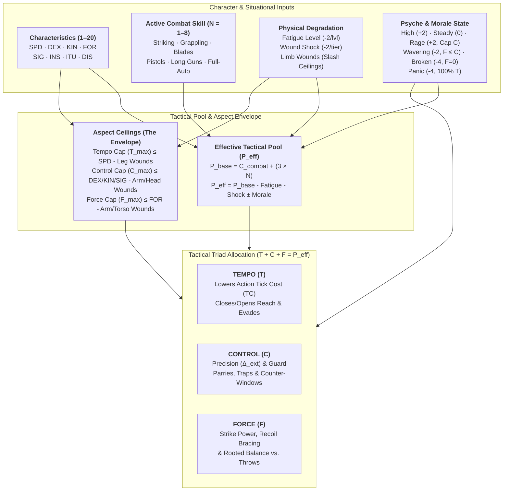

# Satya TTRPG Combat Architecture, Morale & Ranged Firefights

Because I have always been fond of simulation-style games, combat is a large part of the design of **Satya**. Combat is really just a specialized and detailed type of [Task Resolution](../tasks.md). As in all Task Resolutions, it is a contested system using the [Two-List Cascading (`2d20`) Watershed Mechanic](../satya_d20_rules.md). Even ranged combat is a contested roll.

What separates combat in Satya from mainstream RPGs is the depth of tactical agency, psychological realism, and anatomical consequence—achieved through a single unified architecture (**The Count-Up Action Clock**, **Psyche & Morale**, and the **"Envelope & Fill" Tactical Pool**) rather than hundreds of disjointed special-case "Feat" rules. Both **Ranged Combat** (detailed in [Section 5](#5-ranged-combat-suppression--firefight-mechanics) below) and **Melee Combat** (detailed in full in [Melee Combat, Close-Quarters Tactics & The Tactical Triad](melee_combat.md)) share this exact foundation.

---

## 1. Aspects of Combat & Genre Support

So what makes Satya different?

Most games only factor in skill of the adversaries, how fast they are, weapon damage, and armor. Most games typically resolve combat along these lines:

- Determine who has initiative, so that their actions go first or can preempt others
- Choose an action (some kind of attack or feat)
- One being attacked can determine some kind of active or passive defense if possible
- Determine odds of attacker hitting
- If hit, roll for damage, possibly rolling for hit location and subtract armor if any from damage
- The character with the next initiative repeats the above, rinse, lather, repeat

Most games don't consider (or bolt them on in a very ad-hoc manner via feats or advantages) any of the following:

- **Morale**: If you are scared, you may not even get to choose your action or may be at severe tactical disadvantage
- **Aggressiveness**: "It's not the size of the dog in the fight, it's the size of the fight in the dog"
- **Fatigue**: It doesn't matter how skilled you are if you are too tired to move
- **Anatomical Trauma**: Wounds, concussions, broken limbs, blood loss, pain, and shock drastically reduce effectiveness and slash specific physical capabilities
- **Reach**: If your weapon can't reach your target, you have to get into range (which can be difficult and takes time)
- **Time (Action Duration)**: How fast does your (re)action take? It's not just when an action starts that matters, but how soon it finishes on the Count-Up Clock
- **Reliability**: Especially for modern weapons, how prone is your weapon to malfunction under stress or poor maintenance?

Some will argue that factoring in the above is too much minutiae to keep track of, and will bog down the "fun" of the game. I will argue that without consideration of these elements, the narrative value of the action is lost, and perhaps worse, the unrealism will tar victories with a poor brush. Some will argue that many systems _do_ address many of the above aspects, but I feel when they are factored in, they are handled in an indirect ad-hoc way with special rules bolted on (think Feats or Advantages in many systems) and therefore are handled in an incongruous way. If it is done smartly and consistently, all of the above can be factored in with the added benefits:

- Make combat much more visceral and narratively exciting by providing meaningful tactical choices on every exchange
- Realism makes hard-earned victories all the more rewarding
- The added simulation depth is governed by one consistent set of rules rather than a library of exception-based Feats
- While each combat decision carries more weight, overall real-world time spent in combat remains fast because combat is decisive and lethal
- Makes characters think twice before treating violence as their default first resort

### 1.1 Genre Support

Satya is not a super-hero fantasy system at its heart. While it could model such things, Satya is geared towards modeling real-world human-level skills. Moreover, player characters do not have any inherent plot-armor advantages over NPCs. They do not get to dodge bullets, and most solid gunshots (a decent margin of success) will incapacitate a character no matter how much experience and training they have.

The idea behind the realism is twofold:

- Make combat interesting by providing genuine tactical choices
- Make combat memorable and consequential by making it deadly

Too many game systems that are not war-related make combat a first-choice option. This is because in most systems, characters can take multiple solid hits until they are *hors de combat*, and helpful healing spells or sci-fi med kits can instantaneously heal at least some of the damage done. Also, many game systems don't take into account how being wounded or fatigued affects performance. In many game systems, as long as your "hit points" are not `0` or less, your character functions at 100% normal capacity. This is not only unrealistic from a simulation point of view, it is boring from a storytelling point of view. How many stories are made more dramatic and memorable because the protagonist has to overcome pain, fatigue, or physical constraints imposed by wounds? Hit-point style systems without wounding effects are not just unrealistic—leading to one-dimensional play—they are poor at storytelling as well.

In other words, Satya is designed to dispel two pervasive myths:

- That realism is too time-consuming
- That realism isn't fun or interesting because it doesn't let you do cinematic things

---

## 2. Design Philosophy of Combat in Satya

Most combat in RPGs is neither realistic nor narratively interesting. Most games typically allow each participant in the combat an equal number of actions and reactions. And even games that let characters have more actions than others still allow automatic defensive reactions, and generally apply an evenness or "fairness" to combat. Combat, however, is anything but fair—and if you are playing fair, either you are in a sporting duel, or you are doing it wrong. Most games show this fairness by trading action for action:

```text
Character A attacks
NPC B blocks/dodges
NPC B attacks
Character A blocks/dodges
```

This is not only unrealistic, it is narratively boring. How many boxing matches or UFC fights do you see alternating like that? None. In the real world, opponents size each other up and then unleash a flurry of attacks, stopping only to catch their breath, regain balance, or because the defender was able to counter and **seize the initiative**. For example, the defender might trap the attack, sweep the lead leg, or sidestep out of the line of attack. Or maybe one combatant only throws out an exploratory jab or thrust—perhaps as a feint, or perhaps to judge their opponent's reflexes—while the other combatant holds a tight guard, waiting for an opening to counter or escape.

In the latter scenario where a defender only defends, what is in it for them game-wise in most systems? All they have done is allow the attacker a free shot. Without rules for fatigue, guard exposure, or tactical advantage, there is no reason from a metagame perspective for a character to ever probe or hold back. Perhaps in other game systems, there is a special rule (a Feat or Advantage) where if they defend for one round, they gain a bonus next round—but then you have to learn umpteen million special Feat rules and how they interact. Although Satya initially looks more detailed, in practice it is cleaner because tactical behavior emerges naturally from the **Tactical Pool** rather than special-case rules.

Even if proponents of traditional turn-based systems argue that a single attack roll abstracts a whole exchange of feints, footwork, and parries, why does each side still get the exact same rhythmic opportunity to attack and defend every round? That is not how real fights work—as we hear in boxing: *"he's got him on the ropes," "he's on his last legs," "the enemy has seized the initiative," "the unit is pinned down."* By making **Tempo**, **Control**, and **Force** explicit in the rules, tactical decision-making directly drives the story.

> [!IMPORTANT]
> **Why Satya Replaces Hit Points with Anatomical Trauma, Shock & Fatigue**:
> The popularity of classic RPGs has made the notion of ablative Hit Points ubiquitous. Yet it strains verisimilitude to the breaking point when a high-HP character shrugs off a point-blank gunshot or assassination attempt. The old excuse is that Hit Points abstract "skill, luck, and stamina" turning a lethal blow into a graze—until luck runs out.
>
> If Hit Points are mostly "luck and stamina," why do healing rules require weeks of bedrest or multiple medical treatments to restore a high-level character's "luck"? Worse, a single bag of Hit Points fosters a cavalier attitude toward violence and forces GMs to artificially "level up" bandits and guards so combat stays threatening.
>
> In **Satya**, Hit Points are replaced by **Anatomical Wound Tracks, Systemic Shock, Blood Loss, and Fatigue**:
> - **Systemic Drain**: Every tier of **Fatigue (`fatigue_level`)** and **Wound Shock (`wound_shock_index`)** drains **`-2` points** from the character's Effective Tactical Pool ($P_{\text{eff}}$), increases internal cascade difficulty ($\Delta_{\text{int}}$), and slows all actions via `action_time_factor`.
> - **Structural Limb & Organ Trauma**: Wounds to specific hit locations (legs, arms, torso, head/eyes) directly slash the character's **Aspect Ceilings ($T_{\max}, C_{\max}, F_{\max}$)**—so a sliced calf immediately caps **Tempo**, a fractured wrist caps **Control**, and cracked ribs or a dislocated shoulder cap **Force**.

---

## 3. The Action Economy & Count-Up Clock

Determining **what** a character does, **how long** it takes, and **when** it resolves is governed by Satya's continuous **Count-Up Action Clock**:

1. **Starting Tick (OODA Initiative & Awareness)**:
   - At the onset of combat, each participant computes their **OODA Readiness**:
     $$\text{OODA} = \left\lfloor \frac{\text{SPD} + \text{INS} + \text{ITU}}{3} \right\rfloor$$
   - Combatants who are aware and ready enter the clock at $\text{Starting Tick} = \max(1, 15 - \text{OODA})$ (modified by *Observation* / *Combat Awareness* margins on ambush checks). The combatant on the **lowest Tick** acts first.
2. **Base Action Time Cost (`TC`) & Stances**:
   - Every weapon mode, movement, or combat stance has a **Base Tick Cost (`TC`)**:
     - **`POWER` / Heavy Melee Wind-Up**: `TC = 14` (`10–12` for standard heavy unarmed/melee)
     - **`RANGED_AIMED` / Deliberate Sighted Shot**: `TC = 12`
     - **`MANEUVER` / Bounding Advance**: `TC = 11`
     - **Standard Unstanced Action**: `TC = 10`
     - **`STABILITY` / Controlled Double-Tap / Guarded Strike**: `TC = 8–9`
     - **`RANGED_SNAP` / Quick Point-Shoot / Fast Jab or Knife Slash**: `TC = 7`
3. **Fatigue & Wound Shock Time Multiplier (`action_time_factor`)**:
   - Physical exhaustion and pain slow neuromuscular execution:
     $$\text{action\_time\_factor} = 1.0 + (0.10 \times \text{fatigue\_level}) + (0.25 \times \text{wound\_shock\_index})$$
4. **Tempo ($T$) Adjustment to Effective Tick Cost**:
   - Allocating **Tempo ($T$)** above your neutral baseline ($B = \lfloor P_{\text{base}} / 3 \rfloor$) shaves ticks directly off your action; dumping **Tempo** below $B$ adds wind-up/recovery ticks:
     $$\text{Effective TC} = \max\!\Big(2,\; \text{round}\big(\text{Base TC} \times \text{action\_time\_factor}\big) - (T - B)\Big)$$
   - When a character initiates an action on $\text{Tick}_{\text{start}}$, it resolves and advances their clock to $\text{Tick}_{\text{next}} = \text{Tick}_{\text{start}} + \text{Effective TC}$. If an opponent on an earlier tick executes a fast, high-`Tempo` action whose completion tick is *less than* a slow attacker's completion tick, the faster combatant **interrupts** the slow wind-up before it lands!

---

## 4. Psychological State of Combat & Morale

Considerations of fatigue, distancing, aggressiveness, morale, psychology, and looking for openings are central to Satya:

- What is the attack's reach and the distance between opponents?
- Facing, cover profile, and positioning of opponents
- How fatiguing is the maneuver?
- How fast will the attack finish (`Effective TC`), not merely who started first?
- How to create openings or punish an opponent who telegraphs (`Low Tempo` / `Low Control`)
- Stability (`Root`) of an attack or defensive stance
- Motivation to fight and acute emotional state (`Rage` vs. `Fear`)

### 4.1 Overview of a Combat Exchange

1. **Determine psychological and morale state** (`High`, `Steady`, `Wavering`, `Broken`, `Panic`, or `Rage`)
2. **Determine awareness (surprise) and starting OODA tick**
3. **Determine engagement distance / reach and cover**
4. **Plan maneuver and allocate Effective Tactical Pool ($P_{\text{eff}}$)**:
   - Split pool across the Tactical Triad: **Tempo** (speed/mobility), **Control** (precision/guard), **Force** (power/grounding)
5. **Make combat awareness check** (`INS/SIG` or `ITU`) to read when and how the opponent's move will resolve
6. **Resolve contested `2d20` cascade** (factoring in any reaction time penalty if changing a committed action mid-tick)

### 4.2 Psychological Drives (`Harm:Other` vs. `Self:Protect`)

Combat is greatly affected by the psychological state of the fighters. The fighter's mind and will to fight will often be defeated before the body.

In order to model the psychological state of combat for a character we have the following ratings, anchored by the character's **Discipline (`DIS`)** and **Psyche Characteristics (`AGG`, `SLF`, `EGO`, `BLG`, `CNF`, `OPN`, `EXT`)** defined in [`docs/ttrpg/character/characteristics.md`](../character/characteristics.md):


- **Fight (`Harm:Other`)**: how willing and driven you are to do harm (anchored by **Aggressiveness `AGG`** and situational motivation)
- **Preservation (`Self:Protect`)**: how needful you are to stay alive and unharmed (anchored by **Selfishness `SLF`** vs. **Belongingness `BLG`**)
- **Rage**: acute adrenaline and emotional spike that surges `Harm:Other` while collapsing `Self:Protect` (capping **Control** and forcing pool points into **Force + Tempo**)
- **Fear**: acute threat response that spikes `Self:Protect` while collapsing `Harm:Other` (capping **Force** and forcing pool points into **Control + Tempo**, or **Pure Tempo** in a rout)

### Motivation

Fighters who have nothing to lose or are in a vengeful mood will be less affected by morale than fighters who don't know
why they are fighting or have nothing to gain.  If you are fighting to save your home country, or acting as a fighting 
rear guard to allow your comrades to escape, you will be much harder to break than a mercenary fighting only for a paycheck.

Motivation provides a defense against morale loss. Individually, or as a group, if morale drops, then the will to fight
drops to 0, and no offensive moves can be taken, only moves for defense. If morale drops to 0, then the character or
unit has only self-preservation in mind.

#### Game Mechanics for Motivation (`Psyche` Alignment)
A combatant's situational **Motivation Modifier ($\Delta_{\text{mot}}$)** shifts their **Discipline (`DIS`)** Morale Checks and **Self-Preservation Threshold** based on how the fight aligns with their **Psyche**:
- **Fighting for Crew, Family, or Homeland (`BLG >= 14` or `SLF <= 6`)**: Grants **`-2` to `-4` to $\text{TN}_{\text{eff}}$** on all Morale checks and **`+2` to the Tactical Pool** during a **Conviction Surge** (e.g., holding a doorway so allies can escape).
- **Mercenary / Transactional Motive (`SLF >= 14` and `BLG <= 8`)**: Imposes **`+2` to `+4` to $\text{TN}_{\text{eff}}$** on Morale checks as soon as the character takes a wound (`wound_shock_index >= 1`) or the odds turn against them—they are fighting for money, not to die.
- **Sworn Duty / Chain of Command (`CNF >= 14`)**: Grants **`-2` to $\text{TN}_{\text{eff}}$** on Morale checks while a commanding officer is present and issuing orders, but imposes **`+4` Morale Shock** if command breaks down.

### Mental state

Some people are just more aggressive or violent than others.  Others are just more scrappy, and have a love of fighting.
As Churchill famously said, "It's not the size of the dog in the fight, but the size of the fight in the dog".
Conversely, some people are timid, meek, or even cowardly, and either have no heart to harm others, are scared, or too
afraid of harm being done to themselves.

Essentially, aggressiveness is the ratio of desire to do harm to others, vs willingness to be harmed.  The higher this
ratio is, the more you want to "dish it out".  The lower this ratio, the more defensive you become.  Notice the use of
the words _desire_ and _willing_.  A character may be very willing and able to do harm to other NPCs, but may not have a
particular _desire_ to do so.  A berserker can have a high aggression, where an assassin, who is more than willing or
capable to kill someone, won't be aggressive unless there is a purpose or job for example.

Aggressiveness is rated as Harm Other/Self Protection.  If you have a low Protect:Self, then it means you are more
willing to sacrifice yourself or commit harm upon yourself to achieve some goal.  Think for example of suicide bombers
or kamikaze pilots. 

But how do we determine this score, and does it change over time?

#### How the balance changes

This is where a Character's psyche and personality traits come into play.  

Aggression will have a starting value based on two factors:

```
Personality and Situation
```

Some people are naturally more aggressive than others and this will be indicated as part of their personality (**`AGG`** vs. **`SLF`** in [`characteristics.md`](../character/characteristics.md)).  Note
that aggression isn't just physical.  A highly aggressive person is also quick to launch insults or be emotionally
aggressive as well.  It all comes as a package.  Situation is context dependent and so must be judged on the spot.

Situational modifiers include things like hatred of another race, political group, religion or other faction.  It can
also be lessened as well, like if your character has a sense of honor, and the opponent is somehow at a disadvantage.
Seeing suffering can also sometimes lessen aggression.  What can trigger these is left to GM discretion, but should
take into account the Psyche and Personality traits.

For example, Rage can drastically increase both Harm:Other and lower Self:Protect simultaneously.  Selfishness or
cowardly traits can also dramatically raise Self:Protect and reduce Harm:Other.  Being wounded typically puts one into
survival mode, thus increasing Self:Protect.

Training, discipline and personality traits can affect when and how much these values change. Whenever a combat trigger occurs, the character makes a **Discipline (`DIS`) Composure Check** (`2d20` cascade with $\text{TN}_{\text{eff}} = 31 - \text{DIS} + \Delta_{\text{trigger}}$):

| Trigger | Controlling Check & Psyche Modifier | Effect on Failed `DIS` Check |
| :--- | :--- | :--- |
| **Being wounded** | `DIS` check ($\Delta_{\text{ext}} = +2 \times \text{Wound Tier}$; `+2` harder if `SLF >= 13`, `-2` easier if `AGG >= 14`) | Shifts toward **Self:Protect** (**Wavering** morale, or **Rage** if `AGG >= 15` and `SLF <= 8`). |
| **Good friend / squadmate wounded** | `DIS` check ($\Delta_{\text{ext}} = +2$ if `BLG >= 13`) | If `AGG >= 12`, triggers **Rage** against the attacker; if `AGG <= 8`, drops morale by `-1` step toward **Wavering**. |
| **Loved one attacked or wounded** | `DIS` check ($\Delta_{\text{ext}} = +4$ if `BLG >= 14` or `SLF <= 7`) | Immediate shift into **Vengeful Rage** (`+2` Pool, `Control` capped) or **Altruistic Conviction Surge** to shield them. |
| **Insulted or Taunted** | `DIS` check ($\Delta_{\text{ext}} = |\text{EGO} - 10|$ or $|\text{AGG} - 10|$) | If `EGO >= 13` or `AGG >= 13`, character is baited into **Aggressive / Rage** allocation (must commit to **Force + Tempo**). |
| **Publicly Humiliated** | `DIS` check ($\Delta_{\text{ext}} = +4$ if `EGO >= 14`) | Inflicts an **Ego Wound** (`+2` to $\Delta_{\text{int}}$) and triggers reckless **Rage** (`AGG >= 12`) or **Broken** withdrawal (`AGG <= 8`). |
| **Seeing innocent suffering** | `DIS` check (if `SLF <= 7`) | Lessens aggression toward surrendering foes, or triggers protective resolve against the perpetrator. |

Aggressiveness comes with some pros and cons.

#### Effects of aggression

- **High Aggression / Rage (`Harm:Other >> Self:Protect`)**: Grants an adrenaline surge (**`+2` to Tactical Pool** and ignores `-2` of pain shock), **but** imposes tunnel vision—you **must** allocate at least `50%` of your pool into **Force**, and your **Control (Guard & Precision)** is capped at $\le \lfloor P_{\text{eff}} / 4 \rfloor$. You become a terrifying blitz against a stunned or timid opponent, but walk straight into traps and counter-strikes against a composed master.
- **High Self-Protection / Timidity (`Self:Protect >> Harm:Other`)**: Preserves **Control (Guard/Cover)** and **Tempo (Escape)**, **but** caps **Force** ($\text{Force} \le \text{Control}$), making it difficult to finish an armored or braced opponent or push through suppressive fire.

### Morale

We all would like to think our character would bravely face down a horde of orcs, enemy soldiers or whatever your
nemesis happens to be.  But the fact is, having a character essentially be immune to fear cheapens the very heroism
they are supposed to have.  Nothing is valuable without sacrifice...and this includes having to pay for overcoming one's
fears.

Many factors can play into morale.  A substantial part of morale comes from:

- **Psyche**: your personality traits (especially **Ego `EGO`**, **Selfishness `SLF`**, **Belongingness `BLG`**, and **Aggressiveness `AGG`**)
- **Principles**: how you believe you should live your life
- **Training**: A sense of duty and obligation (**Conformity `CNF`** and **Discipline `DIS`**), or cultural way of life

If your homeland or town is being razed to the ground, it can throw thoughts of one's own death to the winds if you are
the type that is patriotic or humanitarian (`BLG >= 14` or `SLF <= 6`).  If your character is the self-centered type (a very high `SLF` and `EGO` with low `BLG`) your
character may feel that everyone else is unimportant except one's own skin.

Morale is lowered under several circumstances (adding to $\Delta_{\text{morale}}$ on **Discipline `DIS`** Morale Checks):

| Trigger                      | Morale Penalty ($\Delta_{\text{morale}}$) |
|------------------------------|------------|
| 25% of your party is down    | `+2` *(or `-1` step)* |
| 50% of your party is down    | `+4` *(or `-2` steps)* |
| 75% of your party is down    | `+6` *(or `-3` steps)* |
| outnumbered 2 to 1           | `+2` |
| outnumbered 3 to 1           | `+4` |
| outnumbered > 4 to 1         | `+6` |
| leader is unreachable        | `+2` *(+4 if `CNF >= 14`)* |
| headquarters is overrun      | `+6` |
| (Modern) down to 20% ammo    | `+4` |
| attacks are doing nothing    | `+6` |
| start out fatigued           | `+2` |

### Base morale

A character's **Base Morale** is anchored by their **Discipline (`DIS`, `1–20` scale)**, modified by their training (*Counter-Interrogation / SERE* or military *Command* experience) and situational **Psyche** alignment ($\Delta_{\text{mot}}$):

$$\text{Base Morale Controller } (C_{\text{morale}}) = \text{DIS} + \text{Motivation Mod } (\Delta_{\text{mot}})$$

### Conditions of morale

There are 5 conditions of morale:

- **High**: You and your team are eager and ready to attack. Advantage to aggression (`+2` to Tactical Pool; `+1` to **Force** or **Tempo** ceiling).
- **Steady**: The default condition. Your character is ready and willing to fight with full freedom of Tactical Pool allocation.
- **Wavering**: You are holding and can still attack, but doubt creeps in (`-2` to Tactical Pool; **Force** cannot exceed **Control**, $F \le C$).
- **Broken**: You can no longer initiate active attacks and must withdraw (`-4` to Tactical Pool; active offensive **Force** is locked to `0`—can perform covering fire, parries, dodges, or passive counter-defenses only).
- **Panic**: Full-blown rout; your only action is to turn your back and flee (`-4` to Tactical Pool; **`Control = 0` and `Force = 0`**—`100%` of remaining pool is locked into **Pure `Tempo`** to run away).

When you have **High** morale, your character is chomping at the bit to fight.  There is a bonus (`+2` Pool) for aggressive
actions (taking the fight to the enemy to try to put them off guard).

For **Steady** morale, your character is in the fight and equally capable of both offensive and defensive techniques.

At **Wavering** morale, your character is starting to wonder if they are going to lose.  The Tactical Pool shrinks by `-2`, and the character switches to a cautious mode where **Force** cannot exceed **Control** ($F \le C$).

At **Broken** morale, your character will try to disengage from combat in the most effective way possible. No actively
offensive techniques are possible (active **Force = 0**).  If cornered and attacked physically, the character can perform passively offensive maneuvers
(counter blocks, trips, disarms, throws, etc), but at a `-4` pool penalty.  Dodges, taking cover, and maneuver-to-withdraw moves (`Tempo + Control`) are
possible.

When in **Panic**, the character must flee at the maximum speed possible (`100% Tempo`, `0 Control`, `0 Force`).  This even means turning one's back to the
enemy (`Guard = 0`)!  A **Discipline (`DIS`)** or **Insight (`INS`)** roll can be made here to surrender instead if the character realizes that flight is hopeless (e.g., the enemy can move
faster than he can).

### Rolling for morale

Whenever a Morale Trigger occurs (such as taking a serious wound, being pinned by heavy automatic fire, or seeing 50% of the squad go down), the character rolls a `2d20` cascade check governed by **$C_{\text{morale}} = \text{DIS} + \Delta_{\text{mot}}$** (`N = 1` pair for civilians, `N = 2` for hardened combat veterans) against:

$$\text{TN}_{\text{morale}} = 31 - C_{\text{morale}} + \Delta_{\text{morale}}$$

- **`1+` Successes**: The character holds their nerve and remains at their current Morale Condition (or rallies `+1` step on `2+` Extraordinary Successes).
- **`0` Successes (`CleanFailure`)**: Morale drops by **`1` Condition Step** (e.g., `Steady` $\to$ `Wavering`, or `Wavering` $\to$ `Broken`).
- **Botch (`CriticalFailure`)**: Morale drops by **`2` Condition Steps** (e.g., `Steady` $\to$ `Broken`, or `Wavering` $\to$ `Panic`).

---

## The Tactical Pool Architecture: "Envelope & Fill"

In satya, a combatant's **Tactical Pool ($P_{\text{eff}}$)** and how they can distribute it across **Tempo (`T`)**, **Control (`C`)**, and **Force (`F`)** are governed by the **"Envelope & Fill" Model**:

1. **Characteristics Set Your Physical Envelope (Aspect Ceilings)**:
   Your physical and sensory attributes (`SPD`, `KIN`, `DEX`, `FOR`, `SIG`) define the **maximum number of points** you can put into any single aspect on a single action ($T_{\max}, C_{\max}, F_{\max}$). A slow heavyweight (`FOR 15, SPD 8`) has a massive `Force` ceiling (`15`) but a low `Tempo` ceiling (`8`); he cannot magically convert his muscle mass into lightning footwork.
2. **Skill Fills Your Envelope (Pool Size)**:
   An untrained athletic prodigy (`SPD 14, KIN 12, FOR 14`, *Brawling* `N = 1`) has high ceilings (`14 / 12 / 14`), but a small total pool—so to throw a max-power `Force 14` punch, they *must* starve `Tempo` and `Control` down to almost `0` (telegraphing the swing and leaving their chin wide open). A trained martial artist (`N = 5`) with the exact same physique has a large enough pool to fill **Tempo**, **Control**, and **Force** *simultaneously*!



### 1. Calculating the Base & Effective Tactical Pool ($P_{\text{eff}}$)

Every combat action uses a specific **Combat Skill ($N \in [1, 8]$)** (or `N = 1` *Brawling* / *Throwing* Talent if untrained) and its **Controlling Characteristic ($C_{\text{skill}} = \lfloor(C_1 + C_2)/2\rfloor$)** from [`docs/ttrpg/skill-design.md`](../skill-design.md#46-tree-5-combat--unarmed-melee-firearms--heavy-ordnance-combat-athletic-technical), paired with the character's **OODA Initiative ($\text{OODA} = \lfloor(\text{SPD} + \text{INS} + \text{ITU})/3\rfloor$)** and **Cognitive Decision Score ($D_{\text{cog}} = \lfloor(\max(\text{ANA}, \text{CRE}) + \text{INS} + \text{FOC})/3\rfloor$ — "Quick Thinking" for complex tactical decisions and mid-action OODA pivots; see [`docs/ttrpg/systems/action_economy.md`](../systems/action_economy.md))** from [`docs/ttrpg/character/characteristics.md`](../character/characteristics.md#8-secondary--derived-characteristics):

$$\text{Combat Readiness } (C_{\text{combat}}) = \left\lfloor \frac{C_{\text{skill}} + \text{OODA}}{2} \right\rfloor$$

$$\text{Base Tactical Pool } (P_{\text{base}}) = C_{\text{combat}} + (3 \times N)$$

$$\text{Effective Tactical Pool } (P_{\text{eff}}) = \max\!\big(0,\; P_{\text{base}} - (2 \times \text{Fatigue Level}) - (2 \times \text{Wound Shock}) + \Delta P_{\text{morale}}\big)$$

- **Why $C_{\text{combat}} + 3N$ Has Zero Arbitrary Cutoffs**:
  Every single point of Characteristic (`1–20`) and every level of Skill (`1–8`) directly increases your tactical pool.
- **What Is a Character's "Neutral Baseline" ($B$)?**
  A character's neutral, balanced per-aspect baseline is **$B = \lfloor P_{\text{base}} / 3 \rfloor$** (for an average human with $C_{\text{combat}} = 10$ and trained skill $N = 3$, $P_{\text{base}} = 19$ and balanced allocation is **`6 / 7 / 6`**).

### 2. Characteristic Aspect Ceilings ($T_{\max}, C_{\max}, F_{\max}$)

When splitting $P_{\text{eff}} = T + C + F$, no aspect may receive more points than its **Aspect Ceiling**:

| Aspect | Melee Ceiling Formula | Ranged Ceiling Formula | Degraded By (Structural Wounds) |
| :--- | :--- | :--- | :--- |
| **Tempo Cap ($T_{\max}$)** | **`SPD`** $-\text{ Leg/Hip/Foot Penalty}$ | **`SPD`** $-\text{ Leg/Hip/Foot Penalty}$ | Sprained ankle, knee tear, thigh laceration, heavy encumbrance. |
| **Control Cap ($C_{\max}$)** | **$\max(\text{KIN}, \text{DEX})$** $-\text{ Arm/Head Penalty}$ | **$\lfloor\frac{\text{DEX} + \text{SIG}}{2}\rfloor$** *(or `DEX/FOC`)* $-\text{ Arm/Head/Eye Penalty}$ | Concussion/daze, fractured wrist/arm, eye injury, suppressed tunnel vision. |
| **Force Cap ($F_{\max}$)** | **`FOR`** $-\text{ Arm/Shoulder/Torso Penalty}$ | **`FOR`** $-\text{ Arm/Shoulder/Torso Penalty}$ | Dislocated shoulder, cracked ribs, severed biceps/tendons. |

> [!TIP]
> **Mastery Technique Overflow ($N \ge 5$)**:
> A true master ($N \ge 5$) who has trained for decades to maximize leverage and body mechanics may add **$\lfloor (N - 3) / 2 \rfloor$** (`+1` at $N=5$, `+2` at $N=7$) to their **Control** and **Force** ceilings within their specialized martial art or weapon skill.

### 3. Physical & Psychological Modifiers to the Pool

1. **Systemic Drain (Shrinks Total Pool $P_{\text{eff}}$)**:
   - **Fatigue (`fatigue_level`)**: Reduces $P_{\text{eff}}$ by **`-2` points per Fatigue Level** (and increases `action_time_factor` by `+10%` per level).
     - *How Combat Generates Fatigue*: Fighting with economy of motion (**Control**) conserves breath. Whenever a combatant allocates **more than `50%` of their Aspect Ceiling into `Force` or `Tempo`** on an action, they accumulate **1 Exertion Mark** (or **2 Marks** if *both* `Force` and `Tempo` exceed `50%` of their ceilings, as in an all-out blitz). When **Exertion Marks $= \text{Fatigue Threshold}$** ($\text{FT} = \text{FIT} + \lfloor\text{DIS}/2\rfloor$), the character gains **`+1` Fatigue Level**.
   - **Wound Shock & Pain (`wound_shock_index`)**: Acute pain, blood loss, and shock reduce $P_{\text{eff}}$ by **`-2` points per unmitigated Shock Tier**.
2. **Localized Structural Wounds (Slash Specific Aspect Ceilings)**:
   - Slash the specific **Aspect Ceiling** ($T_{\max}, C_{\max}, F_{\max}$) tied to that anatomy by **`-2` (Minor Sprain/Flesh Wound)**, **`-5` (Moderate Tear/Deep Cut)**, or **`-10` / Locked at `0` (Fracture / Severed / Disabled)**.
3. **Psychological & Morale Constraints on Allocation**:
   - **High Morale / Conviction Surge**: **`+2` Pool**; no restriction (`+1` to $F_{\max}$ or $T_{\max}$).
   - **Steady Morale**: **`0` Pool**; full freedom up to normal Aspect Ceilings.
   - **Rage / Bloodlust**: **`+2` Pool** (Adrenaline); **must allocate $F \ge \lfloor P_{\text{eff}} / 2 \rfloor$, and `Control` is capped at $C \le \lfloor P_{\text{eff}} / 4 \rfloor$**.
   - **Wavering Morale**: **`-2` Pool**; **cannot allocate more to `Force` than `Control` ($F \le C$)**.
   - **Broken Morale**: **`-4` Pool**; **active offensive `Force = 0`** (all points must go into **`Control` + `Tempo`** for covering fire, parries, dodges, and withdrawal).
   - **Panic**: **`-4` Pool**; **`Control = 0` and `Force = 0`** (`100%` of pool locked into **Pure `Tempo`** to flee with back turned).

### 4. Mechanical Resolution of Tempo, Control, and Force

1. **Tempo ($T$) $\to$ Action Count Cost (`TC`) & Reach/Evasion**:
   $$\text{Effective TC} = \max\!\Big(2,\; \text{round}\big(\text{Base Weapon/Move TC} \times \text{action\_time\_factor}\big) - (T - B)\Big)$$
   *Investing above baseline ($B = \lfloor P_{\text{base}}/3 \rfloor$) in **Tempo** shaves ticks directly off your action; dumping **Tempo** below baseline adds wind-up/recovery ticks.*
2. **Control ($C$) $\to$ Contested Precision ($\Delta_{\text{ext}}$), Guard & Counter-Initiative**:
   - **Guard & Precision Differential**: In a contested exchange, $\Delta_{\text{control}} = C_{\text{def}} - C_{\text{att}}$ shifts $\Delta_{\text{ext}}$ on the attacker's `2d20` cascade roll.
   - **Seizing the Initiative (Counter-Opening)**: If an attacker fails their attack roll against a defender with $C_{\text{def}} > C_{\text{att}}$, the defender traps, sweeps, or off-balances them—imposing **$(C_{\text{def}} - C_{\text{att}})$ extra recovery ticks** (or draining that many points from the attacker's next Tactical Pool)!
3. **Force ($F$) $\to$ Impact Power, Recoil Bracing & Rooted Stability**:
   - **Melee Kinetic Impact**: Scales derived **Power ($\text{POW} = \frac{\text{FOR} \times \text{SPD}}{10}$)**:
     $$\text{Strike Impact} = \text{POW} \times \left(\frac{F}{B}\right)$$
   - **Block & Throw / Sweep Resistance (`Root`)**: Resisting a knockdown, throw, shove, or guard-crush uses **$F + \text{MMF}$** ($\text{MMF} = \frac{\text{MAS}}{70\text{ kg}} \times \text{SPD}$).
   - **Ranged Recoil & Burst Control**: In rapid or automatic fire (*Fully Automatic Weapons* `DEX/FOR`), each point of **Force ($F$)** above/below the weapon's recoil rating offsets or increases burst dispersion ($\Delta_{\text{ext}}$).

---

## 5. Melee Combat & Close-Quarters Tactics

For the complete close-quarters ruleset—including the **Tactical Triad (`Tempo`, `Control`, `Force`)**, **Reach Tiers**, **Seizing the Initiative**, **Root vs. Throws/Sweeps**, **The Six Core Tactical Allocations (`TC`, `TF`, `CF`, `Pure T/C/F`)**, and the tick-by-tick **Viktor vs. Elena** melee walkthrough—see the dedicated companion chapter: **[Melee Combat, Close-Quarters Tactics & The Tactical Triad](melee_combat.md)**.

---

## 6. Ranged Combat, Suppression & Firefight Mechanics

Ranged combat uses the exact same **Tempo, Control, and Force** triad on the Count-Up Clock, interacting with weapon properties, cover, and awareness:

- **Tempo (Aim & Action Time)**: Governs how many ticks (`TC`) you spend bringing the weapon to bear—from a fast point-shoot or hip-fire snapshot (high **Tempo**, lower `TC`) to a deliberate multi-tick sighted shot (low **Tempo**, higher **Control**).
- **Control (Sight Alignment & Cover Exposure)**: Governs marksmanship precision (`DEX/SIG` or `DEX/FOC`) AND how much of your body is exposed out of cover while firing (`Guard`).
- **Force (Stance, Recoil Bracing & Volume of Fire)**: Governs how rooted and braced your shooting platform is (`FOR`/`MAS`) to absorb recoil during rapid/automatic fire (*Fully Automatic Weapons* `DEX/FOR`) and maintain suppressive pressure.
- **Awareness**: Visual (`SIG`), auditory (`HEA`), and intuitive (`ITU`) tracking of targets, crossfires, and incoming suppression (`OODA`).

### Ranged Weapon Recoil & Action Modes in the Triad

Unlike melee weapons where **Force** directly multiplies muscle impact, ranged weapons have a fixed ballistic energy per round, a **Base Time Cost (`TC`)**, and a **Recoil / Bracing Rating (`R`)** based on caliber and fire mode:

| Ranged Fire / Action Mode | Base `TC` | Recoil / Bracing Need (`Force`) | How the Tactical Triad Governs the Shot |
| :--- | :---: | :---: | :--- |
| **Single Snap-Shot / Point-Shoot** | `7` | Low (`R = 3–4`) | Prioritizes **Tempo** (beating the target to the draw) + **Control** (point-aim & cover retention). |
| **Deliberate Sighted / Aimed Shot** | `11–12` | Moderate (`R = 4–6`) | Prioritizes **Control** (sight alignment, trigger squeeze, called shots, minimal cover exposure) at lower **Tempo**. |
| **Controlled Double-Tap / Short Burst (2–3 rds)** | `9` | Medium (`R = 6–7`) | Requires balanced **Force** to keep the second/third round on target alongside **Control** and **Tempo**. |
| **Full-Auto Burst / Suppressive Fire (5–15 rds)** | `8–10` | High (`R = 8–12`) | Demands heavy **Force** (`FOR`/`MAS`) to muscle down muzzle climb and project a beaten zone of **Suppression** (`Force` vs. target's `DIS` Morale). |
| **Bounding / Shooting on the Move** | `10` | Unbraced (`+3` to `R`) | High **Tempo** covers ground quickly, but moving starves **Force** (recoil stability) or **Control** (sight picture). |

---

### Worked Example 2: Ranged Firefight (Alley Ambush — Street SMG vs. Tactical Handgun)

This example shows how **Tempo**, **Control**, and **Force** resolve a 15-meter gunfight behind partial cover, and how **Suppression** and **Wound Shock** trigger **Morale Allocation Constraints**.

#### The Combatants (15 meters apart in a rain-slicked alley behind concrete pillars)
1. **Mateo — Gang Enforcer with a Sear-Modified Machine Pistol (Glock w/ Auto-Switch)**:
   - **Characteristics**: `SPD 13`, `FOR 11`, `DEX 13`, `KIN 12`, `SIG 12`, `INS 12`, `ITU 13`, `DIS 11` ($\text{OODA} = 12$).
   - **Psyche**: `AGG 14`, `BLG 15`, `SLF 11`.
   - **Skills**: *Pistols & Revolvers* (`DEX/SIG`, `N = 3`), *Fully Automatic Weapons* (`DEX/FOR`, $C_{\text{skill}} = 12$, **`N = 2`**).
   - **Tactical Pool (when firing Full-Auto `N = 2`)**: $C_{\text{combat}} = \lfloor(12 + 12)/2\rfloor = 12 \implies P_{\text{base}} = 12 + 3(2) = \mathbf{18}$ points (Neutral baseline $B = 6$).
   - **Aspect Ceilings**: **`Tempo Cap = 13`** (`SPD 13`), **`Control Cap = 12`** (`DEX/SIG 12`), **`Force Cap = 11`** (`FOR 11`).

2. **Sgt. Vance — Veteran Detective with a 9mm Service Pistol (Semi-Auto + Smart-Optic `-2`)**:
   - **Characteristics**: `SPD 10`, `FOR 11`, `DEX 14`, `FOC 13`, `SIG 13`, `INS 13`, `ITU 12`, `DIS 14` ($\text{OODA} = 11$).
   - **Psyche**: `AGG 9`, `CNF 14`, `DIS 14` *(Unflappable veteran)*.
   - **Skill**: *Tactical Handgun & Point Shooting* (`DEX/FOC`, $C_{\text{skill}} = 13$, **`N = 4`**).
   - **Tactical Pool ($P_{\text{base}}$)**: $C_{\text{combat}} = \lfloor(13 + 11)/2\rfloor = 12 \implies P_{\text{base}} = 12 + 3(4) = \mathbf{24}$ points (Neutral baseline $B = 8$).
   - **Aspect Ceilings**: **`Tempo Cap = 10`** (`SPD 10`), **`Control Cap = 13`** (`DEX/SIG 13`), **`Force Cap = 11`** (`FOR 11`).

#### Tick-by-Tick Firefight Exchange
- **Tick 1 — Mateo's Full-Auto Suppressive Blitz (`Tempo + Force`, Low `Control`)**:
  - Mateo acts first (`OODA 12`, `SPD 13`). He steps out from behind a dumpster and hoses Vance's concrete pillar with a **10-round full-auto burst** (`Base TC 8`, Recoil Rating `R = 8`):
    - Mateo allocates **`8 Tempo / 2 Control / 8 Force`** ($8 + 2 + 8 = 18$).
    - **Why he needs `8 Force`**: Firing a lightweight machine pistol on full-auto has a massive Recoil Rating (`R = 8`). By committing `8 Force` (planting his stance and muscling down the muzzle climb), Mateo matches `R = 8` and negates the recoil penalty!
    - **Why his `Control` is only `2`**: Because his *Full-Auto* skill is only `N = 2` (Pool = `18`) and he spent `8 Tempo` (for a fast `6-tick` burst) and `8 Force` (for recoil bracing), he only has **`2` points left for `Control`**!
    - **Mechanical Consequence of `Control 2`**:
      1. *Poor Precision*: He cannot thread a bullet around Vance's concrete cover; his burst chews up the concrete pillar, creating heavy **Suppression** ($\Delta_{\text{morale}} = +4$ based on his `8 Force`).
      2. *Wide-Open Exposure (`Guard = 2`)*: To muscle the SMG burst quickly, Mateo leaned half his upper body out from behind the dumpster!

- **Tick 2 — Vance's Composure Check & "Slicing the Pie" Counter-Shot (`Control + Tempo`)**:
  - Concrete chips spray across Vance's face from Mateo's `8-Force` suppressive burst, triggering a **Suppression Morale Check** ($\Delta_{\text{morale}} = +4$).
  - Vance rolls his **Discipline (`DIS 14`, `N = 2`)** against $\text{TN}_{\text{morale}} = 31 - 14 + 4 = 21$ and scores `2` successes—he stays **Steady** (`+0` pool loss) instead of flinching into **Wavering**!
  - Now on **Tick 2**, while Mateo is still recovering from his burst until **Tick 7** (`1 + 6 ticks`) with his torso exposed (`Control = 2`), Vance leans just an inch around the right edge of the pillar ("slicing the pie") and fires a **controlled double-tap** (`Base TC 9`, Recoil `R = 5`):
    - Vance allocates **`7 Tempo / 12 Control / 5 Force`** ($7 + 12 + 5 = 24$).
    - **`5 Force`** matches the mild `R = 5` recoil of a 9mm double-tap.
    - **`12 Control`** gives Vance pinpoint sight alignment **and** keeps `90%` of his body behind the concrete pillar (`Guard = 12`), while exploiting Mateo's exposed `Control 2` posture!
    - Vance rolls `N = 4` pairs of `2d20` with a massive precision advantage (`Control 12` vs. Mateo's `Control 2`), hitting Mateo's exposed right shoulder and chest protector!

- **Tick 7 — Mateo Drops to `Broken` Morale (Psychological Allocation Lock)**:
  - Hit in the shoulder (`Moderate Arm Wound: -5 to Force & Control Caps`, dropping Mateo's $F_{\max}$ to `6` and $C_{\max}$ to `7`; `Wound Shock 2: -4 to Pool`), Mateo fails his **Discipline (`DIS 11`)** Morale Check by 2 tiers (`Botch`) and drops from **Steady** straight to **Broken Morale** (`-4` to Pool)!
  - **Mateo's Degraded State**:
    - His Tactical Pool drops from `18` down to $18 - 4\text{ (Shock)} - 4\text{ (Broken)} = \mathbf{10}$ points.
    - Because his morale is **Broken**, **active offensive `Force` is locked to `0`**—he is psychologically incapable of stepping out to press the attack.
    - Mateo must spend all `10` remaining points on **`Tempo` (`7`)** and **`Control` (`3`)** to scramble backward behind the dumpster and retreat down the alley while firing blind one-handed suppression shots (`Force 0`) behind him!

---

### Worked Example 3: Ranged Maneuver & Evasion (Sniper Overwatch vs. Grenade Flush)

What happens when a combatant uses the Tactical Triad purely to **maneuver between cover** or **evade an explosive**?

- **Bounding Across an Open Street Under Sniper Overwatch (`Tempo + Control`)**:
  - Elena (`P_eff = 24`, `Tempo Cap = 13`, `Control Cap = 13`, `Force Cap = 10`) needs to cross a 10-meter gap between two burned-out cars while an enemy marksman watches the street.
  - If she runs upright in a straight line (**Pure `Tempo`**: `13 Tempo / 2 Control / 9 Force`), she crosses in minimal ticks, but her low **`Control 2`** means she takes a predictable path with a high visual profile—giving the marksman an easy shot!
  - Instead, she executes a **Low Evasive Bound (`12 Tempo / 12 Control / 0 Force`)**: she sprints low, weaves unpredictably from shadow to shadow, and slides behind the engine block (`Control 12` imposes a high difficulty penalty on the sniper's tracking shot, while `Tempo 12` gets her across before the sniper's `Aimed Shot TC 12` finishes!).
- **Diving Clear of a Fragmentation Grenade (`Tempo + Force`, Low `Control`)**:
  - A grenade lands 2 meters from Elena's cover, detonating in **`4 ticks`**.
  - Here, subtle cover discipline (`Control`) won't save her from shrapnel inside the blast radius—she needs raw reaction time (**`Tempo`**) to beat the `4-tick` fuse AND explosive physical leap distance (**`Force`**, powering her `Jumping` / `Parkour` push-off)!
  - She dumps `Control` to `2` and commits **`12 Tempo / 2 Control / 10 Force`** (`TF — The Dive`): she launches herself headfirst over a low wall (`Force 10` maximizes leap distance; `Tempo 12` completes the dive in `3 ticks`, beating the `4-tick` detonation), landing prone and temporarily unguarded (`Control 2`) on the far side, but unharmed by the blast!