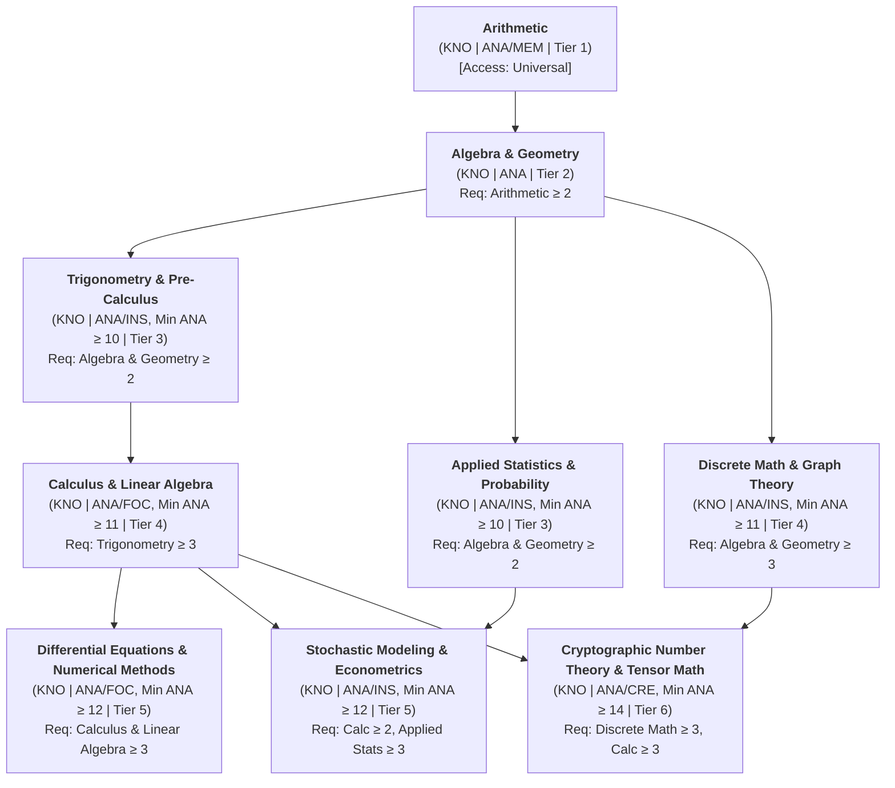
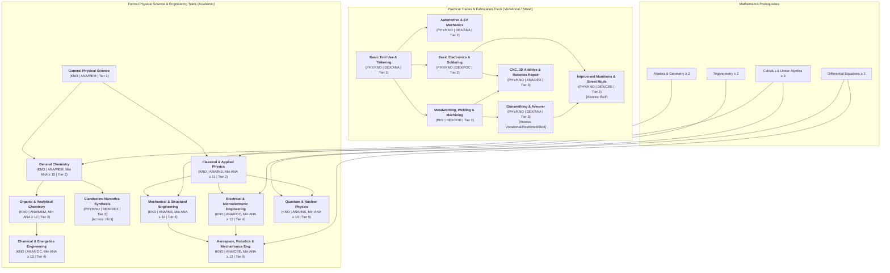
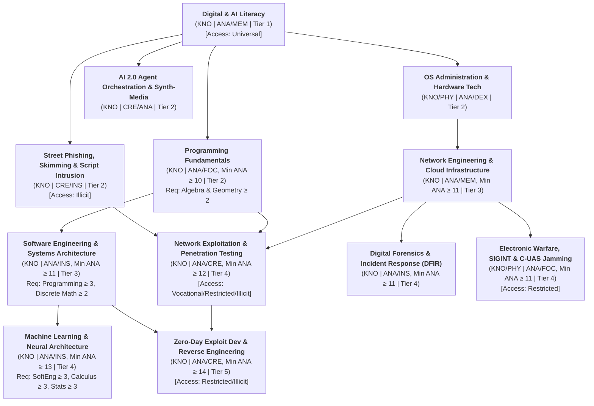
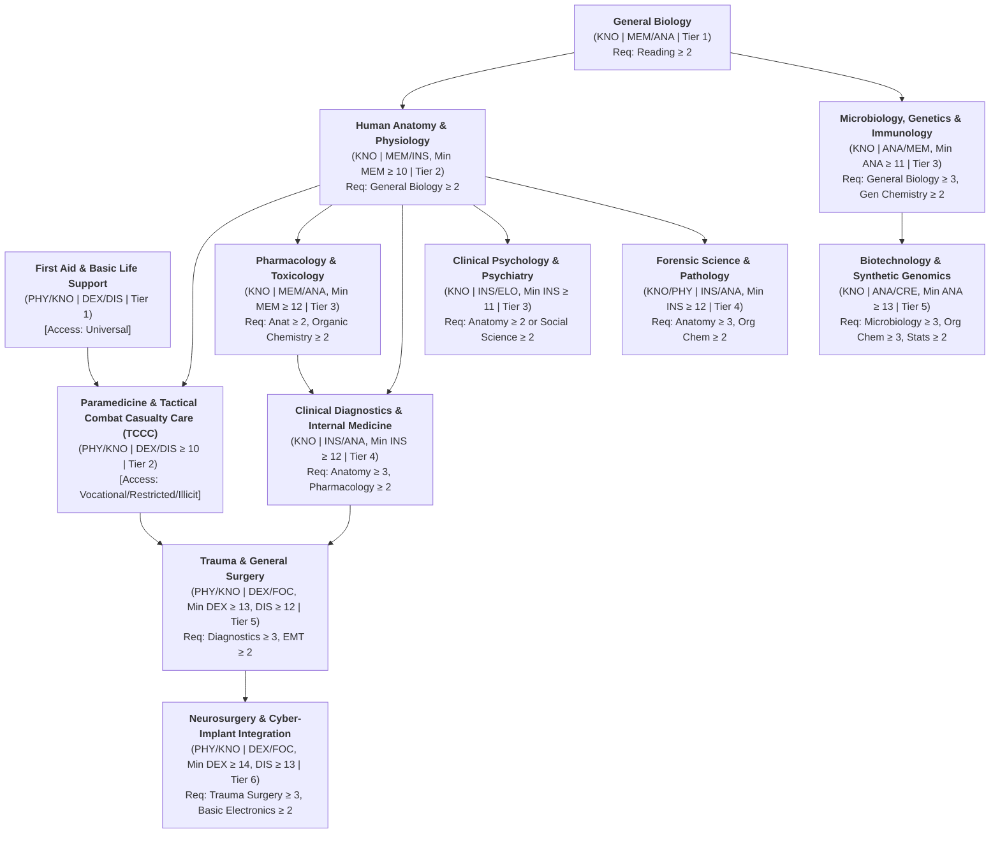
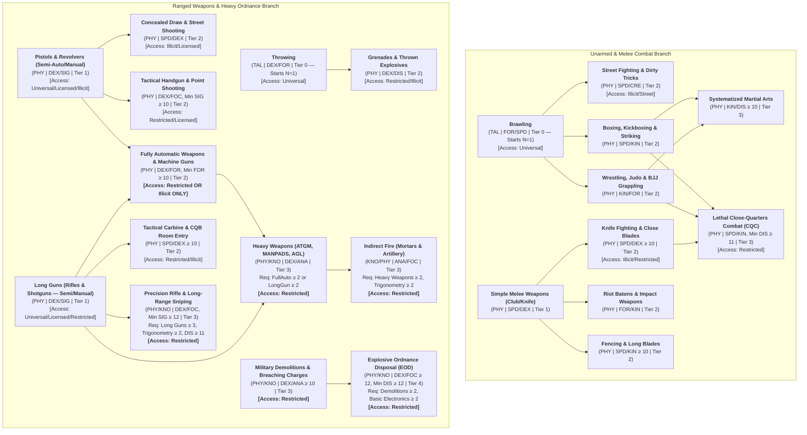
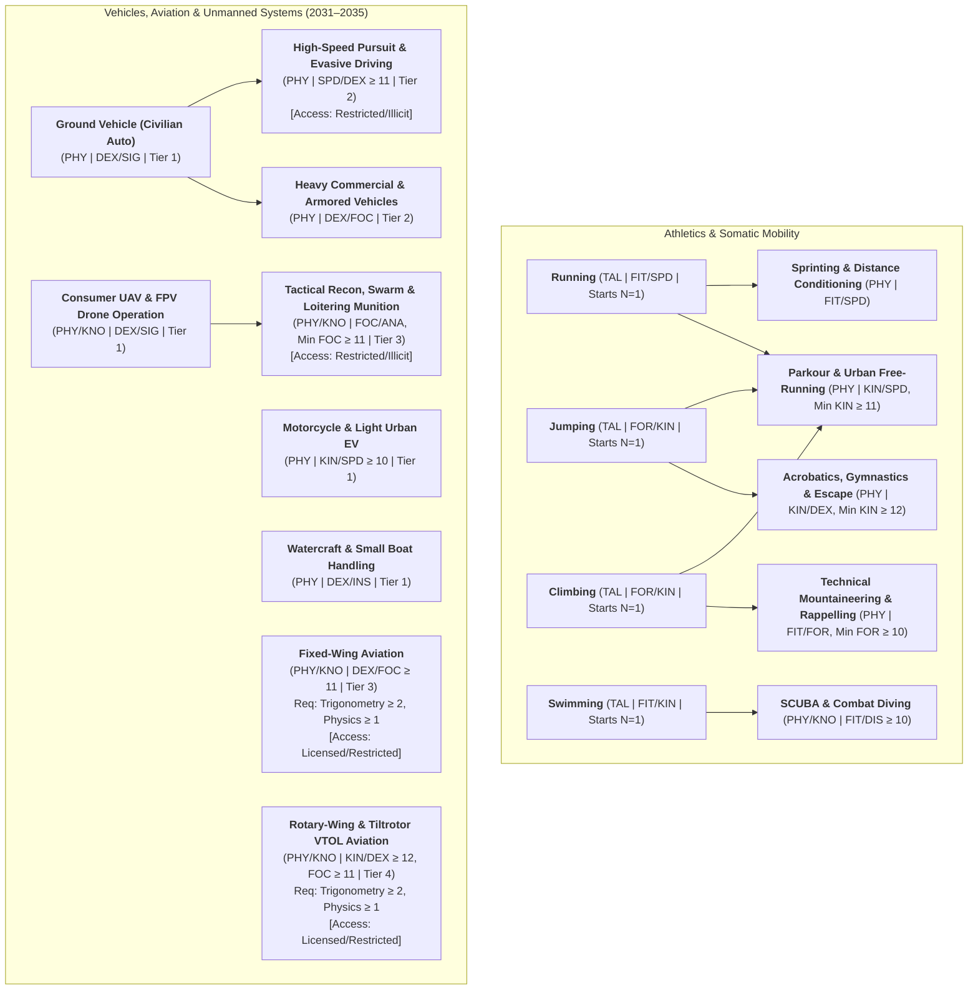
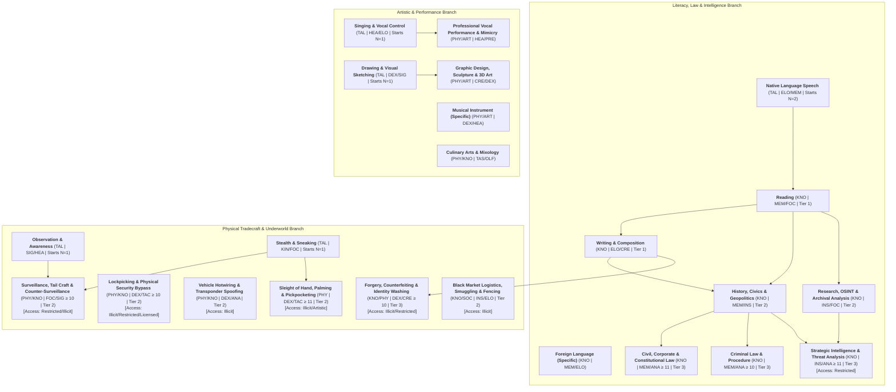
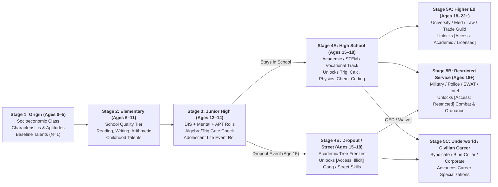

# Satya TTRPG Skill System & Lifepath Architecture

This document defines the canonical **Skill System, Hierarchical Skill Tree, Task Prerequisite Rules, and Lifepath Acquisition Mechanics** for **Satya** (set on near-future Earth, 5 years in the future, ca. 2031–2035). It integrates directly with the **Character Characteristics System** defined in [`docs/ttrpg/character/characteristics.md`](file:///c:/Users/hapah/Projects/satya/docs/ttrpg/character/characteristics.md) and the **Two-List Cascading ("Watershed") `2d20` Dice Mechanic** defined in [`docs/ttrpg/satya_d20_rules.md`](file:///c:/Users/hapah/Projects/satya/docs/ttrpg/satya_d20_rules.md) (calibrated in [`docs/ttrpg/probability.md`](file:///c:/Users/hapah/Projects/satya/docs/ttrpg/probability.md)).

---

## 1. Core Design Philosophy

Satya's skill system is built on five foundational design pillars:

1. **Lifepath Grounding & Plausibility ("No Scientist with Random Full-Auto")**:
   A character's skills are the organic record of their upbringing, socioeconomic class, schooling quality, life events, and adult careers. A university researcher cannot arbitrarily purchase *Fully Automatic Weapons* or *Clandestine Narcotics Synthesis* at character creation unless their lifepath explicitly routed them through military service, law enforcement tactical training, or a criminal syndicate.
2. **Deep Prerequisite Hierarchies (The Skill Tree)**:
   Complex disciplines are gated behind foundational skills. A character who drops out of school at age 15 with only basic *Arithmetic* (or at best *Trigonometry* if exceptionally gifted and disciplined) lacks the *Calculus*, *Linear Algebra*, and *Differential Equations* required to learn advanced *Aerospace Engineering*, *Quantum Cryptography*, or *Machine Learning Architecture*. Conversely, street or military lifepaths open restricted and illicit branches inaccessible to sheltered academics.
3. **Nature of Proficiency (Talents vs. Physical Skills vs. Knowledge Skills)**:
   Every skill is classified by how humans acquire and execute it:
   - **Talents (`TAL`)**: Innate, universal human capacities (such as *Running*, *Singing*, *Observation*, or *Brawling*) in which every non-impaired person possesses a baseline proficiency (`N = 1`).
   - **Physical Skills (`PHY`)**: Trained motor, somatic, and kinesthetic abilities (`N = 0` untrained) governed by physical attributes and muscle memory.
   - **Knowledge Skills (`KNO`)**: Trained cognitive, academic, and analytical disciplines (`N = 0` untrained) governed by mental attributes, study discipline, and formal or street education.
   - **Hybrid Skills (`PHY/KNO`)**: High-complexity disciplines (such as *Trauma Surgery* or *Explosive Ordnance Disposal*) that require both deep theoretical mastery and precise physical execution.
4. **Multi-Category Taxonomy**:
   Skills belong to **one or more categories** (`Combat`, `Athletic`, `Technical`, `Science`, `Knowledge`, `Artistic`, `Social`, `Fieldcraft`, `Medical`, `Cyber`), allowing lifepaths, aptitudes, and equipment systems to reference overlapping domains cleanly.
5. **Explicit Tool & Task Dependencies**:
   Every skill specifies whether it requires tools (`[Tool: None]`, `[Tool: Situational]`, or `[Tool: Mandatory]`), and task resolution rules explicitly define which skill(s), minimum skill levels, controlling characteristics, and tools are necessary to attempt any given action.

---

## 2. Characteristics, Senses, Discipline, and Aptitudes

In the Satya `2d20` Cascading Engine, a character rolls **$N$ sequential pairs of `2d20`** (where $N$ is the **Skill Level**, `1–8`, mythic cap `10`) against an effective Roll-Over Target Number ($\text{TN}_{\text{eff}}$) anchored by the **Controlling Characteristic ($C$)**:

$$\text{TN}_{\text{eff}} = 31 - C + \Delta_{\text{ext}}$$

To support both task execution and Lifepath learning progression, characters possess **Primary Characteristics**, **Sensory Characteristics**, and **Psychological Traits (`Psyche`)**—defined in full in [`docs/ttrpg/character/characteristics.md`](file:///c:/Users/hapah/Projects/satya/docs/ttrpg/character/characteristics.md)—alongside domain **Aptitudes ($A$)**.

### 2.1 Controlling Characteristics ($C \in [1, 20]$, Underlying Spectrum `0.0–100.0`, Human Average `10`)

Rather than collapsing physicality into generic "Strength/Agility" or the mind into a single monolithic "Intelligence" or "Perception" score, Satya separates attributes into **Physical**, **Mental**, **Social**, and **Sensory** characteristics (see [`docs/ttrpg/character/characteristics.md`](file:///c:/Users/hapah/Projects/satya/docs/ttrpg/character/characteristics.md) for full mechanical derivations, including $\text{Power} = \text{Force} \times \text{Speed}$, `Mass`, `Height`, and `Psyche`):

#### A. Physical Primary Characteristics
| Abbr | Characteristic | Role in Task Resolution & Skill Prerequisites |
| :--- | :--- | :--- |
| **`SPD`** | **Speed** | How quickly one can move; a combination of reflexes and quickness. Governs OODA tick speed, fast-draw reflexes, striking speed, sprinting burst, and evasive driving. |
| **`FOR`** | **Force** | Similar to strength; determines mechanical energy that can be transmitted ($\text{Force} \times \text{Speed} = \text{Power}$). Governs melee impact, recoil control for automatic/heavy weapons, grappling leverage, climbing/pulling, and load bearing. |
| **`DEX`** | **Dexterity** | Hand-eye coordination and fine manual precision (*surgeon, watchmaker, pickpocket*). Governs trigger control, surgery, lockpicking, soldering, and manual tool use. |
| **`KIN`** | **Kinesthesis** | Ability to sense and control the body in space (*gymnast, acrobat, martial artist*). Governs balance, footwork, grappling body control, parkour, stealth movement, and VTOL/motorcycle spatial orientation. |
| **`HLT`** | **Health** | Hardiness and physiological resistance to damage, wound shock, toxins, radiation, or disease. |
| **`FIT`** | **Fitness** | Measure of endurance and cardiopulmonary stamina. Governs sustained athletics (running, swimming, mountaineering) and resistance to internal Fatigue ($\Delta_{\text{int}}$). |
| **`MAS` / `HGT`** | **Mass (kg) & Height (m)** | Biometric dimensions (defaults: `70.0 kg`, `1.50–1.75 m`). Govern momentum, grappling weight advantage, recoil absorption, and melee reach. |

#### B. Mental Primary Characteristics
| Abbr | Characteristic | Role in Task Resolution & Skill Prerequisites |
| :--- | :--- | :--- |
| **`MEM`** | **Memory** | Measure of recall and how well a character remembers things. Governs rote learning, language vocabulary, statutory/case law, anatomical & pharmacological nomenclature, and historical/archival recall. |
| **`ANA`** | **Analysis** | What most games call intelligence: the ability to solve problems through logic, deduction, and calculation. Primary controller for mathematics, physics, formal engineering, programming, and ballistics. |
| **`INS`** | **Insight** | Combination of wisdom and the ability to see patterns, hidden relationships, and underlying motives. Governs clinical diagnostics, *Empathy/Read Person*, intelligence synthesis, and forensics. |
| **`CRE`** | **Creativity** | How well one can think outside the box, improvise, or come up with new ideas or expressions. Governs fine/synth arts, zero-day exploit ideation, improvised munitions, con artistry, and culinary arts. |
| **`DIS`** | **Discipline** | Mental fortitude, willpower, composure under fire, resistance to interrogation (*SERE*), and study diligence. Directly governs **Lifepath Skill Advancement Rolls**. |
| **`FOC`** | **Focus** | Concentration and the ability to keep track of one thing without distraction. Governs long-range sniping, trauma/neurosurgery, EOD disarming, drone swarm control, instrument flying, and long stakeouts. |

#### C. Social Primary Characteristics
| Abbr | Characteristic | Role in Task Resolution & Skill Prerequisites |
| :--- | :--- | :--- |
| **`COM`** | **Comeliness** | Physical beauty and attractiveness (by the default society's standards). Governs visual first impressions, seduction, honey-trap tradecraft, and modeling/media appeal. |
| **`PRE`** | **Presence** | Silent charisma, gravitas, and physical magnetism. Governs command authority, intimidation/menace, street credibility, poise, and stage presence. |
| **`ELO`** | **Eloquence** | How well one speaks and can verbally influence others. Governs persuasion, rhetoric, fast-talk deception, diplomacy, public oratory, and subtle elicitation. |

#### D. Sensory Characteristics
| Abbr | Characteristic | Role in Task Resolution & Skill Prerequisites |
| :--- | :--- | :--- |
| **`SIG`** | **Sight** | How well an entity can see. Governs ranged weapon aiming (*Pistols*, *Long Guns*, *Sniping*), visual spotting, reading micro-expressions, sketching, and fine visual inspection. |
| **`HEA`** | **Hearing** | How well an entity can hear. Governs pitch/timbre control (*Singing*, *Musical Instruments*, *Voice Mimicry*), acoustic/sonar analysis, and detecting faint footsteps or mechanical clicks. |
| **`TAC`** | **Tactile** | How sensitive an entity's touch is. Governs feeling lock tumblers (*Lockpicking*), *Sleight of Hand / Pickpocketing*, surgical tissue feel, and clinical palpation. |
| **`OLF`** | **Olfactory** | How sensitive an entity's smell is. Governs detecting chemical precursors, gas hazards, propellant residue, and aromatic profiling in *Culinary Arts & Mixology*. |
| **`TAS`** | **Taste** | How well an entity can taste. Governs *Culinary Arts & Mixology* and detecting trace toxins or chemical contamination. |
| **`ITU`** | **Intuition** | A kind of gut feeling or sixth sense. Governs danger sense, ambush detection, counter-surveillance ("spotting a tail"), and reading the shifting mood of a room. |

#### E. Psyche Characteristics (The Invisible Behavioral Traits)
Defined in [Section 7 of `docs/ttrpg/character/characteristics.md`](file:///c:/Users/hapah/Projects/satya/docs/ttrpg/character/characteristics.md) with interaction mechanics detailed in [`docs/ttrpg/social_interactions.md`](file:///c:/Users/hapah/Projects/satya/docs/ttrpg/social_interactions.md), the seven **Psyche** spectrums (`1–20`, neutral `10`) quantify personality, govern NPC/AI behavioral decisions, trigger **Psyche Friction Checks** (`DIS` vs. $|P - 10|$) when violated, and serve as the target vectors in **Social Combat & Cognitive Dissonance**:

| Abbr | Psyche Trait | Behavioral Spectrum (`1–7` Low Pole $\leftrightarrow$ `13–20` High Pole) & Mechanical Role |
| :--- | :--- | :--- |
| **`EGO`** | **Ego** | How important one thinks one is (*Humble/Self-Effacing $\leftrightarrow$ Proud/Grandiose*). High `EGO` is vulnerable to flattery (`-` to $\Delta_{\text{ext}}$) and suffers **Ego Wounds** when publicly slighted. |
| **`SLF`** | **Selfishness** | What the character thinks is owed or belongs to them (*Altruistic/Self-Sacrificing $\leftrightarrow$ Entitled/Mercenary*). Governs susceptibility to bribery vs. humanitarian appeals and combat surrender thresholds. |
| **`OPN`** | **Openness** | Intellectual curiosity and willingness to change one's mind (*Dogmatic/Rigid $\leftrightarrow$ Curious/Open-Minded*). High `OPN` resonates with evidence-based *Persuasion* (`ELO/ANA`); low `OPN` resists new ideas. |
| **`BLG`** | **Belongingness** | Need to be accepted by a group (*Detached Lone Wolf $\leftrightarrow$ Tribal/Group-Dependent*). High `BLG` bolsters squad morale but creates severe **Cognitive Dissonance** when truth (`OPN`) clashes with group consensus (`BLG`). |
| **`EXT`** | **Extraversion** | Joy and desire in social contact (*Introverted/Solitary $\leftrightarrow$ Gregarious/Social*). Affects social stamina in crowd networking vs. long solitary stakeouts or lab work. |
| **`CNF`** | **Conformity** | Need to follow rules, laws, or expectations (*Rebellious/Iconoclastic $\leftrightarrow$ Institutionalist/By-the-Book*). Governs obedience to chain of command and friction when breaking protocol. |
| **`AGG`** | **Aggressiveness** | Competitiveness and in-your-face attitude (*Passive/Conflict-Averse $\leftrightarrow$ Combative/Dominant*). Biases combat stance selection (`POWER` vs. `STABILITY`), resists suppression, and reacts to dares/taunts. |

#### Composite Controlling Characteristics
Most skills in Satya list two Controlling Characteristics:
- **`C1 / C2` (Balanced Composite)**: The effective Controlling Characteristic is the rounded-down mean:
  $$C_{\text{eff}} = \left\lfloor \frac{C_1 + C_2}{2} \right\rfloor$$
- **`C1 / C2, Min C3 >= X` (Gated Controller)**: Uses `C1 / C2` for $\text{TN}_{\text{eff}}$, but requires one or more supporting characteristics (`C3 >= C_min`) as a prerequisite to learn or operate without penalty (e.g., *Fully Automatic Weapons* uses `DEX/FOR` and requires `FOR >= 10` to control recoil; *Precision Rifle & Sniping* uses `DEX/FOC` and requires `SIG >= 12` and `DIS >= 11`).

---

### 2.2 Aptitudes ($A \in [-2, +3]$, Human Baseline `0`)

While **Characteristics ($C$)** measure raw physical, cognitive, social, or sensory capability, **Aptitudes ($A$)** represent a character's innate neurological or somatic *affinity for learning specific domains*. A teenager with average Analysis (`ANA 10`) in a poor school might still possess a rare **Quantitative Aptitude (`+2`)**, allowing them to grasp *Trigonometry* where peers stall at *Arithmetic*.

| Code | Aptitude Name | Associated Skill Categories & Branches |
| :--- | :--- | :--- |
| **`APT-QNT`** | **Quantitative & Mathematical** | Mathematics spine, Physics, Quantitative Finance, Cryptography, Ballistics (`ANA`/`FOC`). |
| **`APT-MEC`** | **Mechanical & Spatial** | Mechanical/Civil/Aerospace Engineering, Fabrication, Gunsmithing, Piloting, Driving (`ANA`/`DEX`/`KIN`). |
| **`APT-CMP`** | **Computational & Algorithmic** | Programming, Software Architecture, AI/ML, Network Exploitation, Cyberwarfare (`ANA`/`CRE`/`FOC`). |
| **`APT-BIO`** | **Biomedical & Chemical** | Chemistry, Biology, Pharmacology, Diagnostics, Surgery, Forensics (`MEM`/`ANA`/`INS`). |
| **`APT-LNG`** | **Linguistic & Humanities** | Reading, Writing, Foreign Languages, Law, History, Intelligence Analysis (`MEM`/`ELO`/`INS`). |
| **`APT-KIN`** | **Kinesthetic & Somatic** | Athletics, Martial Arts, Melee Combat, Parkour, Swimming, Stealth (`KIN`/`SPD`/`FOR`). |
| **`APT-FIN`** | **Fine-Motor & Tactile** | Sleight of Hand, Lockpicking, Micro-Electronics, Trauma Surgery, Watchmaking (`DEX`/`TAC`/`FOC`). |
| **`APT-AUD`** | **Auditory & Musical** | Singing, Instrumental Music, Acoustic Analysis, Voice Mimicry, Tonal Languages (`HEA`/`CRE`/`ELO`). |
| **`APT-SOC`** | **Interpersonal & Street** | Persuasion, Deception, Empathy, Streetwise, Command, Interrogation (`PRE`/`ELO`/`INS`/`COM`). |

#### Mechanical Effects of Aptitudes
1. **Lifepath Education & Training Bonus**: Added directly as a modifier (`-2` to `+3`) to **Discipline (`DIS`)** learning checks when advancing skills in that domain during school or career terms.
2. **Prerequisite Threshold Relief**: An Aptitude of **`+2` or `+3`** lowers the minimum characteristic prerequisite (`ANA`, `MEM`, `INS`, `DEX`, `KIN`, etc.) for skills in that domain by `1` point, and allows a self-taught or under-schooled character to unlock **one tier higher** in a foundational tree (e.g., reaching *Trigonometry* in Junior High despite poor school quality).
3. **Training Time Multiplier**: Each `+1` of Aptitude reduces post-creation study/training time by `15%` (`-1` increases time by `20%`).

---

## 3. Skill Classifications, Categories, Access Gates, and Tool Tags

### 3.1 Skill Nature: Talent (`TAL`), Physical (`PHY`), Knowledge (`KNO`), and Hybrid (`PHY/KNO`)

| Skill Type | Untrained Baseline ($N$) | Defaulting When Untrained | Fatigue & Injury Impact ($\Delta_{\text{int}}$) | Decay & Study Profile |
| :--- | :---: | :--- | :--- | :--- |
| **Talent (`TAL`)** | **`N = 1`** *(Everyone starts at Level 1)* | Always usable at `N = 1` with $\Delta_{\text{ext}} = 0$ on basic tasks. | Standard $\Delta_{\text{int}}$ (`FOR`/`SPD`/`KIN`/`FIT` tasks) or half $\Delta_{\text{int}}$ (`SIG`/`HEA`/`ITU`/`PRE`/`ELO` tasks). | Never decays below `N = 1`; improves through natural use or dedicated training. |
| **Physical (`PHY`)** | **`N = 0`** *(Untrained)* | Can default to a root Talent or Parent Skill at `N = 1` with **$\Delta_{\text{ext}} = +4$ to $+8$** *(unless task is gated)*. | Full physical Fatigue and Wound Shock apply to both $\delta_{\text{under}}$ and Action Time Cost (`TC`). | Retained via muscle memory; requires physical practice or drills to advance. |
| **Knowledge (`KNO`)** | **`N = 0`** *(Untrained)* | **Cannot default** unless the character holds a directly related Parent/Sibling `KNO` skill (at **$\Delta_{\text{ext}} = +4$ to $+8$**). | Physical wounds impose half $\Delta_{\text{int}}$ unless in active combat; mental exhaustion/sleep deprivation degrades `FOC`/`ANA`/`MEM` and imposes full $\Delta_{\text{int}}$. | Requires literacy/math prerequisites and formal instruction, mentorship, or study materials. |
| **Hybrid (`PHY/KNO`)** | **`N = 0`** *(Untrained)* | Requires **both** the parent `KNO` prerequisite and `PHY` motor control; cannot be attempted untrained. | Full physical and cognitive $\Delta_{\text{int}}$ penalties apply. | Requires clinical, laboratory, or tactical field apprenticeship. |

---

### 3.2 Multi-Category System

Every skill is assigned **one or more** category tags. A single skill frequently bridges multiple domains:

- **`Athletic`**: Locomotion, gymnastics, swimming, climbing, physical conditioning, sports.
- **`Combat`**: Unarmed striking/grappling, melee weapons, firearms, heavy ordnance, tactical movement.
- **`Technical`**: Mechanical repair, electronics, fabrication, piloting, gunsmithing, structural/industrial engineering.
- **`Science`**: Mathematics, physics, chemistry, biology, earth/space sciences, formal research methodology.
- **`Knowledge`**: Literacy, humanities, history, law, finance, geopolitics, bureaucracy, intelligence analysis, street lore.
- **`Cyber`**: Programming, systems administration, AI/ML engineering, network exploitation, electronic warfare, cryptography.
- **`Medical`**: First aid, paramedicine, pharmacology, clinical diagnostics, trauma surgery, cyber-implant medicine.
- **`Artistic`**: Vocal/instrumental music, visual/digital arts, culinary arts, creative writing, acting/performance, synth-media.
- **`Social`**: Persuasion, deception, intimidation, negotiation, command, interrogation, etiquette, streetwise.
- **`Fieldcraft`**: Stealth, observation, tracking, urban/wilderness survival, lockpicking, surveillance, tradecraft.

> [!TIP]
> **Why Multi-Category Tags Matter**:
> Multi-category membership determines which **Aptitudes**, **Lifepath Career Tables**, and **Facility/Workshop Bonuses** apply to a skill. For example, *Explosive Ordnance Disposal (EOD)* carries the tags `[Combat, Technical, Science]`, while *Forensic Pathology* carries `[Science, Medical, Knowledge]`.

---

### 3.3 Lifepath Access & Restriction Tiers (`[Access]`)

To prevent immersion-breaking character builds, every skill is gated by an **Access Tier**:

| Access Tag | Who Can Acquire This Skill | Examples |
| :--- | :--- | :--- |
| **`[Access: Universal]`** | Any character via childhood upbringing, public schooling, hobbies, or daily life. | *Running*, *Singing*, *Reading*, *Writing*, *Arithmetic*, *Brawling*, *Ground Vehicle Driving*. |
| **`[Access: Academic]`** | Characters enrolled in secondary Honors/STEM tracks, Universities, or Research Institutes (plus math/literacy prerequisites). | *Calculus*, *Differential Equations*, *Organic Chemistry*, *Quantum Physics*, *Machine Learning Architecture*. |
| **`[Access: Vocational / Licensed]`** | Characters in accredited trade schools, apprenticeships, medical/legal residencies, or licensed corporate roles. | *Trauma Surgery*, *Commercial Aviation*, *CNC Fabrication*, *High-Voltage Electrical*, *Corporate Law*. |
| **`[Access: Restricted]`** | Strictly gated behind **Military, Police/SWAT, Federal Law Enforcement, Intelligence Agency, or licensed PMC** lifepaths. | *Fully Automatic Weapons*, *Heavy Weapons (ATGM/MANPADS)*, *Artillery/Mortars*, *CQB Breaching*, *CBRN Warfare*, *Counter-Interrogation*. |
| **`[Access: Illicit]`** | Gated behind **Street Gang, Organized Crime Syndicate, Cartel, Black-Hat Collective, Insurgent Cell, or Prison** lifepaths. | *Street Full-Auto / Sear Modification*, *Narcotics Synthesis*, *Hotwiring & Transponder Spoofing*, *Forgery & Identity Washing*, *Extortion*, *Improvised Munitions*. |

---

### 3.4 Tool Dependency Classification (`[Tool]`)

Every skill defines how tools affect its use:

1. **`[Tool: None]`**:
   The skill relies entirely on the character's body, voice, senses, or mind (e.g., *Running*, *Singing*, *Brawling*, *Mental Arithmetic*, *Rhetoric*).
2. **`[Tool: Situational]`**:
   Unassisted tasks can be performed with no tools ($\Delta_{\text{ext}} = 0$), while complex tasks within the same skill require tools or suffer an **Improvised/Unassisted Penalty ($\Delta_{\text{ext}} = +4\text{ to }+12$)** (e.g., *First Aid* allows direct pressure barehanded, but requires a trauma kit to tourniquet severed arterial vessels or decompress a tension pneumothorax; *Climbing* allows scrambling up a brick wall barehanded, but requires pitons/ascenders for a sheer glass skyscraper).
3. **`[Tool: Mandatory]`**:
   The skill **cannot be rolled at all** without the requisite weapon, instrument, vehicle, lab, or computing rig (e.g., *Pistols*, *Microsurgery*, *Network Exploitation*, *Rotary-Wing Piloting*, *Arc Welding*).

#### Tool Quality & 2031–2035 Smart-Tech Modifiers ($\Delta_{\text{ext}}$)

| Equipment / Tool Tier | External Modifier ($\Delta_{\text{ext}}$) | Narrative & Mechanical Description (Earth 2031–2035) |
| :--- | :---: | :--- |
| **No Tools (on `[Tool: Mandatory]` Task)** | **Impossible** | Task cannot be attempted. |
| **No Tools (on `[Tool: Situational]` Tool Task)** | **`+8` to `+12`** | Barehanded / purely improvised under desperate conditions; triggers `SuccessWithComplication` on floor breach. |
| **Improvised / Street-Scavenged Kit** | **`+4` to `+6`** | Shoddy, worn, or makeshift tools (e.g., bent paperclips for lockpicking, unlicensed 3D-printed polymer firearm after 50 rounds). |
| **Standard Commercial / Issue Kit (Baseline)** | **`0`** | Properly maintained professional tools, standard issue service rifle, standard diagnostic tablet. |
| **Precision / Masterwork Professional Kit** | **`-2`** | Match-grade firearm, calibrated forensic lab, high-end trauma suite. |
| **2031–2035 AI-Assisted / Smart-Linked Rig** | **`-4`** | AR ballistic smart-optic synced to weapon, AI 2.0 diagnostic co-pilot, robotic micro-surgical tele-manipulator, or autonomous zero-day fuzzing cluster. |

---

## 4. The Hierarchical Skill Tree & Prerequisite Mechanics

### 4.1 Rules of the Skill Tree

Skills in Satya form a **Directed Acyclic Graph (DAG)**—a multi-tier skill tree where broad foundational roots unlock specialized branches:

1. **Parent Skill Thresholds ($N_{\text{parent}} \ge X$)**:
   To learn a Child Skill at Level `N = 1`, the character must already possess its Parent Skill(s) at or above the specified minimum rank (typically `N = 2` for intermediate skills, `N = 3` for professional specializations, and `N = 4` for advanced scientific/surgical disciplines).
2. **The Foundation Ceiling Rule ($N_{\text{child}} \le N_{\text{parent}} + 2$)**:
   A specialized child skill cannot exceed its primary foundational parent skill by more than **2 levels** (`N_child <= N_parent + 2`).
   - *Example*: If a character has *Calculus & Linear Algebra* at `N = 2`, their *Machine Learning & Neural Architecture* skill is capped at `N = 4` until they raise *Calculus & Linear Algebra* to `N = 3+`.
3. **Tree Defaulting Rules**:
   - **Down-Tree Defaulting (Parent $\to$ Child)**: If a character lacks a specific Child Skill (`N = 0`) but possesses its immediate Parent Skill at `N >= 1`, and the task is marked **Defaultable**, they may roll their Parent Skill level $N_{\text{parent}}$ with an External Difficulty Penalty of **$\Delta_{\text{ext}} = +4$ per tier step** down the tree.
   - **Sibling Defaulting (Branch $\leftrightarrow$ Branch)**: If two skills share an immediate Parent (e.g., *Pistols* and *Long Guns* under firearms fundamentals, or *Organic Chemistry* and *Analytical Chemistry*), a character may default from one sibling to another at **$\Delta_{\text{ext}} = +4$ to $+6$**, provided the target skill is not `[Tool/Training Locked]`.
   - **Hard-Gated Nodes (`[No Default]`)**: High-tier `KNO` and `PHY/KNO` nodes (such as *Neurosurgery*, *Differential Equations*, *Zero-Day Exploit Development*, or *Rotary-Wing Piloting*) **cannot be defaulted** from low-tier roots.

---

### 4.2 Tree 1: The Mathematics & Quantitative Spine (`Science`, `Knowledge`)

Mathematics is the master gatekeeper for all hard sciences, engineering, advanced computing/AI, ballistics, and quantitative finance. Rather than relying on a single generic intelligence score, foundational arithmetic combines **Analysis (`ANA`)** and **Memory (`MEM`)**, statistical and geometric modeling pairs **Analysis (`ANA`)** with **Insight (`INS`)**, multi-step calculus/differential equations require **Analysis (`ANA`)** and **Focus (`FOC`)**, and frontier cryptographic/tensor research demands **Analysis (`ANA`)** and **Creativity (`CRE`)**.

| Skill Name | Type | Categories | Control ($C$) | Min $C$ | Prerequisites | Access | Tools | What It Unlocks / Governs |
| :--- | :---: | :--- | :---: | :---: | :--- | :--- | :---: | :--- |
| **Arithmetic** | `KNO` | `Knowledge`, `Science` | `ANA/MEM` | — | None | `Universal` | `None` | Counting, fractions, percentages, street bookkeeping, basic budgeting; unlocks *Algebra & Geometry*. |
| **Algebra & Geometry** | `KNO` | `Science`, `Knowledge` | `ANA` | `ANA 8` | *Arithmetic* $\ge 2$ | `Universal` | `Situational` | Linear equations, spatial area/volume, trade drafting, basic carpentry/machining math; unlocks *Trigonometry*, *General Chemistry*, *Programming Fundamentals*. |
| **Trigonometry & Pre-Calculus** | `KNO` | `Science`, `Knowledge` | `ANA/INS` | `ANA 10` | *Algebra & Geometry* $\ge 2$ | `Universal` / `Academic` | `Situational` | Sine/cosine waves, vectors, triangulation, navigation, long-range ballistics (*Precision Rifle*), *Classical Physics*, *Surveying*. |
| **Applied Statistics & Probability** | `KNO` | `Science`, `Knowledge` | `ANA/INS` | `ANA 10` | *Algebra & Geometry* $\ge 2$ | `Academic` | `Situational` | Hypothesis testing, epidemiology, actuarial analysis, quality control, data science foundations. |
| **Discrete Math & Graph Theory** | `KNO` | `Science`, `Cyber` | `ANA/INS` | `ANA 11` | *Algebra & Geometry* $\ge 3$ | `Academic` | `Situational` | Boolean logic, combinatorics, formal algorithms, network topology, cryptography foundations. |
| **Calculus & Linear Algebra** | `KNO` | `Science` | `ANA/FOC` | `ANA 11, FOC 10` | *Trigonometry* $\ge 3$ | `Academic` | `Situational` | Derivatives, integrals, matrix operations, vector spaces; **mandatory prerequisite** for university *Engineering*, *Machine Learning*, and *Advanced Physics*. |
| **Differential Equations & Numerical Methods** | `KNO` | `Science` | `ANA/FOC` | `ANA 12, FOC 11` | *Calculus & Linear Algebra* $\ge 3$ | `Academic` | `Mandatory` *(Compute/Paper)* | Fluid dynamics, orbital mechanics, structural stress modeling, control theory, advanced simulation. |
| **Stochastic Modeling & Econometrics** | `KNO` | `Science`, `Knowledge` | `ANA/INS` | `ANA 12, INS 11` | *Calculus* $\ge 2$, *Statistics* $\ge 3$ | `Academic` / `Licensed` | `Mandatory` | Algorithmic trading, macroeconomic forecasting, complex risk modeling. |
| **Cryptographic Number Theory & Tensor Math** | `KNO` | `Science`, `Cyber` | `ANA/CRE` | `ANA 14, FOC 12` | *Discrete Math* $\ge 3$, *Calculus* $\ge 3$ | `Academic` / `Restricted` | `Mandatory` | Post-quantum cryptography, zero-knowledge proofs, theoretical physics, frontier AI 2.0 foundation models. |

---

### 4.3 Tree 2: Physical Sciences, Engineering & Practical Trades (`Science`, `Technical`)

Notice how this tree splits into **two parallel tracks**:
- The **Practical Trade Track** (accessible with *Arithmetic* or *Algebra* via vocational training, blue-collar work, or street gangs; controlled by **Dexterity (`DEX`)**, **Force (`FOR`)**, **Focus (`FOC`)**, **Analysis (`ANA`)**, and **Creativity (`CRE`)**).
- The **Formal Science & Engineering Track** (strictly gated behind *Trigonometry*, *Calculus*, and *Differential Equations*; controlled by **Analysis (`ANA`)**, **Memory (`MEM`)**, **Insight (`INS`)**, **Focus (`FOC`)**, and **Creativity (`CRE`)**).

| Skill Name | Type | Categories | Control ($C$) | Min $C$ | Prerequisites | Access | Tools |
| :--- | :---: | :--- | :---: | :---: | :--- | :--- | :---: |
| **Basic Tool Use & Tinkering** | `PHY/KNO` | `Technical` | `DEX/ANA` | — | None | `Universal` | `Mandatory` |
| **Automotive & EV Mechanics** | `PHY/KNO` | `Technical` | `DEX/ANA` | — | *Basic Tool Use* $\ge 1$, *Arithmetic* $\ge 1$ | `Universal` / `Vocational` | `Mandatory` |
| **Basic Electronics & Soldering** | `PHY/KNO` | `Technical` | `DEX/FOC` | `DEX 9, SIG 9` | *Basic Tool Use* $\ge 1$, *Arithmetic* $\ge 2$ | `Universal` / `Vocational` | `Mandatory` |
| **Metalworking, Welding & Machining** | `PHY` | `Technical` | `DEX/FOR` | `FOR 9, FOC 9` | *Basic Tool Use* $\ge 1$, *Algebra & Geometry* $\ge 1$ | `Vocational` | `Mandatory` |
| **Gunsmithing & Armorer** | `PHY/KNO` | `Technical`, `Combat` | `DEX/ANA` | `DEX 10, TAC 9` | *Metalworking* $\ge 2$ or *Basic Tool Use* $\ge 2$ | `Vocational` / `Restricted` / `Illicit` | `Mandatory` |
| **Improvised Munitions & Street Mods** | `PHY/KNO` | `Technical`, `Combat` | `DEX/CRE` | `DEX 10, CRE 10` | *Basic Electronics* $\ge 2$ or *Gunsmithing* $\ge 2$ | `Illicit` / `Restricted` | `Mandatory` |
| **CNC, 3D Additive & Robotics Repair** | `PHY/KNO` | `Technical`, `Cyber` | `ANA/DEX` | `ANA 10` | *Basic Electronics* $\ge 2$, *Metalworking* $\ge 2$, *Algebra* $\ge 2$ | `Vocational` | `Mandatory` |
| **General Physical Science** | `KNO` | `Science`, `Knowledge` | `ANA/MEM` | — | *Reading* $\ge 2$, *Arithmetic* $\ge 2$ | `Universal` | `Situational` |
| **General Chemistry** | `KNO` | `Science` | `ANA/MEM` | `ANA 10` | *General Physical Science* $\ge 2$, *Algebra & Geometry* $\ge 2$ | `Academic` | `Mandatory` *(Lab)* |
| **Classical & Applied Physics** | `KNO` | `Science` | `ANA/INS` | `ANA 11` | *General Physical Science* $\ge 2$, *Trigonometry* $\ge 2$ | `Academic` | `Situational` |
| **Clandestine Narcotics Synthesis** | `PHY/KNO` | `Science`, `Technical` | `MEM/DEX` | `MEM 9, OLF 9` | *General Chemistry* $\ge 1$ *(or gang cook apprenticeship)* | `Illicit` | `Mandatory` *(Lab)* |
| **Organic & Analytical Chemistry** | `KNO` | `Science` | `ANA/MEM` | `ANA 12, MEM 11` | *General Chemistry* $\ge 3$, *Algebra & Geometry* $\ge 3$ | `Academic` | `Mandatory` *(Lab)* |
| **Mechanical & Structural Engineering** | `KNO` | `Science`, `Technical` | `ANA/INS` | `ANA 12` | *Classical Physics* $\ge 3$, *Calculus & Linear Algebra* $\ge 3$ | `Academic` / `Licensed` | `Mandatory` |
| **Electrical & Microelectronic Engineering** | `KNO` | `Science`, `Technical`, `Cyber` | `ANA/FOC` | `ANA 12` | *Classical Physics* $\ge 3$, *Calculus & Linear Algebra* $\ge 3$ | `Academic` / `Licensed` | `Mandatory` |
| **Chemical & Energetics Engineering** | `KNO` | `Science`, `Technical` | `ANA/FOC` | `ANA 13` | *Organic Chemistry* $\ge 3$, *Calculus & Linear Algebra* $\ge 3$ | `Academic` / `Restricted` | `Mandatory` |
| **Aerospace, Robotics & Mechatronics Eng.** | `KNO` | `Science`, `Technical`, `Cyber` | `ANA/CRE` | `ANA 13, INS 11` | *Mechanical Eng.* $\ge 3$, *Electrical Eng.* $\ge 3$, *Diff. Equations* $\ge 3$ | `Academic` / `Restricted` | `Mandatory` |
| **Quantum & Nuclear Physics** | `KNO` | `Science` | `ANA/INS` | `ANA 14, CRE 12` | *Classical Physics* $\ge 4$, *Differential Equations* $\ge 3$ | `Academic` / `Restricted` | `Mandatory` |

---

### 4.4 Tree 3: Computing, AI 2.0 & Cyberwarfare (`Cyber`, `Technical`, `Science`)

In 2031–2035, computing spans basic user operation, script-kiddie/street hacking, enterprise software engineering, and frontier AI 2.0 neural architecture. Notice how **Programming (`ANA/FOC`)**, **Systems Architecture (`ANA/INS`)**, and **Exploit Development / AI Orchestration (`ANA/CRE`)** leverage distinct combinations of Mental Primary Characteristics.

| Skill Name | Type | Categories | Control ($C$) | Min $C$ | Prerequisites | Access | Tools |
| :--- | :---: | :--- | :---: | :---: | :--- | :--- | :---: |
| **Digital & AI Literacy** | `KNO` | `Cyber`, `Knowledge` | `ANA/MEM` | — | *Reading* $\ge 1$ | `Universal` | `Mandatory` |
| **AI 2.0 Agent Orchestration & Synth-Media** | `KNO` | `Cyber`, `Artistic`, `Knowledge` | `CRE/ANA` | `CRE 9, ANA 9` | *Digital & AI Literacy* $\ge 2$ | `Universal` | `Mandatory` |
| **OS Administration & Hardware Tech** | `KNO/PHY` | `Cyber`, `Technical` | `ANA/DEX` | `ANA 9` | *Digital & AI Literacy* $\ge 2$ | `Universal` / `Vocational` | `Mandatory` |
| **Street Phishing, Skimming & Script Intrusion** | `KNO` | `Cyber`, `Fieldcraft` | `CRE/INS` | `CRE 9` | *Digital & AI Literacy* $\ge 2$ | `Illicit` | `Mandatory` |
| **Programming Fundamentals** | `KNO` | `Cyber`, `Technical` | `ANA/FOC` | `ANA 10, FOC 9` | *Digital & AI Literacy* $\ge 2$, *Algebra & Geometry* $\ge 2$ | `Universal` / `Academic` | `Mandatory` |
| **Network Engineering & Cloud Infrastructure** | `KNO` | `Cyber`, `Technical` | `ANA/MEM` | `ANA 11` | *OS Administration* $\ge 2$, *Programming Fundamentals* $\ge 1$ | `Vocational` / `Academic` | `Mandatory` |
| **Software Engineering & Systems Architecture** | `KNO` | `Cyber`, `Science` | `ANA/INS` | `ANA 11, FOC 10` | *Programming Fundamentals* $\ge 3$, *Discrete Math* $\ge 2$ | `Academic` / `Vocational` | `Mandatory` |
| **Network Exploitation & Penetration Testing** | `KNO` | `Cyber`, `Fieldcraft` | `ANA/CRE` | `ANA 12, CRE 11` | *Network Eng.* $\ge 2$ & *Programming* $\ge 2$ *(or Street Intrusion $\ge 3$ + Programming $\ge 2$)* | `Licensed` / `Restricted` / `Illicit` | `Mandatory` |
| **Digital Forensics & Incident Response** | `KNO` | `Cyber`, `Knowledge` | `ANA/INS` | `ANA 11, INS 11, FOC 10` | *Network Engineering* $\ge 2$, *Programming* $\ge 2$ | `Licensed` / `Restricted` | `Mandatory` |
| **Electronic Warfare, SIGINT & C-UAS Jamming** | `KNO/PHY` | `Cyber`, `Combat`, `Technical` | `ANA/FOC` | `ANA 11, FOC 11` | *Network Engineering* $\ge 2$ or *Basic Electronics* $\ge 3$ | `Restricted` | `Mandatory` |
| **Machine Learning & Neural Architecture** | `KNO` | `Cyber`, `Science` | `ANA/INS` | `ANA 13, CRE 11` | *Software Eng.* $\ge 3$, *Calculus & Linear Algebra* $\ge 3$, *Statistics* $\ge 3$ | `Academic` | `Mandatory` |
| **Zero-Day Exploit Dev & Reverse Engineering** | `KNO` | `Cyber`, `Science` | `ANA/CRE` | `ANA 14, CRE 12, FOC 12` | *Network Exploitation* $\ge 3$, *Software Eng.* $\ge 3$, *Discrete Math* $\ge 3$ | `Restricted` / `Illicit` | `Mandatory` |

---

### 4.5 Tree 4: Biology, Medicine, Biotech & Forensics (`Medical`, `Science`)

Medicine showcases the distinction between **Memory (`MEM`)** (anatomical and pharmacological recall), **Insight (`INS`)** (clinical diagnostics and pathology pattern recognition), **Dexterity (`DEX`) + Focus (`FOC`) + Tactile (`TAC`)** (surgical execution), and **Discipline (`DIS`)** (tactical combat casualty care under fire).

| Skill Name | Type | Categories | Control ($C$) | Min $C$ | Prerequisites | Access | Tools |
| :--- | :---: | :--- | :---: | :---: | :--- | :--- | :---: |
| **First Aid & Basic Life Support** | `PHY/KNO` | `Medical` | `DEX/DIS` | — | None | `Universal` | `Situational` |
| **General Biology** | `KNO` | `Science` | `MEM/ANA` | `MEM 9` | *Reading* $\ge 2$ | `Universal` / `Academic` | `Situational` |
| **Paramedicine & TCCC (Combat Medic)** | `PHY/KNO` | `Medical`, `Combat` | `DEX/DIS` | `DEX 10, DIS 10, FOC 10` | *First Aid* $\ge 2$ | `Vocational` / `Restricted` / `Illicit` | `Mandatory` |
| **Human Anatomy & Physiology** | `KNO` | `Science`, `Medical` | `MEM/INS` | `MEM 10, ANA 10` | *General Biology* $\ge 2$ | `Academic` / `Vocational` | `Situational` |
| **Microbiology, Genetics & Immunology** | `KNO` | `Science`, `Medical` | `ANA/MEM` | `ANA 11, MEM 11` | *General Biology* $\ge 3$, *General Chemistry* $\ge 2$ | `Academic` | `Mandatory` *(Lab)* |
| **Pharmacology & Toxicology** | `KNO` | `Science`, `Medical` | `MEM/ANA` | `MEM 12, ANA 11` | *Human Anatomy* $\ge 2$, *Organic Chemistry* $\ge 2$ | `Academic` / `Licensed` | `Mandatory` |
| **Clinical Psychology & Psychiatry** | `KNO` | `Medical`, `Social`, `Knowledge` | `INS/ELO` | `INS 11, ELO 10` | *Human Anatomy* $\ge 2$, *Applied Statistics* $\ge 1$ | `Academic` / `Licensed` | `None` / `Situational` |
| **Clinical Diagnostics & Internal Medicine** | `KNO` | `Medical`, `Science` | `INS/ANA` | `INS 12, ANA 11, MEM 11` | *Human Anatomy* $\ge 3$, *Pharmacology* $\ge 2$ | `Licensed` *(Med School)* | `Situational` |
| **Forensic Science & Pathology** | `KNO/PHY` | `Science`, `Medical`, `Knowledge` | `INS/ANA` | `INS 12, ANA 11, FOC 11` | *Human Anatomy* $\ge 3$, *Organic Chemistry* $\ge 2$ | `Licensed` / `Restricted` | `Mandatory` *(Lab/Kit)* |
| **Trauma & General Surgery** | `PHY/KNO` | `Medical` | `DEX/FOC` | `DEX 13, FOC 12, DIS 12, TAC 11` | *Clinical Diagnostics* $\ge 3$, *Paramedicine* $\ge 2$ | `Licensed` / `Restricted` | `Mandatory` |
| **Neurosurgery & Cyber-Implant Integration** | `PHY/KNO` | `Medical`, `Cyber`, `Technical` | `DEX/FOC` | `DEX 14, FOC 13, DIS 13, TAC 12` | *Trauma Surgery* $\ge 3$, *Basic Electronics* $\ge 2$ | `Licensed` / `Illicit` *(Ripperdoc)* | `Mandatory` |
| **Biotechnology & Synthetic Genomics** | `KNO` | `Science`, `Medical` | `ANA/CRE` | `ANA 13, MEM 12` | *Microbiology* $\ge 3$, *Organic Chemistry* $\ge 3$, *Statistics* $\ge 2$ | `Academic` / `Restricted` | `Mandatory` *(Lab)* |

---

### 4.6 Tree 5: Combat — Unarmed, Melee, Firearms & Heavy Ordnance (`Combat`, `Athletic`, `Technical`)

This tree enforces the strict distinction between universal brawling, civilian/street weapon handling, and military/SWAT restricted ordnance, while leveraging Satya's physical and sensory characteristics:
- **Unarmed & Melee**: Uses **Force (`FOR`)** and **Speed (`SPD`)** ($\text{Power} = \text{Force} \times \text{Speed}$) for raw brawling, **Kinesthesis (`KIN`)** for martial arts footwork and grappling body control, and **Dexterity (`DEX`)** for precise blade work.
- **Ranged Marksmanship**: Pairs **Dexterity (`DEX`)** (trigger control and hand-eye coordination) with **Sight (`SIG`)** (visual target acquisition), **Speed (`SPD`)** (concealed fast-draw and CQB room entry), **Force (`FOR`)** (full-auto recoil control), or **Focus (`FOC`)** (long-range sniping).

| Skill Name | Type | Categories | Control ($C$) | Min $C$ | Prerequisites | Access | Tools |
| :--- | :---: | :--- | :---: | :---: | :--- | :--- | :---: |
| **Brawling** | `TAL` | `Combat`, `Athletic` | `FOR/SPD` | — | None *(Starts at `N = 1`)* | `Universal` | `None` |
| **Street Fighting & Dirty Tricks** | `PHY` | `Combat`, `Fieldcraft` | `SPD/CRE` | — | *Brawling* $\ge 2$ | `Illicit` | `Situational` |
| **Boxing, Kickboxing & Striking** | `PHY` | `Combat`, `Athletic` | `SPD/KIN` | `SPD 9, KIN 9` | *Brawling* $\ge 1$ | `Universal` | `Situational` |
| **Wrestling, Judo & BJJ Grappling** | `PHY` | `Combat`, `Athletic` | `KIN/FOR` | `KIN 9, FOR 9` | *Brawling* $\ge 1$ | `Universal` | `None` |
| **Systematized Martial Arts** | `PHY` | `Combat`, `Athletic` | `KIN/DIS` | `KIN 10, DIS 10, SPD 10` | *Striking* $\ge 2$ or *Grappling* $\ge 2$ | `Universal` | `None` |
| **Lethal Close-Quarters Combat (CQC)** | `PHY` | `Combat` | `SPD/KIN` | `SPD 11, KIN 11, DIS 11` | *Striking* $\ge 2$, *Grappling* $\ge 2$, or *Knife Fighting* $\ge 2$ | `Restricted` | `Situational` |
| **Simple Melee Weapons (Club/Knife)** | `PHY` | `Combat` | `SPD/DEX` | — | *Brawling* $\ge 1$ | `Universal` | `Mandatory` |
| **Knife Fighting & Close Blades** | `PHY` | `Combat` | `SPD/DEX` | `DEX 10, SPD 10` | *Simple Melee Weapons* $\ge 2$ | `Illicit` / `Restricted` | `Mandatory` |
| **Riot Batons & Impact Weapons** | `PHY` | `Combat` | `FOR/KIN` | `FOR 9` | *Simple Melee Weapons* $\ge 1$ | `Restricted` / `Illicit` | `Mandatory` |
| **Fencing & Long Blades** | `PHY` | `Combat`, `Athletic` | `SPD/KIN` | `SPD 10, KIN 10, DEX 10` | *Simple Melee Weapons* $\ge 1$ | `Universal` | `Mandatory` |
| **Throwing** | `TAL` | `Combat`, `Athletic` | `DEX/FOR` | — | None *(Starts at `N = 1`)* | `Universal` | `Situational` |
| **Grenades & Thrown Explosives** | `PHY` | `Combat` | `DEX/DIS` | `DIS 9, FOR 8` | *Throwing* $\ge 2$ | `Restricted` / `Illicit` | `Mandatory` |
| **Pistols & Revolvers (Semi-Auto/Manual)** | `PHY` | `Combat` | `DEX/SIG` | — | None | `Universal` / `Licensed` / `Illicit` | `Mandatory` |
| **Concealed Draw & Street Shooting** | `PHY` | `Combat`, `Fieldcraft` | `SPD/DEX` | `SPD 10, DEX 10` | *Pistols & Revolvers* $\ge 2$, *Stealth/Concealment* $\ge 1$ | `Illicit` / `Licensed` / `Restricted` | `Mandatory` |
| **Tactical Handgun & Point Shooting** | `PHY` | `Combat` | `DEX/FOC` | `DEX 10, SIG 10, FOC 10` | *Pistols & Revolvers* $\ge 2$ | `Restricted` / `Licensed` | `Mandatory` |
| **Long Guns (Rifles/Shotguns — Semi/Manual)** | `PHY` | `Combat` | `DEX/SIG` | — | None | `Universal` / `Licensed` / `Restricted` | `Mandatory` |
| **Tactical Carbine & CQB Room Entry** | `PHY` | `Combat` | `SPD/DEX` | `SPD 10, DEX 10, FOC 10` | *Long Guns* $\ge 2$ | `Restricted` / `Illicit` | `Mandatory` |
| **Fully Automatic Weapons & Machine Guns** | `PHY` | `Combat` | `DEX/FOR` | **`FOR 10`** | *Long Guns* $\ge 2$ or *Pistols* $\ge 2$ | **`Restricted` or `Illicit` ONLY** | `Mandatory` |
| **Precision Rifle & Long-Range Sniping** | `PHY/KNO` | `Combat`, `Science`, `Fieldcraft` | `DEX/FOC` | `DEX 12, SIG 12, FOC 12, DIS 11` | *Long Guns* $\ge 3$, ***Trigonometry* $\ge 2$**, *Stealth/Camo* $\ge 2$ | **`Restricted` ONLY** | `Mandatory` |
| **Heavy Weapons (ATGM, MANPADS, AGL)** | `PHY/KNO` | `Combat`, `Technical` | `DEX/ANA` | `FOR 10, FOC 10, ANA 9` | *Fully Automatic Weapons* $\ge 2$ or *Long Guns* $\ge 2$ | **`Restricted` (or Cartel/Paramilitary)** | `Mandatory` |
| **Indirect Fire (Mortars & Artillery)** | `KNO/PHY` | `Combat`, `Science`, `Technical` | `ANA/FOC` | `ANA 10` | *Heavy Weapons* $\ge 2$, ***Trigonometry* $\ge 2$** | **`Restricted` ONLY** | `Mandatory` |
| **Military Demolitions & Breaching** | `PHY/KNO` | `Combat`, `Technical` | `DEX/ANA` | `ANA 10, DIS 10` | *Arithmetic* $\ge 2$ | **`Restricted` (or Insurgent)** | `Mandatory` |
| **Explosive Ordnance Disposal (EOD)** | `PHY/KNO` | `Combat`, `Technical`, `Science` | `DEX/FOC` | `DEX 12, FOC 12, DIS 12, TAC 11, ANA 11` | *Military Demolitions* $\ge 2$, *Basic Electronics* $\ge 2$ | **`Restricted` ONLY** | `Mandatory` |

> [!IMPORTANT]
> **Why *Precision Rifle / Sniping* Uses `DEX/FOC` (with `SIG >= 12, DIS >= 11` and *Trigonometry* $\ge 2$)**:
> Shooting a rifle at 50 meters uses *Long Guns* (`DEX/SIG`). Engaging a target at 1,200 meters requires **Sight (`SIG >= 12`)** to resolve the target, **Trigonometry & Pre-Calculus (`N >= 2`)** (`ANA/INS`) to compute milliradian holdovers, Coriolis drift, and high-angle cosine corrections, **Discipline (`DIS >= 11`)** to remain motionless for hours, and **Dexterity + Focus (`DEX/FOC`)** to break the trigger between heartbeats. Similarly, controlling an automatic rifle or sear-modified machine pistol requires **Force (`FOR >= 10`)** (`DEX/FOR`) and `[Access: Restricted or Illicit]`.

---

### 4.7 Tree 6: Athletics, Vehicles, Aviation & Drone Operations (`Athletic`, `Technical`, `Fieldcraft`)

Athletics and vehicle handling directly showcase **Fitness (`FIT`)**, **Speed (`SPD`)**, **Force (`FOR`)**, and **Kinesthesis (`KIN`)** (body awareness in 3D space—essential for parkour, gymnastics, motorcycles, and rotary-wing VTOL aircraft).

| Skill Name | Type | Categories | Control ($C$) | Min $C$ | Prerequisites | Access | Tools |
| :--- | :---: | :--- | :---: | :---: | :--- | :--- | :---: |
| **Running** | `TAL` | `Athletic` | `FIT/SPD` | — | None *(Starts at `N = 1`)* | `Universal` | `None` |
| **Jumping** | `TAL` | `Athletic` | `FOR/KIN` | — | None *(Starts at `N = 1`)* | `Universal` | `None` |
| **Climbing** | `TAL` | `Athletic`, `Fieldcraft` | `FOR/KIN` | — | None *(Starts at `N = 1`)* | `Universal` | `Situational` |
| **Swimming** | `TAL` | `Athletic`, `Fieldcraft` | `FIT/KIN` | — | None *(Starts at `N = 1`)* | `Universal` | `None` |
| **Sprinting & Distance Conditioning** | `PHY` | `Athletic` | `FIT/SPD` | `FIT 10` | *Running* $\ge 2$ | `Universal` | `None` |
| **Parkour & Urban Free-Running** | `PHY` | `Athletic`, `Fieldcraft` | `KIN/SPD` | `KIN 11, SPD 10, FOR 10` | *Running* $\ge 2$, *Jumping* $\ge 2$, *Climbing* $\ge 2$ | `Universal` / `Illicit` | `None` |
| **Technical Mountaineering & Rappelling** | `PHY` | `Athletic`, `Fieldcraft` | `FIT/FOR` | `FOR 10, FIT 10, KIN 10, DIS 10` | *Climbing* $\ge 2$ | `Universal` / `Restricted` | `Mandatory` |
| **SCUBA & Combat Diving** | `PHY/KNO` | `Athletic`, `Fieldcraft` | `FIT/DIS` | `FIT 10, DIS 10, KIN 9` | *Swimming* $\ge 2$, *General Physical Science* $\ge 1$ | `Licensed` / `Restricted` | `Mandatory` |
| **Acrobatics, Gymnastics & Escape** | `PHY` | `Athletic` | `KIN/DEX` | `KIN 12, SPD 10` | *Jumping* $\ge 2$ | `Universal` / `Illicit` | `None` |
| **Ground Vehicle (Civilian Auto)** | `PHY` | `Technical` | `DEX/SIG` | — | None | `Universal` | `Mandatory` |
| **High-Speed Pursuit & Evasive Driving** | `PHY` | `Technical`, `Combat` | `SPD/DEX` | `SPD 11, DEX 11, SIG 10, FOC 10` | *Ground Vehicle* $\ge 2$ | `Restricted` / `Illicit` | `Mandatory` |
| **Heavy Commercial & Armored Vehicles** | `PHY` | `Technical` | `DEX/FOC` | `DEX 9, SIG 9` | *Ground Vehicle* $\ge 2$ | `Vocational` / `Restricted` | `Mandatory` |
| **Motorcycle & Light Urban EV** | `PHY` | `Technical`, `Athletic` | `KIN/SPD` | `KIN 10, SPD 10` | None | `Universal` / `Illicit` | `Mandatory` |
| **Watercraft & Small Boat Handling** | `PHY` | `Technical`, `Fieldcraft` | `DEX/INS` | — | *Swimming* $\ge 1$ | `Universal` / `Vocational` | `Mandatory` |
| **Consumer UAV & FPV Drone Operation** | `PHY/KNO` | `Technical`, `Cyber` | `DEX/SIG` | `DEX 10` | *Digital & AI Literacy* $\ge 1$ | `Universal` | `Mandatory` |
| **Tactical Recon, Swarm & Loitering Munition** | `PHY/KNO` | `Combat`, `Technical`, `Cyber` | `FOC/ANA` | `FOC 11, ANA 10, DEX 10` | *Consumer UAV* $\ge 2$ | `Restricted` / `Illicit` | `Mandatory` |
| **Fixed-Wing Aviation** | `PHY/KNO` | `Technical` | `DEX/FOC` | `DEX 11, FOC 11, ANA 11, SIG 10` | *Trigonometry* $\ge 2$, *Classical Physics* $\ge 1$ | `Licensed` / `Restricted` | `Mandatory` |
| **Rotary-Wing & Tiltrotor VTOL Aviation** | `PHY/KNO` | `Technical` | `KIN/DEX` | `KIN 12, DEX 12, FOC 11, ANA 11` | *Trigonometry* $\ge 2$, *Classical Physics* $\ge 1$ | `Licensed` / `Restricted` | `Mandatory` |

---

### 4.8 Tree 7: Social, Influence, Interrogation & Psychological Warfare (`Social`, `Knowledge`, `Fieldcraft`)

Social skills leverage Satya's three distinct Social Primary Characteristics—**Comeliness (`COM`)** (physical beauty), **Presence (`PRE`)** (silent charisma and physical magnetism), and **Eloquence (`ELO`)** (how well one speaks and verbally influences others)—paired with **Insight (`INS`)**, **Intuition (`ITU`)**, **Analysis (`ANA`)**, **Creativity (`CRE`)**, **Memory (`MEM`)**, **Discipline (`DIS`)**, and **Focus (`FOC`)**.

```mermaid
flowchart TD
    subgraph SocialTalents["Foundational Social Talents (Start at N=1)"]
        Charm["<b>Charm & Rapport</b><br/>(TAL | PRE/ELO | Tier 0 — Starts N=1)<br/>[Access: Universal]"]
        Persuade["<b>Persuasion & Rhetoric</b><br/>(TAL | ELO/ANA | Tier 0 — Starts N=1)<br/>[Access: Universal]"]
        Deceive["<b>Deception & Fast-Talk</b><br/>(TAL | ELO/CRE | Tier 0 — Starts N=1)<br/>[Access: Universal]"]
        Intim["<b>Intimidation & Coercion</b><br/>(TAL | PRE/DIS | Tier 0 — Starts N=1)<br/>[Access: Universal]"]
        Empathy["<b>Empathy & Read Person</b><br/>(TAL | INS/ITU | Tier 0 — Starts N=1)<br/>[Access: Universal]"]
    end

    subgraph InfluenceBranch["Influence, Etiquette & Deception Specializations"]
        Seduct["<b>Seduction & Honey-Trap Tradecraft</b><br/>(PHY/SOC | COM/PRE ≥ 10 | Tier 2)<br/>Req: Charm ≥ 2, Deception or Empathy ≥ 2"]
        Etiquette["<b>Etiquette, High Society & Corporate Protocol</b><br/>(KNO/SOC | PRE/MEM | Tier 2)<br/>Req: Charm ≥ 2 or Persuasion ≥ 2"]
        Streetwise["<b>Streetwise & Gang Protocol</b><br/>(KNO/SOC | INS/PRE | Tier 2)<br/>Req: Intimidation ≥ 1 or Deception ≥ 1<br/>[Access: Illicit/Restricted]"]
        ConArt["<b>Con Artistry, Social Engineering & Impersonation</b><br/>(KNO/SOC | ELO/CRE ≥ 10 | Tier 2)<br/>Req: Deception ≥ 2, Charm ≥ 2<br/>[Access: Illicit/Restricted]"]
        Negotiate["<b>Diplomacy, Mediation & High-Stakes Negotiation</b><br/>(KNO/SOC | ELO/INS ≥ 10 | Tier 2)<br/>Req: Persuasion ≥ 2, Empathy ≥ 2"]
        Oratory["<b>Public Speaking, Oratory & Media Spin</b><br/>(KNO/SOC | ELO/PRE ≥ 10 | Tier 2)<br/>Req: Persuasion ≥ 2, Writing ≥ 2"]
        Command["<b>Leadership, Command & Small-Unit Tactics</b><br/>(KNO/SOC | PRE/DIS ≥ 10, INS ≥ 10 | Tier 3)<br/>Req: Persuasion ≥ 2 or Intimidation ≥ 2<br/>[Access: Restricted/Illicit/Licensed]"]
    end

    subgraph InterrogationBranch["Elicitation, Interrogation & PsyOps Branch"]
        Elicit["<b>Investigative Interviewing & Subtle Elicitation</b><br/>(KNO/SOC | INS/ELO ≥ 11 | Tier 3)<br/>Req: Empathy ≥ 2, Charm or Persuasion ≥ 2<br/>[Access: Restricted/Licensed]"]
        Interrog["<b>Coercive Interrogation & Psychological Breaking</b><br/>(KNO/SOC | DIS/INS ≥ 11 | Tier 3)<br/>Req: Intimidation ≥ 2, Empathy ≥ 2<br/><b>[Access: Restricted OR Illicit ONLY]</b>"]
        SERE["<b>Counter-Interrogation & Resistance (SERE)</b><br/>(KNO/SOC | DIS/FOC ≥ 12 | Tier 3)<br/>Req: Deception ≥ 2<br/><b>[Access: Restricted OR Illicit ONLY]</b>"]
        PsyOps["<b>Psychological Operations (PsyOps) & Disinformation</b><br/>(KNO/SOC | CRE/INS ≥ 12 | Tier 4)<br/>Req: Oratory ≥ 2, AI Synth-Media ≥ 2<br/>[Access: Restricted/Illicit]"]
    end

    Charm --> Seduct
    Charm --> Etiquette
    Charm --> ConArt
    Charm --> Elicit
    Persuade --> Etiquette
    Persuade --> Negotiate
    Persuade --> Oratory
    Persuade --> Command
    Deceive --> Seduct
    Deceive --> Streetwise
    Deceive --> ConArt
    Deceive --> SERE
    Intim --> Streetwise
    Intim --> Interrog
    Intim --> Command
    Empathy --> Negotiate
    Empathy --> Elicit
    Empathy --> Interrog
    Oratory --> PsyOps
```

| Skill Name | Type | Categories | Control ($C$) | Min $C$ | Prerequisites | Access | Tools |
| :--- | :---: | :--- | :---: | :---: | :--- | :--- | :---: |
| **Charm & Rapport** | `TAL` | `Social` | `PRE/ELO` | — | None *(Starts at `N = 1`)* | `Universal` | `None` |
| **Persuasion & Rhetoric** | `TAL` | `Social` | `ELO/ANA` | — | None *(Starts at `N = 1`)* | `Universal` | `None` |
| **Deception & Fast-Talk** | `TAL` | `Social`, `Fieldcraft` | `ELO/CRE` | — | None *(Starts at `N = 1`)* | `Universal` | `None` |
| **Intimidation & Coercion** | `TAL` | `Social`, `Combat` | `PRE/DIS` | — | None *(Starts at `N = 1`)* | `Universal` | `Situational` |
| **Empathy & Read Person** | `TAL` | `Social` | `INS/ITU` | — | None *(Starts at `N = 1`)* | `Universal` | `None` |
| **Seduction & Honey-Trap Tradecraft** | `PHY/KNO` | `Social`, `Fieldcraft` | `COM/PRE` | `COM 10` *(or `PRE 10`)* | *Charm & Rapport* $\ge 2$, *Deception* $\ge 2$ or *Empathy* $\ge 2$ | `Universal` / `Restricted` / `Illicit` | `Situational` |
| **Etiquette, High Society & Corporate Protocol** | `KNO` | `Social`, `Knowledge` | `PRE/MEM` | — | *Charm & Rapport* $\ge 2$ or *Persuasion* $\ge 2$ | `Universal` / `Academic` / `Licensed` | `Situational` *(Wardrobe)* |
| **Streetwise & Gang Protocol** | `KNO` | `Social`, `Knowledge`, `Fieldcraft` | `INS/PRE` | — | *Deception* $\ge 1$ or *Intimidation* $\ge 1$ | `Illicit` / `Restricted` *(Vice/Gang Unit)* | `None` |
| **Con Artistry, Social Engineering & Impersonation** | `KNO` | `Social`, `Fieldcraft`, `Cyber` | `ELO/CRE` | `ELO 10, CRE 10, DIS 10` | *Deception* $\ge 2$, *Charm & Rapport* $\ge 2$ | `Illicit` / `Restricted` | `Situational` *(Props/Spoofer)* |
| **Diplomacy, Mediation & High-Stakes Negotiation** | `KNO` | `Social`, `Knowledge` | `ELO/INS` | `ELO 10, INS 10` | *Persuasion* $\ge 2$, *Empathy* $\ge 2$ | `Academic` / `Licensed` / `Restricted` | `None` |
| **Public Speaking, Oratory & Media Spin** | `KNO` | `Social`, `Artistic`, `Knowledge` | `ELO/PRE` | `ELO 10, PRE 10` | *Persuasion* $\ge 2$, *Writing* $\ge 2$ | `Universal` / `Academic` | `Situational` |
| **Leadership, Command & Small-Unit Tactics** | `KNO` | `Social`, `Combat`, `Knowledge` | `PRE/DIS` | `PRE 10, DIS 10, INS 10` | *Persuasion* $\ge 2$ or *Intimidation* $\ge 2$, *Observation* $\ge 2$ | `Restricted` / `Illicit` *(Shot-Caller)* / `Licensed` | `Situational` *(Comms)* |
| **Investigative Interviewing & Subtle Elicitation** | `KNO` | `Social`, `Fieldcraft`, `Knowledge` | `INS/ELO` | `INS 11, ELO 10` | *Empathy* $\ge 2$, *Charm* $\ge 2$ or *Persuasion* $\ge 2$ | `Restricted` / `Licensed` *(Detective/Reporter/Spy)* | `Situational` |
| **Coercive Interrogation & Psychological Breaking** | `KNO` | `Social`, `Fieldcraft` | `DIS/INS` | `DIS 11, INS 11, PRE 10` | *Intimidation* $\ge 2$, *Empathy* $\ge 2$ | **`Restricted` or `Illicit` ONLY** | `Situational` *(Biometric/Polygraph `-2`)* |
| **Counter-Interrogation & Resistance (SERE)** | `KNO` | `Social`, `Fieldcraft` | `DIS/FOC` | `DIS 12, FOC 11` | *Deception* $\ge 2$ | **`Restricted` or `Illicit` ONLY** | `None` |
| **Psychological Operations (PsyOps) & Disinformation** | `KNO` | `Social`, `Cyber`, `Knowledge` | `CRE/INS` | `CRE 11, INS 12, ELO 10` | *Public Speaking* $\ge 2$, *AI 2.0 Synth-Media* $\ge 2$ | `Restricted` / `Illicit` | `Mandatory` *(Media/Botnet)* |

> [!NOTE]
> **Elicitation, Coercive Interrogation & Social Combat (Psyche Resonance & Cognitive Dissonance)**:
> - **Investigative Interviewing & Subtle Elicitation** (`INS/ELO`) uses *Charm*, *Empathy*, pattern insight, and conversational framing to draw out secrets from a subject who does not even realize they are being interrogated (or via rapport-based detective questioning).
> - **Coercive Interrogation & Psychological Breaking** (`DIS/INS`) is used when a captive knows they are being interrogated and is actively resisting. It pits the interrogator's *Coercive Interrogation* (`DIS/INS`) against the subject's *Counter-Interrogation & Resistance* (`DIS/FOC`, or raw `DIS` at `N = 1` if untrained).
> - **Targeting Psyche in Social Combat**: As detailed in [`docs/ttrpg/social_interactions.md`](file:///c:/Users/hapah/Projects/satya/docs/ttrpg/social_interactions.md), social skills interact directly with the target's seven **Psyche** traits (`EGO`, `SLF`, `OPN`, `BLG`, `EXT`, `CNF`, `AGG`). First rolling *Empathy & Read Person* (`INS/ITU`) reveals the target's high/low Psyche poles. Aligning an argument with a strong trait (such as logical proof via *Persuasion* `ELO/ANA` against high **Openness `OPN`**, or flattery via *Charm* `PRE/ELO` against high **Ego `EGO`**) grants a **Resonance Bonus (`-2` to `-6` to $\Delta_{\text{ext}}$)**. When an argument simultaneously **resonates** with one strong Psyche trait (e.g., high `Openness`) while **clashing** with another (e.g., high `Belongingness` because the target's group rejects the truth), a successful roll inflicts **Cognitive Dissonance ("Mental Bleed")**—imposing compounding internal penalties ($\Delta_{\text{int}}$) until the target converts, hardens in denial (drifting `OPN` downward), or snaps!

---

### 4.9 Tree 8: Literacy, Law, Intelligence, Tradecraft & Artistic (`Knowledge`, `Fieldcraft`, `Artistic`)

This tree highlights the interplay of **Memory (`MEM`)** and **Eloquence (`ELO`)** in language and law, **Insight (`INS`)** and **Focus (`FOC`)** in intelligence and OSINT, **Tactile (`TAC`)** and **Dexterity (`DEX`)** in lockpicking and sleight of hand, and **Hearing (`HEA`)**, **Sight (`SIG`)**, **Taste (`TAS`)**, **Olfactory (`OLF`)**, and **Creativity (`CRE`)** across the arts.

| Skill Name | Type | Categories | Control ($C$) | Min $C$ | Prerequisites | Access | Tools |
| :--- | :---: | :--- | :---: | :---: | :--- | :--- | :---: |
| **Native Language Speech** | `TAL` | `Knowledge`, `Social` | `ELO/MEM` | — | None *(Starts at `N = 2` for native speakers)* | `Universal` | `None` |
| **Reading** | `KNO` | `Knowledge` | `MEM/FOC` | — | *Native Language Speech* $\ge 1$ | `Universal` | `None` |
| **Writing & Composition** | `KNO` | `Knowledge`, `Artistic` | `ELO/CRE` | — | *Reading* $\ge 1$ | `Universal` | `Mandatory` |
| **Foreign Language (Specific)** | `KNO` | `Knowledge`, `Social` | `MEM/ELO` | — | None *(Oral)*; *Reading* $\ge 1$ *(Literate)* | `Universal` | `None` |
| **History, Civics & Geopolitics** | `KNO` | `Knowledge` | `MEM/INS` | `MEM 9` | *Reading* $\ge 2$, *Writing* $\ge 2$ | `Universal` / `Academic` | `Situational` |
| **Research, OSINT & Archival Analysis** | `KNO` | `Knowledge`, `Cyber`, `Fieldcraft` | `INS/FOC` | `ANA 10, FOC 10` | *Reading* $\ge 2$, *Digital Literacy* $\ge 2$ | `Universal` / `Academic` | `Mandatory` |
| **Criminal Law & Procedure** | `KNO` | `Knowledge` | `MEM/ANA` | `MEM 10, ANA 10` | *History & Civics* $\ge 2$ *(or Streetwise $\ge 3$ for `N=1`)* | `Academic` / `Restricted` / `Illicit` | `Situational` |
| **Civil, Corporate & Constitutional Law** | `KNO` | `Knowledge` | `MEM/ANA` | `MEM 11, ANA 11, ELO 10` | *History & Civics* $\ge 3$, *Writing* $\ge 3$ | `Academic` / `Licensed` *(Law School)* | `Situational` |
| **Strategic Intelligence & Threat Analysis** | `KNO` | `Knowledge`, `Fieldcraft` | `INS/ANA` | `INS 11, ANA 11` | *Research & OSINT* $\ge 2$, *History & Civics* $\ge 2$ | `Restricted` | `Mandatory` |
| **Observation & Awareness** | `TAL` | `Fieldcraft` | `SIG/HEA` | — | None *(Starts at `N = 1`; swaps to `ITU`/`FOC` by context)* | `Universal` | `Situational` |
| **Stealth & Sneaking** | `TAL` | `Fieldcraft`, `Athletic` | `KIN/FOC` | — | None *(Starts at `N = 1`)* | `Universal` | `Situational` |
| **Sleight of Hand, Palming & Pickpocketing** | `PHY` | `Fieldcraft`, `Artistic` | `DEX/TAC` | `DEX 11, TAC 10` | *Stealth* $\ge 1$ | `Illicit` / `Artistic` | `None` |
| **Lockpicking & Physical Security Bypass** | `PHY/KNO` | `Fieldcraft`, `Technical` | `DEX/TAC` | `DEX 10, TAC 10, FOC 9` | *Basic Tool Use* $\ge 1$ or *Sleight of Hand* $\ge 1$ | `Illicit` / `Restricted` / `Licensed` | `Mandatory` |
| **Vehicle Hotwiring & Transponder Spoofing** | `PHY/KNO` | `Fieldcraft`, `Technical`, `Cyber` | `DEX/ANA` | `DEX 9` | *Streetwise* $\ge 1$ or *Basic Electronics* $\ge 1$ | `Illicit` / `Restricted` | `Mandatory` |
| **Forgery, Counterfeiting & Identity Washing** | `KNO/PHY` | `Fieldcraft`, `Cyber`, `Artistic` | `DEX/CRE` | `DEX 10, SIG 10, FOC 10` | *Writing* $\ge 2$, *Digital Literacy* $\ge 2$ | `Illicit` / `Restricted` | `Mandatory` |
| **Surveillance, Tail Craft & Counter-Surveillance** | `PHY/KNO` | `Fieldcraft` | `FOC/SIG` | `FOC 10, SIG 10, ITU 10` | *Observation* $\ge 2$, *Stealth* $\ge 2$ | `Restricted` / `Illicit` | `Situational` |
| **Black Market Logistics, Smuggling & Fencing** | `KNO` | `Social`, `Knowledge`, `Fieldcraft` | `INS/ELO` | `INS 9` | *Streetwise* $\ge 2$, *Arithmetic* $\ge 2$ | `Illicit` | `Situational` |
| **Singing & Vocal Control** | `TAL` | `Artistic`, `Social` | `HEA/ELO` | — | None *(Starts at `N = 1`; assisted by `FIT`)* | `Universal` | `None` |
| **Drawing & Visual Sketching** | `TAL` | `Artistic` | `DEX/SIG` | — | None *(Starts at `N = 1`; paired with `CRE`)* | `Universal` | `Mandatory` |
| **Professional Vocal Performance & Mimicry** | `PHY` | `Artistic`, `Fieldcraft` | `HEA/PRE` | `HEA 10, PRE 10` | *Singing* $\ge 2$ | `Universal` / `Artistic` | `Situational` |
| **Musical Instrument (Specific)** | `PHY` | `Artistic` | `DEX/HEA` | `DEX 9, HEA 9` | None *(paired with `CRE/DIS`)* | `Universal` / `Artistic` | `Mandatory` |
| **Graphic Design, Sculpture & 3D Synth-Art** | `PHY/KNO` | `Artistic`, `Cyber` | `CRE/DEX` | `CRE 9, DEX 9, SIG 9` | *Drawing* $\ge 2$ | `Universal` / `Artistic` | `Mandatory` |
| **Culinary Arts & Mixology** | `PHY/KNO` | `Artistic`, `Technical` | `TAS/OLF` | — | None *(paired with `CRE/DEX`)* | `Universal` / `Vocational` | `Mandatory` |

---

## 5. Rules for Task Resolution: Determining Necessary Skills & Tools

Whenever a character attempts a task with uncertain and meaningful stakes, the Game Master (or AI GM engine via `evaluate_satya_cascade_task`) determines the **Five Task Parameters**:

1. **Primary Skill(s) & Minimum Prerequisite Floor ($N_{\text{min}}$)**
2. **Controlling Characteristic ($C$)**
3. **Tool Requirement (`None`, `Situational`, or `Mandatory`) & Tool Modifier ($\Delta_{\text{ext, tool}}$)**
4. **External Task Difficulty ($\Delta_{\text{ext}} \in [-10, +16]$) & Required Successes ($S_{\text{req}}$)**
5. **Carry Mode (`markov_step` vs. `cumulative_snowball`) & Base Action Time Cost (`TC`)**

### 5.1 Three Task Gate Classifications

Every task in Satya falls into one of three gate classifications:

| Task Gate Class | Who Can Attempt the Roll | How $N$ and $\Delta_{\text{ext}}$ Are Determined |
| :--- | :--- | :--- |
| **Class A: Open / Talent Task** | **Anyone** (`TAL` skills or basic `PHY` actions). | Roll the character's Talent level ($N \ge 1$). If using a basic `PHY` skill untrained (`N = 0`), default to `N = 1` with **$\Delta_{\text{ext}} = +4$**. |
| **Class B: Trained / Defaultable Task** | Characters with the required skill ($N \ge 1$), **OR** characters who possess its immediate **Parent or Sibling Skill** ($N_{\text{parent}} \ge 2$). | If trained, roll $N$ at normal $\Delta_{\text{ext}}$. If defaulting from Parent/Sibling, roll $\max(1, N_{\text{parent}} - 1)$ with an added **$\Delta_{\text{ext}} = +4$ to $+6$**. Characters with neither cannot attempt the task. |
| **Class C: Hard-Gated Specialist Task (`[Locked]`)** | **Only** characters who possess the exact required skill at or above **$N_{\text{min}}$** AND possess **Mandatory Tools**. | Cannot be defaulted from parent skills or raw Characteristics. Without the skill at $N \ge N_{\text{min}}$ and required tools, the action is impossible (or automatically botches if forced). |

---

### 5.2 Complementary Skills & Multi-Skill Composite Tasks

Many realistic tasks in 2031–2035 require more than a single skill:

1. **Complementary Knowledge-to-Physical Synergy (Setup + Execution)**:
   When a theoretical **Knowledge (`KNO`)** skill informs a **Physical (`PHY`)** execution (e.g., rolling *Trigonometry* or *Strategic Intelligence* before a *Precision Rifle* shot, or rolling *Mechanical Engineering* to locate the load-bearing pins before placing *Military Demolitions*), the character makes a setup `KNO` cascade roll first:
   - **`+3+` Successes (`ExtraordinarySuccess`)**: Grants **`-4` to $\Delta_{\text{ext}}$** AND increases positive momentum carry $\delta_{\text{over}}$ from `+6` to **`+8`** on the execution roll.
   - **`+1` to `+2` Successes (`Success`)**: Grants **`-2` to $\Delta_{\text{ext}}$** on the execution roll.
   - **`0` Successes (`CleanFailure`)**: No bonus ($\Delta_{\text{ext}} + 0$).
   - **Botch (`CriticalFailure`)**: Faulty calculation imposes **`+4` to $\Delta_{\text{ext}}$** on the execution roll.
2. **Dual-Skill Gate (Minimum of Two Skills)**:
   When a single continuous action simultaneously demands two skills (e.g., *FPV Kamikaze Drone Strike in Heavy Electronic Jamming* requiring both *Tactical Recon & Loitering Munition* and *Electronic Warfare / C-UAS*), the character rolls a number of `2d20` pairs equal to:
   $$N_{\text{eff}} = \min(N_1, N_2) + \begin{cases} 1 & \text{if } \max(N_1, N_2) \ge \min(N_1, N_2) + 2 \\ 0 & \text{otherwise} \end{cases}$$

---

### 5.3 Master Task Requirements Table (Skills, Prerequisites, Tools & Difficulty)

The following rules reference table defines the exact skills, minimum skill ranks ($N_{\text{min}}$), controlling characteristics ($C$), and tools necessary for canonical tasks across all categories:

| Task Description | Category | Gate Class | Primary Skill ($N_{\text{min}}$) | Complementary / Alt Skill | Control ($C$) | Tool Requirement | Base $\Delta_{\text{ext}}$ | Required Successes ($S_{\text{req}}$) |
| :--- | :--- | :---: | :--- | :--- | :---: | :--- | :---: | :---: |
| **Sprint across open street under fire & vault a 1.5m barrier** | `Athletic`, `Combat` | Class A | *Parkour* (`N>=1`) or *Running* (`TAL N>=1`) | *Jumping* (`TAL`) | `KIN/SPD` *(or `FIT/SPD`)* | `[Tool: None]` | `0` *(Parkour)* / `+4` *(Running)* | `1` (`2+` reduces Tick Cost by 2) |
| **Scale a rain-slicked brick warehouse drainpipe (3 stories)** | `Athletic`, `Fieldcraft` | Class A | *Climbing* (`TAL N>=1`) | *Parkour* (`N>=1`) | `FOR/KIN` | `[Tool: Situational]` *(Gloves/Rope `-2`)* | `+4` | `2` |
| **Identify a tail in a crowded 2033 transit hub** | `Fieldcraft` | Class A | *Surveillance & Counter-Surveillance* (`N>=1`) | Default: *Observation* (`TAL`, $\Delta_{\text{ext}} +4$) | `FOC/ITU` *(or `FOC/SIG`)* | `[Tool: Situational]` *(AR Smart-Glasses `-2`)* | Opposed vs. Tail's *Surveillance* | Beat opponent's successes |
| **Pick a mechanical pin-tumbler padlock or deadbolt** | `Fieldcraft`, `Technical` | Class B | *Lockpicking & Security Bypass* (`N>=1`) | Default: *Basic Tool Use* (`N>=2`, $\Delta_{\text{ext}} +6$) | `DEX/TAC` | **`[Tool: Mandatory]`** *(Tension wrench & picks; improvised bobby pins `+6`)* | `0` *(Standard)* / `+4` *(High-Sec)* | `1` (`2+` silent/fast) |
| **Bypass a 2033 biometric / encrypted RFID smart-lock** | `Fieldcraft`, `Cyber` | Class C (`[Locked]`) | *Lockpicking & Security Bypass* (`N>=2`) | *Basic Electronics* (`N>=2`) or *Network Exploitation* (`N>=2`) | `ANA/DEX` | **`[Tool: Mandatory]`** *(RFID/BLE Signal Spoofer or Logic Probe)* | `+4` | `2` |
| **Hotwire an older IC car vs. spoof a 2032 encrypted EV keyfob** | `Fieldcraft`, `Technical` | Class B / C | *Vehicle Hotwiring & Transponder Spoofing* (`N>=1` IC / `N>=2` EV) | *Automotive Mechanics* (`N>=2`, IC only) | `DEX/ANA` | **`[Tool: Mandatory]`** *(Strippers/Screwdriver for IC; CAN-bus/OBD-II injector for EV)* | `0` *(IC)* / `+4` *(2032 EV)* | `1` *(IC)* / `2` *(EV)* |
| **Fire a semi-automatic pistol at 15m under combat stress** | `Combat` | Class B | *Pistols & Revolvers* (`N>=1`) | *Tactical Handgun* or *Street Shooting* (`N>=1`) | `DEX/SIG` | **`[Tool: Mandatory]`** *(Handgun & Ammunition)* | `0` *(Aimed `TC 12`)* / `+4` *(Snap `TC 7`)* | `1+` |
| **Control a 5-round burst from a submachine gun or assault rifle** | `Combat` | Class B | *Fully Automatic Weapons* (`N>=1`) | Default from *Long Guns* / *Pistols* at **$\Delta_{\text{ext}} = +6$** *(or `+8` if `FOR < 10`)* | `DEX/FOR` | **`[Tool: Mandatory]`** *(Select-fire or sear-modified weapon)* | `+2` *(Braced)* / `+6` *(Moving)* | `1` per hit (`+1` hit per extra success) |
| **Engage a point target at 900m in 15 mph crosswind** | `Combat`, `Science` | Class C (`[Locked]`) | *Precision Rifle & Sniping* (`N>=2`) | Setup: *Trigonometry* (`N>=2`) | `DEX/FOC` *(Min `SIG 12`)* | **`[Tool: Mandatory]`** *(Precision Rifle, Magnified Optic, Wind Meter/Ballistic Solver)* | `+6` (`+2` with AI Ballistic Scope) | `2` |
| **Convert a semi-auto pistol to full-auto or mill a ghost-gun receiver** | `Technical`, `Combat` | Class C (`[Locked]`) | *Gunsmithing & Armorer* (`N>=2`) or *Improvised Munitions* (`N>=2`) | *Metalworking / CNC* (`N>=2`) | `DEX/ANA` *(or `DEX/CRE`)* | **`[Tool: Mandatory]`** *(Machining tools / 3D printer & jigs)* | `+2` | `2` (`PartialSuccess` = gun jams on floor breach) |
| **Stop severe arterial extremity bleeding in an alley** | `Medical` | Class A | *First Aid* (`N>=1`) or *Paramedicine* (`N>=1`) | Default: Raw `DEX/DIS` (`N=1`, $\Delta_{\text{ext}} +4$) | `DEX/DIS` | `[Tool: Situational]` *(CAT Tourniquet `0`; improvised belt/rag `+6`)* | `0` | `1` |
| **Decompress a tension pneumothorax or establish a surgical airway** | `Medical` | Class C (`[Locked]`) | *Paramedicine & TCCC* (`N>=2`) or *Trauma Surgery* (`N>=1`) | Setup: *Clinical Diagnostics* (`N>=1`) | `DEX/DIS` | **`[Tool: Mandatory]`** *(14ga decompression needle / cricothyrotomy kit; improvised blade/tube `+8`)* | `+4` | `2` |
| **Extract a fragmented rifle round near the abdominal aorta** | `Medical` | Class C (`[Locked]`) | *Trauma & General Surgery* (`N>=3`) | *Human Anatomy* (`N>=3`), *Diagnostics* (`N>=2`) | `DEX/FOC` *(Min `TAC 11`)* | **`[Tool: Mandatory]`** *(Sterile Surgical Suite or Mobile Field OR; back-alley ripperdoc clinic `+6`)* | `+6` | `3` *(High-Stakes `cumulative_snowball`)* |
| **Disarm a dual-trigger improvised explosive device (IED) with anti-handling tilt switch** | `Combat`, `Technical` | Class C (`[Locked]`) | *Explosive Ordnance Disposal (EOD)* (`N>=2`) | *Basic Electronics* (`N>=2`), *Improvised Munitions* (`N>=3`, $\Delta_{\text{ext}} +4$) | `DEX/FOC` *(Min `DIS 12`)* | **`[Tool: Mandatory]`** *(EOD Diagnostic & Disarm Kit)* | `+6` | `2` *(Botch detonates device)* |
| **Spear-phish a corporate employee and deploy a credential stealer** | `Cyber`, `Social` | Class B | *Street Phishing & Script Intrusion* (`N>=1`) or *Network Exploitation* (`N>=1`) | Setup: *Research & OSINT* (`N>=1`) + *Deception* (`TAL`) | `CRE/INS` *(or `ELO/CRE`)* | **`[Tool: Mandatory]`** *(Laptop/Deck & C2 Server)* | `0` | `1` |
| **Chain a kernel privilege-escalation exploit across an air-gapped industrial SCADA network** | `Cyber` | Class C (`[Locked]`) | *Zero-Day Exploit Dev* (`N>=2`) or *Network Exploitation* (`N>=4`) | *Software Engineering* (`N>=3`) | `ANA/CRE` | **`[Tool: Mandatory]`** *(Custom Hardware Implant & Exploit Framework)* | `+8` | `3` |
| **Fine-tune a 2033 multimodal AI 2.0 model to detect forged satellite telemetry** | `Cyber`, `Science` | Class C (`[Locked]`) | *Machine Learning & Neural Architecture* (`N>=2`) | *Calculus & Linear Algebra* (`N>=3`), *Applied Statistics* (`N>=3`) | `ANA/INS` | **`[Tool: Mandatory]`** *(GPU/TPU Compute Cluster & Training Dataset)* | `+4` | `2` |
| **Cook high-purity synthetic methamphetamine or fentanyl analogues** | `Science`, `Technical` | Class C (`[Locked]`) | *Clandestine Narcotics Synthesis* (`N>=2`) or *Organic Chemistry* (`N>=3`) | *Pharmacology* (`N>=2`) | `MEM/DEX` *(or `ANA/DEX`)* | **`[Tool: Mandatory]`** *(Precursor Chemicals & Glassware/Ventilation)* | `+2` *(Lab)* / `+6` *(Street RV/Basement)* | `2` (`PartialSuccess` = toxic fumes or impure yield) |
| **Charm a hostile VIP or disarm tension at a high-society gala** | `Social` | Class A | *Charm & Rapport* (`TAL N>=1`) or *Seduction* (`N>=1`) | Setup: *Etiquette & Corporate Protocol* (`N>=1`) | `PRE/ELO` *(or `COM/PRE`)* | `[Tool: Situational]` *(Tailored Wardrobe `-2`; street clothes `+4`)* | `0` *(Neutral)* / `+4` *(Suspicious)* | `1` (`2+` gains private invitation/trust) |
| **Run a live voice-cloned pretext call to trick a security desk into opening a vault door** | `Social`, `Fieldcraft`, `Cyber` | Class B | *Con Artistry & Social Engineering* (`N>=1`) | Default: *Deception* (`TAL`, $\Delta_{\text{ext}} +4$); Setup: *AI 2.0 Synth-Media* (`N>=1`) | `ELO/CRE` | `[Tool: Situational]` *(Spoofed Caller-ID & Voice Clone Rig `-2`)* | `+2` | Opposed vs. Guard's *Empathy* (`INS/ITU`) |
| **Subtly elicit classified project details from an engineer over drinks without alerting them** | `Social`, `Fieldcraft` | Class B | *Investigative Interviewing & Subtle Elicitation* (`N>=1`) | Default: *Charm* or *Empathy* (`TAL`, $\Delta_{\text{ext}} +4$) | `INS/ELO` | `[Tool: None]` | Opposed vs. Target's *Empathy* / *Discipline* | `2` (`PartialSuccess` = gets info, but target grows suspicious later) |
| **Break a hardened syndicate courier or operative under high-pressure interrogation** | `Social`, `Fieldcraft` | Class B / C | *Coercive Interrogation & Psychological Breaking* (`N>=1`) | Default: *Intimidation* (`TAL`, $\Delta_{\text{ext}} +6$ vs. trained target) | `DIS/INS` | `[Tool: Situational]` *(2033 Biometric Pupillometry / Voice-Stress Monitor `-2`)* | Opposed vs. Subject's *Counter-Interrogation (SERE)* (`DIS/FOC`) | Net `2+` successes over subject |

---

## 6. The Lifepath Education & Career System

In Satya, characters are created chronologically through **Lifepath Stages**. At every stage, the character's **Socioeconomic Class**, **School Quality**, **Discipline (`DIS`)**, **Mental Primary Characteristics (`ANA`, `MEM`, `INS`, `CRE`, `FOC`)**, **Aptitudes (`APT`)**, and **Life Events** determine which skill trees open and how high those skills advance.

---

### 6.1 Stage 1: Socioeconomic Origin & School Quality (Ages 0–5)

The character's starting family background establishes their **Socioeconomic Class**, which directly sets the **School Quality Modifier (`SQM`)** for their K–12 education and shifts the probability of disruptive adolescent Life Events:

| Roll (`2d20`) | Socioeconomic Class | School System Assigned | School Quality Modifier (`SQM`) | Early Environment Exposure (Bonus `N = 1` or `+1` Talent) | Dropout / Crisis Event Risk (Age 12–17) |
| :---: | :--- | :--- | :---: | :--- | :---: |
| **`2–7`** | **Destitute / Urban Underclass** | Chronically Underfunded / Blighted Public School | **`+4` to $\text{TN}_{\text{edu}}$** *(Harder)* | *Stealth*, *Observation*, or *Brawling* `+1` (to `N = 2`) | **High** (`2–16` on `2d20` = `30.0%`) |
| **`8–14`** | **Working Poor** | Overcrowded Low-Income Public School | **`+2` to $\text{TN}_{\text{edu}}$** *(Harder)* | *Brawling*, *Running*, or *Basic Tool Use* (`N = 1`) | **Elevated** (`2–13` on `2d20` = `19.5%`) |
| **`15–26`** | **Working / Lower-Middle Class** | Standard Municipal Public School | **`0` (Baseline)** | *Ground Vehicle*, *Basic Tool Use*, or *Digital Literacy* (`N = 1`) | **Moderate** (`2–9` on `2d20` = `9.0%`) |
| **`27–33`** | **Professional Middle Class** | Suburban Magnet / Charter School | **`-2` to $\text{TN}_{\text{edu}}$** *(Easier)* | *Digital Literacy* (`N = 1`) + one *Artistic* or *Athletic* skill (`N = 1`) | **Low** (`2–6` on `2d20` = `3.75%`) |
| **`34–38`** | **Upper-Middle / Technocratic** | STEM Preparatory Academy | **`-4` to $\text{TN}_{\text{edu}}$** *(Easier)* | *Digital Literacy* (`N = 2`), *Foreign Language* (`N = 1`) | **Very Low** (`2–4` on `2d20` = `1.5%`) |
| **`39–40`** | **Wealthy / Corporate Elite** | Elite Private Boarding Academy + AI Tutors | **`-6` to $\text{TN}_{\text{edu}}$** *(Much Easier)* | *Foreign Language* (`N = 2`), *Persuasion* (`N = 2`), *Fencing/Riding/Music* (`N = 1`) | **Minimal** (`2` on `2d20` = `0.25%`) |

#### Universal Childhood Baseline (Granted to All Characters at Age 5)
- **Native Language Speech**: `N = 2`
- **All Other Talents (`TAL`)**: `N = 1` (*Running*, *Jumping*, *Climbing*, *Swimming*, *Brawling*, *Throwing*, *Observation*, *Stealth*, *Charm & Rapport*, *Persuasion & Rhetoric*, *Deception & Fast-Talk*, *Intimidation & Coercion*, *Empathy & Read Person*, *Singing*, *Drawing*).

---

### 6.2 The Educational Advancement Roll Mechanic (`DIS` + Mental Characteristic + `APT`)

At the end of each schooling stage (Elementary, Junior High, High School, University), the character makes an **Educational Advancement Roll** for each core academic track (Literacy/Humanities, Mathematics, Science/Tech, and Electives) to see how many Skill Levels ($N$) they gain and whether they unlock the next node in the Skill Tree.

The roll uses the standard Satya `2d20` Cascading Engine (`N = 2` pairs representing multi-year study over the school stage), governed by a **Composite Study Characteristic ($C_{\text{study}}$)** combining **Discipline (`DIS`)** (or **Focus (`FOC`)**) with the track's primary Mental Characteristic ($C_{\text{mental}}$: **`ANA`** for Math/Physics/CS, **`MEM`** for Literacy/Law/Biology, **`INS`** for Social Sciences/Diagnostics, or **`CRE`** for Arts):

$$C_{\text{study}} = \left\lfloor \frac{\text{DIS} + C_{\text{mental}}}{2} \right\rfloor + \text{APT}_{\text{domain}}$$

$$\text{TN}_{\text{edu}} = 31 - C_{\text{study}} + \text{SQM}$$

- **Why Discipline (`DIS`) Is Equal to Raw Mental Ability ($C_{\text{mental}}$)**:
  A brilliant analytical thinker with `ANA 16` and terrible study habits (`DIS 6`) has $C_{\text{study}} = 11$, whereas a diligent student with `ANA 12`, `DIS 14`, and `APT +2` has $C_{\text{study}} = 15$ ($\text{TN}_{\text{edu}} = 16$ at a standard school).
- **Interpreting the Cascade Successes (`0` to `2` pairs rolled per stage)**:
  - **`0` Successes (Struggled / Barely Passed)**: The foundational skill advances by **`+0` levels** (or remains at its entry floor `N = 1`). Does **not** unlock the next advanced branch in the tree during this stage.
  - **`1` Success (Solid Academic Progress)**: Increases the current stage's target skill by **`+1` level** (or unlocks the stage's standard next node at `N = 1`).
  - **`2` Successes (Honor Roll / Accelerated Mastery)**: Increases the current skill by **`+1` level AND unlocks the next tier node in the Skill Tree at `N = 1` (or `+2` total levels)**—allowing a bright, disciplined student to jump ahead to *Algebra* or *Trigonometry* early!

---

### 6.3 Stage 2: Elementary School (Ages 6–11)

1. **Automatic Curriculum Grants (Entry Floor)**:
   Every child attending elementary school (even in a poor district) acquires the four foundational `KNO` roots at **`N = 1`**:
   - **Reading** (`N = 1`)
   - **Writing & Composition** (`N = 1`)
   - **Arithmetic** (`N = 1`)
   - **Digital & AI Literacy** (`N = 1` — ubiquitous by 2020–2031)
2. **Elementary Advancement Rolls (`N = 2` pairs of `2d20` vs. $\text{TN}_{\text{edu}}$)**:
   - **Literacy Roll (`DIS/MEM + APT-LNG`)**:
     - `0` Successes: *Reading* `N = 1`, *Writing* `N = 1` (Functional / rudimentary literacy).
     - `1` Success: *Reading* `N = 2`, *Writing* `N = 2`.
     - `2` Successes: *Reading* `N = 3`, *Writing* `N = 2`, *History & Civics* `N = 1`.
   - **Mathematics Roll (`DIS/ANA + APT-QNT`)**:
     - `0` Successes: *Arithmetic* remains `N = 1` (Struggles with fractions/long division).
     - `1` Success: *Arithmetic* advances to `N = 2` (Meets prerequisite for *Algebra & Geometry*).
     - `2` Successes: *Arithmetic* advances to `N = 3` AND unlocks **Algebra & Geometry** at `N = 1` in 6th grade!
   - **Playground / Recess Talent Development**:
     Pick **two** Talents (e.g., *Running*, *Brawling*, *Climbing*, *Observation*, *Singing*, *Drawing*, *Deception*) and increase one to `N = 2`.

---

### 6.4 Stage 3: Junior High / Middle School (Ages 12–14)

During Junior High (Grades 7–9, ages 12–14), students build on their Elementary foundation—and face the first **Adolescent Life Event Check**.

1. **Junior High Advancement Rolls (`N = 2` pairs of `2d20` vs. $\text{TN}_{\text{edu}}$)**:
   - **Mathematics Progression Roll (`DIS/ANA + APT-QNT`)**:
     - *If entering Junior High with Arithmetic `N = 1`*:
       - `0` Successes: *Arithmetic* stays `N = 1`.
       - `1` Success: *Arithmetic* reaches `N = 2`.
       - `2` Successes: *Arithmetic* reaches `N = 2` and unlocks *Algebra & Geometry* `N = 1`.
     - *If entering Junior High with Arithmetic `N >= 2`*:
       - Automatically unlocks **Algebra & Geometry** `N = 1`.
       - `0` Successes: *Algebra & Geometry* remains `N = 1`.
       - `1` Success: *Algebra & Geometry* advances to `N = 2`.
       - `2` Successes (Bright/Disciplined or High `APT-QNT`): *Algebra & Geometry* advances to `N = 2` AND unlocks **Trigonometry & Pre-Calculus** at `N = 1` (or `N = 2` if they already unlocked *Algebra* in Elementary School)!
   - **General Science Roll (`DIS/ANA + APT-QNT` or `DIS/MEM + APT-BIO`)**:
     - Requires *Reading* $\ge 2$ and *Arithmetic* $\ge 2$.
     - `0` Successes: *General Physical Science* `N = 1` OR *General Biology* `N = 1`.
     - `1` Success: *General Physical Science* `N = 1` AND *General Biology* `N = 1` (or one at `N = 2`).
     - `2` Successes: Both at `N = 2`.
   - **Literacy & Social Studies Roll (`DIS/MEM + APT-LNG`)**:
     - `1+` Successes: Raises *Reading* or *Writing* by `+1` (up to `N = 3`) and grants *History & Civics* `N = 1`.
2. **Adolescent Life Event Check (Age 14–15)**:
   Roll `2d20` against the character's Socioeconomic Class **Dropout / Crisis Risk Threshold** (or choose deliberately):
   - If the roll falls within the Crisis range (e.g., `2–13` for Working Poor, or `2–16` for Underclass), a **Disruptive Life Event** occurs at age 15 (such as family eviction, incarceration of a parent, school expulsion, or neighborhood gang war), forcing or pressuring the character out of formal schooling!

---

### 6.5 Stage 4: Ages 15–18 — High School Track vs. Street Gang / Dropout Path

At age 15, the character's lifepath branches sharply depending on whether they remain in school or drop out.

#### Path 4A: Formal High School (Ages 15–18)
Students who remain in High School select (or qualify for) one of three sub-tracks:
- **Standard / College-Prep Track**:
  - Advances *Algebra & Geometry* to `N = 2–3`, unlocks **Trigonometry & Pre-Calculus** (`N = 1–2`), **General Chemistry** (`N = 1–2`), **Classical Physics** (`N = 1–2`), **Foreign Language** (`N = 1–2`), and **Ground Vehicle Driving** (`N = 1`).
- **AP / Honors STEM Track** (Requires *Algebra & Geometry* $\ge 2$, `ANA >= 11`, `DIS >= 11`):
  - Advances **Trigonometry & Pre-Calculus** to `N = 3`, unlocks **Calculus & Linear Algebra** (`N = 1–2`), **Applied Statistics** (`N = 1–2`), **Programming Fundamentals** (`N = 1–2`), **Classical Physics** (`N = 2`), and **General Chemistry** (`N = 2`).
  - *Crucial Gate*: Completing this track (or University Layer 1) is the gateway to **all University Engineering, Hard Science, and AI/ML degrees**.
- **Vocational / Technical High School Track**:
  - Caps formal math at *Algebra & Geometry* (`N = 2`) or *Trigonometry* (`N = 1`), and grants `[Access: Vocational]` practical skills: **Basic Tool Use** (`N = 2`), **Automotive & EV Mechanics** (`N = 2`), **Basic Electronics** (`N = 2`), **Metalworking & Welding** (`N = 1–2`), or **Digital OS Administration** (`N = 2`).

#### Path 4B: School Dropout & Street Gang / Underworld Path (Ages 15–18)
When a character drops out of school at age 15 and joins a street gang:
1. **Academic Tree Freeze**:
   - The character receives **zero access** to `[Access: Academic]` courses (*Calculus*, *Classical Physics*, *Organic Chemistry*, *Software Engineering*).
   - Their Mathematics Spine freezes permanently at whatever level they reached by age 15 (*Arithmetic* `N = 2`, *Algebra* `N = 1–2`, or at absolute best *Trigonometry* `N = 1–2` if they were exceptionally bright/disciplined in Junior High).
   - Because *Calculus & Linear Algebra* (`N >= 3`) is a mandatory prerequisite for *Mechanical Engineering*, *Electrical Engineering*, *Aerospace Engineering*, *Chemical Engineering*, *Machine Learning*, and *Quantum Physics*, **those scientific and engineering disciplines are locked out**.
2. **Exclusive Gang / Underworld Skill Grants (`[Access: Illicit]`)**:
   Instead of classroom subjects, surviving 3 years in a street gang (ages 15–18) grants direct access to the **Street Gang Skill Package** (advancing via survival/discipline rolls governed by `DIS`, `SPD`, `KIN`, and `DEX`):
   - **Mandatory Core Gang Grants**:
     - **Streetwise & Gang Protocol**: `N = 2`
     - **Brawling** (`TAL`): Advances from `N = 1` to `N = 2` (or unlocks **Street Fighting & Dirty Tricks** `N = 1`)
     - **Intimidation** (`TAL`) or **Deception** (`TAL`): Advances to `N = 2`
     - **Simple Melee Weapons (Knife/Club)**: `N = 1` (unlocks **Knife Fighting** `N = 1`)
   - **Gang Role Elective Specialization (Choose 1 or Roll by Role)**:
     - **Shooter / Enforcer**: Unlocks **Pistols & Revolvers** (`N = 2`), **Concealed Draw & Street Shooting** (`N = 1`), and—if `FOR >= 10`—grants `[Access: Illicit]` to **Fully Automatic Weapons** (`N = 1`, representing illegal auto-sears/Glock switches and submachine guns)!
     - **Boost / Wheelman / Tech Thief**: Unlocks **Lockpicking & Security Bypass** (`N = 1`), **Vehicle Hotwiring & Transponder Spoofing** (`N = 2`), **Ground Vehicle** (`N = 2`), and **High-Speed Pursuit & Evasive Driving** (`N = 1`).
     - **Runner / Lookout / Burglar**: Unlocks **Parkour & Urban Free-Running** (`N = 1–2`), **Stealth** (`N = 2`), **Observation** (`N = 2`), **Sleight of Hand** (`N = 1`), and **Black Market Logistics / Street Dealing** (`N = 1`).
     - **Back-Alley Cook / Modder** (Requires *Algebra* $\ge 1$ or *Basic Tool Use* $\ge 1$): Unlocks **Clandestine Narcotics Synthesis** (`N = 1–2`) or **Improvised Munitions & Street Weapon Mods** (`N = 1–2`).

---

### 6.6 Stage 5: Adult Career & Higher Education Terms (Ages 18+, 4-Year Terms)

Each 4-year adult term grants skill advancements strictly bounded by the career's `[Access]` tags and the character's existing Skill Tree prerequisites:

| Career / Institution Path | Entry Prerequisites | `[Access]` Tags Granted | Skills Taught & Advanced (Max $N$ per 4-yr Term: `+1` to `+2`) |
| :--- | :--- | :--- | :--- |
| **University — STEM / Engineering (B.S. / M.S. / Ph.D.)** | High School Diploma, *Trigonometry* $\ge 2$, `ANA >= 11`, `DIS >= 10` | `[Access: Academic]` | *Calculus & Linear Algebra*, *Differential Equations*, *Applied Statistics*, *Classical Physics*, *Organic Chemistry*, *Mechanical/Electrical/Aerospace/Chemical Engineering*, *Machine Learning*, *Biotechnology*. **Zero Combat Skills.** |
| **Medical School & Surgical Residency** | B.S. Pre-Med (*General Biology* $\ge 3$, *Organic Chemistry* $\ge 2$, `MEM >= 12, ANA >= 11, DIS >= 12`) | `[Access: Academic]`, `[Access: Licensed]` | *Human Anatomy*, *Pharmacology*, *Clinical Diagnostics*, *Paramedicine*, *Trauma & General Surgery*, *Neurosurgery & Cyber-Implants*, *Forensic Pathology*. **Zero Combat Skills.** |
| **Military Service — Combat Arms (Infantry / Armor / Special Ops)** | Age 18+, Physical Exam (`FOR >= 9, FIT >= 10, HLT >= 10`), clean record or moral waiver | **`[Access: Restricted]`** | *Long Guns*, *Pistols*, ***Fully Automatic Weapons***, ***Heavy Weapons (ATGM/MANPADS)***, *Tactical Carbine*, *Grenades*, *Military Demolitions*, *Precision Rifle* (if *Trigonometry* $\ge 2$ & `SIG >= 12`), *Small-Unit Tactics*, *Paramedicine (TCCC)*, *Lethal CQC*. |
| **Law Enforcement / SWAT / Federal Agent** | High School/College, clean criminal record (`DIS >= 10, SIG >= 10, INS >= 10`) | **`[Access: Restricted]`**, `[Access: Licensed]` | *Pistols*, *Tactical Handgun*, *Long Guns*, *Riot Batons*, *Arrest Grappling*, *Criminal Law*, *Interrogation*, *Surveillance*, *Digital/Physical Forensics*. *(SWAT adds *Tactical Carbine*, *Fully Automatic Weapons*, *Precision Rifle*).* |
| **Intelligence Service / Clandestine Operations** | University Degree or Special Ops recruitment (`INS >= 11, DIS >= 11, ELO >= 10`) | **`[Access: Restricted]`**, `[Access: Illicit]` | *Surveillance & Counter-Surveillance*, *Interrogation & Elicitation*, *Foreign Languages*, *Strategic Intelligence*, *Forgery & Identity Washing*, *Concealed Draw*, *Lockpicking*, *Network Exploitation*, *Tactical Recon Drones*. |
| **Organized Crime / Cartel / Street Syndicate** | Juvenile Gang background or underworld recruitment | **`[Access: Illicit]`** | *Streetwise*, *Pistols*, *Concealed Draw*, ***Fully Automatic Weapons***, *Knife Fighting*, *Street Fighting*, *Black Market Logistics*, *Extortion/Intimidation*, *Hotwiring*, *Lockpicking*, *Clandestine Narcotics Synthesis*, *Forgery*. |
| **Blue-Collar Trades / Industrial Technician** | Vocational High School or Apprenticeship (*Arithmetic* $\ge 2$) | `[Access: Vocational]` | *Automotive & EV Mechanics*, *Metalworking & Welding*, *CNC & Robotics Repair*, *Basic Electronics*, *Heavy Commercial Vehicles*, *Gunsmithing*. |

---

## 7. Complete Worked Lifepath Walkthroughs

### 7.1 Walkthrough A: Mateo Vance — The Gifted Dropout & Gang Enforcer

This walkthrough demonstrates the exact scenario from the design brief: a bright, disciplined youth from a poor background who drops out at age 15 and joins a street gang.

1. **Stage 1: Origin & Characteristics (Born 2013, Current Year 2033, Age 20)**:
   - **Socioeconomic Class**: **Working Poor** (Overcrowded Low-Income Public School, **`SQM = +2`**; Crisis/Dropout Risk `2–13` on `2d20`).
   - **Physical Primary Characteristics**: `SPD 13`, `FOR 11`, `DEX 13`, `KIN 12`, `HLT 11`, `FIT 12`, `Mass 76.0 kg`, `Height 1.78 m` (`Power = (11 * 13)/10 = 14.3`).
   - **Mental Primary Characteristics**: `MEM 12`, `ANA 13` *(Sharp analytical mind)*, `INS 12`, `CRE 11`, `DIS 13` *(High mental fortitude & study diligence)*, `FOC 12`.
   - **Social Primary Characteristics**: `COM 10`, `PRE 12` *(Street magnetism)*, `ELO 10`.
   - **Sensory Characteristics**: `SIG 12`, `HEA 11`, `TAC 12`, `OLF 10`, `TAS 10`, `ITU 13` *(Strong street danger sense)*.
   - **Psyche Characteristics**: `EGO 12`, `SLF 7` *(Protective of family)*, `OPN 14` *(Intellectually curious)*, `BLG 15` *(Deep need for crew/family belonging)*, `EXT 11`, `CNF 6` *(Distrusts authority)*, `AGG 13` *(Stands his ground)*.
   - **Aptitudes**: **Quantitative (`APT-QNT = +2`)**, **Kinesthetic (`APT-KIN = +1`)**, **Interpersonal/Street (`APT-SOC = +1`)**.
   - **Composite Math Study Stat ($C_{\text{study, math}}$)**:
     $$C_{\text{study, math}} = \left\lfloor \frac{\text{DIS } 13 + \text{ANA } 13}{2} \right\rfloor + \text{APT-QNT } (+2) = 13 + 2 = \mathbf{15}$$
   - **Effective School Target Number ($\text{TN}_{\text{edu}}$)**:
     $$\text{TN}_{\text{edu}} = 31 - 15 + \text{SQM } (+2) = \mathbf{18}$$
2. **Stage 2: Elementary School (Ages 6–11)**:
   - Base Grants: *Reading* `N = 1`, *Writing* `N = 1`, *Arithmetic* `N = 1`, *Digital Literacy* `N = 1`.
   - **Math Roll (`2d20` cascade vs. $\text{TN}_{\text{edu}} = 18$)**: Mateo rolls Pair 1 = `22` (Success! Carry `+6`) and Pair 2 = `19 + 6 = 25` (Success! **2 Successes**).
     - Because he scored `2` successes, his **Arithmetic** jumps to **`N = 3`** and he unlocks **Algebra & Geometry** at **`N = 1`** early despite his underfunded school!
   - **Literacy Roll (`DIS/MEM` vs. $\text{TN}_{\text{edu}} = 21$)**: Scores `1` success $\to$ *Reading* `N = 2`, *Writing* `N = 2`.
   - **Playground Talent**: *Brawling* (`FOR/SPD`) advances to `N = 2`.
3. **Stage 3: Junior High / Middle School (Ages 12–14)**:
   - **Math Roll (`2d20` cascade vs. $\text{TN}_{\text{edu}} = 18$)**: Mateo scores **2 Successes** again!
     - His **Algebra & Geometry** advances to **`N = 2`**, and his high `ANA 13`, `DIS 13`, and `APT-QNT +2` allow him to unlock **Trigonometry & Pre-Calculus** at **`N = 2`** by age 14!
   - **General Science Roll**: Scores `1` success $\to$ *General Physical Science* `N = 1`, *General Biology* `N = 1`.
   - **Life Event Roll at Age 15 (`2d20`)**: Rolls **`9`** (within the `2–13` Working Poor Crisis range). Mateo's older brother is imprisoned and his family faces eviction; Mateo **drops out of school at age 15** and joins a local street gang to bring in cash.
4. **Stage 4: Dropout & Street Gang (Ages 15–18) + Adult Gang Term (Ages 18–20)**:
   - **What Is Locked Out**:
     - Mateo never attends High School AP Calculus or University. His **Calculus & Linear Algebra** is **`N = 0`**, and his **Differential Equations** is **`N = 0`**.
     - Consequently, despite having `ANA 13` and `APT-QNT +2`, Mateo **cannot learn** *Mechanical Engineering*, *Electrical Engineering*, *Aerospace Engineering*, *Machine Learning*, *Organic Chemistry*, or *Clinical Medicine*.
     - However, because he *did* reach **Trigonometry & Pre-Calculus (`N = 2`)** before dropping out, he can rapidly calculate angles, street trajectories, accounting margins for contraband, or—if he ever later enlisted in the military—qualify for *Precision Rifle* (`DEX/FOC`, since he also has `SIG 12` and `DIS 13`) or *Indirect Fire / Mortars* (`ANA/FOC`)!
   - **What the Gang Lifepath Unlocks (`[Access: Illicit]`)**:
     - **Streetwise & Gang Protocol** (`INS/PRE`): `N = 3`
     - **Pistols & Revolvers** (`DEX/SIG`): `N = 3`
     - **Concealed Draw & Street Shooting** (`SPD/DEX`): `N = 2`
     - **Fully Automatic Weapons** (`DEX/FOR`): `N = 2` *(Unlocked via `[Access: Illicit]` gang enforcer role + `FOR 11 >= 10` and `Pistols >= 2`—experienced with sear-modified machine pistols and compact SMGs).*
     - **Knife Fighting & Close Blades** (`SPD/DEX`): `N = 2` (from *Simple Melee Weapons* `N = 2`)
     - **Vehicle Hotwiring & Transponder Spoofing** (`DEX/ANA`): `N = 2`
     - **Lockpicking & Physical Security Bypass** (`DEX/TAC`): `N = 2` (supported by his `DEX 13, TAC 12`)
     - **Black Market Logistics & Fencing** (`INS/ELO`): `N = 2` (boosted by his *Arithmetic* `N = 3` and *Algebra* `N = 2`!)

---

### 7.2 Walkthrough B: Dr. Priya Nair — Corporate AI & Robotics Scientist (Why She Cannot Take Full-Auto)

1. **Origin & Schooling (Ages 0–26)**:
   - Born to **Upper-Middle Class** parents (`SQM = -4`).
   - **Physical Primary Characteristics**: `SPD 9`, `FOR 8`, `DEX 11`, `KIN 9`, `HLT 10`, `FIT 9`, `Mass 56.0 kg`, `Height 1.63 m`.
   - **Mental Primary Characteristics**: `MEM 13`, `ANA 15`, `INS 14`, `CRE 13`, `DIS 14`, `FOC 14`.
   - **Social Primary Characteristics**: `COM 11`, `PRE 10`, `ELO 12`.
   - **Sensory Characteristics**: `SIG 11`, `HEA 10`, `TAC 11`, `OLF 10`, `TAS 10`, `ITU 10`.
   - **Psyche Characteristics**: `EGO 13` *(Proud of her research)*, `SLF 9`, `OPN 16` *(Driven by scientific truth)*, `BLG 13` *(Attached to her lab peers)*, `EXT 8` *(Introverted researcher)*, `CNF 14` *(By-the-book institutionalist)*, `AGG 5` *(Conflict-averse)*.
   - **Aptitudes**: `APT-QNT +2`, `APT-CMP +2`, `APT-MEC +1`.
   - Completes Elementary, Junior High, and **AP STEM High School** with `2` successes per stage:
     - *Arithmetic* `N = 4`, *Algebra & Geometry* `N = 4`, *Trigonometry* `N = 3`, *Calculus & Linear Algebra* `N = 2`, *Classical Physics* `N = 2`, *Programming Fundamentals* `N = 2`.
   - Completes a **4-Year B.S. in Computer Science & Engineering** and a **4-Year Ph.D. in AI & Mechatronics**:
     - Advances *Calculus & Linear Algebra* (`ANA/FOC`) to `N = 4`, *Differential Equations* (`ANA/FOC`) to `N = 3`, *Applied Statistics* (`ANA/INS`) to `N = 4`, *Discrete Math* (`ANA/INS`) to `N = 3`.
     - Unlocks and advances **Software Engineering** (`ANA/INS`, `N = 4`), **Machine Learning & Neural Architecture** (`ANA/INS`, `N = 5`), **Electrical Engineering** (`ANA/FOC`, `N = 3`), and **Aerospace, Robotics & Mechatronics Engineering** (`ANA/CRE`, `N = 4`).
2. **Weapon & Combat Audit**:
   - **Can Dr. Nair learn *Fully Automatic Weapons*?**
     - **No (`N = 0`, Locked)**:
       1. None of her Lifepath stages (STEM Prep School, University B.S., Ph.D. Lab) grant `[Access: Restricted]` or `[Access: Illicit]`.
       2. She lacks the parent prerequisite (*Pistols* $\ge 2$ or *Long Guns* $\ge 2$; both are `N = 0`).
       3. Her **Force (`FOR 8`)** is below the **`FOR >= 10`** minimum Controlling Characteristic floor for *Fully Automatic Weapons* (`DEX/FOR`).
   - Even if she visits a civilian gun range as a weekend hobby, the maximum she can acquire via `[Access: Universal / Licensed]` is **Pistols & Revolvers (`N = 1`)** or semi-automatic **Long Guns (`N = 1`)** (`DEX/SIG`). If she picks up a fully automatic rifle during a crisis in-game, she must roll an untrained default (`N = 1`) with a severe **`+8` External Difficulty Penalty** ($\Delta_{\text{ext}} = +6$ untrained full-auto + $+2$ under-force recoil penalty), giving her a high probability of missing Pair 1 and triggering a cascade failure or complication.
