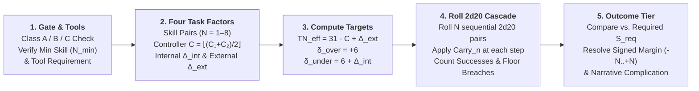

# Satya TTRPG Task Resolution & Skill Check Mechanics

Whenever a character performs an action with meaningful stakes and some degree of uncertainty that can influence the narrative or tactical situation, the Game Master (or the Satya AI Game Master via `evaluate_satya_cascade_task`) calls for a **Task Resolution** roll.

This chapter defines the step-by-step procedure for framing, gating, modifying, and resolving any non-combat or tactical skill check in **Satya**, uniting the mathematical foundation in [Probability & The Cascading Dice Mechanic](probability.md) and [Core Ruleset Reference](satya_d20_rules.md) with the skill hierarchy in [Skill System & Lifepath Architecture](skill-design.md) and attribute controllers in [Character Characteristics](character/characteristics.md).

---

## 1. The Task Resolution Pipeline

Every task in Satya is resolved through a five-step pipeline:

---

## 2. Step 1: Task Gate Classifications, Prerequisites & Tools

Before any dice are rolled, the GM determines **whether the character is qualified and equipped** to attempt the task. Every task belongs to one of three **Gate Classifications**:

| Gate Class | Who May Attempt the Task | Effective Skill ($N$) & Untrained / Default Modifier ($\Delta_{\text{ext}}$) |
| :--- | :--- | :--- |
| **Class A: Open / Talent Task** | **Anyone** (uses an innate Talent `TAL` at $N \ge 1$ or a basic Physical `PHY` action). | Roll the character's Talent level ($N \ge 1$). If attempting a basic `PHY` skill untrained (`N = 0`), roll **`N = 1` pair** with **$\Delta_{\text{ext}} = +4$**. |
| **Class B: Trained / Defaultable Task** | Characters with the required skill ($N \ge 1$), **OR** characters who possess its immediate **Parent or Sibling Skill** at $N_{\text{parent}} \ge 2$. | If trained ($N \ge 1$), roll $N$ pairs at normal $\Delta_{\text{ext}}$. If defaulting from a Parent/Sibling skill, roll **$\max(1, N_{\text{parent}} - 1)$ pairs** with an added **$\Delta_{\text{ext}} = +4$ to $+6$**. Characters with neither cannot attempt the roll. |
| **Class C: Hard-Gated Specialist Task (`[Locked]`)** | **Only** characters who possess the exact required skill at or above **$N_{\text{min}}$** AND possess **Mandatory Tools**. | **No defaulting allowed.** Without $N \ge N_{\text{min}}$ and the required tools, the character cannot meaningfully attempt the task (or automatically botches if forced under duress). |

### 2.1 Tool Dependency Tiers

Every skill and task specifies one of three tool dependencies:

1. **`[Tool: None]`**: Relies purely on the character's body, senses, voice, or mind (*Running*, *Brawling*, *Observation*, *Persuasion*, *Empathy*).
2. **`[Tool: Situational]`**: Can be attempted barehanded (`+0` baseline), while specialized gear grants an equipment bonus (`-2` to `-4` to $\Delta_{\text{ext}}$), or lacking basic protective gear in harsh conditions imposes `+2` to `+4`.
3. **`[Tool: Mandatory]`**: Requires dedicated instruments (*Lockpicking*, *Trauma Surgery*, *Network Exploitation*, *Firearms*).
   - **Standard Professional Kit**: `0` modifier to $\Delta_{\text{ext}}$.
   - **High-Precision / 2033 AI-Assisted Kit**: **`-2` to `-4` to $\Delta_{\text{ext}}$** (e.g., an AI ballistic solver scope or ultrasonic lock diagnostic probe).
   - **Improvised / Substandard Tools**: **`+4` to `+8` to $\Delta_{\text{ext}}$** (only permitted if the task is Class A/B or the character passes an engineering/tradecraft setup check).

---

## 3. Step 2: The Four Task Factors (`N`, `C`, $\Delta_{\text{int}}$, $\Delta_{\text{ext}}$)

Every task roll in Satya is parameterized by **four orthogonal factors** (`CascadeTaskParams` in `satya-engine`), each shaping a distinct property of the probability distribution:

### 3.1 Factor 1: Skill Level ($N \in [1, 8]$, Mythic Cap `10`) — Number of `2d20` Pairs
The character's **Skill Level ($N$)** determines how many sequential pairs of 20-sided dice (`2d20`) are rolled:

$$\text{List A} = (A_1, A_2, \dots, A_N), \qquad \text{List B} = (B_1, B_2, \dots, B_N)$$

| Skill Level ($N$) | Proficiency Tier | Pairs of `2d20` Rolled | Benchmark Success Rate ($C = 10, \Delta_{\text{int}} = 0, \Delta_{\text{ext}} = 0$) |
| :---: | :--- | :---: | :---: |
| **`N = 0`** | **Untrained** *(Non-Talent `PHY`/`KNO`)* | Cannot roll Class C; defaults to `N = 1` (`+4` to `+6` $\Delta_{\text{ext}}$) on Class A/B | — |
| **`N = 1`** | **Novice / Baseline Talent (`TAL`)** | `1` pair (`2d20`) | `52.50%` |
| **`N = 2`** | **Apprentice / Vocational Dabbler** | `2` pairs | `61.69%` |
| **`N = 3`** | **Competent / Journeyman (Trained Professional)** | `3` pairs | **`70.10%`** |
| **`N = 4`** | **Seasoned Specialist** | `4` pairs | `76.81%` |
| **`N = 5`** | **Veteran Expert** | `5` pairs | `82.06%` |
| **`N = 6–7`** | **Master Practitioner** | `6–7` pairs | `86.14% – 89.29%` |
| **`N = 8`** | **Grandmaster (Standard Human Cap)** | `8` pairs | **`92.37%`** |

### 3.2 Factor 2: Controlling Characteristic ($C \in [1, 20]$) — Baseline Target Shift
Most skills use a balanced composite of two Controlling Characteristics (`C1 / C2`, such as `DEX/TAC` for *Lockpicking*, `ELO/ANA` for *Persuasion*, or `DEX/SIG` for *Pistols*):

$$C = \left\lfloor \frac{C_1 + C_2}{2} \right\rfloor$$

- If a skill specifies a **Minimum Supporting Characteristic (`Min C3 >= X`)** and the character falls short by $k = X - C_3$ points, each point of shortfall imposes **`+2` to $\Delta_{\text{ext}}$** (e.g., firing *Fully Automatic Weapons* with `FOR 8` against `Min FOR >= 10` adds `+4` to $\Delta_{\text{ext}}$).

### 3.3 Factor 3: Internal Character Modifiers ($\Delta_{\text{int}} \in [-2, +10]$) — Stumble Recovery Penalty
Internal modifiers reflect the character's physiological and psychological condition (**Fatigue**, **Wound Shock**, **Pain**, **Psychological Strain**, or **Cognitive Dissonance**). Rather than penalizing the character's opening motion (Pair 1), $\Delta_{\text{int}}$ increases the **negative carry-over penalty ($\delta_{\text{under}}$)** after a missed pair:

$$\delta_{\text{under}} = 6 + \Delta_{\text{int}}, \qquad \delta_{\text{over}} = 6$$

| Character Internal State | $\Delta_{\text{int}}$ | Failure Carry Penalty ($-\delta_{\text{under}}$) | Mechanical & Narrative Meaning |
| :--- | :---: | :---: | :--- |
| **Focused / Conviction Surge** | **`-2`** | **`-4`** | Calm, rested, or surging with conviction; a stumble on Pair 1 is easy to recover from on Pair 2. |
| **Fresh (Baseline)** | **`0`** | **`-6`** | Symmetric watershed carry (`+6` on success, `-6` on failure). |
| ** distracted / Mild Strain** | **`+2`** | **`-8`** | Flustered (`1` stack of Rhetorical Strain or minor fatigue). |
| **Winded / Shaken** | **`+4`** | **`-10`** | Breathing hard or Rattled (`2` Fatigue Levels or `1` Wound Shock tier). |
| **Battered / Moderately Wounded** | **`+6`** | **`-12`** | Bleeding or in significant pain; missing Pair 1 makes recovery steep. |
| **Exhausted / Severely Wounded** | **`+8` to `+10`** | **`-14` to `-16`** | On the verge of collapse; if Pair 1 succeeds, muscle memory carries through (`+6`), but a miss almost guarantees cascade failure or a floor-breach complication. |

### 3.4 Factor 4: External Task Difficulty ($\Delta_{\text{ext}} \in [-10, +16]$) — Environmental Target Shift
External modifiers represent the objective complexity of the task, environmental hazards, lighting, range, tool quality, and opponent resistance. They directly shift the **Effective Roll-Over Target Number ($\text{TN}_{\text{eff}}$)**:

$$\text{TN}_{\text{eff}} = 31 - C + \Delta_{\text{ext}}$$

| Task Difficulty Tier | $\Delta_{\text{ext}}$ | Target $\text{TN}_{\text{eff}}$ at Average $C = 10$ | Example Situational Conditions |
| :--- | :---: | :---: | :--- |
| **Trivial / Routine** | `-8` to `-10` | `11 – 13` | Ideal lab conditions, abundant time, AI diagnostic guidance. |
| **Easy** | `-4` | `17` | Good lighting, superior tools (`-2`), cooperative subject. |
| **Standard Benchmark** | **`0`** | **`21`** *(Exact `2d20` midpoint)* | Standard professional challenge under field conditions. |
| **Challenging** | `+4` | `25` | Poor lighting, rain, rushed execution, commercial high-security hardware, or untrained Class A default. |
| **Hard** | `+8` | `29` | Pitch darkness, improvised tools, active combat stress, encrypted military-grade countermeasures. |
| **Extreme** | `+12` | `33` | Near-impossible conditions requiring both high Characteristic $C$ and multi-pair momentum. |
| **Heroic / Nearly Impossible** | `+16` | `37` | Achievable on Pair 1 only by elite specialists ($C \ge 17$), or on Pair 2+ after riding a $+\delta_{\text{over}}$ cascade. |

---

## 4. Step 3 & 4: Resolving the Sequential `2d20` Cascade

Once $N$, $\text{TN}_{\text{eff}} = 31 - C + \Delta_{\text{ext}}$, $\delta_{\text{over}} = 6$, and $\delta_{\text{under}} = 6 + \Delta_{\text{int}}$ are set, the character rolls **$N$ sequential pairs of `2d20`**:

1. **Pair 1 ($n = 1$)**:
   - Compute $Y_1 = A_1 + B_1$ (since $\text{Carry}_1 = 0$).
   - If $Y_1 \ge \text{TN}_{\text{eff}}$ *(or $> \text{TN}_{\text{eff}}$ when strict comparison is selected)*:
     - Record **`+1` Success**.
     - Set carry-over for Pair 2 to **$+\delta_{\text{over}}$ (`+6`)**.
   - If $Y_1 < \text{TN}_{\text{eff}}$:
     - Record **`0` Successes** on Pair 1.
     - Set carry-over for Pair 2 to **$-\delta_{\text{under}}$ (`-(6 + \Delta_{\text{int}})` )**.
2. **Pairs $n = 2 \dots N$**:
   - Compute the modified pair sum:
     $$Y_n = A_n + B_n + \text{Carry}_n$$
   - Compare $Y_n$ against $\text{TN}_{\text{eff}}$:
     - If $Y_n \ge \text{TN}_{\text{eff}}$: Record **`+1` Success**!
     - If $Y_n < \text{TN}_{\text{eff}}$: Record **`0` Successes** on Pair $n$.
     - If $Y_n < 2$ (dropping below the physical `2d20` minimum of snake-eyes `2` due to negative carry $-\delta_{\text{under}}$): Record **`+1` Floor Breach (`raw_botches += 1`)**.
   - Update $\text{Carry}_{n+1}$ according to the task's **Carry Mode**:
     - **`markov_step` (Standard Carry Mode — Default)**: $\text{Carry}_{n+1} = +\delta_{\text{over}}$ if Pair $n$ succeeded, or $-\delta_{\text{under}}$ if Pair $n$ failed. Carry does not stack beyond a single step, allowing a skilled practitioner who stumbles on Pair 1 to fight through $-\delta_{\text{under}}$ on Pair 2 or 3 and flip the cascade back to `+6`!
     - **`cumulative_snowball` (High-Stakes Carry Mode)**: $\text{Carry}_{n+1} = \text{Carry}_n + \delta_{\text{over}}$ on success, or $\text{Carry}_n - \delta_{\text{under}}$ on failure. Used for unforgiving high-stakes procedures (*Neurosurgery*, *EOD Disarming*, *Orbital Docking*) where early mistakes compound rapidly.
     - **`linear_margin` (Exact Margin Carry Mode)**: $\text{Carry}_{n+1} = Y_n - \text{TN}_{\text{eff}}$.

---

## 5. Step 5: Interpreting Successes, Complications & Botches

At the end of the $N$ pairs, the engine totals `total_successes` ($0 \dots N$) and checks for botches or complications:

| Outcome Tier (`OutcomeTier`) | Engine Classification (`CascadeOutcomeKind`) | Condition | Narrative & Mechanical Result |
| :--- | :--- | :--- | :--- |
| **`EXTRAORDINARY_SUCCESS`** | `Success` | `total_successes >= 3` and `raw_botches == 0` | Masterful execution: accomplishes the task faster (`-2 ticks`), silently, with bonus yield, or grants `-4` $\Delta_{\text{ext}}$ setup synergy. |
| **`SUCCESS`** | `Success` | `1 <= total_successes <= 2` (meets $S_{\text{req}}$) and `raw_botches == 0` | Clean professional execution of the task. |
| **`PARTIAL_SUCCESS`** | `SuccessWithComplication` | `total_successes >= 1` **AND** `raw_botches >= 1` ($Y_n < 2$ on a failed pair) | **Success at a Cost**: The character achieves their goal, but the floor-breach pair causes a complication (e.g., snapping a lockpick inside the cylinder after it turns, making noise that alerts a guard, or taking `+2` $\Delta_{\text{int}}$ strain). |
| **`FAILURE`** | `CleanFailure` | `total_successes == 0` and `effective_botches == 0` ($\max Y_n \ge \text{TN}_{\text{eff}} - 4$) | **Near Miss / Clean Failure**: The task does not succeed and time (`TC`) is spent, but no catastrophic mistake occurs. |
| **`CRITICAL_FAILURE`** | `BotchFailure` | `total_successes == 0` and `effective_botches >= 1` (`signed_margin < 0`) | **Botch (`-1` to `-N`)**: Something goes actively wrong—tools jam, alarms trigger, patient destabilizes, or the character exposes themselves to counterattack. |

### 5.1 Complementary Skills & Multi-Skill Synergy

1. **Complementary Knowledge-to-Physical Setup (`KNO` $\to$ `PHY`)**:
   When a character uses an analytical or academic **Knowledge (`KNO`)** skill to plan, diagnose, or calculate a physical or technical execution (e.g., *Clinical Diagnostics* before *Paramedicine*, *Basic Electronics* before *Lockpicking* an electronic strike plate, or *Trigonometry* before *Precision Rifle*), resolve the `KNO` setup roll first:
   - **`3+` Successes (`ExtraordinarySuccess`)**: Grants **`-4` to $\Delta_{\text{ext}}$** AND boosts positive carry $\delta_{\text{over}}$ from `+6` to **`+8`** on the execution roll.
   - **`1–2` Successes (`Success`)**: Grants **`-2` to $\Delta_{\text{ext}}$** on the execution roll.
   - **`0` Successes (`CleanFailure`)**: No modifier (`+0`).
   - **Botch (`CriticalFailure`)**: Flawed assessment imposes **`+4` to $\Delta_{\text{ext}}$** on the execution roll.
2. **Dual-Skill Gate**:
   When a single continuous action requires two skills simultaneously, the number of `2d20` pairs rolled is:
   $$N_{\text{eff}} = \min(N_1, N_2) + \begin{cases} 1 & \text{if } \max(N_1, N_2) \ge \min(N_1, N_2) + 2 \\ 0 & \text{otherwise} \end{cases}$$

---

## 6. Complete Worked Examples

### 6.1 Worked Example 1: Sarah's Lockpicking Task (Standard vs. Stumble-and-Recovery)

> **Scenario**: Sarah needs to pick the mechanical pin-tumbler cylinder on a heavy hardened-steel bike lock in a dimly lit alley before a security patrol rounds the corner.

1. **Character Profile & Gate Check**:
   - **Characteristics**: **Dexterity (`DEX`) = `13`** (steady hands), **Tactile (`TAC`) = `12`** (sensitive fingertips), **Focus (`FOC`) = `11`**.
   - **Skill**: **Lockpicking & Physical Security Bypass** (`PHY/KNO`, `DEX/TAC`, Minimum `DEX 10, TAC 10, FOC 9`) at **Skill Level `N = 3`** (Competent Journeyman).
   - **Gate & Tools**: Picking a mechanical pin-tumbler lock is a **Class B (Trained / Defaultable)** task with **`[Tool: Mandatory]`**. Sarah has a professional tension wrench and hook pick set (`+0` tool modifier).
2. **The Four Task Factors**:
   - **Skill Level ($N$)**: **`3` pairs of `2d20`**.
   - **Controlling Characteristic ($C$)**:
     $$C = \left\lfloor \frac{\text{DEX } 13 + \text{TAC } 12}{2} \right\rfloor = \mathbf{12}$$
   - **Internal Modifier ($\Delta_{\text{int}}$)**: Sarah is winded from sprinting two blocks (**`fatigue_level = 1` $\implies \Delta_{\text{int}} = +2$**).
     - Her positive momentum carry is $\delta_{\text{over}} = \mathbf{+6}$.
     - Her failure stumble carry is $\delta_{\text{under}} = 6 + 2 = \mathbf{8}$ (`-8` penalty after a missed pair).
   - **External Modifier ($\Delta_{\text{ext}}$)**: Standard commercial lock (`0`) in dim alley lighting (`+2`) = **$\Delta_{\text{ext}} = +2$**, requiring **$S_{\text{req}} = 1$ success** to open (`2+` successes to pop it silently in half the time).
   - **Effective Target Number ($\text{TN}_{\text{eff}}$)**:
     $$\text{TN}_{\text{eff}} = 31 - C + \Delta_{\text{ext}} = 31 - 12 + 2 = \mathbf{21}$$
3. **Rolling the `N = 3` Sequential `2d20` Cascade**:
   - **Pair 1 ($n = 1$, $\text{Carry}_1 = 0$)**:
     - Sarah rolls $A_1 = 7, B_1 = 11 \implies Y_1 = 7 + 11 + 0 = \mathbf{18}$.
     - Comparing $Y_1 = 18$ vs. $\text{TN}_{\text{eff}} = 21$: **Miss!** A stiff security spool pin catches her tension wrench.
     - Because Sarah is slightly winded ($\Delta_{\text{int}} = +2$), her stumble passes **$\text{Carry}_2 = -\delta_{\text{under}} = -8$** to Pair 2!
   - **Pair 2 ($n = 2$, $\text{Carry}_2 = -8$)**:
     - Sarah steadies her breathing and feels for the counter-rotation on the spool pin. She rolls $A_2 = 16, B_2 = 14$.
     - Modified total: $Y_2 = 16 + 14 - 8 = \mathbf{22} \ge 21$!
     - **+1 Success (`total_successes = 1`)!** Despite the `-8` stumble penalty from Pair 1, her strong roll (`30` raw) overcomes the bind and sets the spool pin!
     - Under standard `markov_step` carry, her success flips the cascade into positive momentum: **$\text{Carry}_3 = +\delta_{\text{over}} = +6$**!
   - **Pair 3 ($n = 3$, $\text{Carry}_3 = +6$)**:
     - Riding the `+6` momentum as the plug begins to turn, Sarah rolls $A_3 = 9, B_3 = 10$.
     - Modified total: $Y_3 = 9 + 10 + 6 = \mathbf{25} \ge 21$!
     - **+1 Success (`total_successes = 2`, `raw_botches = 0`)!**
4. **Final Resolution**:
   - With **`2` Total Successes** (`OutcomeTier::Success`, exceeding $S_{\text{req}} = 1$), the shackle clicks open cleanly and silently on the first try before the patrol's flashlight beam sweeps the alley!

---

### 6.2 Worked Example 2: What If a Complication Occurs? (`SuccessWithComplication`)

Suppose on **Pair 1** above, Sarah had rolled $A_1 = 4, B_1 = 5 \implies Y_1 = 9 < 21$ (Miss, $\text{Carry}_2 = -8$), and then on **Pair 2** she rolled snake-eyes/low dice $A_2 = 3, B_2 = 5$:
- Her modified Pair 2 total would be $Y_2 = 3 + 5 - 8 = \mathbf{0} < 2$!
- Because $Y_2 < 2$ drops below the physical minimum of `2d20`, Pair 2 triggers a **Floor Breach (`raw_botches = 1`)**.
- If she then rolled $A_3 = 15, B_3 = 15 \implies Y_3 = 30 - 8 = \mathbf{22} \ge 21$ on Pair 3 (`total_successes = 1`, `raw_botches = 1`), the engine returns **`CascadeOutcomeKind::SuccessWithComplication` (`OutcomeTier::PartialSuccess`)**:
  - **Narrative Result**: Sarah forces the final pin and pops the bike lock open (`1` success), **but** the Pair 2 floor breach snaps the tip of her hook pick off inside the keyway (leaving forensic evidence behind and degrading her lockpick kit until replaced)!

---

### 6.3 Quick Reference: Canonical Task Parameters Across Domains

For the full 22-row Master Task Table spanning `Athletic`, `Fieldcraft`, `Combat`, `Technical`, `Medical`, `Cyber`, `Science`, and `Social` tasks, see [Section 5.3 of `docs/ttrpg/skill-design.md`](skill-design.md#53-master-task-requirements-table-skills-prerequisites-tools--difficulty).
